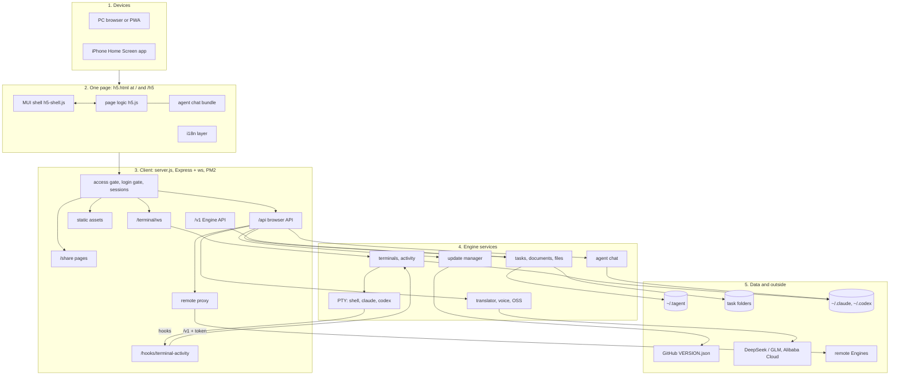
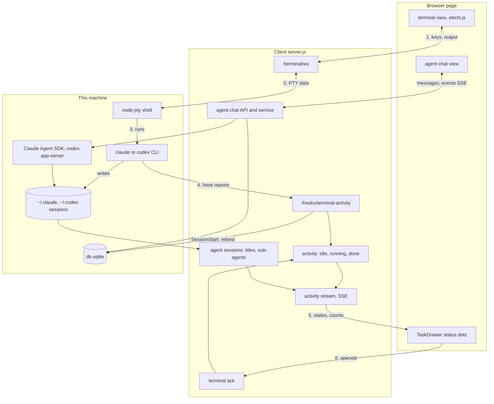
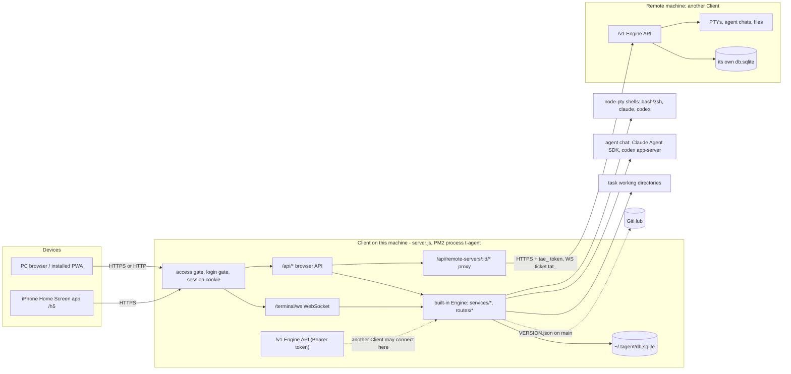

# T-Agent Design Document

> This document describes the system as it is now. The history of how it got here is in `git log` (and in the release notes of each version). "System architecture and functionality" is the map; the sections after it hold the details. Short notes of the latest releases are at the end ("Recent versions"); `scripts/release.js` appends one line there for every release.

---

## System architecture and functionality

> The map of the whole system as it is now (2.88.x: one Material UI page at `/` and `/h5`, data in `~/.tagent`; the diagrams were checked against the code on 2026-11-07). The sections after this part hold the details of each area.

Contents of this part:

- Overview diagram
- A. Purpose and users
- B. Deployment topology
- C. Server modules
- D. Data storage (and "Data directory")
- E. Data model and core concepts
- F. Client UI
- G. The page: routes, layout and input mode
- H. Cross-cutting rules

### Overview diagram

The whole project in five layers, from the device to the data. Part B shows how Clients connect to each other; the second diagram shows how a terminal and an agent chat move data.

- **Devices**: a PC browser (or the installed PWA) and the iPhone Home Screen app open the same page. There is no second page any more (the old PC page and Monaco were removed in 2.88.0).
- **Page** (`public/h5.html`): the React / MUI shell `scripts/h5-shell/*` (built to `public/js/h5-shell.js`: TaskDrawer, terminal bottom bar and on-screen keyboard, Settings, Update, Engines, Design sheet, file viewer) draws the UI; `public/js/h5.js` does the work (xterm.js terminals, warm connections, translate-and-send, voice, image upload, activity stream). They talk through the `window.H5UI` store. The agent chat bundle is `public/js/agent-chat-ui.js`; the i18n layer is `i18n.js` plus the Chinese dictionaries.
- **Client** (`server.js`, Express + `ws`, PM2 process `t-agent`): every request passes the access gate, the login gate and the SQLite session. Static files get content-hash URLs and brotli copies (`lib/static-assets.js`). The page uses `/api` and `/terminal/ws`; `/share/:token` serves read-only Markdown.
- **Engine services** live in the same process (`routes/*`, `services/*`, `lib/*`): terminals in `node-pty` with activity tracking, live directory and agent session binding (`routes/terminal.js`); agent chat through the Claude Agent SDK and `codex app-server`; tasks, groups, documents and files; the translator, voice token and OSS upload policy; the update manager.
- **Hooks**: Claude / Codex in a terminal report start, stop and `SessionStart` to `POST /hooks/terminal-activity` with the per-terminal `TA_HOOK_TOKEN`.
- **Data**: `~/.tagent` holds `db.sqlite`, `session-secret` and `server.lock` (see "Data directory"); task folders hold the user's files; `~/.claude` and `~/.codex` session files are read for names, sub-agents and resume.
- **Outside services**: GitHub `VERSION.json` on `main` for updates; DeepSeek or Zhipu GLM for translation; Alibaba Cloud OSS (images) and Fun-ASR (voice), which the browser calls directly after the Client signs the request.
- **Remote Engines**: the remote proxy `/api/remote-servers/:id/*` calls another Client's `/v1` with a `tae_` token (terminals with a one-time `tat_` ticket). Other Clients call this Client's `/v1` the same way.

- **1–2**: the terminal view sends keys over `/terminal/ws` (protocol v2, one owner per terminal); `handleWs` writes them to the PTY and sends output (and the in-memory history on reconnect) back.
- **3**: the shell runs `claude --session-id` / `--resume` or `codex` / `codex resume` for agent terminals.
- **4**: the CLI hooks post to `/hooks/terminal-activity`; activity events change the state (`idle`, `running`, `done`), and the Claude `SessionStart` hook rebinds the terminal to its new session after `/clear` (`task_terminals.agent_session_id`). Without hooks, the state comes from the foreground process and output bursts.
- **5**: `GET /api/tasks/terminal-activity/stream` (SSE) pushes the states and the running sub-agent counts, which `lib/agent-sessions.js` reads from the session log files; the TaskDrawer shows them as dots.
- **6**: opening a terminal that is `done` posts `POST /api/tasks/:id/terminal/ack`, which turns it back to `idle`.
- **Agent chat**: the chat view uses `/api/tasks/:id/agent/conversations` (REST plus an events SSE stream); `services/agent-chat.js` drives the Claude Agent SDK or `codex app-server` and stores the conversation in `agent_conversations`.
- For a remote Engine, the same calls go through `/api/remote-servers/:id/...` and the remote `/v1`.

### A. Purpose and users

T-Agent is a self-hosted, single-user web workbench for running and watching coding agents and terminals on one or more machines. One person installs a **Client** on each machine they work on. In a browser on a PC, or from the iPhone Home Screen app, they open tasks (a task is a working directory), start shells and Claude Code / Codex sessions in real PTYs, chat with Claude / Codex through the agent chat view, see which terminals are running or finished, and type into terminals with helpers (Chinese-to-English translate-and-send, voice input, image upload). Every Client also contains an **Engine**, so one Client can show and drive the tasks and terminals of other machines (see `README.md` "Project architecture", `docs/ARCHITECTURE.md`).

### B. Deployment topology

- **Client** (`server.js`): one Express + `ws` process. It serves the pages, the browser API under `/api`, the browser terminal WebSocket `/terminal/ws`, the hook endpoint `POST /hooks/terminal-activity`, the share pages `/share/:token`, and the Engine API `/v1`. The browser only ever talks to its own Client.
- **Engine**: the part that owns tasks, documents, terminals and chats. The local Engine is the same process (`routes/tasks.js`, `routes/terminal.js`, `services/*`). A remote Engine is another Client reached over `/v1` (`routes/engine-v1.js`; contract in `docs/ENGINE_API.md`). There is no standalone Engine service any more (removed in v2.28, see the v2.28.2 note).
- **Remote proxy**: `routes/remote-servers.js` mounts `/api/remote-servers/:id/...`. The Client decrypts the stored token (`lib/token-crypto.js`, key from `SESSION_SECRET`) and calls the Engine; the token never reaches the browser. JSON calls are forwarded, SSE streams are piped unbuffered (`services/remote-stream.js`), and terminals go through `services/remote-terminal-proxy.js`: the Client asks `POST /v1/terminal-sessions` for a one-time ticket (`tat_…`, 30 s) and opens `/v1/terminal-sessions/:id/stream?ticket=…`. The browser side of that is `/api/remote-servers/:id/terminal/ws`.
- **Pairing and tokens**: on the Engine, `POST /api/remote-tokens/pairing` makes a one-time pairing code `TA-XXXX-XXXX-XXXX` (10 minutes) or `POST /api/remote-tokens` an access token `tae_…` (stored as a SHA-256 hash in `engine_access_tokens`). On the Client, `POST /api/remote-servers` with the address and the code calls the Engine's rate-limited `POST /v1/pair`, gets a token, checks `GET /v1/info` and stores the token encrypted in `remote_servers.token_cipher`. Every token is admin (`services/engine-auth.js`).
- **Access mode** (`services/client-auth.js`, `lib/access-gate.js`, table `client_access_mode`): `local` = only direct loopback access, no login; `remote` = TOTP authenticator and external access; `unset` = choose on first local visit. Non-local requests in `local` / `unset` get 404.
- **Login gate** (`lib/login-gate.js`): when logged out, a GET of exactly `/`, `/web` or `/h5` redirects to the hidden login path (`CLIENT_LOGIN_PATH`, default `/torin/hide/login`) with `return_to`; everything else is a plain 404, except the login entrance, `/v1`, `/api/remote/v1`, `/health`, `/share/*` and the hook endpoint. Sessions are SQLite sessions (`db/session-store.js`) with a rolling 30-day life.
- **Process and listening**: `install.sh` starts the Client under PM2 with the name `t-agent` (launchd / systemd are still supported, `README.md` "Service management"). `config.js` defaults `HOST` to `127.0.0.1`; a fresh install writes `HOST=0.0.0.0` to `.env` unless `--access-mode local`.
- **Update flow** (`services/update-manager.js`, `lib/update-impact.js`, `routes/system.js`): the runtime version is `VERSION.json` in the install directory. `POST /api/system/check-update` reads `VERSION.json` of `main` on GitHub (`lib/version-utils.js` only allows `raw.githubusercontent.com` / `api.github.com`) and answers `available`, `current`, `local_newer` or `restart_pending` (the code on disk is newer than the running process). `POST /api/system/apply-update` does a Git fast-forward (optional force with a stash backup) or an archive update, installs and builds when needed, then exits with code 75 so PM2 (or launchd / systemd) restarts it; a frontend-only change skips the restart. `GET /api/system/update-status` gives the stage, log lines and `boot_id`, which the page uses to reload when the new process is up. Remote Engines are updated through `/api/remote-servers/:id/check-update|apply-update|update-status` (`services/remote-engine-updates.js`).

### C. Server modules

One line each for the main modules, by area. Each route file is mounted in `server.js` (browser API) and, where the feature exists remotely, has a twin in `routes/engine-v1.js` and a proxy in `routes/remote-servers.js`.

**Entry and auth**

- `server.js` — Express app, gates, page routes (`sendClientPage` names `/js`, `/css` and `/vendor` scripts and styles `?v=<content hash>`, leaves the Chinese dictionaries out for English readers and adds the login-path meta tag), static files (see "Static asset caching"), share pages, WebSocket upgrade routing.
- `lib/static-assets.js` — content-hash asset URLs, the long cache for a matching hash (`no-cache` otherwise), brotli / gzip copies of scripts and styles made once in memory.
- `config.js` — `.env` settings (port, host, access mode, login path, cookie name, session secret).
- `routes/auth.js`, `services/client-auth.js` — TOTP binding and login, access mode, recovery codes, rate limits; `services/single-user.js` builds the single local user.
- `lib/access-gate.js`, `lib/login-gate.js`, `lib/client-embedding.js` — the gates above and the frame-ancestors / cookie SameSite rules.
- `middleware/auth.js`, `middleware/client-origin.js` (same-origin proof for browser mutations), `middleware/engine-auth.js` (Bearer token scopes for `/v1`), `middleware/remote-auth.js` (old `/api/remote/v1`).

**Tasks and groups**

- `routes/tasks.js` — task CRUD, reorder, validate-path, documents (`/document/:kind`, watch SSE), to-dos, share, reveal, vscode, workspace tools, terminals, activity, sub-agents, ack, agent sessions; mounts the files API.
- `routes/task-groups.js`, `services/task-groups.js` — groups (system groups `doing` / `todo` / `done` plus user groups).
- `services/task-documents.js`, `services/engine-tasks.js`, `services/task-assets.js` — document paths (`DESIGN.md`, `README.md`, `AGENTS.md` + `CLAUDE.md` with `@AGENTS.md`), creating missing documents, relative assets.
- `services/workspace-tools.js` — import unmanaged directories under `TASKS_BASE_DIR`, clean up and restore code directories (`repo_cleanups`).

**Terminals, PTY and activity**

- `routes/terminal.js` — PTY sessions keyed by task and terminal id (`node-pty`, `lib/node-pty-runtime.js`), WebSocket `handleWs` with protocol v2 (heartbeat, flow control; client side `public/js/terminal-protocol.js`), single owner per terminal (close codes 4009 / 4010, `takeover=1`), in-memory history replay, `cleanTitle`, agent terminals (`claude --session-id` / `--resume`, `codex resume`), `subagentSnapshot`, hook token per PTY, the per-process Claude `SessionStart` hook that rebinds a terminal after `/clear` (`scripts/claude-session-hook.js`).
- `lib/terminal-activity.js` — state per terminal: `idle` → `running` → `done` (until acknowledged) → `idle`. Decided by the foreground process, by output bursts for agents and TUIs, and by Claude / Codex hooks when they report. `GET /api/tasks/terminal-activity` reads it, `GET /api/tasks/terminal-activity/stream` pushes it with the sub-agent counts (`lib/terminal-activity-stream.js`, server-sent events), `POST /api/tasks/:id/terminal/ack { terminal_id }` turns `done` into `idle`.
- `lib/terminal-snapshot.js` (headless xterm with the vendored Unicode 11 addon), `lib/terminal-history.js`, `lib/terminal-input-modes.js` (reset mouse modes on restore), `lib/terminal-locale.js`, `lib/terminal-user.js` (drop root), `lib/clipboard-shims.js` (shim folder first in PTY `PATH`, see "Clipboard (OSC 52)"), `lib/websocket-close.js`, `services/terminal-tickets.js`.

**Agent sessions and sub-agents**

- `lib/agent-sessions.js` — lists Claude (`~/.claude/projects/<dir>/*.jsonl`) and Codex (`~/.codex/sessions/**/rollout-*.jsonl`) sessions of a directory, session names, and `runningSubagents` (Claude sub-agent logs under `<session>/subagents/agent-*.jsonl`).
- `GET /api/tasks/terminal-subagents` (Engine `/v1/terminal-subagents`, proxy `/api/remote-servers/:id/terminal-subagents`) — read-only count of running sub-agents per Claude terminal; used by the phone "next running or pending session" button.

**Agent chat**

- `routes/agent-chat.js`, `services/agent-chat.js` — chat conversations of a task (`/api/tasks/:id/agent/conversations…`: create, events SSE, messages, interrupt, permissions, queue, fork, commands, models, limits) and `/api/agent-chat/summary` (top-bar counters).
- `lib/agent-chat/claude.js` (Claude Agent SDK adapter), `lib/agent-chat/codex.js` + `codex-app-server.js` (JSON-RPC to `codex app-server`), `lib/agent-chat/fork-point.js`.
- Browser bundle: `scripts/agent-chat/*` → `public/js/agent-chat-ui.js` (`npm run build:agent-chat`), host glue `public/js/agent-chat.js`. Details: "Agent chat mode (v2.72.0)".

**T-Attention** (see "T-Attention" below)

- `services/attention.js` — items, events and tokens of the central attention list (validation, status rules, `onChange` bus); `routes/attention.js` — `/api/attention` for the browser session and for `Bearer tatt_…` tokens (the Bearer handler is mounted in `server.js` before the session and the gates).

**Files API and safety**

- `routes/task-files.js`, `services/task-files.js` — `/api/tasks/:id/files` (list, create, rename, delete), `/files/content` (read, write), `/files/image` (an image, 20 MiB) and `/files/raw` (a PDF, audio or video file, streamed with Range support). Rules: paths are relative to the task root (`work_dir`, else the folder of `md_path`); absolute paths, `..`, backslashes and NUL are refused; symbolic links are never followed (`O_NOFOLLOW`, `lstat`, identity checks before and after); text at most 5 MiB of UTF-8; the root itself cannot be deleted. Engine scopes `files:read` / `files:write`.
- `services/file-content.js` — the content rules shared by the files API and the preview of any path: text is at most 5 MiB of UTF-8 without control characters (answer `{ path, content, revision, eol, bom }`), images are PNG, JPEG, GIF, WebP, SVG, BMP, ICO or AVIF by name and by content (at most 20 MiB; sniffing: PNG/JPEG/GIF/WebP signatures, `BM`, `00 00 01 00`, an `ftyp` box with the brand `avif` / `avis`, and for SVG text that starts, after an optional BOM, white space, an XML declaration, comments and a doctype, with `<svg`) with `Content-Security-Policy: sandbox`, `nosniff` and `private, no-cache` (an SVG is shown by the page only through ``, so its scripts never run); raw files (PDF, audio, video) by name and signature, see "Raw files" below.
- **Raw files** (capability `files:raw` in `/v1/info`, API version still 1): `GET <task>/files/raw?path=` (local `/api/tasks/:id/files/raw`, Engine `/v1/tasks/:id/files/raw` with scope `files:read`, proxy `/api/remote-servers/:id/tasks/:taskId/files/raw`; the task file path rules, `?terminal=` as for the other reads) and `GET /api/fs/raw?path=` / `/v1/fs/raw` / `/api/remote-servers/:id/fs/raw` (any path, as the terminal user, regular files only, as `/fs/content`). Only these names (case-insensitive): pdf `application/pdf`; mp3 `audio/mpeg`, m4a `audio/mp4`, aac `audio/aac`, wav `audio/wav`, ogg / oga / opus `audio/ogg`, flac `audio/flac`; mp4 / m4v `video/mp4`, mov `video/quicktime`, webm `video/webm`, ogv `video/ogg`. The first bytes must match: `%PDF-`; `ftyp` at offset 4 (mp4, m4v, m4a, mov); `1A 45 DF A3` (webm); `OggS`; `RIFF....WAVE`; `fLaC`; mp3 `ID3` or a frame sync `FF Ex/Fx`; aac `ID3` or ADTS `FFF1` / `FFF9`. Anything else (another name, wrong signature, an empty file) is 415 `FILE_UNSUPPORTED`; above 200 MiB 413 `FILE_TOO_LARGE`. One `Range: bytes=a-b` / `a-` / `-n` range answers 206 with `Content-Range`; a malformed or out-of-file range answers 416 `RANGE_NOT_SATISFIABLE` with `Content-Range: bytes */<size>`; another unit or several ranges are ignored (200, the whole file). `HEAD` sends the headers only. The file is streamed from an open descriptor (never buffered). Headers: the Content-Type above, `Content-Length`, `Accept-Ranges: bytes`, `X-Content-Type-Options: nosniff`, `Cache-Control: private, no-cache`, `Content-Disposition: inline`, and `Content-Security-Policy: sandbox` for audio and video. A PDF has no CSP sandbox, because Chrome does not show a sandboxed PDF in its viewer; the proxy (`streamRemote` with `raw: true` in `services/remote-stream.js`) keeps the sandbox on everything except an answer whose media type is exactly `application/pdf`, sends the `Range` header on, passes `Content-Range`, `Accept-Ranges`, `Content-Disposition` and `Cache-Control` back, and has no idle limit once the answer has started (a paused video is not cut). The proxy answers 501 `RAW_UNSUPPORTED` for an Engine whose `/v1/info` lacks `files:raw`; the local Client always has it. Tests: `test/task-files-api.test.js`, `test/fs-read.test.js`.
- `routes/fs-read.js`, `services/fs-read.js`, `scripts/fs-read-child.js` — read-only preview of a file at any path on the Engine machine; see "Preview of any path" below.

**Preview of any path** (read only; the user already has a shell on that machine)

- Endpoints: local `GET /api/fs/content?path=` and `/api/fs/image?path=` (browser session, the same gates as the other `/api` GETs); Engine `GET /v1/fs/content` and `/v1/fs/image` (scope `files:read`, capability `fs:read-any` in `/v1/info`); proxy `GET /api/remote-servers/:id/fs/content` and `/fs/image` (piped unbuffered with the Engine's status and error body; `Content-Security-Policy: sandbox` like every remote file answer; an Engine without `fs:read-any` gets 501 `FS_READ_UNSUPPORTED`). `GET /fs/raw` on the three mounts streams a PDF, audio or video file (capability `files:raw`, 501 `RAW_UNSUPPORTED` through the proxy without it; see "Raw files" above). The local Client always has it (the page treats local as supporting it). Writes, renames and deletes stay in the task files API, limited to the task root.
- Paths: an absolute path, or `~` / `~/...` (the terminal user's home on the Engine); anything else (relative, `~user`, empty, NUL, a repeated parameter) is 400 `BAD_PATH`. The path is normalized (`.`, `..`, trailing `/`); there is no root limit and symbolic links are followed. The answer names `path` (the normalized path asked for) and `realPath`.
- Files: regular files only, checked after following links: a folder is 400 `IS_DIRECTORY` with `{ path }`; FIFOs, sockets and devices (`/dev/zero`) are 400 `NOT_A_REGULAR_FILE`, and so are empty files under `/proc` and `/sys` (they are generated when read and may never end). The file is opened with `O_NONBLOCK` and checked again with `fstat` (still a regular file, same device and inode, else 409 `FILE_PATH_CHANGED`), so a read never waits for a writer. Text and image rules and answers are those of `GET <task>/files/content` and `/files/image` (413 `FILE_TOO_LARGE`, 415 `FILE_UNSUPPORTED` / `FILE_NOT_IMAGE`); 404 `NOT_FOUND`, 403 `PERMISSION_DENIED` (EACCES / EPERM); a read gives up after 10 s (504 `READ_TIMEOUT`). Errors are `{ error, message }` with an English message (Chinese in `public/js/i18n-zh-server.js`).
- Raw files at any path (`GET /fs/raw`, see "Raw files" above): the same file checks, then the signature; errors are `{ error, message }` with `This file type cannot be shown` (415) and `The file is larger than 200 MB` (413), an image above 20 MiB says `The image is larger than 20 MB`. The 10 s limit covers the checks up to the first byte; the stream itself has no time limit and is stopped when the answer closes. As a dropped terminal user the child runs `fs-read-child.js raw <path> <Range header or ''> <head|body>`: it writes one JSON line `{ realPath, size, range, head }` (`head` is the first 16 bytes in base64) or `{ error }`, then exactly the bytes of the range, streamed from its descriptor to its stdout. The parent (`spawnStreamRunner`) waits at most 10 s for that line, checks the size limit, the signature from `head` and that its own `parseRange` gives the same range, then pipes the rest through a counter that fails the stream when the child sends more or fewer bytes than the range (the answer is cut off instead of wrong); closing the answer kills the child.
- Identity: the read is done as the terminal user. When the service runs as root and drops terminals to `TERMINAL_USER` (`lib/terminal-user.js`), the Engine spawns `node scripts/fs-read-child.js <text|image> <path>` with that user's uid / gid, `HOME`, `USER` and a minimal environment (no service secrets), cwd `/`; the child does the same checks and writes one JSON line (`{ realPath, length }` or `{ error }`) and the bytes; the parent caps the output at the limit of the kind (5 MiB of text, 20 MiB of image) plus a little, kills it after 10 s, and applies the text / image rules itself. Otherwise (not root, no drop) the file is read in the service process, which is then also the terminal's user. Limits: node's spawn drops supplementary groups, so a file readable only through one of the terminal user's other groups is refused (403); the dropped user must be able to run the service's `node` and read the script (as for the Claude session hook). Regression: `test/fs-read.test.js` (the dropped path with an injected runner and with the real child under the test's own uid), `test/task-parity.test.js`.

**Input helpers**

- `routes/translate.js`, `services/translator.js` — `POST /api/translate` with DeepSeek or Zhipu GLM; up to 100,000 characters, split into pieces of at most 4,000 at line or sentence ends (`splitForTranslation`), pieces without Chinese kept as they are; each piece keeps its lines (`translatePiece`: the prompt asks for the same lines, and an answer with another line count or moved blank lines is translated again line by line, lines without Chinese kept exactly); `POST /api/translate/word`. Config is per user, encrypted in `system_state`.
- `routes/speech.js`, `services/speech.js` — voice input: the server only mints a 60-second Alibaba Cloud token (`POST /api/speech/token`); audio goes from the browser straight to Fun-ASR (`public/js/voice-input.js`).
- `routes/oss.js`, `services/oss-images.js` — image upload: `POST /api/oss/upload-policy` signs a POST policy and the browser uploads to Alibaba Cloud OSS itself (`public/js/oss-direct.js`).
- `services/attention-notify.js`, `plugins/notifiers/*` — T-Attention notifiers (Telegram message / call when an item needs the user), mounted at `/api/attention-notify`; see "T-Attention notifiers".

**Share pages**

- `GET /share/:token` and `/share/:token/file` in `server.js` — read-only Markdown of a task (`tasks.share_token`, created by `POST /api/tasks/:id/share`), only `.md` files under the folder of `md_path`.

**Machine tools** (local, and remote through `/v1` and the proxy where noted)

- PM2 and apps: `routes/pm2.js`, `services/pm2-manager.js` (status, logs, start / stop / restart / reload only), `routes/apps.js`, `services/apps-registry.js`, `services/apps-service.js`, `services/port-detector.js` (table `apps`; remote: `/v1/pm2`, `/v1/apps`).
- Tunnels: `routes/frp.js`, `services/frp.js`, `services/frp-install.js`; `routes/ssh-tunnel.js`, `services/ssh-tunnel.js` (local only).
- File sync: `routes/file-sync.js`, `services/file-sync.js`, `services/file-sync-instance.js` (master / slave, `/v1/file-sync/*`, state in `system_state.file_sync_v1`).
- Agent config: `routes/agent-config.js`, `services/agent-config.js` (default Claude / Codex settings pushed to this and remote machines, `/v1/agent-config`).
- Environment check: `routes/environment.js`, `services/environment-check.js`.
- Bookmarks (quick links): `routes/bookmarks.js`.
- Update: `routes/system.js`, `services/update-manager.js`, `services/archive-updater.js`, `lib/git-update-workspace.js`, `lib/update-command.js`, `lib/update-impact.js`, `services/remote-engine-updates.js`.
- Remote connections: `routes/remote-servers.js`, `services/remote-client.js`, `services/remote-server-settings.js`, `routes/remote-tokens.js`, `services/engine-identity.js` (stable `engine_id`), `routes/remote-api.js` (old read-only `/api/remote/v1`).

### D. Data storage

- One SQLite file per machine: `~/.tagent/db.sqlite` in the data folder of the service user (`TAGENT_HOME`, old name `T_AGENT_DATA_DIR`; `T_AGENT_DB_PATH` moves only the file), WAL, foreign keys on. Before the data folder it was `data/db.sqlite` in the install directory; see "Data directory" below for the layout, the one-time copy, the lock and the schema check.
- Schema: `db/schema.sql` (`CREATE TABLE IF NOT EXISTS`) plus additive, idempotent migrations in `db/index.js` that add missing columns on every start. There is no numbered migration runner. The database stores the schema generation it was last migrated to in `PRAGMA user_version` (= `VERSION.json` `schema_version`); a database with a higher number is refused (see "Data directory").
- Main tables and key columns:

| Table | Key columns / purpose |
| --- | --- |
| `tasks` | `id`, `title`, `status` (= group key), `priority`, `due_date`, `md_path`, `work_dir`, `technical_path`, `readme_path`, `agent_path`, `sort_order`, `user_id`, `share_token` |
| `task_groups` | `owner_id`, `group_key`, `name`, `sort_order`, `is_system` |
| `task_terminals` | `task_id`, `terminal_id`, `title`, `agent`, `agent_session_id`, `agent_started_at`, `title_custom` (1 = the person named it), `work_dir` (the directory the terminal keeps, schema 8; NULL follows the task) |
| `task_default_terminal_titles`, `task_default_terminal_removed`, `task_default_terminal_dirs` | name, removal and kept directory (schema 8) of the implicit `default` terminal |
| `agent_conversations` | `id`, `task_id`, `agent`, `session_id`, `title`, `mode`, `model`, `effort`, `opened_web`, `opened_h5`, `translate`, `collapse_keyboard`, `queue` (JSON) |
| `task_todos` | to-dos of a task |
| `remote_servers` | `owner_id`, `name`, `base_url`, `token_cipher`, `status`, `remote_version` |
| `engine_access_tokens`, `engine_pairing_codes`, `engine_identity` | Engine side of pairing (hashes only) and the instance id |
| `remote_access_tokens` | tokens of the old `/api/remote/v1` |
| `system_state` | key / value: encrypted per-user settings (`translator:<owner>`, `speech:<owner>`, OSS, `agent-config:<owner>`, `attention-notify:<owner>`, `attention-notify:telegram:<owner>`), `file_sync_v1`, update state |
| `apps`, `repo_cleanups`, `bookmarks` | app list, cleaned repo records, quick links |
| `attention_items`, `attention_events`, `attention_tokens` | T-Attention (schema 9): the central list, its history (`ON DELETE CASCADE`), its Bearer tokens (sha256 hashes only); see "T-Attention" |
| `sessions`, `client_auth`, `client_access_mode`, `client_auth_attempts`, `users` | login sessions, authenticator, access mode, rate limits, legacy accounts |

- Terminal output is not stored (dropped in v2.86.0); history lives in memory.
- `VERSION.json` fields: `app_version` (release, bumped by `scripts/release.js`), `api_version` (the `/v1` protocol; `/v1/info` also answers 1), `min_remote_api_version` / `max_remote_api_version` (the range this Client accepts from remote Engines), `schema_version` (the SQLite schema generation, now 9; the migrations in `db/index.js` still check for missing columns, and after them the number is stored in `PRAGMA user_version`; a code version whose number is lower than the stored one refuses to start, so forgetting to raise it lets an older version open newer data). Rule ("Version release rules" in part 13 below, `AGENTS.md` "Releases and pushing" point 3, `docs/HANDOFF.md`): change `api_version` and the remote range only when the `/v1` protocol changes incompatibly; raise `schema_version` whenever the SQLite schema changes (a new table or column counts), and never bump these fields mechanically with each release. History: v2.87.11 raised it from 6 to 7 for `task_terminals.title_custom`; v2.88.7 raised it from 7 to 8 for `task_terminals.work_dir` and `task_default_terminal_dirs` (terminal start directories); T-Attention raised it from 8 to 9 for the tables `attention_items`, `attention_events` and `attention_tokens` (new tables only, created by `schema.sql`; the 8 → 9 migration copies the database first like 7 → 8); earlier column additions in v2.28.2, v2.70.0, v2.77.0 and v2.78.0 did not raise it, so the number is lower than the real count of schema changes. New endpoints are added as capabilities in `/v1/info` with the API version unchanged (for example `terminal-subagents` in v2.87.10, `files/image` as `files:image` in v2.87.15, and `terminal-activity/stream` as `terminal:activity-stream`, which the page detects by its 404 on an older Engine and then polls).

### Data directory

> Added in v2.87.14 (branch `feat/data-home-tagent`). Code: `lib/data-home.js` (the only place that knows data paths), `db/index.js`, `server.js`, `config.js` (`sessionSecret` getter). Tests: `test/data-home.test.js`, `test/uninstall.test.js`.

Goal: the runtime data of a machine lives outside the install directory, so every installed version (a second checkout, a worktree, an upgrade) reads the same data and no data migration is needed between versions.

- **Root**: `~/.tagent` (`os.homedir()` of the user the service runs as). `TAGENT_HOME` overrides it; the old name `T_AGENT_DATA_DIR` is an alias (the new name wins when both are set); a leading `~/` is expanded. `T_AGENT_DB_PATH` still overrides only the SQLite file.
- **Layout** (the same as the old `<install>/data`, so an older version pointed at it with `T_AGENT_DATA_DIR` reads the same data): `db.sqlite` (+ `-wal`, `-shm`), `session-secret`, `backups/` (database backups before updates, `services/update-manager.js`), `bin/frpc` and `frpc.toml` (`routes/frp.js`), `server.lock`, `migrated-from.json`.
- **Inventory of runtime data** (what moved and what stayed):

| Data | Before | Now |
| --- | --- | --- |
| SQLite database (tasks, groups, terminals, chats, sessions, remote servers and their encrypted tokens, pairing, authenticator, access mode, translator / voice / OSS / agent-config settings, update state, file-sync state, apps, share tokens) | `<install>/data/db.sqlite` (+ WAL / SHM) | `~/.tagent/db.sqlite` |
| Session secret (encrypts tokens, settings and the authenticator) | `SESSION_SECRET` in `<install>/.env` | `~/.tagent/session-secret`, seeded once from `.env` |
| Update backups | `<install>/data/backups/` | `~/.tagent/backups/` (old ones are not copied) |
| frpc binary and config | `<install>/data/bin/`, `<install>/data/frpc.toml` | `~/.tagent/bin/`, `~/.tagent/frpc.toml` |
| Server lock, copy marker | none | `~/.tagent/server.lock`, `~/.tagent/migrated-from.json` |
| `.env` (port, host, access mode, update source, `TASKS_BASE_DIR`, `TERMINAL_USER`) | `<install>/.env` | unchanged: it describes one install, written by `install.sh` |
| Service logs | `<install>/logs/` (launchd), `~/.pm2/logs` (PM2) | unchanged |
| Task folders | `TASKS_BASE_DIR`, default `~/tasks` | unchanged (user content) |
| File-sync backups, agent-sync cache and overrides | `~/.t-agent/file-sync-backups/`, `~/.cache/t-agent-sync`, `~/.config/t-agent/overrides` | unchanged (already per user; the backup paths are stored in the database) |
| Terminal history, update log, uploads | memory only; images go from the browser to OSS; chat images to a temporary folder | unchanged |

- **One-time copy** (`migrateLegacyData`): only for the default root, and only when the root has no `db.sqlite` and `<install>/data/db.sqlite` exists. Steps: copy the old folder as it is to `<install>/data.backup-<time>` (through `…partial-<pid>`, retried when the database changed during the copy, which means a server still writes it); build `~/.tagent.partial-<time>-<pid>` from that backup without `-shm`, `wal_checkpoint(TRUNCATE)` and `quick_check` it, write `migrated-from.json` (source, backup, time, app and schema version); publish by renaming the folder, or, when the root already exists without a database, by moving the other entries and hard-linking `db.sqlite` last (fails when another process published first). Half-done folders of dead pids are removed on the next start. The old folder is never opened by SQLite or changed. `backups/` is not copied (often gigabytes). Any failure stops the start with `DATA_COPY_FAILED` and leaves no database in the root, so the next start tries again. If the root has a database with a marker, the root is used and the old folder is named in the log as ignored. `.gitignore` ignores `data.backup-*/` (and so its `…partial-<pid>` folders), so a Git install's status stays clean and a forced update's `git stash --include-untracked` never takes the database copy (`test/git-update-workspace.test.js`).
- **Empty-home trap** (the root has a database but no `migrated-from.json`, the old `db.sqlite` exists, and no live server holds `server.lock`): both databases are checked for **user data** (`userDataIn`). User data = at least one row in `tasks`, `task_todos`, `task_terminals`, `agent_conversations`, `bookmarks`, `repo_cleanups`, `remote_servers`, `engine_access_tokens`, `engine_pairing_codes`, `remote_access_tokens`, `attention_items` or `attention_tokens`; a `task_groups` row other than the defaults `personal` / `doing` / `todo` / `done`; a bound authenticator (`client_auth.secret_cipher` set); a `users.work_dir`; a `system_state` key other than `update_state`, `single_user_id` and `file_sync_v1`; or a `file_sync_v1` with a master or files. Not user data (a start writes them by itself): default groups, the single user, sessions, PM2 apps, `engine_identity`, the unbound `client_auth` row, the access mode, update and empty file-sync state. The old database is read from a temporary copy (db + WAL), never opened in place.
  - **1a** root without user data, old folder with user data: `db.sqlite`, `-wal`, `-shm` and `session-secret` of the root are moved to `<root>/empty-start-<time>/`, then the normal one-time copy runs (backup, marker). Logged.
  - **1b** both with user data: nothing is guessed; the root is used, a framed warning names both folders with their counts and says how to choose (move the root away and restart to copy the old data, or set `TAGENT_HOME`), and the environment check "Storage → Data source" warns (`dataHomeCheck()`).
  - Old folder without user data: the root is used, the old folder is logged as ignored.
  - A separate rule for "a server started from a git checkout that is not the installed location" was not added: an install is itself a git checkout anywhere on disk, so there is no reliable way to tell them apart. 1a, 1b and the lock cover the cases: a dev server while the real one runs is refused by the lock, and an empty folder it made earlier is replaced by 1a.
- **Session secret**: the stored tokens, settings and the authenticator are encrypted with it, so it must live with the data. First start: `SESSION_SECRET` from `.env`; without one, existing data keeps the old built-in default (so it stays readable) and a new root gets 32 random bytes. Afterwards the file wins and a different `.env` value is ignored with a warning.
- **Permissions**: root 0700, `db.sqlite*`, `session-secret`, `frpc.toml`, `server.lock` 0600; looser modes are fixed on start with a warning.
- **Single writer**: `server.js` takes `server.lock` before opening the database (`open(…, 'wx')` with `{pid, port, host, version, started_at, install_dir}`; the real port is written after `listen`). A live pid makes the second server exit with `T-Agent cannot start: Another T-Agent server is already using the data folder …`; a dead pid (or an unreadable file older than 5 seconds) is moved aside and taken over. The lock is removed on exit. Command-line scripts (`create-engine-token.js`, …) open the database without the lock (short writes; SQLite serialises them).
- **Schema check**: `db/index.js` reads `PRAGMA user_version` before anything else. Higher than `VERSION.json` `schema_version` → close and refuse (`DATA_SCHEMA_NEWER`, "Upgrade T-Agent to the latest version"); lower → run the migrations and store the code's number. Since schema 8, an existing database (`user_version` 1 or more) that is migrated is first copied with `VACUUM INTO` to `backups/db-schema-<old>-before-<new>-<time>.sqlite` (mode 0600) in the data folder; a failed copy is logged and the start goes on. That copy is the way back to an older app version, which refuses the migrated database. Adding `user_version` is not a table or column change, so `schema_version` stays 7. From now on, forgetting to raise `schema_version` for a schema change means older versions are not stopped from opening the newer data. Startup errors are console output only (no page is served), so they have no Chinese translation.
- **Linux root and `TERMINAL_USER`**: the root is the home of the user the service runs as (root under PM2 as root → `/root/.tagent`; the systemd unit uses `User=` → that user's home). Terminals that drop to `TERMINAL_USER` do not get `SESSION_SECRET` (`lib/terminal-user.js`) and cannot read the 0700 folder; nothing in a terminal needs it.
- **Tests and dev servers**: `paths()` throws `DATA_HOME_IN_TEST` when no override is set in a test process (`NODE_TEST_CONTEXT`, or the script is `*.test.js` / `test-*.cjs`), so no test can touch the real `~/.tagent`. Every test that opens the database sets `T_AGENT_DATA_DIR` (or `TAGENT_HOME`) to a temporary folder; `T_AGENT_LEGACY_DATA_DIR` exists only so tests can point the one-time copy at a temporary old folder. Dev servers in worktrees must set `TAGENT_HOME` too; otherwise the lock stops them while the real server runs (and, when no real server runs, they would use the real data).
- **Install and uninstall**: `install.sh` no longer creates `<install>/data` and prints the data folder; `uninstall.sh` keeps the data folder (`TAGENT_HOME` / `T_AGENT_DATA_DIR` from `.env`, else `~/.tagent`), because every install shares it, and prints where it is and how to delete it; `--purge-data` deletes it after a second confirmation (`DELETE DATA`). Test: `test/uninstall.test.js` (stub service tools, temporary home).

### E. Data model and core concepts

- **Engine**: a machine's task store and runtime. The browser picks one: local (`/api/tasks`, `tasksBase = /api/tasks`) or a remote one (`/api/remote-servers/:id/tasks`). Resources are told apart by `(engine_id, task_id)`.
- **Group**: a `task_groups` row; a task's `status` holds the group key. The system groups are `doing`, `todo`, `done`.
- **Task**: a title plus a working directory `work_dir` (any absolute path on that Engine; the default is a new folder under `TASKS_BASE_DIR`) and a design document `md_path` (default `DESIGN.md` in `work_dir`). The task root for files is `work_dir`, else the folder of `md_path`.
- **Session types of a task**:
  - plain **Terminal**: a shell in a PTY (`agent` null). Each task has the implicit `default` terminal plus rows in `task_terminals`.
  - **Start directory** (v2.88.7, schema 8): each terminal keeps the directory it was started in. A change of the task's `work_dir` only affects terminals created afterwards; existing ones keep working in their original directory. See "Terminal start directory" below.
  - **Claude / Codex Session**: a terminal whose shell types `claude --session-id <uuid>` / `claude --resume <id>` or `codex` / `codex resume <id>` (`agent` = `claude` / `codex`, `agent_session_id`).
  - **Agent chat**: an `agent_conversations` row shown in the chat view, driven by the SDK / app-server, not a PTY.
- **Terminal states**: `idle`, `running`, `done` (finished, not yet seen). Showing a terminal sends the ack (`POST …/terminal/ack`), which turns `done` into `idle`.
- **Naming precedence** (`routes/terminal.js`, `lib/agent-sessions.js`): if `title_custom` = 1 the stored `title` is always shown; otherwise an agent terminal shows its session name (Claude: last `custom-title` / `ai-title`, else the first prompt; Codex: `thread_name`), falling back to the stored `Claude N` / `Codex N`; a plain terminal shows its `title` (`Terminal N` by default). Names are cleaned by `cleanTitle` (at most 40 characters).
- **Sub-agents**: Claude Task / Agent tool calls. In a chat they are views inside the conversation (items with `parentToolUseId`); in a Claude terminal they are only counted as running from their log files (`runningSubagents`). Codex has none.

### Terminal start directory (v2.88.7, schema 8)

Before, every terminal read the task's current `work_dir`, so after a change of the working directory the existing terminals broke: session names fell back to `Claude N`, Codex binding and sub-agent counts used the new directory, the `/clear` hook was refused, a respawned Claude started an empty conversation with the old id (Codex started fresh), and file links of an old-directory shell did not open. Now (option A) each terminal remembers its own directory (`terminalWorkDir` in `routes/terminal.js`):

- Storage: `task_terminals.work_dir` is set by `createTerminal` to the task's `work_dir` of that moment. The migration adds the column and, in the same transaction, backfills existing rows with their task's current `work_dir`, so nothing changes for them. NULL (a task without `work_dir`) follows the task. The `default` terminal has no row: `task_default_terminal_dirs` gets its directory the first time its shell starts in the task directory (before that it follows the task; a plain shell has no session to lose); deleting the default terminal removes the row.
- Used everywhere a terminal needs its directory: the spawn `cwd` (also after close / restart / service restart; when the directory no longer exists the shell starts in the task's `work_dir` with a logged warning and a note in the terminal, else `$HOME` as before), `reopenCommand` (the session is looked up where the shell starts), `withAgentSessions` (session names and Codex binding, read per directory), `subagentSnapshot` (logs under the directory the live shell started in), the `/clear` SessionStart hook check (`cwd` must be the terminal's directory or the directory its live shell really started in), and `terminalCwd` (the file-link root).
- Unchanged on the task's current directory: new terminals, the list of sessions to resume (`listAgentSessions`), agent chats and the file browser.
- `GET …/terminals` rows (local, Engine `/v1` and the remote proxy) carry `work_dir`, the terminal's directory; the create answer too. Additive field, `api_version` unchanged.
- File links: the page resolves links against the terminal's `work_dir` (the task's when an older Engine sends none). When it is not the task's directory, the file sheet reads with `?terminal=<id>` (`GET …/files/content`, `…/files/image`, `…/files` listing; forwarded by the remote proxy). The file API then takes that terminal's directory as the root, with the same checks; only reads, writes always use the task root. An older Engine ignores the parameter (the old behaviour).
- UI: a session row whose directory is not the task's shows the folder name in its second line (the full path is its tooltip). The working-directory dialog shows "Existing sessions keep their directory; new sessions start in the new one." when the path is changed.
- Regression: `test/terminal-start-dir.test.js`, the schema 7 → 8 migration in `test/data-home.test.js`.

### T-Attention

Goal: less attention spent on managing agent work. Agents and services (listener plugins, the `t-attention` CLI) create and update items; the person mostly handles the ones that need them ("Needs you"). Self-contained: own tables, service and routes; it never reads or changes tasks, work directories, terminals, agent chat or terminal activity. This Client only: one central list, no `/v1` twin, no remote proxy. Code: `services/attention.js`, `services/attention-summary.js`, `routes/attention.js`, mounted in `server.js`. Tests: `test/attention-service.test.js`, `test/attention-http.test.js`, `test/attention-context.test.js`, `test/attention-summary.test.js`, the 8 → 9 migration in `test/data-home.test.js`. End to end: `test/attention-e2e.test.js` starts a real `server.js` (temporary data folder, local mode, a fake notifier plugin preloaded with `node -r test/fixtures/attention-fake-notifier.js`), makes a token through `POST /api/attention/tokens`, runs `plugins/listeners/claude/hook.js` with recorded hook JSON (UserPromptSubmit → PermissionRequest + Notification → PostToolUse → Stop → SessionEnd; `TA_ATTENTION_URL` / `TA_ATTENTION_TOKEN`), and checks the statuses, the context, the timeline, the SSE changes, that the excerpt reached the server in process but is in no stored row, stream or notification, the two notifications (waiting_user, review) with the card text, and `t-attention show ref:claude:<id>`.

**Data** (schema 9, `db/schema.sql`; times are ISO 8601 UTC text)

- `attention_items`: `title` (1..300, one line, trimmed), `notes` (plain text, at most 20000), `status` (`todo` | `working` | `waiting_user` | `review` | `done` | `failed` | `cancelled`, default `todo`), `priority` (`high` | `medium` | `low` | `none`, default `none`), `due_date` (`YYYY-MM-DD`, a real date), `source` (default `user`; a token that creates without one gets `cli`; letters, digits and `. _ : @ -`), `external_ref` (unique, at most 200, e.g. `claude:<session_id>`), `attention_reason` (at most 500), `link_url` (`http(s)` without user name or password, or a page path starting with `/` but not `//` and without `\`), `link_label` (at most 200), `meta` (a JSON object of at most 8 KiB, returned parsed), `context` (the recall card, see below), `sort_order` (a new item gets the highest + 1; a body may set an integer), `created_at`, `updated_at`, `completed_at`.
- `completed_at` is set when the status becomes `done` / `failed` / `cancelled` (also on create), cleared when it leaves them; it is not touched by other changes.
- `attention_events`: one row per change, written in the same transaction as the change: `type` `created` | `updated` | `status` (the status changed) and `from_status`, `to_status`, `actor`, `data` (the changed fields). A change that changes nothing writes no event, keeps `updated_at` and is not published (listeners may send the same state again). Deleting an item deletes its events (`ON DELETE CASCADE`), so the `deleted` event is only published on the bus, not stored.
- `context` (a JSON object of at most 32 KiB after the merge, returned parsed; the column was added within schema 9 before its release, and `db/index.js` adds it to a database of an earlier build): `goal`, `latest_prompt`, `last_reply` (text, at most 2000 each), `pending` (`{kind: permission | question | error, text ≤ 1000, tool?, command? ≤ 1000}`), `files` (at most 50 `{path, added, deleted}`), `cwd`, `branch`, `host`, `started_at`, `turn_started_at` (ISO times), `turns`, `session` (`{agent, id, resume}`), `tagent` (`{task_id, terminal_id}`), `summary` (`{text ≤ 600, at, model}`). A body `context` is a patch merged shallowly into the stored one: a key set to `null` removes it, `context: null` clears it, unknown keys are dropped. Text values are cut to their limits (they come from prompts and replies; control characters other than tab and line breaks are dropped); a wrong type, a wrong `pending.kind` or a missing required key is a 400. The event of the change stores only the names of the changed context keys (`data.context: ['last_reply', 'pending']`), never their text.
- `activity` (body field on `POST`, `PATCH`, `PUT by-ref`): `{kind: prompt | permission | question | resumed | turn_end | error | session_end | note, text ≤ 500 (cut)}` → an `attention_events` row of type `activity` with `data {kind, text}`, in the same transaction as the change. An activity without other changes leaves the item (and `updated_at`) as it is and is still published, with `event` = the activity row; a change event also carries `activity` (the row or null).
- `excerpt` (body field, text; the last 8 KiB are kept): the end of the session transcript for the AI summary. It is never stored (no column, no event, no log) and never published on the public bus or the SSE stream; only in-process subscribers of `onChangeInternal(fn)` (the summary) get it with the change, and the summary uses it for one call.
- Validation: unknown body fields are ignored; `''` or `null` clears an optional field; errors are `400 {error: 'VALIDATION_FAILED', message}`.
- Bus: `onChange(fn) -> unsubscribe` (module export for this server's database, or `createAttentionService({db}).onChange`), `fn({kind: 'created' | 'updated' | 'deleted', item, previous, event})`; `previous` is null on create and the last state on delete. A listener that throws is logged and does not stop the others. Notifiers subscribe in-process.

**HTTP API** (`/api/attention`; errors `{error: 'CODE', message: 'English text'}`, Chinese in `i18n-zh-server.js`; every answer `Cache-Control: no-store`)

- `GET /api/attention?status=a,b&q=text&limit=200&include_done=1` → `{items}`, newest first (`sort_order` DESC). Without `status`, finished items (`done` / `failed` / `cancelled`) are left out unless `include_done=1`; `q` searches title, notes and reason (`%` and `_` are literal); `limit` 1..1000, default 200. The answer also has `host` (this machine's `os.hostname()`, the value the Claude listener writes into `context.host`), so the page can tell the sessions of this machine from those of another.
- `POST /api/attention` → 201 item; 409 `{error: 'EXTERNAL_REF_EXISTS', id}` when the ref is taken (also on a `PATCH` that sets a taken ref).
- `GET /api/attention/by-ref/:ref` (URL-encoded) → `{item, events}` like `GET /api/attention/:id`; 404 `NOT_FOUND` when no item has that ref. Session or token; the CLI and listeners look an item up with it instead of listing.
- `PUT /api/attention/by-ref/:ref` (URL-encoded) → 201 created or 200 updated; the address names the item (a body `external_ref` is ignored); creating needs a title. The listener path.
- `GET /api/attention/:id` → `{item, events}` (newest first, at most 100); `PATCH /api/attention/:id` → item; `DELETE /api/attention/:id` → 204.
- `GET /api/attention/stream`: server-sent events, `retry: 3000`, then `event: change` with `{kind, item, previous, event}` per change, a comment line every 25 s. Works with the session and with a token; a token's stream ends when the token is revoked (at once through the route, otherwise at the next heartbeat).
- AI summary (session only): `GET` / `PUT /api/attention/settings/summary` (`{enabled, provider, model}` → the same plus `providers: [{id, label, hasApiKey, model}]`; never a key; enabling needs a key saved for that provider, else 409 `SUMMARY_PROVIDER_NOT_CONFIGURED`); `POST /api/attention/:id/summarize` → 202 `{started}` (false while one runs for the item; 409 `SUMMARY_DISABLED` when off). A token gets 403 on all three.
- Event `actor`: `user` for the browser; for a token the body's `source` when it sends one, else the token's name.

**AI summary** (`services/attention-summary.js`, off by default)

- Setting per user, encrypted in `system_state` (`attention-summary:<owner>`): `enabled` (false), `provider` (`deepseek` | `glm`, the translator's providers), `model` (empty: the model saved for that provider in the translator settings, else its default). The API keys are the ones saved in the translation settings (`services/translator.js` `providerConfig`, server side only), used whether or not translation itself is on; the summary stores no key.
- Trigger: the change bus (`onChangeInternal`) when an item enters `waiting_user` or `review` (created in it, or a status change into it) and the setting is on; or `POST …/:id/summarize`. The owner of a change made by a token is the single user (`ensureSingleUser`).
- Prompt: the item's title, status, reason and context (`goal`, `latest_prompt`, `last_reply`, `pending`, up to 20 `files`) as JSON, plus the request's excerpt when one was sent. The model is asked for exactly three short lines `Doing: … / Progress: … / Needs: …`; list marks are removed, at most three lines and 600 characters are kept.
- Runs in the background (the API answer never waits), at most one per item, cut after 20 s. The result is stored with a normal update (`context.summary = {text, at, model}`, actor `summary`), so the page and the notifiers get a change event. A timeout or provider error is logged (item id and reason only, no content, no key) and never changes the item.

**Tokens and security**

- Format `tatt_` + 32 random bytes base64url (48 characters). Only the sha256 hash is stored; the token is shown once, by `POST /api/attention/tokens {name}` → 201 `{id, name, token}`. `GET /api/attention/tokens` → `{tokens: [{id, name, created_at, last_used_at, revoked_at}]}`; `DELETE /api/attention/tokens/:id` → 204 (revoke; the row stays). These three are browser session only (same-origin rule for mutations); a token gets 403 `TOKEN_NOT_ALLOWED` there in any spelling (case, trailing slash, percent-encoding).
- `Authorization: Bearer tatt_…` on `/api/attention*` is handled by `bearer` in `routes/attention.js`, mounted before the JSON parser, the session, the access gate and the login gate. It answers every Bearer request to `/api/attention*` itself: valid → the T-Attention router (no cookie read or set, no same-origin check, its own 256 KiB JSON parser); anything the router does not match → JSON 404; it never passes a Bearer request on. So a token reaches the T-Attention API and nothing else: other `/api` routes, pages and static files still go through the gates (404 / login redirect when logged out), and a token is ignored there. The gates themselves are unchanged. In local-only access mode a valid token also works from a non-local address (it is an explicit credential); without one such requests still get the 404.
- Failures: a missing, malformed, wrong or revoked token → 401 `TOKEN_INVALID`. Failed attempts are counted per address (`req.ip`): 20 in 15 minutes → 429 `TOO_MANY_ATTEMPTS` with `Retry-After` (in memory, reset by a restart). A valid token is limited to 600 requests a minute (429 `RATE_LIMITED`). `last_used_at` is written on every successful use.

### F. Client UI

- **The page**: `public/h5.html` + `public/js/h5.js` (controller: tasks, sockets, viewport, keys, uploads, translation) + the React / MUI shell in `scripts/h5-shell/*` bundled to `public/js/h5-shell.js` (`npm run build:h5-shell`; `store.mjs` exposes `window.H5UI`). Served at `/` and `/h5` (the same HTML; `sendClientPage` sets the manifest link by address). Layout by width (900px), input mode by pointer media queries (part G). Details: "The page (/ and /h5)" and its "UI icons".
- Shared: `i18n*.js`, `toast.js`, `client-auth.js`, `terminal-owner.js`, `terminal-protocol.js`, `terminal-keys.js`, `terminal-ime.js`, `terminal-translate.js` (only `sanitize`; the desktop form code was removed in 2.88.1), `terminal-viewport.js`, `terminal-file-links.js`, `terminal-clipboard.js`, `voice-input.js`, `voice-overlay.js`, `word-translate.js`, `oss-direct.js`, `agent-chat*.js`, `agent-activity.js`, `markdown-view.js` (bundled into the design sheet and used by `server.js`), `sw.js`. Styles: `h5.css`, `agent-chat.css`, `markdown.css` (design sheet and share pages), `auth.css` (login).
- Manifests: `/` gets `manifest.json` (start `/`, standalone, `#121212`); `/h5` and `login.html` get `manifest-h5.json` (`start_url` `/h5`).
- Until 2.87.13 there were two pages (a PC page `public/index.html` with Monaco, and the phone page); tag `v2.87.11-two-pages` (commit `8494601`) marks the last release with two pages. The PC page was deleted in 2.88.0.

### G. The page: routes, layout and input mode

Decided by the user on 2026-11-05 and done in 2.87.12 to 2.88.1: the Material UI page is the only page, for PC and phone.

- **Routes**: `/` and `/h5` serve the same page (`h5.html`; `/h5` is kept so iPhone Home Screen apps keep working). `/web`, `/index.html` and `/h5.html` redirect to `/` and keep their query (`/web?openChat=…` → `/?openChat=…`). There is no user-agent routing. `sendClientPage` sets the manifest link by address (`/h5` → `manifest-h5.json`, `/` → `manifest.json`). Details: "One page" under "The page (/ and /h5)".
- **Layout by width**: one breakpoint, 900px (`wideQuery`, shared by `h5.js` and `scripts/h5-shell/entry.jsx`). Narrow: the phone layout (drawer task sheet, two-row bottom bar, bottom sheets). Wide: a permanent left sidebar that can be folded, and the Design document and the file preview open as a right side panel. A portrait iPad is under 900px.
- **Input mode** (separate from width, no user agent): `matchMedia('(hover: hover) and (pointer: fine)').matches && !matchMedia('(any-pointer: coarse)').matches` is `pointer`, else `touch`; kept in the store and on `<html data-input>`. Pointer mode hides the function-key row and the wheel strip, always shows the draft box as one line, hides the keyboard buttons, uses a 13px terminal font, and sends typing with nothing focused to the terminal. `TerminalClipboard` (copy on select and OSC 52, see "Copy" under "Terminal on the page") is attached in both modes. The touch-only viewport logic (`fitViewport` keyboard detection, `holdTerminalSize`, `scheduleKeyboardReset`, `settleViewport`, Screen Wake Lock) does not run in pointer mode. An iPad with a trackpad stays `touch`; the first hardware `keydown` sets `hasKeyboard`, which turns on the shortcuts.
- **Draft-box shortcuts** (the user's rule): Cmd/Ctrl+Enter = translate and send, Option/Alt+Enter = send as typed, plain Enter = new line; IME-safe (`isComposing` / keyCode 229 ignored).
- **Dropped with the PC page** (user decision, final): the editable file browser and the Monaco editor (a read-only file tree came back after 2.88.7, see "File tree" under "The page (/ and /h5)"), in-page Markdown editing, the To-do tab, the theme picker (dark MUI theme only), the multi-task page, the terminal history viewer, the environment check page, Utilities, quick links, workspace import / cleanup, batch update, the share button (the `/share/:token` pages stay), Finder / VS Code buttons, drag-sort and group create / rename / delete, priority, due date and document paths in forms, and the pages of Apps (PM2), Agent config, tunnels (frp / SSH) and File sync. Terminal file links open the read-only preview.
- **Endpoints kept for compatibility** (unused by the page, kept on the server, in `/v1` and in the remote proxy, so older pages, other Clients and scripts keep working; tunnels and file sync set to start with the Client still start): `/api/bookmarks`; `/api/tasks/workspace/*`; `PUT /api/tasks/reorder`, `POST /api/tasks/validate-path`; `/api/tasks/:id/todos*`; document `PUT` / `POST /api/tasks/:id/document/:kind`, `GET …/document/:kind/watch`, `GET …/md/watch`; `/api/tasks/:id/files*` except `GET …/files` (the file tree), `GET …/files/content` and `…/files/image` (used by the preview); `POST /api/tasks/:id/reveal`, `…/vscode`, `…/share`; `POST` / `PUT` / `DELETE /api/task-groups` and the `priority`, `due_date`, `technical_path`, `readme_path`, `agent_path` fields of `PUT /api/tasks/:id`; `/api/pm2`, `/api/apps`, `/api/frp`, `/api/ssh-tunnel`, `/api/agent-config`, `/api/file-sync`, `/api/environment`, `/api/local-ip`; `GET /api/tasks/terminal-activity` (the page falls back to it for older Engines); the `agent_conversations.opened_web` column.
- **`build:monaco`** stays in `package.json` as a no-op: an update started by a Client of 2.87.15 or older runs `npm run build:monaco` in the new code after `npm ci`, and a missing script would fail that update. `services/update-manager.js` no longer runs it. It can go once no Client older than 2.88.0 is left.
- **Open items**: an installed desktop PWA that was installed with `window-controls-overlay` may keep its old title bar until reinstalled; trackpad / keyboard iPads must be tried on a real device.

### H. Cross-cutting rules

- **Language and i18n**: code, docs and UI text are English; Chinese lives only in `public/js/i18n-zh-ui.js`, `i18n-zh-server.js`, `i18n-zh-extra.js` (keyed by the exact English text) and in fixtures; `test/i18n.test.js` enforces it. See "Interface language".
- **UI icons**: one library (Ant Design Official Icon Library, iconfont.cn collection 9402), inline SVG in `scripts/h5-shell/Icons.jsx`; self-drawn icons (`DRAWN`) or text labels where no library icon is clear; every icon-only button has an English `aria-label` and `title`. See `AGENTS.md` "UI icons" and "UI icons" under "The page (/ and /h5)".
- **Security**: the browser never gets an Engine token; tokens and secrets are stored hashed or encrypted and never written to logs; same-origin checks on browser mutations and WebSocket upgrades; the files API rules in C; the preview of any path ("Preview of any path" in C) is read only and reads as the terminal user (a child process with its uid / gid when the service drops root), regular files only; untrusted Markdown (the design document sheet) shows raw HTML as text and keeps only `http(s)` / `mailto` links and `http(s)` / `data:image` images; shared Markdown stays inside the folder of `md_path`; remote file responses carry `Content-Security-Policy: sandbox`; OSC 52 never writes the clipboard silently: only right after the user's own (trusted) gesture on that terminal, otherwise after a one-line preview in the copy bar and a tap on Copy; the previewed text cannot be replaced by later output, and decode limits, replay, hidden terminals and read queries are refused (see "Copy" under "Terminal on the page"); terminal output is not stored; the clipboard shims in terminal PATH (see "Clipboard (OSC 52)" under "Terminals") only send copies to the browser through OSC 52 and never read the browser clipboard, and a dropped terminal user gets them only when it can read and run them.
- **Releases**: batch requirements until the user says all are submitted, then one full `npm test`, `node scripts/release.js`, commit, normal push to `origin/main`. See `AGENTS.md` "Requirement batches" and "Releases and pushing".
- **Testing**: unit tests in `test/` (`npm run test:quick` while developing), real-Chromium scripts `scripts/test-*-browser.cjs` for UI, full `npm test` once before a release; bundles (`build:h5-shell`, `build:agent-chat`, `build:markdown`) are rebuilt when their sources change.
- **HTTP login sessions**: remote access needs HTTPS for the login cookie by default; only `CLIENT_ALLOW_HTTP=true` lets a plain-HTTP (intranet) request keep a session, and HTTPS requests always get a Secure cookie. It changes nothing else (authenticator, same-origin check, task permissions, WebSocket authentication) and never trusts a request by its IP.

## Terminals

- **Lifecycle**: a PTY (`node-pty`) is created at the first connection of a terminal and is not destroyed when the WebSocket closes; it ends when the service restarts or the terminal is closed, restarted or deleted. The shell starts in the terminal's own start directory (the task's `work_dir` when the terminal was created; see "Terminal start directory" in part E). Output history lives only in memory (5 MB per terminal) and is replayed on connect; nothing is stored in SQLite (the old `terminal_logs` table and `task_terminals.buffer` are dropped by a migration in `db/index.js`), so after a service restart a terminal opens empty with a new shell. A new shell of an agent terminal types its resume command (see "Agent terminals" below).
- **Protocol v2** (`public/js/terminal-protocol.js`): the client adds `proto=2` to the WebSocket URL. Control messages (history snapshot, history pages, resize, ping / pong) are binary frames holding JSON and every text frame is plain data, so program output or pasted text that looks like a control message is never taken as one. Without `proto=2` the server keeps the old text behaviour; the remote proxy forwards `proto`. Heartbeat: the client sends `ping` every 15 s and when the page becomes visible again; no frame for 40 s (or no answer 5 s after resume) closes the socket locally and goes through the normal reconnect; the server pings at protocol level every 30 s and terminates a socket without pong. Input typed during the snapshot replay is queued (4 KB) and sent when the replay ends (latched modifiers are kept until then).
- **Reconnect** (`open` / `closed` in `public/js/h5.js`): an unexpected close reconnects with a backoff of 1 s doubling to 30 s ("Connection lost, reconnecting in N s"), and at once when the page becomes visible again. Close codes 1000 / 1008 are not retried ("Tap the terminal tab to reconnect"); 4009 / 4010 are the single-owner codes below.
- Single-owner terminals (`routes/terminal.js` `handleWs`, `public/js/terminal-owner.js`): every device lists and creates the same terminals (`GET/POST …/tasks/:id/terminals`; the old `surface` parameter is ignored, and `h5-…` shells from v2.65–v2.81 are no longer listed). A terminal has one attached WebSocket. A second client from another browser tab or device is refused with close code `4009` (`terminal in use`) and gets no output and cannot type; the page shows "This terminal is in use on another device" over the terminal with a "Use this terminal here" button, which reconnects with `takeover=1`. A takeover closes the previous owner with `4010`; that page shows "This terminal is now used by another device" and the same button, and does not auto-reconnect. Neither code is retried automatically. Each browser tab sends a `clientId` (kept in `sessionStorage`, so a reload keeps it); the same `clientId` always replaces its own old socket, so a refresh or a reconnect after a dropped network never shows the prompt. The PTY is shared, so a takeover keeps the shell and its running program; the new owner's resize applies. Remote engines: the Client proxy forwards `clientId` and `takeover` to the Engine stream, so the rule is enforced where the PTY lives; an older Engine still replaces the old connection without a prompt.

### Bounded terminal restore and on-demand history

The terminal service maintains a headless xterm state synchronized with the PTY output / size, and uses a serialized snapshot to restore the current screen, modes and the latest 500 lines of scrollback. On connect the entire retained buffer is no longer sent to the browser; the snapshot restore and the live output are delivered in order, so no data is lost or duplicated during asynchronous parsing. The retention limit of the in-memory raw log is unchanged. The headless xterm and the serialize addon are pinned to compatible versions; for the full-screen modes and cursor state the addon does not cover, restore sequences are added and verified with a real parser. The history is kept in memory only (5 MB); after a server restart a terminal starts empty, so nothing is rebuilt from disk. Control context that was already discarded because it exceeded the retention limit cannot be restored.

The initial WebSocket `history` frame keeps the `data` field and carries the snapshot size and optional `archive` metadata. The archive is pinned to the log snapshot of this connection, and a plain-text page of at most 500 lines and 128 KiB is returned only when the browser explicitly requests `history-page`. The request is bound to the connection, the archive ID and a cursor, and inherits the terminal authentication; control frames must never fall into the PTY input. An old Client can still restore the initial data, and a new Client does not request paging from an old Engine without archive metadata.

**Flow control and history retention**: the PTY is paused when the browser socket (`bufferedAmount`) plus the unparsed headless-xterm queue exceed 1 MiB and resumed below 256 KiB (polled every 20 ms; a closed socket stops counting, so the PTY is never left paused). Consecutive live chunks that wait for the parser are merged into batches of at most 256 KiB, so the live WebSocket messages are ordered byte runs, not one message per PTY chunk. The access check (session and task owner) runs at most once per second per socket; a revoked access closes the socket within about a second. The retained history is a chunk list trimmed in whole chunks and cut to exactly 5 MB when read; it is never written to SQLite (the earlier periodic and on-exit writes were removed together with the `terminal_logs` table). One escape-sequence scanner (`ControlScanner` in `lib/terminal-snapshot.js`, CAN/SUB aware) serves both the live parser tracker and the history archive.

The Client shares one history controller, keeping the input / OSC52 suppression and the scroll-position handling during replay; earlier logs are shown in a separate read-only window, inserted through text nodes, without replaying ANSI control sequences. Paging does not block the live main terminal, and pending requests are cleaned up when switching tasks, on disconnect and when releasing an instance, so history cannot mix into another terminal. This extension is backward compatible and changes neither the database nor the Engine API major version.

### Chinese selection alignment in the terminal

The `.xterm` container shared by local and remote terminals disables Chinese punctuation compression and the automatic spacing between Chinese and Western text, so the hidden character-width measurement and the visible text follow the same fixed column width. This avoids Chrome's contextual punctuation compression affecting the xterm DOM renderer and causing text after Chinese punctuation and the mouse selection to drift cumulatively. The browser regression covers Chinese, punctuation and English mixed, plus the normal / alternate screen and different pixel densities.

### Agent terminals

- Terminal icons and names: each phone terminal row starts with a type icon (`>_` shell, `✳` Claude, `◎` Codex). `task_terminals` has `agent`, `agent_session_id` and `agent_started_at` (additive columns). A new Claude terminal runs `claude --session-id <uuid>`, so its session is known from the start; a new Codex terminal is bound on listing to the oldest unclaimed session of the task directory that started after it. `GET …/terminals` returns `agent` and, for agent terminals, the current session name (Claude: last `custom-title` / `ai-title` in the session file, else the first prompt; Codex: `thread_name` in `~/.codex/session_index.jsonl`), falling back to the stored `Claude N` / `Codex N`. The page refreshes the names every 8 s while the task sheet is open; a rename sets `title_custom` (below). Whenever a new shell is spawned for an agent terminal (Reopen after close, Restart in the working directory, service restart) it types `claude --resume <id>` / `codex resume <id>` for the bound session; a Claude session that has no file yet is started again with `--session-id`, and an unbound Codex terminal starts a plain `codex`.
- Name precedence: `task_terminals.title_custom` (additive column) is set to 1 when the person names a terminal, at creation or by a rename (`PATCH …/terminals/:id`). Such a terminal always shows its stored name; the Claude session's `custom-title` / `ai-title` / first prompt and the Codex `thread_name` are no longer used for it. Agent terminals without `title_custom` follow the session name as below. Terminals renamed before this column existed have no flag and keep following the session.
- Claude terminals follow their current session (`scripts/claude-session-hook.js`, `withSessionHook` / `bindReportedSession` in `routes/terminal.js`). `/clear` (and `/resume <other>`, a fork) makes Claude run a new session id, while the terminal stayed bound to its first one: a new shell then resumed the old conversation, and the name, the sub-agent count and the cycle button followed the old session. Now:
  - Mechanism: Claude Code hooks, given per process. The PTY environment gets `TA_CLAUDE_SETTINGS`, a JSON string that only adds one `SessionStart` hook, and every command typed for a Claude terminal (`--session-id`, `--resume`, a resume from the session list) ends with `--settings "$TA_CLAUDE_SETTINGS"` (the shell expands it, so the screen shows a short command). `--settings` hooks are added to the person's own hooks, not put in their place (checked with Claude Code 2.1.318: the user-level `SessionEnd` hook still fired), and `~/.claude` is not changed. `SessionStart` fires on `startup`, `resume`, `clear`, `compact` and `fork` with `session_id` and `cwd` on stdin; after `/clear` it carries the new id (checked with the real binary).
  - The hook runs `<node of the service> scripts/claude-session-hook.js >/dev/null 2>&1 || true`: it posts `{ session_id, source, cwd }` to `POST /hooks/terminal-activity?task=&terminal=&event=session` with the existing per-terminal `X-TA-Token` (HMAC of task + terminal, from `TA_HOOK_TOKEN` in the environment; never on a command line). It prints nothing (a `SessionStart` hook's output would become Claude context), gives up after 2 s and always exits 0. Without `TA_HOOK_URL` / `TA_HOOK_TOKEN` it does nothing.
  - Server: the endpoint stays local-only and outside session auth, as for the activity events (it is not part of the Engine `/v1` API, so no capability). It takes the report only with the right token for that task and terminal (403 otherwise), only for a Claude terminal of that task (404), only for an id that matches `SESSION_ID` and only when `cwd` is the directory the terminal's shell starts in (the terminal's own directory, since v2.88.7 also the directory its live shell really started in; else the home directory; compared as real paths) (400). Then `task_terminals.agent_session_id` is set to the reported id and the activity stream is told. No schema change. `reopenCommand`, the session name and `subagentSnapshot` read that column, so they follow; a cleared session that has no message yet has no file, so a new shell starts that id again with `--session-id`.
  - Older terminals: a Claude terminal whose shell was started before this version has no hook in its running Claude, so it keeps the old behaviour until its shell is started again (close and reopen, restart, service restart); the next shell types the new command. Without a hook endpoint (it is set when the server listens) the commands stay as before.
  - Remote Engines run the same server code, so their Claude terminals report to their own `/hooks/terminal-activity` on `127.0.0.1`; nothing goes through the Client. An Engine that runs an older version keeps the old behaviour.
  - Limits: when the service runs as root and drops to `TERMINAL_USER`, the hook needs that user to be able to run the service's `node` and read the script; if not, it fails silently and the binding stays as before. Codex `/new` has the same problem, but Codex has no reliable per-terminal signal (its interactive hooks did not fire, see `docs/HANDOFF.md`, and its binding is the heuristic in `withAgentSessions`), so Codex terminals are unchanged. Regression: `test/terminal-claude-session-hook.test.js`.

### Terminal activity push

- Terminal activity push (`lib/terminal-activity-stream.js`, `routes/terminal.js` `serveActivityStream`, `h5.js` `connectFeed`):
  - Endpoints: `GET /api/tasks/terminal-activity/stream` (login gate and session like the other `/api/tasks` routes), Engine `GET /v1/terminal-activity/stream` (Bearer token, scope `terminal:execute`, as `/v1/terminal-activity`; capability `terminal:activity-stream` in `/v1/info`), proxy `GET /api/remote-servers/:id/terminal-activity/stream` (piped unbuffered by `services/remote-stream.js`; the Engine token stays on the Client). The polling endpoints stay.
  - Messages: `retry: 5000`, then `event: activity` with `data: { activity, subagents }` (the same objects as `terminal-activity` and `terminal-subagents`, only the owner's tasks) on connect and whenever that stream's snapshot changes; whole snapshots, not diffs, so a lost message cannot leave a page wrong. A `: ping` comment every 20 s keeps proxies from closing it.
  - Triggers: every tracker state change (`createActivityTracker`'s `onChange`: running, done, idle, an ack included) and the end of a terminal session (exit, close, restart, delete) call `notify()`; changes within 100 ms go out as one message. Sub-agents have no event (they are log files), so one shared timer reads the counts of all live Claude terminals (`subagentSnapshot(null)`) every 5 s, only while at least one stream is open, the same for any number of tabs or devices; streams are written only when their part changed.
  - Page: reads the stream with `fetch` (not `EventSource`) so it sees the status. 404 / 405 / 501 (an older Engine, also through the proxy) or a 200 that is not an event stream means no stream: it polls `terminal-activity` and `terminal-subagents` every 30 s instead (feature detection, not a version check). Other failures and a stream that ends reconnect with a backoff from 1 s doubling to 30 s, polling every 30 s meanwhile; no data for 50 s counts as a dead stream. Hidden page: the stream is closed and opened again with a fresh snapshot when the page is shown (nothing hidden needs it; phones drop background connections anyway). Another Engine: the stream is reopened for it. Each tab has its own stream.
  - Requests while a terminal is shown: before, 20 per minute (3 s ack poll), plus 2 per cycle tap; now one open stream and no polling (a cycle tap still reads the terminal lists of other tasks), or 4 per minute (2 every 30 s) against an Engine without the stream.

### Terminal file links

File paths in terminal output are links that open the file in the task's file browser. Detection is one shared module, `public/js/terminal-file-links.js` (`findFileLinks`, `toRelative`, `attach`; unit test `test/terminal-file-links.test.js`), registered on each xterm with `registerLinkProvider` next to the OSC 8 `linkHandler`.

- Detected: `src/app.js`, `./docs/a.md`, `../x/y.ts`, `/abs/path/file.ts`, `lib/` (a folder), a bare name only with a known text extension (`README.md`), `file:line`, `file:line:col`, `file:line-line`, `#L12`, `@src/app.js` mentions, `file:///abs/path` (and `file://localhost/`), and paths inside `( ) [ ] { } < >`, quotes and backticks (Claude Code `Read(src/x.js)`, Markdown `[x](path)`). Trailing `. : ! ?` and CJK punctuation are dropped. A path holds spaces only inside quotes. Chinese file names work; wide cells are mapped through the xterm buffer, and wrapped lines are joined.
- Paths over several rows: a line the terminal wraps (xterm `isWrapped`) is searched as one line, so a long path is one link from its first to its last row. Programs that wrap text themselves (Claude Code and other TUIs) write a real newline and an indent instead (`  ⎿  /a/very/long/pa` + `     th/plan.md`); `logicalLine` joins such a row with the next one (indent and trailing blanks left out, the link range then spans the rows, the indent included) only when (1) the row's text reaches the last column of the terminal (`term.cols`; one free column allowed for a padded box, `HARD_WRAP_SLACK`), (2) the next row starts, after an indent of less than half the width, with a word right after it, and (3) `continuesPath(tail, head)` agrees: the piece at the edge holds a `/`, the joined text is a path, and it adds only a position (`a.js` + `:42`), extends a known extension (`plan.m` + `d`), or, when the piece has no known extension, ends in a folder, goes on with a `/` or gets a known extension. Word-wrapped text fills rows the same way, so `/a/plan.md` + `next` and `/a/b` + `for` stay apart; a path broken inside a folder name without a `/` after it (`/a/scrat` + `chpad`) or a whole path followed by a word with an extension or a `/` is not joined (limits). Checked against Claude Code 2.1 output in a headless xterm: tool output (`⎿` and a 5-space indent, rows filled to the last column), the input box and dialogs (one free column).
- Not links: `http(s)://` and other URLs (left to the web links addon), `~/...` (except with any-path read, below), host-like first parts (`github.com/o/r`), numbers and dates (`2026/11/05`, `1/2`, `v2.87.10`), anything with a remaining `:` or a backslash.
- Root (any-path read, after 2.88.9): the file sheet opens files at any path of the Engine machine when the Engine has the any-path read (`GET /fs/content`, `/fs/image`, read only, as the terminal user, regular files only; the local Client always, a remote Engine when its `/v1/info` `capabilities` contain `fs:read-any`; the page keeps that list on the source object each time it reads `/info` (`readInfo` in `h5.js`: the session menu, the chat list, and once when a terminal of a remote Engine is attached)). The option `anyPath` of `TerminalFileLinks.attach` (a boolean or a function, here `readsAnyPath(s.source)`) then makes paths outside the root links too: absolute paths elsewhere (Claude Code's scratchpad `/private/tmp/claude-<uid>/...`), `~/...` (`~`, `~/` and `~user/...` stay plain text), relative paths that go above the root, and relative paths from a live directory outside the root (an OSC 7 report or the server's `…/cwd` answer with `relative: null`). `locatePath` / `link.locate()` give `{ relative }` (inside the root: the task file API, unchanged, with `?terminal=`) or `{ absolute }` (folded `.`/`..`; a `..` above `~` is left to the Engine), read with `GET {fs}/content?path=` (local `/api/fs`, remote `/api/remote-servers/:id/fs`; `openAnyFile` in `h5.js`). The sheet's title is the file name and its second line (and tooltip) the Engine's normalized `path` (so `~/x.md` shows where it is); relative Markdown images resolve against the file's folder through `{fs}/image`. The any-path codes have their own notes (`FS_ERRORS` in `Design.jsx`): `IS_DIRECTORY` a folder note, `NOT_FOUND` "Not found: <path>", `PERMISSION_DENIED`, `NOT_A_REGULAR_FILE`, `FILE_TOO_LARGE`, `FILE_UNSUPPORTED`, `FILE_PATH_CHANGED`, `READ_TIMEOUT`, `BAD_PATH`, anything else "Could not open the file". The proxy's `501 FS_READ_UNSUPPORTED` (the remote Engine lacks it after all) closes the sheet with the old "Outside the working directory: <path>" note and drops the capability, so its outside paths stop being links. Every other rule of detection is unchanged; the file tree stays the task root.
- Root (older Engines without `fs:read-any`, and `attach` without `anyPath`): the limit is the task working directory (`work_dir`, else the folder of `md_path`: the same root the server's `taskRoot` uses). A path outside the root (absolute elsewhere, or `..` past it) is not a link at all: no underline and no request, because the file sheet could not show it. This includes Claude Code's scratchpad (`/private/tmp/claude-<uid>/...`), which is outside every task root. Absolute paths need a known root; the server checks everything again (relative only, no symbolic links, 5 MiB).
- Live directory: relative paths are taken from the shell's current directory, so after `cd sub` a printed `a.md` opens `sub/a.md`. In order: (1) the directory the shell reports with OSC 7 (`ESC ] 7 ; file://host/path BEL|ST`), read in the browser with `term.parser.registerOscHandler(7)` (`parseOsc7`: percent escapes decoded as UTF-8, trailing slash and `.`/`..` parts folded, control characters refused). The host is not checked: the PTY runs on the Engine machine, so the shell names that machine (`$HOST`, `localhost` or nothing) and the browser does not know its name; the path is taken as an Engine path and still limited to the root. (2) Else, only when a link is activated, the server reads the shell's directory: `GET …/terminals/:terminalId/cwd` (local `/api/tasks/:id`, Engine `/v1/tasks/:id` with `terminal:execute`, and the remote proxy; read-only, `lib/terminal-cwd.js`: `/proc/<pid>/cwd` on Linux, `lsof -a -d cwd -p <pid> -Fn` on macOS) answers `{ cwd, relative }`, where `relative` is the directory inside the root compared as real paths (a symbolic link out of the root is outside, `null`). Only the shell process is asked, not its foreground child: Claude Code and other programs print paths relative to the directory they were started in, which is the shell's. (3) Else (no shell running, an older Engine without the endpoint, a failed request) the work dir, as before. With a reported directory outside the root, relative paths are no links; with a server directory outside the root the tap opens nothing and says "Outside the working directory: <path>" (an Engine with `fs:read-any` opens the file from that directory instead). The app does not inject shell integration (it starts `/bin/zsh`, `/bin/bash` or `/bin/sh` with no rc wrapper and does not touch dotfiles). OSC 7 comes out of the box from oh-my-zsh (`termsupport.zsh`, since the PTY has `TERM=xterm-256color`; not inside SSH sessions) and from macOS `/etc/zshrc_Apple_Terminal` / `/etc/bashrc_Apple_Terminal` when the service inherited `TERM_PROGRAM=Apple_Terminal`; plain bash or zsh need a `precmd` / `PROMPT_COMMAND` hook, and the server fallback covers them. The reported directory is forgotten when the screen is restored (reconnect, new shell); the shell reports again at its next prompt. Limits: a line is resolved against the directory current when the link is hovered, not when it was printed; a reported directory is compared as text, so a work dir reached through a symbolic link (`/tmp/x` while the shell reports `/private/tmp/x`) hides relative links until the shell is in a path written like the work dir; a program that prints an OSC 7 for another machine (an SSH session with its own hook) is taken as an Engine path.
- Nothing is requested while text is printed or hovered. Only on activation the existing task file API (or, outside the root, the any-path read) is asked (local `/api/tasks/:id/files`, Engine and remote proxy through the same `tasksBase`/`taskUrl`).
- Opening: on a computer a click opens the file in the right side panel (`scripts/test-terminal-file-links-browser.cjs`); on a touch screen a tap on a link opens the file in the design document sheet (`openFileSheet` in `h5.js`, `DesignSheet` in `scripts/h5-shell/Design.jsx`): the title is the file name, Markdown is rendered as for DESIGN.md, other files are shown by their kind (see "Viewers by file kind" in "Design sheet and file viewer": highlighted code with line numbers, JSON, CSV, HTML, images, PDF, audio, video), the named line marked and scrolled to the middle. A folder or a missing file shows a note in the sheet. Regression for the any-path read: `test/terminal-file-links.test.js` (anyPath cases), `scripts/test-h5-file-links-browser.cjs` (local, a remote Engine with and without `fs:read-any`, every error note, `/fs/image`; the endpoints mocked) and `scripts/test-terminal-file-links-browser.cjs` (a fake `/api/fs/content` on the real local routes). The tap waits the double-tap time (400 ms) first, so a double or triple tap on a path still selects and copies; a long press or the open copy view open nothing. Opening blurs the focused input (the keyboard closes) and the terminal keeps its size, so no resize reaches the PTY. Regression: `scripts/test-h5-file-links-browser.cjs`.

### Clipboard (OSC 52)

Programs in a terminal run on the server, so `cmd | pbcopy`, Neovim's `"+` register or Claude Code's copy used to fill the server's clipboard. Copies now reach the browser clipboard as OSC 52; the page side (copy at once after a gesture, else the copy bar; 64 KiB decode limit) is "Copy" under "Terminal on the page".

- Shims (`scripts/clipboard-shims/`: `pbcopy`, `xclip`, `xsel`, `wl-copy` and the `codex` wrapper below, POSIX sh, git mode 100755, shared code in `osc52-lib.sh`): `routes/terminal.js` puts the folder first in `PATH` of every PTY it spawns (local and Engine terminals use the same spawn; the other `PATH` entries stay) and sets `TA_CLIPBOARD_OSC52=1` (`lib/clipboard-shims.js` `clipboardShimEnv`). Without the marker a shim only runs the real command, so a copy of the folder outside a T-Agent terminal does nothing special.
- Copy: the shim reads stdin (or the file arguments of `xclip`, the text arguments of `wl-copy`), then writes `ESC ] 52 ; c ; <base64> BEL` to `/dev/tty` (never stdout; no controlling terminal: skipped silently). Over 64 KiB (65536 bytes): a one-line note on stderr, no OSC 52, exit 1. Empty input sends nothing. Inside tmux (`$TMUX` and `tmux` found): `tmux load-buffer -w -`, which tmux forwards as OSC 52 when `set-clipboard` is `on` or `external` (the default); when that fails or `set-clipboard` is `off`, the DCS passthrough `ESC P tmux; ESC ESC ] 52 ; c ; … BEL ESC \` (needs `allow-passthrough on` in tmux 3.3+). Inside GNU screen (`$STY`): DCS chunks of 512 characters.
- The real command found later in `PATH` still runs with the same arguments and data, so the server clipboard keeps working; its failure is ignored. The search skips the shim folder and every file whose second line is `# TA-CLIPBOARD-SHIM`, so two copies of the folder never call each other. `xclip` / `xsel` run only when `DISPLAY` is set and `wl-copy` only when `WAYLAND_DISPLAY` is set (no error noise on a headless server); `xclip -filter` echoes the input itself when no real `xclip` runs. No real command: the copy still goes to the browser, exit 0.
- Conservative parsing: only clear copy calls go to the browser. `pbcopy` with no arguments or `-pboard general`; `xclip` without `-o` for the clipboard or primary selection with a text target (`-rmlastnl` honoured); `xsel` with `-i` / `--input`, or data piped in, and no output / append / follow / clear / delete / keep / exchange / secondary flag; `wl-copy` without `--clear` and with a text `--type` (`-n` honoured). Paste and output modes (`xclip -o`, `xsel -o`), non-text targets (`-t image/png`), the secondary selection and unknown flags go to the real command untouched (`exec`, stdin unchanged); `pbpaste` and `wl-paste` are not shimmed. Both selections go to the browser's one clipboard.
- Dropped terminal user (root service, `TERMINAL_USER`): the shims are used only when that user can enter every parent folder and read / run the files (permission bits); else the folder is left out and one line is logged. Before each spawn the executable bits are put back if an update or a `core.fileMode=false` checkout lost them (`ensureShimModes`); git, `tar` and `fs.cpSync` in `services/archive-updater.js` keep them anyway.
- Neovim picks `pbcopy` (macOS, with `pbpaste`), `wl-copy` (with `WAYLAND_DISPLAY`) or `xsel` / `xclip` (with `DISPLAY`) from `PATH`, so it goes through the shims where it uses one of them; a headless Linux server without `DISPLAY` makes Neovim skip `xclip` / `xsel` (Neovim 0.10+ may then use its own OSC 52 provider). Claude Code calls `pbcopy` / `xclip` / `wl-copy`, so its copies are covered.
- Codex (checked on 0.166, source tag `rust-v0.166.0`, `tui/src/clipboard_copy.rs`): `/copy`, Ctrl+O and selection copies always use the native clipboard (arboard) and also send one OSC 52 to `/dev/tty` (tmux: `load-buffer -w`) when `HERDR_ENV=1`, in tmux, or when `SSH_TTY` / `SSH_CONNECTION` is set. There is no config key or flag for it.
  - Main path: `clipboardShimEnv` sets `HERDR_ENV=1` (the marker of the Herdr multiplexer) in every terminal, together with `TA_CLIPBOARD_OSC52=1`, unless the inherited environment already has a `HERDR_ENV` (a real Herdr keeps its value). It does not depend on the shim folder or the `PATH` order, so it is also set when the folder is skipped for a dropped user. In 0.166 `HERDR_ENV` is read only by that copy decision (no other use in the repository, one string in the binary). Risk: it is an undocumented marker of another tool; re-check `clipboard_copy.rs` when Codex is upgraded.
  - Second path: the `codex` wrapper in the shim folder. When `TA_CLIPBOARD_OSC52=1`, stdin is a terminal, `SSH_TTY`, `SSH_CONNECTION` and `TMUX` are unset, it sets `SSH_TTY` to the output of `tty` and `exec`s the real `codex` found later in `PATH` (same search as the other shims) with all arguments and stdin; otherwise it only `exec`s. It covers a Codex that stops reading `HERDR_ENV`, but only when the wrapper comes first in `PATH`. Agent terminals type `codex` / `codex resume <id>`; `codex exec` / `codex app-server` with piped stdin get no `SSH_TTY`. With both, Codex still sends one OSC 52 per copy (one terminal send when any of the conditions holds), next to the native copy.
  - Agent chat: `codex app-server` is started from the server environment (`lib/agent-chat/codex-app-server.js`, `lib/find-program.js`), not from a terminal, so it gets neither `HERDR_ENV` nor `SSH_TTY` (only a server that was itself started inside a T-Agent terminal inherits `HERDR_ENV`; the app-server has no TUI copy, so nothing changes; its stdin is a pipe, so the wrapper sets nothing).
- What `SSH_TTY` (wrapper path only) also changes in Codex 0.166 (none judged harmful; `HERDR_ENV` has none of these): copies go to the native clipboard and as OSC 52 (both); right-click paste (default `auto`, Linux / Windows only) says "Unavailable over SSH; use your terminal's paste command" and reading clipboard text (the server's, which the browser user does not see) is refused; image paste is unchanged; the Linux X11 PRIMARY selection copy is off; the startup probe also sends `ESC [ > c` (secondary device attributes) to detect Terminal.app over SSH for the alternate screen choice (xterm.js answers with a different value, so nothing changes; no answer means the usual probe timeout and the default); `codex doctor` lists `SSH_TTY: present`. Login (browser or `--device-auth`), notifications, update checks and the sandbox do not read these variables. Commands that Codex runs inherit `SSH_TTY`.
- tmux needs no configuration change: its own copy mode emits OSC 52 when `set-clipboard` is `on` or `external` (the default, with `TERM=xterm-256color` outside), and programs inside tmux are covered by the shims' `load-buffer -w` path.
- Limit: a shell profile that puts a folder with the real command in front of the existing `PATH` (for example `~/.local/bin`, where the Codex installer puts `codex`, or `/usr/bin`) wins over the shims; `type -a codex` in the terminal shows the order.
- Tests: `test/clipboard-shims.test.js` (shims and the codex wrapper under a real PTY with fake real commands and a fake `tmux`, the `PATH` of a spawned PTY).

## Update check and versions

- **Version source**: `VERSION.json` in the install directory is the runtime version (`app_version`, `api_version`, `schema_version`, `min_remote_api_version`, `max_remote_api_version`, `published_at`, optional `release_url`); `package.json` and `package-lock.json` carry the same `app_version` (`scripts/release.js` sets them together). `GET /api/system/version` returns the version, the `boot_id` and the remote API range. The field rules are under "D. Data storage".
- **Check** (`services/update-manager.js`, `lib/version-utils.js`): the server reads `VERSION.json` of the configured branch on GitHub over HTTPS (only `raw.githubusercontent.com` / `api.github.com`, checked again after a redirect; 10 s timeout, 16 KiB body limit, ETag / Last-Modified reused on 304). It never runs Git for a check. The first check runs shortly after start, then every `config.updateCheckIntervalMs`; one check runs at a time. `app_version` is compared as strict SemVer: higher = `available`, equal = `current`, lower = `local_newer` (no downgrade), and `restart_pending` when the code on disk is newer than the running process. The browser cannot pass a URL, remote, branch or command.
- **Apply** (`POST /api/system/apply-update { confirm: true[, force: true] }`): a global update lock; Git installs fetch, check that the target branch has the checked version, that the branch is not ahead or diverged, and that tracked files are clean (`git status --porcelain --untracked-files=no`; untracked files do not block, `git merge --ff-only` refuses a same-named conflict by itself), then fast-forward; archive installs replace the files (`services/archive-updater.js`). A dirty work tree blocks the update with `WORKTREE_DIRTY` and lists the files; only a forced update (offered after that block) backs local changes up to a Git stash. Before the change a timestamped SQLite backup goes to `~/.tagent/backups/`. Then `npm ci` when dependencies changed, and the process exits with code 75 so PM2 (or launchd / systemd) starts the new code; a frontend-only change skips the restart (`lib/update-impact.js`). On a failure the new version is not started and the log says what to do.
- **Status**: `GET /api/system/update-status` gives the stage, log lines and `boot_id`. Remote Engines are updated through `/api/remote-servers/:id/check-update|apply-update|update-status` (`services/remote-engine-updates.js`). The page side is the Update dialog (see "Settings, Engines and Update" under the page).
- **Release rule**: raise `app_version` before releasable code reaches `main` (clients only see `VERSION.json` on `main`); change `api_version` and the remote range only for an incompatible `/v1` change, and raise `schema_version` for every SQLite schema change.

### Automatic refresh after an update

- The on-disk `VERSION.json` is already the new version when the code is merged, and before the old process exits `/api/system/version` also returns the new version number, so the version number cannot be used to decide that "the restart is done".
- Every service process generates a `boot_id` at start-up (`update-manager.bootId`), returned with `/api/system/version` and `/api/system/update-status`. Before clicking update the page reads the current `boot_id` once (the return value of `apply-update` is `{ accepted, status }` and it is taken from there as well), and refreshes as soon as a different `boot_id` is read after the restart.
- Fallback: the old process exits about 0.75 seconds after writing `restarting`, so once the page has seen `restarting` for more than 4 seconds (`RESTART_GRACE_MS`) any successful response comes from the new process and it refreshes directly, without depending on one particular poll hitting the outage and without requiring the version number to equal the target version. An old service without `boot_id` treats a successful response after an observed outage as the new process as well.
- If it still has not refreshed after waiting for more than 20 seconds, a "Refresh now" button is shown; closing the dialog does not interrupt the polling.

## Agent rule file compatibility

New tasks create `AGENTS.md` and `CLAUDE.md` by default, and the latter references the main rules through `@AGENTS.md`. An existing `CLAUDE.md` keeps its content and gets the reference added. Existing tasks are migrated at start-up: when only `AGENT.md` exists it becomes `AGENTS.md`; when both exist `AGENTS.md` is kept and `AGENT.md` is deleted. An old explicit `AGENT.md` path is migrated as well, other custom rule paths are left as they are, and the working directory still gets the standard rule entry points. A working directory that cannot be accessed records an error and is retried at the next start-up, and an old directory that no longer exists is not recreated. Remote projects are migrated after the corresponding Engine is updated and started.

## Image and file upload (OSS)

The Client stores OSS configuration isolated per user, reusing `system_state` and the AES-GCM encryption based on `SESSION_SECRET`, without changing the database structure (the saved format did not change when files were added). `/api/oss/config` provides reading, writing and deleting the configuration, and a read never returns the Secret. `POST /api/oss/upload-policy` signs an OSS V4 form-upload policy and returns `{ host, fields, url, expiresAt }`. Every policy allows exactly one randomly generated object key, one `Content-Type`, one exact `Content-Disposition`, a `content-length-range` of exactly the announced size, and is valid for 5 minutes; the signature is the V4 HMAC chain over the base64 policy, checked in tests against `ali-oss`'s `signPostObjectPolicyV4` (also with a non-ASCII file name). The request body is at most 4 KB.

- **Image** (`{ type, size }`, the request it always had): the browser reads the real type from the first bytes (png / jpeg / gif / webp). The policy pins that type, `Content-Disposition: inline`, at most 10 MiB (`MAX_IMAGE_BYTES`), key `<prefix><date>/<uuid>.<png|jpg|gif|webp>`. A real image over 10 MiB is refused ("The image cannot exceed 10 MiB"); it is not sent as a file instead.
- **Any other file** (`{ kind: 'file', type, size, name }`, sent when the first bytes are not one of those images, whatever the name or the browser type say): at most 100 MiB (`MAX_FILE_BYTES`). `Content-Disposition` is always `attachment; filename="<ASCII fallback>"; filename*=UTF-8''<RFC 5987 percent-encoding>` (RFC 6266), so Chinese and other names work; the name loses its folder part, control, format (bidi overrides, zero-width) and line separator characters, quotes and backslashes, is at most 200 characters with its extension kept, and is `file` when nothing is left; the fallback replaces non-ASCII, `%` and `;` by `_`. `Content-Type` is the browser's type when it is a plain, well-formed MIME type without parameters, else `application/octet-stream`; types a browser would render or run from the bucket's domain (HTML, XHTML, SVG, any `xml` / `+xml`, JavaScript / ECMAScript, CSS, XSL, Flash, `multipart/*`, `message/*`) are always stored as `application/octet-stream`, so nothing uploaded can become a page on the bucket's domain (stored XSS). The key is `<prefix><date>/<uuid>[.<ext>]`, the extension only when it is 1 to 10 ASCII letters or digits (lower case); the original name is only in the disposition, so keys stay ASCII and safe.

The browser POSTs the form to the bucket itself (`public/js/oss-direct.js`), so the bytes never pass through the Client and the AccessKey secret never leaves it. The size limits are checked in the browser before anything is sent, and OSS enforces the type, disposition and size of the policy. The bucket needs a CORS rule that allows `POST` from the page's origin (unchanged by the file upload); a blocked or failed request is reported with a message that names it, and an OSS error response shows its code. The endpoints keep the Client's authentication and same-origin protection, and no configuration or credential is exposed on the Engine. The default signed read URL is valid for 24 hours (an attachment link downloads the file under its name), and a public HTTPS address is optional.

Local and remote xterm instances reuse the upload controller; ordinary text pasting keeps its original behavior. Pasting a file into the terminal (a paste event with one file item: an image, or a file copied in the file manager where the browser passes it on) and the upload button at the bottom (`#h5-image`, its picker accepts any file) enter the same flow; the Paste button only reads images from the clipboard (`navigator.clipboard.read` gives no other files). Dropping files on the terminal is not supported. The agent chat composer keeps its own attachments (images and text files sent to the agent, not OSS). A full-page mask locks pointer, keyboard and focus operations; the progress reflects the browser's transfer to OSS ("Uploading image to OSS" or "Uploading file to OSS"), the processing state stays while OSS finishes, and the lock is released and the URL filled in only after OSS accepted the upload. Filling in does not trigger Enter, the state of the original instance is still checked when the async work completes so nothing is written into another terminal, and when it went away the link is shown for copying; a failure or timeout restores page operation.

### OSS configuration sync

The frontend OSS configuration is read again when the window gets focus, when the page is restored and when it returns to the foreground; asynchronous reads use a sequence number so an old result cannot overwrite a newly saved configuration. The upload entry does not depend on the cached enabled state: when it is not enabled or not read yet, the read is retried inside the full-page lock and the target terminal is checked again; a read failure and "not enabled" use different hints. Saving a configuration that is not enabled keeps the form and gives explicit feedback.

## Machine tools without a page

The pages of these tools were removed with the PC page in 2.88.0. Their routes, services, `/v1` twins and remote proxies stay (see "G. The page"), and a tool set to start with the Client still starts.

- **Tunnel (frp)**: `routes/frp.js` (`/api/frp`), `services/frp.js`, `services/frp-install.js`; configuration in `system_state.frp_config` (token encrypted), `~/.tagent/frpc.toml` (0600) and `~/.tagent/bin/frpc`; one TCP proxy to this Client on a random remote port; frpc 0.52 or newer.
- **SSH reverse tunnel**: `routes/ssh-tunnel.js` (`/api/ssh-tunnel`), `services/ssh-tunnel.js`; configuration in `system_state.ssh_tunnel_config` (only the private key path, never the key); `ssh -N -R …` started with an argument array, its own connection (`ControlMaster=no`), reconnect after 5 s at most 5 times.
- **Environment check**: `GET /api/environment/check` (`routes/environment.js`, `services/environment-check.js`, `lib/find-program.js`): read-only checks of the machine (programs, agents, network, storage, data source), each with its own time limit. `test/environment-i18n.test.js` checks that every text it can show has a Chinese translation.
- **PM2 and apps, agent config, file sync, bookmarks, workspace tools**: see "C. Server modules".

## T-Attention: CLI and Claude listener

These subsections cover the client side of T-Attention: the `t-attention` command and the listener plugins. The server side (tables, service, `/api/attention` routes, tokens) is described in the "T-Attention" section.

### CLI (`t-attention`)

- `scripts/t-attention.js` (`bin` `t-attention` in `package.json`, mode 755) on top of `lib/attention-client.js`. Node built-ins only (`http` / `https`), so the listener can load the client without `node_modules`.
- Config: `--url` / `--token` > env `TA_ATTENTION_URL` / `TA_ATTENTION_TOKEN` > `<data folder>/attention-client.json` `{url, token}`; each value comes from the first layer that has it. The data folder is resolved like `lib/data-home.js` (`TAGENT_HOME`, then `T_AGENT_DATA_DIR`, else `~/.tagent`, `~/` expanded); `data-home.js` itself is not required because it loads dotenv and the database helpers. The URL may carry a path prefix (a reverse proxy); `/api/attention` is appended to it.
- Commands: `add <title>`, `list [--status a,b] [--all] [--q]`, `show`, `update`, `done|review|fail|cancel|wait|work [--reason]`, `upsert --ref R`, `rm`, `login`, `plugins [--json]` (see "Plugin overview" below). A target is `<id>` or `ref:<external_ref>`, resolved with `GET /api/attention/by-ref/:ref` (`getByRef` in the client; a JSON 404 means no such task). An older server without that route answers 404 with a non-JSON body, or 405: then the client searches `GET /api/attention?include_done=1&limit=1000` for an exact match (and `show` reads the events with `GET /:id`). Field flags: `--title --notes --priority --due --status --ref --reason --link --label`; an empty value sends `null` (clears). `add` and `upsert` send `source: 'cli'`. `update` and `upsert` take `--note "text"` (one line, at most 500 characters), sent as `activity: {kind: 'note', text}`, a timeline entry; a note alone is a valid `update`.
- `show` prints the context card first: the status and how long ago; "Summary" (the AI summary, 3 lines, when present); "Goal"; "Progress" (the first 3 lines of the last reply, or the latest prompt, the turn count and when the turn started, up to 10 changed files with `+added -deleted`); "Needs you" (the pending text, tool and command as `$ ...`, or the reason); "Where" (folder and branch, host, the T-Agent task and terminal, the resume command). Then the other fields and the history, oldest first, with activities as `Prompt: ...`, `Permission: ...`, `Note: ...` and status changes as `Working -> Needs you`.
- `login --url U --token T` tests the token with `GET /api/attention?limit=1` (skip with `--no-check`), then writes the config atomically with mode 600 in a 700 folder and writes `<data folder>/listeners/claude-hook.path` (the absolute path of this install's `plugins/listeners/claude/hook.js`). A refused token is not saved. The token is never printed.
- Output: human text for a phone-width terminal (no tables; `list` groups like the page: Needs you, Review, Working, To do, Done & failed; long titles are cut to the terminal width, at most 100 columns), or `--json` (the API objects; errors as `{error, message, exit}` on stderr).
- Exit codes: 0 ok; 1 usage, and the server's other 4xx (400 validation, 409 `EXTERNAL_REF_EXISTS`); 2 no URL or token, 401 / 403; 3 404 (also a ref with no task); 4 5xx, a non-JSON answer (a wrong URL that serves the login page), network error, timeout (`--timeout` seconds, default 10).
- Test: `test/attention-cli.test.js` (fake server in `test/fixtures/attention-fake-server.js`, temporary HOME).

### Claude listener plugin (`plugins/listeners/claude/`)

- Format of a listener plugin: `plugins/README.md`. `manifest.json` `{name: 'claude', version, kind: 'listener', description, entry: 'hook.js', events}`.
- `hook.js` is a Claude Code command hook. It reads the hook JSON on stdin (Claude Code 2.1.319 fields: `session_id`, `transcript_path`, `cwd`, `permission_mode`, `hook_event_name`; `prompt` for `UserPromptSubmit`; `message`, `title`, `notification_type` for `Notification`; `last_assistant_message` for `Stop`; `error`, `error_details`, `last_assistant_message` for `StopFailure`; `reason` for `SessionEnd`). One task per session, `external_ref` `claude:<session_id>`, `source: 'claude'`:
  - `UserPromptSubmit` -> `PUT by-ref` `{status: 'working', attention_reason: null, meta: {cwd, host}}`.
  - `Notification` with `notification_type` `permission_prompt`, `elicitation_dialog`, `elicitation_url_dialog`, `agent_needs_input` or `worker_permission_prompt` (or no type) -> `waiting_user`, reason = the message. Other types (`idle_prompt`, `auth_success`, ...) send nothing: `idle_prompt` comes after a finished turn that is already in review.
  - `Stop` -> `review` (never done), reason = `last_assistant_message` (cut to 500 characters), so the list and the notifiers show what Claude answered.
  - `StopFailure` (fires instead of `Stop` on an API error) -> `failed`, reason `API error: <error> (<error_details>)`.
  - `SessionEnd` -> `GET by-ref` and, when the task is `working` or `waiting_user`, `PATCH {status: 'review'}`; it never creates a task.
  - `PostToolUse` / `PostToolUseFailure` (any tool) -> back to `working` with `attention_reason: null`, but only when the session state says the last status this hook set was `waiting_user`: the user answered the prompt and Claude went on. `PostToolUse` of the tool that waited for permission fires after it was allowed; after a denial the next tool's event (or `Stop`) follows. `PreToolUse` is not used: it fires before the permission dialog of the same tool and would cost a node start before every tool.
  - Session state: `<data folder>/listeners/claude-state/<session_id>.json` `{status, at}` (mode 600; a session id with other characters than letters, digits, `.`, `_`, `-` gets a sha256 file name), written after each successful update, deleted on `SessionEnd`, files older than 2 days pruned on every write. The tool events read only this file and return without config or network unless it says `waiting_user`, so a normal tool call costs one node start and one small file read. If the task was deleted meanwhile (the update answers 400), the state is dropped and nothing is created.
  - Title only on create: the hook first reads `GET by-ref` (with the fallback of the CLI for older servers); missing -> the upsert with the title, present -> without it (a 400 then means it was deleted in between, and the upsert is sent again with the title). The title is the first prompt on one line, cut to 80 characters, or `Claude session in <folder>` (for a session first seen at a later event, or a prompt that is empty). A title the user edited is never overwritten.
- Context recall (`context`, merged shallowly by the server; `activity` per event; `excerpt` never stored):
  - `UserPromptSubmit`: `latest_prompt`, `turn_started_at`, `turns` (counted in the session state), `pending: null`, `cwd`, `host`, `branch`, `session {agent: 'claude', id, resume: "cd '<cwd>' && claude --resume <id>"}`, `tagent` (`{task_id, terminal_id}` from `TA_HOOK_URL`'s `task` and `terminal` parameters when the hook runs in a T-Agent terminal, else `null`); `goal` and `started_at` only for the first prompt the hook sees. Activity `prompt`.
  - `PermissionRequest` (fires when the permission dialog is shown, with `tool_name` / `tool_input`): no request; it only stores `{tool, command}` in the session state (no network, so the dialog is never delayed). The permission `Notification` within 2 minutes uses them; otherwise the tool and command come from the last `tool_use` of the transcript. A `PreToolUse` hook is not used: it would start node before every tool call.
  - `Notification`: `pending {kind: 'permission' | 'question', text, tool?, command?}` (`command` is the Bash command, else the path / URL / pattern of the tool input, else its JSON, at most 1000 characters). Activity `permission` / `question`.
  - `PostToolUse` / `PostToolUseFailure` after a wait: `pending: null`, activity `resumed`.
  - `Stop`: `last_reply` (2000 characters), `pending: null`, activity `turn_end`. `StopFailure`: `pending {kind: 'error', text}`, activity `error`. `SessionEnd`: activity `session_end` (and `pending: null` when it moves the task to review).
  - `files` (`git -C <cwd> diff --numstat HEAD`, at most 50 entries, binary files as 0 / 0) on the transitions to `waiting_user`, on `Stop`, `StopFailure` and a `SessionEnd` that moves to review; it runs side by side with the `GET by-ref` and is killed after 1.5 s (or earlier when the 2 s budget is nearly used); not a repository, no git or too slow: no `files` key. `branch` is read from `.git/HEAD` without a process (worktrees follow the `gitdir:` file; a detached HEAD gives 12 hex digits).
  - `excerpt` only on a transition to `waiting_user` or `review` (the session state's last status differs): the last 256 KiB of `transcript_path` (a `.jsonl` file) are read and parsed line by line from the end; the first, cut line, bad JSON, meta lines, tool results and texts that start with `<` (command wrappers, system reminders) are skipped; `User: ...` / `Claude: ...` pieces of at most 2000 characters, whole pieces dropped from the start until it fits 8 KiB. A 10 MiB transcript takes a few milliseconds.
- Never blocks or breaks Claude: prints nothing (`UserPromptSubmit` output would become context), one 2 s budget for all its requests plus a hard exit after 2.5 s, always exit 0, errors (never the token) appended to `<data folder>/listeners/claude.log` (mode 600, rotated at 256 KiB). No config, `TA_ATTENTION_LISTENER=0`, bad JSON or no `session_id`: no request. The input limit is 16 MiB (tool events carry the tool output); a larger event is skipped silently.
- Distribution: `rules/claude/settings.json` has one more hook group for `UserPromptSubmit`, `Notification` (matcher of the types above), `Stop`, `StopFailure`, `SessionEnd`, `PostToolUse`, `PostToolUseFailure` and `PermissionRequest` (matcher `*`), next to the unchanged terminal-activity `curl` hooks; `scripts/agent-sync.py` merges it into `~/.claude/settings.json` (arrays are a union, so syncing again adds nothing). The settings file is the same on every machine, but the install directory is not, so the command finds the hook through the pointer file written by `t-attention login`: `d="${TAGENT_HOME:-${T_AGENT_DATA_DIR:-$HOME/.tagent}}"; h="$(cat "$d/listeners/claude-hook.path")"; [ -f "$h" ] && command -v node && node "$h" >/dev/null 2>&1; true` (timeout 5 s). No pointer, a stale path or no `node`: nothing runs and the hook succeeds. A `~/` in `TAGENT_HOME` is not expanded by the shell command.
- Known limitations: with parallel tool calls, another tool that finishes while one waits for permission moves the task back to `working` early; a task the user deleted is created again by the next event of that session; Claude Code versions without `StopFailure` simply never report failed.
- Test: `test/attention-claude-listener.test.js` (recorded hook JSON for every event, the settings command run with `/bin/sh`), `test/attention-claude-context.test.js` (context fields per event in a real git repository, excerpt cap and transitions, a 10 MiB transcript, a `git` that hangs, `TA_HOOK_URL`).

### Plugin overview (`GET /api/attention/plugins`, `t-attention plugins`)

- Endpoint: `GET /api/attention/plugins`, for the browser session and for a `tatt_` token (like the other `/api/attention` GETs; `routes/attention.js`, answered by `services/attention-plugins.js`, wired in `server.js` with the same notify service that serves `/api/attention-notify`, which is now made before the attention routes). Without an overview passed to `createAttentionRoutes` the route is a JSON 404. Answer:
  `{ listeners: [{ name, version, description, entry, events, error, local: { hookPath, loggedIn, toolHooks, lastEventAt, itemCount } }], notifiers: [{ name, version, description, loaded, error, configured, summary, statuses }] }`.
- Listeners: every `plugins/listeners/<name>/manifest.json` of kind `listener` (`lib/attention-plugins-local.js` `readListeners`); a broken one (missing or invalid JSON, no valid name, no entry, entry file missing) is listed with `error` and nulls. `local` is the machine that runs the server, read as the terminal user (`lib/terminal-user.js`) when the service runs as root and drops privileges, because that user runs `t-attention login`, `ta` and Claude Code (its `HOME`, and `TAGENT_HOME` / `T_AGENT_DATA_DIR` from the service environment): `hookPath` = `<data folder>/listeners/<name>-hook.path` names an existing file; `loggedIn` = `<data folder>/attention-client.json` has a url and a token (the token is never returned); `toolHooks` (claude only) = `~/.claude/settings.json` has a hook command that reads `listeners/claude-hook.path` (false when the file is missing, null when it cannot be read or parsed, null for other listeners); `itemCount` = open items with `source = <name>`; `lastEventAt` = the newest `updated_at` of its items or `at` of their events (`sourceStats(name)` in `services/attention.js`).
- Notifiers: `overview(owner)` of `services/attention-notify.js`. Loaded plugins carry their manifest's `version` / `description`; plugins skipped at load (bad manifest, no interface; `scanNotifiers` keeps them) are listed with `loaded: false` and the error. `configured` / `summary` come from the optional plugin hook `status(config, owner)` (its `configured` boolean and `summary` string; null when absent; an exception gives `error: "status failed: ..."`); a summary that contains a stored setting named like session, hash, token, secret, password or key is dropped. `statuses` = `{ <notified status>: 'message' | 'call' | 'off' }` from the rules (`{}` for a skipped plugin). For a token (no user) the notifier part is the single user's (the owner of background events).
- CLI: `t-attention plugins [--json]` calls the endpoint and prints "Listeners" and "Notifiers", one line each (`claude 1.0.0  installed here · hooks synced · 3 open · last 5 min ago`, `telegram 1.0.0  configured · waiting_user: call, review: message` with the summary indented below, `failed to load: <error>`). It also checks this machine (where the CLI runs, which may be another machine than the server) with the same `checkListener` and prints "This machine:" with fix hints (`run: t-attention login --url <server> --token <token>`, `run ta once to sync the hooks`). Without a config or without the network it still prints the local part, the reason on stderr, exit 4 (2 for a refused token). `--json` prints `{ server: <answer> | null, local: { dataDir, listeners: [{ name, version, error, hookPath, loggedIn, toolHooks, hints }] }, error? }` on stdout, also on failure.
- Tests: `test/attention-plugins.test.js` (route with a session and a token, broken listener manifest, skipped notifier, terminal user home), `test/attention-cli.test.js` (`plugins` text, `--json`, no server), `test/attention-notify-telegram.test.js` (Telegram `status` masks the phone, no secret).

## Floating notices (Toast)

- `public/js/toast.js`: the global `Toast.show(message, { type: 'info' | 'success' | 'error' })` and `notify(message, type)`. The `.toast-stack` container is positioned fixed at the top centre of the page and takes no part in the layout, so no notice ever changes the height of the two toolbars at the bottom of the terminal (the Chinese-to-English input bar and the function-key bar). Text is written with `textContent`; the same text only restarts the timer; at most 4 are shown at once; they disappear automatically after 2.5 seconds for success, 3.5 seconds for ordinary and 6 seconds for errors, and a click dismisses one immediately.
- Messages that now use floating notices: the send / translate / configuration hints of the Chinese-to-English input (before, they took a separate line in the input bar and made it taller), terminal copy results, and the errors of terminal image upload and reading the OSS settings (before, `alert`). Each script calls `notify` through a local `tell()`, and an environment that did not load `toast.js` (the unit-test page) falls back to `alert`.

## Interface language

- The UI text is English and the default language. The 🌐 button in the top bar (and at the bottom of the login page) switches between English and Chinese; the choice is stored in `localStorage['ta-lang']` and in the cookie `ta-lang` (the server leaves the dictionaries out of the pages for English readers, see "Static asset caching"), and switching reloads the page so all dynamic content is rendered again in the new language.
- **All source text is English**: UI strings, comments, documentation, test names, server messages and CLI output. There are no translation keys in the code; the English text itself is the key. The Chinese UI is a translation layer in `public/js/i18n.js` plus the dictionaries `i18n-zh-ui.js` (client text), `i18n-zh-server.js` (messages produced by `services/`, `routes/` and `lib/`) and `i18n-zh-extra.js` (sentences JavaScript assembles from several pieces, and verb forms). Only when Chinese is selected, `i18n.js` translates:
  - a `MutationObserver` translates DOM text nodes and `title` / `placeholder` / `aria-label` / `data-tip` / `alt` (static HTML, content rendered later by JavaScript and Toasts are all covered);
  - `alert` / `confirm` / `prompt` are wrapped;
  - text written straight to the terminal or the clipboard, which does not go through the DOM, uses `I18n.t('English text')` (written as `typeof I18n !== 'undefined' ? I18n.t(x) : x`, because the test environment has no `I18n`).
- Dictionary format: `I18n.add({ 'English text': '<Chinese text>' })`. A whole string is matched first; otherwise `{1}`, `{2}` ... placeholders match the variable parts of a sentence (`'Saved {1}': '<Chinese> {1}'`, and the same placeholders may be reordered in the Chinese value). A captured value is itself translated when it is a known string. A template with almost no fixed text (such as `'{1}s'` for a duration) only matches numbers. A string joined with ` · ` is translated segment by segment. A piece ending with a colon (for example `'Could not save the document:'`) also gets a `'... {1}'` entry, because the message is appended at run time. Text without an entry is shown as English.
- User content is never translated: Markdown documents (`.markdown-body`), the terminal (`.xterm`), the Markdown code blocks (`.md-code-block`) are in the `SKIP` selector of `i18n.js` (the old page's selectors such as `.monaco-editor` were removed in 2.88.1); add `translate="no"` to any other element that must stay as written. Content created or entered by users (tasks, documents, terminal input, file names) must keep working with Chinese and any other language; the terminal Chinese-to-English input is built for exactly that.
- When adding UI text, write it in English and add its Chinese translation to the dictionary. `test/i18n.test.js` checks that every static label in `h5.html`, `login.html`, the Kwai tool page and the MUI shell has a Chinese translation, and it fails if Chinese text appears anywhere in the project outside the dictionaries and the CJK-handling test fixtures. Where a regular expression needs a CJK range, write it with `\u` escapes. A stylesheet cannot be translated through the DOM, so the few texts in CSS (for example the empty update log) are English with a Chinese override under `html[lang="zh-CN"]`, written as CSS escapes.
- Compatibility: home-directory paths in file sync are written `home/...`, and the Chinese prefix written by earlier versions is still read (`LEGACY_HOME_PREFIX` in `services/file-sync.js`). The default bookmark group name in new databases is `Default`; rows saved earlier keep their stored value.

## Agent chat mode

A conversation view of Claude Code / Codex that replaces the terminal for one session; it is reached from the Session menu of a task: **Claude agent** / **Codex agent** list "New … chat", the task's existing chats and the agent CLI sessions of the task directory that have no chat yet. Local and remote Engines share the same conversation router. Engines advertise `agent-chat:manage`; older Engines without it keep the chat entries hidden. The Engine mounts `/v1/tasks/:id/agent` with token authentication and the token principal as task owner; the Client proxies the JSON endpoints and pipes SSE (including `after`, `reset` and `gone`) without buffering. The selected Engine owns the runtime, session files, CLI credentials and task working directory; tokens stay on the Client server. Deleting an Engine task interrupts its chats just like a local task.

- Backends (`lib/agent-chat/claude.js`, `codex.js`): the Claude Agent SDK (`query()` once per turn, `resume` = the session id, `includePartialMessages`, `settingSources: user/project/local` so CLAUDE.md and settings apply, `canUseTool` for approvals (and for the agent's questions and plans, see below), the installed `claude` binary when found on PATH). Codex runs on **`codex app-server`** (`lib/agent-chat/codex-app-server.js`, a JSON-RPC client over the stdio of the user's own `codex`, so it uses the terminal's install, login and configuration (it is looked for in `CODEX_PATH`, on PATH, in the usual install folders of the user and, as a last resort, through the user's login shell asked once with `command -v codex`, because a service started by pm2 / systemd / launchd has a short PATH and nvm, bun or a custom prefix are set up by the shell profile; the answer of the shell is remembered while that file stays executable); there is no SDK dependency). One app-server process serves one turn: `initialize` → `thread/start` or `thread/resume` → `turn/start`, then notifications until `turn/completed`. The access level maps to the thread's sandbox (`read-only`, `workspace-write`, `danger-full-access`) with `approvalPolicy: on-request` (`never` for full access) and `approvalsReviewer: user`, so Codex asks in the chat even when `~/.codex/config.toml` routes approvals to an automatic reviewer. The Claude Agent SDK is ESM and loaded with `import()` on first use. Codex threads start with `config.features.default_mode_request_user_input = true`, because Codex has no question tool in its default collaboration mode and the model would otherwise list options as text.
- Items: both adapters normalise their events into `{ id, kind: user | text | thinking | tool | notice | error, text, name, input, output, status }`. Claude streams a block under `<message id>:<ordinal>` and the final assistant message upserts the same id; a tool call uses the tool_use id and its result fills `output`; subagent chatter is dropped. History of a resumed session comes from `getSessionMessages` (Claude) or the rollout file (Codex); injected context (environment block, AGENTS.md) is not shown.
- Two-way interaction with Codex: requests Codex sends while it works are answered through the same permission cards as Claude's: command and file-change approvals (Allow / Allow for this session / Deny → `accept` / `acceptForSession` / `decline`), extra permission requests (`item/permissions/requestApproval`, granted for the turn or the session), questions to the person (`item/tool/requestUserInput`) and MCP elicitations (form fields are shown as questions), which a `kind: 'question'` request carries to the page as `questions`. Dynamic tools are declined and unknown requests get a JSON-RPC error. A message sent while a Codex turn runs is added to it with `turn/steer` (the adapter registers `ctx.setControl({ steer })`; the snapshot's `capabilities.steer` tells the page to keep Send available; an adapter without it keeps answering `409 CONVERSATION_BUSY`), Stop sends `turn/interrupt` and kills the process if the turn does not report `interrupted` within 4 seconds. Item ids are prefixed with the turn id because Codex numbers items per turn, and notifications of other threads (sub-agents) are ignored. History of a resumed session is still read from the rollout file. Limitations: one process per turn (no state shared between turns), no dynamic tools, and a Codex CLI older than the app-server protocol used here (`0.164`) is not covered.
- Service (`services/agent-chat.js`): one in-memory runtime per conversation (items, numbered events, pending permission requests, the running turn) plus the `agent_conversations` table (agent, `session_id`, title, mode; additive table). One turn at a time (`409 CONVERSATION_BUSY`); a Claude session id is learned from the `system init` message, a Codex one from `thread.started`; the first prompt names a new chat. Interrupt aborts the turn and denies pending requests; deleting a task stops its chats.
- API (`routes/agent-chat.js`, `/api/tasks/:id/agent`): `GET/POST conversations`, `GET sessions?agent=`, `GET/PATCH/DELETE conversations/:cid`, `POST conversations/:cid/messages | interrupt | permissions/:rid`, and `GET conversations/:cid/events?after=<seq>` (server-sent events: `upsert`, `append`, `status`, `permission`, `permission_done`, `session`, `meta`; `reset` when the client is too far behind, `gone` for an unknown chat). A client loads the snapshot, then follows the events after its `seq`.
- Attachments: up to 6 images (png/jpeg/gif/webp, 8 MB each; base64 in the request, passed as image blocks to Claude and as temporary files to Codex) and up to 10 text files (200 KB each, quoted into the prompt). Other files are refused.
- **Default access**: a new chat of either agent starts with full access (`DEFAULT_MODE = 'full'` in `lib/agent-chat/claude.js` and `codex.js`: Claude "Full access (no prompts)", Codex "Full access"). The person can lower it in the chat footer; existing chats keep the mode they have, and approving a plan returns a "plan only" chat to this default.
- **Suggested next message** (Claude only): `lib/agent-chat/claude.js` passes `promptSuggestions: true`; the SDK then sends a `prompt_suggestion` message *after* the `result` (not on the first turn, in plan mode, after an error or near the plan usage limit; `promptSuggestionEnabled: false` in the user's settings turns it off). `runTurn` ends the turn at the `result` and reads the stream on in the background (at most 20 s, then `query.close()`), so the turn never waits for the suggestion; an error before the result is still the turn's error, one after it is ignored. The service (`ctx.suggest`) keeps it in memory with the chat (flattened to one line, at most 500 characters), announces it as `meta { suggestion }` and returns it in the snapshot, so a reload shows it again. It is dropped (`suggestion: null`) when the person sends a message, and a suggestion that comes from an earlier turn (`suggestTurn`) or while a turn runs is ignored. The view shows it as one line above the input box ("Next" and the text) while the box is empty and the agent is idle: a tap sends it (through the translation switch like a typed message), the pencil or Tab puts it in the box to edit, × dismisses it. The phone page gets it from the same view. Codex has no equivalent.
- **Queued messages are sent by the Client** (capability `serverQueue` in the snapshot): the messages the person queues while the agent works (`agent_conversations.queue`) are sent by `services/agent-chat.js` itself, so it works with no page open, in a background tab or a suspended phone page. When a turn ends well, or the person stops it (`controller.signal.aborted`, from any page), `finishTurn` calls `dispatchQueue`: the first message is taken out of the queue and sent like a typed one; after a failed turn the queue waits. A message that cannot be sent (for example the working directory is gone) goes back to the front and the chat shows an error item; nothing is retried by itself. Pages change the queue with operations, all `POST`: `queue/add`, `queue/:id/remove`, `queue/:id/edit` and `queue/:id/send` (send now: into the running turn when the agent takes input, otherwise the message is moved to the front, the turn is stopped and the end of the stopped turn sends it); every change is announced as a `queue` event (`{ queue: [...] }`) and is part of the snapshot, so all pages show the same queue. The operations never replace the whole list, so a page that is behind cannot bring back a message that has been sent; entry numbers are never used twice. The whole-list `POST …/queue` stays for older pages. The page (`store.mjs`) with a `serverQueue` Engine only asks for changes (it shows an added message at once, with a temporary negative number, until the `queue` event numbers it) and never sends the next message itself; with an older Engine (remote) it keeps the earlier behaviour (the page sends the next message and saves the whole list). The Client proxy forwards the queue routes to remote Engines. A restart of the Client keeps the queue but does not send it (no turn ended).
- **Plan usage refreshes by itself** (`POLL_LIMITS` on the adapter, Claude): Codex pushes its usage (`account/rateLimits/updated`), but Claude reports it inside a turn only when a window is close to its limit, so the shown numbers used to stay as they were at page load until the person clicked them. Now `services/agent-chat.js` reads it again with the adapter's `loadLimits` (a Claude Code process that runs no turn, about 0.6 s): (1) right after each turn ends (not again within 10 s of the last reading, `limitsTurnGapMs`), because a turn is what uses the plan up; (2) every 2 minutes (`limitsPollMs`) while a page is subscribed to a chat of that agent: one timer, started by the first subscription, unreferenced, and stopped by the first tick that finds no subscribed page, so with nobody looking nothing is read. A reading goes to every chat of the agent as a `meta { limits }` event; a failed reading leaves the old numbers and is tried again at the next time. The click on the usage still reads at once. Codex has no `POLL_LIMITS` and is not read on a timer.
- **Keep the microphone ready** (`public/js/voice-input.js`, a switch "Keep the microphone ready" in the chat Options, off by default): most of the time between the tap on the microphone and the start of the recording is the permission request and loading the audio worklet. With the switch on, the page takes the microphone once and keeps the whole audio graph (stream → high-pass filter → worklet → muted gain) running but silent: the worklet posts nothing until a message `true` switches it on (`false` switches it off), so a kept microphone costs no CPU. A recording takes the graph from the pool (`takeWarm`), switches it on and, when it ends, switches it off and gives it back instead of stopping the tracks; a recording with no graph ready (the permission was not given yet, the system took the microphone away) works as before, and its end builds the graph when the option is on, so the first recording is what gets the permission. The setting belongs to the device (`localStorage` `voice-keep-mic`), not to a chat, and the switch follows it through `VoiceInput.keepWarm` / `onKeepWarm` (several chats can be open); it also covers the hold-to-talk microphone of the phone terminal, which uses the same `attach`. The microphone is let go when the page is hidden (`visibilitychange`, `pagehide`) and taken again when it is shown (quietly: a refusal then is not an error), and a refusal at the moment the person turns the option on is said and turns the option off. The price is shown in the switch's description: the browser shows its microphone indicator the whole time, and other audio on the device (music, Bluetooth headsets) may be affected. The speech token and the recognizer connection are still made when a recording starts, and the sound that says the recognizer is ready still waits for it, so the gain is the permission and audio part only (audio spoken at once is kept and sent when the recognizer is ready). Tests: `test/speech.test.js`, `node scripts/test-voice-keep-mic-browser.cjs` (Chromium's fake microphone), `node scripts/test-agent-chat-browser.cjs` (the switch).
- **Tap to translate** (`public/js/word-translate.js`, a switch "Translate words on tap" in the chat Options, off by default, kept on this device in `localStorage` `word-translate`; the switch follows it through `WordTranslate.enabled` / `onChange`): with it on, a tap on an English word in a chat message shows the meaning in a small popup beside the word. A tap is a press and a release that stay within 8 px and 600 ms (pointer events, so it works for mouse and touch, and a drag, a long press and an existing selection are left alone); the word under the point is found with `caretPositionFromPoint` / `caretRangeFromPoint` and must really be under the pointer; letters with an apostrophe or hyphen inside are one word; the sentence around it (at most 300 characters) goes along to pick the meaning. Only chat text counts: code, `pre`, tool cards, buttons, links, the input box and the controls are skipped. `POST /api/translate/word` (`routes/translate.js`, same sign-in and same-origin check as the other translate routes) takes `{ word, context }` and returns `{ word, base, phonetic, pos, meaning }`: `services/translator.js` `translateWord` asks the translation service the person set up (DeepSeek / GLM, through the shared `complete()`, which is also what `translate()` uses) for one line of JSON with a dictionary-style prompt that treats the word and the sentence as data, checks the word (`^[A-Za-z][A-Za-z'’-]{0,39}$`), reads the answer strictly (an unreadable answer is an error, not a guess) and keeps the last 500 answers in memory per person, provider, model, word and sentence. The popup follows the word while the chat scrolls (the chat scrolls by itself while the agent writes) and goes when the word is out of view or drawn again; an answer that comes after another word was tapped is dropped; an error (for example the service is not set up) is shown in the popup; everything from the server is set with `textContent`. Translation runs on the Client, so it works for chats of remote Engines too. Tests: `test/translator.test.js`, `node scripts/test-word-translate-browser.cjs` (mouse and touch), `node scripts/test-agent-chat-browser.cjs` (the switch and a real tap in the chat).
- UI (`public/js/agent-chat.js`, `public/js/agent-chat-ui.js`, `css/agent-chat.css`): one component. `agent-chat.js` is a small script loaded with every page (agent labels and access levels, the open-a-chat choices, the agent logos) and loads the view bundle `agent-chat-ui.js` on the first chat that is mounted (`mount` returns at once; `focus` and `destroy` work before the bundle arrives). The bundle is React 19 with assistant-ui (`@assistant-ui/react` external-store runtime: thread, viewport scrolling, message parts) and react-markdown with remark-gfm and highlight.js for agent text; it is built with esbuild from `scripts/agent-chat/` (`npm run build:agent-chat`) and the output is committed like the Markdown bundle, so installs need no build step. `store.mjs` holds the conversation state (snapshot, SSE events after `seq`, answering, sending, access level) and has no React in it; `convert.mjs` turns the items into assistant-ui messages (one user message per prompt, one assistant message per turn with text, reasoning, tool-call and notice parts in order). Permission, question and plan cards, the access-level selector and the composer (attachments, steering while Codex works) are ours. Agent text is rendered by React and react-markdown, which does not pass raw HTML, and the view carries `translate="no"`: labels go through `I18n.t` because the i18n observer would otherwise rewrite text nodes React owns. The page mounts it over the terminal and follows the visual viewport so the keyboard never covers the composer.

  **Look** (the same on both pages, one column of at most 760 px): a header with only the title and a menu (rename, close; on narrow views also a back arrow and the agent's mark, because the phone page has no tab strip); the person's messages as grey rounded bubbles on the right, the agent's text without a bubble; a folded "Initialized session" entry (an `init` item with `details`, sent by the adapter when a new session starts); while a turn runs, animated dots and how long it has run (`runningMs` of the snapshot, counted on the page's own clock); one rounded composer holding the attach button, the text, the stop button, a send button when there is something to send and, on pointer devices whose browser has speech recognition, a dictation button (phones dictate through their keyboard); below it the access level (a select laid over its label) and the model and effort the agent reported (`setMeta`; claude ids such as `claude-sonnet-5-5` are shown as `Sonnet 5.5`). Only what exists is drawn: no model line until the agent reports one, no dictation button without a recognizer. Enter sends, Shift+Enter is a new line; while a turn runs Enter steers it when the agent takes input (Codex) and Cmd/Ctrl+Enter queues the message, and for an agent that does not take input both queue. Queued messages live on the page (`store.queue`): the next one is sent when a turn ends normally, after a stop or a failure they stay until the person sends or removes them, and a refresh drops them.
  **Dictation.** The microphone in the composer uses the page's speech model, `VoiceInput` from `public/js/voice-input.js` (Fun-ASR, the same as the Chinese input box and its settings), not the browser's `SpeechRecognition` (v2.84.24; v2.84.23 had a browser recognizer). A tap starts recording and the next tap stops it. `VoiceInput.attach` writes into a textarea, and a value set from outside does not reach React's state, so it gets a detached textarea; its `input` events are copied into the chat text after what was typed before the recording (a cancelled recording restores that text). Text typed while recording is replaced by the next result. When speech is not configured, the page says "Set up voice input in Settings". Test (with a fake `VoiceInput`, not the real service): `scripts/test-agent-chat-browser.cjs`.

  **Tool calls.** The calls of a turn that follow each other are one `tools` part (`convert.mjs`), drawn as a folded line like "Initialized session" ("Ran 2 commands · 1 failed"; while one runs, "Running Bash make test" with a turning ring); opened, it is a rounded card with a row per call, each with its state (a ring while it runs, a check, a cross) and what it is about, and a row opens again to show what was sent and what came back. The label comes from `groupLabel` (`format.mjs`): commands, edited files or tools.

  **Choosing and reviewing.** What the agent needs from the person arrives as a request and is answered in the page: (1) *approvals* (command, file change, extra permission): Allow / Allow for this session / Deny; (2) *questions* (`kind: 'question'`): Claude's `AskUserQuestion` (enabled; up to four questions, each with two to four options with descriptions and optional previews, one or several picks when `multiSelect`, and always an answer of one's own; the answers go back as `updatedInput.answers`, question text → the picked labels joined with ", ", and skipping denies the tool) and Codex's `item/tool/requestUserInput` and MCP forms, all drawn as option cards; Submit waits until every question has an answer; (3) *plans* (`kind: 'plan'`): Claude's `ExitPlanMode` in plan mode arrives with the plan as markdown (`input.plan`), shown formatted with "Approve plan" and "Keep planning" (the comments typed there go back as the reason of the refusal so the agent revises the plan); approving also takes the chat out of plan mode (`answerPermission` sets the access level to the adapter's default) so the next messages are not "plan only"; (4) *changes to review*: an approval of an edit (Codex `fileChange`, Claude `Edit`, `MultiEdit`, `Write`) shows the change as a diff with the lines that go, the lines that come and the lines around them (`diffLines` in `format.mjs`, at most 400 lines), the same diff is in the opened row of the call.

  **Footer: model, effort, context and plan limits.** What the agent reports about itself goes through `ctx.setMeta({ model, effort, context: { used, window }, limits })` and reaches the page as `meta` events and in the snapshot's conversation row. Because a chat can be opened long after its last turn (after a restart, or from a session of the terminal), `loadMeta` of each adapter reads the same values from the session itself when the history is loaded and only fills what no live turn has reported: Codex from the end of its rollout file (`turn_context` for model and effort, `token_count` for the context use and the window), Claude from the last assistant message's `usage` (the window is 200k, or 1M when a request held more; a finished turn reports the real size in `modelUsage.contextWindow`). The context is drawn as a ring that turns amber from 80% and red from 92%.

  The plan limits are the account's, not the chat's: Codex reads `account/rateLimits/read` through a short-lived app server (and gets `account/rateLimits/updated` during turns), Claude reports them only in its `rate_limit_event` messages during a turn (five-hour and seven-day windows; the utilization is read as a fraction of the window, which the SDK does not spell out). The service keeps the last reading per agent, shows it at once when a chat opens and reads it again in the background when it is older than a minute (a failure waits for the next interval), pushing the result to every open chat of that agent as a `meta` event; partial updates merge by window. The page shows what is left and when it resets as `5h 62.5% · 4.2h`: the remaining share, then the time to the reset in one unit (`m`, `h` or `d`) with at most one decimal and no trailing `.0`; a window whose reset time has passed is hidden until the next reading, and the text turns red at 10% left.

  **Choosing the model and the effort.** The model in the footer is a button (when the adapter has `CAPABILITIES.models`) that opens the models on offer, each with the efforts it supports, and the effort levels of the selected one. The list is read from the agent when first needed and kept for ten minutes: Codex `model/list` through a short-lived app server, Claude `supportedModels()` of a query that never runs a turn; the service puts a "Default" entry (no choice) first. `GET /conversations/:cid/models` returns it, `PATCH /conversations/:cid { model, effort }` saves the choice (`agent_conversations.model` / `effort`, additive columns, an empty value goes back to the agent's default). The choice applies from the next message: Codex passes it as `model` / `effort` of `thread/start|resume` and `turn/start`, Claude as the SDK's `model` and `effort` options. The footer shows the choice at once and the agent's report once a turn has run; choosing another model drops the effort the last turn reported (it belonged to the old model) and keeps one the person chose, and the page resets an effort the new model does not offer. Limitations: the list and the efforts are what the agent says today (nothing is hard-coded), the Claude plan limits are only as fresh as the last turn, and a restart shows the model and context of a chat from its session file until the next turn reports them. Which chats are open is saved in the database, not in the browser: `agent_conversations.opened_web` / `opened_h5` hold the time a chat was opened on the old desktop page / on this page (NULL: not open there; `opened_web` is kept for compatibility, see G), set and cleared with `PATCH /conversations/:cid { opened, surface: 'web' | 'h5' }` (the phone page first sends the same body with `POST /conversations/:cid/opened`, for a network path in front of the Client that lets POST through but not PATCH, and falls back to the PATCH for an Engine without that route) and listed as `opened: { web, h5 }` on every conversation row. Opening does not change the order of the list; opening a chat again keeps its place among the tabs; the phone shows one chat at a time, so opening one there closes the other chats of the task on that page. The page opens the chat with `opened.h5` when its task is selected (on a refresh, the task that was open). Restoring never writes to the server, a list that cannot be read opens nothing and forgets nothing, and a chat that was deleted is simply not in the list. Closing a tab (or the phone's back button) clears the flag, which closes it everywhere on that page type. Only the tab that is shown is a matter of the browser (`localStorage` `agent-tabs:<task scope>` → `{ active }`; on another browser no tab is shown and the terminal is). Earlier versions kept the open chats in `localStorage` (`h5-agent:<source>:<task id>`); such a record is moved to the database the first time it is found and then dropped. What is not saved: the messages (the agent's own session file is the source and is read again when a chat is opened), queued messages and requests that wait for an answer. A chat open over another task on the phone is put away when a different task is selected and comes back with its own task. The chats of the selected task are also listed in the task sheet, after its terminals (`GET /conversations`, read when a task is selected and whenever the sheet is opened); tapping one opens it. Because the chat covers the whole screen and the back arrow is the only way out of it (and means the person is done with it, which clears the open flag), this list is how a chat that was left is reached again and why it never seems to have disappeared.

More behaviour of the chat:

- Agent chat translation: the composer has a Translate switch beside dictation, off by default for each mounted chat. Turning it on translates the message text through the Client's existing `POST /api/translate` before sending, steering or queueing, including remote Engine chats. Translation uses the existing translation settings (configured from the terminal toolbar); English passes through. Images and attached files are unchanged. Queued messages keep the text prepared when queued. During translation the draft is locked; failures keep the draft and attachments and show an error. `POST /api/translate` accepts up to 100,000 characters (body limit 1 MB, after v2.87.7); text longer than 4,000 characters is split at line breaks (a long line at a sentence end) and translated piece by piece, pieces without Chinese are kept as they are (`splitForTranslation` in `services/translator.js`). Closing or reloading the chat resets the switch.
- Agent chat sub-agents: a Claude Task (or Agent) tool call starts a sub-agent. The SDK tags every message of a sub-agent with `parent_tool_use_id`; the normalizer (`lib/agent-chat/claude.js`) keeps those messages and their tool results in the same conversation as items with `parentToolUseId` (the id of the Task call), also when a saved session is reopened (`loadHistory`). The query sets `forwardSubagentText: true`; without it the SDK sends only a sub-agent's tool calls and its tab has no text. A saved session file holds no sub-agent messages: each sub-agent has a transcript of its own, so `loadHistory` reads it with `getSubagentMessages`, finding the `agentId` named in the result of the Task call (a transcript that cannot be read leaves that tab empty). Items without it belong to the main agent, so conversations stored before this still show as the main view. A sub-agent's token usage is not reported as the main agent's context. The page (`scripts/agent-chat/ui.jsx`, helpers `subAgents` and `viewItems` in `format.mjs`) shows a tab row under the header once a Task call exists: "Main" and one tab per sub-agent (its description, a state dot for running / done / failed; the row scrolls sideways on a phone), the open one highlighted. Switching only changes which items are shown; it never switches by itself when a sub-agent starts. A sub-agent view is read-only: a note with "Back to the main agent" replaces the composer, which stays mounted so a draft survives. The Task step of the main view has a "View sub-agent" button. The turn notification uses the last text of the main agent only. Codex has no such tag, so its conversations never show tabs. On the phone / wide page (`public/js/h5.js`) the tab row is not drawn: the page mounts the chat with `hostTabs: true` and `onViews`, and the task sidebar (`scripts/h5-shell/TaskDrawer.jsx`) lists the sub-agents as indented child rows under the open chat's row (state dot, name, state); a tap calls `setView` on the mounted chat, and a tap on the chat row itself goes back to the main agent. Limitation: sub-agents of sub-agents are listed in the same row, flat. Regression: `test/agent-chat-service.test.js`, `scripts/test-agent-chat-browser.cjs`.
- Chat order: `GET .../agent/conversations` lists chats in the order they were created (`ORDER BY rowid ASC`), so a chat that gets a message no longer jumps to the top of the phone task sheet. It was `updated_at DESC`. The "open a chat" choices (`AgentChat.choices`) sort by `updated_at` themselves to keep the latest first. A remote Engine on an older version still returns the old order until it is updated. Regression: `test/agent-chat-service.test.js`.
- Translation switch per chat: the switch is saved with the chat in `agent_conversations.translate` (added by the column migration in `db/index.js`, also in `schema.sql`); `PATCH .../conversations/:id { translate }` (`setTranslate` in `services/agent-chat.js`) saves it and sends a `meta` event with `translate`, so other pages that show the chat follow it; it comes back as `translate` on every conversation row and snapshot. The store (`setTranslate`) moves the switch at once and puts it back with a notice when the save fails. A new chat starts with it off. Chats on a remote Engine that predates this ignore the field, so there the switch is not kept. Regression: `test/agent-chat-service.test.js`, `test/agent-chat-routes.test.js`, `test/agent-chat-view.test.js`, `test/agent-chat-db-columns.test.js` and `scripts/test-agent-chat-browser.cjs`.
- Stop in an agent chat: a turn that the agent does not end after Stop no longer leaves the chat running for good. `interrupt` aborts the turn, and if the adapter has not returned within `stopGraceMs` (5 s) the service ends the turn itself (`finishTurn` in `sendMessage`, which runs once: the idle `status` event, the "Stopped" notice; a late return of the adapter does nothing). The Claude adapter also closes the query (`query.close()`, which kills Claude Code's process) when it has not ended 3 s after the abort (`INTERRUPT_GRACE_MS`; Codex already had its own grace timer). Stopping a turn now goes on with the queue: the store remembers that the person pressed Stop (`stopping`), and the end of that turn sends the next queued message, as the end of a normal turn does; a failure without a Stop still keeps the queue waiting. Regression: `test/agent-chat-service.test.js`, `test/agent-chat-view.test.js`, `scripts/test-agent-chat-browser.cjs`.
- Queued messages survive a refresh: the messages queued while the agent works (the page still decides when each goes out) are kept on the server with the chat, in `agent_conversations.queue` (JSON `[{ id, label, body }]`, added by the column migration in `db/index.js` and in `schema.sql`). `POST .../conversations/:id/queue { queue }` (`setQueue` in `services/agent-chat.js`) replaces the whole list; each body goes through the same checks as a sent message (`buildPrompt`), at most 20 messages and 28 MB; the snapshot of the chat carries `queue` (the list of chats does not). The store saves after every change, one save after the other so the last change stays, shows a failure once and keeps the queue on the page anyway; when the chat loads it takes the saved queue unless this page already changed it, and new ids go on after the saved ones. A message is removed from the saved queue before it is sent (it is put back if the server refuses), so a refresh at that moment can lose it but never sends it twice. After a refresh the next message goes out when the running turn ends (or the person stops it); if the turn already ended while the page was closed, the queued messages wait until the person sends one (the send-now button on each). A remote Engine without the route keeps the queue only on the page. Regression: `test/agent-chat-service.test.js`, `test/agent-chat-routes.test.js`, `test/agent-chat-view.test.js`, `test/agent-chat-db-columns.test.js`, `scripts/test-agent-chat-browser.cjs`.
- Queued messages can be edited, force-sent and deleted: each chip in the queue has a pencil (an input in place of the label: Enter keeps the change, Escape drops it, leaving the field keeps it; the attachments stay and a message with nothing left is refused, `editQueued` in the store), the send button, and ×. The send button is "Send now" when the agent can take it (idle, or a Codex turn that takes input, which steers it into the running turn). When the agent cannot (Claude mid-turn) it is "Stop the agent and send now" (red; `forceSend`): it stops the turn and sends that message when the stopped turn has ended, ahead of the head of the queue; the rest waits as usual. `stop()` now resolves to `'stopping'`, `'idle'` or `'failed'`; an unnecessary stop (nothing running) sends at once, a refused stop sends nothing. Edits are saved with the queue. Regression: `test/agent-chat-view.test.js`, `scripts/test-agent-chat-browser.cjs`.
- Enter in the chat input: by default Enter sends the message (Shift+Enter is still a new line; Cmd/Ctrl+Enter still queues behind a running turn); before, Enter was a new line on a touch device. An "Expand the input box" button (`.ac-expand`, `aria-pressed`) next to the microphone makes the box tall (`.ac-composer.expanded`, about 45% of the height, at most 360 px) and switches Enter to a new line: from the expanded box no key sends (not Enter, not Cmd/Ctrl+Enter); the message goes out only with the send button. The state is per chat view and is not kept; the placeholder and the on-screen keyboard's enter key (`enterKeyHint`) follow it. Regression: `scripts/test-agent-chat-browser.cjs`.
- Notification when an agent turn ends: the chat store keeps `lastTurn` (`{ n, ok, stopped }`, set when a turn that ran on this page ends; `stopped` is true when the person pressed Stop) and the chat entry hands it to the host as `onTurn` with the chat title and the last thing the agent said. `agent-chat.js` shows a notification (`Claude: <chat title>`, the first 140 characters of that last text, `The turn did not finish` after a failure; one per chat, `tag: agent-chat:<id>`) when the person is away (`document.hidden`, no window focus, or the chat is not shown) and did not stop the turn. Permission is asked on the first touch or key in a chat (a gesture). It is shown through the service worker when there is one (the phone page now registers `/sw.js` too, the only way to notify on a phone), otherwise with `new Notification`. A click: the worker (`sw.js`, `notificationclick`) focuses the page that is open and posts `agent-chat-open` with `{ conversationId, taskId, remote, page }`, or, when no page is open, opens `<page>?openChat=<task id>:<conversation id>`; the page shows the chat through `AgentChat.setOpenHandler` (a chat that is not mounted). `openChatFromLink` selects the task and mounts the chat. Chats of a remote Engine notify but are not navigated to. Only chats that are mounted on a page notify (on the phone, the open chat; no push when no page is open). Regression: `test/agent-chat-view.test.js`, `scripts/test-agent-chat-browser.cjs` (with a fake `Notification`; the worker's click handler is not exercised).
- Agent counters in the top bar: the page shows "<n> submitted <n> running" in the right of the top bar (between the task name and the settings button, two small lines). Running = agent turns running now; submitted = the running turns plus the messages queued behind them (the queue is kept on the server, see the queue paragraph), over all the tasks of the signed-in person, local Engine only. `GET /api/agent-chat/summary` (`summary` in `services/agent-chat.js`, `createAgentChatSummaryRouter`; the queued count uses `json_array_length` on the saved queue) answers `{ running, queued, submitted }`; `public/js/agent-activity.js` asks every 5 s while the page is visible and at once when it becomes visible again, keeps the old numbers when a request fails, ignores an older answer that arrives late, and stays hidden until the first answer. Chats on a remote Engine are not counted. Regression: `test/agent-chat-service.test.js`, `test/agent-chat-routes.test.js`, `test/agent-activity.test.js`, `scripts/test-h5-browser.cjs`.
- **Agent counters pushed** (`lib/terminal-activity-stream.js`, `routes/terminal.js`, `services/agent-chat.js` `onSummaryChange`, `public/js/agent-activity.js` `push` / `unlive` / `setPollMs`). The terminal activity stream snapshot now also has `agents: { running, queued, submitted }` for the stream's owner (local, `/v1` and through the proxy; the same numbers as `GET /api/agent-chat/summary`). The agent chat service tells the stream when a turn starts or ends, a queue changes or a chat is removed, and the stream sends a new snapshot when it changed. The MUI page shows the counters from the local stream and does not poll them while it is live; without it (a remote Engine is shown, the stream is down or missing, the page is hidden) it reads the summary every 30 s instead of every 5 s. Idle requests per minute on the MUI page with a terminal open (mocked, 60 s): 13 before (12 of them `agent-chat/summary`), 1 after (`system/update-status`). Tests: `test/terminal-activity-stream.test.js`, `test/agent-activity.test.js`, `test/agent-chat-service.test.js`, `test/task-parity.test.js`, `scripts/test-h5-cycle-browser.cjs`.
- Slash commands in agent chats. Claude Code reads a message that starts with `/` as a command, also over the SDK (checked against the real SDK: `/context`, `/cost`, `/usage`, `/model`, `/config`, `/mcp`, `/output-style` answer with an assistant message, and it works with an image attached too); the chat had no help for it. Now: typing `/` and a name at the start of the message opens a menu above the input (`.ac-commands`; matching commands first by prefix, then by part of the name, at most 8; arrows move, Tab or a click takes one, Enter takes the highlighted one unless the command is typed in full, Escape closes it; in the expanded box Enter stays a new line). The list is `GET .../conversations/:id/commands` (`listCommands` in `services/agent-chat.js`, from the SDK's `supportedCommands()` on an idle query in the task directory, so the skills and commands of the user and the project are in; kept 5 minutes per agent and folder and refreshed in the background, a failure is `COMMANDS_UNAVAILABLE` and the store retries on the next ask) and is read in the background when a chat that has `CAPABILITIES.commands` has loaded. Left out: the terminal-only commands (`doctor`, `color`, `focus`, `reload-plugins`: the SDK's `terminal_slash_commands`) and `model` and `effort` (the footer picker does that). The output of a command is an assistant message of the made-up model `<synthetic>` with empty usage; the normalizer no longer lets it set the model or the context of the footer. `/clear` ends the session with a `conversation_reset` message and the init message that follows names the new session: the normalizer calls `ctx.resetConversation()` (the service empties the items and sends a `reset` event; the pages and a page that comes later drop what was said) and shows "Started a new session". A message that is a command (`/name` then nothing or a space) is not translated. Codex chats have no commands (the Codex app-server takes text only; this was not checked in its protocol): typing a command-like `/word` shows a note and sends the text on as it is. Regression: `test/agent-chat-service.test.js`, `test/agent-chat-routes.test.js`, `test/agent-chat-view.test.js`, `scripts/test-agent-chat-browser.cjs`.
- Agent turn notifications are sent only while the app page is hidden. A visible page stays quiet even if the window has no focus or another chat is selected. Visibility is checked again after finding the service worker to avoid notifying after the person returns.

## Static asset caching

Scripts and styles are named by their content (single-page load work, after v2.87.13; `lib/static-assets.js`, `test/static-asset-cache.test.js`):

- **Content-hash URLs, long cache only for the exact hash.** `sendClientPage` rewrites every `/js`, `/css` and `/vendor` script or style of a page to `<path>?v=<first 16 hex digits of the SHA-256 of the file>`. A request whose `v` is the file's current hash gets `Cache-Control: public, max-age=31536000, immutable`; every other request (a plain URL, the old `?v=<app version>`, a wrong or an outdated hash, icons, manifests, `sw.js`) keeps `no-cache` and is revalidated with its ETag (a `304` when unchanged). Any change to a file (a release, an update, a local edit without a version bump) changes its URL in the next page, so a client never runs a stale script; this is why v2.84.26 dropped the old version-based long cache (a file could change without a new version) and why the hash, not the app version, is used now. The hash is cached per file and recomputed when its size or modification time changes. Files loaded by scripts at run time (`agent-chat-ui.js`, mermaid, Monaco) are not named by hash and keep `no-cache`. The pages themselves stay `no-store` (login redirect). The login page (`routes/auth.js`, `sendFile`) is not rewritten.
- **Pre-compressed copies.** For `/js`, `/css` and `/vendor` scripts and styles, `staticAssets.precompressed` answers with a brotli (quality 11) or gzip (level 9) copy chosen from `Accept-Encoding` (`br` first; a coding with `q=0` is not used), with `Content-Encoding`, `Vary: Accept-Encoding`, an ETag `"<hash>-<coding>"` and the same `Cache-Control` rule. The copies are made in the background, one file at a time (Node's own `zlib`, no new dependency), for the files of `h5.html` and `index.html` at server start and for any other file the first time it is asked for; they live in memory (at most 48 MB, files up to 8 MB) next to the file's size and modification time, so nothing is written to the app directory or `~/.tagent`. Until a copy is ready, and for range requests, the `compression` middleware compresses on the fly as before. Brotli 11 is too slow for every request (about 1 s per MB), which is why it is done once; doing it at release time would add build output to the repository. Measured on the 28 files of `h5.html` (1412 KB raw): about 357 KB in brotli 11, 428 KB in gzip 9 and 429 KB with the middleware's default brotli.
- **Chinese dictionaries only for Chinese.** `i18n.js` keeps the language in the cookie `ta-lang=zh` as well as `localStorage['ta-lang']`; `sendClientPage` leaves the three `i18n-zh-*.js` scripts out of the page when the cookie is not there, so English readers skip three requests and about 44 KB (brotli 11). Switching the language writes the cookie before the reload, so the next page comes with them. A Chinese reader without the cookie yet (the first load after this change) gets the page without them: `i18n.js` then fetches them itself and translates the page again when they arrive.

## The page (/ and /h5)

One page for computers and phones since 2.88.0: `public/h5.html` with `public/css/h5.css`, the controller `public/js/h5.js` and the React / Material UI shell. Layout by width and input mode by pointer are in part G above.

- `scripts/h5-shell/entry.jsx` synchronously mounts React into `#h5-root` before the existing phone scripts run, preserving the element IDs used by voice input and agent activity. Build with `npm run build:h5-shell`; the bundled `public/js/h5-shell.js` is shipped with the application. MUI, Emotion and the icon package are build-time development dependencies. The user selected the default MUI dark theme rather than a custom Material Design 3 theme.
- `store.mjs` exposes `window.H5UI` (`get`, `set`, `subscribe`, `actions`). `public/js/h5.js` owns task loading, sessions, sockets, uploads, translation and viewport handling; it updates store state instead of drawing the shell. React components own headers, lists, drawers, terminal keys, notices and dialogs. The terminal, voice input and agent chat keep their existing implementations.
- The 900px breakpoint is shared by the shell and controller: a temporary 78%-width phone task drawer becomes a permanent 320px sidebar. Settings open on the right; dialogs and drawers use MUI focus handling and Escape/backdrop dismissal. Drawer padding respects device safe areas. The chat remains outside the React root; the image file input is inside the Upload image button (since the fix after 2.87.8).

**Loading** (`scripts/test-h5-load-browser.cjs`). Every script of `h5.html` is `defer` (same order: `i18n.js` and its dictionaries, then `toast.js`, `client-auth.js`, xterm, then the shell and the controller scripts, `h5.js` last), so the page is painted as soon as its three style sheets arrive, with an inline dark style and a static skeleton inside `#h5-root` (the header bar, and the sidebar edge on a wide screen, at the shell's sizes; the shell's first React render empties `#h5-root`). The load test compares the skeleton's header and sidebar with the shell's, so a change of the header height must change the skeleton too. At start `h5.js` asks for everything at once instead of in rounds: the Engine list, the tasks and groups of the remembered Engine (assumed until the list says it is gone, then this machine's tasks are loaded), and for the remembered task its `/terminals` and its chats (`/agent/conversations`, or `/info` on an Engine). It also opens the WebSocket of the remembered terminal at once and keeps what arrives; `open` takes that socket when the terminal shown is that one (the history it got is replayed in order), and it is closed with code 1000 when the task or the terminal is gone or another one is shown (and after 20 s unused). Early answers are used once, by the same URL, within 20 s.

### One page: routes, login and manifests

- **Routes** (`server.js`): `/` and `/h5` both call `sendClientPage` with `public/h5.html` (the file name is kept: other branches and tests name it, and a rename would only add churn). `sendClientPage` replaces the page's manifest link by address: `/h5` → `/manifest-h5.json` (start `/h5`, what iPhone Home Screen apps were added with), every other address → `/manifest.json`. `/web`, `/index.html` and `/h5.html` answer 302 to `/`, with the query kept. `PHONE_USER_AGENT` is gone: every user agent gets the same page.
- **Manifest**: `manifest.json` has no `display_override` (no `window-controls-overlay`), `background_color` / `theme_color` `#121212` (the MUI dark background).
- **Login and return**: `routes/auth.js` answers `redirect: '/'` (was `/web`) and `setup?return_to=/`; `services/client-auth.js` `safeReturnTo` keeps `/h5` and maps everything else (`/web` included) to `/`; `public/js/auth.js` returns to `/h5` only when `return_to=/h5`, else `/`; `public/js/client-auth.js` sends `return_to` `/h5` or `/`; `lib/login-gate.js` still leads `/`, `/web`, `/h5` to the login entrance. `scripts/h5-shell/Settings.jsx` uses the address the page was opened at (`pagePath()`: `/` or `/h5`) for the logout, the access-mode switch and "Replace authenticator". The "Desktop version" link in the task list is gone.
- **Login keeps the query**: `lib/login-gate.js` adds the request's query to `return_to`; `safeReturnTo` (`services/client-auth.js`) and the same rule in `public/js/auth.js` accept only a same-origin path that is one of the page addresses (`/`, `/web`, `/h5`; anything with `//`, a backslash, another origin or another path gives a bare `/`), map `/web` to `/`, keep the query (re-encoded by `URL`, at most 2000 characters, fragment dropped). So `/web?openChat=x` → login → `/?openChat=x`, and `return_to` can never lead off the site. `public/js/client-auth.js` also sends the query when a login expires while the page is open. Tests: `test/login-gate.test.js`, `test/client-auth.test.js`, `test/client-auth-http.test.js`, `test/access-mode-page.test.js`, `test/client-auth-page.test.js`.
- Logged out, the pages lead to the login entrance: a GET / HEAD of exactly `/`, `/web` or `/h5` (`PAGE_ADDRESSES` in `lib/login-gate.js`) is answered with a redirect to `<login path>?return_to=<page>` (with the page's query since 2.88.1) for every device, so a device that has never logged in no longer sees a bare, unstyled `Cannot GET /h5` page, and the login brings the person back to the page they asked for. Look-alike addresses (`/h5/`, encoded forms) and every other address stay a plain 404. The page loads `client-auth.js`, so a login that expires while the page is open sends the person to the login entrance and back to `/h5` or `/` (with the query since 2.88.1). Tests: `test/login-gate.test.js`, `test/client-auth-http.test.js`, `node scripts/test-session-redirect-browser.cjs`.
- Wrong page address: for a logged-in browser page visit (GET/HEAD asking for `text/html`) to an address nothing serves, the last handler (`createUnknownPageRedirect` in `lib/login-gate.js`, mounted after the static files) redirects to `/`. Logged-out requests are never redirected, so the hidden login entrance stays hidden and they keep getting the plain 404; `/api`, `/auth`, `/v1`, `/share`, `/hooks`, `/terminal`, `/js`, `/css`, `/vendor`, `/icons`, the login path and non-HTML requests also keep the 404. Tests: `test/login-gate.test.js` and `test/client-auth-http.test.js`.
- Home-screen app: a browser tab cannot hide its address bar and toolbar, so `/h5` is installable as a standalone web app (`manifest-h5.json` with `start_url` `/h5`, dark colours, plus the `apple-mobile-web-app-capable` meta tags). Opened from the home-screen icon (browser share menu → Add to Home Screen) it runs without the browser bars; the layout already follows `visualViewport` and the safe-area insets. `/` uses `manifest.json`.

### Wide layout and keyboard on a computer

- Input mode (`scripts/h5-shell/entry.jsx`): `matchMedia('(hover: hover) and (pointer: fine)').matches && !matchMedia('(any-pointer: coarse)').matches` is `pointer`, else `touch`; no user agent. It follows both queries' `change` events and is kept in the store (`input`) and on `<html data-input>`. `H5UI.media.wideQuery` is the one `(min-width: 900px)` query object; `h5.js` uses it. `hasKeyboard`: set by the first trusted `keydown` (not composing, not `Unidentified`) while the visual viewport is at its tallest height for this width (no on-screen keyboard); it turns on the keyboard shortcuts below in touch mode too (iPad with a keyboard) and changes no touch bar. An iPad with a trackpad reports a coarse pointer and stays `touch`.
- Touch only (`h5.js`): `fitViewport` keyboard detection (`keyboardOpen`), `holdTerminalSize` pinning, `scheduleKeyboardReset`, `settleViewport` and the 500 ms keyboard timer. In pointer mode `keyboardOpen` is always false and `--h5-height` follows `innerHeight`, so a shorter desktop window refits the terminal (a real PTY resize) instead of being taken for the on-screen keyboard and pinning the terminal to its old height (the bug this fixes). The bottom-area press protection (`data-hold`, `setPointerCapture`) is skipped for `pointerType === 'mouse'`. Screen Wake Lock is touch only. The iOS image label and `inputmode="none"` stay.
- Pointer layout (`Terminal.jsx`): no function key row (`#h5-keys`) and no wheel strip (`#h5-wheel`); no terminal / draft keyboard buttons; the draft box is always shown as one line and grows with its text as on the phone. Its resting line has its own room in the layout; only the growth beyond one line is `--h5-bar-extra` (`syncBar`), so focusing the box never resizes the terminal. The action row is compact 40px buttons: image, saved commands, voice, design document, next session, then send and translate-and-send at the right end. Terminal font 13px (11px on touch). Icon buttons show the browser's native tooltip from their `title` (`named` in `common.jsx` sets the same `aria-label` and `title`); the voice button's title is set by `voice-input.js`. Voice is click to start / click to stop on pointer and hold to talk on touch (`attach({ hold })` takes a function now). Cmd+C with a selection and Ctrl/Cmd+Shift+C copy (`terminal-clipboard.js`, attached in both modes; see "Program copy (OSC 52)").
- Keyboard (pointer, or `hasKeyboard`): a terminal that is shown takes the focus unless something editable has it; a click on the terminal focuses it; a `keydown` with nothing editable focused (no dialog, temporary drawer, copy view, chat or side panel focused; not a lone modifier, not Cmd, not Ctrl on non-Apple systems, not F-keys) is sent to the terminal and focuses it (from a focused button only characters, so Enter / Space / Tab / arrows keep working there); Escape in the draft box focuses the terminal and keeps the text; Cmd+K (Apple) / Ctrl+K (others, not inside the terminal where it is the shell's kill-line) focuses the session search, unfolding a folded sidebar first. Draft box shortcuts are unchanged: Cmd/Ctrl+Enter = translate and send, Option/Alt+Enter = send as typed, plain Enter = new line, IME-safe. After a successful send the terminal takes the focus instead of a plain blur: there is no on-screen keyboard to dismiss, a blur would leave the focus nowhere, and the answer and the next keys (a confirmation, Ctrl+C) belong to the terminal. On a phone without a keyboard the box is still blurred.
- Wide layout (900px and up): a header button folds the permanent sidebar away and back (`#h5-sidebar-toggle`, `outdent` / `indent` icons, `aria-expanded`; `localStorage` `h5-sidebar-collapsed`, read and written in try/catch; `html[data-sidebar-collapsed]` sets `--h5-sidebar-width: 0`). The task name in the header unfolds it too. The design document and the terminal file preview open as a right side panel (a persistent MUI `Drawer`, `anchor="right"`, width `--h5-side-width` = `min(560px, 42vw)`, not dimmed, Escape closes it) instead of the bottom sheet; `html[data-side-panel]` ends the page and the chat where the panel starts. Both are real layout changes, so the terminal refits and a PTY resize is sent. Narrow keeps the bottom sheet. Not resizable.
- Width: Under 900px the page fills the window (a phone, or a narrow window or portrait tablet) and the task sheet slides over it as a drawer (`--h5-drawer-width`, at most 360px), with settings opening as a panel on the right from 600px. From 900px (a computer, a landscape tablet) the task sheet is a permanent 320px sidebar (`--h5-sidebar-width`): it has no close button, does not block the page beside it and keeps the list of terminals visible while one is open; the terminal or chat fills the rest, the settings panel opens on the right with the page dimmed (a click beside it closes it), and the keys and the translate row are limited to 960px and centred. `h5.js` (`isWide`, `syncLayout`) uses the same `(min-width: 900px)` query as the CSS, so resizing the window or rotating a tablet switches between the two without a reload. Hover feedback is added only where a mouse exists (`@media (hover: hover)`).

### Task list and sessions

- Phone task sidebar redesign (`scripts/h5-shell/TaskDrawer.jsx`, `public/js/h5.js`). Tasks are one list with no status group titles: a chevron, the bold title, and an "N sessions" line once the task's sessions are loaded; every task has a `+` (`ui.actions.addSession` selects a task that is not shown, then opens the Session menu). A session row is a 36px icon tile, the title and a second line "<Agent> Session|Agent · <state>": a chat is an "Agent" (agent logo with a small robot, an AGENT badge) and Claude / Codex in a terminal is a "Session"; the state is Running, Pending, or the time since `updated_at`. `pending` is new on the conversation rows of `services/agent-chat.js` (`publicRow`): a permission request is waiting or messages are queued. A search box and the All / Running / Pending chips filter the tasks and the sessions of open tasks only (closed tasks are not loaded). The bottom has a "New task" button that opens the title form above it, the Desktop version link and a settings gear. Not done: counts for collapsed tasks, an Idle state for terminals, grouping by project.
- Phone task sheet: a tap on a task opens and closes the list of that task's sessions (`expandedId`, `toggleTask`; one task is open at a time, `aria-expanded` on the row), and a tap on a session goes there and closes the sheet. The sheet opens with the sessions of the task that is shown. The sessions of a task that is not the selected one are read when its list is opened (`loadPeek`: its terminals and, where the Engine has chats, its chats; `readChats` has a `peek` option for a task that is not selected) and listed without the `⋯` actions (`peekList`); a task with no sessions shows "Open this task". A tap on such a session selects the task and shows that terminal (`wantedTerminal`, remembered as the terminal of the task) or opens that chat (`mountAgent`), and a chat that was open on the phone for the task is closed when a terminal is chosen. A new task is still selected at once. Regression: `scripts/test-h5-browser.cjs`.
- Phone header: the name of what is shown (the open chat, otherwise the current terminal) stands under the task name in small text (`#h5-session-name`, `renderSessionName` in `h5.js`, called from `renderTabs`). The line keeps its height when there is no name, so the header never changes height (the chat view is placed under it once, in `fitAgentView`). `AgentChat.mount` has a new `onTitle(title)` option, called when a chat is renamed or gets its first-message title, so the header and the task sheet follow without a reload. Regression: `scripts/test-h5-browser.cjs`, `scripts/test-agent-chat-browser.cjs`.
- Session menu: the `+` on the right of the selected task row opens a Session menu: New Terminal (a plain phone terminal), Claude session and Codex session. A session kind expands to "New Claude/Codex session" plus the sessions that were run in the task's working directory (newest first, titled by their first prompt); choosing one creates a terminal whose shell first types `claude` / `codex` or `claude --resume <id>` / `codex resume <id>` (`POST …/terminals` with `{agent, session_id, title?}`; the command is held in memory and typed once when the PTY is spawned). Sessions come from `GET …/tasks/:id/agent-sessions?agent=claude|codex` (`lib/agent-sessions.js`: `~/.claude/projects/<dir>/*.jsonl`, and `~/.codex/sessions/**/rollout-*.jsonl` filtered by `cwd`); the Engine API and the remote proxy expose the same endpoint. An old engine ignores `agent` and opens a plain terminal.
- Naming at creation: the `+` of a task opens its Session list in the task list itself, right under that task's row and indented like its session rows (`NewSession` in `scripts/h5-shell/TaskDrawer.jsx`): a small title (Session, Claude session, …), an optional "Name (optional)" field, the choices and Cancel. Its sub-lists replace the choices in the same place. The `+` of a task that is not selected selects it and keeps the phone sheet open (`selectTask(…, { stay: true })`); the `+` again, Cancel or Escape closes the list, and closing the phone sheet closes it too. The field takes the focus on a computer only (on a touch screen no keyboard pops up over the choices). The name is kept while moving between the lists (Claude session, Back) and is cleared when the menu closes; Enter in the field runs the first entry of the list shown (New Terminal, New Claude/Codex session, New Claude/Codex chat). The name goes to `POST …/terminals` as `title` (local, Engine `/v1` and the remote proxy, which forwards `title`), validated like a rename (`cleanTitle` in `routes/terminal.js`: control characters and runs of whitespace become one space, trimmed, at most 40 characters, else 400 `TERMINAL_TITLE_TOO_LONG`; any script, Chinese and emoji included, is kept). An empty or blank name keeps the default `Terminal N` / `Claude N` / `Codex N`. A resumed session takes the name too. For an agent chat it goes to `POST …/agent/conversations` as `title` (the chat keeps it; the first message only names a chat that is still "New chat").
- Terminal actions: each terminal row has a `⋯` button that opens a bottom action sheet: Rename (`PATCH {tasksBase}/{task}/terminals/{id}`), Reopen (reconnect, starts a new shell if it was closed), Restart in the working directory and Delete (both `POST {tasksBase}/{task}/terminal/control` with `restart-workdir` / `delete`, after a confirmation; the server refuses to delete the `default` terminal, which is why that row has no Delete). Works for local and remote engines alike.
- Rename in place: "Rename" in the action sheet closes the sheet and shows the name field in place of the row (`RenameRow` in `TaskDrawer.jsx`: same place, indentation and height, focused with the old name selected, kept in view). Enter or Save keeps the name (Save cancels its pointerdown, so it does not blur the field first); Escape or leaving the field cancels. Escape is not passed on to the terminal and does not close the phone sheet. The task sheet's height follows the visual viewport (`--h5-height`), so with the iPhone keyboard open the list gets shorter and the field stays above the keyboard; the list scrolls in its own space (`flex: 1 1 0`) so the rows below it keep their size. State: `menu.naming` + `menu.task` for the Session list, `menu.rename` = `{ kind, id }` for the rename field; the bottom sheet (`TermMenu.jsx`) only shows the other action lists. Regression: `scripts/test-h5-session-name-browser.cjs` (phone 390x844 touch with a smaller fake visual viewport, PC 1440x900).
- **Task "⋯" menu** (`TaskDrawer.jsx`, `h5.js` `ui.actions.taskMore`, dialogs in `scripts/h5-shell/TaskDialogs.jsx`). Every task row has "⋯" (Ant Design `ellipsis`, left of the "+", which stays at the right end). The sheet lists "Move to “<group>”" for every group of the engine (the current one with a tick; `PUT {tasksBase}/:id { status }`), Edit working directory and Delete. Delete opens a confirmation with "Also delete the directory" (off by default; shows the path and the "permanently deleted" warning when ticked; only when the task has a working directory) and calls `DELETE {tasksBase}/:id[?delete_directory=1]`; a refused directory (`409 DIRECTORY_NOT_SAFE_TO_DELETE` with a reason) is shown in the dialog and the task stays; `directory_error` and an old remote service that did not delete the directory are reported as on the PC page. Deleting the open task closes it. Edit working directory echoes the saved path; it must be absolute (the server rule `path.isAbsolute`), and an unchanged path sends nothing (`PUT {tasksBase}/:id { work_dir }`).
- **New-task form**: a Working directory field under the title. Empty = the default rule (the server makes a folder named after the task under the user's working directory, `TASKS_BASE_DIR` or `~/tasks`); for this machine the placeholder and the helper show that effective path (`effective_work_dir` of `/auth/me` plus the same slug as the server), which follows the title; the default is never sent (the request is `{ title }`). A remote Engine shows a helper instead (its tasks folder is not known to the browser). A non-empty path must be absolute (checked in the browser, the server checks again); it is sent as `work_dir`. `POST /api/tasks/validate-path` is not used: it validates a Markdown file path (`md_path`, the PC "Design doc path" field, which was dropped), not a directory.
- The selected engine, task and terminal are remembered in `localStorage` (`h5-*`) as a convenience only.

### Terminal on the page

- **Warm terminals** (`public/js/h5.js`, `WARM_MAX = 3`, `warm`, `showWarm`, `hideShown`, `disposeSession`). The 3 most recently shown terminals stay connected: the hidden ones keep their xterm (hidden with the `hidden` attribute, `data-terminal-id` / `data-task-id` on `.h5-xterm`) and their socket, so their output keeps arriving and switching back shows them at once (measured 1.8 ms from the click, against 9 ms plus the socket and the replay for a new one). Only the shown terminal acks, sends input and sends its size (`sendResize` and `refit` do nothing for a hidden one, so a hidden view never resizes the PTY); showing a warm one fits it and sends its size once, and opens its socket again when it was lost. Opening a 4th closes the least recently shown one. A hidden terminal that another device takes over (close 4009 / 4010) is closed without the "use it here" prompt; shown again, it connects normally and asks then. Restart and Delete also close a hidden warm view of that terminal. After 60 s on a hidden page (`WARM_IDLE_MS`) every socket is closed; the shown terminal keeps its view and connects again when the page is shown. Memory is bounded: 3 xterms with `scrollback: 5000` each. Engine switch and task change keep the terminals warm (the key is Engine, task, terminal).
- **xterm listener leak** (`disposeTerm` in `h5.js`): xterm 5.5 never disposes its screen-DPR monitor (`_core._coreBrowserService._screenDprMonitor`), which kept a window `resize` listener and a `matchMedia` listener for every terminal ever opened: 2 listeners per switch (measured: 466 to 486 after 10 switches). It is disposed after the terminal now (a private field; nothing happens if a later xterm renames it). Measured with five terminals and 10 or 30 switches: 529 listeners and 657 DOM nodes before and after. Test: `scripts/test-h5-warm-terminals-browser.cjs` (CDP `Performance.getMetrics` `JSEventListeners` after a forced GC).
- Terminal "done" ack (`h5.js`): `POST {tasksBase}/{task}/terminal/ack { terminal_id }` when a terminal is shown while the page is visible, when the page becomes visible again, when a chat over the terminal is closed, and when the shown terminal turns `done` while visible (from the pushed activity, see "Terminal activity push" under "Terminals"). Same task base as every other call, so local, Engine and proxied tasks work alike; the server ignores the ack unless the state is `done`.
- Keyboard and terminal size: when the visual viewport shrinks by more than 8px from its tallest height (the on-screen keyboard), the terminal keeps the height it had before and is shifted up (`translateY`) so its bottom rows stay visible above the keys; the top rows are clipped. The shift is capped by the cursor row (`TerminalViewport.keyboardShift`, updated on every cursor move), so a shell prompt near the top of the terminal stays visible instead of being pushed out of sight. Its size does not change, so no `resize` reaches the PTY and a full-screen program does not redraw. When the keyboard closes the terminal goes back to its place. Rotating the phone measures the full height again. iOS Safari can report the final keyboard height without a last `resize` event (for example when focus moves from the terminal to the translate box), which left a blank band under the translate row; the page therefore measures again on `visualViewport` `scroll`, on every focus change (at 0, 100, 250, 500 and 1000 ms) and every 500 ms while the keyboard is open.
- Touch scrolling: a drag on the terminal body is not turned into wheel events. In the normal buffer the browser scrolls the history natively (`touch-action: pan-y`); in the alternate buffer (Claude Code, Codex, vim, tmux) the body does not scroll. Scrolling by hand is also done with the wheel strip, a scrollbar on the right edge (below). Press-and-hold never starts text selection or the callout menu on the phone terminal (`user-select: none`); terminal text is copied with a double / triple tap or the copy view (see "Copy").
- Terminal width (`TerminalViewport.fit` / `columns` in `public/js/terminal-viewport.js`, called by `refit` in `h5.js`, local and remote terminals alike): FitAddon gives the rows; the page counts the columns itself as the most columns whose drawn screen (`Math.round(cols * cell)`, xterm's glyph width from `_charSizeService`, fallback the drawn screen divided by the columns) fits the host width less the room a scrollbar really takes now (`offsetWidth - clientWidth` of `.xterm-viewport`). An overlay scrollbar (phones, macOS) takes nothing; a classic one keeps its width, read live, so a scrollbar change after start is followed. Why: xterm 5.5 measures the scrollbar once and uses 15px when it measures 0, and FitAddon took that off, so a phone lost 2 to 3 columns (about 20 to 30px blank on the right; 58 instead of 61 columns at 412px). Now less than one cell stays blank. The column count does not depend on the current columns (0.05px slack for a layout width just short of a pixel), so it never flips and a size change is one PTY resize. Limitation: xterm's DOM renderer places glyphs with letter-spacing that Chrome keeps in 1/64px steps, so a long row may end up to cols/64 px past the screen (about 2.5px at 180 columns, inside the 4px margin or over a classic scrollbar). Regression: `scripts/test-terminal-width-browser.cjs` (360/393/412px at x2.625 and x3 touch, 1280/1440px pointer with and without a classic scrollbar), `test/terminal-viewport.test.js`.
- Wheel strip (a scrollbar; before it was an invisible drag strip where dragging down showed older output, which users read backwards): a 40px-wide, full-height hit area (`#h5-wheel`, drawn in `scripts/h5-shell/Terminal.jsx`, touches handled in `public/js/h5.js` `bindWheelStrip` with pointer events, so mouse and touch both work) on the right edge of the terminal, down to its bottom edge, 2px in from the screen edge so the browser edge-swipe gesture is not blocked. Touch mode only (pointer mode draws none). It is absolutely placed over the terminal's right margin, so it never changes the columns (checked in `test-h5-browser.cjs`). Only a 4px track and thumb are drawn (6px thumb while touched), dim when idle and brighter while a finger is on it (class `active`, faded out 0.7s after release); the strip keeps `touch-action: none`. Its mode is `data-mode`, set by `syncWheel` from the shown terminal's buffer:
  - `bar` (normal buffer with scrollback): thumb size = strip height x rows / (rows + `baseY`), at least 32px; thumb position = `viewportY / baseY` of the free room. Dragging the thumb is absolute, 1:1 like a desktop scrollbar: the grabbed point stays under the finger and the view goes to the matching line (`term.scrollToLine`), so down = newer, up = older. A touch beside the thumb that travels more than 8px drags too (the thumb centre jumps under the finger). A tap (under 8px and 400ms) on the track above the thumb is one page up, below it one page down (`term.scrollPages`, which moves rows - 1 lines). A tap on the thumb is handed to the element under it (links stay clickable there). There is no flick momentum: a scrollbar does not coast. The thumb follows scrolling done elsewhere: `term.onScroll`, `onLineFeed`, `onResize`, `buffer.onBufferChange`, the DOM `scroll` event of `.xterm-viewport` (xterm 5.5 fires no `onScroll` for its native scroll, which is what a drag on the body does), the terminal's resize observer, window resize, terminal switches and every store change (the strip can be re-mounted), all coalesced into one redraw per frame.
  - `spring` (alternate buffer: Claude Code, Codex, vim, tmux; the page cannot know the program's position): a 32px thumb rests in the middle, with self-drawn chevrons above and below it (`chevronUp` / `chevronDown`, 14px). A drag anywhere on the strip pulls the thumb with the finger (up to 42% of the strip height from the middle); pulled down scrolls down (newer), pulled up scrolls up (older): the same meaning as the bar. Speed grows with the pull: 8 lines per second per terminal row of pull beyond a 6px dead zone, at most 200 lines per second, counted by real time (`performance.now()`, every frame, every move, every 250ms check and on release), so slow frames do not slow it. The steps are wheel events on the xterm screen (one per line, up to 200 per step), which xterm forwards as mouse wheel reports or, without mouse mode, up/down arrows. Released, the thumb springs back to the middle (CSS transition with a small overshoot) and the scrolling stops; no momentum. A tap on the spring is handed to the element under it (a program's links stay clickable).
  - `none` (no terminal shown, or a normal buffer without scrollback): nothing is drawn, `pointer-events: none`, `aria-hidden`.
  The buffer type is read on every move: a thumb drag that meets a switch to the alternate screen becomes a spring pull from that point, and a spring pull whose program leaves the alternate screen keeps scrolling with `term.scrollLines`. Accessibility: `role="scrollbar"`, `aria-orientation="vertical"`, `aria-label` "Scroll"; in the bar mode `aria-valuemin` 0, `aria-valuemax` = `baseY`, `aria-valuenow` = `viewportY`; in the spring mode 0 / 100 / 50. Tuning constants are named at the top of the wheel code (`WHEEL_THUMB_MIN`, `WHEEL_SPRING_RATE`, `WHEEL_SPRING_DEAD`, `WHEEL_SPRING_MAX`, `WHEEL_STALE_MS`, ...). The strip never gets stuck when the browser swallows the end of a touch (an Android system gesture, an app switch, a dialog over the strip, a re-mounted strip, a second finger): a new touch on the strip always takes over from a drag that is still open (so a second finger drives and the first one is ignored); a drag ends without a tap on `lostpointercapture`, a hidden page (`visibilitychange`), `pagehide`, window `blur`, a switched or closed terminal and a strip that is no longer in the document (checked on every move and every 250 ms while a finger is down), and the spring thumb goes back to the middle; when no pointer event came for `WHEEL_STALE_MS` (3 s) the strip dims and the spring stops (a held, perfectly still finger therefore stops scrolling after 3 s; its next move brings both back); and every element that got the `active` class loses it, also an old, detached strip. Tested by `scripts/test-h5-wheel-stuck-browser.cjs` (self-healing, spring) and the wheel part of `scripts/test-h5-browser.cjs` (thumb size and position, drag direction and 1:1 follow, page taps, following native scroll and new output, hidden without scrollback, the spring's direction, speed, dead zone and spring back, tap pass-through, columns unchanged), with in-page pointer events that wait on state rather than fixed delays. It does not take focus, so the on-screen keyboard stays as it is. It exists only in the terminal view (the agent chat view covers it).
- Copy text: the phone terminal blocks text selection (the wheel strip and drag scroll), so a long press on the terminal body or the "Copy text" item of the terminal actions menu (the "⋯" of the open terminal's row in the task drawer; not shown for other terminals or chat rows) opens a full-screen overlay with the terminal buffer as plain text (`buffer.active` lines, wrapped lines joined, trailing blank lines dropped; the whole scrollback in the normal buffer, only the screen in a full-screen program). The overlay uses the terminal's font and size (11px) with no letter spacing (it would otherwise inherit MUI's 0.15px and a full-width row would scroll sideways), 4px side padding and `white-space: pre`, so one terminal row is one line and the layout matches the terminal. The text is `user-select: text`, so the browser's long-press handles work; `Copy all` uses `navigator.clipboard.writeText` and falls back to selecting the text and `execCommand('copy')` on plain HTTP. Rows that soft-wrap are joined without losing a space in the last cell of the wrapped row (only the end of a logical line is trimmed). The view is live: while it is open, new output refreshes the text (debounced 400 ms, the scroll position is kept, and the view follows the bottom when it was at the bottom). If the user holds a text selection in the view, the text is not replaced; a "New output" chip appears and refreshes on tap. A search box under the title bar (Enter or "Next match") jumps to the next match, wrapping around, and marks it with the CSS Custom Highlight API (browsers without it select the match instead). A long press (500 ms, cancelled by more than 8 px of movement, a scroll or a lifted finger) on the terminal body opens the same view at the bottom; the wheel strip and the key bar are not affected. The long press handles touch and pen only: a mouse never starts it (the pointerdown handler returns early for `pointerType === 'mouse'`, so xterm keeps its own selection), so the menu item is the entry for mouse users. There is no floating copy button any more.
- Select on the terminal (touch): a double tap selects a word and a triple tap selects the whole logical line (wrapped rows included) with xterm's own selection (`term.select` / `term.selectLines`; `user-select: none` stays, xterm draws the highlight), and copies it at once (see "Copy" below). A single tap elsewhere and any new output clear the highlight. It works only while the program is not tracking the mouse (`term.modes.mouseTrackingMode === 'none'`), so vim, tmux and Claude Code always receive the taps. Only touch and pen input is handled here; a mouse keeps xterm's own selection. The tapped cell is computed from the bounding box of `.xterm-screen` (which includes the 4px inset, any scale and the keyboard shift) divided by the column / row counts; the second half of a wide (CJK) character counts as the character. A double or triple tap on a file link selects and copies, it does not open the file. Limits: a word that wraps over two rows is cut at the row end; not tried on a real phone.
- Apple Chinese keyboard: xterm 5.5 ignores an `insertText` input event that is `composed` and follows a keydown, which is how iOS types a space, punctuation or a number with the native Pinyin keyboard, so those characters never reached the shell. `public/js/terminal-ime.js` (`TerminalIme.attach`) watches the terminal root in the capture phase and, 40 ms after such an event (a single space, punctuation mark, symbol or number, not composing), sends the character unless xterm emitted it in the meantime, so nothing is typed twice. Letters and composed text stay with xterm. Test: `test/terminal-ime.test.js`; not verified on a real iPhone.

- **Copy** (user decision, final: every terminal copy feels the same; the user cannot tell a page selection from a program's OSC 52 copy). One rule, copy on select, and one code path in `public/js/terminal-clipboard.js` (both input modes; `TerminalClipboard.attach` per terminal, only the shown one acts: `isActive` from `h5.js`, `session === s`, not hidden), so the write, the notice, the bar, the durations and the failure handling are identical:
  - Sources of a user copy: a double / triple tap (touch, `h5.js` calls `handle.copy(text)` inside the tap); a finished mouse selection (the module: a trusted primary-button `pointerdown` of `pointerType === 'mouse'` on the terminal, then `mouseup` on `window`, which runs after xterm's document listener and is still inside the user activation: a drag, a double-click word, a triple-click line, Option / Shift forced selection); Cmd+C / Ctrl+Shift+C on a selection (and the browser `copy` event); a program's OSC 52 (`ESC ] 52 ; c ; <base64> BEL/ST`; Claude Code, tmux, vim) within `GESTURE_WINDOW_MS` (1500 ms) after a trusted `pointerup` / `mouseup` / `touchend` / `keydown` inside that terminal's element, or a key of the key bar / on-screen keyboard / saved command (`handle.gesture()`). One write per gesture: a page copy uses the gesture up, so a program cannot copy on the same one.
  - Not a copy: a plain click without selection, an empty selection, a selection that did not change since it was copied (for example a press on the scrollbar), the right button, a hidden terminal.
  - Success: `navigator.clipboard.writeText` (called synchronously), else `execCommand('copy')` from a temporary read-only field; the notice "Copied N characters" ("Copied 1 character"), type `success`; no bar. The highlight stays until the next tap / click or new output, like a program's own highlight.
  - Refused (no user activation left, iOS Safari): the copy bar `#h5-clipboard-bar` (kind `tap`, "Tap to copy" / Cancel, with the one-line preview) for a page selection and a program copy alike; its tap writes inside its own gesture. Cmd+C on the same text also writes it. If that write fails too, the bar closes and one error notice says how to copy by hand: touch "Could not copy. Long-press to open the copy view", pointer "Could not copy. Use Copy text in the terminal menu".
  - A program's copy without a recent gesture (it asks on its own, for example a command that ran longer than 1.5 s): the same bar (kind `ask`) with a one-line preview (white space folded, cut after 120 characters and by CSS to the bar width; the full text is the `title`) and Copy / Cancel. Nothing is written before Copy; later output cannot replace the shown text; it expires after `REQUEST_TTL_MS` (60 s) and goes away when its terminal is hidden or closed. There is no dialog any more.
  - Duplicate merge: the same text from the same terminal within `DUPLICATE_WINDOW_MS` (2000 ms) is one copy whatever the source (a `pbcopy` shim plus the program's own OSC 52; a page selection and the program's copy of it; Cmd+C right after a mouse copy): one write, one notice, one bar.
  - Security and limits: replayed history (`writeHistory`), `?` read queries, invalid base64 or UTF-8 and more than 64 KiB are ignored; only trusted events count as gestures. Only one bar at a time (the shell reads `state.clipboard` = `{ id, kind, text, preview, chars }`; `TerminalClipboard.setHost`, `confirm`, `cancel`). The bar is drawn in `scripts/h5-shell/Terminal.jsx` (text buttons, no icons), styled by `.h5-clipboard-bar` in `public/css/h5.css`. The long-press copy view (Copy text) is unchanged and uses the system selection.
  - Limits: GNU screen's DCS-only form is not handled (tmux sends raw plus DCS, the raw one is used); the notice and the bar sit over the top rows of the terminal; real Android / iPhone not tried. Tests: `test/terminal-clipboard.test.js`, `scripts/test-terminal-clipboard-browser.cjs` (touch 390 px and pointer 1440 px: the notice and bar of a page selection and an OSC 52 copy are compared and must be identical), `scripts/test-h5-browser.cjs`, `scripts/test-h5-file-links-browser.cjs`.

### Bottom bar

- Two rows and a hidden draft box (touch mode; reference image of 2026-11-01). `#h5-bottom` holds, top to bottom: the draft box `#h5-translate` (hidden), row 1 `#h5-keys` and row 2 `#h5-actions` (`BottomArea`, `TranslateBar`, `KeyBar`, `ActionBar` in `scripts/h5-shell/Terminal.jsx`).
  - Row 1 (function keys, `#h5-keys`): Esc, Left, Down, Up, Right, Enter, Backspace, Tab, Ctrl, Alt, Home, End, Page up, Page down, Ins, Delete, Shift, ^C, in that order; the arrows, Enter, Backspace, Tab and Shift show an icon and the other keys a short text label (see "UI icons"). It still scrolls sideways: `overflow-x: auto`, no wrapping, keys do not shrink (`flex: 0 0 auto`), no scroll bar, a fade at the right edge only while there is more to the right (`data-more`, removed at the scroll end, so `^C` is never dimmed there). Keys are 44px high with 8px gaps. A touch drag scrolls and presses no key (the browser drops the click). Ctrl, Alt and Shift stay one-shot latches (blue, `aria-pressed`).
  - Row 2 (actions, `#h5-actions`), equal-width buttons filling the width: terminal keyboard, draft keyboard, upload image or file (`#h5-image`: a `<label>` whose real file input `#h5-image-picker` covers the whole button at opacity 0, so a tap hits the input and the picker opens natively; iOS WebKit, a Home Screen web app above all, ignores a script `input.click()` on a hidden file input from another, pointer-captured button, which is why it did nothing in 2.87.4 to 2.87.8; `h5.js` checks the upload lock and the terminal connection on the input's click and cancels it when needed), saved commands (`#h5-commands`), voice (`#h5-voice`), Docs (`#h5-design`, the design document sheet, whose header has Files for the read-only file tree, see "Design sheet and file viewer" and "File tree"; hidden while the draft box is shown, `.h5-draft-hide`, and left out under 360px in touch mode, where the saved commands list has a "Docs" entry, `#h5-commands-docs`, instead), Attention (`#h5-attention`, T-Attention with the "Needs you" badge, see "T-Attention on the page"; also `.h5-draft-hide`), next running or pending session (`#h5-cycle`, see below; also `.h5-draft-hide`). Since the T-Attention UI (branch `feat/todo-ui`) Design and Files are one "Docs" button and the freed place is Attention, so row 2 still has eight buttons at rest. Below 340px wide the row uses a 4px gap and 6px side padding so seven buttons stay at least 40px wide at 320px. While the draft box is shown the row also gets a divider, the send icon (`#h5-translate-send`, white round button; sends the text as typed) and translate-and-send (`#h5-translate-button`, the same white round button with the same send icon plus a small "Aa" mark in its lower right corner; the mark is the only difference) at its right end (`.h5-draft-only`, shown by the `:has()` rule `DRAFT_ON` on `#h5-bottom`). The send button sits outside the form and uses the `form="h5-translate"` attribute. Both rows stay visible while the on-screen keyboard is open (the image shows only the action row above the keyboard; the arrow keys are too useful in the terminal to hide).
  - Keyboard keys: icons are a prompt box with `>_` (terminal) and a pencil on a square (draft), from the iconfont.cn set above; `aria-label` and `title` "Terminal keyboard" / "Draft keyboard" (Chinese in `i18n-zh-ui.js`). "Terminal keyboard" shows and hides the terminal on-screen keyboard (see the next item; it no longer opens the system keyboard); the draft box stays hidden. "Draft keyboard" (`toggleDraftKeyboard()` in `h5.js`) hides the terminal keyboard and focuses `#h5-translate-input`, so the system keyboard (IME, voice dictation) types into the draft box; a second tap blurs it. The terminal key is blue and `aria-pressed="true"` while the terminal keyboard is shown (`ui.state.osk`); the draft key while the draft box has the focus (`ui.state.keyboard`, from document `focusin` / `focusout`).
  - Terminal on-screen keyboard (after 2.88.0, `TerminalKeyboard` in `scripts/h5-shell/Osk.jsx`, `#h5-osk`, touch mode only; `scripts/test-h5-osk-browser.cjs`): an in-page keyboard under row 2, at the bottom of `#h5-bottom`, where the system keyboard would be. The system keyboard is never opened for the terminal: the xterm textarea always has `inputmode="none"`, opening the keyboard (`setOsk` in `h5.js`) blurs the draft box and the textarea, and the keys never take the focus (`tabIndex=-1`, pointerdown cancelled, `touch-action: none` on the box, so no double-tap zoom). Focusing the draft box hides it. Layout like a phone keyboard on a 20-column grid per row (one key = 2 columns, the second letter row indented by half a key): letters `qwertyuiop` / `asdfghjkl` / Shift `zxcvbnm` Backspace / `123` Space Enter. Shift is one-shot (the letters show upper case while it is on), two taps within 350 ms are caps lock (the Caps lock icon), a third tap ends it. `123` shows the digits and `- / : ; ( ) $ & @ "`, `. , ? ! ' _ ~`; its `#+=` key shows `[ ] { } # % ^ * + =`, `` \ | ~ < > ` _ - / @ ``, `. , ? ! ' " ;`; `ABC` goes back. Keys are sent on pointerdown through `ui.actions.key({ key })`, the same path as row 1 (`sendKey` and `TerminalKeys.encode`), so a latched Ctrl / Alt / Shift of row 1 applies (Ctrl then `c` sends `\x03`) and is released by it; no new server API. Backspace repeats while held (400 ms, then every 60 ms). A press shows a lighter key (`data-down`, set on the DOM node). Keys are 44px high; at 320px a letter key is about 27px wide (the width does not allow 44). Size: unlike the system keyboard (where the terminal keeps its height and is shifted, see "Keyboard and terminal size"), this keyboard takes room in the layout: the terminal box gets shorter and refits (fewer rows, one PTY resize when shown and one when hidden), so the whole terminal stays visible above it; a full-screen program redraws once at each toggle. No visual viewport change is involved. A computer (input mode `pointer`) has no keyboard buttons in row 2, so the keyboard is touch only; on a touch device with a hardware keyboard physical typing keeps working as before. Not tried on a real iPhone or Android phone.
  - Saved commands opens the list: `Paste text` first (it has no button of its own in the image), then a header and the presets of the open terminal's kind (`scripts/h5-shell/commands.mjs`, see "Saved commands" below; a tap types the command without Enter). Upload image or file is a direct button. The plus button and the add menu are gone. Voice: the voice button works with the box hidden; while recording the box is shown, and when it is done `voice-input.js` focuses the box so the text can be seen.
  - Draft box: hidden by default with CSS only (`max-height: 0`, no padding, border or margin; not `display: none`, so it can take focus). It is shown while it has focus (`:focus-within`), a button is pressed (`data-hold`), voice is recording or a translation runs. Losing the focus hides it at once (no timer); the text stays. After a successful send or translate-and-send the box is cleared, `data-hold` is removed and the box is blurred (`submitBox`), so the keyboard goes away and the box hides at once; the terminal is not focused and no keyboard key stays pressed. A failed translation, an empty send or a not-connected terminal change nothing: the keyboard, the box and the text stay. Hardware keyboard shortcuts in the box (keydown on `#h5-translate-input` in `h5.js`): Cmd+Enter, or Ctrl+Enter, is translate-and-send (`submitBox(true)`) and Option+Enter, or Alt+Enter, is the send arrow (`submitBox(false)`), so success, failure, the empty-box and in-progress guards and the dismissed keyboard are exactly those of the buttons. Both keys are accepted on every system: Ctrl+Enter and Alt+Enter insert nothing in a textarea and the box has no other key handler, so there is no conflict. The shortcut calls `preventDefault`, so no new line or Option character is inserted; a held key sends once (`event.repeat`). Plain Enter and Shift+Enter stay a new line, Cmd and Option together stay a new line, and an Enter that confirms an IME candidate (`isComposing` or keyCode 229) is left alone. The button tooltips name the shortcut: "Send as typed, without translating (⌥↩)" and "Translate to English and send (⌘↩)" on Apple systems (`navigator.platform` Mac, iPhone, iPad, iPod; iPadOS reports MacIntel), "(Alt+Enter)" and "(Ctrl+Enter)" elsewhere; the suffix is added after the translated text, so the Chinese UI needs no new entry. It grows with its text up to half of the visible height (`autosize`), one layout, outer radius 22px and textarea 16px.
  - Terminal never resized: the bar keeps NO height in the page layout; all of its outer height, margin included (`barOuterHeight()`), is `--h5-bar-extra` on `#h5-bottom`, so the terminal is only moved (`holdTerminalSize`) and no PTY resize is sent. The `clip-path` growth animation and the terminal move stay (off with `prefers-reduced-motion`). The resting pill, its 28px radius and the FLIP slide of the controls are gone.
  - Modifier keys: Ctrl, Alt and Shift are one-shot latches. A tap arms the key (`aria-pressed="true"`, accent-blue fill and border from the same `selected` state, so they cannot disagree); a second tap disarms it; the next key sent (or the next character typed on the on-screen keyboard) releases it. The state lives in `h5.js` (`mods`) and is drawn from the shell state, so a layout change of the bar or a re-render does not lose it.
  - Saved commands (the presets of the list): one data table, `scripts/h5-shell/commands.mjs` (`AGENT_COMMANDS`, `SHELL_COMMANDS`, `commandsFor(agent)`); users cannot edit it yet. The list follows the kind of the open terminal: `ui.state.terminalAgent`, set by `renderSessionName()` in `h5.js` from the `agent` field of the current terminal row (the same field the task list uses for its Claude / Codex marks; it is refreshed with the terminal names while the list is open). Each item shows the command (monospace) and a short English description under it (Chinese in `i18n-zh-ui.js`; `test/i18n.test.js` checks the titles and descriptions of `commands.mjs`).
  - Keys (key combinations in the saved commands list): a Claude Code or Codex terminal also lists common keys under a "Keys" header after its commands (`keys` in `commands.mjs`: `label`, `send`, `note`; a plain shell has none, row 1 already has ^C, Esc and the arrows). Unlike a command, a tap SENDS the key at once and closes the list: `ui.actions.key({ send })` in `h5.js` → `sendBytes`, which drops a latched Ctrl / Alt / Shift of row 1 (the entry already is the whole key) and sends a list of byte strings 120 ms apart (`KEY_GAP`), so "Esc Esc" arrives as two presses, not as Alt+Esc. No new server API. Claude Code: Shift+Tab `\x1b[Z` (cycle permission modes), Esc, Esc Esc (clear input / rewind), Ctrl+C, Ctrl+R (history search), Ctrl+O (transcript), Ctrl+G (external editor), Ctrl+J (new line); source https://code.claude.com/docs/en/interactive-mode. Codex: Shift+Tab (change mode / plan mode), Shift+Left `\x1b[1;2D` (edit the last queued message; Codex shows it as "⇧ ←"), Esc (interrupt), Esc Esc (edit the previous message), Ctrl+C, Ctrl+R, Ctrl+T (transcript), Ctrl+G, Ctrl+J; sources https://learn.chatgpt.com/docs/developer-commands?surface=cli, https://learn.chatgpt.com/docs/cli-customization and the default keymap in github.com/openai/codex `codex-rs/tui/src/keymap.rs` (Shift+Tab, Shift+Left, Esc, Ctrl+T and Ctrl+J are documented only there). Checked 2026-11-06. Labels are monospace text (`.h5-add-menu-key`), notes in English with Chinese in `i18n-zh-ui.js`. Regression: `test/h5-commands.test.js` (bytes, labels, translated notes) and `scripts/test-h5-pc-browser.cjs` (the lists per terminal kind; on a phone in a Codex terminal Shift+Tab sends `\x1b[Z`, a latched Ctrl is dropped, Esc Esc is two sends).
    - Claude terminal (`agent: 'claude'`), header "Claude Code commands": `/clear`, `/compact`, `/resume`, `/model`, `/context`, `/usage`, `/diff`, `/rewind`, `/review`, `/init`, `/memory`, `/mcp`. Source: https://code.claude.com/docs/en/commands, checked 2026-11-05.
    - Codex terminal (`agent: 'codex'`), header "Codex commands": `/new`, `/resume`, `/compact`, `/model`, `/permissions`, `/status`, `/diff`, `/review`, `/mention`, `/plan`, `/init`, `/mcp`. Source: https://learn.chatgpt.com/docs/developer-commands?surface=cli (developers.openai.com/codex/cli/slash-commands redirects there), checked 2026-11-05.
    - Plain shell terminal, header "Start an agent": `claude`, `claude --continue`, `claude --resume`, `codex`, `codex resume`, `git status`. Slash commands mean nothing to a shell, so the shell list is the way to start or resume an agent in it; once the terminal is a Claude or Codex session its own list is shown.
    - An agent chat covers the terminal and has its own composer, so the list does not apply there. A tap types the command into the terminal like a paste (`ui.actions.insertCommand`) and does NOT send Enter, so the user can check it and press Enter.
- **Send rules** (`submitBox(translateFirst)` in `h5.js`): the send arrow (`sendTyped`) sends the text exactly as typed: nothing trimmed or joined, line breaks as carriage returns; text with a line break or a tab, or longer than 200 characters (`PASTE_LINE_CHARS`), is one bracketed paste when the program has that mode on (`term.modes.bracketedPasteMode`, as Claude Code does), otherwise it is typed key by key. Only control characters a keyboard cannot type (C0 except tab and line breaks, DEL, C1, ESC) are dropped, so a text cannot end the paste early. Translate-and-send uses `POST /api/translate` (the translator keeps the lines) and writes the result with the same paste rule; when the translation fails nothing is sent and the text stays. Both are followed by one Enter after 120 ms. A short line (at most 800 bytes of UTF-8, one PTY read) stays keys, so `/command` and `!` at the start still act as typed; a longer unbracketed line would be taken by Claude Code as a paste of its own ("[Pasted text #1]"). The draft box restricts no input (no `maxlength`, platform keyboard defaults) and stays editable while a translation runs; after a send only the sent text leaves the box. It grows with its text up to half of the visible viewport (whole lines, never below two), scrolls inside beyond that, and goes back to one line when it loses focus (the text stays). Voice input never sends by itself.
- Paste reads `navigator.clipboard.readText()` (needs HTTPS or localhost) and goes through `term.paste`, so bracketed paste is kept. Image and file upload: see "Image and file upload (OSS)"; the link is typed into the original terminal with a trailing space and no Enter, or shown for copying when that terminal went away.

### Next running or pending session

- Next running or pending session (`#h5-cycle`, `ui.actions.nextActiveSession` in `h5.js`): the last button of row 2. Each tap closes the on-screen keyboard (blurs the focused input) and goes to the next session of a cycle; the terminal is not resized beyond what normal switching does.
  - Members: only terminal sessions, that is plain shell terminals ("Terminal" in the task sheet, `agent` null) and the Claude / Codex terminals the app creates ("Session", `agent` `claude` / `codex`). Agent chats ("Agent"), their sub-agent views, documents and other rows are not members.
  - Running: the server's terminal activity state is `running` (`GET {activityBase}/terminal-activity`, the `lib/terminal-activity.js` signal), or the terminal has at least one running sub-agent (`GET {activityBase}/terminal-subagents`). Pending acceptance: the activity state is `done` (finished, not yet seen; showing the terminal acknowledges it). `activityBase` is `/api/tasks` locally and `/api/remote-servers/:id` for a remote Engine.
  - Running sub-agent (`runningSubagents` in `lib/agent-sessions.js`, `subagentSnapshot` in `routes/terminal.js`): only for a Claude terminal whose shell is alive and that is bound to a session (`task_terminals.agent_session_id`). Claude Code writes each sub-agent of session `<id>` to `~/.claude/projects/<task dir>/<id>/subagents/agent-<x>.jsonl`. A sub-agent runs while the last complete line of that log is not the final assistant message (`stop_reason` `end_turn` / `stop_sequence`) and the log changed in the last 15 minutes (a sub-agent killed with its parent never writes the final line). Read only: the session id and file names are checked, symbolic links and non-files are skipped, only the last 64 KiB of recent logs is read. Codex terminals have no sub-agent information. The home directory is the service user's, as for the session names.
  - Order: the task sheet order (groups by `sort_order`, tasks in list order, then the terminals of each task in `GET …/terminals` order). Both states come from the pushed activity stream while it is live, else they are read fresh on the tap. A MUI `Badge` on the button shows how many members are running or pending (tasks of the list only, the same set the cycle goes through; hidden at 0, at most `99+`); the button's `aria-label` and `title` then end with the count, for example "Next running or pending session (3)". The badge is drawn over the icon, so row 2 keeps its widths at 320 and 360px. The cycle starts after the current terminal and wraps; when the current one is not a member (or a chat is shown) it goes to the first. Empty: the notice "No running or pending sessions". Only the current one: "This is the only running or pending session". An Engine without `terminal-subagents` (older versions) still cycles by activity state.
  - Switching uses `ui.actions.openRow` with a terminal row, the same path as a tap in the task sheet (task selection, terminal attach, header names and remembered state stay right).

### Design sheet and file viewer

- Design document (`#h5-design`, labelled "Docs" since the T-Attention UI, `DesignSheet` in `scripts/h5-shell/Design.jsx`, `ui.actions.openDesign` in `h5.js`): the Docs button of row 2 opens `DESIGN.md` of the current task's working directory (`work_dir`, else the folder of `md_path`, the same root the task file panel uses) in a sheet that slides up from the bottom. It is read with the existing task file API, `GET {tasksBase}/{task}/files/content?path=DESIGN.md` (local, Engine and remote proxy alike; only paths relative to the working directory, no symbolic links, at most 5 MiB of UTF-8 text); nothing new on the server and nothing is written. The sheet is a MUI `Drawer` (`anchor="bottom"`) with its own swipe-down handler (`useSwipeDown` in `Design.jsx`: the sheet follows the finger and closes after 25% of its height or a quick flick; a swipe that starts on the document while it is scrolled scrolls it instead): 88% of the viewport height (`88dvh`, at most 960px wide and centred), 16px top corners, a drag handle, a header with "Design document", the full file path and a close button, and a scrolling body. It closes with the close button, a tap on the dimmed page, Escape or a swipe down. The slide is off with `prefers-reduced-motion`. Opening it blurs the focused input first (the on-screen keyboard closes) and uses no scroll lock, so the terminal keeps its size and no PTY resize is sent. The Markdown is drawn with the renderer the app already ships (`/vendor/marked/…`, `/js/markdown-view.js` for code highlighting and table scrolling, `/css/markdown.css` with dark overrides in `h5.css`), loaded from this server the first time a document is shown; mermaid (about 5 MB) is loaded only when the document has a diagram. The document is not trusted: raw HTML is shown as text, only `http(s)` / `mailto` links and `http(s)` / `data:image` images are live, and a relative link or image shows its text. States: loading (a progress bar), "No DESIGN.md in <dir>" when the file is missing (`FILE_NOT_FOUND`), "This task has no working directory" (`TASK_ROOT_UNAVAILABLE`), "Choose a task first", and a short message for a file that is too large, not text or not readable. Row 2 fits: at rest seven buttons (with the next-session button) of at least 44px at 320px; while the draft box is shown the design button steps aside, so send and translate-and-send keep the same room as before. Limits: there is no Android back-button handling (the phone shell has none for any sheet), relative images in the document are not shown, and a sub-folder `DESIGN.md` is not looked for. Regression: `scripts/test-h5-browser.cjs` (`H5_SHOT_DIR=<dir>` also saves 3x screenshots).
- Outline (all Markdown files the sheet shows: `DESIGN.md` and files opened from terminal links; plain-text files have none): after rendering, `buildOutline` (`scripts/h5-shell/outline.mjs`) takes the h1-h3 headings of the rendered DOM (so a `#` line in a code block is never one; h4 and deeper are left out) and gives each a stable unique id: `h5-doc-` + a slug that keeps letters, digits and marks of every script (Chinese headings keep their characters), spaces become `-`, other characters go, an empty slug is `section`; a repeated slug gets `-1`, `-2` ... (a suffix already used is skipped). marked adds no ids itself. A document without headings has no Outline button. The button (`#h5-design-outline`, Ant Design `ordered list`, `aria-label` = `title` = "Outline") sits left of Close in the sheet header. The entries are the document's own text (`translate="no"`), indented by level, at most two lines each, 44px high in touch mode. A click or tap scrolls the document view (smooth, instant with reduced motion) so the heading sits 8px below its top; the sheet header is outside the scrolling box, so nothing covers it. The section being read is marked (`aria-current="location"`, blue left bar): the last heading whose top has reached 40px from the top of the view, else the first, recomputed once per frame while scrolling; after a jump the target stays marked until the reader scrolls by hand (wheel, touch, key, pointer), so a short last section can still be marked. The marked entry is kept in view inside the list, which scrolls on its own.
  - Narrow (under 900px): the button opens the outline in a drawer from the right (`#h5-design-outline-panel`, `min(86vw, 360px)`, a MUI modal of its own, so Escape, a tap beside it and the back button (`back.mjs`) close it before the sheet). A tap on an entry closes it. Touches inside the drawer never drag the sheet (`useSwipeDown` ignores events from outside the sheet's own DOM; React events bubble through the portal).
  - Wide (900px and up): the outline is a column on the right of the document inside the side panel (`clamp(140px, 32%, 220px)`, as tall as the document view); the panel keeps its width (`--h5-side-width`), so opening or folding the column never resizes the terminal. The header button folds it away and back (`aria-expanded`), remembered in `localStorage['h5-design-outline']`; without a saved choice it is shown when the window is at least 1140px wide (the panel is then about 480px or more), else folded. Escape in the panel still closes the panel.
  - Regression: `scripts/test-h5-design-outline-browser.cjs` (390x844 touch and 1440x900 mouse; `H5_SHOT_DIR=<dir>` saves screenshots), `test/h5-outline.test.js`.
- Full-screen pictures and diagrams (`ImageViewer` in `scripts/h5-shell/ImageViewer.jsx`, math in `zoom.mjs`): a tap or click on a picture of the document (a web image or a relative one read through `…/files/image`) or on a rendered mermaid diagram, or Enter on it (pictures and diagrams are focusable, `aria-haspopup="dialog"`; a diagram is `role="button"` named "View diagram"), opens a full-screen MUI `Dialog` (`#h5-viewer`, black). Pictures and diagrams show `cursor: zoom-in` (`h5.css`); nothing else in the layout changes. A picture uses the same `src` (the file at its natural resolution, fitted to the screen, never enlarged at fit); a picture inside a link opens the viewer, not the link. A diagram is a clone of its SVG (vector, so it stays sharp at any zoom) without mermaid's fixed `max-width`, fitted to the screen with 16px around it, keeping the aspect ratio of its `viewBox`. Zoom is done by the page, not the browser (the Home Screen app may not allow page zoom): pointer events and a `translate() scale()` transform on the content; the stage has `touch-action: none`. Two fingers pinch and move; one finger (or a mouse drag) pans a zoomed view; a double tap or double click switches between fit and detail (2x, or the picture's natural size when larger, at most the largest scale) at that point; the wheel or a trackpad pinch zooms at the pointer (`preventDefault`, so the page never scrolls or zooms). Scale is 1x (fit) up to the largest scale, which is 8x or enough for 4x the picture's actual pixels, whichever is larger (`maxScale` in `zoom.mjs`: a 6000 px photo fitted to 300 px can reach 80x, so it shows full detail); the view cannot leave a gap at the edges. A bottom toolbar (`#h5-viewer-bar`, `role="toolbar"`, a dark pill centred 12px above the safe-area bottom; it is outside the gesture stage, so its taps never pan, zoom or close) has: Zoom out (library `zoom out`), the zoom in percent (`#h5-viewer-zoom-level`: of the actual pixels when the picture's natural width is known, so 100% is one picture pixel per CSS pixel; of the fit size for a diagram; a tap fits, its `aria-label` and `title` are "Fit to screen"), Zoom in (library `zoom in`), "1:1" (`#h5-viewer-actual`, a text label: actual pixels; disabled for a diagram) and, only when `item.download` (a URL) is given, Download original (library `download`, an `<a download>` in a new tab; a picture of a Markdown document has none). All controls are 44px; four of them fit at 320px. Zoom in and Zoom out step by 1.5x and land on the actual size when a step would pass it (`stepScale`); they and the keys zoom at the centre with a 0.2s transform transition (none with `prefers-reduced-motion: reduce`; gestures never animate). Keys while the viewer is open: `+` or `=` zoom in, `-` zoom out, `0` fit, `1` actual size, the arrow keys pan a zoomed view by 15% of the screen. Props: `<ImageViewer item={{ kind: 'img', src, alt, natural?, download?, name? } | { kind: 'svg', svg }} onClose />` (`natural`: the natural width until the picture has loaded; `name`: the download file name). The close button (library `close`, 44px, top right inside the safe area), Escape and the back button (`back.mjs` sees the modal) close the viewer first and leave the sheet or side panel open (the side panel's Escape handler ignores keys from outside its own DOM, and `useSwipeDown` ignores touches from the viewer); a tap on the background closes it while not zoomed. No scroll lock is used (`html` and `body` never scroll on this page, and a scroll lock would change the body padding). Regression: `scripts/test-h5-design-outline-browser.cjs` (same src, SVG clone, pinch with in-page pointer events, double tap, wheel and drag, Escape / back / background tap, the toolbar buttons and percent, the toolbar at 320px, the keys; 390, 320 and 1440), `test/h5-zoom.test.js` (largest scale, actual size, percent and step math).
- **Large plain-text files** (`scripts/h5-shell/file-view.mjs` `renderText`, used by `Design.jsx`). Lines never wrap, so all have one height; only the lines in view and 60 lines above and below exist as elements, inside a box as tall as the whole file and as wide as its widest line. They are drawn again only when the view comes within 15 lines of their edge, so a selection being made stays. The named line is marked and scrolled to the middle as before. Cmd/Ctrl+A inside the view selects the drawn lines and the copy that follows takes the whole file. A 200 000-line file (4.5 MB) has about 156 line elements (it had 200 000). Tests: `test/h5-file-view.test.js`, `scripts/test-h5-file-links-browser.cjs`.
- **Relative images in the Markdown preview**: `` in a Markdown file of the working directory is read through the task file API: `GET {tasksBase}/{task}/files/image?path=` (local `/api/tasks`, Engine `/v1/tasks`, proxy `/api/remote-servers/:id/tasks/:taskId/files/image`, streamed; capability `files:image` in `/v1/info`, API version still 1). The path is resolved from the folder of the document (`imagePath`), must stay inside the working directory, and follows the file API rules (relative, no symbolic links, the path must not change while it is read); only the image types of `services/file-content.js` (PNG, JPEG, GIF, WebP, SVG, BMP, ICO, AVIF), checked by name and by content, at most 20 MB (413), with `Content-Security-Policy: sandbox` and `nosniff`; the proxy also passes `?terminal=`. An image that does not load (missing, other type, an older Engine without the endpoint) shows its alt text as before; web images stay as they were. Tests: `test/task-files-api.test.js` (local, Engine, proxy), `scripts/test-h5-file-links-browser.cjs`.
- **Viewers by file kind** (every way a file opens in the sheet: the file tree, terminal file links, any-path links, T-Attention; `DESIGN.md` from the Docs button is always Markdown). `scripts/h5-shell/file-kinds.mjs` `kindOf(path)` is the page's one table (by extension, case-insensitive; `.babelrc` / `.eslintrc` by name). h5.js uses the same function through the shell (`H5UI.fileKinds`, set in `entry.jsx`), never a copy. h5.js `openFileSheet` / `openAnyFile` decide the kind first and store `design.kind`:
  - markdown, json, csv, html, code: read as text (`…/content`) as before. A binary file that is none of the kinds below is refused by that read (`FILE_UNSUPPORTED`, "This is not a plain text file").
  - image (png jpg jpeg gif webp svg bmp ico avif): no text read. `design.src` = `{files}/image?[terminal=…&]path=` or `{fs}/image?path=`. It is shown fitted to the sheet (never enlarged), on a checkerboard so transparent pictures show, with its pixel size and file size (Resource Timing) under it. A tap, click or Enter (`#h5-file-image-open`, "View image") opens the full-screen `ImageViewer` with `{ kind: 'img', src, alt, name, download: src }` (the viewer's "Download original"). When it does not load, the page fetches the address once to read the server's code (`FILE_NOT_IMAGE` / `FILE_UNSUPPORTED`: "This image type cannot be shown", `FILE_TOO_LARGE`: "The image is larger than 20 MB", not found).
  - pdf, audio (mp3 m4a aac wav ogg oga flac opus), video (mp4 m4v webm mov ogv): read raw, `design.src` = `{files}/raw?[terminal=…&]path=` or `{fs}/raw?path=`. This needs `files:raw`: the local Client always has it; for a remote Engine the page reads `/info` (like `fs:read-any`). Without it the sheet says "This Engine cannot show this file type" (`RAW_UNSUPPORTED`; a 501 from the proxy also drops the capability) and reads nothing. Before showing the file the page fetches one byte (`Range: bytes=0-0`, then cuts the request off), so a missing, too large (200 MB) or wrongly typed file gets its note instead of an empty frame (416 counts as an empty file). PDF: an `<iframe>` with no sandbox attribute (Chrome does not show a sandboxed PDF), plus "Open in new tab" in the toolbar for phones that show only the first page in a frame. Audio: `<audio controls preload="metadata">`. Video: `<video controls playsinline preload="metadata">` on black. A file the browser cannot decode says "This browser cannot play this file".
  - code: syntax highlighted with highlight.js. `languageOf(path)` (file-kinds.mjs) maps the extension or name (Dockerfile, Makefile, `.env*`, Gemfile …) to a language bundled in `public/js/markdown-view.js` (highlight.js "common" plus dockerfile and nginx; it exports `highlight(source, language)`, loaded on first use). An unknown extension (`.txt`, `LICENSE`) stays plain. The whole file is highlighted once (up to 1 MiB of characters; larger stays plain) and `splitHighlighted` (file-view.mjs) cuts the HTML into lines, closing the spans still open at a line end and opening them again on the next line, so `renderText` keeps its line numbers, the `line` mark and drawing only the lines in view (`renderText(node, text, line, { html })`). Copy and Select all still give the plain text. Colours: the code-block colours of markdown.css, in `h5.css` (`.h5-file-text .hljs-*`); the page has only the dark theme.
  - json (json jsonc json5 geojson webmanifest): pretty-printed and highlighted when it parses (at most 2 MiB). `formatJson` (file-formats.mjs) copies every token as written, so big numbers and escapes never change. A toggle under the header (`#h5-file-modes`) switches "Formatted" / "Raw". JSON that does not parse (comments) is shown as highlighted code without a toggle.
  - csv / tsv: a table (`parseDelimited`, RFC 4180: quotes, `""`, separators and line ends inside quotes; tab for `.tsv`). The first row is a sticky header, then at most 2000 rows ("Showing the first {1} of {2} rows"), and it scrolls both ways. The toggle switches "Table" / "Raw".
  - html: the highlighted code (default) and "Preview", an `<iframe sandbox="" srcdoc>` (no scripts, no forms, no same-origin) whose srcdoc starts with a CSP `<meta>` (`default-src 'none'`; only inline styles and `data:` / `https:` images, styles, fonts and media), placed after a `<!doctype>`, so the preview cannot call the Client's API.
  - A link that names a line opens JSON and CSV as their raw text, whose lines it counts. The chosen view belongs to the file shown; another file starts at its default view.
  - Viewers: `scripts/h5-shell/FileViewers.jsx`; pure parts: `file-kinds.mjs`, `file-formats.mjs`. Tests: `test/h5-file-kinds.test.js` (kinds, languages, line splitting against the real bundle, JSON, CSV/TSV), `scripts/test-h5-file-viewers-browser.cjs` (390x844 touch and 1440x900 mouse; endpoints mocked; `H5_SHOT_DIR=<dir>` saves screenshots).
- Terminal file links open files here; see "Terminal file links".

### File tree

Read-only tree of the task's working directory (after 2.88.7, branch `feat/h5-file-tree`). Browse and preview only: no create, rename, delete or edit, and nothing new on the server.

- **Library**: Headless Tree (`@headless-tree/core` and `@headless-tree/react` 1.8.0, MIT, dev dependencies bundled into `h5-shell.js`) with `asyncDataLoaderFeature` and `hotkeysCoreFeature` only. It gives the flat list of visible rows, the `tree` / `treeitem` roles and `aria-level` / `aria-expanded` / `aria-setsize`, and the arrow / Home / End keys; the rows are drawn in `scripts/h5-shell/FileTree.jsx` with MUI `ListItemButton` and the library icons (chevron, folder, folder-open, file).
- **Data** (`scripts/h5-shell/file-tree.mjs`, test `test/h5-file-tree.test.js`): one folder per request, when it is expanded, through the existing list endpoint `GET {tasksBase}/{task}/files?path=<rel>&offset=<n>` (root without `path`; local `/api/tasks`, Engine `/v1/tasks`, remote proxy `/api/remote-servers/:id/tasks`; the server rules of "Files API and safety" apply: relative paths only, no symbolic links followed, hidden names left out). Items are keyed by their relative path (`ROOT_ID` is `/`). `getChildrenWithData` never throws (a throw would leave the folder "loading" in Headless Tree): an error becomes a note row ("This folder no longer exists" for `FILE_NOT_FOUND`, "This task has no working directory", "This folder cannot be read", "Could not list this folder", ...), an empty folder shows "Empty folder". A folder with more than 200 entries (`nextOffset`) ends in a "Load more" row; a tap reads the next page and replaces the row (`mergePage`, written into the loader cache with `updateCachedChildrenIds`); a failed later page keeps the rows and offers "Could not load more. Try again". A folder is read once; closing and opening it reads nothing. Symbolic links and other entries are listed dimmed (a link with a "link" mark) and a tap only says "Symbolic links are not opened" / "This is not a plain file".
- **State** (`state.files` = `{ open, key, base, dir }`, written by `h5.js` `openFiles` / `closeFiles` / `syncFiles`): `key` is Engine, task and working directory; `syncFiles` runs on task selection, Engine change and a working directory edit, and a new key draws a new tree (`key` on the tree component: folders closed, scroll at the top). The header's Reload button draws the tree again from the server. The sheet is mounted the first time it opens (`Lazy` in `App.jsx`).
- **Opening a file**: a tap (or Enter) on a file calls `ui.actions.openTreeFile(path)` = `openFileSheet(path, { link: true })`, the same viewer as terminal file links (`DesignSheet`). The viewer lies over the tree, which stays mounted and open under it, so the expanded folders and the scroll position are kept. While the tree is open the viewer header has a back arrow (`#h5-design-back`, "Back to files"); the back arrow, Escape, the Android back button and a swipe down go back one layer (to the tree); Close and a tap beside the sheet close both. When the tree is not open, the viewer header has a Files button (`#h5-design-files`) that shows the tree instead: since the Docs button replaced the Files button of row 2, this is THE way to the tree. The tree header has a Design document button (`#h5-files-design`, `file-text`) that opens `DESIGN.md` over the tree (with the back arrow to the tree), so the tree always leads back to the design document. The file shown is marked in the tree (`selected`).
- **Narrow (under 900px)**: a bottom sheet like the design document (`#h5-files-sheet`, 88dvh, drag handle, swipe down, `keepMounted`, so opening it again shows it as it was left). The viewer sheet opened over it has a transparent backdrop (the tree's backdrop already dims the page). Rows are 44px high in touch mode (theme `TOUCH` on `MuiListItemButton`), 36px with a mouse. Row 2 has eight buttons at rest: from 380px the gaps shrink to what is left (`REST_GAP` = `min(8px, (100% - 352px) / 7)`, about 3px at 390px, 8px from 424px) and the draft-shown row keeps its 8px gaps; under 380px the buttons touch as before; under 360px eight 44px buttons do not fit, so Docs is left out of row 2 there (`display: none`) and is reached through the saved commands list ("Docs", shown only under 360px), then Files in the viewer header.
- **Wide (900px and up)**: the tree is a persistent drawer on the right (`.h5-files-panel`, the same width `--h5-side-width` as the file panel, `html[data-side-panel]` while open, so the terminal refits once). A file opens in the file panel drawn over it (`DesignSheet` comes after `FileTreeSheet` in `App.jsx`). The viewer's Files button shows the panel (and closes the file shown); its Close button hides it. Escape closes the file panel first, then the tree (`h5.js` keydown; each panel's own Escape handler for focus inside it); the back button sees both panels as layers (`extra` in `entry.jsx`, tree first).
- **Bundle**: `h5-shell.js` 621,947 bytes (607 KiB, gzip 193,761) before, 652 KB (gzip about 203 KB) after: Headless Tree core is about 19 KB of it (one file, `sideEffects: false`, not split by feature), the rest is `FileTree.jsx`, `file-tree.mjs` and the five icon paths.
- **Limits**: hidden files are not listed (no toggle); no search; the tree does not follow changes on disk (Reload); not tried on a real iPhone / Android phone (swipe, the back button with two stacked sheets).
- Regression: `scripts/test-h5-file-tree-browser.cjs` (390x844 touch: lazy reads, paging 450 entries, notes, symbolic link, open / back / Android back keeping folders and scroll, Close, new tree for another task, 44px rows, no PTY resize; 320x640: Files left out, the viewer's Files button; 1440x900 mouse: side panel, keyboard, Escape one layer at a time, a remote Engine through the proxy). `H5_SHOT_DIR=<dir>` saves screenshots.

### Settings, Engines and Update

The settings sheet (`scripts/h5-shell/Settings.jsx`) has folding groups. A group reads its data the first time it is opened; the server data is shown with `textContent` / `value`, never as markup.

- **Working directory**: `GET /auth/me` / `PUT /auth/settings`. The path in effect is shown; an unchanged default is not saved as a fixed path, and clearing the field restores the default (rule 3 of "Development workflow" in `AGENTS.md`).
- **Image upload**: `GET/PUT/DELETE /api/oss/config`. The secret is never sent back; an empty secret field keeps the saved one.
- **Translation**: `GET/PUT/DELETE /api/translate/config`. One key per provider (DeepSeek / GLM); input that is not saved yet survives switching providers, saved keys are never sent back, and the provider chosen on save is the one in use.
- **Voice input**: `GET/PUT/DELETE /api/speech/config` (Alibaba Cloud: key, region, language, model, noise filter, hot words, hot word list ID, endpoint). The key is never echoed; the "Address in use" line follows the region and a custom endpoint. When the translation service or voice input is not set up, the phone page now says to set it up in Settings.
- **Notifications** inside the Settings group "T-Attention" (`scripts/h5-shell/NotifierSettings.jsx` registers `NotifierSlot` with `registerAttentionSettings` from `attention-slots.mjs`, imported in `entry.jsx`; it reads `/api/attention-notify/config` only when the group is opened): Telegram login steps, account 2, ring time, test buttons, mode per status, delay before a call, quiet hours, hourly limits, page address, recent outcomes. Typed secrets are cleared after each server step and never filled from the server. Test: `node scripts/test-h5-notifier-browser.cjs`.
- **Remote service**: `/api/remote-tokens` (list, revoke) and `POST /api/remote-tokens/pairing` (a code valid for 10 minutes, single use).
- **Access mode and authenticator**: `POST /auth/mode`, with a confirmation; "Replace authenticator" opens `/auth/setup?return_to=/h5`. Switching to local access only from a phone locks that phone out; the page says so.
- **One row style** (2.88.7, `scripts/h5-shell/Settings.jsx` and `ROW` in `scripts/h5-shell/Form.jsx`): every top-level row, Language, the group headers and Log out, uses the same body1 label (`.h5-setting-label`), 16px side padding lined up with the sheet title, a 56px height and a full-width divider; on a wide screen too. Order: Language (a compact button on the right names the other language, `#h5-lang`), the groups, then Log out last as a full-width row in the error colour (`#h5-logout` is the row itself; the old repeated "Log out" label and button are gone). Group content has 16px side and bottom padding; the main action of each group is a contained button (Access mode's switch too), deleting is an outlined error button.
- Tests: `node scripts/test-h5-settings-browser.cjs` (it also checks that all top-level rows share one height, label size, letter spacing and left edge, and that Log out is last).
- Speech recognition in noise: the voice input settings have a noise filter (`speech_noise_threshold`, -1 to 1, empty = the service default; closer to 1 filters more noise and can cut quiet speech), hot words (sent as `input.context`, one `user` message of type `input_text`, at most 400 characters, kept as one clean comma list) and a hot word list ID (`parameters.vocabulary_id`, a list made in advance on Alibaba Cloud); they are saved per user with the other settings, kept when another field is saved, and reach the browser in the token response only when set (`services/speech.js`, `createRecognizer`). The microphone is asked for `autoGainControl` besides echo cancellation and noise suppression, and a 100 Hz high-pass filter sits between the microphone and the capture worklet (it is skipped when the context has no `createBiquadFilter`). Limits: the service has no speaker separation, so other people talking close to the microphone are still transcribed, and no browser-side denoiser (such as RNNoise) is included. Not verified against the real service (no key here); the tests use fake sockets and audio contexts. Regression: `test/speech.test.js`.
- **Settings "Engines"** (`scripts/h5-shell/Engines.jsx`, a group of the settings sheet before "Remote service"; the form parts moved to `scripts/h5-shell/Form.jsx`). Lists "This machine" (version from `GET /api/system/version`) and every remote Engine of `GET /api/remote-servers` with its state (Online / Offline / Authentication expired), address, version, last check and last error. Per Engine: Check (`POST /:id/check`; a 502 still returns the new state, which is shown with the error text), Check for updates, Edit connection, Remove connection (`DELETE /:id` after a confirmation). "Connect remote service" opens the connect form (URL, Port, Pairing code or access token as a password field; Test connection = `POST /test`, Connect = `POST /`). Edit connection echoes the saved name, URL and port (split from `base_url`); there is no token field: the saved token is reused and never reaches the browser (Test connection = `POST /:id/test`, Save = `PUT /:id`). The update of a remote Engine: check (`POST /:id/check-update`: versions, status, install type, target branch, release notes link, error), Update now, a confirmation, `POST /:id/apply-update`, then `GET /:id/update-status` every 2 s (offline answers are "waiting for it to restart") until the Engine reports the target version, for at most 12 minutes; the dialog cannot be closed while it runs. The page is not reloaded at the end: the engine list is read again instead. The dialogs are full screen on a phone (< 900px) and normal dialogs on a wide screen.
- After a connect, edit, remove or finished update, `ui.actions.enginesChanged(key)` (`h5.js`) reads `/api/remote-servers` again and refreshes the engine selector of the task list. `loadSources` now keeps the object of an Engine that is still there, so requests in flight are not dropped. When the Engine shown was removed, the list goes back to this machine; when the Engine shown was edited or updated, its task list is read again from the start (`changeEngine`: the open terminal or chat of that Engine is closed).
- **Update modal** (`scripts/h5-shell/Update.jsx`), shows the status label, current and latest version, install type, last checked time and check interval, GitHub version source (`version_url`), publish time and the release notes link (`remote_manifest.release_url`, http(s) only), the `restart_pending` state with the restart commands for PM2, the macOS login service and Linux systemd, the `errorLabel` texts (also for the 502 of a failed check), the warning of what the update does (package / Git / frontend only without restart), the database backup note, **force update** (non-package installs only, and only after an update was blocked by `WORKTREE_DIRTY`: the "Choose force update…" button goes back to the update view with the force checkbox shown and ticked and the button reading "Force update now", which sends `POST /api/system/apply-update { confirm: true, force: true }`; the normal "available" view has no force checkbox, since shown every time it read like a warning that the install has uncommitted changes, and its body stays `{ confirm: true }`; "Check again" goes back to the normal view), the non-admin text, and a "Refresh now" button when the restart takes more than 20 s. **Red dot**: a MUI `Badge` on the header Update button (`#h5-update-dot`, `data-attention` on the button) when the state is `available` or `restart_pending`; read with `GET /api/system/update-status` when the page loads and every 60 s; a state that was never checked or whose last check failed is checked once with `POST /api/system/check-update`. When the modal shows a new version it calls `POST /api/system/update-notified`. The page never pops up an "Update available" modal by itself; it only shows the dot (no pop-up over a phone terminal).

### Voice, back button and rename

- **Voice keeps typed text** (`public/js/voice-input.js`, `follow`, `track`, `show`). The recognized text is one segment of the draft box, placed at the caret when the recording starts (at the end when the box has no caret), no longer "the text before + the speech". Before each update the box is compared with what voice input last wrote there: an edit before the segment (or right at its start) moves it, an edit after it changes nothing, and an edit inside it makes the text so far the person's own (the segment starts again, empty, after that edit, and the part of the sentence still being recognized is not written twice). The caret stays where the person types. Cancel removes only the speech of that recording. Tests: `test/speech.test.js` ("follow keeps…", "Text typed while the microphone records…").
- **Back button** (`scripts/h5-shell/back.mjs`, wired in `entry.jsx`). The Android back button, the back gesture and the browser's back close the top open layer instead of leaving the page. Layers are found in the page: every open MUI modal (a `.MuiModal-root` under `<body>`: the task sheet on a phone, settings, the file sheet, the terminal / chat / session menu, dialogs, menus, the copy view), plus the file sheet beside the terminal on a wide screen (not a modal, named in `entry.jsx`). Each open layer pushes one history entry with the same address (`history.pushState(state, '')`, so `?openChat=` and the Home Screen app's address stay); back pops it and the top modal is closed the way Escape closes it. A layer closed another way takes its entry back with `history.go(-n)`, so entries never pile up. A modal that ignores Escape (the upload overlay) gets a new entry after 600 ms, so the next back press does not leave the page. Escape on a computer works as before. Tests: `test/h5-back.test.js`, the first block of `scripts/test-h5-cycle-browser.cjs` (`page.goBack()`). Not tried on a real Android phone or an iPhone Home Screen app.
- **Rename for Claude / Codex terminals**: the terminal menu offers Rename for agent terminals too (it was hidden). Since 2.87.11 a rename sets `title_custom`, which wins over the Claude `ai-title` / `custom-title` and the Codex thread name (`test/terminal-agent-sessions.test.js`; the menu in `scripts/test-h5-cycle-browser.cjs`).

### Bundle size and touch targets

- Bundle (`public/js/h5-shell.js`, `npm run build:h5-shell`): 654 KB raw / 204 KB gzip before, 583 KB / 181 KB after. Four MUI parts are no longer imported:
  - `TextField` is replaced by `scripts/h5-shell/TextField.jsx` (FormControl + InputLabel + OutlinedInput / NativeSelect + FormHelperText, the same ids and classes). MUI's TextField also pulls in Select, Menu, Popover and the filled and standard inputs; the page uses only native selects.
  - The MUI `Tooltip` (and Popper) is gone: icon buttons have the same `aria-label` and `title` (`named` in `common.jsx`); the browser shows the title.
  - `Chip` is replaced by `Pill` in `common.jsx` (a span, or a `ButtonBase` when it has `onClick`).
  - `SwipeableDrawer` is replaced by `Drawer` and a small swipe-down handler on the design / file sheet.
- First render: the sheets and dialogs that are closed at start (settings, terminal / session menu, copy view, design / file sheet, upload, retain link, task dialogs, update dialog) are mounted the first time they open (`Lazy` in `App.jsx`, `opened` in `Update.jsx`) and stay mounted after that, so MUI keeps its closing animation and focus return.
- Touch targets (input mode `touch`, `<html data-input="touch">`): every button, list row, checkbox and text input is at least 44 x 44px. The rule is in the theme (`TOUCH` in `theme.mjs`: MuiButton, MuiIconButton, MuiToggleButton, MuiListItemButton, MuiCheckbox, MuiOutlinedInput), so a new control gets it too. Pointer mode (a computer) keeps the compact sizes. Small-looking controls keep a 44px target with a `::after` (the task filters are 32px high pills with a 44px target). Neighbours have 8px between them where the row has room (task row `⋯` / `+`, the task sheet header, row 1 keys); list rows touch, as in any list.
- Row 2 at 320 and 360px (seven buttons before the file tree; since the file tree eight from 360px, from 380px the rest gaps shrink to fit, see "File tree"; since T-Attention the eighth is Attention and Docs is the one left out under 360px): seven 44px buttons and 8px gaps need 380px. Under 380px (`NARROW` in `Terminal.jsx`) the buttons touch: each takes an equal share of the row (at least 44px at 320px, also with the draft box shown) and is drawn 2 to 3px smaller on each side (`::before`, `--h5-slot-pad`), so the whole share is the target and a gap is still visible. No button moved to an overflow menu and the row does not scroll, so every action stays one tap away and send / translate-and-send stay in place. From 380px the buttons have real 8px gaps. The divider before send cancels one gap, so the draft-shown row fits too.
- Saved commands menu: Escape closes it in the capture phase (on a computer the focus stays in xterm, which stops the keydown of keys it handles, so the old bubble listener never heard it); that Escape is not sent to the terminal. The menu is 300px wide (at most the window minus 16px) and long commands and notes wrap inside it.
- Update dialog: links use the theme's light blue (`primary.light`), readable on the dark paper.
- Regression: `scripts/test-h5-touch-targets-browser.cjs` checks at 320, 360 and 390px, in every state (main, draft, saved commands, task sheet, terminal and session menus, settings, update dialog, design sheet), that a 44px circle around the centre of every control lands on that control (`elementFromPoint`), and that rows 1 and 2 have 44px buttons. Inline text links are exempt (WCAG 2.5.8).

### UI icons

- Library: "Ant Design Official Icon Library", a collection on iconfont.cn: https://www.iconfont.cn/collections/detail?cid=9402 (collection id 9402, 599 icons when checked on 2026-11-02). The icons are the official Ant Design icons (outlined style, 1024 grid, project ant-design/ant-design-icons).
- Licence: MIT, as stated by the Ant Design project. The iconfont.cn collection page shows no licence field, so the owner should confirm the terms before the project is distributed outside private use.
- How the icons were obtained: from the public JSON API of iconfont.cn, without login and without cookies. The list of the collection is `https://www.iconfont.cn/api/collection/detail.json?id=9402`; every icon in it has an `id`, a `name` and a `show_svg` field with the SVG source. The `d` attribute of each `path` was copied into `PATHS` in `scripts/h5-shell/Icons.jsx` (an icon with two paths, such as `delete`, has them joined into one path string).
- How they are used: inline SVG (`viewBox="0 0 1024 1024"`, `fill` is `currentColor`, `aria-hidden`), drawn by `<Icon name size />` from Material UI `SvgIcon`: 24px in row 2, 22px in row 1. Colour follows the theme, the blue pressed state and the disabled colour. Nothing is fetched at runtime.
- Rules for new icons: see "UI icons" in `AGENTS.md`. Library icons come first; where none is clearly recognisable, a self-drawn icon or a text label is used (in 2.87.6 several keys used library substitutes that nobody could recognise as those keys, such as a cross for Esc and Backspace, a trash can for Delete).
- Self-drawn icons: `DRAWN` in the `SELF-DRAWN ICONS` section of `scripts/h5-shell/Icons.jsx`. 24 viewBox, outlined, `stroke-width` 1.5, round caps and joins, `currentColor`, shown at 22px like the library icons.
- Text labels: Esc, Ctrl, Alt, Home, End, PgUp, PgDn, Ins, Del and ^C show a short text (14px, weight 500, centred) with the same size and alignment as the icon keys. Their `aria-label` and `title` stay the full name (Escape, Page up, Page down, Insert, Delete, ...).
- Send and translate-and-send: both use the white round 44px button (`SEND` in `scripts/h5-shell/Terminal.jsx`) and the same `send` icon. Translate-and-send adds a 10px bold "Aa" text (`.h5-aa`, `aria-hidden`) inside the circle at the lower right. The outlined square and the `translate` icon (8094821) are no longer used and were removed from `Icons.jsx`.

| Button | Icon name | iconfont.cn icon id | Note |
| --- | --- | --- | --- |
| Terminal keyboard (row 2) | code library | 4765970 | substitute: the set has no keyboard icon |
| Draft keyboard (row 2) | edit-square | 4765957 | substitute: the set has no keyboard icon |
| Upload image or file (row 2) | image | 4766917 | |
| Saved commands (row 2) | unordered list | 4767060 | |
| Voice (row 2) | audio | 5756281 | |
| Docs (row 2: the design document sheet; also the Docs entry of the saved commands list under 360px and the Design document button of the file tree header) | file-text | 4766480 | `designDoc` |
| Attention (row 2, T-Attention) | carry out | 4766856 | `attention`; a calendar page with a tick |
| Mark as done (T-Attention row, a task that is done) | check-circle | 4765721 | `attentionDone` |
| Mark as done (T-Attention row, a task that is not done) | check-circle, outer path only | 4765721 | `attentionOpen`: the ring of the same icon, so both states have one weight |
| Add task (T-Attention quick add) | plus | 7834345 | `add` |
| Open link (T-Attention edit view) | link | 4766965 | `link` |
| Next running or pending session (row 2) | swap | 4767044 | `cycleSessions` in `Icons.jsx`; two opposite arrows for "switch between" |
| Close (design document sheet) | close | 4767096 | |
| Close (full-screen picture viewer) | close | 4767096 | the same icon as the sheet's Close |
| Zoom in (full-screen picture viewer toolbar) | zoom in | 5756284 | `zoomIn` |
| Zoom out (full-screen picture viewer toolbar) | zoom out | 5756279 | `zoomOut` |
| Download original (full-screen picture viewer toolbar, a file only) | download | 4767031 | `download` |
| Actual size (full-screen picture viewer toolbar) | none | none | text "1:1", 14px, weight 500, like the key labels |
| Fit to screen (full-screen picture viewer toolbar) | none | none | the zoom percent as text (for example "150%"); a tap fits |
| Files (the file viewer header; it was also a row 2 button until T-Attention) | folder | 4766846 | `folder` in `Icons.jsx`; also a closed folder in the file tree |
| Open folder (file tree) | folder-open | 4766847 | `folderOpen` |
| File (file tree) | file | 4766478 | `file` |
| Folder chevron (file tree) | right | 4767011 | `treeChevron`, 14px, turned 90 degrees when the folder is open |
| Reload (file tree header) | reload | 4765852 | `reload` |
| Back to files (file viewer opened from the tree) | arrowleft | 4767022 | `back` in `Icons.jsx`, the same path as the Left key |
| Outline (design document sheet) | ordered list | 4767061 | `outline` in `Icons.jsx`; numbered lines read as a table of contents (`unordered list` is already the saved commands) |
| Collapse the sidebar (header, wide) | outdent | 4767051 | substitute: the set has no menu-fold; same lines-and-left-arrow shape |
| Expand the sidebar (header, wide) | indent | 4767050 | substitute: the set has no menu-unfold |
| Send | send | 9230696 | |
| Translate and send | send | 9230696 | the same icon, plus the "Aa" text mark |
| Paste text (menu item) | snippets | 4766482 | |
| Task actions ("⋯" of a task row, task sidebar) | ellipsis | 4767094 | `taskMore` in `Icons.jsx`, 20px, left of the "+" |
| Esc | none | none | text "Esc" |
| Left | arrowleft | 4767022 | library icon |
| Down | arrowdown | 4767023 | library icon |
| Up | arrowup | 4767021 | library icon |
| Right | arrowright | 4767020 | library icon |
| Enter | enter | 4767097 | library icon (the return arrow) |
| Backspace | self-drawn `keyBackspace` | none | self-drawn: a keycap tag pointing left with a cross inside |
| Tab | self-drawn `keyTab` | none | self-drawn: an arrow to a bar (drawn at 26px, `iconSize` in `KEYS`, so it looks as big as the filled arrows) |
| Ctrl | none | none | text "Ctrl" |
| Alt | none | none | text "Alt" |
| Home | none | none | text "Home" |
| End | none | none | text "End" |
| Page up | none | none | text "PgUp" |
| Page down | none | none | text "PgDn" |
| Insert | none | none | text "Ins" |
| Delete | none | none | text "Del" |
| Shift | self-drawn `keyShift` | none | self-drawn: a hollow up arrow (drawn at 26px, like Tab) |
| Terminal on-screen keyboard: Shift / Backspace / Enter | `keyShift` / `keyBackspace` / `keyEnter` | none / none / 4767097 | the same icons as row 1 (Shift 24px, the others 22px), `aria-label` = `title` |
| Terminal on-screen keyboard: Caps lock | self-drawn `keyCapsLock` | none | self-drawn: the Shift arrow, shorter, over a bar (Shift tapped twice) |
| Wheel strip spring (full-screen program): up / down chevrons | self-drawn `chevronUp`, `chevronDown` | none | self-drawn: open chevrons above and below the spring thumb, 14px (direction marks inside the thin strip, not buttons) |
| Terminal on-screen keyboard: letters, digits, symbols, `123`, `ABC`, `#+=`, Space | none | none | text labels (the layer keys are named "Numbers and symbols", "Letters", "More symbols") |
| Ctrl+C | none | none | text "^C" |

Every icon-only button has an English `aria-label` and the same `title` (function keys: Escape, Left arrow, Down arrow, Up arrow, Right arrow, Enter, Backspace, Tab, Home, End, Page up, Page down, Insert, Delete, Shift, Send Ctrl+C; the Chinese UI text is in `public/js/i18n-zh-ui.js`). The `data-key`, `data-modifier` and `data-shortcut` attributes did not change. The one-shot Ctrl, Alt and Shift keys still turn blue with `aria-pressed` (the Shift icon takes the blue through `currentColor`).

### T-Attention on the page

The page part of T-Attention (branch `feat/todo-ui`; the data, API, CLI, listeners and notifiers are described in the "T-Attention" section). Files: `scripts/h5-shell/Attention.jsx` (panel, rows, edit view), `attention-model.mjs` (pure logic: groups, order, the "Needs you" count, change events, reminders, links, the PATCH body; `test/attention-model.test.js`), `attention-feed.mjs` (list, live stream, reminders, actions), `AttentionSettings.jsx` (the Settings group) and `attention-slots.mjs` (the slot for other parts' settings).

- **Button**: "Attention" (`#h5-attention`, Ant Design `carry out`) in row 2 between Docs and the next-session button; `aria-label` = `title` = "Attention", with the count while some tasks wait for the user ("Attention (2)"). A MUI `Badge` (warning colour, at most `99+`, hidden at 0) shows the number of `waiting_user` tasks. Pointer layout: the same button in the compact action row. The button opens the panel on a phone and shows / hides it on a wide screen (`ui.actions.toggleAttention`).
- **State**: `state.attention` = `{ open, status: idle | loading | ready | error, items, needs, live, focus }`, written only by `attention-feed.mjs` (started once in `entry.jsx`, so the badge and the reminders work before the panel was ever opened). It reads `GET /api/attention?include_done=1&limit=200` at start, follows `GET /api/attention/stream` with `EventSource` (event `change`: `{ kind, item, previous, event }`, applied with `applyChange`; an older copy never replaces a newer one) and reads the list again on every (re)connection and when the page becomes visible. A connection the browser gave up on (HTTP error) is opened again after 1, 2, 5, 10, 30, then every 60 s; the panel says "Not live: reconnecting…" meanwhile. A server without the API leaves the list in its error state ("Could not read the tasks", Try again) and shows no badge.
- **Panel**: phone (under 900px) a full-screen bottom `Drawer` (`#h5-attention-sheet`, a MUI modal: Escape and the Android back button close it, `back.mjs`); wide a persistent right `Drawer` with `--h5-side-width` (`html[data-side-panel]`, the terminal refits once), Escape inside it or with nothing focused (`h5.js`) closes it, keys typed inside it never reach the terminal, and the back button sees it as a layer (`extra` in `entry.jsx`). One right panel at a time: opening it closes the file viewer and the file tree, opening those closes it. The panel is mounted the first time it opens (`Lazy`).
- **List**: quick add at the top (`#h5-attention-add-input`, Enter or the `plus` button, `POST /api/attention { title }`, at most 300 characters); then the groups Needs you (`waiting_user`), Review, Working, To do, Done & failed (`done`, `failed`, `cancelled`; folded, a header button unfolds it), each with its count; empty groups are left out. Inside a group: priority (high, medium, low, none), then due date (earliest first, none last), then `updated_at` (newest first). A row: the circle (44px, "Mark as done" / "Mark as not done"; a tap sends `PATCH { status: 'done' }` from any status, or `{ status: 'todo' }` on a done task), the title (two lines), for Needs you / Review / Failed the `attention_reason`, then the source badge (not for `user`), the priority and "Due YYYY-MM-DD" (red when overdue). Texts from agents are drawn as text, never as markup.
- **Edit view** (tap on a row): a MUI `Dialog` (full screen on a phone, `#h5-attention-edit`): the reason, Title, Notes, Status, Priority (native selects), Due date (`type=date`), the link (`safeLink`: `http(s)` opens in a new tab with `noopener`, a page address `/…` in this tab; anything else is not shown), source and times, Save (`PATCH` with the changed fields only, `patchFor`; empty notes / due date are sent as null), Delete (a confirmation dialog, then `DELETE`), and the history (`GET /api/attention/:id`, events newest first: created, status `from → to`, updated fields, actor). Escape and the back button close the confirmation, then the edit view, then the panel.
- **Context recall** (the "Page" part of the context recall addition; data in `context` of the item, see the "T-Attention" section):
  - Rows that need the user (Needs you, Review, Failed) show one line under the title: `context.pending.text`, else `attention_reason` (`pendingLine`).
  - The edit view starts with a context card (`ContextCard` in `Attention.jsx`, drawn only when the context has something): "Needs you" (the pending text, its command in a code box; it replaces the reason box), "AI summary" (the 3 lines, time and model, Refresh = `POST /api/attention/:id/summarize`; the new summary arrives as a change event), "Goal", "Progress" (the first lines of the last reply, the time, "Turns: N", the changed files with `+added −deleted`), the folder, branch and host, and the way back.
  - Files of the card: `contextFileAction` in `Attention.jsx` is the one place that opens them. A file is a path on the machine of `context.host`. When that host is another machine than this Client (`onThisMachine` in `attention-model.mjs`: `context.host` against the `host` of `GET /api/attention`, compared without case; unknown on either side counts as this machine), the files show only their paths with the note "These files are on <host>; only their paths are shown here", and Open terminal is not offered (Copy resume command instead). Otherwise `ui.actions.openAnyPath` in `h5.js` opens any absolute (or `~/`) path with the any-path preview of the LOCAL Engine (`openFileSheet(path, { absolute: true, from: LOCAL })` → `GET /api/fs/content`, read only, as the terminal user), whatever Engine the page shows, because the central list belongs to this Client. Without `openAnyPath` (older code) a file opens in the file sheet when it lies inside the working directory of a task of this machine (`ui.actions.canOpenLocalPath` / `openLocalPath` in `h5.js`: the deepest task folder that holds the absolute path, `openFileSheet(…, { forTask })`; only while this machine's list is shown), else only its path is shown (not a button).
  - Way back (`jumpBack`): when `context.tagent` names a task of the list of this machine that the page shows, "Open terminal" selects that task and terminal through `ui.actions.openRow` (the path of a tap in the task sheet) and closes the edit view (and the sheet on a phone); otherwise "Copy resume command" copies `context.session.resume` (clipboard, else `execCommand('copy')`). A remote Engine shown in the task list means Copy.
  - Timeline (`timeline`, `eventSentence`): the history as sentences with their times, grouped by local day, the newest last. Activity events (`type: 'activity'`, `data.kind`): prompt "You asked: …", permission "Asked for permission: …", question "Asked you a question: …", resumed "Work resumed", turn_end "Finished a turn", error "Error: …", session_end "Session ended", note "Note: …" (an unknown kind is a note). Status events: "Started working", "Now needs you", "Ready for your review", "Marked done", "Failed", "Cancelled", "Moved to To do". "Created", and "Changed: <fields>" for user-visible fields; updates of the context alone are left out. The fixed part is translated, the text is shown as sent.
  - Settings "T-Attention" → "AI summary": the switch (off by default), the provider (the translation providers; the list comes with `GET /api/attention/settings/summary` as `providers`, else from `GET /api/translate/config`; a provider without a saved key is marked), an optional model, the note of what is sent, Save = `PUT /api/attention/settings/summary { enabled, provider, model }`. `GET` and `PUT` answer `{ enabled, provider, model, providers }` with `providers` a list `[{ id, label, hasApiKey, model }]` (`services/attention-summary.js`; the page also reads a map `{ id: { label, hasApiKey } }`, the shape of `GET /api/translate/config`, used when `providers` is missing). A refused request shows the server's English `message` (translated by the server dictionary), not the code: `errorText` in `common.jsx`, for example 409 `SUMMARY_PROVIDER_NOT_CONFIGURED` on Save and 409 `SUMMARY_DISABLED` on the card's refresh.
- **Reminders** (`reminderFor`): a change event that moves a task INTO `waiting_user`, `failed` or `review` (or creates it there) gives a toast "<Status>: <title> — <reason>" (error style for failed), a system notification when enabled ("T-Attention · <Status>", tag `attention-<id>`, a click focuses the page and opens that task; the `Notification` constructor, else the service worker's `showNotification`), and a short sound when enabled (two sine tones, about 0.3 s, made with WebAudio; no audio file; the context is woken on the first tap of the page). A change this page made (an id it PATCHed / DELETEd / created within 8 s, reported with actor `user`) gives none.
- **Settings "T-Attention"** (`AttentionSettings.jsx`, after Remote service): "Reminders on this device": Play a short sound (on by default, `localStorage['h5-attention-sound'] = '0'` when off), system notifications (the permission is asked only from "Enable system notifications", never on load; then "Send a test notification" and "Turn off"; `localStorage['h5-attention-notify']`); "CLI tokens": the list (`GET /api/attention/tokens`: name, created, last used, revoked), "Create token" (`POST { name }`; the `tatt_…` token is shown once with Copy and never again), Revoke (`DELETE /api/attention/tokens/:id`, after a confirmation). These preferences are per browser by design (reminders belong to the device).
- **Plugins** (Settings "T-Attention", slot `plugins`, order 50, so above Notifications at 100; `scripts/h5-shell/PluginSettings.jsx`, imported in `entry.jsx` next to `NotifierSettings.jsx`; pure logic in `plugins-model.mjs`, `test/plugins-model.test.js`): reads `GET /api/attention/plugins` when the group opens and with the Refresh icon button (`reload`, `aria-label` = `title` = "Refresh"); "Loading…" before the first answer, the server's message on a failure. Two lists, Listeners and Notifiers, one outlined card per plugin: name and version (plugin content, `translate="no"`), description, chips (`Pill`): a listener is "Installed" when `local.hookPath` and `local.loggedIn` are both true, else "Not installed" (plus "Not logged in" when only the hook path is there), "Hooks synced" / "Hooks not synced" for `local.toolHooks` true / false (none when null), "Failed to load" with the error for a broken manifest; then "<n> open · Last event <5 min ago>" (or "No open items · No events yet"). A listener not set up on the Client's machine shows the steps: create a token under CLI tokens above, `t-attention login --url <this page's origin> --token <token>` and `ta` once (each command with a Copy button; only `ta` when just the tool hooks are missing). A notifier shows "Configured" / "Not configured" (none when `configured` is null) or "Failed to load" with its error, its `summary`, and the statuses that are not off in the settings order ("Needs you: Call · Review: Message"; "Sends nothing: every status is off"). "local" is the machine that runs this Client, not the browser. Test: the Plugins part of `scripts/test-h5-attention-browser.cjs` (390px, 320px and 1440px; the page has only the dark theme).
- **Settings slot for other parts**: `registerAttentionSettings({ id, order, Component })` in `attention-slots.mjs`; the component gets `{ ui }` and is drawn at the end of the group in `order`; nothing is drawn when none is registered. The notifier part registers `NotifierSettings` from its own module and imports that module in `entry.jsx` (the marked line "T-Attention settings slots").
- **Docs instead of Design + Files**: see "Bottom bar" and "File tree". Under 360px Docs is in the saved commands list.
- **Bundle**: `h5-shell.js` 654,242 bytes (gzip -9 203,401) before, 685,042 bytes (gzip -9 212,062) with the panel, the edit dialog (MUI `Dialog`), the Settings group, the feed and five icon paths, and 695,831 bytes (gzip -9 215,105) with the context recall.
- **Limits**: not tried on a real iPhone / Android phone (full-screen sheet, back button, notifications through the service worker, sound after the first tap); the list shows at most 200 tasks (done ones included); the reminder preferences are not synced between devices.
- Regression: `scripts/test-h5-attention-browser.cjs` (mocked API, fake `EventSource`, `Notification` and `AudioContext`; phone 390, 320 and 360, computer 1440; the context card, timeline, Open terminal, Copy resume command, context files read with `/api/fs/content` (inside and outside task folders) and paths only for another host, AI summary settings with the server's `providers` list and its 409 messages; `H5_SHOT_DIR=<dir>` saves screenshots), `test/attention-model.test.js` (also the timeline sentences, `jumpBack`, `contextFilePath`, `onThisMachine`).

### Page tests

- Real Chromium (`scripts/test-*-browser.cjs`, `H5_SHOT_DIR=<dir>` saves screenshots where supported): `test-h5-browser.cjs` (phone sizes with touch and a 1440 mouse-only computer), `test-h5-pc-browser.cjs` (PC 1440x900 and 1280x800), `test-h5-phase2-browser.cjs` (Engines, Update, task menu), `test-h5-phase3-browser.cjs` (routes of the one page), `test-h5-settings-browser.cjs`, `test-h5-load-browser.cjs`, `test-h5-touch-targets-browser.cjs`, `test-h5-osk-browser.cjs`, `test-h5-session-name-browser.cjs`, `test-h5-cycle-browser.cjs`, `test-h5-warm-terminals-browser.cjs`, `test-h5-file-links-browser.cjs`, `test-h5-file-tree-browser.cjs`, `test-h5-attention-browser.cjs`, `test-h5-wheel-stuck-browser.cjs`, `test-terminal-file-links-browser.cjs`, `test-session-redirect-browser.cjs`.
- Unit: `test/terminal-multiple.test.js`, `test/terminal-api.test.js`, `test/terminal-owner.test.js` (shared terminals and single-owner takeover), `test/client-auth*.test.js` and `test/login-gate.test.js` (routes and return targets), `test/i18n.test.js` (labels of `h5.html` and the shell), `test/h5-commands.test.js`.

## T-Attention notifiers

> Branch `feat/todo-notify`. Code: `services/attention-notify.js`, `plugins/notifiers/telegram/` (`manifest.json`, `index.js`), `scripts/h5-shell/NotifierSettings.jsx`. Tests: `test/attention-notify.test.js` (fake bus and notifier), `test/attention-notify-telegram.test.js` (mocked gramjs), `scripts/test-h5-notifier-browser.cjs`.

Tells the user on another channel when an attention item enters a status that needs them. In-process: `start({ db, sessionSecret, onChange?, getItem?, getOwner?, notifiers?, log?, now?, timers? })` subscribes to `onChange(fn) -> unsubscribe` of `services/attention.js` (looked up when `onChange` is not passed; without that module it only serves its settings) and returns `{ createRouter(), handle(change), stop(), getRules, saveRules, recent }`. `server.js` mounts `start(...).createRouter()` at `/api/attention-notify` and passes the same service instance the routes use: `onChange: attentionService.onChange` (the public bus: the excerpt never reaches a notifier) and `getItem: id => attentionService.get(id)`, which a delayed call uses to send the item as it is when the call fires (with a `context.summary` that arrived after the status change). The AI summary is stored with `actor: 'summary'` and the same status, so it notifies nobody and keeps a planned call (`test/attention-notify.test.js`, also with the real service).

**Plugins.** Every `plugins/notifiers/<name>/` with `manifest.json` (`{name, version, kind: 'notifier', description}`) and an `index.js` exporting `{ name, label, configFields, async notify({ item, previous, reason, mode, config, log, link, error }), async test(config, { kind, link }) }` is loaded at start; a broken plugin is skipped and logged. Optional extras: `ready(config)` (false = not set up, skipped), `status(config, owner)` (the safe view for Settings), `routes(router, { store, owner, NotifyError, log })` (own endpoints under `/api/attention-notify/<name>/`), `close()`. `reason` is `status` (entered the status), `still` (a delayed call) or `call_failed` (the fallback message, with `error`); `link` is the absolute page link. A call returns `{ outcome }` or `{ fallback: 'message', error }`.

**Rules** (per user, encrypted in `system_state` as `attention-notify:<owner>`; plugin settings as `attention-notify:<plugin>:<owner>`; no schema change): `statuses` (default `waiting_user`, `failed`, `review`), `modes[notifier][status]` = `message` | `call` | `off` (missing = `message`), `callDelayMinutes` (a call is made only if the item is still in that status after M minutes; 0 = at once), `quietHours {enabled, start, end, timeZone}` (the browser's zone; ranges over midnight work; nothing is sent inside them, a delayed call that falls inside is dropped), `rateLimit {message: 20, call: 6}` per notifier per hour, `publicUrl` (an http(s) link stays, a relative `/...` link is put under it, else the address itself). Only a status change notifies (or a created item); the same notifier + item + status is not sent again within 10 minutes. A delayed call is cancelled when the item changes status, is deleted, or is edited by the user in the page (actor `user`); a listener refreshing the same status keeps it. A call over the limit or a failed call becomes a message (counted as a message). Background events belong to the single user (`ensureSingleUser`).

**Isolation.** The bus callback returns at once and never throws; every delivery is awaited separately and its error is caught and logged (`[attention-notify] <notifier> item <id> <status> <mode>: <outcome>`, never the title or a secret). The last 50 outcomes are kept in memory and the last 20 shown in Settings (`GET /config` `recent`).

**Endpoints** (browser session only, same-origin rule; an attention token cannot reach them): `GET/PUT /api/attention-notify/config`; Telegram: `GET /telegram/status`, `POST /telegram/start {api_id, api_hash, phone}` (sends the code), `POST /telegram/verify {code}` (may answer `step: 'password'`), `POST /telegram/password {password}`, `POST /telegram/cancel`, `POST /telegram/logout`, `PUT /telegram/config {target, callSeconds}`, `POST /telegram/test {kind: 'message' | 'call'}`. Errors are `{ error }` with an English text (Chinese in `i18n-zh-server.js`); Telegram errors are mapped to texts or `Telegram error <CODE>`.

**Telegram** (`telegram` 2.26.22, gramjs, MIT; about 3.3 MB, 11 MB with its new dependencies; one of them, `@cryptography/aes`, is GPL-3.0-or-later; loaded only when used). Account 1 (user API, not a bot) -> account 2.
- Login: a pending login (client, `phoneCodeHash`) lives in memory for 10 minutes. After it, the session string, `api_hash`, `api_id`, the masked phone and account 1's name are stored encrypted; the session string and `api_hash` are never logged and never returned (`status` has `hasApiHash` only). gramjs logging is off (`Logger('none')`), `floodSleepThreshold: 0` (flood waits come back as errors). Logout calls `auth.LogOut` and deletes the saved settings.
- Target: a username (`contacts.resolveUsername` through `getEntity`) or a numeric id (the dialogs are read first so the session knows it); stored as `{id, accessHash, username, name}`; must be a user other than account 1.
- Message: a short plain-text card from the item and `item.context` (contract "context recall"): `T-Attention · <status label>: <title>`, `Needs: <pending.text>`, `Command: <pending.command>`, `Reason:` (when it differs from Needs), the 3-line `context.summary` if any else `Last reply: <first line of last_reply>`, `Folder: <cwd> (<branch>)`, `Source:`, `Open: <link>`. Sent with `parseMode: false` (gramjs parses Markdown by default) and no link preview; control and bidirectional characters removed, each field cut, at most 1000 characters with the link line kept whole. A later change that only adds `context.summary` keeps the status, so it sends nothing again (only a status change notifies).
- Call: `messages.getDhConfig` -> a random `a`, `g_a = g^a mod p`, `g_a_hash = sha256(g_a)` -> `phone.requestCall` (protocol udp_p2p + reflector, layers 65-92) -> wait for `updatePhoneCall` (`phoneCallAccepted` = answered, `phoneCallDiscarded` = declined) or the ring time (default 30 s, 5-120) -> `phone.discardCall` (reason missed after a timeout, hangup after an answer; nothing after a decline). No `confirmCall`, no audio. Errors (`USER_PRIVACY_RESTRICTED`, `FLOOD` with seconds, others) give the message fallback.
- A connected client is reused for notifications and closed after 10 idle minutes.

**Third-party licenses.** gramjs (`telegram` 2.26.22, MIT) pulls in `@cryptography/aes` (GPL-3.0-or-later), which it uses at runtime (`telegram/crypto`). Accepted for this self-hosted tool: fine for self-hosted personal use; distributing the project with this dependency means the GPL terms apply to the combined work.

**Security and limits.** The account 1 session is full access to that Telegram account (messages, contacts, other sessions): it is stored with AES-256-GCM under the session secret like the other per-user secrets, and anyone with the data folder and `.env` can use it. Prefer a secondary account as account 1. Automating a user account is allowed by the API terms, but Telegram may limit or ban accounts that send too much or call too often: keep the hourly limits low (defaults 20 messages, 6 calls). Account 2 must allow calls from account 1. Not tried with a real Telegram login (no credentials here): the login, message and call flows are verified against a mocked gramjs only.

## Development notes

- Tests: unit tests in `test/` (`npm run test:quick` while developing), real-Chromium scripts `scripts/test-*-browser.cjs` for the UI (Playwright is a dev dependency; Chromium is installed after `npm ci --include=dev`; the scripts support `CHROME_PATH`), and the full `npm test` once before a release (`AGENTS.md`).
- `npm audit --omit=dev` is kept at 0 findings. axios, body-parser, follow-redirects, qs and express are updated within their ranges (`npm update`).
- `npm test` is `node --test --test-concurrency=2 test/*.test.js scripts/test-*-browser.cjs`: the browser regressions start real Chromium windows and shells, and with every file in parallel a busy machine makes the slower ones time out (the terminal check of `scripts/test-terminal-file-links-browser.cjs` waits up to 90 s for the shell).
- Installing through a flaky proxy: a request that stalls leaves `npm` waiting without using the CPU, and an interrupted install leaves temporary directories (`node_modules/.axios-XXXXXXXX`) that make the next install fail with `ENOTEMPTY`. Use `--fetch-timeout=20000 --fetch-retries=2` so a stalled request fails fast, and remove such directories before retrying.

## Recent versions

One line per release, added by `scripts/release.js`. Older notes are in `git log`.

> v2.87.14 Runtime data moves from <install>/data to ~/.tagent (TAGENT_HOME, alias T_AGENT_DATA_DIR): one-time copy with a backup of the old folder, empty-folder guard, refusal of a newer database schema (PRAGMA user_version), single-writer lock (server.lock), uninstall keeps the data unless --purge-data.
> v2.87.15 Phone/PC page loads faster (parallel start, hashed long-cache assets, defer + skeleton, pre-compressed files, zh dictionaries only for zh), slimmer MUI bundle and 44 px touch targets, voice keeps typed text, Android back closes layers, rename agent terminals, 3 warm terminals, virtualized file preview and Markdown images (capability files:image), pushed agent counters.
> v2.88.0 Single MUI page: / and /h5 serve the same page, old PC page, Monaco and tools pages removed (endpoints kept)
> v2.88.1 Phase 4 cleanup: stale comments, dead i18n keys, unused vendor files; login keeps the query of old /web links
> v2.88.2 Terminal keyboard button opens a custom full on-screen keyboard instead of the system keyboard
> v2.88.3 Saved commands: Keys group with common Claude Code and Codex key combinations (Shift+Tab, Shift+Left, Esc, Ctrl+R, ...)
> v2.88.4 Session name fields inline in the sidebar; Claude terminals follow their current session after /clear
> v2.88.5 Translate-and-send keeps line breaks and sends long text whole
> v2.88.6 Update dialog shows the force option only after a blocked update; data backups ignored by Git
> v2.88.7 Settings: one consistent row style; Design sheet: outline and full-screen zoomable images and diagrams; terminals keep their own start directory when the task's working directory changes (schema 8)
> v2.88.8 Terminal file links: a path that a program such as Claude Code wraps itself over several rows (real newlines and an indent) is one link
> v2.88.9 File tree on the MUI page, upload any file to OSS, OSC 52 copy in all input modes plus clipboard shims (pbcopy/xclip/xsel/wl-copy; Codex copies via OSC 52 with HERDR_ENV=1 and a codex wrapper), terminal uses the full width
> v2.88.10 Wheel strip never gets stuck after an interrupted touch; copy on select with one shared copy bar for page selections and program (OSC 52) copies
> v2.89.0 T-Attention (attention hub: tasks updated by listener plugins, Claude Code listener, t-attention CLI, context card, timeline, AI summary off by default, page panel with reminders, Telegram notifier), preview files at any path, Docs button, wheel strip as a scrollbar; schema 9
