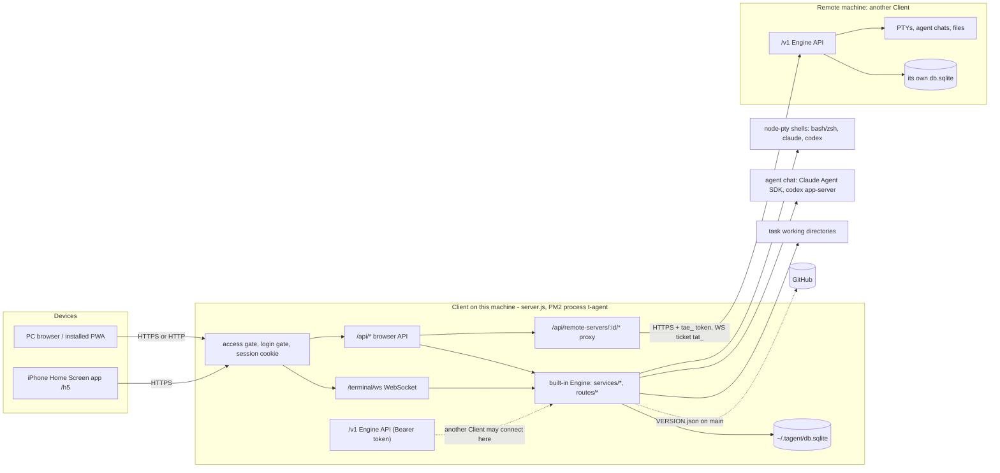

# Personal Home Page Design Document

> Date: 2026-07-15

> Start here: "System architecture and functionality" (after the release notes below) is the current map of the system and the agreed target design (one MUI page for PC and phone).

> Unreleased: Terminal activity is pushed to the MUI page instead of polled: `GET /api/tasks/terminal-activity/stream` (Engine `/v1/terminal-activity/stream`, capability `terminal:activity-stream`; proxy `/api/remote-servers/:id/terminal-activity/stream`), server-sent `event: activity` with `{ activity, subagents }` on connect and on every change (`lib/terminal-activity-stream.js`). The 3 s ack poll is gone; an Engine without the stream (404) is polled every 30 s. `#h5-cycle` shows a count badge of running and pending sessions. See "Terminal activity push" under the phone page. Regression: `test/terminal-activity-stream.test.js`, `test/task-parity.test.js`, `scripts/test-h5-cycle-browser.cjs`, `scripts/test-h5-pc-browser.cjs`.
> Unreleased: Phone row 2 has a "Next running or pending session" button (`#h5-cycle`, Ant Design `swap` icon): each tap goes to the next terminal session (plain terminal or Claude / Codex session terminal) that is running, has a running Claude sub-agent, or is pending acceptance, in task sheet order, wrapping around. New read-only endpoint `GET /api/tasks/terminal-subagents` (Engine `/v1/terminal-subagents`, proxy `/api/remote-servers/:id/terminal-subagents`). See "Next running or pending session" under the phone page. Regression: `scripts/test-h5-cycle-browser.cjs`, `test/agent-sessions.test.js`, `test/task-parity.test.js`.
> Unreleased: The function keys of the phone bottom bar (row 1) use clear faces (library icons for the arrows and Enter, self-drawn icons for Backspace, Tab and Shift, text for the rest), and the translate-and-send button is now the send button with a small "Aa" mark. Full icon information is in "Phone UI icons" below. Regression: `scripts/test-h5-browser.cjs`.
> Unreleased: The icons of the phone bottom bar come from one set, the "Ant Design Official Icon Library" collection (Chinese collection title translated) on iconfont.cn (https://www.iconfont.cn/collections/detail?cid=9402; the official Ant Design icons, outlined style, 1024 grid, author Ant Design / ant-design/ant-design-icons, MIT licence; the licence is stated by the Ant Design project, the collection page itself shows no licence field, to be confirmed by the owner). Paths were copied from the public SVG data of the collection (no login, no cookies) into `scripts/h5-shell/Icons.jsx` as inline SVG with `currentColor` (24px, no runtime request). Mapping: terminal keyboard = `code library` (4765970), draft keyboard = `edit-square` (4765957), upload image = `image` (4766917), saved commands = `unordered list` (4767060), voice = `audio` (5756281), send = `send` (9230696), translate and send = `translate` (8094821), Paste text menu item = `snippets` (4766482). The set has no keyboard icon, so the two keyboard keys use the closest same-style ones (a terminal prompt box and a pencil on a square). The send button stays a white round button; only its glyph changed. Rebuilt `public/js/h5-shell.js`. Regression: `scripts/test-h5-browser.cjs`.
> Unreleased: File paths printed in the terminal open in the file browser (desktop file panel, phone file sheet); see "Terminal file links" under "Task file panel".
> Unreleased: Tasks in the left sidebar have no selected state. The desktop sidebar (`.task-nav-item`) no longer dims unselected tasks or highlights the open one (`public/css/style.css`, `themes.css`); the phone task list and the wide phone sidebar (`scripts/h5-shell/TaskDrawer.jsx`, rebuilt into `public/js/h5-shell.js`) no longer fill the open task's row. Kept: hover feedback, the `active` class and `aria-current` on the open task (script and test hooks, no style), and the highlight of the current terminal or chat row. Regression: `test/sidebar-no-selected.test.js`, `scripts/test-h5-browser.cjs`.

> Unreleased: Phone page header has an Update button right of the refresh button (`#h5-update`, `UpdateButton` in `scripts/h5-shell/Update.jsx`, rebuilt into `public/js/h5-shell.js`). It opens a modal (`#h5-update-dialog`, MUI Dialog: `role=dialog`, `aria-modal`, labelled by its title; closes with the X, Escape or a tap outside; focus returns to the button) that checks `POST /api/system/check-update` (nothing is installed by the check) and shows a checking state, current and latest version, "Already up to date", the error when the check fails (with "Check again"), or, when a newer version exists and the user is the update administrator, an "Update now" action (`apply-update`, then the same progress log and automatic reload as the settings updater; the modal cannot be closed while updating). The desktop page has no "Refresh page" button (its `↻ Update` button in the header is unchanged), so only the phone page changed. The one-tap updater was removed from the phone Settings sheet (it had no version row or auto-update option, only the check-and-update button, hint and log); the modal now does all of it and also links the release notes when the check returns `remote_manifest.release_url`. The desktop Settings dialog keeps its own "Check for updates" section and the header `↻ Update` button (unchanged). Regression: `scripts/test-h5-browser.cjs`.

> v2.84.49 The access level in the chat footer opens a list like the model's (`ModeButton` in `scripts/agent-chat/ui.jsx`: `ac-picker` menu with `menuitemradio` items, a name and a short explanation each) instead of the invisible native `select`; a choice applies at once, and Full access still asks to confirm. Regression: `scripts/test-agent-chat-browser.cjs`.

> v2.84.49 Agent chat footer is one row of icons under the input box (before: a row for the options and the usage, and another for the access level and model). Left: options (sliders icon) and the access level (an icon per level; the invisible `select` over it keeps keyboard and screen-reader use). Right: the model (chip icon; the model and effort are its title, the list opens as before), the context ring and the plan usage. The usage is one button of upright bars, per window one for the usage left and one for the time left (`limitBars` in `scripts/agent-chat/format.mjs`); a click opens a floating window with the numbers in words and a "Refresh usage" button (a click on the bars no longer refreshes by itself). `public/js/agent-chat-ui.js` was rebuilt. Regression: `scripts/test-agent-chat-browser.cjs`, `test/agent-chat-view.test.js`.

> v2.84.49 Task list (phone page and wide sidebar): any number of tasks can be open at once. `expanded` (a Set of task ids) and `peeks` (task id -> sessions of an open task that is not selected) replace the single `expandedId` / `peek` in `public/js/h5.js`; selecting a task or opening the list no longer closes the others (the lists of open tasks are read again when the list opens). The header row of the list has "Expand all" (`#h5-expand-all`) and "Collapse all" (`#h5-collapse-all`) buttons (`scripts/h5-shell/TaskDrawer.jsx`; `ui.actions.expandAll` / `collapseAll`). `public/js/h5-shell.js` was rebuilt. Regression: `scripts/test-h5-browser.cjs`.

> v2.84.48 Phone page header has a refresh button just before the settings button (`#h5-refresh`, `scripts/h5-shell/Header.jsx`; `ui.actions.refresh` in `public/js/h5.js`). It deletes Cache Storage entries, asks the service worker to update, then calls `location.reload()`, so a phone holding old scripts loads the new ones. Login, settings and the open task are kept. `public/js/h5-shell.js` was rebuilt. Regression: `scripts/test-h5-browser.cjs`.

> v2.84.48 The phone page keeps the screen on while a task is open (Screen Wake Lock API in `public/js/h5.js`, `syncWakeLock`): requested when a task is selected, let go when none is, and asked for again when the page becomes visible (the browser drops it in the background). Browsers without the API, or that refuse it, behave as before. Regression: `scripts/test-h5-browser.cjs`.

> v2.84.48 Message footer in the agent chat. Under each message: send time, copy, "start a chat from here" (fork) and "new chat". Items carry `at` (ms, stamped by `turnContext.upsert`, or taken from the history file); `toMessages` gives every message `footer: { itemId, at, text }` (an agent message forks after its last item and copies only its text blocks). `POST conversations/:cid/fork { itemId }` (Claude `forkSession`, Codex `thread/fork`; `lib/agent-chat/fork-point.js` locates the message by counting the person's messages and checking the text, and refuses with `FORK_MISMATCH` / `FORK_AT_FIRST_MESSAGE` rather than fork in the wrong place) answers `{ conversation, draft }`; forking a person's message keeps everything before it and puts its text in the new chat's input box. Capability `fork` enables the button; it is disabled while a turn runs. The view tells the host through `onOpenChat(conversation, { draft })`: desktop opens a tab, the phone replaces the shown chat, the multi-task page adds a cell. Regression: `test/agent-chat-fork.test.js`, `test/agent-chat-view.test.js`.

> v2.84.15 Agent chat icons: the attach, microphone and send icons are sized in CSS too (`.agent-chat svg:not(.agent-logo)`, 18px; the rules for the stop button and the chevrons are later in the file and still win). On an iPhone (WebKit) they were drawn as specks inside their 36px buttons while the chevrons, which already had a CSS size, were fine, so the width / height attributes alone were not enough there. Chromium always drew them at 18px, so the cause is inferred, not reproduced: Playwright has no WebKit for this macOS. Regression: `scripts/test-agent-chat-browser.cjs` (18px in Chromium).
> v2.84.14 Phone voice input looks and works like a chat app's hold-to-talk screen. Pressing the 🎤 button dims the page and shows a green bubble with a live level meter (`public/js/voice-overlay.js`, styles `.vo-*` in `h5.css`) and three zones: the bottom arc "Release to send" (default), a left "Cancel" pill and a right "Convert to Text" pill. Sliding the finger onto a pill picks what letting go does (`zoneAt`, the pills react 28px outside their edges): over the arc the recognition ends and the text is translated and sent at once (`onSend` submits the translate form), over Convert to Text it only fills the Chinese input box (the behaviour before), over Cancel the recognition is thrown away and the box is as before. A press shorter than 350 ms is a tap and is cancelled. The meter is the RMS of the audio blocks the microphone already delivers, nothing extra is recorded. The desktop button is unchanged. Regression: `test/speech.test.js` (the three zones with a fake overlay); the overlay was also rendered in Chromium at phone size. Not tried with a real microphone or finger.
> v2.84.13 Agent chat footer: the plan usage (`5h 98% · 3h  7d 96% · 6.7d`) is its own row directly below the input box, above the footer row that holds the access level on the left and the model and the context ring on the right (before, it shared the right side with the model and wrapped beside it on a phone). `Limits` moved out of `.ac-status` in `scripts/agent-chat/ui.jsx`; `public/js/agent-chat-ui.js` was rebuilt. Applies to the phone and the desktop page. Regression: `scripts/test-agent-chat-browser.cjs`.
> v2.84.12 Phone task sheet: a terminal and an agent chat are never both highlighted. While a chat is open its row is the current one and the terminal row is not (before, the terminal the task had selected stayed highlighted under the chat); going back to a terminal highlights that terminal and clears the chat row. The sheet is redrawn as soon as a chat opens or closes. Regression: `scripts/test-h5-browser.cjs`.
> v2.84.11 Phone task sheet: each agent chat row has the same `⋯` button as a terminal row, which opens the same bottom sheet with the actions of a chat: Rename (`PATCH …/agent/conversations/:cid { title }`), Open and Delete (`DELETE …/agent/conversations/:cid`, after a confirmation; if that chat is open it is closed first). Both calls are proxied for remote Engines already. The rename the title menu used to offer is back this way. Regression: `scripts/test-h5-browser.cjs` (rename, declined and confirmed delete).
> v2.84.10 Codex warnings in the chat (for example "Under-development features enabled…") are left-aligned with an orange bar at the left instead of centred like a plain notice. The Codex adapter marks them `level: 'warn'` (the item keeps `kind: 'notice'`, so history and older pages are unaffected), `toMessages` passes the level on and `Notice` uses the class `ac-warn`. `public/js/agent-chat-ui.js` was rebuilt with `npm run build:agent-chat`. Regression: `test/agent-chat-view.test.js`.
> v2.84.9 Phone agent chat: the `←` close button added in v2.84.8 is gone, so a chat looks like a terminal (page header on top, nothing else). A chat is left by going to a terminal (a terminal row in the task sheet, a new terminal or a restart): that closes the chat the way the old back arrow did (the open flag is cleared) and the chat stays listed in the task sheet to be opened again. The task sheet and the settings sheet now sit above the chat (`z-index` 109 over 108), so the ☰ and ⚙ buttons of the page header work while a chat is open. Regression: `scripts/test-h5-browser.cjs`. Not tried on a real phone.
> v2.84.8 Phone agent chat: the chat no longer has its own header (back arrow, agent icon, title menu). The page header (task name and settings) stays on top as in the terminal and the chat starts right below it (`fitAgentView`); a `←` button at the left of that header (`#h5-close-chat`, shown only while a chat is open) closes the chat. Renaming a chat from the phone page is gone with the title menu. Regression: `scripts/test-h5-browser.cjs`. Not tried on a real phone.
> v2.84.6 Phone settings: the ↻ button checks for an update and, when a newer version exists, starts the update at once (`POST /api/system/apply-update`), without the earlier "Update and restart" confirmation; only the update administrator can run it, and the page reloads when the PC service is back. Because the PC service restarts, terminals running on it are interrupted. Regression: `scripts/test-h5-browser.cjs`.
> v2.84.5 Phone voice input is hold to speak: pressing the microphone next to the Chinese input box starts recording at once (inside the touch, so iOS lets the audio context run) and releasing it ends the recognition and keeps the text; a press shorter than 350 ms is a tap and is discarded; keyboard Enter/Space still toggles. The desktop button is still click to start / click to stop (`hold` option of `VoiceInput.attach`). Regression: `test/speech.test.js`. Not tried on a real phone.
> v2.84.4 Pasting an image on the phone page: a paste event with an image on the terminal input (long-press paste) and the Paste key (it reads the clipboard with `navigator.clipboard.read()` first) now upload the image to OSS like the Image key and type the link with a trailing space and no Enter; text pastes are unchanged. Regression: `scripts/test-h5-browser.cjs` (paste event with an image file). The Paste key needs a secure context and clipboard permission; a real phone was not tried.
> v2.82.1 Voice input on the phone page: the microphone button on `/h5` failed because the token request used the global `API` helper, which only `app.js` (desktop page) defines. `voice-input.js` now makes the token request with its own `fetch`; the settings dialog still uses `API` and `Modal` because it exists on the desktop page only. Regression: `test/speech.test.js` runs the script on a page without `API` and `Modal`. Verified in a real Chromium on `/h5` with a fake microphone; a real phone was not tried.

> v2.82.0 Voice input: a 🎤 button next to the Chinese input box (desktop and `/h5`) fills the box with live speech recognition. The browser captures the microphone with an `AudioWorklet`, resamples it to 16 kHz mono 16-bit PCM (`createResampler` in `public/js/voice-input.js`) and sends 100 ms frames over its own WebSocket straight to Alibaba Cloud Model Studio Fun-ASR (`wss://dashscope.aliyuncs.com/api-ws/v1/inference`, Singapore `dashscope-intl`), speaking the documented task protocol itself (`run-task` → `task-started` → audio → `finish-task` → `task-finished`; `result-generated` with `sentence_end` false is the live text, true is the finished sentence; heartbeats are ignored). No audio passes through the Client server, which was a requirement (bandwidth). A browser WebSocket cannot set an `Authorization` header, so the server mints a temporary token (`POST /api/speech/token` → `POST https://<host>/api/v1/tokens?expire_in_seconds=60` with the real key) and the browser puts it in `?api_key=`; both facts were checked against the real service (the plain key and the temporary token both open the connection with the query parameter, `api-key=`, `token=` and a subprotocol do not). The real key never reaches the browser. The configuration (key, region, endpoint, model, language) is stored encrypted per user in `system_state` under `speech:<owner>` (`services/speech.js`, `routes/speech.js`: `GET/PUT/DELETE /api/speech/config`); an empty key on save keeps the stored key, a blank endpoint means the region default and the dialog shows the address really in effect; `DASHSCOPE_API_KEY` is the fallback when no key is saved. The token is fetched after the microphone permission is granted (it lives one minute); audio produced before `task-started` is buffered (at most 10 s); a recording ends after 5 minutes, 8 s after `finish-task` without an answer the session fails, and 10 s after the click the text recognized so far is kept. The microphone needs a secure context (HTTPS or localhost). Tests: `test/speech.test.js` (service, routes, resampler, the protocol against a fake socket). Known limitations: audio is sent to Alibaba Cloud; a temporary token is not limited to one model; browsers cannot show the HTTP status of a refused WebSocket handshake, so such a failure is reported generically (the token request itself reports 401/403 clearly); no hotwords (`vocabulary_id`) or sensitive-word filter yet; Safari/iOS was not tried on a real device.

> v2.83.0 Phone and desktop share the task's terminals and each terminal has one attached client at a time: a second client gets "This terminal is in use on another device" with a button to take it over (see "Single-owner terminals"). The phone-only `h5-` shells and the `surface` parameter are gone.

> v2.65.0 Phone page `/h5`, separate from the desktop page `/web`: see "Phone page (/h5)" at the end of this document. Phone and desktop share the task's terminals, and each terminal has one attached client at a time (see "Single-owner terminals").

> v2.45.0 Agent config: the main navigation gained an "Agent config" page for several servers. The Client stores the global default and the per-server overrides in `system_state` (`agent-config:<owner>`; a key present in an override, including an empty string, wins over the default, and an empty string means that server is left alone). The field table is `SCHEMA` in `services/agent-config.js`; values are always strings and are validated as enum / number / list. `POST /api/agent-config/push` writes files directly on this machine and calls `PUT /v1/agent-config` (`engine:admin`, capability `agent-config:manage`) on remote Engines. A write only changes the keys that were filled in: Claude uses recursive JSON value setting, Codex uses single-line TOML key/value editing (comments and other tables are kept, and top-level keys are written before the first table); nothing is written when the config file is invalid. The local override file is also written, so it is not overwritten by the remote defaults from `agent-sync.py`.

> v2.54.0 Access mode: a fresh install lets the user choose, the first time the page is opened on this machine, "Authenticator + allow external access (remote)" or "Local access only, no verification (local)", and Settings → Access mode can switch it at any time. `services/client-auth.js` gained the `client_access_mode` table and `accessMode()` (saved choice > already bound counts as remote > initial `ACCESS_MODE` > `unset`), `setAccessMode()` and `ready(session)` (pages / endpoints use it to decide "must bind / must log in"; local needs no binding); under local, `authenticated()` only recognizes `session.localTrusted`, that mark is void after switching back to remote, and the 30-second sweep of `sessionActive()` disconnects the existing terminals. `lib/access-gate.js` sits after the session and before the login gate: local / unset only let direct local access through (reusing `isLocalInitialization`: loopback address + loopback Host + no forwarding headers) and answer 404 to everything else (including `/v1`, `/share` and WebSocket upgrades), and under local it marks local sessions as trusted. `POST {loginPath|/auth}/mode`: when unset, local must come from this machine and remote only enters the binding flow (remote is written only after `confirmSetup` succeeds); once chosen, the user must be logged in, remote→local disconnects all terminals, local→remote without a binding returns 409 `AUTHENTICATOR_BINDING_REQUIRED`, and when already bound one code is verified. `GET /auth/me` gained `access_mode` and `listen_host`, and `/auth/status` gained `mode`. `install.sh --access-mode local|remote` (local writes `HOST=127.0.0.1`, otherwise a new install writes `HOST=0.0.0.0`; the `HOST` of an existing `.env` is not changed). **Behavior change**: an instance that has neither bound nor chosen yet can no longer be bound for the first time from a non-local address (it gets 404); a remote server uses `node scripts/client-auth-setup.js`; a new install listens on 0.0.0.0 by default. Tests: `test/access-mode.test.js` (including starting a real service to verify the first choice, local-only without verification, 404 for DNS rebinding / forwarding, and opening external access after binding and switching back) and `test/access-mode-page.test.js`. Known limitations: in local-only mode other users / processes on the same machine can reach it; the `HOOK` reports inside the terminal go over loopback and are unaffected; switching to external access was not verified between two real machines.

> v2.53.0 Terminal Chinese-to-English input: below the terminal (above the function-key row) a new input box; Enter → `POST /api/translate` (`routes/translate.js`, `services/translator.js`, calling DeepSeek's OpenAI-compatible endpoint `/chat/completions` with `temperature: 0` and a prompt that only translates and never executes the message content) → `public/js/terminal-translate.js` types the translation into the current terminal through `Tasks.sendTerminalInput`, sending `\r` after a 120 ms delay (so a TUI does not treat it as a newline inside a paste). The configuration (API key / endpoint / model) is stored encrypted per user in `system_state` under `translator:<owner>`; the read endpoint never returns the key; the endpoint must be an HTTPS URL without credentials. Translation happens only on the local Client, so terminals of remote engines work too and the Engine is unchanged. Input without Chinese does not call the endpoint; before the translation enters the terminal all control characters (including ESC) are removed and it is collapsed into one line; when the terminal is not connected nothing is sent and the input is kept, and `sendTerminalInput` now returns whether it was sent. When the file drawer is open it is hidden together with the function-key row. Tests: `test/translator.test.js`, `test/terminal-translate.test.js`, `scripts/test-terminal-translate-browser.cjs`. v2.53.1 changed the default model to `deepseek-flash` (configurations that already saved a model name keep their value and must be changed by hand under ⚙). v2.54.1 no longer shows "Sent: translation" under the input after a successful send (it is already visible in the terminal) and only shows error hints. v2.54.2 "Translating" no longer takes a line of text of its own: the input box itself pulses (`.terminal-translate-input.translating`, read-only while keeping focus; cyan on the futuristic theme, a static glow under reduced motion) and the send button is disabled at the same time. v2.54.3 after pasting / uploading an image in the terminal finishes, a space is added by default after the inserted link (still no Enter) so you can keep typing; a link copied by hand because the original terminal was switched carries no space. v2.54.4 fixed "after a refresh, switching back to local, all tasks are gone and only appear after another refresh": after getting the task list, `reloadSource` still waits for the groups endpoint, and in that time Engines had already switched the UI to the saved remote Engine, so `activateSource` wrote the then still empty `tasks` array back to the local data source and overwrote the list just received. Now the `tasks` of the current view are updated synchronously when the list arrives. Regression: `test/remote-active-engine.test.js` (slow local groups endpoint). v2.55.0 translation gained Zhipu GLM: the configuration became `{enabled, provider, providers:{deepseek,glm}}`, each provider stores its own `{apiKey, baseUrl, model}`, saving only changes the selected provider, `provider` points at the one in use, and switching never overwrites the other provider's key; an old flat DeepSeek configuration is migrated automatically when read. GLM goes to `https://open.bigmodel.cn/api/paas/v4/chat/completions`, and models `glm-4.5` and above automatically carry `thinking: {type:'disabled'}` (translation does not need deep thinking). `GET /api/translate/config` gained `provider` and `providers` (only `hasApiKey/baseUrl/model/label`), keeping the old top-level fields for the current provider; the settings dialog gained a "Translation service" dropdown that keeps unsaved input when switching. Regression: `test/translator.test.js`. v2.55.1 changed the default GLM model to `glm-5.3-flash` (`glm-4-flash` timed out; the GLM-5 series think by default, so the request automatically carries `thinking: disabled`; configurations that already saved a model name keep their value and must be changed by hand under ⚙). v2.55.2 when the endpoint returns a non-2xx status, the provider's `error.message` and error code are shown first (such as GLM `1113 insufficient balance or no available resource package`), falling back to the generic message by status code only when there is none. v2.55.3/v2.55.4 (3 regression cases of 2.55.3 failed and were fixed in 2.55.4: an empty JSON body still falls back to the status-code message, and only plain text reports the raw text) when the error body is not in the `error.message` shape (flat `{code,msg}` or plain text), the reason / a raw snippet (≤200 characters) is reported too. v2.55.5 fixed the default GLM model `glm-5.3-flash` failing with HTTP 400 (1210 "this model always thinks and cannot turn thinking off"): v2.55.1 sent it `thinking:{type:'disabled'}`, which was rejected. `glm-5.3` and above now send `reasoning_effort:'low'` (measured on the real endpoint: 0 reasoning tokens, about 0.7 s), while `glm-4.5` to `glm-5.2` still send `thinking:disabled`. Known limitations: every input containing Chinese sends the original text to the selected provider; GLM was not verified against a real account (it follows Zhipu's public OpenAI-compatible documentation and stub tests); the Enter used to pick an IME candidate does not submit, but there is no history or translation preview confirmation; DeepSeek was not verified against a real account (the endpoint behavior follows its public OpenAI-compatible documentation and stub tests).

> v2.52.0 Links in the terminal can be opened in a new tab with Cmd (macOS) / Ctrl + click: before, the xterm links addon was not loaded and a URL was just ordinary text. Added the self-hosted `@xterm/addon-web-links` 0.11.0 (`public/vendor/xterm/`, manifest and SHA-256 in `scripts/vendor-libs.json`), registered in `tasks.js` when the terminal is created; the handler only calls `window.open(uri, '_blank', 'noopener,noreferrer')` when Cmd/Ctrl is held, a plain click is still text selection, and only http(s) links are recognized. Verified by `scripts/test-terminal-links-browser.cjs` (real Chromium). v2.52.1 hyperlinks printed by programs with OSC 8 (Claude Code and others, where the visible text can differ from the real address): xterm supports them itself but pops a confirm box on a single click by default; they now use `linkHandler`, likewise handled only on Cmd/Ctrl-click, which first asks for confirmation of the real address and only opens http(s). Known limitations: a long link broken across lines is only recognized as a whole by xterm when the break is a soft wrap; when a program in the terminal has enabled mouse reporting, whether a click is forwarded is decided by that program.

> Unreleased: Terminal character widths use Unicode 11 everywhere. xterm.js defaults to Unicode 6 tables, where emoji such as U+1F600, U+2705 and U+2728 are one column wide while TUIs such as Claude Code assume two. The self-hosted `@xterm/addon-unicode11` 0.8.0 (`public/vendor/xterm/`, manifest and SHA-256 in `scripts/vendor-libs.json`, fetched from unpkg because it is the same npm file) is loaded with `unicode.activeVersion = '11'` in the desktop terminal (`tasks.js`), the h5 terminal (`h5.js`) and the server-side headless terminal in `lib/terminal-snapshot.js`. The server `require`s the very same vendored file, so the snapshot and the browser cannot disagree on widths. Terminals need `allowProposedApi: true` for this. Verified by `test/terminal-unicode11.test.js`. Limitation: not tried on a real phone; ZWJ emoji sequences and skin-tone modifiers are still not joined into one glyph by Unicode 11 (a version-15 table would be needed).

> v2.51.0 Theme switch: the top bar gained "🎨 Theme" with Light / Dark / Futuristic (deep-space blue background, neon cyan glow, grid background). `public/js/theme.js` runs synchronously in `<head>`, writes the choice (`localStorage` key `ta-theme`, effective in this browser only) to `<html data-theme>` to avoid a flash, and keeps Monaco (`vs` / `vs-dark` / custom `ta-tech`), mermaid (diagrams rendered later) and `theme-color` in sync; `public/css/themes.css` loads last and implements the dark themes with variable overrides plus a few overrides of hard-coded colors, while light stays the default of `style.css`. The terminal was already dark and is unchanged. No backend change. Verified by `scripts/test-theme-browser.cjs` (real Chromium; set `THEME_SHOT_DIR` to save screenshots). v2.51.1 fixed diagrams on the dark themes: the light-yellow `rect` highlight blocks hard-coded in the diagram source made light text invisible and were changed to a translucent dark tone (`themes.css`); when the theme switches, diagrams already shown are redrawn with the new theme (the source is kept in `data-mermaid-source`, `rerenderMermaid` in `tasks.js`). v2.51.3 fixed the terminal "running" shimmer being invisible on the dark / futuristic themes: the futuristic theme's selected item cleared the `background-image` shimmer with the `background` shorthand; brighter beams and outlines were added for the dark (bright blue) and futuristic (cyan glow) themes in `themes.css`. v2.51.4 reverted the "in-progress task highlight" (`is-doing`) of v2.51.2, and the task list is back to normal. Known limitations: the share page and login page do not follow the theme; screenshot comparison was only done for the empty state of the main UI, and the dark details of the sub-pages (utilities, apps, file sync, Agent config) were not checked one by one.

> v2.50.0 The sidebar gained an "Update all" button (⬆️, `public/js/batch-update.js`): after confirmation it checks and upgrades all connected remote engines in parallel (reusing `/api/remote-servers/:id/check-update|apply-update|update-status`, showing the result item by item and waiting after the restart until the version is in place, for at most 5 minutes), and updates this machine's Client last (updating it restarts the service and refreshes the page automatically, so it goes last and is handed to `Updates.apply()`). Items that are already up to date, blocked or failed are only summarized and not updated; `restart_pending` items that need a restart hint at restarting by hand. No backend change. Test `test/batch-update.test.js`.

> v2.49.0 The sidebar's "Import directories from the workspace" (📁) and "Clean up code directories" (🧹) follow the current engine: before, they still operated on this machine when a remote Engine was selected. The Engine gained `GET /v1/workspace/unmanaged`, `POST /v1/workspace/import`, `GET|POST /v1/workspace/cleanup` and `POST /v1/workspace/restore` (capability `workspace:manage`, reusing `services/workspace-tools`, with the directory base being that Engine's `TASKS_BASE_DIR` and the token subject being the owner), the Client proxies `/api/remote-servers/:id/workspace/*`, an old Engine returns `501 WORKSPACE_UNSUPPORTED`, and the frontend tells the user to update that engine first; when the engine is switched the unmanaged directories and the badge are checked again. Test `test/workspace-engine.test.js`.

> v2.48.0 File sync now has the master generate a connection string and the slave connect out (replacing v2.47.0's "the slave shows a pairing code and the master links it": the master has a fixed public IP while slaves are usually on an internal network, so the master cannot reach the slave): `POST /file-sync/invite` (`master_url`) generates a one-time sync pairing code on the master (in memory, 10 minutes, single use) and returns `TAFS1:` + base64url(`{v:1,u:<normalized master address>,c:<pairing code>}`); the slave's `POST /file-sync/join` (`connection_string`; whitespace picked up when pasting is removed) parses it and exchanges it for a `tfs_` token through the master's unauthenticated, rate-limited `POST /v1/file-sync/pair`, and is only allowed when `mode=slave`. Removed v2.47.0's `adopt`, `associate`, `refresh-code` and `status().pairing`; kept v2.47.0's role `mode`, `state.link`, `state.tokens`, the sync token scope and the old engine token compatibility.

> v2.47.0 File sync now has the slave initiate pairing and no longer borrows engine connections: `state.mode` (`master`/`slave`; old data infers it from whether a master is connected) records the role explicitly, `PUT /file-sync/role` switches it (which clears the list) and `POST /file-sync/unpair` unlinks. When a slave is not linked, `status().pairing` returns the in-memory pairing code (10 minutes, invalidated after 5 wrong guesses, regenerated on restart). The master's `POST /file-sync/associate` (slave address, pairing code, own address) calls the slave's unauthenticated `POST /v1/file-sync/adopt`; the slave then uses the master's one-time sync pairing code to call the master's unauthenticated `POST /v1/file-sync/pair` and exchange for a `tfs_` token (the master only stores the hash in `state.tokens` and revokes it by instance ID when the heartbeat deregisters). The master address and token are stored as ciphertext in `state.link` and no longer written to `remote_servers`, and no engine token is used; `manifest/file/heartbeat` accept the sync token and also stay compatible with the old engine token; the old `masterId` is still read from `remote_servers`. Removed `/pairing`, `/join`, `/connect` and `/servers`.

> v2.35.1 File sync node visibility: after a slave node connects for the first time and after every sync round, it uses the existing Engine Token to `POST /v1/file-sync/heartbeat` to the master to register its stable instance ID, name, last sync time and error; the master stores the latest heartbeat in `file_sync_v1.children` and shows it offline after 15 seconds. A normal disconnect deregisters with `DELETE /v1/file-sync/heartbeat`. The master's status endpoint returns the slave list and the page shows the online state and times; an old node needs no reconnection after upgrading and registers automatically in the next sync round.

> v2.36.0 Node path mapping: the master still owns the file list exclusively; a slave's `pathOverrides` stores local paths keyed by the master's path. `PUT /v1/file-sync/path` only changes the local mapping, is refused when the target path conflicts with another synced file, and deletes the override value when the default is restored. Switching a mapping clears that file's observed version, and an existing file at the target is backed up before the first write. The state returns the default path, the actual path and the override path together. A short-lived `.t-agent-file-sync-managed` marker is written next to a synced file for the new `agent-sync.py` to recognize, so the startup script and node sync do not rewrite the Claude/Codex configuration twice; the marker is refreshed with the 3-second poll, cleaned up on disconnect or path change, and expires after 60 seconds if the process stops abnormally. The time on the status page is renamed "Last check", so a periodic check is not mistaken for a content change.

> File sync service: its navigation entry sits next to "App list" and is shown per current engine. Every node starts as a master with an empty list; after choosing an existing remote connection, this node becomes a slave and the master node owns the path list exclusively. Paths support a home-directory alias and absolute paths, resolved separately on each machine; the service persists the role, file versions, the master generation, observed versions and backup paths in `system_state.file_sync_v1`. The master scans file hashes every 3 seconds and raises versions; a slave polls `GET /v1/file-sync/manifest`, submits local edits through `PUT /v1/file-sync/file` carrying `generation` and `base_revision`, and the master rejects concurrent writes by comparing versions. On conflict the local file is kept and the UI says so, and the user can explicitly choose to back up and pull the master version. The original file is backed up before the first overwrite as well. It reuses the Engine owner Token and the Client's remote connection proxy, and declares the capability `file-sync:manage`; a new node can recognize that an old node lacks the capability and prompts for an upgrade.

> v2.30.5 Fixed the content tab bar disappearing: after the v2.29.0 refactor the tab bar (design doc / README / AGENTS.md / to-do / terminal) was only shown when a document was rendered; when a task last stayed on the "terminal" tab, start-up went straight to the terminal without rendering a document and the tab bar stayed hidden, so the design doc, AGENTS and to-do could not be seen. Now the tab bar is always shown when a task is selected.

> v2.30.4 Terminal mouse garbage fix: a service restart, crash or manual close kills the running TUI (such as Claude Code), which has no chance to turn off the mouse / focus reporting modes, and this "enabled" state was saved in the output history; after a new shell replayed the history, the browser terminal kept feeding mouse movement to the shell as input, so characters like `35;39;58M` appeared after the prompt and were even run as commands. Now, when a session is created from history restored from the database, the input modes are always reset (and written into the history, so later replays do not turn them on again). The existing mechanism of "reset when the foreground program exits back to the shell" is kept.

> v2.30.3 Update progress is visible: while installing dependencies and building the frontend, "elapsed time + the latest npm output line" is updated every 2 seconds, with a hint after a long time without output; the npm used by the update has short retries and timeouts and fails fast when the network is down.

> v2.30.1 Third-party frontend libraries (marked, mermaid, xterm) are pinned and self-hosted in `public/vendor`, no longer depend on a runtime CDN, and mermaid is loaded on demand; foreground process detection on macOS uses a shared asynchronous `ps`; added CI that runs only the unit tests.

> v2.30.0 Engine and navigation swapped: the engine switch is at the top and Tasks / Utilities are on the left; Utilities belong to the current engine (PM2 manages the remote machine through the Engine's `/v1/pm2`, which needs the `pm2:manage` capability); all engine connections have admin rights and view / operate / manage are no longer distinguished.

> v2.29.4 Fixed the terminal tab group rendering twice when the state of the current terminal becomes finished (acknowledging completion triggered a redraw synchronously; it now finishes rendering first and then acknowledges); the marquee highlight is shorter and thinner, clipped by the tab and has a faint track.

> v2.29.2 The terminal state marquee became a highlight that moves at constant speed along the border path (`offset-path`), with the same speed at corners and on long and short sides, no longer using the angle-rotating `conic-gradient`.

> v2.29.1 Removed all Docker deployment and image builds (Dockerfile, Compose, `docker-client.sh`, the GitHub Actions image release and the related tests and docs), leaving only native, Git and archive installs; if a remote Engine reports a Docker install type, the Client still only shows it and does not trigger an update.

> v2.29.0 Remote Engines behave like the local one: the Client frontend became "data source" based, the local Engine and every remote Engine share one task UI (`tasks.js`), and connection management was split into `engines.js` (replacing `remote-tasks.js`). Remote tasks now support in-page document editing, adding / editing / deleting to-dos, the outline, relative-path images, automatic refresh on document changes, full task editing and deletion, drag-and-drop ordering, group management and terminal run state; Finder / VS Code / share links are hidden for remote tasks because they depend on this machine's file system. The Engine gained `/v1` endpoints: `PUT /tasks/reorder`, `GET /tasks/:id/file`, `GET /tasks/:id/document/:kind/watch` (SSE), `POST /tasks/:id/document/:kind`, `POST /tasks/validate-path`, `GET /terminal-activity` and `POST /tasks/:id/terminal/ack`, declared in `capabilities` of `/v1/info` (`tasks:reorder`, `documents:create`, `documents:watch`, `files:assets`, `paths:validate`, `terminal:activity`) with the API version still 1; the Client proxy gained the matching forwarding (including unbuffered streaming forwarding and `GET /api/remote-servers/:id/info`), and remote file responses carry `Content-Security-Policy: sandbox`. The frontend enables features by role and capability, and `readonly` connections and old Engines degrade automatically.

> v2.28.3 Engine connection failure handling: when a remote Engine is offline, its authentication has expired or loading tasks failed, the task list, documents and terminals are no longer shown; a "cannot connect" hint is shown instead (the reason for the failure, the service address and the steps to check the service status) together with retry / edit / remove connection buttons; when authentication has expired it asks the user to pair again. The sidebar under that Engine only shows "Service unavailable, please check its status".

> v2.28.2 Corrected the over-deletion of v2.28.0: v2.28.0 deleted by mistake the Client's feature of connecting to other Engines (`/api/remote-servers`, `/api/remote-tokens`, the `/v1` endpoints, the frontend engine bar and remote task UI, and remote Engine updates); all of it is now restored, Client A can keep connecting to Client B, and every Client still includes and exposes the same Engine endpoints. What was really removed is only the standalone Engine service: `apps/engine`, `compose.engine.yml`, the Engine update script and environment file, `--mode engine` of `install.sh`/`bootstrap.sh`, `start:engine`, the Docker engine image target and the matching release workflow. `--mode engine` now fails with a clear error.

> v2.28.1 Removed the "Client switch" entry button from the page header; the `/clients` workspace page and route were kept and can be opened by typing the address.

> v2.27.0 Agent hook reporting: the terminal PTY gets `TA_HOOK_URL` / `TA_HOOK_TOKEN` injected (the token is an HMAC of task + terminal and only exists in that PTY's environment), and the hooks of Claude Code and Codex (`UserPromptSubmit`→start, `Stop`→finished, permission-confirmation events→waiting for confirmation, `SessionEnd`→end) report through `POST /hooks/terminal-activity`; once a hook has been received, the hook wins; Esc/Ctrl+C interruptions do not trigger Stop and are treated as finished after 20 seconds of silence; an Agent without hooks is still decided by output. The hook configuration lives in `rules/claude/settings.json` and the newly added `rules/codex/hooks.json`, and `agent-sync.py` merges it into the machine when `ta` starts (hooks that already exist locally are kept and syncing again produces no duplicates). Codex must trust it once in `/hooks`.

> v2.26.1 Terminal state fix: Agents such as Claude Code and Codex, and interactive programs such as ssh, tmux and vim, hold the foreground forever, so looking only at the foreground process always showed running. For these programs the decision is now by output: only 4 or more outputs within about 1.5 seconds count as running, and about 3 seconds of silence is treated as waiting for the user and turns into finished-awaiting-review; the echo of the user's own typing and the redraw after a window resize do not count. Ordinary commands such as make and npm test are still decided by the foreground process, and stay running when the command is silent.

> v2.26.0 Terminal run state: the server decides each terminal's state from the PTY foreground process (the foreground not being a shell for about 1 second is running, returning to the shell is done, and it goes back to idle after the user opens that terminal to acknowledge), no longer depending on the rhythm of output, so it stays running while a command is silent and is not lost on a page refresh. `GET /api/tasks/terminal-activity` returns the terminal states of the tasks and `POST /api/tasks/:id/terminal/ack` acknowledges completion; the frontend polls every 1.5 seconds. The task item on the left aggregates all terminals of that task, and each terminal tab shows its own: running is an outer-ring marquee and finished-awaiting-review is a green breathing light, replacing the old dot badge. Remote Engine tasks are not wired in yet.

> v2.14.0 Multi-Client: (the `/clients` workspace was removed in v2.34.0) added the `/clients` workspace, where the browser stores Client names, addresses and the selected item, and switches between them in independent iframes while keeping the opened pages. Clients do not share sessions or proxy credentials; login and binding are completed in a separate window. The target Client explicitly allows the workspace origin through `CLIENT_FRAME_ORIGINS`, and pages uniformly restrict CSP frame-ancestors; a configured HTTPS session uses SameSite=None + Secure, HTTP stays Strict, and the same-origin checks of the browser API and WebSocket stay in force. Cross-site embedding is subject to the third-party cookie policy. Client authentication actually uses TOTP and the current session has a rolling 30-day lifetime; the OAuth part below is a historical design.

> v2.7.5 Terminal copy: local and remote terminals share a selection-copy module that explicitly enables the Mac Option forced selection; OSC 52 write requests are written to the clipboard only after a size limit, UTF-8 validation and a user preview confirmation. Read requests are refused, hidden instances and history replays are ignored, pending requests are cleaned up when an instance is released, and Ctrl+C keeps its interrupt meaning.

> v2.33.0 Removed the standalone PM2 process management panel from the "Utilities" page: the PM2 status, start / stop / restart / reload and logs are all in the "App list". The backend `/api/pm2`, the Engine `/v1/pm2` and the `pm2:manage` capability are kept (the PM2 actions of the app list use them); `tools.js` only keeps page switching and the app list's engine adaptation.

> v2.32.0 Service management: a new install of `install.sh` manages the Client with PM2 by default (`ensure_pm2` installs it with npm when missing; a busy port does not start; if `pm2 describe t-agent` exists it runs `restart --update-env`, otherwise `start`). An existing LaunchAgent / `t-agent.service` is kept to avoid two instances fighting over the port; `--pm2` first stops and removes the old service and then migrates; `uninstall.sh` deletes `t-agent` from PM2 and runs `pm2 save`.

> v2.31.1 Update check: added the `restart_pending` state. `services/update-manager.js` records `runningVersion` at process start (keeping the existing `runningCommit`), and when checking for updates, if the remote version equals the disk version but there are changes needing a restart between "start commit → HEAD" (the rules of `lib/update-impact.js`), or for a package install the start-up version differs from the disk version, it returns `restart_pending` instead of `current`; with a higher remote version it is still `available`. Extra fields `restart_pending` and `running_version`; the persisted state is cleared when the process restarts.

> v2.31.0 App list: the engine's own SQLite gained an `apps` table (`db/schema.sql`), `services/apps-registry.js` handles validation and idempotent registration, `services/port-detector.js` detects listening ports on the PM2 process tree, and `services/apps-service.js` auto-registers PM2 processes and merges run state and access addresses; the local `/api/apps`, the Engine's `/v1/apps` (capability `apps:manage`, program self-registration goes through `POST /v1/apps/register`) and the Client's proxy to remote engines share `routes/apps.js`, and the frontend `public/js/apps.js` is dispatched by `Tools` for the current engine.

> v2.7.3 Update protection: a Git update supports an explicit forced update, which backs uncommitted changes up to a Git stash and then fast-forwards. Ignored runtime data is kept, merging over ignored files is forbidden, committed divergence and Git-tracked runtime data are refused; when switching the update branch the remote tracking refs are fetched explicitly.

> v2.7.2 Reading experience: local documents, remote read-only documents and the share page uniformly use an isolated Markdown style and locally bundled Highlight.js syntax highlighting. Code blocks keep the original whitespace and offer a language label and a copy button; unknown languages are shown as plain text, and Mermaid keeps using diagram rendering. The terminal and the Monaco editor are unaffected by this style.

> Current implementation note (v2.7.1): this document keeps the early design record; the current architecture is split into Client and Engine. The Client runs as a single-user application and builds a local user context automatically at start-up, with no username, password, login page or logout entry; on upgrade the existing user in the database and its task ownership are kept first. The Client listens on `127.0.0.1` only by default. A standalone Engine always listens on `0.0.0.0`, serves the remote API and terminal connections to the Client through a Bearer Token, allows a Client holding an owner Token to trigger a controlled self-update, and provides control endpoints to close a terminal and to rebuild one from the task working directory. A task can use any absolute working directory on the Engine server, and the design doc defaults to `DESIGN.md` in the working directory. A standalone Engine supports Docker image deployment with a pinned Node/C++ toolchain, with the host updating the image, and persists data, tasks and the independent Codex configuration under `~/.torin/t-agent-data`; the Engine image includes the Codex CLI. The installed-app mode uses a dynamic viewport and flex height constraints and recomputes the terminal rows and columns automatically when the terminal container changes size, so the bottom input row is not clipped by the window edge. The complete current architecture and deployment are described in `README.md` and `docs/ARCHITECTURE.md`.

---

## System architecture and functionality

> Written 2026-11-05 against v2.87.11. This part is the map of the whole system: what exists today, the target design the user decided on 2026-11-05 (one Material UI page for PC and phone), and the rules that apply everywhere. The older sections below it are the detailed record (many of them historical); where this part and an older section disagree, this part describes the current code, and the "Notes on older sections" list at the end names the known differences.

Contents of this part:

- A. Purpose and users
- B. Deployment topology
- C. Server modules
- D. Data storage (and "Data directory")
- E. Data model and core concepts
- F. Client UI today (v2.87.11, two pages)
- G. Target: one MUI page for PC and phone (agreed design)
- H. Cross-cutting rules
- I. Notes on older sections

### A. Purpose and users

T-Agent is a self-hosted, single-user web workbench for running and watching coding agents and terminals on one or more machines. One person installs a **Client** on each machine they work on. In a browser on a PC, or from the iPhone Home Screen app, they open tasks (a task is a working directory), start shells and Claude Code / Codex sessions in real PTYs, chat with Claude / Codex through the agent chat view, see which terminals are running or finished, and type into terminals with helpers (Chinese-to-English translate-and-send, voice input, image upload). Every Client also contains an **Engine**, so one Client can show and drive the tasks and terminals of other machines (see `README.md` "Project architecture", `docs/ARCHITECTURE.md`).

### B. Deployment topology



- **Client** (`server.js`): one Express + `ws` process. It serves the pages, the browser API under `/api`, the browser terminal WebSocket `/terminal/ws`, the hook endpoint `POST /hooks/terminal-activity`, the share pages `/share/:token`, and the Engine API `/v1`. The browser only ever talks to its own Client.
- **Engine**: the part that owns tasks, documents, terminals and chats. The local Engine is the same process (`routes/tasks.js`, `routes/terminal.js`, `services/*`). A remote Engine is another Client reached over `/v1` (`routes/engine-v1.js`; contract in `docs/ENGINE_API.md`). There is no standalone Engine service any more (removed in v2.28, see the v2.28.2 note).
- **Remote proxy**: `routes/remote-servers.js` mounts `/api/remote-servers/:id/...`. The Client decrypts the stored token (`lib/token-crypto.js`, key from `SESSION_SECRET`) and calls the Engine; the token never reaches the browser. JSON calls are forwarded, SSE streams are piped unbuffered (`services/remote-stream.js`), and terminals go through `services/remote-terminal-proxy.js`: the Client asks `POST /v1/terminal-sessions` for a one-time ticket (`tat_…`, 30 s) and opens `/v1/terminal-sessions/:id/stream?ticket=…`. The browser side of that is `/api/remote-servers/:id/terminal/ws`.
- **Pairing and tokens**: on the Engine, `POST /api/remote-tokens/pairing` makes a one-time pairing code `TA-XXXX-XXXX-XXXX` (10 minutes) or `POST /api/remote-tokens` an access token `tae_…` (stored as a SHA-256 hash in `engine_access_tokens`). On the Client, `POST /api/remote-servers` with the address and the code calls the Engine's rate-limited `POST /v1/pair`, gets a token, checks `GET /v1/info` and stores the token encrypted in `remote_servers.token_cipher`. Every token is admin (`services/engine-auth.js`).
- **Access mode** (`services/client-auth.js`, `lib/access-gate.js`, table `client_access_mode`): `local` = only direct loopback access, no login; `remote` = TOTP authenticator and external access; `unset` = choose on first local visit. Non-local requests in `local` / `unset` get 404.
- **Login gate** (`lib/login-gate.js`): when logged out, a GET of exactly `/`, `/web` or `/h5` redirects to the hidden login path (`CLIENT_LOGIN_PATH`, default `/torin/hide/login`) with `return_to`; everything else is a plain 404, except the login entrance, `/v1`, `/api/remote/v1`, `/health`, `/share/*` and the hook endpoint. Sessions are SQLite sessions (`db/session-store.js`) with a rolling 30-day life.
- **Process and listening**: `install.sh` starts the Client under PM2 with the name `t-agent` (launchd / systemd are still supported, `README.md` "Service management"). `config.js` defaults `HOST` to `127.0.0.1`; a fresh install writes `HOST=0.0.0.0` to `.env` unless `--access-mode local`.
- **Update flow** (`services/update-manager.js`, `lib/update-impact.js`, `routes/system.js`): the runtime version is `VERSION.json` in the install directory. `POST /api/system/check-update` reads `VERSION.json` of `main` on GitHub (`lib/version-utils.js` only allows `raw.githubusercontent.com` / `api.github.com`) and answers `available`, `current`, `local_newer` or `restart_pending` (the code on disk is newer than the running process). `POST /api/system/apply-update` does a Git fast-forward (optional force with a stash backup) or an archive update, installs and builds when needed, then exits with code 75 so PM2 (or launchd / systemd) restarts it; a frontend-only change skips the restart. `GET /api/system/update-status` gives the stage, log lines and `boot_id`, which the page uses to reload when the new process is up. Remote Engines are updated through `/api/remote-servers/:id/check-update|apply-update|update-status` (`services/remote-engine-updates.js`).

### C. Server modules

One line each for the main modules, by area. Each route file is mounted in `server.js` (browser API) and, where the feature exists remotely, has a twin in `routes/engine-v1.js` and a proxy in `routes/remote-servers.js`.

**Entry and auth**

- `server.js` — Express app, gates, page routes (`sendClientPage` names `/js`, `/css` and `/vendor` scripts and styles `?v=<content hash>`, leaves the Chinese dictionaries out for English readers and adds the login-path meta tag), static files (see "Static asset caching"), share pages, WebSocket upgrade routing.
- `lib/static-assets.js` — content-hash asset URLs, the long cache for a matching hash (`no-cache` otherwise), brotli / gzip copies of scripts and styles made once in memory.
- `config.js` — `.env` settings (port, host, access mode, login path, cookie name, session secret).
- `routes/auth.js`, `services/client-auth.js` — TOTP binding and login, access mode, recovery codes, rate limits; `services/single-user.js` builds the single local user.
- `lib/access-gate.js`, `lib/login-gate.js`, `lib/client-embedding.js` — the gates above and the frame-ancestors / cookie SameSite rules.
- `middleware/auth.js`, `middleware/client-origin.js` (same-origin proof for browser mutations), `middleware/engine-auth.js` (Bearer token scopes for `/v1`), `middleware/remote-auth.js` (old `/api/remote/v1`).

**Tasks and groups**

- `routes/tasks.js` — task CRUD, reorder, validate-path, documents (`/document/:kind`, watch SSE), to-dos, share, reveal, vscode, workspace tools, terminals, activity, sub-agents, ack, agent sessions; mounts the files API.
- `routes/task-groups.js`, `services/task-groups.js` — groups (system groups `doing` / `todo` / `done` plus user groups).
- `services/task-documents.js`, `services/engine-tasks.js`, `services/task-assets.js` — document paths (`DESIGN.md`, `README.md`, `AGENTS.md` + `CLAUDE.md` with `@AGENTS.md`), creating missing documents, relative assets.
- `services/workspace-tools.js` — import unmanaged directories under `TASKS_BASE_DIR`, clean up and restore code directories (`repo_cleanups`).

**Terminals, PTY and activity**

- `routes/terminal.js` — PTY sessions keyed by task and terminal id (`node-pty`, `lib/node-pty-runtime.js`), WebSocket `handleWs` with protocol v2 (heartbeat, flow control; client side `public/js/terminal-protocol.js`), single owner per terminal (close codes 4009 / 4010, `takeover=1`), in-memory history replay, `cleanTitle`, agent terminals (`claude --session-id` / `--resume`, `codex resume`), `subagentSnapshot`, hook token per PTY.
- `lib/terminal-activity.js` — state per terminal: `idle` → `running` → `done` (until acknowledged) → `idle`. Decided by the foreground process, by output bursts for agents and TUIs, and by Claude / Codex hooks when they report. `GET /api/tasks/terminal-activity` reads it, `GET /api/tasks/terminal-activity/stream` pushes it with the sub-agent counts (`lib/terminal-activity-stream.js`, server-sent events), `POST /api/tasks/:id/terminal/ack { terminal_id }` turns `done` into `idle`.
- `lib/terminal-snapshot.js` (headless xterm with the vendored Unicode 11 addon), `lib/terminal-history.js`, `lib/terminal-input-modes.js` (reset mouse modes on restore), `lib/terminal-locale.js`, `lib/terminal-user.js` (drop root), `lib/websocket-close.js`, `services/terminal-tickets.js`.

**Agent sessions and sub-agents**

- `lib/agent-sessions.js` — lists Claude (`~/.claude/projects/<dir>/*.jsonl`) and Codex (`~/.codex/sessions/**/rollout-*.jsonl`) sessions of a directory, session names, and `runningSubagents` (Claude sub-agent logs under `<session>/subagents/agent-*.jsonl`).
- `GET /api/tasks/terminal-subagents` (Engine `/v1/terminal-subagents`, proxy `/api/remote-servers/:id/terminal-subagents`) — read-only count of running sub-agents per Claude terminal; used by the phone "next running or pending session" button.

**Agent chat**

- `routes/agent-chat.js`, `services/agent-chat.js` — chat conversations of a task (`/api/tasks/:id/agent/conversations…`: create, events SSE, messages, interrupt, permissions, queue, fork, commands, models, limits) and `/api/agent-chat/summary` (top-bar counters).
- `lib/agent-chat/claude.js` (Claude Agent SDK adapter), `lib/agent-chat/codex.js` + `codex-app-server.js` (JSON-RPC to `codex app-server`), `lib/agent-chat/fork-point.js`.
- Browser bundle: `scripts/agent-chat/*` → `public/js/agent-chat-ui.js` (`npm run build:agent-chat`), host glue `public/js/agent-chat.js`. Details: "Agent chat mode (v2.72.0)".

**Files API and safety**

- `routes/task-files.js`, `services/task-files.js` — `/api/tasks/:id/files` (list, create, rename, delete) and `/files/content` (read, write). Rules: paths are relative to the task root (`work_dir`, else the folder of `md_path`); absolute paths, `..`, backslashes and NUL are refused; symbolic links are never followed (`O_NOFOLLOW`, `lstat`, identity checks before and after); text at most 5 MiB of UTF-8; the root itself cannot be deleted. Engine scopes `files:read` / `files:write`.

**Input helpers**

- `routes/translate.js`, `services/translator.js` — `POST /api/translate` with DeepSeek or Zhipu GLM; up to 100,000 characters, split into pieces of at most 4,000 at line or sentence ends (`splitForTranslation`), pieces without Chinese kept as they are; `POST /api/translate/word`. Config is per user, encrypted in `system_state`.
- `routes/speech.js`, `services/speech.js` — voice input: the server only mints a 60-second Alibaba Cloud token (`POST /api/speech/token`); audio goes from the browser straight to Fun-ASR (`public/js/voice-input.js`).
- `routes/oss.js`, `services/oss-images.js` — image upload: `POST /api/oss/upload-policy` signs a POST policy and the browser uploads to Alibaba Cloud OSS itself (`public/js/oss-direct.js`).

**Share pages**

- `GET /share/:token` and `/share/:token/file` in `server.js` — read-only Markdown of a task (`tasks.share_token`, created by `POST /api/tasks/:id/share`), only `.md` files under the folder of `md_path`.

**Machine tools** (local, and remote through `/v1` and the proxy where noted)

- PM2 and apps: `routes/pm2.js`, `services/pm2-manager.js` (status, logs, start / stop / restart / reload only), `routes/apps.js`, `services/apps-registry.js`, `services/apps-service.js`, `services/port-detector.js` (table `apps`; remote: `/v1/pm2`, `/v1/apps`).
- Tunnels: `routes/frp.js`, `services/frp.js`, `services/frp-install.js`; `routes/ssh-tunnel.js`, `services/ssh-tunnel.js` (local only).
- File sync: `routes/file-sync.js`, `services/file-sync.js`, `services/file-sync-instance.js` (master / slave, `/v1/file-sync/*`, state in `system_state.file_sync_v1`).
- Agent config: `routes/agent-config.js`, `services/agent-config.js` (default Claude / Codex settings pushed to this and remote machines, `/v1/agent-config`).
- Environment check: `routes/environment.js`, `services/environment-check.js`.
- Bookmarks (quick links): `routes/bookmarks.js`.
- Update: `routes/system.js`, `services/update-manager.js`, `services/archive-updater.js`, `lib/git-update-workspace.js`, `lib/update-command.js`, `lib/update-impact.js`, `services/remote-engine-updates.js`.
- Remote connections: `routes/remote-servers.js`, `services/remote-client.js`, `services/remote-server-settings.js`, `routes/remote-tokens.js`, `services/engine-identity.js` (stable `engine_id`), `routes/remote-api.js` (old read-only `/api/remote/v1`).

### D. Data storage

- One SQLite file per machine: `~/.tagent/db.sqlite` in the data folder of the service user (`TAGENT_HOME`, old name `T_AGENT_DATA_DIR`; `T_AGENT_DB_PATH` moves only the file), WAL, foreign keys on. Before the data folder it was `data/db.sqlite` in the install directory; see "Data directory" below for the layout, the one-time copy, the lock and the schema check.
- Schema: `db/schema.sql` (`CREATE TABLE IF NOT EXISTS`) plus additive, idempotent migrations in `db/index.js` that add missing columns on every start. There is no numbered migration runner. The database stores the schema generation it was last migrated to in `PRAGMA user_version` (= `VERSION.json` `schema_version`); a database with a higher number is refused (see "Data directory").
- Main tables and key columns:

| Table | Key columns / purpose |
| --- | --- |
| `tasks` | `id`, `title`, `status` (= group key), `priority`, `due_date`, `md_path`, `work_dir`, `technical_path`, `readme_path`, `agent_path`, `sort_order`, `user_id`, `share_token` |
| `task_groups` | `owner_id`, `group_key`, `name`, `sort_order`, `is_system` |
| `task_terminals` | `task_id`, `terminal_id`, `title`, `agent`, `agent_session_id`, `agent_started_at`, `title_custom` (1 = the person named it) |
| `task_default_terminal_titles`, `task_default_terminal_removed` | name and removal of the implicit `default` terminal |
| `agent_conversations` | `id`, `task_id`, `agent`, `session_id`, `title`, `mode`, `model`, `effort`, `opened_web`, `opened_h5`, `translate`, `collapse_keyboard`, `queue` (JSON) |
| `task_todos` | to-dos of a task |
| `remote_servers` | `owner_id`, `name`, `base_url`, `token_cipher`, `status`, `remote_version` |
| `engine_access_tokens`, `engine_pairing_codes`, `engine_identity` | Engine side of pairing (hashes only) and the instance id |
| `remote_access_tokens` | tokens of the old `/api/remote/v1` |
| `system_state` | key / value: encrypted per-user settings (`translator:<owner>`, `speech:<owner>`, OSS, `agent-config:<owner>`), `file_sync_v1`, update state |
| `apps`, `repo_cleanups`, `bookmarks` | app list, cleaned repo records, quick links |
| `sessions`, `client_auth`, `client_access_mode`, `client_auth_attempts`, `users` | login sessions, authenticator, access mode, rate limits, legacy accounts |

- Terminal output is not stored (dropped in v2.86.0); history lives in memory.
- `VERSION.json` fields: `app_version` (release, bumped by `scripts/release.js`), `api_version` (the `/v1` protocol; `/v1/info` also answers 1), `min_remote_api_version` / `max_remote_api_version` (the range this Client accepts from remote Engines), `schema_version` (the SQLite schema generation, now 7; the migrations in `db/index.js` still check for missing columns, and after them the number is stored in `PRAGMA user_version`; a code version whose number is lower than the stored one refuses to start, so forgetting to raise it lets an older version open newer data). Rule ("Version release rules" in part 13 below, `AGENTS.md` "Releases and pushing" point 3, `docs/HANDOFF.md`): change `api_version` and the remote range only when the `/v1` protocol changes incompatibly; raise `schema_version` whenever the SQLite schema changes (a new table or column counts), and never bump these fields mechanically with each release. History: v2.87.11 raised it from 6 to 7 for `task_terminals.title_custom`; earlier column additions in v2.28.2, v2.70.0, v2.77.0 and v2.78.0 did not raise it, so the number is lower than the real count of schema changes. New endpoints are added as capabilities in `/v1/info` with the API version unchanged (for example `terminal-subagents` in v2.87.10, and `terminal-activity/stream` as `terminal:activity-stream`, which the page detects by its 404 on an older Engine and then polls).

### Data directory

> Added in v2.87.14 (branch `feat/data-home-tagent`). Code: `lib/data-home.js` (the only place that knows data paths), `db/index.js`, `server.js`, `config.js` (`sessionSecret` getter). Tests: `test/data-home.test.js`, `test/uninstall.test.js`.

Goal: the runtime data of a machine lives outside the install directory, so every installed version (a second checkout, a worktree, an upgrade) reads the same data and no data migration is needed between versions.

- **Root**: `~/.tagent` (`os.homedir()` of the user the service runs as). `TAGENT_HOME` overrides it; the old name `T_AGENT_DATA_DIR` is an alias (the new name wins when both are set); a leading `~/` is expanded. `T_AGENT_DB_PATH` still overrides only the SQLite file.
- **Layout** (the same as the old `<install>/data`, so an older version pointed at it with `T_AGENT_DATA_DIR` reads the same data): `db.sqlite` (+ `-wal`, `-shm`), `session-secret`, `backups/` (database backups before updates, `services/update-manager.js`), `bin/frpc` and `frpc.toml` (`routes/frp.js`), `server.lock`, `migrated-from.json`.
- **Inventory of runtime data** (what moved and what stayed):

| Data | Before | Now |
| --- | --- | --- |
| SQLite database (tasks, groups, terminals, chats, sessions, remote servers and their encrypted tokens, pairing, authenticator, access mode, translator / voice / OSS / agent-config settings, update state, file-sync state, apps, share tokens) | `<install>/data/db.sqlite` (+ WAL / SHM) | `~/.tagent/db.sqlite` |
| Session secret (encrypts tokens, settings and the authenticator) | `SESSION_SECRET` in `<install>/.env` | `~/.tagent/session-secret`, seeded once from `.env` |
| Update backups | `<install>/data/backups/` | `~/.tagent/backups/` (old ones are not copied) |
| frpc binary and config | `<install>/data/bin/`, `<install>/data/frpc.toml` | `~/.tagent/bin/`, `~/.tagent/frpc.toml` |
| Server lock, copy marker | none | `~/.tagent/server.lock`, `~/.tagent/migrated-from.json` |
| `.env` (port, host, access mode, update source, `TASKS_BASE_DIR`, `TERMINAL_USER`) | `<install>/.env` | unchanged: it describes one install, written by `install.sh` |
| Service logs | `<install>/logs/` (launchd), `~/.pm2/logs` (PM2) | unchanged |
| Task folders | `TASKS_BASE_DIR`, default `~/tasks` | unchanged (user content) |
| File-sync backups, agent-sync cache and overrides | `~/.t-agent/file-sync-backups/`, `~/.cache/t-agent-sync`, `~/.config/t-agent/overrides` | unchanged (already per user; the backup paths are stored in the database) |
| Terminal history, update log, uploads | memory only; images go from the browser to OSS; chat images to a temporary folder | unchanged |

- **One-time copy** (`migrateLegacyData`): only for the default root, and only when the root has no `db.sqlite` and `<install>/data/db.sqlite` exists. Steps: copy the old folder as it is to `<install>/data.backup-<time>` (through `…partial-<pid>`, retried when the database changed during the copy, which means a server still writes it); build `~/.tagent.partial-<time>-<pid>` from that backup without `-shm`, `wal_checkpoint(TRUNCATE)` and `quick_check` it, write `migrated-from.json` (source, backup, time, app and schema version); publish by renaming the folder, or, when the root already exists without a database, by moving the other entries and hard-linking `db.sqlite` last (fails when another process published first). Half-done folders of dead pids are removed on the next start. The old folder is never opened by SQLite or changed. `backups/` is not copied (often gigabytes). Any failure stops the start with `DATA_COPY_FAILED` and leaves no database in the root, so the next start tries again. If the root has a database with a marker, the root is used and the old folder is named in the log as ignored.
- **Empty-home trap** (the root has a database but no `migrated-from.json`, the old `db.sqlite` exists, and no live server holds `server.lock`): both databases are checked for **user data** (`userDataIn`). User data = at least one row in `tasks`, `task_todos`, `task_terminals`, `agent_conversations`, `bookmarks`, `repo_cleanups`, `remote_servers`, `engine_access_tokens`, `engine_pairing_codes` or `remote_access_tokens`; a `task_groups` row other than the defaults `personal` / `doing` / `todo` / `done`; a bound authenticator (`client_auth.secret_cipher` set); a `users.work_dir`; a `system_state` key other than `update_state`, `single_user_id` and `file_sync_v1`; or a `file_sync_v1` with a master or files. Not user data (a start writes them by itself): default groups, the single user, sessions, PM2 apps, `engine_identity`, the unbound `client_auth` row, the access mode, update and empty file-sync state. The old database is read from a temporary copy (db + WAL), never opened in place.
  - **1a** root without user data, old folder with user data: `db.sqlite`, `-wal`, `-shm` and `session-secret` of the root are moved to `<root>/empty-start-<time>/`, then the normal one-time copy runs (backup, marker). Logged.
  - **1b** both with user data: nothing is guessed; the root is used, a framed warning names both folders with their counts and says how to choose (move the root away and restart to copy the old data, or set `TAGENT_HOME`), and the environment check "Storage → Data source" warns (`dataHomeCheck()`).
  - Old folder without user data: the root is used, the old folder is logged as ignored.
  - A separate rule for "a server started from a git checkout that is not the installed location" was not added: an install is itself a git checkout anywhere on disk, so there is no reliable way to tell them apart. 1a, 1b and the lock cover the cases: a dev server while the real one runs is refused by the lock, and an empty folder it made earlier is replaced by 1a.
- **Session secret**: the stored tokens, settings and the authenticator are encrypted with it, so it must live with the data. First start: `SESSION_SECRET` from `.env`; without one, existing data keeps the old built-in default (so it stays readable) and a new root gets 32 random bytes. Afterwards the file wins and a different `.env` value is ignored with a warning.
- **Permissions**: root 0700, `db.sqlite*`, `session-secret`, `frpc.toml`, `server.lock` 0600; looser modes are fixed on start with a warning.
- **Single writer**: `server.js` takes `server.lock` before opening the database (`open(…, 'wx')` with `{pid, port, host, version, started_at, install_dir}`; the real port is written after `listen`). A live pid makes the second server exit with `T-Agent cannot start: Another T-Agent server is already using the data folder …`; a dead pid (or an unreadable file older than 5 seconds) is moved aside and taken over. The lock is removed on exit. Command-line scripts (`create-engine-token.js`, …) open the database without the lock (short writes; SQLite serialises them).
- **Schema check**: `db/index.js` reads `PRAGMA user_version` before anything else. Higher than `VERSION.json` `schema_version` → close and refuse (`DATA_SCHEMA_NEWER`, "Upgrade T-Agent to the latest version"); lower → run the migrations and store the code's number. Adding `user_version` is not a table or column change, so `schema_version` stays 7. From now on, forgetting to raise `schema_version` for a schema change means older versions are not stopped from opening the newer data. Startup errors are console output only (no page is served), so they have no Chinese translation.
- **Linux root and `TERMINAL_USER`**: the root is the home of the user the service runs as (root under PM2 as root → `/root/.tagent`; the systemd unit uses `User=` → that user's home). Terminals that drop to `TERMINAL_USER` do not get `SESSION_SECRET` (`lib/terminal-user.js`) and cannot read the 0700 folder; nothing in a terminal needs it.
- **Tests and dev servers**: `paths()` throws `DATA_HOME_IN_TEST` when no override is set in a test process (`NODE_TEST_CONTEXT`, or the script is `*.test.js` / `test-*.cjs`), so no test can touch the real `~/.tagent`. Every test that opens the database sets `T_AGENT_DATA_DIR` (or `TAGENT_HOME`) to a temporary folder; `T_AGENT_LEGACY_DATA_DIR` exists only so tests can point the one-time copy at a temporary old folder. Dev servers in worktrees must set `TAGENT_HOME` too; otherwise the lock stops them while the real server runs (and, when no real server runs, they would use the real data).
- **Install and uninstall**: `install.sh` no longer creates `<install>/data` and prints the data folder; `uninstall.sh` keeps the data folder (`TAGENT_HOME` / `T_AGENT_DATA_DIR` from `.env`, else `~/.tagent`), because every install shares it, and prints where it is and how to delete it; `--purge-data` deletes it after a second confirmation (`DELETE DATA`). Test: `test/uninstall.test.js` (stub service tools, temporary home).

### E. Data model and core concepts

- **Engine**: a machine's task store and runtime. The browser picks one: local (`/api/tasks`, `tasksBase = /api/tasks`) or a remote one (`/api/remote-servers/:id/tasks`). Resources are told apart by `(engine_id, task_id)`.
- **Group**: a `task_groups` row; a task's `status` holds the group key. The system groups are `doing`, `todo`, `done`.
- **Task**: a title plus a working directory `work_dir` (any absolute path on that Engine; the default is a new folder under `TASKS_BASE_DIR`) and a design document `md_path` (default `DESIGN.md` in `work_dir`). The task root for files is `work_dir`, else the folder of `md_path`.
- **Session types of a task**:
  - plain **Terminal**: a shell in a PTY (`agent` null). Each task has the implicit `default` terminal plus rows in `task_terminals`.
  - **Claude / Codex Session**: a terminal whose shell types `claude --session-id <uuid>` / `claude --resume <id>` or `codex` / `codex resume <id>` (`agent` = `claude` / `codex`, `agent_session_id`).
  - **Agent chat**: an `agent_conversations` row shown in the chat view, driven by the SDK / app-server, not a PTY.
- **Terminal states**: `idle`, `running`, `done` (finished, not yet seen). Opening a terminal on the PC page sends the ack; the phone page does not ack (see G, must-port).
- **Naming precedence** (`routes/terminal.js`, `lib/agent-sessions.js`): if `title_custom` = 1 the stored `title` is always shown; otherwise an agent terminal shows its session name (Claude: last `custom-title` / `ai-title`, else the first prompt; Codex: `thread_name`), falling back to the stored `Claude N` / `Codex N`; a plain terminal shows its `title` (`Terminal N` by default). Names are cleaned by `cleanTitle` (at most 40 characters).
- **Sub-agents**: Claude Task / Agent tool calls. In a chat they are views inside the conversation (items with `parentToolUseId`); in a Claude terminal they are only counted as running from their log files (`runningSubagents`). Codex has none.

### F. Client UI today (v2.87.11, two pages)

- **PC page**: `public/index.html` with `app.js`, `tasks.js`, `engines.js`, `file-panel.js` (Monaco), `multi-task.js`, `tools.js`, `apps.js`, `file-sync.js`, `agent-config.js`, `frp.js`, `ssh-tunnel.js`, `environment-check.js`, `batch-update.js`, `bookmarks.js`, `theme.js`, `terminal-*.js`, `agent-chat*.js`, styles `style.css` and `themes.css`. Served at `/web`, and at `/` for non-phone user agents. Fixed-width desktop layout (see "Phone page (/h5)" first bullet and the README feature list).
- **Phone page**: `public/h5.html` + `public/js/h5.js` (controller: tasks, sockets, viewport, keys, uploads, translation) + the React / MUI shell in `scripts/h5-shell/*` bundled to `public/js/h5-shell.js` (`npm run build:h5-shell`; `store.mjs` exposes `window.H5UI`). Served at `/h5`; `/` redirects phone user agents there (`PHONE_USER_AGENT` in `server.js`). From 900px wide it already shows a permanent sidebar. Details: "Phone page (/h5)", "Phone UI icons", "Material UI phone shell".
- Shared: `i18n*.js`, `toast.js`, `terminal-keys.js`, `terminal-translate.js`, `terminal-viewport.js`, `terminal-owner.js`, `terminal-ime.js`, `voice-input.js`, `voice-overlay.js`, `oss-direct.js`, `agent-chat*.js`, `agent-activity.js`, `markdown-view.js`, `sw.js`.
- Manifests: `index.html` links `manifest.json` (`display_override` with `window-controls-overlay`); `h5.html` and `login.html` link `manifest-h5.json` (`start_url` `/h5`).
- Tag: `v2.87.11-two-pages` (on `origin`, commit `8494601`, the 2.87.11 release) marks the last release with two pages.

### G. Target: one MUI page for PC and phone (agreed design)

Decided by the user on 2026-11-05. The MUI phone page becomes the only page; the PC page is removed. This is the agreed design. Phase 1 is done (released in 2.87.12, see "MUI page on a computer (single page, phase 1)"). Phase 2 is done on branch `feat/single-page-phase2` (not released yet, see "MUI page on a computer (single page, phase 2)"); phases 3 and 4 are not implemented yet. Each phase below is releasable on its own.

#### G.1 Routes

- `/` serves the MUI page (`h5.html`). `/h5` serves the same HTML (not a redirect), so iPhone Home Screen apps keep working (`manifest-h5.json`, `start_url` `/h5`).
- `/web`, `/index.html` and `/h5.html` redirect to `/`.
- `PHONE_USER_AGENT` routing is removed.
- `sendClientPage` injects the manifest link by path (`/h5` → `manifest-h5.json`, `/` → `manifest.json`) instead of a fixed link in the HTML.
- `manifest.json` drops `window-controls-overlay` from `display_override`.
- The login gate keeps `/`, `/web`, `/h5` in `PAGE_ADDRESSES`.

#### G.2 Layout by width

- One breakpoint, 900px. `wideQuery` (`matchMedia('(min-width: 900px)')`) is shared by `h5.js` and `scripts/h5-shell/entry.jsx` (today each makes its own query).
- Narrow (< 900px): the current phone layout (drawer task sheet, two-row bottom bar, bottom sheets).
- Wide (≥ 900px): a permanent left drawer that can be collapsed, the terminal or chat fills the rest, and the Design document and the file preview open as a right side panel instead of a bottom sheet.
- Portrait iPad is under 900px and gets the phone layout.

#### G.3 Input mode (separate from width, no user agent)

```js
const input = matchMedia('(hover: hover) and (pointer: fine)').matches && !matchMedia('(any-pointer: coarse)').matches ? 'pointer' : 'touch';
```

Stored in `store.mjs` and on `<html data-input>`.

- **pointer** (PC with mouse and keyboard):
  - hide row 1 (key bar `#h5-keys`) and the wheel strip `#h5-wheel`;
  - the draft box is always visible, one line;
  - hide the two keyboard buttons (terminal keyboard, draft keyboard);
  - terminal font 13px;
  - icon buttons show their native `title` as the tooltip (the MUI Tooltip was removed for size, see "MUI page: bundle size and touch targets");
  - typing while nothing is focused goes to the terminal;
  - Esc in the draft box returns focus to the terminal;
  - voice button in click mode (click to start, click to stop);
  - attach `TerminalClipboard` (OSC 52 review, `public/js/terminal-clipboard.js`);
  - draft-box shortcuts (the user's rule): Cmd/Ctrl+Enter = translate and send, Option/Alt+Enter = send as typed, plain Enter = new line; IME-safe (`isComposing` / keyCode 229 ignored). This is the rule already in `h5.js` for the phone draft box.
- **touch**: everything as today.
- Touch-only logic (does not run in pointer mode): `fitViewport` keyboard detection, `holdTerminalSize`, `scheduleKeyboardReset`, `settleViewport` (this also fixes a desktop window resize being taken for the on-screen keyboard); the long-press / press protection is skipped for `pointerType === 'mouse'`; Screen Wake Lock (`syncWakeLock`).
- iPad: an iPad with a trackpad stays `touch` (it reports a coarse pointer). The first hardware `keydown` sets `hasKeyboard`, which turns on the shortcuts. Must be checked on a real iPad.

#### G.4 Must port before the switch

- Done after phase 1: terminal activity is pushed (`…/terminal-activity/stream`), so the MUI page no longer polls it every 3 s; see "Terminal activity push" under the phone page.
- Done in phase 1 (2.87.12). Terminal "done" ack from the MUI page: `POST {tasksBase}/{id}/terminal/ack { terminal_id }` when a terminal is shown (before 2.87.12 only `public/js/terminal-activity.js` on the PC page acked, so Pending never cleared on the phone). This changes phone behaviour: opening a terminal on the phone clears its Pending state.

#### G.5 User decisions on features

KEEP / PORT into the MUI page (all three done in phase 2, see "MUI page on a computer (single page, phase 2)"):

- Remote Engine management in a Settings "Engines" section: connect with address + pairing code (`POST /api/remote-servers`), edit (`PUT`), remove (`DELETE`), check (`POST /:id/check`), update the remote Engine (`/:id/check-update`, `/:id/apply-update`, `/:id/update-status`). Done in phase 2 (`scripts/h5-shell/Engines.jsx`); before that only `public/js/engines.js` on the PC page did this.
- Richer Update details in `scripts/h5-shell/Update.jsx`: `restart_pending` with restart help, install type, release link, force update, a red dot when an update exists. Done in phase 2.
- Task menu: Delete (optionally with the directory), Move to group; a Work directory field in the new-task form that shows the effective default path (AGENTS.md workflow rule 3). Done in phase 2, plus Edit working directory of an existing task (the PC edit form has it).

DROP (UI removed):

- File browser and the Monaco editor, in-page Markdown editing, the To-do tab. Monaco and its build (`scripts/build-monaco.js`, `scripts/monaco-entry.js`, `build:monaco`) are removed; terminal file links keep opening the read-only preview.
- Theme picker (dark MUI theme only).
- Multi-task page; terminal history viewer; environment check page; Utilities; quick links; workspace import / cleanup; batch update; share button (the `/share/:token` pages stay); Finder / VS Code buttons; drag-sort and group create / rename / delete; priority, due date and document paths in forms.
- Apps (PM2), Agent config, tunnels (frp / SSH) and File sync pages: the user selected none of them to keep, so their UI is dropped and their server endpoints are kept. **Pending final confirmation by the user.**

#### G.6 Endpoints kept for compatibility

These become unused by the browser but stay on the server (and in `/v1` and the remote proxy), so older pages, other Clients and scripts keep working:

- `/api/bookmarks`
- `/api/tasks/workspace/*`
- `PUT /api/tasks/reorder`, `POST /api/tasks/validate-path`
- `/api/tasks/:id/todos*`
- document `PUT` / `POST /api/tasks/:id/document/:kind`, `GET …/document/:kind/watch`, `GET …/md/watch`
- `/api/tasks/:id/files*` except `GET …/files/content` (still used by the preview)
- `POST /api/tasks/:id/reveal`, `POST /api/tasks/:id/vscode`, `POST /api/tasks/:id/share`
- `POST` / `PUT` / `DELETE /api/task-groups`
- `/api/pm2`, `/api/apps`, `/api/frp`, `/api/ssh-tunnel`, `/api/agent-config`, `/api/file-sync`, `/api/environment`
- the matching `/api/remote-servers/:id/...` proxies
- the `agent_conversations.opened_web` column

#### G.7 Tests

- `npm test` is `node --test --test-concurrency=2` with no file list. Its default patterns also match `scripts/test-*` (confirmed): all 32 real-Chromium browser scripts `scripts/test-*.cjs` plus `scripts/test-quick.js`, 33 files under `scripts/`. Plan: give `npm test` an explicit file list (unit tests in `test/`, then the browser scripts that are wanted).
- Delete with the PC page: browser scripts that drive `index.html` for dropped features (`test-file-panel-*`, `test-multi-task`, `test-environment-page`, `test-apps-ui`, `test-file-sync-ui`, `test-theme`, `test-terminal-history`, `test-agent-tabs-restore`, `test-context-menu`, `test-desktop-layout`) and unit tests of dropped modules (for example `test/batch-update.test.js`, `test/file-panel-task-integration.test.js`). Rewrite against the MUI page: the PC-page terminal tests that cover kept behaviour (`test-terminal-keys`, `test-terminal-width`, `test-terminal-translate`, `test-terminal-images`, `test-terminal-file-links`, `test-terminal-new-menu`, `test-terminal-theme`), `test-session-redirect` (new routes) and unit tests that read `index.html` (`test/i18n.test.js`, `test/login-gate.test.js`, `test/client-auth-http.test.js`, `test/access-mode-page.test.js`, `test/sidebar-no-selected.test.js`, `test/vendor-assets.test.js`, update tests). The exact list is shown to the user in phase 3.
- Done in phase 1: `scripts/test-h5-pc-browser.cjs`, a PC-viewport variant of `scripts/test-h5-browser.cjs` (1280x800, pointer mode: hidden key row and wheel strip, visible draft box, shortcuts, Esc, typing to the terminal, no keyboard detection on window resize, side panel, ack).

#### G.8 Phases

0. Tag the last two-page version: done, `v2.87.11-two-pages` (commit `8494601`).
1. The MUI page works on PC next to the old page: input mode, wide layout, side panel, ack, shared `wideQuery`, PC-viewport tests. `/` and `/web` still serve the old page. Done, released in 2.87.12 (`scripts/test-h5-pc-browser.cjs`).
2. Port the kept features: Engines settings, Update details, task Delete / Move / Work directory. Done on branch `feat/single-page-phase2` (`scripts/test-h5-phase2-browser.cjs`), not released yet.
3. Switch `/` to the MUI page and delete the old page; the delete list is shown to the user first.
4. Cleanup: explicit `npm test` list, unused CSS / vendor files, documentation.

#### G.9 Risks and open items

- Installed desktop PWA title bar: an app installed from `manifest.json` with `window-controls-overlay` may keep its old title-bar mode until reinstalled.
- iPad media queries: trackpad / keyboard iPads must be tried on a real device.
- One terminal connection at a time on PC: the MUI page attaches one terminal; the multi-task page and side-by-side terminals go away.
- The ack changes phone behaviour (Pending clears when a terminal is opened on the phone).
- Large deletion in phase 3 (old page, Monaco, many modules and tests).
- Browser test coverage drops until the PC-viewport variants exist.

### H. Cross-cutting rules

- **Language and i18n**: code, docs and UI text are English; Chinese lives only in `public/js/i18n-zh-ui.js`, `i18n-zh-server.js`, `i18n-zh-extra.js` (keyed by the exact English text) and in fixtures; `test/i18n.test.js` enforces it. See "Interface language".
- **Phone UI icons**: one library (Ant Design Official Icon Library, iconfont.cn collection 9402), inline SVG in `scripts/h5-shell/Icons.jsx`; self-drawn icons (`DRAWN`) or text labels where no library icon is clear; every icon-only button has an English `aria-label` and `title`. See `AGENTS.md` "Phone UI icons" and "Phone UI icons" below.
- **Security**: the browser never gets an Engine token; tokens and secrets are stored hashed or encrypted and never written to logs; same-origin checks on browser mutations and WebSocket upgrades; the files API rules in C; untrusted Markdown (the design document sheet) shows raw HTML as text and keeps only `http(s)` / `mailto` links and `http(s)` / `data:image` images; shared Markdown stays inside the folder of `md_path`; remote file responses carry `Content-Security-Policy: sandbox`; OSC 52 writes need a user preview; terminal output is not stored.
- **Releases**: batch requirements until the user says all are submitted, then one full `npm test`, `node scripts/release.js`, commit, normal push to `origin/main`. See `AGENTS.md` "Requirement batches" and "Releases and pushing".
- **Testing**: unit tests in `test/` (`npm run test:quick` while developing), real-Chromium scripts `scripts/test-*-browser.cjs` for UI, full `npm test` once before a release; bundles (`build:h5-shell`, `build:agent-chat`, `build:markdown`) are rebuilt when their sources change.

### I. Notes on older sections

Known differences between the older sections and the current code (not rewritten, only noted):

- Sections "1. Goals" to "12. How to start" (and their duplicated "3." to "11.") are the first design: GitHub OAuth, the project name `torin-x-web`, marked and mermaid from a CDN, a fixed task path under `/Users/torin/main-kuaishou/02_agent/`. Today login is a TOTP authenticator, the libraries are self-hosted in `public/vendor`, and new task folders go under `TASKS_BASE_DIR` (default `~/tasks`).
- "Current implementation note (v2.7.1)" at the top still describes a standalone Engine on `0.0.0.0` with Docker images; both were removed (v2.28.2, v2.29.1). Every Client contains the Engine.
- "12. Remote terminal plan" shows `/terminal/remote/:serverId/:taskId` and `/api/remote/v1/tasks/:id/terminal`; the code uses `/api/remote-servers/:id/terminal/ws` and a one-time ticket for `/v1/terminal-sessions/:id/stream` (see B).
- Many notes at the top still say "Unreleased" for work that shipped in v2.87.4 to v2.87.11 (see the version list at the end of "Phone page (/h5)").
- "Phone page (/h5)": its first line ("only offers tasks, terminals, image upload and translate-and-send") is out of date (chats, settings, update, design document, next session were added). Its "Layout" bullet (8-column two-row key grid) and the "Density" bullet of "Material UI phone shell" (6 by 3 key grid) are replaced by the "Two rows and a hidden draft box" bullet. Its "Settings" bullet (update button in the settings sheet) is replaced by the Update modal (note at the top: the updater was removed from the Settings sheet). Its upload text names `POST /api/oss/images`; the code signs with `POST /api/oss/upload-policy` and the browser uploads to OSS directly (see "Client OSS terminal image upload").
- `docs/ARCHITECTURE.md` says the Client listens on `127.0.0.1` by default. That is the default of `config.js`; a fresh `install.sh` writes `HOST=0.0.0.0` unless `--access-mode local` (`README.md`).

---

## 1. Goals

Build a private task management page with:
- **Task list** (left navigation): add, edit and delete tasks, and move them through statuses
- **MD file preview** (main area on the right): clicking a task shows its linked `.md` file, with Mermaid rendering

Authentication is by GitHub OAuth, and only configured GitHub users are allowed in.

---

## 2. Technology stack

| Layer | Technology |
|------|------|
| Frontend | Plain HTML + CSS + Vanilla JS (no framework) |
| Backend | Node.js + Express |
| Database | SQLite (better-sqlite3) |
| Authentication | GitHub OAuth 2.0 + Express Session |
| Session persistence | connect-better-sqlite3 |
| MD rendering | marked.js (CDN) |
| Diagram rendering | mermaid.js (CDN) |

---

## 3. Project structure

```
torin-x-web/
├── server.js              # Entry point, Express service
├── config.js              # Configuration (GitHub OAuth, allowed usernames, port and so on)
├── .env                   # Environment variables (not committed to git)
├── .env.example           # Example environment variables
├── db/
│   ├── index.js           # SQLite connection & initialization
│   └── schema.sql         # Table definitions
├── routes/
│   ├── auth.js            # GitHub OAuth routes
│   └── tasks.js           # Task list API
├── middleware/
│   └── auth.js            # Login-state check middleware
├── public/
│   ├── index.html         # Home page (visible after login)
│   ├── login.html         # Login page
│   ├── css/
│   │   └── style.css
│   └── js/
│       ├── app.js         # Home page logic (task list + MD preview)
│       └── tasks.js       # Task module
└── data/
    └── db.sqlite          # SQLite database file (not committed to git)
```

---

## 4. Data model

### tasks (task list)

```sql
CREATE TABLE tasks (
  id         INTEGER PRIMARY KEY AUTOINCREMENT,
  title      TEXT    NOT NULL,
  status     TEXT    DEFAULT 'todo',   -- todo | doing | done
  priority   TEXT    DEFAULT 'normal', -- low | normal | high
  due_date   TEXT,                     -- YYYY-MM-DD
  md_path    TEXT,                     -- absolute path of the linked local .md file (may be NULL)
  work_dir   TEXT,                     -- working directory, defaults to the directory of md_path (may be NULL)
  sort_order INTEGER DEFAULT 0,
  created_at DATETIME DEFAULT CURRENT_TIMESTAMP,
  updated_at DATETIME DEFAULT CURRENT_TIMESTAMP
);
```

**Notes:**
- When creating a task: only `md_path` may be filled in, and the title is taken from the file name (without the `.md` suffix)
- `md_path` must be an absolute path with the extension `.md`, strictly validated on the server
- If `work_dir` is not passed and there is an `md_path`, the server uses `path.dirname(md_path)` as the default

### sessions (managed automatically by connect-better-sqlite3)

---

## 5. Authentication flow

```
User visits any page
      │
      ▼
Middleware checks session.user
      │
  Not logged in ──► redirect to /login
      │
  Logged in
      │
      ▼
  Is the GitHub username in the ALLOWED_USERS allowlist?
      │
    No ──► return a 403 page
      │
    Yes ──► let through
```

**OAuth callback flow:**
1. The user clicks "Log in with GitHub" → redirected to `GET /auth/github`
2. Redirect to the GitHub authorization page
3. GitHub calls back `GET /auth/github/callback?code=xxx`
4. The backend exchanges the code for an access_token and then gets the user information
5. Check whether the `login` field is on the allowlist and write it to the session
6. Redirect to the home page

---

## 6. API design

All APIs need a login state, otherwise they return `401`.

### Authentication

| Method | Path | Description |
|--------|------|------|
| GET | `/auth/github` | Redirect to GitHub OAuth |
| GET | `/auth/github/callback` | OAuth callback |
| POST | `/auth/logout` | Log out |
| GET | `/auth/me` | Get the current user information |

### Tasks

| Method | Path | Description |
|--------|------|------|
| GET | `/api/tasks` | Get all tasks (supports the `?status=todo` filter) |
| POST | `/api/tasks` | Create a task |
| PUT | `/api/tasks/:id` | Update a task (title, status, priority, due_date) |
| DELETE | `/api/tasks/:id` | Delete a task |
| GET | `/api/tasks/:id/md` | Read the content of the task's linked `.md` file (plain text) |

---

## 7. Page layout

### Login page (`/login.html`)

A centered card with a GitHub icon + a "Log in with GitHub" button.

### Home page (`/`) — three-column layout

```
┌──────────────────────────────────────────────────────────────────────────┐
│  📋 Tasks                                  [avatar] matonglin  [Log out] │
├─────────────────┬───────────────────────────────────────┬────────────────┤
│                 │                                       │                │
│  [+ New task]   │   # Design document                   │  Outline       │
│                 │                                       │  ─────────     │
│  ● In progress  │   ## 1. Goals                         │  # Design doc  │
│  ─────────────  │   ...                                 │  ├ 1. Goals    │
│  ▶ design       │                                       │  ├ 2. Architec │
│  ▶ plan         │   ## 2. Architecture                  │  │ ├ Diagram   │
│                 │   ```mermaid                          │  │ └ Modules   │
│  ○ To do        │   graph TD                            │  └ 3. Deploy   │
│  ─────────────  │     A --> B                           │                │
│    task-a       │   ```                                 │                │
│    task-b       │   [mermaid rendering result]          │                │
│                 │                                       │                │
│  ✓ Done         │   ## 3. Deployment                    │                │
│  ─────────────  │   ...                                 │                │
│    old-task     │                                       │                │
│                 │                                       │                │
└─────────────────┴───────────────────────────────────────┴────────────────┘

Left (task navigation): fixed 280px
Middle (MD preview): flex: 1, adaptive, scrollable
Right (MD outline): fixed 220px, shown only when there is an md_path
```

---

## 8. Frontend interaction

### Left navigation bar

- Tasks are grouped by status into three groups: **In progress / To do / Done**, and each group can be collapsed
- A task with an `md_path` shows a `▶` arrow icon, and a task without md shows an ordinary dot
- Clicking a task → loads it on the right; the task has no selected look (no highlight, dimming or bar), on the wide sidebar and on the phone list alike (the current terminal or chat row under a task is still marked)
- Right-clicking a task → context menu (change status / delete)
- Clicking the status circle → quick status switch (todo → doing → done → todo)

### New-task dialog

```
┌─────────────────────────────┐
│  New task                 ✕ │
├─────────────────────────────┤
│  Title [___________________] │
│  MD path[__________________] │  ← the title is filled in automatically after entering it
│  Priority ○Low  ●Medium  ○High │
│  Due date [____-__-__]       │
│                             │
│           [Cancel]  [Create] │
└─────────────────────────────┘
```

- When the `md_path` input loses focus:
  1. Check that the extension is `.md`
  2. Request `POST /api/tasks/validate-path` to verify that the file exists
  3. If valid and the title is empty, fill in the file name as the title automatically
- The title is required (it can be changed by hand) and the path is optional
- **Automatic creation mode**: if only the title is filled in and `md_path` is not, clicking Create:
  1. The server creates a directory under `/Users/torin/main-kuaishou/02_agent/<task title>/`
  2. It creates the file `<task title>.md` whose content is `# <task title>\n`
  3. It sets `work_dir` to that directory and `md_path` to the path of that md file
  4. The directory / file name is taken from the title with illegal characters replaced by `-` (replacement rules: `/\s+/g → '-'`, `/[^a-zA-Z0-9\u4e00-\u9fff\-_\.]/g → ''`)

### MD preview area on the right

- With no task selected: show the empty-state hint "← Pick a task on the left to see details"
- With a selected task that has no `md_path`: show the task's basic information (title, status, priority, due date)
- With an `md_path`:
  1. Request `GET /api/tasks/:id/md` to get the markdown source
  2. marked.js renders HTML, and mermaid code blocks are replaced with `<div class="mermaid">...</div>`
  3. `mermaid.init()` triggers rendering
  4. The preview area is scrollable
  5. When rendering finishes, the outline on the right is generated

### Right outline (TOC)

- Shown only when the current task has an `md_path`, otherwise hidden (the width collapses)
- Parses the `h1~h4` heading elements in the DOM rendered by marked.js and builds a tree
- Heading indentation by level: `h1` none, `h2` 8px, `h3` 16px, `h4` 24px
- Clicking an outline entry → the matching heading scrolls to the top of the visible range of the middle preview area (`scrollIntoView`)
- When the middle preview area scrolls → the outline entry of the topmost heading in the visible range is highlighted (scroll listener + IntersectionObserver)

```html
<!-- CDN includes (index.html) -->
<script src="https://cdn.jsdelivr.net/npm/marked/marked.min.js"></script>
<script src="https://cdn.jsdelivr.net/npm/mermaid/dist/mermaid.min.js"></script>
```

---

## 9. Configuration (`.env`)

```env
# GitHub OAuth
GITHUB_CLIENT_ID=xxx
GITHUB_CLIENT_SECRET=xxx
GITHUB_CALLBACK_URL=http://localhost:3000/auth/github/callback

# GitHub usernames allowed in (comma separated)
ALLOWED_GITHUB_USERS=matonglin

# Service
PORT=3000
SESSION_SECRET=your-random-secret
```

---

## 10. Dependency list

```json
{
  "dependencies": {
    "express": "^4.18.x",
    "better-sqlite3": "^9.x",
    "connect-better-sqlite3": "^1.x",
    "express-session": "^1.17.x",
    "axios": "^1.x"
  }
}
```

---

## 11. Security considerations

| Risk | Mitigation |
|------|------|
| Session hijacking | `httpOnly` + `secure` (production) cookies, randomly generated session secret |
| CSRF | API requests carry an `X-Requested-With` header that the server checks |
| Unauthorized access | Every API goes through the auth middleware, which checks the session |
| Leaking sensitive configuration | `.env` is in `.gitignore`, and `.env.example` is provided |
| Bypassing the username allowlist | The `login` field returned by the GitHub API is matched exactly; parameters from the frontend are not trusted |
| Arbitrary file read | `/api/tasks/:id/md` only reads the `md_path` already stored in the database and never accepts a path from the frontend; the extension must be `.md` |

---

## 12. How to start

```bash
npm install
cp .env.example .env   # fill in the GitHub OAuth settings
node server.js         # development: nodemon server.js
```

| Layer | Technology |
|------|------|
| Frontend | Plain HTML + CSS + Vanilla JS (no framework) |
| Backend | Node.js + Express |
| Database | SQLite (better-sqlite3) |
| Authentication | GitHub OAuth 2.0 + Express Session |
| Data persistence | Sessions are stored in SQLite (connect-better-sqlite3) |

---

## 3. Project structure

```
torin-x-web/
├── server.js              # Entry point, Express service
├── config.js              # Configuration (GitHub OAuth, allowed usernames, port and so on)
├── .env                   # Environment variables (not committed to git)
├── .env.example           # Example environment variables
├── db/
│   ├── index.js           # SQLite connection & initialization
│   └── schema.sql         # Table definitions
├── routes/
│   ├── auth.js            # GitHub OAuth routes
│   ├── bookmarks.js       # Quick-navigation API
│   └── tasks.js           # Task list API
├── middleware/
│   └── auth.js            # Login-state check middleware
├── public/
│   ├── index.html         # Home page (visible after login)
│   ├── login.html         # Login page
│   ├── css/
│   │   └── style.css
│   └── js/
│       ├── app.js         # Home page logic
│       ├── bookmarks.js   # Quick-navigation module
│       └── tasks.js       # Task list module
└── data/
    └── db.sqlite          # SQLite database file (not committed to git)
```

---

## 4. Data model

### bookmarks (quick navigation)

```sql
CREATE TABLE bookmarks (
  id         INTEGER PRIMARY KEY AUTOINCREMENT,
  title      TEXT    NOT NULL,
  url        TEXT    NOT NULL,
  icon       TEXT,              -- favicon URL or emoji
  group_name TEXT    DEFAULT 'Default',
  sort_order INTEGER DEFAULT 0,
  created_at DATETIME DEFAULT CURRENT_TIMESTAMP
);
```

### tasks (task list)

```sql
CREATE TABLE tasks (
  id         INTEGER PRIMARY KEY AUTOINCREMENT,
  title      TEXT    NOT NULL,
  status     TEXT    DEFAULT 'todo',   -- todo | doing | done
  priority   TEXT    DEFAULT 'normal', -- low | normal | high
  due_date   TEXT,                     -- YYYY-MM-DD
  md_path    TEXT,                     -- absolute path of the linked local .md file (may be NULL)
  created_at DATETIME DEFAULT CURRENT_TIMESTAMP,
  updated_at DATETIME DEFAULT CURRENT_TIMESTAMP
);
```

**Notes:**
- `md_path` is an optional field
- When creating a task: only `md_path` may be filled in (the title is taken from the file name without the `.md` suffix), or both a title and a path
- The path must be absolute and the file extension must be `.md`, validated on the server

### sessions (session persistence, managed automatically by connect-better-sqlite3)

---

## 5. Authentication flow

```
User visits any page
      │
      ▼
Middleware checks session.user
      │
  Not logged in ──► redirect to /login
      │
  Logged in
      │
      ▼
  Is the GitHub username in the ALLOWED_USERS list?
      │
    No ──► return a 403 page
      │
    Yes ──► let through
```

**OAuth callback flow:**
1. The user clicks "Log in with GitHub" → redirected to `GET /auth/github`
2. Redirect to the GitHub authorization page
3. GitHub calls back `GET /auth/github/callback?code=xxx`
4. The backend exchanges the code for an access_token and then gets the user information
5. Check whether the username is on the allowlist and write it to the session
6. Redirect to the home page

---

## 6. API design

All APIs need a login state, otherwise they return `401`.

### Authentication

| Method | Path | Description |
|--------|------|------|
| GET | `/auth/github` | Redirect to GitHub OAuth |
| GET | `/auth/github/callback` | OAuth callback |
| POST | `/auth/logout` | Log out |
| GET | `/auth/me` | Get the current user information |

### Quick navigation

| Method | Path | Description |
|--------|------|------|
| GET | `/api/bookmarks` | Get all bookmarks (by group) |
| POST | `/api/bookmarks` | Create a bookmark |
| PUT | `/api/bookmarks/:id` | Update a bookmark |
| DELETE | `/api/bookmarks/:id` | Delete a bookmark |
| PUT | `/api/bookmarks/reorder` | Change the order |

### Task list

| Method | Path | Description |
|--------|------|------|
| GET | `/api/tasks` | Get all tasks (supports the `?status=todo` filter) |
| POST | `/api/tasks` | Create a task |
| PUT | `/api/tasks/:id` | Update a task (including status transitions) |
| DELETE | `/api/tasks/:id` | Delete a task |
| GET | `/api/tasks/:id/md` | Read the content of the task's linked .md file (returned as plain text) |

---

## 7. Frontend page design

### Login page (`/login.html`)

- A centered card
- A GitHub icon + a "Log in with GitHub" button
- Simple, with no extra elements

### Home page (`/`)

```
┌─────────────────────────────────────────────────────┐
│  🏠 Torin's Dashboard        [avatar] matonglin  Log out │
├─────────────────────────────────────────────────────┤
│                                                     │
│  Quick navigation                       [+ Add]     │
│  ┌──────────┐ ┌──────────┐ ┌──────────┐            │
│  │  Work    │ │  Tools   │ │  Docs    │  ...       │
│  │  [icon]  │ │  [icon]  │ │  [icon]  │            │
│  │  Jira    │ │  ChatGPT │ │  Notion  │            │
│  └──────────┘ └──────────┘ └──────────┘            │
│                                                     │
│  ─────────────────────────────────────────────────  │
│                                                     │
│  Task list                              [+ Add]     │
│  ┌─────────────────────────────────────────────┐   │
│  │ ○ [high] Finish the home page         Today  │   │
│  │ ○ [norm] Review code                  Tomorrow │ │
│  │                                              │   │
│  │ ▶ [norm] 📄 design.md                 Today  │   │  ← a task linked to an md file; click to expand
│  │   ┌──────────────────────────────────────┐   │   │
│  │   │  # Design document                   │   │   │
│  │   │  ## Flow chart                       │   │   │
│  │   │  [mermaid diagram]                   │   │   │
│  │   └──────────────────────────────────────┘   │   │
│  │                                              │   │
│  │ ✓ [low]  Update docs                  Done   │   │
│  └─────────────────────────────────────────────┘   │
│                                                     │
└─────────────────────────────────────────────────────┘
```

**Interaction details:**
- Bookmark cards: a click opens the link, and right-click or hover shows edit / delete
- Bookmark groups: switched by tabs
- Tasks: click the circle to switch the status (todo → doing → done)
- Adding a bookmark / task: an inline dialog form, no page jump
- Done tasks are collapsed by default and can be expanded to view

### Task MD preview interaction

**Create a task (linked to an md file):**
1. Click "+ Add" → a dialog with input fields appears
2. Enter the absolute path of a local `.md` file (such as `/Users/torin/docs/design.md`)
3. On blur the server validates the path (extension `.md`, file exists)
4. The title is filled in automatically with the file name (without `.md`) and can be edited by hand
5. After submitting, the task card shows a 📄 icon marker

**Task expand preview:**
- A task with an `md_path` has a `▶` expand arrow to the left of its title
- Click the title row → an inline preview area expands (click again to collapse)
- On expanding, the frontend requests `GET /api/tasks/:id/md` to get the markdown source
- Use **marked.js** to render markdown and **mermaid.js** to render diagrams
- Mermaid code block rendering flow: when marked parses, it recognizes ` ```mermaid ` code blocks → replaces them with `<div class="mermaid">` → mermaid.js initializes and renders
- The preview area has a maximum height of `500px` and scrolls beyond it

### New frontend dependencies (included from a CDN, no build)

```html
<!-- Markdown rendering -->
<script src="https://cdn.jsdelivr.net/npm/marked/marked.min.js"></script>
<!-- Mermaid diagrams -->
<script src="https://cdn.jsdelivr.net/npm/mermaid/dist/mermaid.min.js"></script>
```

---

## 8. Configuration (`.env`)

```env
# GitHub OAuth
GITHUB_CLIENT_ID=xxx
GITHUB_CLIENT_SECRET=xxx
GITHUB_CALLBACK_URL=http://localhost:3000/auth/github/callback

# GitHub usernames allowed in (comma separated)
ALLOWED_GITHUB_USERS=matonglin

# Service
PORT=3000
SESSION_SECRET=your-random-secret
```

---

## 9. Dependency list

```json
{
  "dependencies": {
    "express": "^4.18.x",
    "better-sqlite3": "^9.x",
    "connect-better-sqlite3": "^1.x",
    "express-session": "^1.17.x",
    "axios": "^1.x"
  }
}
```

No passport is needed; GitHub OAuth is implemented by hand to stay lightweight.

---

## 10. Security considerations

| Risk | Mitigation |
|------|------|
| Session hijacking | `httpOnly` + `secure` (production) cookies, randomly generated session secret |
| CSRF | API requests carry an `X-Requested-With` header that the server checks |
| Unauthorized access | Every API request goes through the auth middleware, which checks the session |
| Leaking sensitive configuration | `.env` is in `.gitignore`, and `.env.example` is provided |
| Bypassing the username allowlist | The `login` field returned by the GitHub API is matched exactly; parameters from the frontend are not trusted |
| Arbitrary file read | `/api/tasks/:id/md` only reads the `md_path` already stored in the database and never accepts a path from the frontend; the server strictly validates the extension as `.md` |

---

## 11. How to start

```bash
npm install
cp .env.example .env   # fill in the GitHub OAuth settings
node server.js         # development: nodemon server.js
```

---

## 13. Start on boot

> **Current default (since v2.32.0)**: `install.sh` manages the Client with **PM2**, with the process name `t-agent` (`pm2 start server.js --name t-agent --cwd <project directory>` + `pm2 save`); the in-app update exits with code 75 and PM2 starts it again automatically; for start on boot the user runs `pm2 startup` and `pm2 save`. Old installs that already registered a system service keep using it (`--pm2` migrates, `--system-service` forces keeping it). What follows is the earlier LaunchAgent-based design record.

Managed by a macOS **LaunchAgent**, started automatically at boot, with a crashed process brought back automatically (`KeepAlive: true`).

**plist path**: `~/Library/LaunchAgents/com.torin.x-web.plist`

```xml
<?xml version="1.0" encoding="UTF-8"?>
<!DOCTYPE plist PUBLIC "-//Apple//DTD PLIST 1.0//EN" "http://www.apple.com/DTDs/PropertyList-1.0.dtd">
<plist version="1.0">
<dict>
  <key>Label</key>
  <string>com.torin.x-web</string>
  <key>ProgramArguments</key>
  <array>
    <string>/usr/local/bin/node</string>
    <string>/Users/torin/main-kuaishou/02_agent/torin-x-web/server.js</string>
  </array>
  <key>WorkingDirectory</key>
  <string>/Users/torin/main-kuaishou/02_agent/torin-x-web</string>
  <key>RunAtLoad</key>
  <true/>
  <key>KeepAlive</key>
  <true/>
  <key>StandardOutPath</key>
  <string>/Users/torin/main-kuaishou/02_agent/torin-x-web/logs/stdout.log</string>
  <key>StandardErrorPath</key>
  <string>/Users/torin/main-kuaishou/02_agent/torin-x-web/logs/stderr.log</string>
</dict>
</plist>
```

**Common management commands**:

```bash
launchctl start  com.torin.x-web   # start
launchctl stop   com.torin.x-web   # stop (KeepAlive brings it back, so unload first to stop it completely)
launchctl unload ~/Library/LaunchAgents/com.torin.x-web.plist   # stop completely and cancel start on boot
launchctl load   ~/Library/LaunchAgents/com.torin.x-web.plist   # register again and start

# view the run state
launchctl list com.torin.x-web

# view the logs
tail -f /Users/torin/main-kuaishou/02_agent/torin-x-web/logs/stdout.log
tail -f /Users/torin/main-kuaishou/02_agent/torin-x-web/logs/stderr.log
```

**Node.js version**: `/usr/local/bin/node` (v20.16.0), **not** Homebrew's node (to avoid native-module build incompatibilities caused by version conflicts).

> ⚠️ After upgrading dependencies or running `npm install`, if native modules are included (`better-sqlite3`, `node-pty`), make sure they are built by the npm that belongs to `/usr/local/bin/node`, then restart the service:
> ```bash
> cd /Users/torin/main-kuaishou/02_agent/torin-x-web
> npm rebuild
> launchctl stop com.torin.x-web && launchctl start com.torin.x-web
> ```

---
## 12. Quick links technical design

> Date: 2026-07-16

### Goals

Add a "Quick links" area to the existing three-column layout, supporting adding, editing and deleting frequently used URLs, group management, and a single click to jump.

---

### UI design

**Layout: a horizontal link bar below the header**, which does not take space from the task navigation on the left.

```
┌───────────────────────────────────────────────────────────────────┐
│  📋 Tasks                              [avatar] matonglin  [Log out] │
├───────────────────────────────────────────────────────────────────┤
│  🔗  [Jira] [Confluence] [ChatGPT] [KDev] …  [+]  [▾]           │  ← new
├──────────────────┬─────────────────────────────────┬─────────────┤
│                  │                                 │             │
│  [+ New task]    │   MD Preview                    │  TOC        │
│  ─────────────   │                                 │             │
│  ▶ design        │                                 │             │
└──────────────────┴─────────────────────────────────┴─────────────┘
```

**Link chip**: favicon icon + title; a click opens a new tab, and right-click shows "Edit" and "Delete".

**Collapse / expand**: with several groups, click `▾` to expand; the state is persisted in `localStorage`.

**Add / edit dialog**:

```
┌──────────────────────────────┐
│  Add link               ✕   │
├──────────────────────────────┤
│  Name   [__________________] │
│  URL    [__________________] │  ← on blur, fetch the favicon & fill in the name automatically
│  Icon   [__________________] │  ← an emoji or image URL, leave empty to use the favicon
│  Group  [__________________] │
│            [Cancel]  [Add]   │
└──────────────────────────────┘
```

When the URL loses focus, a preview is loaded automatically from `{origin}/favicon.ico`; when the name is empty it is taken from the hostname.

---

### Data model

Already exists (`db/schema.sql`):

```sql
CREATE TABLE IF NOT EXISTS bookmarks (
  id         INTEGER PRIMARY KEY AUTOINCREMENT,
  title      TEXT    NOT NULL,
  url        TEXT    NOT NULL,
  icon       TEXT,
  group_name TEXT    NOT NULL DEFAULT 'Default',
  sort_order INTEGER NOT NULL DEFAULT 0,
  created_at DATETIME NOT NULL DEFAULT CURRENT_TIMESTAMP
);
```

---

### API (already implemented, nothing to add)

| Method | Path | Description |
|--------|------|------|
| GET | `/api/bookmarks` | Get all bookmarks |
| POST | `/api/bookmarks` | Create |
| PUT | `/api/bookmarks/:id` | Update |
| DELETE | `/api/bookmarks/:id` | Delete |
| PUT | `/api/bookmarks/reorder` | Bulk ordering |

---

### Frontend implementation

**HTML** (inserted between `<header>` and `.layout`):

```html
<div class="quicklinks-bar" id="quicklinks-bar">
  <span class="quicklinks-label">🔗</span>
  <div class="quicklinks-chips" id="quicklinks-chips"></div>
  <button id="btn-add-link">+</button>
  <button id="btn-toggle-links">▾</button>
</div>
```

**JS module**: `public/js/bookmarks.js` (a skeleton already exists, adapted to the horizontal chip layout)

| Interaction | Behavior |
|------|------|
| Click a chip | `window.open(url, '_blank')` |
| Right-click a chip | ContextMenu: edit / delete |
| Click `+` | Open the add dialog |
| Click `▾` | Collapse / expand several groups, written to `localStorage` |

---

### List of changed files

| File | Change |
|------|------|
| `public/index.html` | Insert `.quicklinks-bar` below the header |
| `public/css/style.css` | Add `.quicklinks-*` styles |
| `public/js/bookmarks.js` | Rewritten into a horizontal chip layout |
| `public/js/app.js` | `init()` calls `Bookmarks.load()` |
| Backend | No change needed |

---

## 13. Log of implemented changes

> Date: 2026-07-16

### Quick links feature (implemented)

Implemented according to the design of chapter 12; the details as actually landed:

- **Layout**: `--quicklinks-height: 36px`, and the height of `.layout` is reduced by the same value
- **Chip**: `inline-flex` + `border-radius: 14px`; the favicon is loaded automatically from `{origin}/favicon.ico` and degrades to 🔗 on failure
- **Collapse**: with a single group the `▾` button is hidden; when expanded with several groups each group takes one row and shows its group label; the state is persisted in `localStorage('quicklinksExpanded')`
- **Context menu**: reuses the global `ContextMenu` and offers edit / delete

---

### LAN share link on the Tools page (implemented)

**Background**: the static tool pages under `public/tools/` (such as `kwai-url-parser.html`) are not authenticated and need to show a full URL that can be reached directly on the LAN.

**Implementation**:

1. **Backend**: `server.js` gained an unauthenticated endpoint:
   ```
   GET /api/local-ip  →  { ip: "192.168.x.x", port: 3000 }
   ```
   It uses `os.networkInterfaces()` to get the first non-internal IPv4 address.

2. **Frontend** (`kwai-url-parser.html`): when the page loads it requests `/api/local-ip`, replaces the hostname/port of `window.location` with the LAN IP, and shows it at the right of the header.

3. **UI**:
   ```
   ┌────────────────────────────────────────────────────────────┐
   │  🔗 Kwai URL parser    http://192.168.1.4:3000/tools/… [Copy link] │
   └────────────────────────────────────────────────────────────┘
   ```
   Clicking the whole row or the "Copy link" button both trigger `navigator.clipboard.writeText()`, and after copying the button briefly becomes "Copied ✓".

**Changed files**:

| File | Change |
|------|------|
| `server.js` | Added `GET /api/local-ip`, and the start-up log prints the LAN address |
| `public/tools/kwai-url-parser.html` | A share-link component is inserted at the right of the header, and JS builds the LAN URL dynamically |

---

## 14. Task working path + embedded terminal

> Date: 2026-07-20

### Goals

1. Each task gets a new `work_dir` (working directory) field, defaulting to the directory of `md_path`
2. The content area gets a tab switch (**Document** / **Terminal**), and the terminal uses xterm.js to open a server shell
3. The shell process stays resident in memory together with its output history (the commands + their results). The history is not persisted: after a service restart a terminal starts empty with a new shell (originally it was stored in SQLite; see "Terminal architecture")

---

### Data model changes

A new column on the **tasks table** (appended with `ALTER TABLE`):

```sql
ALTER TABLE tasks ADD COLUMN work_dir TEXT;
-- working directory, defaults to the directory of md_path and can be changed by hand
```

**Removed terminal_logs table**: the first design stored the full raw terminal output in a `terminal_logs` table (and in `task_terminals.buffer` for extra terminals). The history is now kept in memory only, so the table and the column no longer exist. At start `db/index.js` runs `DROP TABLE IF EXISTS terminal_logs` and drops `task_terminals.buffer` when it is still there (idempotent, safe on every start; `agent_session_id`, the work directory and all task and session tables are untouched). The deletion is irreversible: back up the database file before the first start of the version that includes this change if the old history might still be needed.

---

### API changes

`POST /api/tasks` and `PUT /api/tasks/:id`: new `work_dir` field; when not passed it is taken automatically as `path.dirname(md_path)`.

`POST /api/tasks/validate-path`: the response also carries `work_dir: path.dirname(md_path)`.

**New WebSocket endpoint**:

| Endpoint | Description |
|------|------|
| `GET /terminal/ws?taskId=:id` | Upgraded to a WebSocket and connected to the task's shell |

---

### Terminal architecture

```
Frontend xterm.js  ←—— WebSocket ——→  node-pty (per task, resident in memory)
                                       ↓
                              in-memory buffer (5MB ring, not persisted)
```

**Process lifecycle**: the pty is created at a task's first connection, is not destroyed when the ws disconnects, and only disappears when the service restarts or the terminal is closed, restarted or deleted. The history lives only in memory: a reconnect replays it, but after a service restart (or close / restart) a new pty is spawned and the terminal opens empty. `reopenCommand` still starts `claude --resume ...` / `codex resume ...` for agent terminals. Because no old text is replayed, the old reset of stale mouse and focus modes for restored history is gone; the live reset when the shell regains the foreground (`watchShellReturn`) stays.

---

### UI changes

A tab bar is added below the toolbar (shown only when a task is selected):

```
[📄 Document]  [⌨ Terminal]
```

- **Document tab**: the original MD preview + TOC, behavior unchanged
- **Terminal tab**: a full-size black xterm.js terminal with cwd = `work_dir`, which replays the history buffer automatically on connect

The new / edit task dialog gains a "Working path" input, filled in automatically once the md_path passes validation on blur.

---

### New dependencies

```json
"node-pty": "^1.0.0",
"ws": "^8.0.0"
```

Frontend CDN includes (`index.html`):

```html
<link rel="stylesheet" href="https://cdn.jsdelivr.net/npm/@xterm/xterm/css/xterm.css">
<script src="https://cdn.jsdelivr.net/npm/@xterm/xterm/lib/xterm.js"></script>
<script src="https://cdn.jsdelivr.net/npm/@xterm/addon-fit/lib/addon-fit.js"></script>
```

---

### List of changed files

| File | Change |
|------|------|
| `db/index.js` | Append the work_dir migration (the terminal_logs table it once created is now dropped by a migration) |
| `routes/tasks.js` | POST/PUT support work_dir; validate-path returns work_dir |
| `routes/terminal.js` | New: WebSocket PTY, node-pty resident, in-memory output history |
| `server.js` | Mount the ws server and intercept the `/terminal/ws` upgrade |
| `package.json` | Add node-pty and ws |
| `public/index.html` | Include the xterm.js CDN; add the tab bar and terminal-pane structure |
| `public/js/tasks.js` | Tab switching; xterm initialization; the work_dir form field; WebSocket forwarding |
| `public/css/style.css` | Add the tab bar, terminal-pane and .task-info-path styles |

---

## 16. Task drag-and-drop ordering + personal task group

> Date: 2026-07-27

### Goals

1. The task list on the left supports drag-and-drop ordering (reordering within a group)
2. Dragging to another status group → changes the task's status
3. A new status value `personal` (personal tasks) as a fourth group alongside In progress / To do / Done

---

### Sidebar structure

```
● In progress
  ▶ design
○ To do
  task-a
✓ Done
  old-task
★ Personal tasks      ← new status='personal' group
  life-task
```

---

### Drag behavior

| Drag scenario | Result |
|---------|------|
| Drag within the same status group | Update sort_order |
| Drag to a different status group | Update status + sort_order |

- While dragging, the target insertion position is highlighted (a placeholder line)
- When the drag ends, the status change is submitted and then sort_order in bulk

---

### Scope of changes

**Frontend** (only tasks.js + style.css):
- `STATUS_ORDER` gets `'personal'` appended and `STATUS_LABEL` gets `'Personal tasks'`
- In the STATUS_NEXT cycle personal → todo
- The status options of the new / edit dialog gain "Personal tasks"
- HTML5 drag-and-drop logic for the sidebar

**Backend**: no change needed (the status column is already TEXT and `personal` is stored directly)

**DB**: no change needed

---

### API changes

New `PUT /api/tasks/reorder`: bulk update of sort_order, body: `[{ id, sort_order }]`

---

### List of changed files

| File | Change |
|------|------|
| `routes/tasks.js` | Add PUT /api/tasks/reorder |
| `public/js/tasks.js` | Update STATUS_ORDER/LABEL/NEXT; drag logic; status options of the new dialog |
| `public/css/style.css` | Add drag placeholder and highlight styles |

---

## 15. PWA Window Controls Overlay + header display mode switch

> Date: 2026-07-21

### Goals

1. The manifest enables `window-controls-overlay`, blending the header content (logo + user info) into the system title bar and saving 48px of vertical space
2. A new toggle button switches between "title bar mode" and "in-page header mode", and the preference is persisted in `localStorage`

---

### manifest changes

```json
"display": "standalone",
"display_override": ["window-controls-overlay", "standalone"]
```

> `display_override` takes precedence over `display`, and the browser picks the first supported mode in order; an environment that does not support overlay falls back to standalone automatically, with unchanged behavior.

---

### CSS adaptation (`style.css`)

CSS environment variables read the size of the system title bar area and only take effect in overlay mode:

```css
@media (display-mode: window-controls-overlay) {
  .header {
    position: fixed;
    top: env(titlebar-area-y, 0);
    left: env(titlebar-area-x, 0);
    width: env(titlebar-area-width, 100%);
    height: env(titlebar-area-height, 48px);
    -webkit-app-region: drag;          /* the whole header can be dragged */
    z-index: 1000;
  }
  /* buttons and avatar cannot be dragged */
  .header button,
  .header a,
  .header img,
  .header-mode-btn {
    -webkit-app-region: no-drag;
  }
  /* leave the header height at the top of the layout */
  .page-wrapper {
    padding-top: env(titlebar-area-height, 48px);
  }
}
```

---

### Toggle button

**Position**: at the right of the header, next to the log out button

**Icon**:
- Title bar mode (currently overlay): shows `⊡` (tuck into the title bar)
- Page mode (currently in the page): shows `⊞` (expand into the page)

**Logic**:
- Read / write `localStorage('header-mode')`, whose value is `'overlay'` or `'page'`
- `'page'` mode: `<html>` gets `class="header-page-mode"`, the CSS overrides the overlay media query and forces the header into the normal in-page flow layout
- `'overlay'` mode: remove that class and rely on `@media (display-mode: window-controls-overlay)` taking effect automatically

---

### List of changed files

| File | Change |
|------|------|
| `public/manifest.json` | Add `display_override` |
| `public/css/style.css` | Add the `@media (display-mode: window-controls-overlay)` adaptation; add the `.header-page-mode` override styles |
| `public/index.html` | The header gains a toggle button |
| `public/js/app.js` | Read localStorage on initialization and bind the toggle button logic |

---

## 18. Stronger highlight of the selected task on the left

> Date: 2026-08-07

### Goals

Make the currently selected task in the left task navigation easier to recognize visually, without changing task selection, dragging or status switching logic.

### Style plan

- The selected item uses a more noticeable light theme-color background, distinct from the ordinary hover state
- The accent bar on the left grows from 3px to 4px and uses the theme link color
- The text color of the selected item is raised to the main text color and made bold
- A light inset shadow is added, keeping the existing rounded corners and list layout
- Unselected tasks, the task status dots and the interaction behavior are not modified

### List of changed files

| File | Change |
|------|------|
| `public/css/style.css` | Strengthen the background, text, accent bar and shadow styles of `.task-nav-item.active` |

---

## 19. Grey overlay for unselected tasks

> Date: 2026-08-07

### Goals

In the left task list, add a translucent grey overlay to unselected task items, so the currently selected task stands out more visually.

### Style plan

- Unselected tasks `.task-nav-item:not(.active)` get `opacity: 0.55` as a whole, giving a greyed look
- On hover `opacity: 1` restores it, and the existing hover background is unchanged
- The selected item `.active` keeps the highlight styles strengthened in the previous section and is unaffected
- Layout, interaction and DOM structure are unchanged

### List of changed files

| File | Change |
|------|------|
| `public/css/style.css` | Add the `.task-nav-item:not(.active)` opacity rule and the hover restore |

### Risks and trade-offs

| Risk | Handling |
|------|------|
| Status dots / terminal badges are covered by the overlay too | They are dimmed as a whole, but users do not need the status of unselected items much; hover restores it |
| Too faint on the light theme | 0.55 stays readable on both light and dark themes, and can be adjusted per theme later if needed |


---

## 17. Terminal WebSocket automatic reconnect

> Date: 2026-08-05

### Background

Currently, after the terminal WebSocket disconnects, xterm only gets `[Connection lost, switch tasks to reconnect]` written to it, and the user has to switch away from the task's shell tab and back to reconnect. The experience is poor in scenarios such as a service restart or a network blip.

### Goals

- When the ws is disconnected not on purpose, reconnect automatically with exponential backoff, without user intervention
- After a successful reconnect, reuse the original xterm instance and replay the server's history buffer (consistent with the existing "switch task to reconnect" experience)
- When the user switches away from the task / the instance is explicitly destroyed, cancel the pending reconnect immediately, to avoid a dangling ws

### Reconnect strategy

| Element | Value |
|------|------|
| First reconnect delay | 1s |
| Backoff | Exponential backoff `delay = 1000 * 2^attempts` |
| Maximum delay | 30s |
| Maximum attempts | Unlimited (keep retrying until the ws succeeds or the instance is destroyed) |
| Trigger | `ws.onclose` and the instance was not explicitly destroyed |
| Cancel | The instance is removed from `termInstances` (`disposed = true`) |

### State machine

```
ws.open(OPEN)  ── onclose ──►  scheduleReconnect(delay)
       ↑                            │
       │                            ↓ (after delay)
       │                       connect() creates a new ws
       │                            │
       └──── onopen (success) ──────┘
                                    │
                              onclose (failure) ──► scheduleReconnect(delay*2)
```

### Implementation points

1. **Instance field extension**: the `inst` in `termInstances.set(task.id, inst)` gains:
   - `disposed: boolean` — whether the instance has been destroyed
   - `reconnectTimer: number | null` — the pending reconnect timer
   - `reconnectAttempts: number` — the number of reconnect attempts so far (reset to zero after onopen succeeds)

2. **Decouple the ws lifecycle from the terminal**:
   - `t.onData` / `t.onResize` are set once when the terminal is created and read `inst.ws` inside, so they are not registered again on every reconnect
   - `connect()` only handles the ws lifecycle and can be called many times

3. **Clear the screen + replay history before reconnecting**:
   - When `ws.onopen` fires and `reconnectAttempts > 0` (the reconnect case), first call `t.reset()` to clear the current content
   - The server sends `{ type: 'history', data }` on the new ws, and writing it into xterm restores the history
   - After a successful reconnect, append the notice `\x1b[32m[Reconnected]\x1b[0m`

4. **onclose handling**:
   - Check `inst.disposed` and `termInstances.get(task.id) === inst`, so an old ws of a destroyed instance does not trigger a reconnect by mistake
   - Write `\x1b[33m[Connection lost, reconnecting in {N}s...]\x1b[0m` (replacing the old "switch tasks to reconnect" text)
   - Compute the backoff delay, set `reconnectTimer`, and call `connect()` when it fires

5. **Silence onerror**: it used to write `[WebSocket connection failed]`; it is now left to `onclose`, so the error message and the reconnect notice are not duplicated

6a. **Terminal protocol v2 (`public/js/terminal-protocol.js`)**: the client adds `proto=2` to the WebSocket URL. Then control messages (history snapshot, history pages, resize, ping/pong) are binary frames holding JSON and every text frame is plain data, so program output or pasted text that looks like `{"type":"history",...}` or `{"type":"resize",...}` is never taken as a control message. Without `proto=2` the server keeps the old text behaviour (old cached pages work), and a new client talking to an old server (which sends a text snapshot and also accepts binary JSON controls) falls back to text parsing for that connection. The remote proxy forwards `proto`. Heartbeat: on a v2 connection the client sends `ping` every 15 s and when the page becomes visible again; no frame for 40 s (or no answer 5 s after resume) closes the socket locally and goes through the normal reconnect; the server also pings the socket at protocol level every 30 s and terminates it when no pong comes. The compatibility version fields were not changed because old and new peers still interoperate. Desktop: a terminal that already showed output is reset before the new snapshot (also after an ownership takeover); at most 8 terminals stay cached (least recently used hidden ones are disposed and rebuilt from the server snapshot); input typed during the snapshot replay is queued (4 KB) and sent when the replay ends (h5 does the same and keeps latched modifiers until then); translate sends to the terminal that was current when the request started.

6. **Instance disposal path**: extract the helper `disposeTerminalInstance(taskId)` to handle in one place:
   - `inst.disposed = true`
   - `clearTimeout(inst.reconnectTimer)`
   - `inst.ws.close()`
   - `inst.term.dispose()`, `inst.el.remove()`
   - `termInstances.delete(taskId)`
   - If the current `termTaskId === taskId`, clear the global `term`/`fitAddon`/`termWs`/`termTaskId`
   - The old-instance cleanup inside `connectTerminal` and any future page-unload logic reuse this function

7. **Background tasks reconnect automatically too**: a task ws that is not currently displayed also triggers a reconnect when it drops, so it is ready when the user switches back, with no waiting

### List of changed files

| File | Change |
|------|------|
| `public/js/tasks.js` | Refactor `connectTerminal`: extract `createTerminalInstance` and `disposeTerminalInstance`; decouple the ws lifecycle from the terminal; `onclose` now schedules `connect()` with exponential backoff; `onopen` calls `t.reset()` first in the reconnect case; remove the fixed "switch tasks to reconnect" text |

### Risks and trade-offs

| Risk | Handling |
|------|------|
| An expired session makes reconnecting fail | The cause of failure is currently not distinguished, so it keeps retrying at 30s intervals. Refreshing the page lets the user log in again. Later, the ws close code can be used to tell a 401 apart, stop reconnecting and show a hint |
| Clearing the screen on reconnect loses the scrollback | Consistent with the existing "switch task to reconnect" experience (the old instance is destroyed, the new instance replays the history buffer), which users are used to |
| Many background tasks reconnecting together may briefly overload the server | The backoff naturally spreads the reconnect times; in the single-user scenario the number of tasks is limited, so there is no significant pressure |

---

## 20. Multiple content tabs and the to-do list for a task

> Date: 2026-08-13

### Goals

- Rename the original "Document" tab to "Design doc"
- Add `README` and `AGENTS.md` Markdown preview tabs
- Add a "To-do" page that is isolated per task and persisted in SQLite
- Keep the existing terminal tab and the per-task tab memory

### Tab to file mapping

| Tab | Data source |
|------|----------|
| Design doc | `task.md_path` |
| README | `task.work_dir/README.md`, or the directory of the design doc when there is no `work_dir` |
| AGENTS.md | `task.work_dir/AGENTS.md`, or the directory of the design doc when there is no `work_dir` |
| To-do | SQLite `task_todos` table |
| Terminal | The existing WebSocket PTY session |

The to-do tab keeps the full document toolbar, retaining the "Open folder / Open in VSCode / Share" buttons and the toolbar height, so the content area does not jump up and down when switching tabs.

When a task is created, four documents are always guaranteed to exist: the design doc `DESIGN.md` (`task.md_path`), `README.md`, `AGENTS.md` and `CLAUDE.md`. When only a title is entered, the task directory and these four standard documents are created; when a design path is specified manually, the file name the user specified is kept and the missing `README.md`, `AGENTS.md` and the `CLAUDE.md` that references the main rules are filled in the current Task directory. Existing files are always kept and never overwritten. For an existing task whose file does not exist, the page still offers an explicit create button.

### Data model

```sql
CREATE TABLE IF NOT EXISTS task_todos (
  id         INTEGER PRIMARY KEY AUTOINCREMENT,
  task_id    INTEGER NOT NULL,
  content    TEXT NOT NULL,
  completed  INTEGER NOT NULL DEFAULT 0,
  sort_order INTEGER NOT NULL DEFAULT 0,
  created_at DATETIME NOT NULL DEFAULT CURRENT_TIMESTAMP,
  updated_at DATETIME NOT NULL DEFAULT CURRENT_TIMESTAMP,
  FOREIGN KEY (task_id) REFERENCES tasks(id) ON DELETE CASCADE
);
```

### API

| Method | Path | Description |
|--------|------|------|
| GET | `/api/tasks/:id/document/:kind` | Read a `technical/readme/agent` document |
| POST | `/api/tasks/:id/document/:kind` | Create a missing `README.md` or `AGENTS.md` |
| PUT | `/api/tasks/:id/document/:kind` | Save the Markdown content of a `technical/readme/agent` document |
| GET | `/api/tasks/:id/todos` | Get the task's to-dos |
| POST | `/api/tasks/:id/todos` | Add a to-do |
| PUT | `/api/tasks/:id/todos/:todoId` | Update the content or completion state |
| DELETE | `/api/tasks/:id/todos/:todoId` | Delete a to-do |

### Online Markdown editing

- The toolbars of the design doc, `README.md` and `AGENTS.md` gain an "Edit" button
- Uses Microsoft's official Monaco Editor (the same editor as VS Code), with the VS Code light theme, Markdown syntax highlighting, line numbers, auto-closing brackets and soft wrapping
- Uses Monaco's native VS Code shortcuts, the find / replace panel, multiple cursors and column selection, and only additionally binds `Cmd/Ctrl+S` to the application's Markdown save endpoint
- Monaco 0.56.0 uses the ESM package as its source, is built with esbuild, and the main-thread and worker resources are hosted locally, avoiding CDN and worker cross-origin problems
- When a document has unsaved changes, confirmation is required before switching tasks or tabs
- New `PUT /api/tasks/:id/document/:kind` writes the corresponding Markdown after the task ownership check, with a limit of 5MB per document

All endpoints first check task ownership against the currently logged-in user.

---

## 21. Update check and remote service tasks

> Date: 2026-08-14
> Status: design only, not implemented yet

### 1. Background and goals

The application currently only manages tasks in the local SQLite and files on this machine. The new design wants to add:

1. **GitHub version check**: periodically read a GitHub `VERSION.json` link fixed on the server, compare the local and remote versions, and pop up a reminder when a higher version is found.
2. **Connect peer instances**: after starting, every torin-x-web instance is both a local client and a remote server that other instances can connect to.
3. **Unified task navigation**: the left sidebar is clearly divided into "Local tasks" and "Remote services", with the tasks of each remote service shown under it.
4. **Keep the data boundary**: local tasks still use the local DB / files; the DB, documents and terminals of remote tasks are always managed by the corresponding remote service.

### 2. Scope and non-goals

#### Scope of this design

- Configure several peer service instances through URL, port and Token, with connection testing, enabling / disabling and removal
- The remote task list, design doc, README, AGENTS.md and to-do list
- Creating, editing, status transitions and deleting of remote tasks
- Periodic query of the GitHub version link, an immediate manual check, a new-version dialog, and updating the local service after confirmation

#### Not in the first phase

- Automatic two-way sync or merging of local and remote tasks
- Modifying remote tasks offline and uploading them later
- Dragging tasks across servers to migrate them
- Updates without human confirmation; every update needs the user to confirm in the dialog
- Third-party task platforms (GitHub Issues, Linear, Jira and so on)

### 3. Core principles

1. **The browser never connects to the remote directly**: all remote requests are proxied by the local Express, which avoids CORS and does not expose the remote Token to the frontend.
2. **Never copy as a local task**: a remote task is a remote resource accessed live and is not written into the local `tasks` table.
3. **Show the source explicitly**: a task identity must be `(source, serverId, taskId)`, not just the numeric `id`.
4. **The Token decides permissions**: the connection form does not set permissions again; the actual capability is decided by the remote Token scope and the server switches.
5. **Query automatically, update manually**: reading the fixed GitHub version link may run periodically on its own; Git fetch, changing local code, installing dependencies, migrating the DB and restarting must be confirmed by the user.
6. **Symmetric peer roles**: the same program mounts both the local Session API and the Token-authenticated remote API, and there is no separate "client edition" or "server edition".

### 4. Left sidebar information architecture

```text
Left task bar
├─ Local tasks                      [ + ]
│  ├─ Personal tasks
│  ├─ In progress
│  ├─ To do
│  └─ Done
└─ Remote services                  [ + Connect ]
   ├─ ● Home Mac                          [ ⋯ ]
   │  ├─ Personal tasks
   │  ├─ In progress
   │  ├─ To do
   │  └─ Done
   └─ ○ Office server (offline)          [ Retry ]
```

#### Display conventions

- The first-level areas "Local tasks" and "Remote services" are collapsible, and the collapsed state is saved per user.
- Each remote service shows its connection state: online, checking, offline, authentication expired, version incompatible.
- A remote task entry shows a cloud marker, and a tooltip shows the server name.
- The "New task" button acts on the currently selected task source; if no remote service is selected, the task is created locally by default.
- Dragging across local / remote or across servers is forbidden in the first phase, and the cursor shows it cannot be dropped.
- When a remote service is temporarily unavailable, the last task list snapshot is kept, but the whole group is greyed out and marked "not live".

### 5. Flow for connecting a remote service

#### Connection form

| Field | Description |
|------|------|
| URL | Host or domain, for example `https://tasks.example.com` or `http://192.168.1.20` |
| Port | The listening port of the remote torin-x-web, for example `14002` |
| Token | The access Token issued by the remote instance, entered only when adding or replacing |

The user only needs to provide the three items above. The server display name is generated automatically from the `instance_name` returned by `/capabilities`, the hostname or the URL, and the user may optionally change it to an alias after connecting successfully. Read / write / terminal capabilities are not chosen separately in the form and follow the Token scope.

#### Connection test

```text
The user enters URL + port + Token
    ↓
The local instance assembles and validates the base URL
    ↓
GET <remote>/api/remote/v1/capabilities
Authorization: Bearer <token>
    ↓
Verify the service identity, API version and Token scope
    ↓
Save the connection → load the task snapshot for the first time
```

When the connection fails the plaintext Token is not saved, and only an actionable error category is returned: DNS/timeout, TLS failure, 401 invalid Token, 403 insufficient scope, API version incompatible.

### 6. System architecture

Every running torin-x-web instance has two roles at once:

- **Client role**: manages local tasks with the current browser session, and connects to other instances with saved Tokens.
- **Remote server role**: listens on the same URL/port and offers the `/api/remote/v1/*` Token API to other instances.

```text
Instance A (currently open in the browser)
  ├─ Web UI + Session API ──► A's SQLite / files / PTY
  ├─ Remote Client ── Token ──────────┐
  └─ Remote Server `/api/remote/v1/*`        │
                                                ▼
Instance B
  ├─ Web UI + Session API ──► B's SQLite / files / PTY
  ├─ Remote Client
  └─ Remote Server `/api/remote/v1/*` ◄──┘
```

A can connect to B, and B can connect back to A; the Tokens and permissions of the two connections are independent. Requests are not forwarded further in a cascade: accessing B from A only shows B's local tasks and does not expose instance C that B has connected, which avoids loops and permission spread.

#### Why the frontend does not connect to the remote directly

- The Token never enters `localStorage`, the DOM or browser request logs.
- CORS does not need to be opened on the remote service.
- The local backend can implement timeouts, server identity verification and error redaction uniformly.
- The frontend only handles a unified local / remote task view model.

### 7. Local data model

#### `remote_servers`

```sql
CREATE TABLE remote_servers (
  id                  INTEGER PRIMARY KEY AUTOINCREMENT,
  user_id             TEXT NOT NULL,
  name                TEXT NOT NULL,
  base_url            TEXT NOT NULL,
  port                INTEGER NOT NULL,
  token_ciphertext    TEXT NOT NULL,
  token_iv            TEXT NOT NULL,
  token_auth_tag      TEXT NOT NULL,
  enabled             INTEGER NOT NULL DEFAULT 1,
  remote_instance_id  TEXT,
  api_version         TEXT,
  remote_app_version  TEXT,
  last_status         TEXT NOT NULL DEFAULT 'unknown',
  last_error_code     TEXT,
  last_checked_at     DATETIME,
  created_at          DATETIME NOT NULL DEFAULT CURRENT_TIMESTAMP,
  updated_at          DATETIME NOT NULL DEFAULT CURRENT_TIMESTAMP,
  UNIQUE(user_id, base_url, port)
);
```

The Token is encrypted with AES-256-GCM, and the key comes from the separate `REMOTE_CREDENTIALS_KEY` environment variable and does not reuse `SESSION_SECRET`. When the API returns connection settings it never returns the Token or the ciphertext fields.

#### `remote_task_snapshots`

```sql
CREATE TABLE remote_task_snapshots (
  server_id       INTEGER NOT NULL,
  remote_task_id  TEXT NOT NULL,
  payload_json    TEXT NOT NULL,
  remote_revision TEXT,
  fetched_at      DATETIME NOT NULL,
  PRIMARY KEY (server_id, remote_task_id),
  FOREIGN KEY (server_id) REFERENCES remote_servers(id) ON DELETE CASCADE
);
```

A snapshot is only used to show the task list offline and is not an editable offline copy. By default the full Markdown text, terminal history and Token are not cached.

#### GitHub version check state

The update state is per instance rather than per user, because all logged-in users share the same service code. The state can live in a singleton `system_state` table or a separate JSON:

```text
github_version_url     https URL       # the fixed GitHub VERSION.json link
git_remote             origin          # only used after an update is confirmed
git_branch             main            # only used after an update is confirmed
update_check_interval  1800            # 30 minutes by default
update_last_checked_at datetime
update_local_version   semver
update_remote_version  semver
update_manifest_etag   text
update_manifest_mtime  text             # GitHub Last-Modified
update_status          idle | checking | current | available | local_newer | blocked | updating | failed
update_error           safe error code
update_notice_version  semver           # the remote version already shown in a dialog
```

### 8. Remote service API protocol

A separate versioned namespace `/api/remote/v1` is created, and the existing Session API is not exposed directly.

#### Endpoint overview

| Method | Path | Scope | Description |
|--------|------|-------|------|
| GET | `/api/remote/v1/capabilities` | `server:read` | Instance ID, app / API versions, features and scopes |
| GET | `/api/remote/v1/tasks` | `tasks:read` | Remote task list, supports `updated_since` |
| POST | `/api/remote/v1/tasks` | `tasks:write` | Create a remote task |
| GET | `/api/remote/v1/tasks/:id` | `tasks:read` | Task details and revision |
| PUT | `/api/remote/v1/tasks/:id` | `tasks:write` | Update a task, which must carry the revision |
| DELETE | `/api/remote/v1/tasks/:id` | `tasks:write` | Delete a remote task |
| GET/PUT | `/api/remote/v1/tasks/:id/documents/:kind` | `docs:read/write` | `technical/readme/agent` documents |
| GET/POST/PUT/DELETE | `/api/remote/v1/tasks/:id/todos...` | `todos:read/write` | To-do CRUD |
| WS | `/api/remote/v1/tasks/:id/terminal` | `terminal` | Remote PTY, which must be enabled separately |

#### Task view model

The frontend normalizes local and remote tasks into:

```json
{
  "key": "remote:12:task:87",
  "source": "remote",
  "server_id": 12,
  "server_name": "Home Mac",
  "id": "87",
  "title": "Example",
  "status": "doing",
  "priority": "normal",
  "due_date": null,
  "capabilities": {
    "write": true,
    "documents": true,
    "todos": true,
    "terminal": false
  },
  "revision": "2026-08-14T09:20:11.123Z:4",
  "stale": false
}
```

### 9. Local proxy API

The frontend only calls local endpoints:

| Method | Path | Description |
|--------|------|------|
| GET/POST | `/api/remote-servers` | List / add a connection |
| PUT/DELETE | `/api/remote-servers/:id` | Verify the new address with the saved Token and then modify / remove the connection |
| POST | `/api/remote-servers/test` | Test a connection before saving |
| POST | `/api/remote-servers/:id/test` | Test a new address that is about to be changed, with the saved Token |
| POST | `/api/remote-servers/:id/check` | Check the given service again |
| GET | `/api/remote-servers/:id/tasks` | Get remote tasks through the local proxy |
| `*` | `/api/remote-servers/:id/tasks/:taskId/...` | Proxy task, document and to-do operations |
| GET | `/api/system/version` | Current app / API / schema versions and the Git commit |
| GET | `/api/system/update-status` | The latest GitHub version check result and update progress |
| POST | `/api/system/check-update` | Request the fixed GitHub version link now and compare versions |
| POST | `/api/system/apply-update` | Update the local service after confirmation and trigger a controlled restart when done |

`check-update` can be open to ordinary logged-in users, while `apply-update` must require instance administrator rights and a second confirmation, so that no arbitrary registered user can restart the whole service.

The proxy must implement:

- Only requests to the `base_url` configured in the DB are allowed; the frontend must not pass an arbitrary target URL.
- Connect and read timeouts, request cancellation, and bounded retries with exponential backoff.
- Filter hop-by-hop headers, and never pass through cookies, the local session or internal error stacks.
- Limit the response body and Markdown size, so a remote service cannot exhaust memory.
- Prevent SSRF: the resolved address, redirect targets and DNS rebinding are all checked again; accessing private-network addresses needs the user to enable it explicitly.

### 10. Remote authentication and Token management

The remote service does not reuse the browser session and adds a Personal Access Token:

```text
Token format: txw_<public-id>_<secret>
The DB stores only a scrypt/Argon2id hash of the secret
Token scope:
  server:read
  tasks:read | tasks:write
  docs:read  | docs:write
  todos:read | todos:write
  terminal
```

Management requirements:

- A Token is shown only once when it is created, can have an expiry time and a name, and can be revoked at any time.
- Every request records the Token ID, user, scope, target resource and result, without recording the secret or the full document text.
- A connection name is bound to the Token's owner, and tasks of other remote users cannot be accessed.
- The terminal scope is not granted by default, and a remote server can disable Remote PTY globally.

### 11. Concurrency and conflict handling

- Remote task / document returns a `revision` or `ETag`.
- On update the local proxy passes `If-Match` / the revision.
- When the remote content has changed it returns `409 Conflict` or `412 Precondition Failed`.
- The frontend does not overwrite directly; for Markdown it shows "Reload / Copy local changes / View differences".
- To-dos are conflict-checked by individual ID and `updated_at`.

### 12. Remote terminal plan

A remote terminal is riskier than reading and writing tasks, so it is suggested for the third phase:

```text
Browser xterm
  ↔ local WebSocket /terminal/remote/:serverId/:taskId
  ↔ remote WSS /api/remote/v1/tasks/:id/terminal
  ↔ remote PTY
```

- The local service only proxies the byte stream in both directions, and the Token is never sent to the browser.
- Remote terminal output is not persisted in the local SQLite; history is managed by the remote.
- Heartbeats, message size, the number of concurrent sessions and the idle time must be limited.
- On reconnect, sessions must be told apart by `(serverId, taskId)` and never mixed with local task IDs.

### 13. Update check design

#### Version information

`VERSION.json` is added in the repository root as the only release information source for the application version and protocol compatibility. `package.json.version` is kept equal to `VERSION.json.app_version` in the release flow, but at run time `VERSION.json` is authoritative.

```json
{
  "app_version": "1.0.0",
  "api_version": 1,
  "schema_version": 1,
  "min_remote_api_version": 1,
  "max_remote_api_version": 1,
  "published_at": "2026-08-14T12:00:00Z",
  "release_url": "https://github.com/owner/repository/releases/tag/v1.0.0"
}
```

Field description:

| Version | Purpose |
|------|------|
| `app_version` | The application release version, semantic versioning, for example `1.4.0` |
| `api_version` | The remote API protocol version, for example `1` |
| `schema_version` | The SQLite migration version, for example `7` |
| `min_remote_api_version` | The lowest remote API version this client can connect to |
| `max_remote_api_version` | The highest remote API version this client can connect to |
| `published_at` | Optional, the release time of the version, used for display in the UI |
| `release_url` | Optional, the matching GitHub Release page, used to view the release notes |

`GET /api/system/version` returns the current version, the build commit, the build time and the supported range of remote API versions.

#### Comparing the local and GitHub versions

The periodic check does not run `git fetch`. The local side reads the version file at the root of the deployment directory, and the remote side is read through a fixed GitHub HTTPS link configured on the server:

```text
Local version: read VERSION.json in the workspace root
Remote version: GET https://raw.githubusercontent.com/<owner>/<repository>/<branch>/VERSION.json
```

A fixed GitHub Contents API address may also be used, but one instance can only configure one trusted version source. The address comes from the deployment configuration or an environment variable, is shown read-only by the frontend, and no check endpoint may accept a temporary URL. For a public repository the Raw link is preferred; if a private repository needs a GitHub Token, it can only be read from the server environment and the logs must be redacted.

Decision rules:

| Condition | Result |
|------|------|
| `remote.app_version > local.app_version` | An update is available, show a reminder dialog |
| `remote.app_version = local.app_version` | Already up to date, no update reminder is shown |
| `remote.app_version < local.app_version` | The local version is newer, downgrading is not allowed |
| The local or remote `VERSION.json` does not exist / is invalid | The update check fails and updating is not allowed |
| The remote version is higher | Show the available version; after the user clicks update, run the Git safety pre-check |

`app_version` must be strict SemVer and compared with a semver library, never as strings. `api_version` and `schema_version` are not used to decide "is there a new version", but are used for compatibility and migration checks in the update pre-check stage.

The periodic check relies only on the GitHub `VERSION.json.app_version` and does not try to discover commits whose version number was not raised. So the release flow must make sure the version number is raised before releasable code is merged into the target branch.

#### GitHub version source and periodic query

The current instance checks for updates with a fixed GitHub `VERSION.json` link. The version link and the Git remote/branch actually used for updating are both configured on the server, and the frontend cannot pass an arbitrary URL, remote, branch or command.

```text
Timer fires (every 30 minutes by default)
    ↓
Read the local VERSION.json
    ↓
Send If-None-Match / If-Modified-Since
GET <configured-github-version-url>
    ↓
Compare app_version with semver
    ↓
The remote version is higher
  → notify the frontend; update capability is pre-checked after the user confirms
The remote version is the same
  → no formal update
```

- The periodic check only sends a read-only HTTPS request and reads the local version file; it does not call Git and does not modify the workspace.
- The first check runs 30 seconds after start-up, then every 30 minutes by default, configurable from 5 minutes to 24 hours.
- Only one check can run at a time; a manual check reuses the task that is already running.
- The HTTP request has a default timeout of 10 seconds and a response body limit of 16 KiB; only HTTPS and the GitHub domains on the server's allowlist are permitted, and the target is checked again after a redirect.
- ETag/`If-None-Match` and Last-Modified/`If-Modified-Since` are used, and when GitHub returns `304` the remote version that passed validation last time is reused.
- The response is checked for a JSON schema, strict SemVer and field lengths; on errors only a safe error code is saved, never credentials or the full response.
- The local / remote versions, the version link, the release time, the Release link and the last check time are recorded; commit differences are not computed during the periodic check.

#### Application update flow

After the user clicks "Update now", the server runs the following flow:

```text
Acquire the global update lock
    ↓
Request the GitHub VERSION.json again and confirm the remote version is still higher
    ↓
git fetch --prune <configured-remote> <configured-branch>
    ↓
Pre-check: the target branch's VERSION.json matches the GitHub check result, a Git repository, remote/branch, clean working tree, only a fast-forward path exists
    ↓
Record previous_commit
    ↓
git merge --ff-only <remote>/<branch>
    ↓
npm ci
    ↓
npm run build:monaco
    ↓
Run the DB migration and a quick self-check
    ↓
Write the restart marker and ask the supervisor for a controlled restart
```

Mandatory pre-check rules:

- After the fetch, the `VERSION.json.app_version` in `<remote>/<branch>` must equal the version just obtained from the GitHub link; if they differ the update is blocked, avoiding caching, branch or version-link misconfiguration.
- When tracked files have modifications (`git status --porcelain --untracked-files=no` is non-empty) the update is forbidden, the dialog says "Local uncommitted changes" and the details list the file names (`trackedChanges` / `dirtyError` in `lib/git-update-workspace.js`); nothing is stashed, reset or discarded automatically. Untracked files do not block the update: `git merge --ff-only --no-overwrite-ignore` refuses on its own when a same-named file conflicts; a forced update still backs untracked files up to the stash as well.
- When the current branch is ahead or diverged the update is forbidden, with no automatic rebase/merge.
- The update process must not write the DB schema in parallel, so it needs a maintenance state and a global lock.
- When any of npm/build/migration/self-check fails, the new version is not started automatically; `previous_commit` and the logs are kept and recovery guidance is shown to the user.
- Before a database migration, a timestamped SQLite backup is created; rolling back the code does not roll back the DB automatically, so schema migrations must be backward compatible as far as possible.
- The restart does not rely on the old Node process "restarting itself" but is brought back up by a supervisor such as LaunchAgent/systemd/PM2.

#### UI interaction

- The settings dialog gains "Check for updates": the read-only GitHub version link, the local / remote `app_version`, the release time, the Release link, the check interval, the last check time and "Check now".
- When the periodic query finds a higher remote `app_version`, a dialog is shown once for each remote version, and the small blue dot on the settings button is kept.
- The dialog shows local→remote version, the release time and an entry to the release notes, with the buttons "Remind me later" and "Update now"; the Git branch, working tree and fast-forward state are shown in the pre-check stage after "Update now" is clicked.
- An explicit confirmation is asked again before "Update now"; during the update the stage and a log summary are shown, and the frontend polls the update status.
- A non-administrator only gets the hint "There is a new version, please contact the administrator" and no "Update now" button is shown.
- While the service restarts the page shows "Restarting" and requests the health endpoint periodically; once the new process is ready it refreshes automatically.
- Result states: up to date, update available, local changes, branch diverged, check failed, update failed, restarting, update complete.

#### Version release rules

- Every time a releasable version is about to be published to the tracked branch, `VERSION.json.app_version` must be raised first.
- When the remote API protocol changes, raise `api_version` and maintain the minimum / maximum compatible versions as well.
- When a change includes a SQLite schema change, raise `schema_version` and provide the matching ordered migration.
- CI / the release check verifies the `VERSION.json` schema, SemVer validity, the consistency of `package.json.version`, and that the version number has really been raised when code is released.

### 14. Caching, refresh and failure degradation

- Tasks are loaded when a remote service is expanded; expanded services are refreshed lightly every 60 seconds, paused while the page is not visible.
- The user can click the refresh button next to a server to retry immediately.
- On a 429 or 5xx from the remote, back off exponentially; write requests are never retried automatically.
- The suggested snapshot TTL is 7 days; beyond the TTL only "server offline" is shown and the old tasks are no longer displayed.
- When a selected remote task goes offline, the content already loaded stays read-only and the top of the page shows "Connection lost".

### 15. Security requirements

| Risk | Design measure |
|------|----------|
| SSRF | Target URL allowlisting; DNS/redirect rechecks; private networks must be enabled explicitly |
| Token leak | Encrypted storage on the backend; never returned to the frontend; redacted logs |
| Man in the middle | HTTPS is enforced in production; no "ignore TLS errors" option is offered |
| Privilege escalation | A PAT is bound to the user and scope; the remote checks task ownership again |
| Write conflicts | revision/ETag + `If-Match`, never silently overwritten |
| Malicious remote responses | Size / timeout limits; field schema validation; sanitizing before Markdown rendering |
| Remote PTY abuse | Separate scope, a global switch, session limits and audit logs |
| Malicious version link or response | The URL is fixed by the server; only HTTPS and trusted GitHub domains are allowed; redirects are rechecked; timeout / size limits; strict JSON schema validation |
| Malicious Git update | The remote/branch is fixed by the server; only fast-forward is allowed; updates need human confirmation; signed commits / tags can optionally be verified |
| An update overwriting local changes | Modified tracked files block immediately and the files are listed; untracked files rely on git's same-name protection when merging; no automatic stash/reset/rebase |
| Failing to start after an update | Staged state for dependencies / build / migration / self-check; SQLite backup; the previous commit is recorded; the supervisor handles the restart |

### 16. Performance and observability

- A single remote request has a default timeout of 8 seconds and a document request 15 seconds, with a safe upper limit on timeout values.
- Server status checks may run in parallel, but a global concurrency limit is set so that start-up does not stress several remotes at once.
- Record `server_id`, the route, duration, status code and error category, but not the Token, passwords, terminal content or the full Markdown text.
- The connection management page shows the last check time and the last error type, for self-service diagnosis.

### 17. Phased implementation plan

#### Phase 1: peer service protocol and read-only remote tasks

1. Introduce the app/api/schema versions and a SQLite migration mechanism.
2. Implement the PAT and `/api/remote/v1/capabilities`.
3. Enable Remote Client/Server on every instance, and implement URL + port + Token connection, encrypted storage and testing.
4. Add local / remote sections to the left sidebar.
5. Load remote tasks, the three Markdown documents and to-dos read-only.
6. Implement snapshots and offline degradation.

#### Phase 2: GitHub version check and controlled update

1. Add and validate `VERSION.json`, request the fixed GitHub link periodically, compare SemVer, and implement the ETag cache and a singleton lock.
2. The new-version dialog, remind-me-later, manual check and update status polling.
3. Working tree / divergence / fast-forward pre-checks, SQLite backup and a controlled update pipeline.
4. Agree on restarting and health checks of the new process with LaunchAgent/systemd/PM2.

#### Phase 3: remote write operations and the terminal

1. Read / write scopes for tasks, Markdown and to-dos, with revision/ETag conflict handling.
2. A separate terminal scope and a server-side master switch.
3. A two-way WebSocket proxy, rate limiting, auditing, reconnection and end-to-end tests.

### 18. Acceptance criteria

#### Remote connections

- Several remote services can be added, and online, offline, authentication expired and incompatible are clearly told apart.
- The remote Token does not appear in browser network traffic, the DOM, localStorage or frontend errors.
- The behavior of local tasks in the left sidebar is unaffected by remote service failures.
- When a remote is offline, an unexpired snapshot can be viewed but not edited.
- A local task cannot be dragged into a remote, and ordering across remote servers is not possible.

#### Update check

- The periodic check reads `VERSION.json.app_version` through the fixed GitHub link and correctly decides up to date, new version available, local newer and check failed.
- A dialog is shown only once for the same remote version, and a higher version arriving can remind again.
- GitHub timeouts, untrusted redirects, oversized responses, illegal JSON or illegal SemVer all fail safely and never enter the update flow.
- After the user confirms the update, it only continues when the Git target branch version matches the GitHub version and a fast-forward is possible.
- When the working tree has modifications or the branch has diverged, the update is blocked and no file is discarded.
- After user confirmation, fast-forward, dependencies, build, migration, self-check and a controlled restart can complete.
- A failure in any stage has a clear state and recovery information, and a new version that fails the self-check is not served.

### 19. Decisions to confirm

| Decision | Recommended default | Alternative |
|--------|----------|------|
| Remote service type | Only torin-x-web instances are supported | Abstract third-party providers, which raises complexity significantly |
| Connection form | URL + port + Token | Extra display name and permission options (unnecessary) |
| Remote permissions in the first phase | Show whatever the Token allows, with the Phase 1 UI still read-only | Open read and write directly in the first phase |
| Remote terminal | Developed separately in Phase 3 | Opened together with remote tasks in the first phase |
| Version file | `VERSION.json` in the root, the only version source at run time | Use only `package.json.version`, which cannot express API/schema compatibility at the same time |
| Remote version source | The fixed GitHub Raw `VERSION.json` link on the server | The fixed GitHub Contents API link, suitable for private repository authentication |
| Git update target | `origin/main` tracked by the current branch | Configure remote/branch through environment variables |
| Check interval | First check 30 seconds after start-up, then every 30 minutes | Configurable from 5 minutes to 24 hours |
| Update behavior | Run the full pipeline and restart after confirmation in a dialog | Only prompt and let the user run the commands by hand |
| Private-network HTTP | Allowed only in development mode | Enabled in the connection settings after a high-risk confirmation |

### 20. Expected scope of changes (implementation phase)

| Area | Expected change |
|------|----------|
| DB | Schema migration, `remote_servers`, `remote_task_snapshots`, PATs and user settings |
| Server | Every instance enables the remote client/server, the local proxy, credential encryption and the Git scheduler / update pipeline |
| Frontend | A tree of task sources on the left, connection management, a unified task key, remote error / conflict UI |
| Terminal | Remote WebSocket proxy and permission isolation (Phase 3) |
| Release | `VERSION.json`, app/api/schema versions, Git remote/branch conventions, migrations, supervisor restart conventions |
| Tests | Version file schema / SemVer, local / remote version comparison, protocol contract, SSRF / Token leaks, Git behind/ahead/diverged, dirty working tree, pipeline failure and restart |

### Agent rule file compatibility

New tasks create `AGENTS.md` and `CLAUDE.md` by default, and the latter references the main rules through `@AGENTS.md`. An existing `CLAUDE.md` keeps its content and gets the reference added. Existing tasks are migrated at start-up: when only `AGENT.md` exists it becomes `AGENTS.md`; when both exist `AGENTS.md` is kept and `AGENT.md` is deleted. An old explicit `AGENT.md` path is migrated as well, other custom rule paths are left as they are, and the working directory still gets the standard rule entry points. A working directory that cannot be accessed records an error and is retried at the next start-up, and an old directory that no longer exists is not recreated. Remote projects are migrated after the corresponding Engine is updated and started.

### Test environment and current layout checks

The full test run includes real Chromium regressions; Playwright, xterm 5.5 and Fit 0.10 are locked as dev dependencies, and Chromium is installed after `npm ci --include=dev`. The browser scripts all support `CHROME_PATH`. The layout regressions check the safe-area and installed-app window rules of the current shared `style.css` and no longer refer to the removed `mobile.css`.

### Task file panel (v2.11.0)

A "File browser" was added to the content toolbar; after it automatically selects the task terminal, it unfolds downward. By default it takes 85% of the available height below the toolbar, its bottom edge can be adjusted between 20% and 90%, and on a narrow height it gives priority to keeping the terminal usable; no draggable floating window or modal mask is used. The original content tabs are hidden for now, the terminal is truly resized into the remaining area, the function keys at the bottom are hidden in compact mode, and the shell and connection stay unchanged. The directory tree and the Monaco file tabs are separate modules that isolate models by the task / Engine / path combination, and unsaved content is dealt with first when switching context.

The file service is shared by the local `/api/tasks/:id/files`, the Engine `/v1/tasks/:id/files` and the matching Client remote proxy. The root GET lists directories in pages, GET/PUT `/content` reads and saves, POST creates, PATCH renames and DELETE deletes. A save carries the file revision, a conflict is HTTP 409, and the client sends force only after an explicit confirmation. Paths are only accepted relative to the working directory, the root cannot be modified and symbolic links are never followed. UTF-8 text is limited to 5 MiB, keeping the BOM, line endings and permissions.

File access re-checks the inode and realpath of the directory chain and the identity of the opened file, and a save writes a temporary file in the same directory and then replaces. It is not a security sandbox against malicious local processes: Node's path-based create, rename and delete operations still have a race gap before the final system call, and cannot defend against the same system user continuously replacing a parent directory.

The Engine advertises and validates `files:read` and `files:write`; existing standard-role credentials are compatible with the new capabilities, and custom restricted scopes are not widened automatically. The endpoints are a compatible addition and do not change the database schema or the API major version. Directories are expanded on demand with 200 entries per page; every asynchronous result checks the current context, and a failed save or a conflict keeps the draft. Files and directories are confirmed before deleting, and rename / delete update the opened files accordingly.

Regressions include service and local / Engine / proxy endpoint tests, real Monaco file editing, simultaneous terminal input, panel resizing, task-switch protection and the registration of common languages. Building Monaco also generates the JSON worker.

### Terminal file links

File paths in terminal output are links that open the file in the task's file browser. Detection is one shared module, `public/js/terminal-file-links.js` (`findFileLinks`, `toRelative`, `attach`; unit test `test/terminal-file-links.test.js`), registered on each xterm with `registerLinkProvider` next to the existing web links addon (desktop) and the OSC 8 `linkHandler`; neither of those changed.

- Detected: `src/app.js`, `./docs/a.md`, `../x/y.ts`, `/abs/path/file.ts`, `lib/` (a folder), a bare name only with a known text extension (`README.md`), `file:line`, `file:line:col`, `file:line-line`, `#L12`, `@src/app.js` mentions, `file:///abs/path` (and `file://localhost/`), and paths inside `( ) [ ] { } < >`, quotes and backticks (Claude Code `Read(src/x.js)`, Markdown `[x](path)`). Trailing `. : ! ?` and CJK punctuation are dropped. A path holds spaces only inside quotes. Chinese file names work; wide cells are mapped through the xterm buffer, and wrapped lines are joined.
- Not links: `http(s)://` and other URLs (left to the web links addon), `~/...`, host-like first parts (`github.com/o/r`), numbers and dates (`2026/11/05`, `1/2`, `v2.87.10`), anything with a remaining `:` or a backslash.
- Root: the limit is the task working directory (`work_dir`, else the folder of `md_path`: the same root the server's `taskRoot` and the file panel use). A path outside the root (absolute elsewhere, or `..` past it) is not a link at all: no underline and no request, because the file panel could not show it. Absolute paths need a known root; the server checks everything again (relative only, no symbolic links, 5 MiB).
- Live directory: relative paths are taken from the shell's current directory, so after `cd sub` a printed `a.md` opens `sub/a.md`. In order: (1) the directory the shell reports with OSC 7 (`ESC ] 7 ; file://host/path BEL|ST`), read in the browser with `term.parser.registerOscHandler(7)` (`parseOsc7`: percent escapes decoded as UTF-8, trailing slash and `.`/`..` parts folded, control characters refused). The host is not checked: the PTY runs on the Engine machine, so the shell names that machine (`$HOST`, `localhost` or nothing) and the browser does not know its name; the path is taken as an Engine path and still limited to the root. (2) Else, only when a link is activated, the server reads the shell's directory: `GET …/terminals/:terminalId/cwd` (local `/api/tasks/:id`, Engine `/v1/tasks/:id` with `terminal:execute`, and the remote proxy; read-only, `lib/terminal-cwd.js`: `/proc/<pid>/cwd` on Linux, `lsof -a -d cwd -p <pid> -Fn` on macOS) answers `{ cwd, relative }`, where `relative` is the directory inside the root compared as real paths (a symbolic link out of the root is outside, `null`). Only the shell process is asked, not its foreground child: Claude Code and other programs print paths relative to the directory they were started in, which is the shell's. (3) Else (no shell running, an older Engine without the endpoint, a failed request) the work dir, as before. With a reported directory outside the root, relative paths are no links; with a server directory outside the root the tap opens nothing and says "Outside the working directory: <path>". The app does not inject shell integration (it starts `/bin/zsh`, `/bin/bash` or `/bin/sh` with no rc wrapper and does not touch dotfiles). OSC 7 comes out of the box from oh-my-zsh (`termsupport.zsh`, since the PTY has `TERM=xterm-256color`; not inside SSH sessions) and from macOS `/etc/zshrc_Apple_Terminal` / `/etc/bashrc_Apple_Terminal` when the service inherited `TERM_PROGRAM=Apple_Terminal`; plain bash or zsh need a `precmd` / `PROMPT_COMMAND` hook, and the server fallback covers them. The reported directory is forgotten when the screen is restored (reconnect, new shell); the shell reports again at its next prompt. Limits: a line is resolved against the directory current when the link is hovered, not when it was printed; a reported directory is compared as text, so a work dir reached through a symbolic link (`/tmp/x` while the shell reports `/private/tmp/x`) hides relative links until the shell is in a path written like the work dir; a program that prints an OSC 7 for another machine (an SSH session with its own hook) is taken as an Engine path.
- Nothing is requested while text is printed or hovered. Only on activation the existing task file API is asked (local `/api/tasks/:id/files`, Engine and remote proxy through the same `tasksBase`/`taskUrl`).
- Desktop: Cmd/Ctrl + click (like web links; a plain click keeps selecting text). `FilePanel.probe` lists the path once (a folder lists, a file answers `FILE_NOT_DIRECTORY`); a missing path shows a toast "Not found in the working directory: <path>" and leaves the panel alone. Otherwise the file panel opens above the terminal (as the "File browser" button does, with its unsaved-changes checks) and `FilePanel.reveal` expands the folders, selects the row, opens the file in Monaco (syntax highlight) and, with a line, puts the cursor there, centres it and marks it (`.file-panel-line-mark`). A folder opens as the folder in the tree. A path through a hidden folder turns on "Show hidden files". Regression: `scripts/test-terminal-file-links-browser.cjs`.
- Phone (`/h5` has no file tree): a tap on a link opens the file in the design document sheet (`openFileSheet` in `h5.js`, `DesignSheet` in `scripts/h5-shell/Design.jsx`): the title is the file name, Markdown is rendered as for DESIGN.md, other files are plain text with line numbers (no highlighter on the phone), the named line marked and scrolled to the middle. A folder or a missing file shows a note in the sheet. The tap waits the double-tap time (400 ms) first, so a double or triple tap on a path still selects; a long press, the open copy view or a shown selection bar open nothing. Opening blurs the focused input (the keyboard closes) and the terminal keeps its size, so no resize reaches the PTY. Regression: `scripts/test-h5-file-links-browser.cjs`.

## Client OSS terminal image upload

The Client stores OSS configuration isolated per user, reusing `system_state` and the AES-GCM encryption based on `SESSION_SECRET`, without changing the database structure. `/api/oss/config` provides reading, writing and deleting the configuration, and a read never returns the Secret; `POST /api/oss/upload-policy` (`{ type, size }`) signs an OSS V4 form-upload policy and returns `{ host, fields, url, expiresAt }`: the policy allows exactly one randomly generated object key, one `Content-Type` (png / jpeg / gif / webp), `Content-Disposition: inline`, a `content-length-range` of exactly the announced size (up to 10 MiB) and is valid for 5 minutes; the signature is the V4 HMAC chain over the base64 policy, checked in tests against `ali-oss`'s `signPostObjectPolicyV4`. The browser POSTs the form to the bucket itself (`public/js/oss-direct.js`, shared by the desktop and the phone page), so image bytes never pass through the Client and the AccessKey secret never leaves it; the earlier `POST /api/oss/images` (the Client received the image and put it to OSS) was removed. The real file type is now checked in the browser from the first bytes (the server cannot see the bytes any more); OSS enforces the type and size of the policy. The bucket needs a CORS rule that allows `POST` from the page's origin; a blocked or failed request is reported with a message that names it, and an OSS error response shows its code. The endpoints keep the Client's authentication and same-origin protection, and no configuration or credential is exposed on the Engine. The default signed read URL is valid for 24 hours, and a public HTTPS address is optional.

Local and remote xterm instances reuse the image upload controller; ordinary text pasting keeps its original behavior. Image pasting and the select button at the bottom enter the same upload flow, a full-page mask locks pointer, keyboard and focus operations; the progress reflects the browser's transfer to OSS, the processing state stays while OSS finishes, and the lock is released and the URL filled in only after OSS accepted the upload. Filling in does not trigger Enter, the state of the original instance is still checked when the async work completes so nothing is written into another terminal, and a failure or timeout restores page operation.

### Explicit intranet HTTP sessions

The Client uses a unified cookie policy and keeps requiring HTTPS for remote access in production by default; only `CLIENT_ALLOW_HTTP=true` explicitly allows HTTP to store the login session, and HTTPS requests always use a Secure cookie. This setting does not change the authenticator, the same-origin check, task permissions or WebSocket authentication, and it does not choose to trust automatically by source IP.

### Bounded terminal restore and on-demand history

The terminal service maintains a headless xterm state synchronized with the PTY output / size, and uses a serialized snapshot to restore the current screen, modes and the latest 500 lines of scrollback. On connect the entire retained buffer is no longer sent to the browser; the snapshot restore and the live output are delivered in order, so no data is lost or duplicated during asynchronous parsing. The retention limit of the in-memory raw log is unchanged. The headless xterm and the serialize addon are pinned to compatible versions; for the full-screen modes and cursor state the addon does not cover, restore sequences are added and verified with a real parser. The history is kept in memory only (5 MB); after a server restart a terminal starts empty, so nothing is rebuilt from disk. Control context that was already discarded because it exceeded the retention limit cannot be restored.

The initial WebSocket `history` frame keeps the `data` field and carries the snapshot size and optional `archive` metadata. The archive is pinned to the log snapshot of this connection, and a plain-text page of at most 500 lines and 128 KiB is returned only when the browser explicitly requests `history-page`. The request is bound to the connection, the archive ID and a cursor, and inherits the terminal authentication; control frames must never fall into the PTY input. An old Client can still restore the initial data, and a new Client does not request paging from an old Engine without archive metadata.

**Flow control and history retention**: the PTY is paused when the browser socket (`bufferedAmount`) plus the unparsed headless-xterm queue exceed 1 MiB and resumed below 256 KiB (polled every 20 ms; a closed socket stops counting, so the PTY is never left paused). Consecutive live chunks that wait for the parser are merged into batches of at most 256 KiB, so the live WebSocket messages are ordered byte runs, not one message per PTY chunk. The access check (session and task owner) runs at most once per second per socket; a revoked access closes the socket within about a second. The retained history is a chunk list trimmed in whole chunks and cut to exactly 5 MB when read; it is never written to SQLite (the earlier periodic and on-exit writes were removed together with the `terminal_logs` table). One escape-sequence scanner (`ControlScanner` in `lib/terminal-snapshot.js`, CAN/SUB aware) serves both the live parser tracker and the history archive.

The Client shares one history controller, keeping the input / OSC52 suppression and the scroll-position handling during replay; earlier logs are shown in a separate read-only window, inserted through text nodes, without replaying ANSI control sequences. Paging does not block the live main terminal, and pending requests are cleaned up when switching tasks, on disconnect and when releasing an instance, so history cannot mix into another terminal. This extension is backward compatible and changes neither the database nor the Engine API major version.

### Chinese selection alignment in the terminal

The `.xterm` container shared by local and remote terminals disables Chinese punctuation compression and the automatic spacing between Chinese and Western text, so the hidden character-width measurement and the visible text follow the same fixed column width. This avoids Chrome's contextual punctuation compression affecting the xterm DOM renderer and causing text after Chinese punctuation and the mouse selection to drift cumulatively. The browser regression covers Chinese, punctuation and English mixed, plus the normal / alternate screen and different pixel densities.

### Ownership checks for asynchronous preview results

Local Markdown and remote previews check the current task, tab and render sequence number after asynchronous steps such as the request, reading the body and rendering diagrams. Switching into the terminal cleans up the outline, scroll listeners and the document watcher; an expired preview must not show the outline again, overwrite a new page or restart an old document watcher. Error responses follow the same rule.

### OSS window configuration sync

The frontend OSS configuration is read again when the window gets focus, when the page is restored and when it returns to the foreground; asynchronous reads use a sequence number so an old result cannot overwrite a newly saved configuration. The upload entry does not depend on the cached enabled state: when it is not enabled or not read yet, the read is retried inside the full-page lock and the target terminal is checked again; a read failure and "not enabled" use different hints. Saving a configuration that is not enabled keeps the form and gives explicit feedback.

## Tunnel (frp)

- Service: `services/frp.js` (configuration, random port, TOML generation, frpc process management), routes: `routes/frp.js` (`/api/frp`, login + same-origin check required), page: `public/js/frp.js`.
- The configuration is stored in `system_state.frp_config` (JSON); the Token is encrypted with `SESSION_SECRET` through `lib/token-crypto`. The frpc configuration is written to `data/frpc.toml` (0600).
- A fixed `type = "tcp"` proxy: `localIP/localPort` points at this Client and `remotePort` is a random value within `[portMin, portMax]`, generated only when missing or out of range and otherwise kept stable. If frpc exits because of a busy port within 15 seconds after start-up, a new random port is chosen and it retries, at most 3 times.
- The domain is only used to show `publicAddress` and never enters the frpc configuration. The process ends with the Client's exit, and when `autoStart` is true it is started after the Client starts.
- frpc lookup order: `T_AGENT_FRPC_BIN` → `data/bin/` → PATH and common directories → Homebrew (`bin/`, `opt/frpc|frp/bin`, `Cellar/frpc|frp/<version>/bin`, with prefixes including `HOMEBREW_PREFIX`, `/opt/homebrew`, `/usr/local` and Linuxbrew); only executable regular files are accepted, and an empty keg does not count as installed. After it is found, `frpc --version` is run (5 second timeout, cached by path + mtime), and below 0.52 `start` returns `FRP_VERSION_UNSUPPORTED`. `POST /api/frp/detect` clears the cache and scans again. `POST /api/frp/install` installs asynchronously (`services/frp-install.js`): it downloads the pinned release package and `frp_sha256_checksums.txt`, gives up when the SHA-256 does not match, extracts only frpc with the system `tar`, writes a temporary file and renames it; the page polls `installing` / `installError`.
- Remote port: when `remotePortManual` is true the manual value is used as-is (it may be outside `[portMin, portMax]`, and neither a range change nor a port conflict alters it); passing an empty / 0 `remotePort` or "Regenerate" restores automatic. The page only submits `remotePort` when the input was edited, so saving never stores an automatic port as a manual one by mistake.
- Agent prompts are produced by the pure functions in `public/js/frp-prompts.js` (frpc: checksum + only into `data/bin`; frps: systemd, `allowPorts`, firewall / security group), and after "Install frpc" is clicked a dialog asks: yes → copy the prompt, no → go through `POST /api/frp/install`. The prompts are plain text for an Agent and are always English.
- Limits: local machine only; automatic install only on macOS / Linux (amd64, arm64, arm).

## SSH reverse tunnel

- Service: `services/ssh-tunnel.js`, routes: `routes/ssh-tunnel.js` (`/api/ssh-tunnel`, login + same-origin check required), page: `public/js/ssh-tunnel.js`; it shares the "Page enhancement" page (the left navigation name) with frp, a radio switch at the top (the choice is stored in `localStorage`), and the configuration and process of the two methods are independent of each other.
- The configuration is stored in `system_state.ssh_tunnel_config`. No key content is stored, only the private key **path**; the private key file is never read.
- Process: `ssh -N -T -v -o BatchMode=yes -o ExitOnForwardFailure=yes -o ServerAliveInterval=30 -o ServerAliveCountMax=3 -o ConnectTimeout=15 -o StrictHostKeyChecking=accept-new -p <port> [-i <private key> -o IdentitiesOnly=yes] -R [0.0.0.0:]<remote port>:<local IP>:<local port> <user>@<host>`. It is started with an argument array only (no shell); `ControlMaster=no`, `ControlPath=none` and `ControlPersist=no` are always added: the `ControlMaster auto` often found in the user's `~/.ssh/config` makes ssh hand the forward request to an existing shared connection and exit with 0 right away (the tunnel is then not owned by this process, the page wrongly reports a failure and stop cannot close it either), so the tunnel always uses its own connection; the host and username are validated when saved and may not start with `-`. An empty private key path adds no `-i` and follows ssh's default lookup entirely; a non-empty one is checked for existence before starting.
- State: running is decided by `remote forward success` in the `-v` output; the log keeps only lines about connection, authentication and forwarding. `remote port forwarding failed` retries with another port for automatic ports (at most 3 times within 15 seconds) and reports an error directly for manual ports. Authentication failure, DNS, connection refused, timeout, unusable private key and a changed host key are all mapped to readable reasons.
- Unexpected exit after having connected: reconnect automatically after 5 seconds, at most 5 times in a row; `stop` cancels a pending reconnect. It ends with the Client's exit; when `autoStart` is true it is started after start-up.
- Limits: local machine only; passwordless login only; the host key is trusted on first connection (TOFU).

## Automatic refresh after an update

- The on-disk `VERSION.json` is already the new version when the code is merged, and before the old process exits `/api/system/version` also returns the new version number, so the version number cannot be used to decide that "the restart is done".
- Every service process generates a `boot_id` at start-up (`update-manager.bootId`), returned with `/api/system/version` and `/api/system/update-status`. Before clicking update the page reads the current `boot_id` once (the return value of `apply-update` is `{ accepted, status }` and it is taken from there as well), and refreshes as soon as a different `boot_id` is read after the restart.
- Fallback: the old process exits about 0.75 seconds after writing `restarting`, so once the page has seen `restarting` for more than 4 seconds (`RESTART_GRACE_MS`) any successful response comes from the new process and it refreshes directly, without depending on one particular poll hitting the outage and without requiring the version number to equal the target version. An old service without `boot_id` treats a successful response after an observed outage as the new process as well.
- If it still has not refreshed after waiting for more than 20 seconds, a "Refresh now" button is shown; closing the dialog does not interrupt the polling.

## Floating notices (Toast)

- `public/js/toast.js`: the global `Toast.show(message, { type: 'info' | 'success' | 'error' })` and `notify(message, type)`. The `.toast-stack` container is positioned fixed at the top centre of the page and takes no part in the layout, so no notice ever changes the height of the two toolbars at the bottom of the terminal (the Chinese-to-English input bar and the function-key bar). Text is written with `textContent`; the same text only restarts the timer; at most 4 are shown at once; they disappear automatically after 2.5 seconds for success, 3.5 seconds for ordinary and 6 seconds for errors, and a click dismisses one immediately.
- Messages that now use floating notices: the send / translate / configuration hints of the Chinese-to-English input (before, they took a separate line in the input bar and made it taller), terminal copy results, and the errors of terminal image upload and reading the OSS settings (before, `alert`). Each script calls `notify` through a local `tell()`, and an environment that did not load `toast.js` (the unit-test page) falls back to `alert`.
- Still unchanged: operation status text placed next to buttons inside forms (such as the frp / SSH pages and the feedback in the settings dialog), the image upload progress card, `confirm` dialogs that need the user's confirmation, and the `alert` used for tasks, sharing, document editing and so on.

## Terminal colours and themes

The terminal, its tab strip, the buttons, the keys bar, the translate bar and xterm's own background use one set of CSS variables (`--term-bg`, `--term-chrome`, `--term-line`, `--term-btn`, `--term-btn-hover`, `--term-btn-line`, `--term-pop`, `--term-text`, `--term-tab-active`, `--term-accent`). `style.css` holds the neutral grey defaults (the light and dark themes keep the terminal they always had) and `themes.css` replaces the whole set for the futuristic theme with the blue of the page, so the pieces never mix two palettes. xterm takes its background from `Theme.terminal()` (the same variable) when it is created and every open terminal is updated when the theme changes. A new terminal rule must use the variables: `test/terminal-theme-css.test.js` fails when a grey is written into a rule again, and `scripts/test-terminal-theme-browser.cjs` checks the real colours in every theme, including xterm's background.

## Interface language

- The UI text is English and the default language. The 🌐 button in the top bar (and at the bottom of the login page) switches between English and Chinese; the choice is stored in `localStorage['ta-lang']` and in the cookie `ta-lang` (the server leaves the dictionaries out of the pages for English readers, see "Static asset caching"), and switching reloads the page so all dynamic content is rendered again in the new language.
- **All source text is English**: UI strings, comments, documentation, test names, server messages and CLI output. There are no translation keys in the code; the English text itself is the key. The Chinese UI is a translation layer in `public/js/i18n.js` plus the dictionaries `i18n-zh-ui.js` (client text), `i18n-zh-server.js` (messages produced by `services/`, `routes/` and `lib/`) and `i18n-zh-extra.js` (sentences JavaScript assembles from several pieces, and verb forms). Only when Chinese is selected, `i18n.js` translates:
  - a `MutationObserver` translates DOM text nodes and `title` / `placeholder` / `aria-label` / `data-tip` / `alt` (static HTML, content rendered later by JavaScript and Toasts are all covered);
  - `alert` / `confirm` / `prompt` are wrapped;
  - text written straight to the terminal or the clipboard, which does not go through the DOM, uses `I18n.t('English text')` (written as `typeof I18n !== 'undefined' ? I18n.t(x) : x`, because the test environment has no `I18n`).
- Dictionary format: `I18n.add({ 'English text': '<Chinese text>' })`. A whole string is matched first; otherwise `{1}`, `{2}` ... placeholders match the variable parts of a sentence (`'Saved {1}': '<Chinese> {1}'`, and the same placeholders may be reordered in the Chinese value). A captured value is itself translated when it is a known string. A template with almost no fixed text (such as `'{1}s'` for a duration) only matches numbers. A string joined with ` · ` is translated segment by segment. A piece ending with a colon (for example `'Could not save the document:'`) also gets a `'... {1}'` entry, because the message is appended at run time. Text without an entry is shown as English.
- User content is never translated: Markdown documents (`.markdown-body`), the terminal (`.xterm`), the editor (`.monaco-editor`), task / file / bookmark names and so on are in the `SKIP` selector of `i18n.js`; add `translate="no"` to any other element that must stay as written. Content created or entered by users (tasks, documents, terminal input, file names) must keep working with Chinese and any other language; the terminal Chinese-to-English input is built for exactly that.
- When adding UI text, write it in English and add its Chinese translation to the dictionary. `test/i18n.test.js` checks that every static label in `index.html`, `login.html` and the Kwai tool page has a Chinese translation, and it fails if Chinese text appears anywhere in the project outside the dictionaries and the CJK-handling test fixtures. Where a regular expression needs a CJK range, write it with `\u` escapes. A stylesheet cannot be translated through the DOM, so the few texts in CSS (for example the empty update log) are English with a Chinese override under `html[lang="zh-CN"]`, written as CSS escapes.
- The prompts that `frp-prompts.js` copies to an Agent and the CLI output of the install scripts are plain English text and are not translated. The Chinese-to-English input box keeps working as before.
- Compatibility: home-directory paths in file sync are written `home/...`, and the Chinese prefix written by earlier versions is still read (`LEGACY_HOME_PREFIX` in `services/file-sync.js`). The default bookmark group name in new databases is `Default`; rows saved earlier keep their stored value.

## Agent chat mode (v2.72.0)

A conversation view of Claude Code / Codex that replaces the terminal for one session; it is reached from the `+` menu of the terminal tabs (desktop) and the Session menu (phone): **Claude agent** / **Codex agent** list "New … chat", the task's existing chats and the agent CLI sessions of the task directory that have no chat yet. Local and remote Engines share the same conversation router. Engines advertise `agent-chat:manage`; older Engines without it keep the chat entries hidden. The Engine mounts `/v1/tasks/:id/agent` with token authentication and the token principal as task owner; the Client proxies the JSON endpoints and pipes SSE (including `after`, `reset` and `gone`) without buffering. The selected Engine owns the runtime, session files, CLI credentials and task working directory; tokens stay on the Client server. Deleting an Engine task interrupts its chats just like a local task.

- Backends (`lib/agent-chat/claude.js`, `codex.js`): the Claude Agent SDK (`query()` once per turn, `resume` = the session id, `includePartialMessages`, `settingSources: user/project/local` so CLAUDE.md and settings apply, `canUseTool` for approvals (and for the agent's questions and plans, see below), the installed `claude` binary when found on PATH). Codex runs on **`codex app-server`** (`lib/agent-chat/codex-app-server.js`, a JSON-RPC client over the stdio of the user's own `codex`, so it uses the terminal's install, login and configuration (it is looked for in `CODEX_PATH`, on PATH, in the usual install folders of the user and, as a last resort, through the user's login shell asked once with `command -v codex`, because a service started by pm2 / systemd / launchd has a short PATH and nvm, bun or a custom prefix are set up by the shell profile; the answer of the shell is remembered while that file stays executable); there is no SDK dependency). One app-server process serves one turn: `initialize` → `thread/start` or `thread/resume` → `turn/start`, then notifications until `turn/completed`. The access level maps to the thread's sandbox (`read-only`, `workspace-write`, `danger-full-access`) with `approvalPolicy: on-request` (`never` for full access) and `approvalsReviewer: user`, so Codex asks in the chat even when `~/.codex/config.toml` routes approvals to an automatic reviewer. The Claude Agent SDK is ESM and loaded with `import()` on first use. Codex threads start with `config.features.default_mode_request_user_input = true`, because Codex has no question tool in its default collaboration mode and the model would otherwise list options as text.
- Items: both adapters normalise their events into `{ id, kind: user | text | thinking | tool | notice | error, text, name, input, output, status }`. Claude streams a block under `<message id>:<ordinal>` and the final assistant message upserts the same id; a tool call uses the tool_use id and its result fills `output`; subagent chatter is dropped. History of a resumed session comes from `getSessionMessages` (Claude) or the rollout file (Codex); injected context (environment block, AGENTS.md) is not shown.
- Two-way interaction with Codex: requests Codex sends while it works are answered through the same permission cards as Claude's: command and file-change approvals (Allow / Allow for this session / Deny → `accept` / `acceptForSession` / `decline`), extra permission requests (`item/permissions/requestApproval`, granted for the turn or the session), questions to the person (`item/tool/requestUserInput`) and MCP elicitations (form fields are shown as questions), which a `kind: 'question'` request carries to the page as `questions`. Dynamic tools are declined and unknown requests get a JSON-RPC error. A message sent while a Codex turn runs is added to it with `turn/steer` (the adapter registers `ctx.setControl({ steer })`; the snapshot's `capabilities.steer` tells the page to keep Send available; an adapter without it keeps answering `409 CONVERSATION_BUSY`), Stop sends `turn/interrupt` and kills the process if the turn does not report `interrupted` within 4 seconds. Item ids are prefixed with the turn id because Codex numbers items per turn, and notifications of other threads (sub-agents) are ignored. History of a resumed session is still read from the rollout file. Limitations: one process per turn (no state shared between turns), no dynamic tools, and a Codex CLI older than the app-server protocol used here (`0.164`) is not covered.
- Service (`services/agent-chat.js`): one in-memory runtime per conversation (items, numbered events, pending permission requests, the running turn) plus the `agent_conversations` table (agent, `session_id`, title, mode; additive table). One turn at a time (`409 CONVERSATION_BUSY`); a Claude session id is learned from the `system init` message, a Codex one from `thread.started`; the first prompt names a new chat. Interrupt aborts the turn and denies pending requests; deleting a task stops its chats.
- API (`routes/agent-chat.js`, `/api/tasks/:id/agent`): `GET/POST conversations`, `GET sessions?agent=`, `GET/PATCH/DELETE conversations/:cid`, `POST conversations/:cid/messages | interrupt | permissions/:rid`, and `GET conversations/:cid/events?after=<seq>` (server-sent events: `upsert`, `append`, `status`, `permission`, `permission_done`, `session`, `meta`; `reset` when the client is too far behind, `gone` for an unknown chat). A client loads the snapshot, then follows the events after its `seq`.
- Attachments: up to 6 images (png/jpeg/gif/webp, 8 MB each; base64 in the request, passed as image blocks to Claude and as temporary files to Codex) and up to 10 text files (200 KB each, quoted into the prompt). Other files are refused.
- **Default access**: a new chat of either agent starts with full access (`DEFAULT_MODE = 'full'` in `lib/agent-chat/claude.js` and `codex.js`: Claude "Full access (no prompts)", Codex "Full access"). The person can lower it in the chat footer; existing chats keep the mode they have, and approving a plan returns a "plan only" chat to this default.
- **Suggested next message** (Claude only): `lib/agent-chat/claude.js` passes `promptSuggestions: true`; the SDK then sends a `prompt_suggestion` message *after* the `result` (not on the first turn, in plan mode, after an error or near the plan usage limit; `promptSuggestionEnabled: false` in the user's settings turns it off). `runTurn` ends the turn at the `result` and reads the stream on in the background (at most 20 s, then `query.close()`), so the turn never waits for the suggestion; an error before the result is still the turn's error, one after it is ignored. The service (`ctx.suggest`) keeps it in memory with the chat (flattened to one line, at most 500 characters), announces it as `meta { suggestion }` and returns it in the snapshot, so a reload shows it again. It is dropped (`suggestion: null`) when the person sends a message, and a suggestion that comes from an earlier turn (`suggestTurn`) or while a turn runs is ignored. The view shows it as one line above the input box ("Next" and the text) while the box is empty and the agent is idle: a tap sends it (through the translation switch like a typed message), the pencil or Tab puts it in the box to edit, × dismisses it. The phone page gets it from the same view. Codex has no equivalent.
- **Queued messages are sent by the Client** (capability `serverQueue` in the snapshot): the messages the person queues while the agent works (`agent_conversations.queue`) are sent by `services/agent-chat.js` itself, so it works with no page open, in a background tab or a suspended phone page. When a turn ends well, or the person stops it (`controller.signal.aborted`, from any page), `finishTurn` calls `dispatchQueue`: the first message is taken out of the queue and sent like a typed one; after a failed turn the queue waits. A message that cannot be sent (for example the working directory is gone) goes back to the front and the chat shows an error item; nothing is retried by itself. Pages change the queue with operations, all `POST`: `queue/add`, `queue/:id/remove`, `queue/:id/edit` and `queue/:id/send` (send now: into the running turn when the agent takes input, otherwise the message is moved to the front, the turn is stopped and the end of the stopped turn sends it); every change is announced as a `queue` event (`{ queue: [...] }`) and is part of the snapshot, so all pages show the same queue. The operations never replace the whole list, so a page that is behind cannot bring back a message that has been sent; entry numbers are never used twice. The whole-list `POST …/queue` stays for older pages. The page (`store.mjs`) with a `serverQueue` Engine only asks for changes (it shows an added message at once, with a temporary negative number, until the `queue` event numbers it) and never sends the next message itself; with an older Engine (remote) it keeps the earlier behaviour (the page sends the next message and saves the whole list). The Client proxy forwards the queue routes to remote Engines. A restart of the Client keeps the queue but does not send it (no turn ended).
- **Plan usage refreshes by itself** (`POLL_LIMITS` on the adapter, Claude): Codex pushes its usage (`account/rateLimits/updated`), but Claude reports it inside a turn only when a window is close to its limit, so the shown numbers used to stay as they were at page load until the person clicked them. Now `services/agent-chat.js` reads it again with the adapter's `loadLimits` (a Claude Code process that runs no turn, about 0.6 s): (1) right after each turn ends (not again within 10 s of the last reading, `limitsTurnGapMs`), because a turn is what uses the plan up; (2) every 2 minutes (`limitsPollMs`) while a page is subscribed to a chat of that agent: one timer, started by the first subscription, unreferenced, and stopped by the first tick that finds no subscribed page, so with nobody looking nothing is read. A reading goes to every chat of the agent as a `meta { limits }` event; a failed reading leaves the old numbers and is tried again at the next time. The click on the usage still reads at once. Codex has no `POLL_LIMITS` and is not read on a timer.
- **Keep the microphone ready** (`public/js/voice-input.js`, a switch "Keep the microphone ready" in the chat Options, off by default): most of the time between the tap on the microphone and the start of the recording is the permission request and loading the audio worklet. With the switch on, the page takes the microphone once and keeps the whole audio graph (stream → high-pass filter → worklet → muted gain) running but silent: the worklet posts nothing until a message `true` switches it on (`false` switches it off), so a kept microphone costs no CPU. A recording takes the graph from the pool (`takeWarm`), switches it on and, when it ends, switches it off and gives it back instead of stopping the tracks; a recording with no graph ready (the permission was not given yet, the system took the microphone away) works as before, and its end builds the graph when the option is on, so the first recording is what gets the permission. The setting belongs to the device (`localStorage` `voice-keep-mic`), not to a chat, and the switch follows it through `VoiceInput.keepWarm` / `onKeepWarm` (several chats can be open); it also covers the hold-to-talk microphone of the phone terminal, which uses the same `attach`. The microphone is let go when the page is hidden (`visibilitychange`, `pagehide`) and taken again when it is shown (quietly: a refusal then is not an error), and a refusal at the moment the person turns the option on is said and turns the option off. The price is shown in the switch's description: the browser shows its microphone indicator the whole time, and other audio on the device (music, Bluetooth headsets) may be affected. The speech token and the recognizer connection are still made when a recording starts, and the sound that says the recognizer is ready still waits for it, so the gain is the permission and audio part only (audio spoken at once is kept and sent when the recognizer is ready). Tests: `test/speech.test.js`, `node scripts/test-voice-keep-mic-browser.cjs` (Chromium's fake microphone), `node scripts/test-agent-chat-browser.cjs` (the switch).
- **Tap to translate** (`public/js/word-translate.js`, a switch "Translate words on tap" in the chat Options, off by default, kept on this device in `localStorage` `word-translate`; the switch follows it through `WordTranslate.enabled` / `onChange`): with it on, a tap on an English word in a chat message shows the meaning in a small popup beside the word. A tap is a press and a release that stay within 8 px and 600 ms (pointer events, so it works for mouse and touch, and a drag, a long press and an existing selection are left alone); the word under the point is found with `caretPositionFromPoint` / `caretRangeFromPoint` and must really be under the pointer; letters with an apostrophe or hyphen inside are one word; the sentence around it (at most 300 characters) goes along to pick the meaning. Only chat text counts: code, `pre`, tool cards, buttons, links, the input box and the controls are skipped. `POST /api/translate/word` (`routes/translate.js`, same sign-in and same-origin check as the other translate routes) takes `{ word, context }` and returns `{ word, base, phonetic, pos, meaning }`: `services/translator.js` `translateWord` asks the translation service the person set up (DeepSeek / GLM, through the shared `complete()`, which is also what `translate()` uses) for one line of JSON with a dictionary-style prompt that treats the word and the sentence as data, checks the word (`^[A-Za-z][A-Za-z'’-]{0,39}$`), reads the answer strictly (an unreadable answer is an error, not a guess) and keeps the last 500 answers in memory per person, provider, model, word and sentence. The popup follows the word while the chat scrolls (the chat scrolls by itself while the agent writes) and goes when the word is out of view or drawn again; an answer that comes after another word was tapped is dropped; an error (for example the service is not set up) is shown in the popup; everything from the server is set with `textContent`. Translation runs on the Client, so it works for chats of remote Engines too. Tests: `test/translator.test.js`, `node scripts/test-word-translate-browser.cjs` (mouse and touch), `node scripts/test-agent-chat-browser.cjs` (the switch and a real tap in the chat).
- UI (`public/js/agent-chat.js`, `public/js/agent-chat-ui.js`, `css/agent-chat.css`): one component mounted by both pages. `agent-chat.js` is a small script loaded with every page (agent labels and access levels, the open-a-chat choices, the agent logos) and loads the view bundle `agent-chat-ui.js` on the first chat that is mounted (`mount` returns at once; `focus` and `destroy` work before the bundle arrives). The bundle is React 19 with assistant-ui (`@assistant-ui/react` external-store runtime: thread, viewport scrolling, message parts) and react-markdown with remark-gfm and highlight.js for agent text; it is built with esbuild from `scripts/agent-chat/` (`npm run build:agent-chat`) and the output is committed like the Markdown and Monaco bundles, so installs need no build step. `store.mjs` holds the conversation state (snapshot, SSE events after `seq`, answering, sending, access level) and has no React in it; `convert.mjs` turns the items into assistant-ui messages (one user message per prompt, one assistant message per turn with text, reasoning, tool-call and notice parts in order). Permission, question and plan cards, the access-level selector and the composer (attachments, steering while Codex works) are ours. Agent text is rendered by React and react-markdown, which does not pass raw HTML, and the view carries `translate="no"`: labels go through `I18n.t` because the i18n observer would otherwise rewrite text nodes React owns. The phone page mounts it full-screen and follows the visual viewport so the keyboard never covers the composer; the desktop page covers the terminal pane (closed when another task is selected).

  **Look** (the same on both pages, one column of at most 760 px): a header with only the title and a menu (rename, close; on narrow views also a back arrow and the agent's mark, because the phone page has no tab strip); the person's messages as grey rounded bubbles on the right, the agent's text without a bubble; a folded "Initialized session" entry (an `init` item with `details`, sent by the adapter when a new session starts); while a turn runs, animated dots and how long it has run (`runningMs` of the snapshot, counted on the page's own clock); one rounded composer holding the attach button, the text, the stop button, a send button when there is something to send and, on pointer devices whose browser has speech recognition, a dictation button (phones dictate through their keyboard); below it the access level (a select laid over its label) and the model and effort the agent reported (`setMeta`; claude ids such as `claude-sonnet-5-5` are shown as `Sonnet 5.5`). Only what exists is drawn: no model line until the agent reports one, no dictation button without a recognizer. Enter sends, Shift+Enter is a new line; while a turn runs Enter steers it when the agent takes input (Codex) and Cmd/Ctrl+Enter queues the message, and for an agent that does not take input both queue. Queued messages live on the page (`store.queue`): the next one is sent when a turn ends normally, after a stop or a failure they stay until the person sends or removes them, and a refresh drops them.
  **Dictation.** The microphone in the composer uses the page's speech model, `VoiceInput` from `public/js/voice-input.js` (Fun-ASR, the same as the Chinese input box and its settings), not the browser's `SpeechRecognition` (v2.84.24; v2.84.23 had a browser recognizer). The button exists only where the page loaded `voice-input.js` (desktop and `/h5`). A tap starts recording and the next tap stops it. `VoiceInput.attach` writes into a textarea, and a value set from outside does not reach React's state, so it gets a detached textarea; its `input` events are copied into the chat text after what was typed before the recording (a cancelled recording restores that text). Text typed while recording is replaced by the next result. When speech is not configured, the desktop opens the voice input settings and the phone tells the person to set it up on the desktop page, as the Chinese input box does. Test (with a fake `VoiceInput`, not the real service): `scripts/test-agent-chat-browser.cjs`.

  **Tool calls.** The calls of a turn that follow each other are one `tools` part (`convert.mjs`), drawn as a folded line like "Initialized session" ("Ran 2 commands · 1 failed"; while one runs, "Running Bash make test" with a turning ring); opened, it is a rounded card with a row per call, each with its state (a ring while it runs, a check, a cross) and what it is about, and a row opens again to show what was sent and what came back. The label comes from `groupLabel` (`format.mjs`): commands, edited files or tools. Both pages use the same component, so the desktop and the phone look the same.

  **Choosing and reviewing.** What the agent needs from the person arrives as a request and is answered in the page: (1) *approvals* (command, file change, extra permission): Allow / Allow for this session / Deny; (2) *questions* (`kind: 'question'`): Claude's `AskUserQuestion` (enabled; up to four questions, each with two to four options with descriptions and optional previews, one or several picks when `multiSelect`, and always an answer of one's own; the answers go back as `updatedInput.answers`, question text → the picked labels joined with ", ", and skipping denies the tool) and Codex's `item/tool/requestUserInput` and MCP forms, all drawn as option cards; Submit waits until every question has an answer; (3) *plans* (`kind: 'plan'`): Claude's `ExitPlanMode` in plan mode arrives with the plan as markdown (`input.plan`), shown formatted with "Approve plan" and "Keep planning" (the comments typed there go back as the reason of the refusal so the agent revises the plan); approving also takes the chat out of plan mode (`answerPermission` sets the access level to the adapter's default) so the next messages are not "plan only"; (4) *changes to review*: an approval of an edit (Codex `fileChange`, Claude `Edit`, `MultiEdit`, `Write`) shows the change as a diff with the lines that go, the lines that come and the lines around them (`diffLines` in `format.mjs`, at most 400 lines), the same diff is in the opened row of the call.

  **Footer: model, effort, context and plan limits.** What the agent reports about itself goes through `ctx.setMeta({ model, effort, context: { used, window }, limits })` and reaches the page as `meta` events and in the snapshot's conversation row. Because a chat can be opened long after its last turn (after a restart, or from a session of the terminal), `loadMeta` of each adapter reads the same values from the session itself when the history is loaded and only fills what no live turn has reported: Codex from the end of its rollout file (`turn_context` for model and effort, `token_count` for the context use and the window), Claude from the last assistant message's `usage` (the window is 200k, or 1M when a request held more; a finished turn reports the real size in `modelUsage.contextWindow`). The context is drawn as a ring that turns amber from 80% and red from 92%.

  The plan limits are the account's, not the chat's: Codex reads `account/rateLimits/read` through a short-lived app server (and gets `account/rateLimits/updated` during turns), Claude reports them only in its `rate_limit_event` messages during a turn (five-hour and seven-day windows; the utilization is read as a fraction of the window, which the SDK does not spell out). The service keeps the last reading per agent, shows it at once when a chat opens and reads it again in the background when it is older than a minute (a failure waits for the next interval), pushing the result to every open chat of that agent as a `meta` event; partial updates merge by window. The page shows what is left and when it resets as `5h 62.5% · 4.2h`: the remaining share, then the time to the reset in one unit (`m`, `h` or `d`) with at most one decimal and no trailing `.0`; a window whose reset time has passed is hidden until the next reading, and the text turns red at 10% left.

  **Choosing the model and the effort.** The model in the footer is a button (when the adapter has `CAPABILITIES.models`) that opens the models on offer, each with the efforts it supports, and the effort levels of the selected one. The list is read from the agent when first needed and kept for ten minutes: Codex `model/list` through a short-lived app server, Claude `supportedModels()` of a query that never runs a turn; the service puts a "Default" entry (no choice) first. `GET /conversations/:cid/models` returns it, `PATCH /conversations/:cid { model, effort }` saves the choice (`agent_conversations.model` / `effort`, additive columns, an empty value goes back to the agent's default). The choice applies from the next message: Codex passes it as `model` / `effort` of `thread/start|resume` and `turn/start`, Claude as the SDK's `model` and `effort` options. The footer shows the choice at once and the agent's report once a turn has run; choosing another model drops the effort the last turn reported (it belonged to the old model) and keeps one the person chose, and the page resets an effort the new model does not offer. Limitations: the list and the efforts are what the agent says today (nothing is hard-coded), the Claude plan limits are only as fresh as the last turn, and a restart shows the model and context of a chat from its session file until the next turn reports them. On the desktop, the chats open on a task are tabs after its terminals (`AgentView` in `app.js`). Which chats are open is saved in the database, not in the browser: `agent_conversations.opened_web` / `opened_h5` hold the time a chat was opened on the desktop page / the phone page (NULL: not open there; additive columns, like the terminals the two pages are separate sets), set and cleared with `PATCH /conversations/:cid { opened, surface: 'web' | 'h5' }` (the phone page first sends the same body with `POST /conversations/:cid/opened`, for a network path in front of the Client that lets POST through but not PATCH, and falls back to the PATCH for an Engine without that route) and listed as `opened: { web, h5 }` on every conversation row. Opening does not change the order of the list; opening a chat again keeps its place among the tabs; the phone shows one chat at a time, so opening one there closes the other chats of the task on that page. The first time a task of an Engine supporting `agent-chat:manage` is mounted after a page load the desktop reopens the chats with `opened.web`, in the order they were opened, so a refresh, another browser or another computer shows the same tabs; the phone page opens the chat with `opened.h5` when its task is selected (on a refresh, the task that was open). Restoring never writes to the server, a list that cannot be read opens nothing and forgets nothing, and a chat that was deleted is simply not in the list. Closing a tab (or the phone's back button) clears the flag, which closes it everywhere on that page type. Only the tab that is shown is a matter of the browser (`localStorage` `agent-tabs:<task scope>` → `{ active }`; on another browser no tab is shown and the terminal is). Earlier versions kept the open chats in `localStorage` (`{ ids, active }` on the desktop, `h5-agent:<source>:<task id>` on the phone); such a record is moved to the database the first time it is found and then dropped. What is not saved: the messages (the agent's own session file is the source and is read again when a chat is opened), queued messages and requests that wait for an answer. A chat open over another task on the phone is put away when a different task is selected and comes back with its own task. The chats of the selected task are also listed in the task sheet, after its terminals (`GET /conversations`, read when a task is selected and whenever the sheet is opened); tapping one opens it. Because the chat covers the whole screen and the back arrow is the only way out of it (and means the person is done with it, which clears the open flag), this list is how a chat that was left is reached again and why it never seems to have disappeared.

## Phone settings (h5)

The settings sheet of `/h5` has the same configuration as the desktop "Settings" dialog and the desktop translation and voice settings buttons, as folding groups (`public/js/h5-settings.js`, markup in `h5.html`, styles at the end of `css/h5.css`). A group reads its data the first time it is opened; the server data is shown with `textContent` / `value`, never as markup.

- **Working directory**: `GET /auth/me` / `PUT /auth/settings`. The path in effect is shown; an unchanged default is not saved as a fixed path, and clearing the field restores the default (same rule as the desktop).
- **Image upload**: `GET/PUT/DELETE /api/oss/config`. The secret is never sent back; an empty secret field keeps the saved one.
- **Translation**: `GET/PUT/DELETE /api/translate/config`. One key per provider (DeepSeek / GLM); input that is not saved yet survives switching providers, saved keys are never sent back, and the provider chosen on save is the one in use.
- **Voice input**: `GET/PUT/DELETE /api/speech/config` (Alibaba Cloud: key, region, language, model, noise filter, hot words, hot word list ID, endpoint). The key is never echoed; the "Address in use" line follows the region and a custom endpoint. When the translation service or voice input is not set up, the phone page now says to set it up in Settings (it used to point to the desktop page).
- **Remote service**: `/api/remote-tokens` (list, revoke) and `POST /api/remote-tokens/pairing` (a code valid for 10 minutes, single use).
- **Access mode and authenticator**: `POST /auth/mode`, with the same confirmation and error texts as the desktop; "Replace authenticator" opens `/auth/setup?return_to=/h5`. Switching to local access only from a phone locks that phone out; the page says so.
- Tests: `node scripts/test-h5-settings-browser.cjs`.

## Dependencies and the Monaco bundle

- `npm audit --omit=dev` is kept at 0 findings. axios, body-parser, follow-redirects, qs and express are updated within their ranges (`npm update`). DOMPurify needs more care: monaco-editor does not use the npm package of that name for the editor, it imports its own old copy by a relative path (`monaco-editor/esm/vs/base/browser/dompurify`, 3.4.8 in monaco-editor 0.56; 0.57 pins 3.4.15, also inside the vulnerable range), so raising the version in `node_modules` alone only silences the audit. `scripts/build-monaco.js` (what `npm run build:monaco` runs) builds the same three bundles as before and redirects that one import to `node_modules/dompurify`, which `overrides` in `package.json` pins to an exact patched version. The build fails when the redirect no longer finds anything to redirect (a newer monaco-editor that uses the package itself), so the script cannot rot unnoticed. `test/monaco-bundle.test.js` checks that the built bundle carries the installed DOMPurify and not the vendored one. Not checked: Monaco's markdown hover (the part that calls DOMPurify) was not driven in a browser; the editor browser tests pass.
- `npm test` is `node --test --test-concurrency=2`: the browser regressions start real Chromium windows and shells, and with every file in parallel a busy machine makes the slower ones time out (the terminal check of `scripts/test-file-panel-terminal-browser.cjs` also waits up to 90 s for the shell).
- Installing through a flaky proxy: a request that stalls leaves `npm` waiting without using the CPU, and an interrupted install leaves temporary directories (`node_modules/.axios-XXXXXXXX`) that make the next install fail with `ENOTEMPTY`. Use `--fetch-timeout=20000 --fetch-retries=2` so a stalled request fails fast, and remove such directories before retrying.

## Multi-task page (desktop)

The "Multi-task" tab (below "Environment" in the left navigation, `public/js/multi-task.js`) shows up to four agent chats (Claude / Codex) side by side. The columns share the whole page width and height equally (CSS grid, `--mt-columns`), so one to four chats always fill the screen exactly.

- **Adding a session** ("Add session" in the bar, or the button of the empty page) opens a dialog: pick the task (tasks of the engine shown on the Tasks page; a remote engine needs the `agent-chat:manage` capability), the agent, then "New chat" or an existing chat or CLI session of that task (`AgentChat.choices` / `AgentChat.open`, the same calls as the "+" menu of a task). Sessions of different tasks can be mixed. The same conversation cannot be open twice on this page.
- **Each column** is one `AgentChat.mount` with a small header (task title, chat title, close). Switching to another page only hides the panel, so the chats stay connected.
- **Remembered per browser** in `localStorage` (`multiTaskSessions`: tasks base, conversation id, task title) and restored on the first visit of the page. This page does not set the server-side "opened" flag, so it does not change the chat tabs of the Tasks page.
- Tests: `node scripts/test-multi-task-browser.cjs`.

## Environment check

`GET /api/environment/check` (`routes/environment.js`, behind the same sign-in and same-origin check as the other Client APIs) runs `services/environment-check.js` and answers `{ checked_at, machine, summary, features: [{ id, name, description, status, checks: [{ id, name, status, detail, fix, impact }] }] }`. The page (`public/js/environment-check.js`, the tab right below "File sync") draws it with the features that will not work first and open.

- **Statuses**: a check is `ok`, `warn` (works, something is off), `fail` (the feature will not work) or `info` (nothing wrong: not set up or not applicable); a feature is as bad as its worst check. `impact` says what stops working, `fix` what to do (text between backticks is drawn as code). The checks are grouped by what the person uses (terminals, Claude / Codex in terminals and in the chat view, network, updates, image upload, login, tunnel, PM2, storage), not by technology, so the page answers "which features will have problems".
- **Every check is a small function** with its own time limit (15 s); a check that throws or hangs is one failed or warned check, never a failed report; all run in parallel (the clock check waits for the network checks, whose `Date` headers it compares). A second request while a check runs shares its answer, so a double click starts no more processes.
- **It only reads.** The writable checks never create a folder (a folder that does not exist yet is judged by the nearest existing one above it); the report holds no account names, e-mail addresses, keys or proxy credentials (the proxy is shown as host:port).
- **Network checks are made like the agents make theirs**: `curl` (so `https_proxy` of the Client is followed; the CLIs read the same variables), with `fetch` when there is no curl; any HTTP answer means reachable. The image upload check also sends a CORS preflight (`OPTIONS` with the page's origin) to the bucket and looks for `Access-Control-Allow-Origin`, which finds a missing CORS rule before the first upload fails.
- **Programs are found like the person's terminal finds them** (`lib/find-program.js`): an explicit variable (`CODEX_PATH`, `CLAUDE_PATH`), PATH, the usual install folders (npm, bun, volta, cargo, pnpm, the newest nvm node, the standalone installers), and last the login shell asked once with `command -v` (a service started by pm2, systemd or launchd has a short PATH). The Codex chat uses the same finder.
- **The agents are probed, not just looked for**: Claude Code is started without a turn (`probe()` in `lib/agent-chat/claude.js`: models and `accountInfo()`), the Codex app server is started and asked `account/read`, which tells "installed" from "installed and logged in".
- It checks the machine running the Client; on a remote engine the page says so. All texts are English, translated through the dictionaries; `test/environment-i18n.test.js` scans the service for every text it can show and fails when one has no Chinese translation.

## Static asset caching

Scripts and styles are named by their content (single-page load work, after v2.87.13; `lib/static-assets.js`, `test/static-asset-cache.test.js`):

- **Content-hash URLs, long cache only for the exact hash.** `sendClientPage` rewrites every `/js`, `/css` and `/vendor` script or style of a page to `<path>?v=<first 16 hex digits of the SHA-256 of the file>`. A request whose `v` is the file's current hash gets `Cache-Control: public, max-age=31536000, immutable`; every other request (a plain URL, the old `?v=<app version>`, a wrong or an outdated hash, icons, manifests, `sw.js`) keeps `no-cache` and is revalidated with its ETag (a `304` when unchanged). Any change to a file (a release, an update, a local edit without a version bump) changes its URL in the next page, so a client never runs a stale script; this is why v2.84.26 dropped the old version-based long cache (a file could change without a new version) and why the hash, not the app version, is used now. The hash is cached per file and recomputed when its size or modification time changes. Files loaded by scripts at run time (`agent-chat-ui.js`, mermaid, Monaco) are not named by hash and keep `no-cache`. The pages themselves stay `no-store` (login redirect). The login page (`routes/auth.js`, `sendFile`) is not rewritten.
- **Pre-compressed copies.** For `/js`, `/css` and `/vendor` scripts and styles, `staticAssets.precompressed` answers with a brotli (quality 11) or gzip (level 9) copy chosen from `Accept-Encoding` (`br` first; a coding with `q=0` is not used), with `Content-Encoding`, `Vary: Accept-Encoding`, an ETag `"<hash>-<coding>"` and the same `Cache-Control` rule. The copies are made in the background, one file at a time (Node's own `zlib`, no new dependency), for the files of `h5.html` and `index.html` at server start and for any other file the first time it is asked for; they live in memory (at most 48 MB, files up to 8 MB) next to the file's size and modification time, so nothing is written to the app directory or `~/.tagent`. Until a copy is ready, and for range requests, the `compression` middleware compresses on the fly as before. Brotli 11 is too slow for every request (about 1 s per MB), which is why it is done once; doing it at release time would add build output to the repository. Measured on the 28 files of `h5.html` (1412 KB raw): about 357 KB in brotli 11, 428 KB in gzip 9 and 429 KB with the middleware's default brotli.
- **Chinese dictionaries only for Chinese.** `i18n.js` keeps the language in the cookie `ta-lang=zh` as well as `localStorage['ta-lang']`; `sendClientPage` leaves the three `i18n-zh-*.js` scripts out of the page when the cookie is not there, so English readers skip three requests and about 44 KB (brotli 11). Switching the language writes the cookie before the reload, so the next page comes with them. A Chinese reader without the cookie yet (the first load after this change) gets the page without them: `i18n.js` then fetches them itself and translates the page again when they arrive.

## Phone page (/h5)

**Loading (after v2.87.13; `scripts/test-h5-load-browser.cjs`).** Every script of `h5.html` is `defer` (same order: `i18n.js` and its dictionaries, then `toast.js`, `client-auth.js`, xterm, then the shell and the controller scripts, `h5.js` last), so the page is painted as soon as its three style sheets arrive, with an inline dark style and a static skeleton inside `#h5-root` (the header bar, and the sidebar edge on a wide screen, at the shell's sizes; the shell's first React render empties `#h5-root`). The load test compares the skeleton's header and sidebar with the shell's, so a change of the header height must change the skeleton too. At start `h5.js` asks for everything at once instead of in rounds: the Engine list, the tasks and groups of the remembered Engine (assumed until the list says it is gone, then this machine's tasks are loaded), and for the remembered task its `/terminals` and its chats (`/agent/conversations`, or `/info` on an Engine). It also opens the WebSocket of the remembered terminal at once and keeps what arrives; `open` takes that socket when the terminal shown is that one (the history it got is replayed in order), and it is closed with code 1000 when the task or the terminal is gone or another one is shown (and after 20 s unused). Early answers are used once, by the same URL, within 20 s.

Phones and computers use two separate pages that share no frontend state or layout. The phone page only offers tasks, terminals, image upload and translate-and-send; everything else stays on the desktop page.

- Routing (`server.js`): `/web` is always the desktop page (fixed 1280px layout), `/h5` is always the phone page (`public/h5.html`, `public/css/h5.css`, `public/js/h5.js`, `width=device-width`). `/` sends phone user agents (iPhone, Android phones and similar; iPad and tablets stay on the desktop page) to `/h5` and serves the desktop page otherwise; the installed app starts at `/` and follows the same rule. `/h5` is an allowed login return target, and the login page returns to `/` by default so the device rule applies.
- The phone page reuses only page-independent helpers: `i18n.js` and the dictionaries, `toast.js`, `TerminalKeys.encode`, `TerminalTranslate.sanitize` and `TerminalViewport.fit`. It does not load `style.css`, `app.js`, `tasks.js` or any other desktop module.
- Single-owner terminals (`routes/terminal.js` `handleWs`, `public/js/terminal-owner.js`): the phone and the desktop list and create the same terminals (`GET/POST …/tasks/:id/terminals`; the old `surface` parameter is ignored, and `h5-…` shells from v2.65–v2.81 are no longer listed). A terminal has one attached WebSocket. A second client from another browser tab or device is refused with close code `4009` (`terminal in use`) and gets no output and cannot type; the page shows "This terminal is in use on another device" over the terminal with a "Use this terminal here" button, which reconnects with `takeover=1`. A takeover closes the previous owner with `4010`; that page shows "This terminal is now used by another device" and the same button, and does not auto-reconnect. Neither code is retried automatically. Each browser tab sends a `clientId` (kept in `sessionStorage`, so a reload keeps it); the same `clientId` always replaces its own old socket, so a refresh or a reconnect after a dropped network never shows the prompt. The PTY is shared, so a takeover keeps the shell and its running program; the new owner's resize applies. Remote engines: the Client proxy forwards `clientId` and `takeover` to the Engine stream, so the rule is enforced where the PTY lives; an older Engine still replaces the old connection without a prompt.
- Width (responsive): there is no fixed column any more. Under 900px the page fills the window (a phone, or a narrow window or portrait tablet) and the task sheet slides over it as a drawer (`--h5-drawer-width`, at most 360px), with settings opening as a panel on the right from 600px. From 900px (a computer, a landscape tablet) the task sheet is a permanent 320px sidebar (`--h5-sidebar-width`): it has no close button, does not block the page beside it and keeps the list of terminals visible while one is open; the terminal or chat fills the rest, the settings panel opens on the right with the page dimmed (a click beside it closes it), and the keys and the translate row are limited to 960px and centred. `h5.js` (`isWide`, `syncLayout`) uses the same `(min-width: 900px)` query as the CSS, so resizing the window or rotating a tablet switches between the two without a reload. Hover feedback is added only where a mouse exists (`@media (hover: hover)`).
- Layout: header (task name opens the task sheet, settings button), full-height terminal (the terminal list is in the task sheet, not above the terminal), the always-visible translate row, and an 8-column, two-row key grid: `Esc Tab Ctrl Alt Shift ⌨ Paste Image` / `← ↓ ↑ → Enter(2 columns) ⌫ ^C`. While the on-screen keyboard is open (see below) the key grid is hidden and the translate row stays; it comes back when the keyboard closes. The page height follows `visualViewport` so the on-screen keyboard pushes the translate row up. Keys do not move focus (so they neither open nor close the on-screen keyboard); tapping the terminal does not open the on-screen keyboard (the terminal input has `inputmode="none"`, so a hardware keyboard still works); only the `⌨` key opens it (it sets `inputmode="text"` and focuses the input) and closes it (it blurs the input and restores `none`), and the page restores `none` whenever the terminal loses focus. Android keeps the input focused when the back button closes the keyboard, so `fitViewport` also resets `inputmode` to `none` (blurring the input) 350ms after the visual viewport went from keyboard-open to closed, unless the keyboard is open again or the `⌨` key was used in the last 800ms. Ctrl / Alt / Shift latch for one key, including the next character typed on the on-screen keyboard.
- Session menu: the `+` on the right of the selected task row opens a Session menu: New Terminal (a plain phone terminal), Claude session and Codex session. A session kind expands to "New Claude/Codex session" plus the sessions that were run in the task's working directory (newest first, titled by their first prompt); choosing one creates a terminal whose shell first types `claude` / `codex` or `claude --resume <id>` / `codex resume <id>` (`POST …/terminals` with `{agent, session_id, title?}`; the command is held in memory and typed once when the PTY is spawned). Sessions come from `GET …/tasks/:id/agent-sessions?agent=claude|codex` (`lib/agent-sessions.js`: `~/.claude/projects/<dir>/*.jsonl`, and `~/.codex/sessions/**/rollout-*.jsonl` filtered by `cwd`); the Engine API and the remote proxy expose the same endpoint. An old engine ignores `agent` and opens a plain terminal.
- Translate box: grows with its text from one line up to 120px (`autosize`), then scrolls inside. A single-line variant (v2.70.1) was tried and dropped because it made longer text hard to review.
- Naming at creation: the Session sheet (phone, an MUI text field above its lists) and the desktop `+` menu (a text field at the top of the menu) have an optional "Name (optional)" field. The name is kept while moving between the lists (Claude session, Back) and is cleared when the menu closes; Enter in the field runs the first entry of the list shown (New Terminal, New Claude/Codex session, New Claude/Codex chat). The name goes to `POST …/terminals` as `title` (local, Engine `/v1` and the remote proxy, which forwards `title`), validated like a rename (`cleanTitle` in `routes/terminal.js`: control characters and runs of whitespace become one space, trimmed, at most 40 characters, else 400 `TERMINAL_TITLE_TOO_LONG`; any script, Chinese and emoji included, is kept). An empty or blank name keeps the default `Terminal N` / `Claude N` / `Codex N`. A resumed session takes the name too. For an agent chat it goes to `POST …/agent/conversations` as `title` (the chat keeps it; the first message only names a chat that is still "New chat").
- Name precedence: `task_terminals.title_custom` (additive column) is set to 1 when the person names a terminal, at creation or by a rename (`PATCH …/terminals/:id`). Such a terminal always shows its stored name; the Claude session's `custom-title` / `ai-title` / first prompt and the Codex `thread_name` are no longer used for it. Agent terminals without `title_custom` follow the session name as below. Terminals renamed before this column existed have no flag and keep following the session.
- Terminal icons and names: each phone terminal row starts with a type icon (`>_` shell, `✳` Claude, `◎` Codex). `task_terminals` has `agent`, `agent_session_id` and `agent_started_at` (additive columns). A new Claude terminal runs `claude --session-id <uuid>`, so its session is known from the start; a new Codex terminal is bound on listing to the oldest unclaimed session of the task directory that started after it. `GET …/terminals` returns `agent` and, for agent terminals, the current session name (Claude: last `custom-title` / `ai-title` in the session file, else the first prompt; Codex: `thread_name` in `~/.codex/session_index.jsonl`), falling back to the stored `Claude N` / `Codex N`. The phone page refreshes the names every 8 s while the task sheet is open; Rename is hidden for agent terminals because the name follows the session. Whenever a new shell is spawned for an agent terminal (Reopen after close, Restart in the working directory, service restart) it types `claude --resume <id>` / `codex resume <id>` for the bound session; a Claude session that has no file yet is started again with `--session-id`, and an unbound Codex terminal starts a plain `codex`.
- Terminal actions: each terminal row has a `⋯` button that opens a bottom action sheet: Rename (`PATCH {tasksBase}/{task}/terminals/{id}`), Reopen (reconnect, starts a new shell if it was closed), Restart in the working directory and Delete (both `POST {tasksBase}/{task}/terminal/control` with `restart-workdir` / `delete`, after a confirmation; the server refuses to delete the `default` terminal, which is why that row has no Delete). Works for local and remote engines alike.
- Terminal list: the phone terminals of the selected task are a second-level list nested under it in the task sheet (current one highlighted, `+` adds a new phone terminal); tapping one switches to it (tapping the current one reconnects a dropped terminal) and closes the sheet. The sheet keeps the old flow of closing when a task is tapped.
- Task sheet: a drawer that slides in from the left (0.25s, none with reduced motion) and is clipped to the phone column; engine switcher (when remote engines exist), create a task by title, tasks grouped by status. The selected engine, task and terminal are remembered in `localStorage` (`h5-*`) as a convenience only.
- Touch scrolling: a drag on the terminal body is not turned into wheel events. In the normal buffer the browser scrolls the history natively (`touch-action: pan-y`); in the alternate buffer (Claude Code, Codex, vim, tmux) the body does not scroll. Scrolling by wheel is done with the wheel strip (below). Press-and-hold never starts text selection or the callout menu on the phone terminal (`user-select: none`); copying terminal text is done with the Copy text button.
- Home-screen app: a browser tab cannot hide its address bar and toolbar, so `/h5` is installable as a standalone web app (`manifest-h5.json` with `start_url` `/h5`, dark colours, plus the `apple-mobile-web-app-capable` meta tags). Opened from the home-screen icon (browser share menu → Add to Home Screen) it runs without the browser bars; the layout already follows `visualViewport` and the safe-area insets. The desktop page keeps `manifest.json`.
- Logged out, the pages lead to the login entrance: a GET / HEAD of exactly `/`, `/web` or `/h5` (`PAGE_ADDRESSES` in `lib/login-gate.js`) is answered with a redirect to `<login path>?return_to=<page>` for every device, so a device that has never logged in no longer sees a bare, unstyled `Cannot GET /h5` page, and the login brings the person back to the page they asked for. (The earlier rule gave the redirect to `/h5` only to a device that carried the `t_agent_known` cookie; that cookie is no longer set.) Look-alike addresses (`/h5/`, encoded forms) and every other address stay a plain 404. The phone page loads `client-auth.js` like the desktop page, so a login that expires while the page is open sends the person to the login entrance and back to `/h5` (the desktop page back to `/web`). Tests: `test/login-gate.test.js`, `test/client-auth-http.test.js`, `node scripts/test-session-redirect-browser.cjs`.
- Wrong page address: for a logged-in browser page visit (GET/HEAD asking for `text/html`) to an address nothing serves, the last handler (`createUnknownPageRedirect` in `lib/login-gate.js`, mounted after the static files) redirects to `/` (phones continue to `/h5`). Logged-out requests are never redirected, so the hidden login entrance stays hidden and they keep getting the plain 404; `/api`, `/auth`, `/v1`, `/share`, `/hooks`, `/terminal`, `/js`, `/css`, `/vendor`, `/icons`, the login path and non-HTML requests also keep the 404. Tests: `test/login-gate.test.js` and `test/client-auth-http.test.js`.
- Keyboard and terminal size: when the visual viewport shrinks by more than 8px from its tallest height (the on-screen keyboard), the terminal keeps the height it had before and is shifted up (`translateY`) so its bottom rows stay visible above the keys; the top rows are clipped. The shift is capped by the cursor row (`TerminalViewport.keyboardShift`, updated on every cursor move), so a shell prompt near the top of the terminal stays visible instead of being pushed out of sight. Its size does not change, so no `resize` reaches the PTY and a full-screen program does not redraw. When the keyboard closes the terminal goes back to its place. Rotating the phone measures the full height again. iOS Safari can report the final keyboard height without a last `resize` event (for example when focus moves from the terminal to the translate box), which left a blank band under the translate row; the page therefore measures again on `visualViewport` `scroll`, on every focus change (at 0, 100, 250, 500 and 1000 ms) and every 500 ms while the keyboard is open.
- Two rows and a hidden draft box (phone, after v2.87.3; reference image of 2026-11-01; this replaces the pill message bar and the one-row key bar described in the next paragraphs wherever they differ). `#h5-bottom` holds, top to bottom: the draft box `#h5-translate` (hidden), row 1 `#h5-keys` and row 2 `#h5-actions` (`BottomArea`, `TranslateBar`, `KeyBar`, `ActionBar` in `scripts/h5-shell/Terminal.jsx`).
  - Row 1 (function keys, `#h5-keys`): Esc, Left, Down, Up, Right, Enter, Backspace, Tab, Ctrl, Alt, Home, End, Page up, Page down, Ins, Delete, Shift, ^C, in that order; the arrows, Enter, Backspace, Tab and Shift show an icon and the other keys a short text label (see "Phone UI icons"). It still scrolls sideways: `overflow-x: auto`, no wrapping, keys do not shrink (`flex: 0 0 auto`), no scroll bar, a fade at the right edge only while there is more to the right (`data-more`, removed at the scroll end, so `^C` is never dimmed there). Keys are 44px high with 8px gaps. A touch drag scrolls and presses no key (the browser drops the click). Ctrl, Alt and Shift stay one-shot latches (blue, `aria-pressed`).
  - Row 2 (actions, `#h5-actions`), equal-width buttons filling the width: terminal keyboard, draft keyboard, upload image (`#h5-image`: a `<label>` whose real file input `#h5-image-picker` covers the whole button at opacity 0, so a tap hits the input and the picker opens natively; iOS WebKit, a Home Screen web app above all, ignores a script `input.click()` on a hidden file input from another, pointer-captured button, which is why it did nothing in 2.87.4 to 2.87.8; `h5.js` checks the upload lock and the terminal connection on the input's click and cancels it when needed), saved commands (`#h5-commands`), voice (`#h5-voice`), design document (`#h5-design`, see below; hidden while the draft box is shown, `.h5-draft-hide`), next running or pending session (`#h5-cycle`, see below; also `.h5-draft-hide`). Below 340px wide the row uses a 4px gap and 6px side padding so seven buttons stay at least 40px wide at 320px. While the draft box is shown the row also gets a divider, the send icon (`#h5-translate-send`, white round button; sends the text as typed) and translate-and-send (`#h5-translate-button`, the same white round button with the same send icon plus a small "Aa" mark in its lower right corner; the mark is the only difference) at its right end (`.h5-draft-only`, shown by the `:has()` rule `DRAFT_ON` on `#h5-bottom`). The send button sits outside the form and uses the `form="h5-translate"` attribute. Both rows stay visible while the on-screen keyboard is open (the image shows only the action row above the keyboard; the arrow keys are too useful in the terminal to hide).
  - Keyboard keys: icons are a prompt box with `>_` (terminal) and a pencil on a square (draft), from the iconfont.cn set above; `aria-label` and `title` "Terminal keyboard" / "Draft keyboard" (Chinese in `i18n-zh-ui.js`). "Terminal keyboard" focuses the terminal (inputmode `text`) and toggles; the draft box stays hidden. "Draft keyboard" (`toggleDraftKeyboard()` in `h5.js`) focuses `#h5-translate-input`; a second tap blurs it. The one whose input has the focus is blue and `aria-pressed="true"` (`ui.state.keyboard`, from document `focusin` / `focusout`).
  - Saved commands opens the list: `Paste text` first (it has no button of its own in the image), then a header and the presets of the open terminal's kind (`scripts/h5-shell/commands.mjs`, see "Insert command" below; a tap types the command without Enter). Upload image is a direct button. The plus button and the add menu are gone. Voice: the voice button works with the box hidden; while recording the box is shown, and when it is done `voice-input.js` focuses the box so the text can be seen.
  - Draft box: hidden by default with CSS only (`max-height: 0`, no padding, border or margin; not `display: none`, so it can take focus). It is shown while it has focus (`:focus-within`), a button is pressed (`data-hold`), voice is recording or a translation runs. Losing the focus hides it at once (no timer); the text stays. After a successful send or translate-and-send the box is cleared, `data-hold` is removed and the box is blurred (`submitBox`), so the keyboard goes away and the box hides at once; the terminal is not focused and no keyboard key stays pressed. A failed translation, an empty send or a not-connected terminal change nothing: the keyboard, the box and the text stay. Hardware keyboard shortcuts in the box (keydown on `#h5-translate-input` in `h5.js`): Cmd+Enter, or Ctrl+Enter, is translate-and-send (`submitBox(true)`) and Option+Enter, or Alt+Enter, is the send arrow (`submitBox(false)`), so success, failure, the empty-box and in-progress guards and the dismissed keyboard are exactly those of the buttons. Both keys are accepted on every system: Ctrl+Enter and Alt+Enter insert nothing in a textarea and the box has no other key handler, so there is no conflict. The shortcut calls `preventDefault`, so no new line or Option character is inserted; a held key sends once (`event.repeat`). Plain Enter and Shift+Enter stay a new line, Cmd and Option together stay a new line, and an Enter that confirms an IME candidate (`isComposing` or keyCode 229) is left alone. The button tooltips name the shortcut: "Send as typed, without translating (⌥↩)" and "Translate to English and send (⌘↩)" on Apple systems (`navigator.platform` Mac, iPhone, iPad, iPod; iPadOS reports MacIntel), "(Alt+Enter)" and "(Ctrl+Enter)" elsewhere; the suffix is added after the translated text, so the Chinese UI needs no new entry. The desktop translate box has only translate-and-send, and its Enter (with or without Cmd, Option or Ctrl) already translates and sends, so it is unchanged. It grows with its text up to half of the visible height (`autosize`), one layout, outer radius 22px and textarea 16px.
  - Terminal never resized: the bar keeps NO height in the page layout; all of its outer height, margin included (`barOuterHeight()`), is `--h5-bar-extra` on `#h5-bottom`, so the terminal is only moved (`holdTerminalSize`) and no PTY resize is sent. The `clip-path` growth animation and the terminal move stay (off with `prefers-reduced-motion`). The resting pill, its 28px radius and the FLIP slide of the controls are gone.
  - Design document (`#h5-design`, `DesignSheet` in `scripts/h5-shell/Design.jsx`, `ui.actions.openDesign` in `h5.js`): the last button of row 2 opens `DESIGN.md` of the current task's working directory (`work_dir`, else the folder of `md_path`, the same root the task file panel uses) in a sheet that slides up from the bottom. It is read with the existing task file API, `GET {tasksBase}/{task}/files/content?path=DESIGN.md` (local, Engine and remote proxy alike; only paths relative to the working directory, no symbolic links, at most 5 MiB of UTF-8 text); nothing new on the server and nothing is written. The sheet is a MUI `Drawer` (`anchor="bottom"`) with its own swipe-down handler (`useSwipeDown` in `Design.jsx`: the sheet follows the finger and closes after 25% of its height or a quick flick; a swipe that starts on the document while it is scrolled scrolls it instead): 88% of the viewport height (`88dvh`, at most 960px wide and centred), 16px top corners, a drag handle, a header with "Design document", the full file path and a close button, and a scrolling body. It closes with the close button, a tap on the dimmed page, Escape or a swipe down. The slide is off with `prefers-reduced-motion`. Opening it blurs the focused input first (the on-screen keyboard closes) and uses no scroll lock, so the terminal keeps its size and no PTY resize is sent. The Markdown is drawn with the renderer the app already ships (`/vendor/marked/…`, `/js/markdown-view.js` for code highlighting and table scrolling, `/css/markdown.css` with dark overrides in `h5.css`), loaded from this server the first time a document is shown; mermaid (about 5 MB) is loaded only when the document has a diagram. The document is not trusted: raw HTML is shown as text, only `http(s)` / `mailto` links and `http(s)` / `data:image` images are live, and a relative link or image shows its text. States: loading (a progress bar), "No DESIGN.md in <dir>" when the file is missing (`FILE_NOT_FOUND`), "This task has no working directory" (`TASK_ROOT_UNAVAILABLE`), "Choose a task first", and a short message for a file that is too large, not text or not readable. Row 2 fits: at rest seven buttons (with the next-session button) of at least 44px at 320px; while the draft box is shown the design button steps aside, so send and translate-and-send keep the same room as before. Limits: there is no Android back-button handling (the phone shell has none for any sheet), relative images in the document are not shown, and a sub-folder `DESIGN.md` is not looked for. Regression: `scripts/test-h5-browser.cjs` (`H5_SHOT_DIR=<dir>` also saves 3x screenshots).
  - Next running or pending session (`#h5-cycle`, `ui.actions.nextActiveSession` in `h5.js`): the last button of row 2. Each tap closes the on-screen keyboard (blurs the focused input) and goes to the next session of a cycle; the terminal is not resized beyond what normal switching does.
    - Members: only terminal sessions, that is plain shell terminals ("Terminal" in the task sheet, `agent` null) and the Claude / Codex terminals the app creates ("Session", `agent` `claude` / `codex`). Agent chats ("Agent"), their sub-agent views, documents and other rows are not members.
    - Running: the server's terminal activity state is `running` (`GET {activityBase}/terminal-activity`, the same `lib/terminal-activity.js` signal the desktop sidebar shows), or the terminal has at least one running sub-agent (`GET {activityBase}/terminal-subagents`). Pending acceptance: the activity state is `done` (finished, not yet seen; the desktop clears it to `idle` when that terminal is opened there; since the single-page phase 1 the MUI page acknowledges it too, see "MUI page on a computer (single page, phase 1)"). `activityBase` is `/api/tasks` locally and `/api/remote-servers/:id` for a remote Engine.
    - Running sub-agent (`runningSubagents` in `lib/agent-sessions.js`, `subagentSnapshot` in `routes/terminal.js`): only for a Claude terminal whose shell is alive and that is bound to a session (`task_terminals.agent_session_id`). Claude Code writes each sub-agent of session `<id>` to `~/.claude/projects/<task dir>/<id>/subagents/agent-<x>.jsonl`. A sub-agent runs while the last complete line of that log is not the final assistant message (`stop_reason` `end_turn` / `stop_sequence`) and the log changed in the last 15 minutes (a sub-agent killed with its parent never writes the final line). Read only: the session id and file names are checked, symbolic links and non-files are skipped, only the last 64 KiB of recent logs is read. Codex terminals have no sub-agent information. The home directory is the service user's, as for the session names.
    - Order: the task sheet order (groups by `sort_order`, tasks in list order, then the terminals of each task in `GET …/terminals` order). Both states come from the pushed activity stream while it is live, else they are read fresh on the tap. A MUI `Badge` on the button shows how many members are running or pending (tasks of the list only, the same set the cycle goes through; hidden at 0, at most `99+`); the button's `aria-label` and `title` then end with the count, for example "Next running or pending session (3)". The badge is drawn over the icon, so row 2 keeps its widths at 320 and 360px. The cycle starts after the current terminal and wraps; when the current one is not a member (or a chat is shown) it goes to the first. Empty: the notice "No running or pending sessions". Only the current one: "This is the only running or pending session". An Engine without `terminal-subagents` (older versions) still cycles by activity state.
    - Switching uses `ui.actions.openRow` with a terminal row, the same path as a tap in the task sheet (task selection, terminal attach, header names and remembered state stay right).
  - Unclear in the image, chosen here: the function row is not shown in the keyboard states of the image (kept visible here); the icon of saved commands and the "A to arrow" icon are redrawn, not cut out. Not tried on a real phone: iOS keyboard timing when focus moves between the two keyboards.
- Bottom area of the phone page (reference design: a one-row key bar above a pill-shaped message bar; `BottomArea` in `scripts/h5-shell/Terminal.jsx`, `#h5-bottom`). It replaces the earlier 3-row key grid and the separate bar order, and supersedes the layout details of the paragraph below where they differ.
  - Keys: ONE row that scrolls sideways (no scroll bar, a fade at the right edge; it starts at the left): `⌨` (the on-screen keyboard toggle, first so it is always in view), then `Esc`, the four arrows `← ↓ ↑ →`, `Enter`, `⌫` (Backspace, right next to Enter), and all the other keys: `Tab Ctrl Alt Home End PgUp PgDn Ins Del Shift ^C`. Paste and Image moved into the add menu. This differs from the "function keys stay two lines" wish; the picture shows one row, so one row is used. The function keys are no longer hidden while the on-screen keyboard is open (`keysHidden` is gone); the terminal shift of the keyboard simply gets larger. `Insert` was added to `TerminalKeys` (`ESC [ 2 ~`).
  - Modifier keys: Ctrl, Alt and Shift are one-shot latches. A tap arms the key (`aria-pressed="true"`, accent-blue fill and border from the same `selected` state, so they cannot disagree); a second tap disarms it; the next key sent (or the next character typed on the on-screen keyboard) releases it. The state lives in `h5.js` (`mods`) and is drawn from the shell state, so a layout change of the bar or a re-render does not lose it.
  - Message bar: a rounded pill with a plus button, the box and the voice button on one row. When active (box focused or holding text, add menu open, a button pressed, voice recording, translating) the box takes row 1 and row 2 holds: plus (left), voice, the send arrow (outlined, `#h5-translate-send`: sends the text exactly as typed, no translation and no request to the translator) and, at the far right, the translate button (A with globe icon, white, `#h5-translate-button`: translates the text, then sends the English result). The send arrow sends what was typed as typed (`sendTyped`, after v2.87.7): nothing trimmed or joined, spaces, tabs, blank lines and indentation kept, line breaks as carriage returns; text with a line break or a tab is one bracketed paste when the program has that mode on, otherwise it is typed key by key like a desktop paste into xterm (a shell without bracketed paste then runs each line, and a tab completes). Only invisible control characters a keyboard cannot type (C0 except tab and line breaks, DEL, C1; ESC included) are dropped, so a pasted text cannot end the paste early or send key sequences. The translation result keeps the older safe rules (`sendTranslation`: control characters removed, spaces collapsed, one bracketed paste when the program has that mode on, otherwise the lines joined with spaces). Both are followed by one Enter after 120 ms; `submitBox(translateFirst)` in `h5.js`. A box with only spaces sends nothing. When the translation fails nothing is sent, the error is shown and the text stays in the box. The draft box restricts no input (after v2.87.7): no `maxlength`, no character filter, platform keyboard defaults (Enter is a new line, autocorrect, capitalisation and IME as the keyboard sets them), and it stays editable while a translation runs (only the send buttons wait); after a send only the sent text leaves the box, text typed meanwhile stays and keeps the keyboard. Voice input never sends by itself. The translate and send buttons are not shown at rest. Corner radii share one CSS variable, `--h5-bar-radius`, set on the bar (28px at rest, 22px when active): the send arrow and translate-and-send buttons are 60x40 px (before 40x40, radius 8px) and use the variable as is; the box uses `max(8px, var(--h5-bar-radius) - 6px)` (the bar padding), so 22px at rest and 16px when active (before 8px). The desktop translate box is unchanged. Enter is still a new line.
  - Add menu (plus, which turns into a cross while open): `Upload image`, `Paste text`, `Insert command`. A tap outside, Escape or the cross closes it. The menu does not take focus, so the keyboard state does not change. There is no "Upload file" item: the client can upload images only.
  - Insert command (the presets of the saved commands list): one data table, `scripts/h5-shell/commands.mjs` (`AGENT_COMMANDS`, `SHELL_COMMANDS`, `commandsFor(agent)`); users cannot edit it yet. The list follows the kind of the open terminal: `ui.state.terminalAgent`, set by `renderSessionName()` in `h5.js` from the `agent` field of the current terminal row (the same field the task list uses for its Claude / Codex marks; it is refreshed with the terminal names while the list is open). Each item shows the command (monospace) and a short English description under it (Chinese in `i18n-zh-ui.js`; `test/i18n.test.js` checks the titles and descriptions of `commands.mjs`).
    - Claude terminal (`agent: 'claude'`), header "Claude Code commands": `/clear`, `/compact`, `/resume`, `/model`, `/context`, `/usage`, `/diff`, `/rewind`, `/review`, `/init`, `/memory`, `/mcp`. Source: https://code.claude.com/docs/en/commands, checked 2026-11-05.
    - Codex terminal (`agent: 'codex'`), header "Codex commands": `/new`, `/resume`, `/compact`, `/model`, `/permissions`, `/status`, `/diff`, `/review`, `/mention`, `/plan`, `/init`, `/mcp`. Source: https://learn.chatgpt.com/docs/developer-commands?surface=cli (developers.openai.com/codex/cli/slash-commands redirects there), checked 2026-11-05.
    - Plain shell terminal, header "Start an agent": `claude`, `claude --continue`, `claude --resume`, `codex`, `codex resume`, `git status`. Slash commands mean nothing to a shell, so the shell list is the way to start or resume an agent in it; once the terminal is a Claude or Codex session its own list is shown.
    - An agent chat covers the terminal and has its own composer, so the list does not apply there. A tap types the command into the terminal like a paste (`ui.actions.insertCommand`) and does NOT send Enter, so the user can check it and press Enter.
  - Growth over the terminal: the keys and the bar share one box, `#h5-bottom`. `--h5-bar-extra` and the negative top margin are on that box, so when the bar grows the keys move up with it and stay visible; the terminal is still moved with `translateY`, never resized. The `clip-path` animation runs on `#h5-bottom`. `barReserved()` uses the voice button as the resting row height. The layout is also re-measured (`relayoutBar()`) when the box gains or loses text.
- Translate box height (phone): the box shows one line when empty and, while it has focus, grows with its text and shows ALL of it (wrapped lines and Enter new lines, no inner scroll). Safety cap: half of the visible viewport height (`visualViewport.height`, so the on-screen keyboard is already subtracted), cut down to whole lines, never below two lines; only beyond the cap does the box scroll inside. Half keeps the key row, the buttons and part of the terminal in view. The cap is recomputed on every viewport resize. With a tall bar the terminal is still only moved (`translateY`, never resized, no PTY resize message); the shift is capped by `TerminalViewport.keyboardShift` so the cursor row never leaves the top of the terminal, so with a very tall bar and a cursor near the top the rows below the cursor can stay hidden behind the bar. It goes back to one line after a send or when cleared. It also goes back to ONE line when it loses focus (keyboard dismissed): the text stays in the box, clipped to its first line, and the bar returns to the resting pill (a box that only holds text no longer keeps the active layout); focusing it again shows all the text. The collapse on blur is immediate: the `focusout` handler runs `autosize()` and `relayoutBar()` in the same tick (no timer; only a pressed bar button, `data-hold`, delays it until the press ends). When the keyboard hides without a blur (Android back), `fitViewport()` blurs the box one animation frame after the visual viewport is back to full height (the frame only guards against iOS reporting full height for a moment while focus moves between inputs); the former 350 ms timer now only resets the terminal's own `inputmode`. When the keyboard is hidden without a blur (Android back button), the viewport returning to full height makes `scheduleKeyboardReset()` blur the box after 350 ms. While a bar button is pressed (`data-hold`) the size is kept so the button does not move under the finger. `autosize()` in `h5.js` is the only place that sets the height (from the textarea's own line height and padding, capped at half of the visible viewport); it runs on `input` (typing, paste, voice input, which dispatches `input`), after a send and at start, and then calls `holdTerminalSize()`. The box sits at the bottom of the page, so the terminal box above it gets shorter or taller with it; with the keyboard open the terminal keeps its closed height and only its shift is recomputed, so no `resize` reaches the PTY. The placeholder stays on one line. Two layouts (CSS only, one element tree, the textarea is never remounted): at rest the box, the voice button and the send button share one row; while the bar is active the box takes row 1 across the full width (still one to two lines) and the voice button (left) and send button (right, at the same right edge as at rest) sit on row 2. Active means the box has focus (`:focus-within`), or a bar button is pressed (`data-hold` on the form, set on `pointerdown` and cleared 400 ms after the release; `mousedown` on the buttons is also stopped so the box keeps focus and the click is not lost), or the voice input is recording (`:has(.h5-voice.listening)`), or a translation is running. The terminal is moved, not resized, when the bar changes height (layout switch or the second text line). The bar reserves only its resting row in the page layout (`barReserved()`: the taller of the send button and the one-line box, plus padding and border) and grows upward over the terminal: `syncBar()` in `h5.js` writes the difference to `--h5-bar-extra`, which is a negative top margin of the form, so the terminal box keeps exactly its height. No fit, no xterm resize, no resize message to the PTY, no reflow. The part of the terminal the bar covers is handled by `holdTerminalSize()` with one `translateY` (the terminal moves up by the covered height, capped so the cursor row stays visible); with the on-screen keyboard open the same transform also carries the keyboard shift, so the two never add up twice. Animation (about 180 ms at most, `cubic-bezier(0.2, 0.7, 0.2, 1)`, not with `prefers-reduced-motion`): the grid switch itself is instant and a FLIP animation (Web Animations API: transform, plus the width of the box) slides the box from its old place; the terminal move is one CSS transform transition (class `h5-bar-moving`, with `will-change`, only for the length of the move); the bar's own edge grows with a `clip-path` animation (or shrinks with a `box-shadow` strip). A press on a bar button first finishes the running animations and captures the pointer, so a tap during the animation still ends on the same button. Both the focus event and the mutation observer call `relayoutBar()`; the second call is a no-op so it cannot cut the animation short. The desktop translate box (`terminal-translate.js`) is unchanged. Regression: `scripts/test-h5-browser.cjs`. Not tried on a real phone.
- Apple Chinese keyboard: xterm 5.5 ignores an `insertText` input event that is `composed` and follows a keydown, which is how iOS types a space, punctuation or a number with the native Pinyin keyboard, so those characters never reached the shell. `public/js/terminal-ime.js` (`TerminalIme.attach`) watches the terminal root in the capture phase and, 40 ms after such an event (a single space, punctuation mark, symbol or number, not composing), sends the character unless xterm emitted it in the meantime, so nothing is typed twice. Letters and composed text stay with xterm. Test: `test/terminal-ime.test.js`; not verified on a real iPhone.
- Settings: the header's top-right button (⚙) opens a sheet that slides in from the right with the language toggle and an icon-only (↻) PC one-click update button; its status text appears only while an update runs. The update uses the desktop endpoints (`POST /api/system/check-update`, `apply-update` with `confirm: true`, `GET /api/system/update-status`): check, show `old → new` with a confirm button (the service restarts and interrupts terminals), then poll the progress log; once the service is back (changed `boot_id`, `stage: completed`, or the 4 s restart grace) the page reloads. Force update stays a desktop-only option.
- Copy text: the phone terminal blocks text selection (the wheel strip and drag scroll), so a long press on the terminal body or the "Copy text" item of the terminal actions menu (the "⋯" of the open terminal's row in the task drawer; not shown for other terminals or chat rows) opens a full-screen overlay with the terminal buffer as plain text (`buffer.active` lines, wrapped lines joined, trailing blank lines dropped; the whole scrollback in the normal buffer, only the screen in a full-screen program). The overlay uses the terminal's font and size (11px) with 4px side padding and `white-space: pre`, so one terminal row is one line and the layout matches the terminal. The text is `user-select: text`, so the browser's long-press handles work; `Copy all` uses `navigator.clipboard.writeText` and falls back to selecting the text and `execCommand('copy')` on plain HTTP. Rows that soft-wrap are joined without losing a space in the last cell of the wrapped row (only the end of a logical line is trimmed). The view is live: while it is open, new output refreshes the text (debounced 400 ms, the scroll position is kept, and the view follows the bottom when it was at the bottom). If the user holds a text selection in the view, the text is not replaced; a "New output" chip appears and refreshes on tap. A search box under the title bar (Enter or "Next match") jumps to the next match, wrapping around, and marks it with the CSS Custom Highlight API (browsers without it select the match instead). A long press (500 ms, cancelled by more than 8 px of movement, a scroll or a lifted finger) on the terminal body opens the same view at the bottom; the wheel strip and the key bar are not affected. The long press handles touch and pen only: a mouse never starts it (the pointerdown handler returns early for `pointerType === 'mouse'`, so xterm keeps its own selection), so the menu item is the entry for mouse users. There is no floating copy button any more.
- Select on the terminal (phone page): a double tap selects a word and a triple tap selects the whole logical line (wrapped rows included) with xterm's own selection (`term.select` / `term.selectLines`; `user-select: none` stays, xterm draws the highlight), followed by a small Copy / Cancel bar at the top of the terminal. Copy uses `navigator.clipboard.writeText` and falls back to `execCommand('copy')` from a temporary read-only field; Cancel, a single tap elsewhere and any new output clear the selection. It works only while the program is not tracking the mouse (`term.modes.mouseTrackingMode === 'none'`), so vim, tmux and Claude Code always receive the taps. Only touch and pen input is handled; a mouse keeps xterm's own double-click selection. The tapped cell is computed from the bounding box of `.xterm-screen` (which includes the 4px inset, any scale and the keyboard shift) divided by the column / row counts; the second half of a wide (CJK) character counts as the character. Limits: a word that wraps over two rows is cut at the row end; not tried on a real phone.
- Wheel strip: a 40px-wide, full-height touch strip (`#h5-wheel`, drawn in `scripts/h5-shell/Terminal.jsx`, touches handled in `public/js/h5.js` `bindWheelStrip` with pointer events, so mouse and touch both work) on the right edge of the terminal, down to its bottom edge. It is fully transparent when idle but still receives touches (`touch-action: none`, so neither the page nor the terminal scrolls natively there); while a finger is on it a faint track with ticks that follow the finger shows, and it fades out 0.7s after release. The strip sits 2px in from the screen edge so the browser edge-swipe gesture is not blocked. A vertical drag works like a scroll wheel at 2 lines per terminal row of finger travel; dragging down shows older output. A quick flick (release speed of at least 0.4px/ms, finger moved in the last 80ms) keeps scrolling with momentum (speed decays by 0.95 per 16ms frame, stops below 0.03px/ms); a new touch stops it. A tap on the strip without travel is handed to the element under it (links stay clickable). The tuning constants are named at the top of the wheel code (`WHEEL_GAIN`, `WHEEL_FADE_MS`, `WHEEL_FLICK_SPEED`, `WHEEL_DECAY`, ...). Every step reads the buffer type at the moment it is sent: in the normal buffer it calls `term.scrollLines`; in the alternate buffer it dispatches one wheel event per line (up to 200 per step, so fast flicks lose no lines) on the xterm screen, which xterm forwards as mouse wheel reports or, without mouse mode, up/down arrows. It does not take focus, so the on-screen keyboard stays as it is. It exists only in the terminal view (the agent chat view covers it).
- Terminal connection: same WebSocket protocol as the desktop (`history` replay first, input held back until it is drawn, `resize` after fitting, exponential reconnect, reconnect when the page becomes visible again).
- Paste reads `navigator.clipboard.readText()` (needs HTTPS or localhost) and goes through `term.paste` so bracketed paste is kept. Image upload uses `POST /api/oss/images` with a full-screen lock; the link is typed into the original terminal with a trailing space and no Enter, or shown for copying when that terminal went away. Translate-and-send (phone) uses `POST /api/translate`; the Enter key of the box (on-screen or hardware, with or without Shift) only inserts a new line (`enterKeyHint="enter"`, no keydown handler; an IME-confirming Enter inserts nothing) and the message is sent only by the Send button. The request keeps the user's line breaks. The result loses all control characters (ESC included, so it cannot carry a paste end marker) and its lines are trimmed; a one-line result is written as is. A result with several lines is written as ONE bracketed paste (`ESC[200~` text with `\r` between lines `ESC[201~`) only when the terminal program has turned bracketed paste mode on (`term.modes.bracketedPasteMode`, as Claude Code does); otherwise the lines are joined with spaces (the shared `sanitize`), because a shell would run every raw line at once. Enter is sent after 120 ms in both cases. The desktop box is unchanged (Enter sends there). translation settings stay on the desktop page.
- Tests: `test/terminal-multiple.test.js`, `test/terminal-api.test.js` and `test/terminal-owner.test.js` (shared terminals and single-owner takeover), `test/client-auth*.test.js` (routes and return targets), `test/i18n.test.js` (`h5.html` labels), `scripts/test-h5-browser.cjs` (real Chromium at phone size).
> v2.84.16 Agent chat footer and paste: the plan usage row (`.agent-chat > .ac-limits`) is a flex row with `justify-content: flex-end`, so it sits right-aligned above the model, on the same edge as the footer content. Pasting an image works anywhere in the chat, not only inside the input box: a `document` paste listener in `Composer` takes it when the target is inside the chat (or `body` when only one chat is on the page) and is not another input; images are also read from `clipboardData.items` when `files` is empty. Regression: `scripts/test-agent-chat-browser.cjs`.
> v2.84.17 Claude plan usage: `loadLimits` in `lib/agent-chat/claude.js` reads the 5h and 7d windows from the SDK's `usage_EXPERIMENTAL_MAY_CHANGE_DO_NOT_RELY_ON_THIS_API_YET` on an idle query (no turn runs), so the usage row shows as soon as a chat opens (`refreshLimits` in `services/agent-chat.js`, at most once a minute). Before this, Claude's `rate_limit_event` was the only source and it carries a percent only when a window is close to its limit. Utilization from this call is already a percent (the event's is a fraction). API-key and third-party accounts (`rate_limits_available` false), or an SDK without the call, give no limits and no error; the call is experimental, so an SDK upgrade can break it, and the row then falls back to the event. Regression: `test/agent-chat-service.test.js`.
> v2.84.18 Chat versus terminal icons: a terminal that runs an agent shows the agent's plain mark (`AgentChat.icon`), and an agent chat shows the same mark with a small speech bubble at its lower right (`AgentChat.chatIcon`, `.agent-chat-mark` / `.agent-chat-bubble`), in the phone task sheet and in the desktop agent tabs. Before, both showed the same mark and could not be told apart. Regression: `scripts/test-h5-browser.cjs`.

Agent chat translation: the composer has a Translate switch beside dictation, off by default for each mounted chat. Turning it on translates the message text through the Client's existing `POST /api/translate` before sending, steering or queueing, including remote Engine chats. Translation uses the existing translation settings (configured from the terminal toolbar); English passes through. Images and attached files are unchanged. Queued messages keep the text prepared when queued. During translation the draft is locked; failures keep the draft and attachments and show an error. `POST /api/translate` accepts up to 100,000 characters (body limit 1 MB, after v2.87.7); text longer than 4,000 characters is split at line breaks (a long line at a sentence end) and translated piece by piece, pieces without Chinese are kept as they are (`splitForTranslation` in `services/translator.js`). Closing or reloading the chat resets the switch.

Agent chat sub-agents: a Claude Task (or Agent) tool call starts a sub-agent. The SDK tags every message of a sub-agent with `parent_tool_use_id`; the normalizer (`lib/agent-chat/claude.js`) keeps those messages and their tool results in the same conversation as items with `parentToolUseId` (the id of the Task call), also when a saved session is reopened (`loadHistory`). The query sets `forwardSubagentText: true`; without it the SDK sends only a sub-agent's tool calls and its tab has no text. A saved session file holds no sub-agent messages: each sub-agent has a transcript of its own, so `loadHistory` reads it with `getSubagentMessages`, finding the `agentId` named in the result of the Task call (a transcript that cannot be read leaves that tab empty). Items without it belong to the main agent, so conversations stored before this still show as the main view. A sub-agent's token usage is not reported as the main agent's context. The page (`scripts/agent-chat/ui.jsx`, helpers `subAgents` and `viewItems` in `format.mjs`) shows a tab row under the header once a Task call exists: "Main" and one tab per sub-agent (its description, a state dot for running / done / failed; the row scrolls sideways on a phone), the open one highlighted. Switching only changes which items are shown; it never switches by itself when a sub-agent starts. A sub-agent view is read-only: a note with "Back to the main agent" replaces the composer, which stays mounted so a draft survives. The Task step of the main view has a "View sub-agent" button. The turn notification uses the last text of the main agent only. Codex has no such tag, so its conversations never show tabs. On the phone / wide page (`public/js/h5.js`) the tab row is not drawn: the page mounts the chat with `hostTabs: true` and `onViews`, and the task sidebar (`scripts/h5-shell/TaskDrawer.jsx`) lists the sub-agents as indented child rows under the open chat's row (state dot, name, state); a tap calls `setView` on the mounted chat, and a tap on the chat row itself goes back to the main agent. The desktop page keeps the tab row. Limitation: sub-agents of sub-agents are listed in the same row, flat. Regression: `test/agent-chat-service.test.js`, `scripts/test-agent-chat-browser.cjs`.
> v2.84.20 Chat order: `GET .../agent/conversations` lists chats in the order they were created (`ORDER BY rowid ASC`), so a chat that gets a message no longer jumps to the top of the phone task sheet. It was `updated_at DESC`. The "open a chat" choices (`AgentChat.choices`) sort by `updated_at` themselves to keep the latest first. A remote Engine on an older version still returns the old order until it is updated. Regression: `test/agent-chat-service.test.js`.
> v2.84.21 Chat footer layout: the translation switch moved out of the input box into a row of its own (`.agent-chat > .ac-meta`) between the input box and the access level, with the switch on the left (its left edge matches the access level) and the plan usage on the right, above the model. The row is always there because the switch is; the usage still shows only when known. `Limits` is rendered by `Composer` for this. Regression: `scripts/test-agent-chat-browser.cjs` (positions).
> v2.84.22 Development speed: `npm run test:quick` (unit tests without the installer tests, about 20 s; or pass files), `scripts/release.js` (one-step version bump, tested in `test/release-script.test.js`) and `scripts/new-worktree.sh` (a worktree from the latest `origin/main` with `node_modules` linked). `AGENTS.md` says to run the full `npm test` once before a release, not after every edit.
> v2.84.23 Dictation: the microphone in the agent chat composer is a tap-to-start, tap-to-stop toggle (see Dictation above); it was hold-to-talk.
> v2.84.24 Dictation in the agent chat uses the page's speech model (`VoiceInput`, Fun-ASR) instead of the browser recognizer; see Dictation above.
> v2.84.25 Speech recognition in noise: the voice input settings have a noise filter (`speech_noise_threshold`, -1 to 1, empty = the service default; closer to 1 filters more noise and can cut quiet speech), hot words (sent as `input.context`, one `user` message of type `input_text`, at most 400 characters, kept as one clean comma list) and a hot word list ID (`parameters.vocabulary_id`, a list made in advance on Alibaba Cloud); they are saved per user with the other settings, kept when another field is saved, and reach the browser in the token response only when set (`services/speech.js`, `createRecognizer`). The microphone is asked for `autoGainControl` besides echo cancellation and noise suppression, and a 100 Hz high-pass filter sits between the microphone and the capture worklet (it is skipped when the context has no `createBiquadFilter`). Limits: the service has no speaker separation, so other people talking close to the microphone are still transcribed, and no browser-side denoiser (such as RNNoise) is included. Not verified against the real service (no key here); the tests use fake sockets and audio contexts. Regression: `test/speech.test.js`.
> v2.84.26 Static files: every file from `/js`, `/css`, `/vendor` and the rest of `public/` is served with `Cache-Control: no-cache` (revalidated with its ETag each time), replacing the one-year and one-day caches; see the paragraph about static files above.
> v2.84.27 Translation switch per chat: the switch is saved with the chat in `agent_conversations.translate` (added by the column migration in `db/index.js`, also in `schema.sql`); `PATCH .../conversations/:id { translate }` (`setTranslate` in `services/agent-chat.js`) saves it and sends a `meta` event with `translate`, so other pages that show the chat follow it; it comes back as `translate` on every conversation row and snapshot. The store (`setTranslate`) moves the switch at once and puts it back with a notice when the save fails. A new chat starts with it off. Chats on a remote Engine that predates this ignore the field, so there the switch is not kept. Regression: `test/agent-chat-service.test.js`, `test/agent-chat-routes.test.js`, `test/agent-chat-view.test.js`, `test/agent-chat-db-columns.test.js` and `scripts/test-agent-chat-browser.cjs`.
> v2.84.28 Phone header: the name of what is shown (the open chat, otherwise the current terminal) stands under the task name in small text (`#h5-session-name`, `renderSessionName` in `h5.js`, called from `renderTabs`). The line keeps its height when there is no name, so the header never changes height (the chat view is placed under it once, in `fitAgentView`). `AgentChat.mount` has a new `onTitle(title)` option, called when a chat is renamed or gets its first-message title, so the header and the task sheet follow without a reload. Regression: `scripts/test-h5-browser.cjs`, `scripts/test-agent-chat-browser.cjs`.
> v2.84.29 Phone task sheet: a tap on a task no longer opens it; it opens and closes the list of that task's sessions (`expandedId`, `toggleTask`; one task is open at a time, `aria-expanded` on the row), and a tap on a session goes there and closes the sheet. The sheet opens with the sessions of the task that is shown. The sessions of a task that is not the selected one are read when its list is opened (`loadPeek`: its terminals and, where the Engine has chats, its chats; `readChats` has a `peek` option for a task that is not selected) and listed without the `⋯` actions (`peekList`); a task with no sessions shows "Open this task". A tap on such a session selects the task and shows that terminal (`wantedTerminal`, remembered as the terminal of the task) or opens that chat (`mountAgent`), and a chat that was open on the phone for the task is closed when a terminal is chosen. A new task is still selected at once. Regression: `scripts/test-h5-browser.cjs`.
> v2.84.29 Stop in an agent chat: a turn that the agent does not end after Stop no longer leaves the chat running for good. `interrupt` aborts the turn, and if the adapter has not returned within `stopGraceMs` (5 s) the service ends the turn itself (`finishTurn` in `sendMessage`, which runs once: the idle `status` event, the "Stopped" notice; a late return of the adapter does nothing). The Claude adapter also closes the query (`query.close()`, which kills Claude Code's process) when it has not ended 3 s after the abort (`INTERRUPT_GRACE_MS`; Codex already had its own grace timer). Stopping a turn now goes on with the queue: the store remembers that the person pressed Stop (`stopping`), and the end of that turn sends the next queued message, as the end of a normal turn does; a failure without a Stop still keeps the queue waiting. Regression: `test/agent-chat-service.test.js`, `test/agent-chat-view.test.js`, `scripts/test-agent-chat-browser.cjs`.
> v2.84.29 Queued messages survive a refresh: the messages queued while the agent works (the page still decides when each goes out) are kept on the server with the chat, in `agent_conversations.queue` (JSON `[{ id, label, body }]`, added by the column migration in `db/index.js` and in `schema.sql`). `POST .../conversations/:id/queue { queue }` (`setQueue` in `services/agent-chat.js`) replaces the whole list; each body goes through the same checks as a sent message (`buildPrompt`), at most 20 messages and 28 MB; the snapshot of the chat carries `queue` (the list of chats does not). The store saves after every change, one save after the other so the last change stays, shows a failure once and keeps the queue on the page anyway; when the chat loads it takes the saved queue unless this page already changed it, and new ids go on after the saved ones. A message is removed from the saved queue before it is sent (it is put back if the server refuses), so a refresh at that moment can lose it but never sends it twice. After a refresh the next message goes out when the running turn ends (or the person stops it); if the turn already ended while the page was closed, the queued messages wait until the person sends one (the send-now button on each). A remote Engine without the route keeps the queue only on the page. Regression: `test/agent-chat-service.test.js`, `test/agent-chat-routes.test.js`, `test/agent-chat-view.test.js`, `test/agent-chat-db-columns.test.js`, `scripts/test-agent-chat-browser.cjs`.
> v2.84.29 Queued messages can be edited, force-sent and deleted: each chip in the queue has a pencil (an input in place of the label: Enter keeps the change, Escape drops it, leaving the field keeps it; the attachments stay and a message with nothing left is refused, `editQueued` in the store), the send button, and ×. The send button is "Send now" when the agent can take it (idle, or a Codex turn that takes input, which steers it into the running turn). When the agent cannot (Claude mid-turn) it is "Stop the agent and send now" (red; `forceSend`): it stops the turn and sends that message when the stopped turn has ended, ahead of the head of the queue; the rest waits as usual. `stop()` now resolves to `'stopping'`, `'idle'` or `'failed'`; an unnecessary stop (nothing running) sends at once, a refused stop sends nothing. Edits are saved with the queue. Regression: `test/agent-chat-view.test.js`, `scripts/test-agent-chat-browser.cjs`.
> v2.84.29 Enter in the chat input: by default Enter sends the message on desktop and on the phone (Shift+Enter is still a new line; Cmd/Ctrl+Enter still queues behind a running turn); before, Enter was a new line on a touch device. An "Expand the input box" button (`.ac-expand`, `aria-pressed`) next to the microphone makes the box tall (`.ac-composer.expanded`, about 45% of the height, at most 360 px) and switches Enter to a new line: from the expanded box no key sends (not Enter, not Cmd/Ctrl+Enter); the message goes out only with the send button. The state is per chat view and is not kept; the placeholder and the on-screen keyboard's enter key (`enterKeyHint`) follow it. Regression: `scripts/test-agent-chat-browser.cjs`.
> v2.84.29 Notification when an agent turn ends: the chat store keeps `lastTurn` (`{ n, ok, stopped }`, set when a turn that ran on this page ends; `stopped` is true when the person pressed Stop) and the chat entry hands it to the host as `onTurn` with the chat title and the last thing the agent said. `agent-chat.js` shows a notification (`Claude: <chat title>`, the first 140 characters of that last text, `The turn did not finish` after a failure; one per chat, `tag: agent-chat:<id>`) when the person is away (`document.hidden`, no window focus, or the chat is not shown) and did not stop the turn. Permission is asked on the first touch or key in a chat (a gesture). It is shown through the service worker when there is one (the phone page now registers `/sw.js` too, the only way to notify on a phone), otherwise with `new Notification`. A click: the worker (`sw.js`, `notificationclick`) focuses the page that is open and posts `agent-chat-open` with `{ conversationId, taskId, remote, page }`, or, when no page is open, opens `<page>?openChat=<task id>:<conversation id>`; the page shows the chat through the opener of the mounted chat (`onOpen`, desktop) or `AgentChat.setOpenHandler` (a chat that is not mounted). Desktop: `AgentView.openChat` selects the task (`Tasks.openTask`, local Engine) and opens or activates the chat tab; phone: `openChatFromLink` selects the task and mounts the chat. Chats of a remote Engine notify but are not navigated to. Only chats that are mounted on a page notify (on the phone, the open chat; no push when no page is open). Regression: `test/agent-chat-view.test.js`, `scripts/test-agent-chat-browser.cjs` (with a fake `Notification`; the worker's click handler is not exercised).
> v2.84.29 Agent counters in the top bar: both pages show "<n> submitted <n> running" in the right of the top bar (desktop header, right side before the buttons; phone header, between the task name and the settings button, two small lines). Running = agent turns running now; submitted = the running turns plus the messages queued behind them (the queue is kept on the server, see the queue paragraph), over all the tasks of the signed-in person, local Engine only. `GET /api/agent-chat/summary` (`summary` in `services/agent-chat.js`, `createAgentChatSummaryRouter`; the queued count uses `json_array_length` on the saved queue) answers `{ running, queued, submitted }`; `public/js/agent-activity.js` asks every 5 s while the page is visible and at once when it becomes visible again, keeps the old numbers when a request fails, ignores an older answer that arrives late, and stays hidden until the first answer. Chats on a remote Engine are not counted. Regression: `test/agent-chat-service.test.js`, `test/agent-chat-routes.test.js`, `test/agent-activity.test.js`, `scripts/test-h5-browser.cjs`.


Usage, notifications and phone sidebar changes:
- Usage values omit window labels in the visible text: `62.5% · 4.2h` and `80% · 3.5d`. Tooltips and screen-reader labels retain the window identity.
- Agent turn notifications are sent only while the app page is hidden. A visible page stays quiet even if the window has no focus or another chat is selected. Visibility is checked again after finding the service worker to avoid notifying after the person returns.
- The phone task drawer uses 78% of the phone column. The main conversation slides right without changing width, leaving its rounded left edge visible. Tapping the dimmed conversation, the close button or Escape closes the drawer; the background is inert while open. Settings keep their full-width panel.
> v2.84.30 Simplify usage values, notify only when the page is hidden, and leave the conversation visible beside the phone task sidebar.
> v2.84.31 Slash commands in agent chats. Claude Code reads a message that starts with `/` as a command, also over the SDK (checked against the real SDK: `/context`, `/cost`, `/usage`, `/model`, `/config`, `/mcp`, `/output-style` answer with an assistant message, and it works with an image attached too); the chat had no help for it. Now: typing `/` and a name at the start of the message opens a menu above the input (`.ac-commands`; matching commands first by prefix, then by part of the name, at most 8; arrows move, Tab or a click takes one, Enter takes the highlighted one unless the command is typed in full, Escape closes it; in the expanded box Enter stays a new line). The list is `GET .../conversations/:id/commands` (`listCommands` in `services/agent-chat.js`, from the SDK's `supportedCommands()` on an idle query in the task directory, so the skills and commands of the user and the project are in; kept 5 minutes per agent and folder and refreshed in the background, a failure is `COMMANDS_UNAVAILABLE` and the store retries on the next ask) and is read in the background when a chat that has `CAPABILITIES.commands` has loaded. Left out: the terminal-only commands (`doctor`, `color`, `focus`, `reload-plugins`: the SDK's `terminal_slash_commands`) and `model` and `effort` (the footer picker does that). The output of a command is an assistant message of the made-up model `<synthetic>` with empty usage; the normalizer no longer lets it set the model or the context of the footer. `/clear` ends the session with a `conversation_reset` message and the init message that follows names the new session: the normalizer calls `ctx.resetConversation()` (the service empties the items and sends a `reset` event; the pages and a page that comes later drop what was said) and shows "Started a new session". A message that is a command (`/name` then nothing or a space) is not translated. Codex chats have no commands (the Codex app-server takes text only; this was not checked in its protocol): typing a command-like `/word` shows a note and sends the text on as it is. Regression: `test/agent-chat-service.test.js`, `test/agent-chat-routes.test.js`, `test/agent-chat-view.test.js`, `scripts/test-agent-chat-browser.cjs`.
> v2.84.32 Agent chat: stop button beside the run time, options menu with per-chat translate and keyboard switches, running tool calls shown as counts; phone settings get a log out button
> v2.84.33 Agent chat: click the usage to refresh it, bordered stop button; the login page opens as a full-screen home-screen app and phones go to the phone page after login
> v2.84.34 Phones always return to the phone page after login, even from the desktop page; the phone log out goes to the hidden login address
> v2.84.35 The login page links the phone manifest, and the manifest and icons open before login, so the home-screen login page stays a full-screen app after the login
> v2.84.36 Phones and computers always go to the phone page after login; a device that has logged in before reaches the login entrance from the phone page address after logging out, so the installed phone app can log in again; the login page always uses the phone manifest
> v2.84.38 Remove the iFlytek speaker filter (voiceprint) so recognized text shows live again; click-to-talk recording shows a floating sound wave driven by the microphone level (`createWave` in `voice-input.js`); the chat Stop button sits at the left of the working row and is smaller; the queued message buttons stay visible when the message is long
> v2.84.39 Add a Multi-task page that shows up to four Claude or Codex chats side by side, each with its own task and session
> v2.84.40 Keep table columns readable in the agent chat: file name columns no longer break after every letter
> v2.84.41 Restore the Multi-task sessions after a page refresh
> v2.84.42 Ignore the Enter that confirms an IME candidate in the agent chat input, and type Chinese punctuation in the desktop terminal
> v2.84.43 Responsive phone page with settings, suggested next message, server-side queue and default full access
> v2.84.44 Pages lead to the login entrance when logged out, the phone page goes there when a login expires, and the Claude plan usage refreshes by itself
> v2.84.45 Keep the microphone ready option and tap to translate words in the chat

### Phone UI icons

- Library: "Ant Design Official Icon Library", a collection on iconfont.cn: https://www.iconfont.cn/collections/detail?cid=9402 (collection id 9402, 599 icons when checked on 2026-11-02). The icons are the official Ant Design icons (outlined style, 1024 grid, project ant-design/ant-design-icons).
- Licence: MIT, as stated by the Ant Design project. The iconfont.cn collection page shows no licence field, so the owner should confirm the terms before the project is distributed outside private use.
- How the icons were obtained: from the public JSON API of iconfont.cn, without login and without cookies. The list of the collection is `https://www.iconfont.cn/api/collection/detail.json?id=9402`; every icon in it has an `id`, a `name` and a `show_svg` field with the SVG source. The `d` attribute of each `path` was copied into `PATHS` in `scripts/h5-shell/Icons.jsx` (an icon with two paths, such as `delete`, has them joined into one path string).
- How they are used: inline SVG (`viewBox="0 0 1024 1024"`, `fill` is `currentColor`, `aria-hidden`), drawn by `<Icon name size />` from Material UI `SvgIcon`: 24px in row 2, 22px in row 1. Colour follows the theme, the blue pressed state and the disabled colour. Nothing is fetched at runtime.
- Rules for new icons: see "Phone UI icons" in `AGENTS.md`. Library icons come first; where none is clearly recognisable, a self-drawn icon or a text label is used (in 2.87.6 several keys used library substitutes that nobody could recognise as those keys, such as a cross for Esc and Backspace, a trash can for Delete).
- Self-drawn icons: `DRAWN` in the `SELF-DRAWN ICONS` section of `scripts/h5-shell/Icons.jsx`. 24 viewBox, outlined, `stroke-width` 1.5, round caps and joins, `currentColor`, shown at 22px like the library icons.
- Text labels: Esc, Ctrl, Alt, Home, End, PgUp, PgDn, Ins, Del and ^C show a short text (14px, weight 500, centred) with the same size and alignment as the icon keys. Their `aria-label` and `title` stay the full name (Escape, Page up, Page down, Insert, Delete, ...).
- Send and translate-and-send: both use the white round 44px button (`SEND` in `scripts/h5-shell/Terminal.jsx`) and the same `send` icon. Translate-and-send adds a 10px bold "Aa" text (`.h5-aa`, `aria-hidden`) inside the circle at the lower right. The outlined square and the `translate` icon (8094821) are no longer used and were removed from `Icons.jsx`.

| Button | Icon name | iconfont.cn icon id | Note |
| --- | --- | --- | --- |
| Terminal keyboard (row 2) | code library | 4765970 | substitute: the set has no keyboard icon |
| Draft keyboard (row 2) | edit-square | 4765957 | substitute: the set has no keyboard icon |
| Upload image (row 2) | image | 4766917 | |
| Saved commands (row 2) | unordered list | 4767060 | |
| Voice (row 2) | audio | 5756281 | |
| Design document (row 2) | file-text | 4766480 | |
| Next running or pending session (row 2) | swap | 4767044 | `cycleSessions` in `Icons.jsx`; two opposite arrows for "switch between" |
| Close (design document sheet) | close | 4767096 | |
| Collapse the sidebar (header, wide) | outdent | 4767051 | substitute: the set has no menu-fold; same lines-and-left-arrow shape |
| Expand the sidebar (header, wide) | indent | 4767050 | substitute: the set has no menu-unfold |
| Send | send | 9230696 | |
| Translate and send | send | 9230696 | the same icon, plus the "Aa" text mark |
| Paste text (menu item) | snippets | 4766482 | |
| Task actions ("⋯" of a task row, task sidebar) | ellipsis | 4767094 | `taskMore` in `Icons.jsx`, 20px, left of the "+" (phase 2) |
| Esc | none | none | text "Esc" |
| Left | arrowleft | 4767022 | library icon |
| Down | arrowdown | 4767023 | library icon |
| Up | arrowup | 4767021 | library icon |
| Right | arrowright | 4767020 | library icon |
| Enter | enter | 4767097 | library icon (the return arrow) |
| Backspace | self-drawn `keyBackspace` | none | self-drawn: a keycap tag pointing left with a cross inside |
| Tab | self-drawn `keyTab` | none | self-drawn: an arrow to a bar (drawn at 26px, `iconSize` in `KEYS`, so it looks as big as the filled arrows) |
| Ctrl | none | none | text "Ctrl" |
| Alt | none | none | text "Alt" |
| Home | none | none | text "Home" |
| End | none | none | text "End" |
| Page up | none | none | text "PgUp" |
| Page down | none | none | text "PgDn" |
| Insert | none | none | text "Ins" |
| Delete | none | none | text "Del" |
| Shift | self-drawn `keyShift` | none | self-drawn: a hollow up arrow (drawn at 26px, like Tab) |
| Ctrl+C | none | none | text "^C" |

Every icon-only button has an English `aria-label` and the same `title` (function keys: Escape, Left arrow, Down arrow, Up arrow, Right arrow, Enter, Backspace, Tab, Home, End, Page up, Page down, Insert, Delete, Shift, Send Ctrl+C; the Chinese UI text is in `public/js/i18n-zh-ui.js`). The `data-key`, `data-modifier` and `data-shortcut` attributes did not change. The one-shot Ctrl, Alt and Shift keys still turn blue with `aria-pressed` (the Shift icon takes the blue through `currentColor`).

## Material UI phone shell

- `scripts/h5-shell/entry.jsx` synchronously mounts React into `#h5-root` before the existing phone scripts run, preserving the element IDs used by voice input and agent activity. Build with `npm run build:h5-shell`; the bundled `public/js/h5-shell.js` is shipped with the application. MUI, Emotion and the icon package are build-time development dependencies. The user selected the default MUI dark theme rather than a custom Material Design 3 theme.
- **Density of the phone page** (`scripts/h5-shell/theme.mjs`, `TaskDrawer.jsx`, `Terminal.jsx`): the task list follows the rhythm of a plain sidebar list: rows about 32px apart (tasks 15px, sessions 14px), (since v2.84.50 the rows are taller, with icon tiles and a second line, and there are no group titles) a quiet grey selection (`action.selected`) instead of a tinted block, and small `+` / `⋯` buttons that do not make a row taller. Buttons and inputs are flat and compact everywhere: the theme turns off the upper-case text and the shadow of buttons and gives buttons and inputs one 8px radius; the new-task input and its button are both 36px; the translate box has a quiet fill and no outline, the same 40px height as the microphone and Send; the function keys are 38px filled keys without outlines, and a latched Ctrl / Alt / Shift takes the accent colour. The key bar is a grid of 6 columns and 3 rows (each key has an explicit `at: [row, column]` in `KEYS`): `Esc Tab Ctrl Alt Shift ⌨` / `Paste Image ⌫ _ ↑ _` / `Enter(2 wide) ^C ← ↓ →`. The arrows form a keyboard-style inverted T in the right half of the last two rows (↑ above ↓, ← and → beside ↓); the key actions are unchanged. No code hard-codes the bar height (`holdTerminalSize` and `fitViewport` read the real DOM). The hint of the translate box stays on one line on a narrow phone.
- `store.mjs` exposes `window.H5UI` (`get`, `set`, `subscribe`, `actions`). `public/js/h5.js` owns task loading, sessions, sockets, uploads, translation and viewport handling; it updates store state instead of drawing the shell. React components own headers, lists, drawers, terminal keys, notices and dialogs. The terminal, voice input and agent chat keep their existing implementations.
- Settings moved from `public/js/h5-settings.js` into `Settings.jsx`, retaining the same API endpoints, saved-secret handling, inherited working directory, translation provider drafts, access-mode verification, remote pairing and update monitoring.
- The 900px breakpoint is shared by the shell and controller: a temporary 78%-width phone task drawer becomes a permanent 320px sidebar. Settings open on the right; dialogs and drawers use MUI focus handling and Escape/backdrop dismissal. Drawer padding respects device safe areas. The chat remains outside the React root; the image file input is inside the Upload image button (since the fix after 2.87.8).
- Focused verification covers the actual bundled shell with the existing phone and settings browser scripts; the i18n suite checks shell labels and settings messages. No backend protocol changes.
> v2.84.46 Rebuild the responsive H5 shell with React and Material UI, preserving terminal and chat behavior, settings, and the conversation-revealing task drawer. Full regression: 660 tests passed.
> v2.84.47 Phone page: action menu inside the sidebar on wide screens, tighter sidebar rhythm, flat inputs and buttons
> v2.84.50 Phone task sidebar redesign (`scripts/h5-shell/TaskDrawer.jsx`, `public/js/h5.js`). Tasks are one list with no status group titles: a chevron, the bold title, and an "N sessions" line once the task's sessions are loaded; every task has a `+` (`ui.actions.addSession` selects a task that is not shown, then opens the Session menu). A session row is a 36px icon tile, the title and a second line "<Agent> Session|Agent · <state>": a chat is an "Agent" (agent logo with a small robot, an AGENT badge) and Claude / Codex in a terminal is a "Session"; the state is Running, Pending, or the time since `updated_at`. `pending` is new on the conversation rows of `services/agent-chat.js` (`publicRow`): a permission request is waiting or messages are queued. A search box and the All / Running / Pending chips filter the tasks and the sessions of open tasks only (closed tasks are not loaded). The bottom has a "New task" button that opens the title form above it, the Desktop version link and a settings gear. Not done: counts for collapsed tasks, an Idle state for terminals, grouping by project.
> v2.84.51 Phone task sidebar made more compact: shorter rows, smaller icons and buttons, uppercase task names
> v2.84.52 Phone sidebar and chat page made more compact: wider drawer, shorter rows, tighter message spacing and composer
> v2.84.53 Agent chat footer: model name and thinking effort shown, footer controls aligned, input box becomes two rows when focused, one run button (time inside, Ready, green breathing light when done), context window is a vertical bar in the usage unit
> v2.84.54 Agent chat: sub-agents are shown as tabs and can be opened read-only; the phone page shows the model and thinking effort on one stacked button; Claude Code ends with its process group, stale running tools are marked as ended, and /clear resets the context.
> v2.84.55 Sub-agent tabs show the sub-agent's text: the SDK now forwards it (forwardSubagentText), and a reopened session reads each sub-agent's own transcript.
> v2.85.0 Agent chat: sub-agents are child rows under their chat in the phone sidebar; answered AskUserQuestion questions stay visible as a card
> v2.85.1 Messages sent to a sub-agent show in its view, and Claude Code is kept alive after a turn while background tasks (sub-agents) still run, instead of being closed 20 seconds after the result
> v2.85.2 A sub-agent view starts with the prompt the main agent gave it, also for sub-agents that ran live
> v2.85.3 h5 side wheel strip replaces scroll buttons and drag-wheel, http(s)-only OSC 8 links, no keyboard on terminal tap
> v2.86.0 Terminal protocol v2 with heartbeat and flow control, Unicode 11 widths, phone copy by long press and menu, side wheel strip, no keyboard on terminal tap, two-line translate box, inverted-T arrow keys, terminal history no longer stored in SQLite (migration drops terminal_logs and task_terminals.buffer).
> v2.87.0 New phone bottom bar with key row and Insert command menu, translate-and-send, Enter newline, animation; no selected state in sidebar; Update modal
> v2.87.1 Phone: message box collapses to one line when the keyboard is dismissed; new function key order; send and translate buttons swapped
> v2.87.2 Phone message box grows to show all its text up to half of the visible viewport and collapses to one line at once when focus is lost or the keyboard hides
> v2.87.3 Phone send buttons wider with outer corner radius, concentric input radius, Backspace key next to Enter
> v2.87.4 Phone bottom bar is now two rows with separate terminal and draft keyboard buttons
> v2.87.5 Consistent Ant Design icon set from iconfont.cn in the phone bottom bar, new send icon
> v2.87.6 Function keys use the Ant Design icon set, translate-send button matches the send button with an Aa mark, icon docs and rules
> v2.87.7 Recognisable phone function key faces (self-drawn icons and text labels); icon rule updated
> v2.87.8 Phone DESIGN.md bottom-sheet viewer; the draft box has no input limits and sends text as typed; the translator splits long text up to 100k chars
> v2.87.9 Phone Upload image button is now a label over a real file input, so the picker opens on iOS Home Screen web apps.
> v2.87.10 Phone row 2 has a button that cycles through running or pending-review terminal and session terminals; running includes running Claude sub-agents, read from the new read-only terminal-subagents endpoint (API version stays 1).
> v2.87.11 Session names can be given when a terminal, agent session or chat is created (new column task_terminals.title_custom, schema_version 7); file paths in terminal output open the file panel (desktop Cmd/Ctrl+click) or the file sheet (phone tap); the phone draft box sends with Option/Alt+Enter and translates and sends with Cmd/Ctrl+Enter. Last version with both the desktop page and the phone page (tag v2.87.11-two-pages).

## MUI page on a computer (single page, phase 1)

Phase 1 of the agreed single-page plan ("System architecture and functionality", part G): the MUI page (`/h5`) works well on a PC. Routes are unchanged; `/` and `/web` still serve the old desktop page.

- Done: input mode, touch-only logic, pointer layout, wide layout (folding sidebar, right side panel), terminal "done" ack, shared `wideQuery`, PC-viewport tests. `?openChat=` was already handled by `h5.js` (`openChatFromLink`), nothing to port. Not in phase 1: Engines management, richer Update details, task Delete / Move / Work directory (phase 2).
- Input mode (`scripts/h5-shell/entry.jsx`): `matchMedia('(hover: hover) and (pointer: fine)').matches && !matchMedia('(any-pointer: coarse)').matches` is `pointer`, else `touch`; no user agent. It follows both queries' `change` events and is kept in the store (`input`) and on `<html data-input>`. `H5UI.media.wideQuery` is the one `(min-width: 900px)` query object; `h5.js` uses it. `hasKeyboard`: set by the first trusted `keydown` (not composing, not `Unidentified`) while the visual viewport is at its tallest height for this width (no on-screen keyboard); it turns on the keyboard shortcuts below in touch mode too (iPad with a keyboard) and changes no touch bar. An iPad with a trackpad reports a coarse pointer and stays `touch`.
- Touch only (`h5.js`): `fitViewport` keyboard detection (`keyboardOpen`), `holdTerminalSize` pinning, `scheduleKeyboardReset`, `settleViewport` and the 500 ms keyboard timer. In pointer mode `keyboardOpen` is always false and `--h5-height` follows `innerHeight`, so a shorter desktop window refits the terminal (a real PTY resize) instead of being taken for the on-screen keyboard and pinning the terminal to its old height (the bug this fixes). The bottom-area press protection (`data-hold`, `setPointerCapture`) is skipped for `pointerType === 'mouse'`. Screen Wake Lock is touch only. The iOS image label and `inputmode="none"` stay.
- Pointer layout (`Terminal.jsx`): no function key row (`#h5-keys`) and no wheel strip (`#h5-wheel`); no terminal / draft keyboard buttons; the draft box is always shown as one line and grows with its text as on the phone. Its resting line has its own room in the layout; only the growth beyond one line is `--h5-bar-extra` (`syncBar`), so focusing the box never resizes the terminal. The action row is compact 40px buttons: image, saved commands, voice, design document, next session, then send and translate-and-send at the right end. Terminal font 13px (11px on touch). Icon buttons show the browser's native tooltip from their `title` (`named` in `common.jsx` sets the same `aria-label` and `title`); the voice button's title is set by `voice-input.js`. Voice is click to start / click to stop on pointer and hold to talk on touch (`attach({ hold })` takes a function now). `TerminalClipboard` (`terminal-clipboard.js`) is attached on pointer: Cmd+C with a selection and Ctrl/Cmd+Shift+C copy, and a program's OSC 52 copy request opens the confirmation dialog at once (this page has no toolbar button to wait on; replayed history never asks).
- Keyboard (pointer, or `hasKeyboard`): a terminal that is shown takes the focus unless something editable has it; a click on the terminal focuses it; a `keydown` with nothing editable focused (no dialog, temporary drawer, copy view, chat or side panel focused; not a lone modifier, not Cmd, not Ctrl on non-Apple systems, not F-keys) is sent to the terminal and focuses it (from a focused button only characters, so Enter / Space / Tab / arrows keep working there); Escape in the draft box focuses the terminal and keeps the text; Cmd+K (Apple) / Ctrl+K (others, not inside the terminal where it is the shell's kill-line) focuses the session search, unfolding a folded sidebar first. Draft box shortcuts are unchanged: Cmd/Ctrl+Enter = translate and send, Option/Alt+Enter = send as typed, plain Enter = new line, IME-safe. After a successful send the terminal takes the focus instead of a plain blur: there is no on-screen keyboard to dismiss, a blur would leave the focus nowhere, and the answer and the next keys (a confirmation, Ctrl+C) belong to the terminal. On a phone without a keyboard the box is still blurred.
- Wide layout (900px and up): a header button folds the permanent sidebar away and back (`#h5-sidebar-toggle`, `outdent` / `indent` icons, `aria-expanded`; `localStorage` `h5-sidebar-collapsed`, read and written in try/catch; `html[data-sidebar-collapsed]` sets `--h5-sidebar-width: 0`). The task name in the header unfolds it too. The design document and the terminal file preview open as a right side panel (a persistent MUI `Drawer`, `anchor="right"`, width `--h5-side-width` = `min(560px, 42vw)`, not dimmed, Escape closes it) instead of the bottom sheet; `html[data-side-panel]` ends the page and the chat where the panel starts. Both are real layout changes, so the terminal refits and a PTY resize is sent. Narrow keeps the bottom sheet. Not resizable.
- Terminal "done" ack (`h5.js`): `POST {tasksBase}/{task}/terminal/ack { terminal_id }` when a terminal is shown while the page is visible, when the page becomes visible again, when a chat over the terminal is closed, and when the shown terminal turns `done` while visible (from the pushed activity, see "Terminal activity push" below; no 3 s poll any more). Same task base as every other call, so local, Engine and proxied tasks work alike; the server ignores the ack unless the state is `done`. Behaviour change on the phone: opening a terminal there now clears its Pending state (before, only the PC page did), and the next-session button then sees it as idle.
- Terminal activity push (`lib/terminal-activity-stream.js`, `routes/terminal.js` `serveActivityStream`, `h5.js` `connectFeed`):
  - Endpoints: `GET /api/tasks/terminal-activity/stream` (login gate and session like the other `/api/tasks` routes), Engine `GET /v1/terminal-activity/stream` (Bearer token, scope `terminal:execute`, as `/v1/terminal-activity`; capability `terminal:activity-stream` in `/v1/info`), proxy `GET /api/remote-servers/:id/terminal-activity/stream` (piped unbuffered by `services/remote-stream.js`; the Engine token stays on the Client). The polling endpoints stay.
  - Messages: `retry: 5000`, then `event: activity` with `data: { activity, subagents }` (the same objects as `terminal-activity` and `terminal-subagents`, only the owner's tasks) on connect and whenever that stream's snapshot changes; whole snapshots, not diffs, so a lost message cannot leave a page wrong. A `: ping` comment every 20 s keeps proxies from closing it.
  - Triggers: every tracker state change (`createActivityTracker`'s `onChange`: running, done, idle, an ack included) and the end of a terminal session (exit, close, restart, delete) call `notify()`; changes within 100 ms go out as one message. Sub-agents have no event (they are log files), so one shared timer reads the counts of all live Claude terminals (`subagentSnapshot(null)`) every 5 s, only while at least one stream is open, the same for any number of tabs or devices; streams are written only when their part changed.
  - Page: reads the stream with `fetch` (not `EventSource`) so it sees the status. 404 / 405 / 501 (an older Engine, also through the proxy) or a 200 that is not an event stream means no stream: it polls `terminal-activity` and `terminal-subagents` every 30 s instead (feature detection, not a version check). Other failures and a stream that ends reconnect with a backoff from 1 s doubling to 30 s, polling every 30 s meanwhile; no data for 50 s counts as a dead stream. Hidden page: the stream is closed and opened again with a fresh snapshot when the page is shown (nothing hidden needs it; phones drop background connections anyway). Another Engine: the stream is reopened for it. Each tab has its own stream.
  - Requests while a terminal is shown: before, 20 per minute (3 s ack poll), plus 2 per cycle tap; now one open stream and no polling (a cycle tap still reads the terminal lists of other tasks), or 4 per minute (2 every 30 s) against an Engine without the stream.
- Tests: `node scripts/test-h5-pc-browser.cjs` (PC 1440x900 and 1280x800 without touch, plus the phone; `H5_SHOT_DIR=<dir>` saves screenshots). In `scripts/test-h5-browser.cjs` the phone-sized contexts now have touch, the 1440 context stays a mouse-only computer, and the flag `hasKeyboard` (set by Playwright's trusted key presses) is cleared before the phone send checks. Not verified on real PC browsers other than headless Chromium, on an iPad with a keyboard or trackpad, or on an iPhone.
> v2.87.12 MUI page works on PC (input mode, terminal done-ack, touch-only viewport logic, PC layout, collapsible sidebar, right side panel); system architecture section in DESIGN.md

## MUI page on a computer (single page, phase 2)

Phase 2 of the agreed single-page plan ("System architecture and functionality", part G): the PC-only features the user kept are ported into the MUI page. Routes are unchanged; `/` and `/web` still serve the old desktop page, which is unchanged (it is deleted in phase 3). No server change: every endpoint below already existed and is used the same way as by the PC page, so local tasks, remote Engines and proxied tasks behave alike.

- **Settings "Engines"** (`scripts/h5-shell/Engines.jsx`, a group of the settings sheet before "Remote service"; the form parts moved to `scripts/h5-shell/Form.jsx`). Lists "This machine" (version from `GET /api/system/version`) and every remote Engine of `GET /api/remote-servers` with its state (Online / Offline / Authentication expired), address, version, last check and last error. Per Engine: Check (`POST /:id/check`; a 502 still returns the new state, which is shown with the error text), Check for updates, Edit connection, Remove connection (`DELETE /:id` after the same `confirm()` text as the PC page). "Connect remote service" opens the connect form (URL, Port, Pairing code or access token as a password field; Test connection = `POST /test`, Connect = `POST /`). Edit connection echoes the saved name, URL and port (split from `base_url`); there is no token field, as on the PC page: the saved token is reused and never reaches the browser (Test connection = `POST /:id/test`, Save = `PUT /:id`). Error texts are the PC page's `errorLabel` table. The update of a remote Engine is the PC flow: check (`POST /:id/check-update`: versions, status, install type, target branch, release notes link, error), Update now, a confirmation, `POST /:id/apply-update`, then `GET /:id/update-status` every 2 s (offline answers are "waiting for it to restart") until the Engine reports the target version, for at most 12 minutes; the dialog cannot be closed while it runs. Unlike the PC page the page is not reloaded at the end: the engine list is read again instead. The dialogs are full screen on a phone (< 900px) and normal dialogs on a wide screen.
- After a connect, edit, remove or finished update, `ui.actions.enginesChanged(key)` (`h5.js`) reads `/api/remote-servers` again and refreshes the engine selector of the task list. `loadSources` now keeps the object of an Engine that is still there, so requests in flight are not dropped. When the Engine shown was removed, the list goes back to this machine; when the Engine shown was edited or updated, its task list is read again from the start (`changeEngine`: the open terminal or chat of that Engine is closed, as the PC page disposes that Engine's terminals).
- **Update modal** (`scripts/h5-shell/Update.jsx`), checked against `Updates` in `public/js/app.js`: ported the status label, current and latest version, install type, last checked time and check interval, GitHub version source (`version_url`), publish time and the release notes link (`remote_manifest.release_url`, http(s) only), the `restart_pending` state with the restart commands for PM2, the macOS login service and Linux systemd, the `errorLabel` texts (also for the 502 of a failed check), the warning of what the update does (package / Git / frontend only without restart), the database backup note, **force update** (a checkbox for non-package installs; `POST /api/system/apply-update { confirm: true, force: true }`, without force the body stays `{ confirm: true }`), "Choose force update…" after a `WORKTREE_DIRTY` failure, the non-admin text, and a "Refresh now" button when the restart takes more than 20 s. **Red dot**: a MUI `Badge` on the header Update button (`#h5-update-dot`, `data-attention` on the button) when the state is `available` or `restart_pending`; read with `GET /api/system/update-status` when the page loads and every 60 s; a state that was never checked or whose last check failed is checked once with `POST /api/system/check-update` (as the PC page's `Updates.start`). When the modal shows a new version it calls `POST /api/system/update-notified` (the PC page then does not pop up the same version again). Not ported on purpose: the PC page opens the "Update available" modal by itself; the MUI page only shows the dot (no pop-up over a phone terminal).
- **Task "⋯" menu** (`TaskDrawer.jsx`, `h5.js` `ui.actions.taskMore`, dialogs in `scripts/h5-shell/TaskDialogs.jsx`). Every task row has "⋯" (Ant Design `ellipsis`, left of the "+", which stays at the right end). The sheet lists "Move to “<group>”" for every group of the engine (the current one with a tick; `PUT {tasksBase}/:id { status }`), Edit working directory and Delete. Delete opens a confirmation with "Also delete the directory" (off by default; shows the path and the "permanently deleted" warning when ticked; only when the task has a working directory) and calls `DELETE {tasksBase}/:id[?delete_directory=1]`; a refused directory (`409 DIRECTORY_NOT_SAFE_TO_DELETE` with a reason) is shown in the dialog and the task stays; `directory_error` and an old remote service that did not delete the directory are reported as on the PC page. Deleting the open task closes it. Edit working directory echoes the saved path; it must be absolute (the server rule `path.isAbsolute`), and an unchanged path sends nothing (`PUT {tasksBase}/:id { work_dir }`).
- **New-task form**: a Working directory field under the title. Empty = the default rule (the server makes a folder named after the task under the user's working directory, `TASKS_BASE_DIR` or `~/tasks`); for this machine the placeholder and the helper show that effective path (`effective_work_dir` of `/auth/me` plus the same slug as the server), which follows the title; the default is never sent (the request is `{ title }`). A remote Engine shows a helper instead (its tasks folder is not known to the browser). A non-empty path must be absolute (checked in the browser, the server checks again); it is sent as `work_dir`. `POST /api/tasks/validate-path` is not used: it validates a Markdown file path (`md_path`, the PC "Design doc path" field, which was dropped), not a directory.
- Not ported (user decision): priority, due date, document paths, group create / rename / delete, drag-sort.
- Tests: `node scripts/test-h5-phase2-browser.cjs` (phone 390x844 with touch and PC 1440x900 with a mouse, mocked endpoints; `H5_SHOT_DIR=<dir>` saves screenshots). `scripts/test-h5-settings-browser.cjs` now expects the Engines group and ignores the Update button's own `/api/system/*` reads.
> v2.87.13 Single-page phase 2 (Engines settings, update details and red dot, task delete/move/work dir), pushed terminal activity with a cycle badge, terminal links follow the live cwd (OSC 7), Claude/Codex saved commands
> v2.87.14 Runtime data moves from <install>/data to ~/.tagent (TAGENT_HOME, alias T_AGENT_DATA_DIR): one-time copy with a backup of the old folder, empty-folder guard, refusal of a newer database schema (PRAGMA user_version), single-writer lock (server.lock), uninstall keeps the data unless --purge-data.

## MUI page: bundle size and touch targets

- Bundle (`public/js/h5-shell.js`, `npm run build:h5-shell`): 654 KB raw / 204 KB gzip before, 583 KB / 181 KB after. Four MUI parts are no longer imported:
  - `TextField` is replaced by `scripts/h5-shell/TextField.jsx` (FormControl + InputLabel + OutlinedInput / NativeSelect + FormHelperText, the same ids and classes). MUI's TextField also pulls in Select, Menu, Popover and the filled and standard inputs; the page uses only native selects.
  - The MUI `Tooltip` (and Popper) is gone: icon buttons have the same `aria-label` and `title` (`named` in `common.jsx`); the browser shows the title.
  - `Chip` is replaced by `Pill` in `common.jsx` (a span, or a `ButtonBase` when it has `onClick`).
  - `SwipeableDrawer` is replaced by `Drawer` and a small swipe-down handler on the design / file sheet.
- First render: the sheets and dialogs that are closed at start (settings, terminal / session menu, copy view, design / file sheet, upload, retain link, task dialogs, update dialog) are mounted the first time they open (`Lazy` in `App.jsx`, `opened` in `Update.jsx`) and stay mounted after that, so MUI keeps its closing animation and focus return.
- Touch targets (input mode `touch`, `<html data-input="touch">`): every button, list row, checkbox and text input is at least 44 x 44px. The rule is in the theme (`TOUCH` in `theme.mjs`: MuiButton, MuiIconButton, MuiToggleButton, MuiListItemButton, MuiCheckbox, MuiOutlinedInput), so a new control gets it too. Pointer mode (a computer) keeps the compact sizes. Small-looking controls keep a 44px target with a `::after` (the task filters are 32px high pills with a 44px target). Neighbours have 8px between them where the row has room (task row `⋯` / `+`, the task sheet header, row 1 keys); list rows touch, as in any list.
- Row 2 at 320 and 360px: seven 44px buttons and 8px gaps need 380px. Under 380px (`NARROW` in `Terminal.jsx`) the buttons touch: each takes an equal share of the row (at least 44px at 320px, also with the draft box shown) and is drawn 2 to 3px smaller on each side (`::before`, `--h5-slot-pad`), so the whole share is the target and a gap is still visible. No button moved to an overflow menu and the row does not scroll, so every action stays one tap away and send / translate-and-send stay in place. From 380px the buttons have real 8px gaps. The divider before send cancels one gap, so the draft-shown row fits too.
- Saved commands menu: Escape closes it in the capture phase (on a computer the focus stays in xterm, which stops the keydown of keys it handles, so the old bubble listener never heard it); that Escape is not sent to the terminal. The menu is 300px wide (at most the window minus 16px) and long commands and notes wrap inside it.
- Update dialog: links use the theme's light blue (`primary.light`), readable on the dark paper.
- Regression: `scripts/test-h5-touch-targets-browser.cjs` checks at 320, 360 and 390px, in every state (main, draft, saved commands, task sheet, terminal and session menus, settings, update dialog, design sheet), that a 44px circle around the centre of every control lands on that control (`elementFromPoint`), and that rows 1 and 2 have 44px buttons. Inline text links are exempt (WCAG 2.5.8).

## MUI page behaviour: back button, warm terminals, large files, pushed agent counters, voice and rename

Branch `feat/h5-opt-behaviour` (merged in 2.87.15). These replace older text above where they differ.

- **Voice keeps typed text** (`public/js/voice-input.js`, `follow`, `track`, `show`). The recognized text is one segment of the draft box, placed at the caret when the recording starts (at the end when the box has no caret), no longer "the text before + the speech". Before each update the box is compared with what voice input last wrote there: an edit before the segment (or right at its start) moves it, an edit after it changes nothing, and an edit inside it makes the text so far the person's own (the segment starts again, empty, after that edit, and the part of the sentence still being recognized is not written twice). The caret stays where the person types. Cancel removes only the speech of that recording. The same module serves the old PC page; its behaviour there is the same. Tests: `test/speech.test.js` ("follow keeps…", "Text typed while the microphone records…").
- **Back button** (`scripts/h5-shell/back.mjs`, wired in `entry.jsx`). The Android back button, the back gesture and the browser's back close the top open layer instead of leaving the page. Layers are found in the page: every open MUI modal (a `.MuiModal-root` under `<body>`: the task sheet on a phone, settings, the file sheet, the terminal / chat / session menu, dialogs, menus, the copy view), plus the file sheet beside the terminal on a wide screen (not a modal, named in `entry.jsx`). Each open layer pushes one history entry with the same address (`history.pushState(state, '')`, so `?openChat=` and the Home Screen app's address stay); back pops it and the top modal is closed the way Escape closes it. A layer closed another way takes its entry back with `history.go(-n)`, so entries never pile up. A modal that ignores Escape (the upload overlay) gets a new entry after 600 ms, so the next back press does not leave the page. Escape on a computer works as before. Tests: `test/h5-back.test.js`, the first block of `scripts/test-h5-cycle-browser.cjs` (`page.goBack()`). Not tried on a real Android phone or an iPhone Home Screen app.
- **Rename for Claude / Codex terminals**: the terminal menu offers Rename for agent terminals too (it was hidden). Since 2.87.11 a rename sets `title_custom`, which wins over the Claude `ai-title` / `custom-title` and the Codex thread name (`test/terminal-agent-sessions.test.js`; the menu in `scripts/test-h5-cycle-browser.cjs`).
- **Warm terminals** (`public/js/h5.js`, `WARM_MAX = 3`, `warm`, `showWarm`, `hideShown`, `disposeSession`). The 3 most recently shown terminals stay connected: the hidden ones keep their xterm (hidden with the `hidden` attribute, `data-terminal-id` / `data-task-id` on `.h5-xterm`) and their socket, so their output keeps arriving and switching back shows them at once (measured 1.8 ms from the click, against 9 ms plus the socket and the replay for a new one). Only the shown terminal acks, sends input and sends its size (`sendResize` and `refit` do nothing for a hidden one, so a hidden view never resizes the PTY); showing a warm one fits it and sends its size once, and opens its socket again when it was lost. Opening a 4th closes the least recently shown one. A hidden terminal that another device takes over (close 4009 / 4010) is closed without the "use it here" prompt; shown again, it connects normally and asks then. Restart and Delete also close a hidden warm view of that terminal. After 60 s on a hidden page (`WARM_IDLE_MS`) every socket is closed; the shown terminal keeps its view and connects again when the page is shown. Memory is bounded: 3 xterms with `scrollback: 5000` each. Engine switch and task change keep the terminals warm (the key is Engine, task, terminal).
- **Listener leak fixed** (`disposeTerm` in `h5.js`): xterm 5.5 never disposes its screen-DPR monitor (`_core._coreBrowserService._screenDprMonitor`), which kept a window `resize` listener and a `matchMedia` listener for every terminal ever opened: 2 listeners per switch (measured: 466 to 486 after 10 switches). It is disposed after the terminal now (a private field; nothing happens if a later xterm renames it). Measured with five terminals and 10 or 30 switches: 529 listeners and 657 DOM nodes before and after. Test: `scripts/test-h5-warm-terminals-browser.cjs` (CDP `Performance.getMetrics` `JSEventListeners` after a forced GC).
- **Large plain-text files** (`scripts/h5-shell/file-view.mjs` `renderText`, used by `Design.jsx`). Lines never wrap, so all have one height; only the lines in view and 60 lines above and below exist as elements, inside a box as tall as the whole file and as wide as its widest line. They are drawn again only when the view comes within 15 lines of their edge, so a selection being made stays. The named line is marked and scrolled to the middle as before. Cmd/Ctrl+A inside the view selects the drawn lines and the copy that follows takes the whole file. A 200 000-line file (4.5 MB) has about 156 line elements (it had 200 000). Tests: `test/h5-file-view.test.js`, `scripts/test-h5-file-links-browser.cjs`.
- **Relative images in the Markdown preview**: `` in a Markdown file of the working directory is read through the task file API: `GET {tasksBase}/{task}/files/image?path=` (local `/api/tasks`, Engine `/v1/tasks`, proxy `/api/remote-servers/:id/tasks/:taskId/files/image`, streamed). The path is resolved from the folder of the document (`imagePath`), must stay inside the working directory, and follows the file API rules (relative, no symbolic links, the path must not change while it is read); only PNG, JPEG, GIF and WebP, checked by name and by content (never SVG), at most 5 MB (413), with `Content-Security-Policy: sandbox` and `nosniff`. An image that does not load (missing, other type, an older Engine without the endpoint) shows its alt text as before; web images stay as they were. Tests: `test/task-files-api.test.js` (local, Engine, proxy), `scripts/test-h5-file-links-browser.cjs`.
- **Agent counters pushed** (`lib/terminal-activity-stream.js`, `routes/terminal.js`, `services/agent-chat.js` `onSummaryChange`, `public/js/agent-activity.js` `push` / `unlive` / `setPollMs`). The terminal activity stream snapshot now also has `agents: { running, queued, submitted }` for the stream's owner (local, `/v1` and through the proxy; the same numbers as `GET /api/agent-chat/summary`). The agent chat service tells the stream when a turn starts or ends, a queue changes or a chat is removed, and the stream sends a new snapshot when it changed. The MUI page shows the counters from the local stream and does not poll them while it is live; without it (a remote Engine is shown, the stream is down or missing, the page is hidden) it reads the summary every 30 s instead of every 5 s. The old PC page still polls every 5 s. Idle requests per minute on the MUI page with a terminal open (mocked, 60 s): 13 before (12 of them `agent-chat/summary`), 1 after (`system/update-status`). Tests: `test/terminal-activity-stream.test.js`, `test/agent-activity.test.js`, `test/agent-chat-service.test.js`, `test/task-parity.test.js`, `scripts/test-h5-cycle-browser.cjs`.
