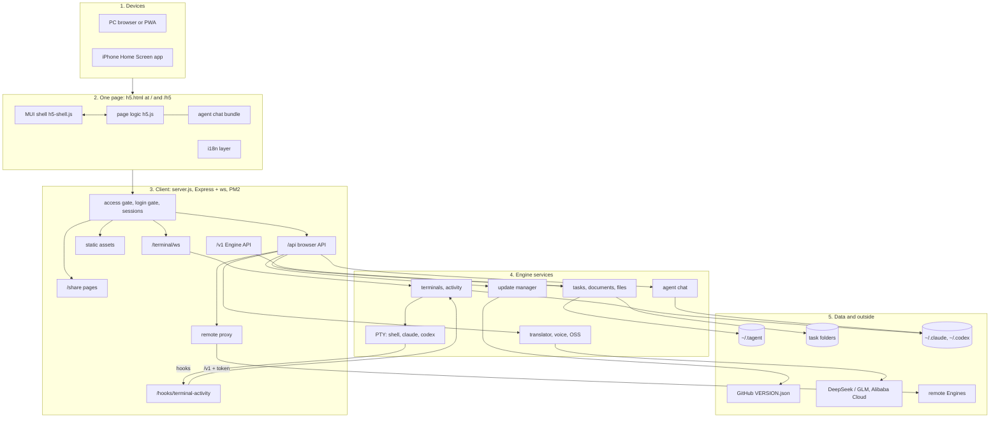
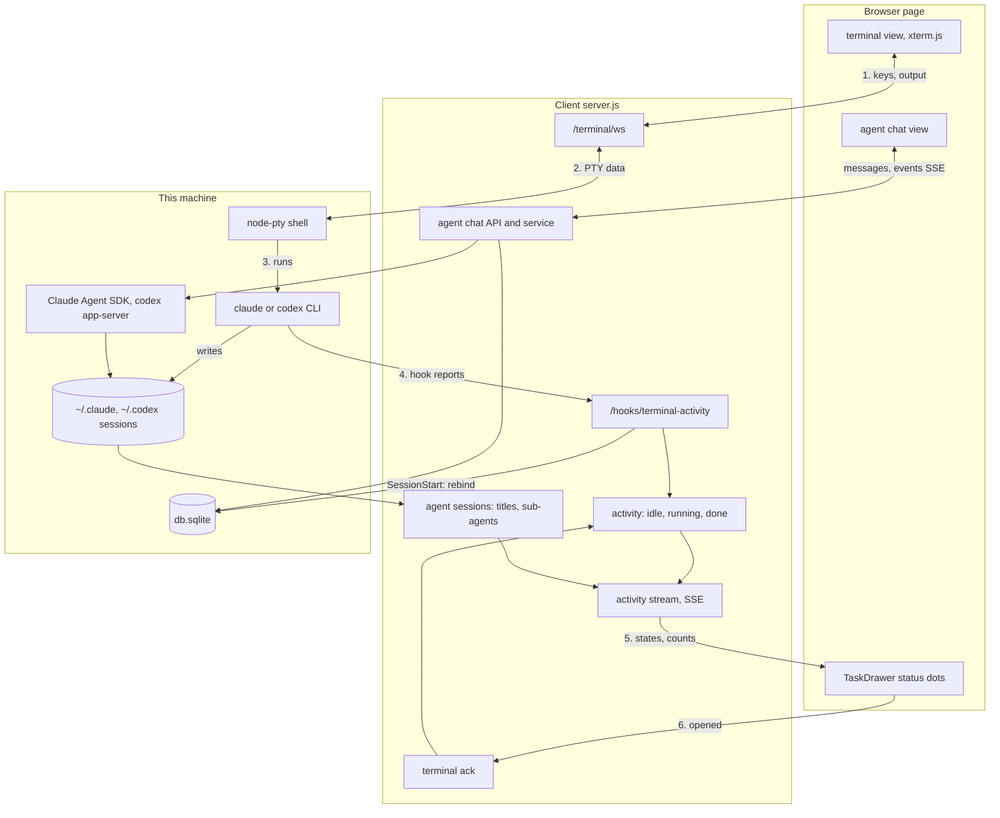
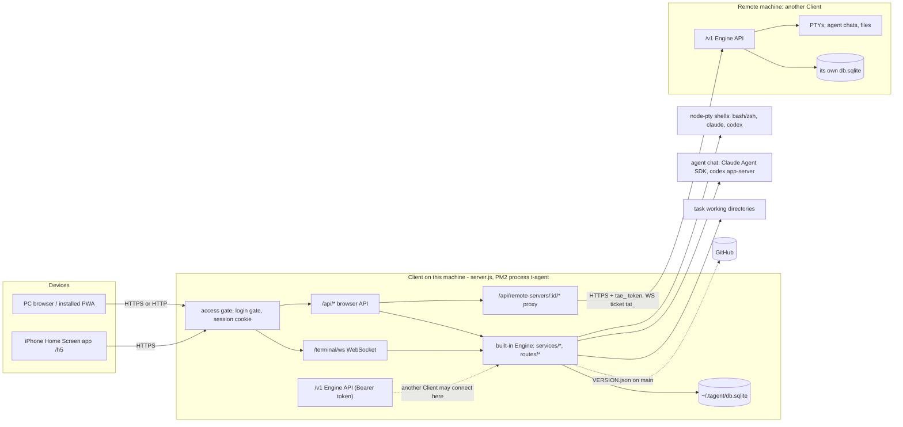

# T-Agent Design Document

> This document describes the system as it is now. The history of how it got here is in `git log` (and in the release notes of each version). "System architecture and functionality" is the map; the sections after it hold the details. Short notes of the latest releases are at the end ("Recent versions"); `scripts/release.js` appends one line there for every release.

---

## System architecture and functionality

> The map of the whole system as it is now (2.88.x: one Material UI page at `/` and `/h5`, data in `~/.tagent`; the diagrams were checked against the code on 2026-11-07). The sections after this part hold the details of each area.

Contents of this part:

- Overview diagram
- A. Purpose and users
- B. Deployment topology
- C. Server modules
- D. Data storage (and "Data directory")
- E. Data model and core concepts
- F. Client UI
- G. The page: routes, layout and input mode
- H. Cross-cutting rules

### Overview diagram

The whole project in five layers, from the device to the data. Part B shows how Clients connect to each other; the second diagram shows how a terminal and an agent chat move data.

- **Devices**: a PC browser (or the installed PWA) and the iPhone Home Screen app open the same page. There is no second page any more (the old PC page and Monaco were removed in 2.88.0).
- **Page** (`public/h5.html`): the React / MUI shell `scripts/h5-shell/*` (built to `public/js/h5-shell.js`: TaskDrawer, terminal bottom bar and on-screen keyboard, Settings, Update, Engines, Design sheet, file viewer) draws the UI; `public/js/h5.js` does the work (xterm.js terminals, warm connections, translate-and-send, voice, image upload, activity stream). They talk through the `window.H5UI` store. The agent chat bundle is `public/js/agent-chat-ui.js`; the i18n layer is `i18n.js` plus the Chinese dictionaries.
- **Client** (`server.js`, Express + `ws`, PM2 process `t-agent`): every request passes the access gate, the login gate and the SQLite session. Static files get content-hash URLs and brotli copies (`lib/static-assets.js`). The page uses `/api` and `/terminal/ws`; `/share/:token` serves read-only Markdown.
- **Engine services** live in the same process (`routes/*`, `services/*`, `lib/*`): terminals in `node-pty` with activity tracking, live directory and agent session binding (`routes/terminal.js`); agent chat through the Claude Agent SDK and `codex app-server`; tasks, groups, documents and files; the translator, voice token and OSS upload policy; the update manager.
- **Hooks**: Claude / Codex in a terminal report start, stop and `SessionStart` to `POST /hooks/terminal-activity` with the per-terminal `TA_HOOK_TOKEN`.
- **Data**: `~/.tagent` holds `db.sqlite`, `session-secret` and `server.lock` (see "Data directory"); task folders hold the user's files; `~/.claude` and `~/.codex` session files are read for names, sub-agents and resume.
- **Outside services**: GitHub `VERSION.json` on `main` for updates; DeepSeek or Zhipu GLM for translation; Alibaba Cloud OSS (images) and Fun-ASR (voice), which the browser calls directly after the Client signs the request.
- **Remote Engines**: the remote proxy `/api/remote-servers/:id/*` calls another Client's `/v1` with a `tae_` token (terminals with a one-time `tat_` ticket). Other Clients call this Client's `/v1` the same way.

- **1–2**: the terminal view sends keys over `/terminal/ws` (protocol v2, one owner per terminal); `handleWs` writes them to the PTY and sends output (and the in-memory history on reconnect) back.
- **3**: the shell runs `claude --session-id` / `--resume` or `codex` / `codex resume` for agent terminals.
- **4**: the CLI hooks post to `/hooks/terminal-activity`; activity events change the state (`idle`, `running`, `done`), and the Claude `SessionStart` hook rebinds the terminal to its new session after `/clear` (`task_terminals.agent_session_id`). Without hooks, the state comes from the foreground process and output bursts.
- **5**: `GET /api/tasks/terminal-activity/stream` (SSE) pushes the states and the running sub-agent counts, which `lib/agent-sessions.js` reads from the session log files; the TaskDrawer shows them as dots.
- **6**: opening a terminal that is `done` posts `POST /api/tasks/:id/terminal/ack`, which turns it back to `idle`.
- **Agent chat**: the chat view uses `/api/tasks/:id/agent/conversations` (REST plus an events SSE stream); `services/agent-chat.js` drives the Claude Agent SDK or `codex app-server` and stores the conversation in `agent_conversations`.
- For a remote Engine, the same calls go through `/api/remote-servers/:id/...` and the remote `/v1`.

### A. Purpose and users

T-Agent is a self-hosted, single-user web workbench for running and watching coding agents and terminals on one or more machines. One person installs a **Client** on each machine they work on. In a browser on a PC, or from the iPhone Home Screen app, they open tasks (a task is a working directory), start shells and Claude Code / Codex sessions in real PTYs, chat with Claude / Codex through the agent chat view, see which terminals are running or finished, and type into terminals with helpers (Chinese-to-English translate-and-send, voice input, image upload). Every Client also contains an **Engine**, so one Client can show and drive the tasks and terminals of other machines (see `README.md` "Project architecture", `docs/ARCHITECTURE.md`).

### B. Deployment topology

- **Client** (`server.js`): one Express + `ws` process. It serves the pages, the browser API under `/api`, the browser terminal WebSocket `/terminal/ws`, the hook endpoint `POST /hooks/terminal-activity`, the share pages `/share/:token`, and the Engine API `/v1`. The browser only ever talks to its own Client.
- **Engine**: the part that owns tasks, documents, terminals and chats. The local Engine is the same process (`routes/tasks.js`, `routes/terminal.js`, `services/*`). A remote Engine is another Client reached over `/v1` (`routes/engine-v1.js`; contract in `docs/ENGINE_API.md`). There is no standalone Engine service any more (removed in v2.28, see the v2.28.2 note).
- **Remote proxy**: `routes/remote-servers.js` mounts `/api/remote-servers/:id/...`. The Client decrypts the stored token (`lib/token-crypto.js`, key from `SESSION_SECRET`) and calls the Engine; the token never reaches the browser. JSON calls are forwarded, SSE streams are piped unbuffered (`services/remote-stream.js`), and terminals go through `services/remote-terminal-proxy.js`: the Client asks `POST /v1/terminal-sessions` for a one-time ticket (`tat_…`, 30 s) and opens `/v1/terminal-sessions/:id/stream?ticket=…`. The browser side of that is `/api/remote-servers/:id/terminal/ws`.
- **Pairing and tokens**: on the Engine, `POST /api/remote-tokens/pairing` makes a one-time pairing code `TA-XXXX-XXXX-XXXX` (10 minutes) or `POST /api/remote-tokens` an access token `tae_…` (stored as a SHA-256 hash in `engine_access_tokens`). On the Client, `POST /api/remote-servers` with the address and the code calls the Engine's rate-limited `POST /v1/pair`, gets a token, checks `GET /v1/info` and stores the token encrypted in `remote_servers.token_cipher`. Every token is admin (`services/engine-auth.js`).
- **Access mode** (`services/client-auth.js`, `lib/access-gate.js`, table `client_access_mode`): `local` = only direct loopback access, no login; `remote` = TOTP authenticator and external access; `unset` = choose on first local visit. Non-local requests in `local` / `unset` get 404.
- **Login gate** (`lib/login-gate.js`): when logged out, a GET of exactly `/`, `/web` or `/h5` redirects to the hidden login path (`CLIENT_LOGIN_PATH`, default `/torin/hide/login`) with `return_to`; everything else is a plain 404, except the login entrance, `/v1`, `/api/remote/v1`, `/health`, `/share/*` and the hook endpoint. Sessions are SQLite sessions (`db/session-store.js`) with a rolling 30-day life.
- **Process and listening**: `install.sh` starts the Client under PM2 with the name `t-agent` (launchd / systemd are still supported, `README.md` "Service management"). `config.js` defaults `HOST` to `127.0.0.1`; a fresh install writes `HOST=0.0.0.0` to `.env` unless `--access-mode local`.
- **Update flow** (`services/update-manager.js`, `lib/update-impact.js`, `routes/system.js`): the runtime version is `VERSION.json` in the install directory. `POST /api/system/check-update` reads `VERSION.json` of `main` on GitHub (`lib/version-utils.js` only allows `raw.githubusercontent.com` / `api.github.com`) and answers `available`, `current`, `local_newer` or `restart_pending` (the code on disk is newer than the running process). `POST /api/system/apply-update` does a Git fast-forward (optional force with a stash backup) or an archive update, installs and builds when needed, then exits with code 75 so PM2 (or launchd / systemd) restarts it; a frontend-only change skips the restart. `GET /api/system/update-status` gives the stage, log lines and `boot_id`, which the page uses to reload when the new process is up. `POST /api/system/restart` restarts the service with no update (see "Restart without an update" under "Update check and versions"). Remote Engines are updated through `/api/remote-servers/:id/check-update|apply-update|update-status` (`services/remote-engine-updates.js`).

### C. Server modules

One line each for the main modules, by area. Each route file is mounted in `server.js` (browser API) and, where the feature exists remotely, has a twin in `routes/engine-v1.js` and a proxy in `routes/remote-servers.js`.

**Entry and auth**

- `server.js` — Express app, gates, page routes (`sendClientPage` names `/js`, `/css` and `/vendor` scripts and styles `?v=<content hash>`, leaves the Chinese dictionaries out for English readers and adds the login-path meta tag), static files (see "Static asset caching"), share pages, WebSocket upgrade routing.
- `lib/static-assets.js` — content-hash asset URLs, the long cache for a matching hash (`no-cache` otherwise), brotli / gzip copies of scripts and styles made once in memory.
- `config.js` — `.env` settings (port, host, access mode, login path, cookie name, session secret).
- `routes/auth.js`, `services/client-auth.js` — TOTP binding and login, access mode, recovery codes, rate limits; `services/single-user.js` builds the single local user.
- `lib/access-gate.js`, `lib/login-gate.js`, `lib/client-embedding.js` — the gates above and the frame-ancestors / cookie SameSite rules.
- `middleware/auth.js`, `middleware/client-origin.js` (same-origin proof for browser mutations), `middleware/engine-auth.js` (Bearer token scopes for `/v1`), `middleware/remote-auth.js` (old `/api/remote/v1`).

**Tasks and groups**

- `routes/tasks.js` — task CRUD, reorder, validate-path, documents (`/document/:kind`, watch SSE), to-dos, share, reveal, vscode, workspace tools, terminals, activity, sub-agents, ack, agent sessions; mounts the files API.
- `routes/task-groups.js`, `services/task-groups.js` — groups (system groups `doing` / `todo` / `done` plus user groups).
- `services/task-documents.js`, `services/engine-tasks.js`, `services/task-assets.js` — document paths (`DESIGN.md`, `README.md`, `AGENTS.md` + `CLAUDE.md` with `@AGENTS.md`), creating missing documents, relative assets.
- `services/workspace-tools.js` — import unmanaged directories under `TASKS_BASE_DIR`, clean up and restore code directories (`repo_cleanups`).

**Terminals, PTY and activity**

- `routes/terminal.js` — PTY sessions keyed by task and terminal id (`node-pty`, `lib/node-pty-runtime.js`), WebSocket `handleWs` with protocol v2 (heartbeat, flow control; client side `public/js/terminal-protocol.js`), single owner per terminal (close codes 4009 / 4010, `takeover=1`), in-memory history replay, `cleanTitle`, agent terminals (`claude --session-id` / `--resume`, `codex resume`), `subagentSnapshot`, hook token per PTY, the per-process Claude `SessionStart` hook that rebinds a terminal after `/clear` (`scripts/claude-session-hook.js`).
- `lib/terminal-activity.js` — state per terminal: `idle` → `running` → `done` (until acknowledged) → `idle`. Decided by the foreground process, by output bursts for agents and TUIs, and by Claude / Codex hooks when they report. `GET /api/tasks/terminal-activity` reads it, `GET /api/tasks/terminal-activity/stream` pushes it with the sub-agent counts (`lib/terminal-activity-stream.js`, server-sent events), `POST /api/tasks/:id/terminal/ack { terminal_id }` turns `done` into `idle`.
- `lib/terminal-snapshot.js` (headless xterm with the vendored Unicode 11 addon), `lib/terminal-history.js`, `lib/terminal-input-modes.js` (reset mouse modes on restore), `lib/terminal-locale.js`, `lib/terminal-user.js` (drop root), `lib/clipboard-shims.js` (shim folder first in PTY `PATH`, see "Clipboard (OSC 52)"), `lib/websocket-close.js`, `services/terminal-tickets.js`.

**Agent sessions and sub-agents**

- `lib/agent-sessions.js` — lists Claude (`~/.claude/projects/<dir>/*.jsonl`) and Codex (`~/.codex/sessions/**/rollout-*.jsonl`) sessions of a directory, session names, and `runningSubagents` (Claude sub-agent logs under `<session>/subagents/agent-*.jsonl`).
- `GET /api/tasks/terminal-subagents` (Engine `/v1/terminal-subagents`, proxy `/api/remote-servers/:id/terminal-subagents`) — read-only count of running sub-agents per Claude terminal; used by the phone "next running or pending session" button.

**Agent chat**

- `routes/agent-chat.js`, `services/agent-chat.js` — chat conversations of a task (`/api/tasks/:id/agent/conversations…`: create, events SSE, messages, interrupt, permissions, queue, fork, commands, models, limits) and `/api/agent-chat/summary` (top-bar counters).
- `lib/agent-chat/claude.js` (Claude Agent SDK adapter), `lib/agent-chat/codex.js` + `codex-app-server.js` (JSON-RPC to `codex app-server`), `lib/agent-chat/fork-point.js`.
- Browser bundle: `scripts/agent-chat/*` → `public/js/agent-chat-ui.js` (`npm run build:agent-chat`), host glue `public/js/agent-chat.js`. Details: "Agent chat mode (v2.72.0)".

**T-Attention** (see "T-Attention" below)

- `services/attention.js` — items, events and tokens of the central attention list (validation, status rules, `onChange` bus); `routes/attention.js` — `/api/attention` for the browser session and for `Bearer tatt_…` tokens (the Bearer handler is mounted in `server.js` before the session and the gates).

**Mind maps** (see "Mind maps" below)

- `services/mindmap.js` — maps as JSON files in the data folder (one shared instance, `getMindmapService`); `routes/mindmap.js` — `/api/mindmaps` for the browser session and `/v1/mindmaps` for connected services (mounted in `routes/engine-v1.js`); the proxy `/api/remote-servers/:id/mindmaps` is in `routes/remote-servers.js`.

**Files API and safety**

- `routes/task-files.js`, `services/task-files.js` — `/api/tasks/:id/files` (list, create, rename, delete), `/files/content` (read, write), `/files/image` (an image, 20 MiB) and `/files/raw` (a PDF, audio or video file, streamed with Range support). Rules: paths are relative to the task root (`work_dir`, else the folder of `md_path`); absolute paths, `..`, backslashes and NUL are refused; symbolic links are never followed (`O_NOFOLLOW`, `lstat`, identity checks before and after); text at most 5 MiB of UTF-8; the root itself cannot be deleted. Engine scopes `files:read` / `files:write`.
- `services/file-content.js` — the content rules shared by the files API and the preview of any path: text is at most 5 MiB of UTF-8 without control characters (answer `{ path, content, revision, eol, bom }`), images are PNG, JPEG, GIF, WebP, SVG, BMP, ICO or AVIF by name and by content (at most 20 MiB; sniffing: PNG/JPEG/GIF/WebP signatures, `BM`, `00 00 01 00`, an `ftyp` box with the brand `avif` / `avis`, and for SVG text that starts, after an optional BOM, white space, an XML declaration, comments and a doctype, with `<svg`) with `Content-Security-Policy: sandbox`, `nosniff` and `private, no-cache` (an SVG is shown by the page only through ``, so its scripts never run); raw files (PDF, audio, video) by name and signature, see "Raw files" below.
- **Raw files** (capability `files:raw` in `/v1/info`, API version still 1): `GET <task>/files/raw?path=` (local `/api/tasks/:id/files/raw`, Engine `/v1/tasks/:id/files/raw` with scope `files:read`, proxy `/api/remote-servers/:id/tasks/:taskId/files/raw`; the task file path rules, `?terminal=` as for the other reads) and `GET /api/fs/raw?path=` / `/v1/fs/raw` / `/api/remote-servers/:id/fs/raw` (any path, as the terminal user, regular files only, as `/fs/content`). Only these names (case-insensitive): pdf `application/pdf`; mp3 `audio/mpeg`, m4a `audio/mp4`, aac `audio/aac`, wav `audio/wav`, ogg / oga / opus `audio/ogg`, flac `audio/flac`; mp4 / m4v `video/mp4`, mov `video/quicktime`, webm `video/webm`, ogv `video/ogg`. The first bytes must match: `%PDF-`; `ftyp` at offset 4 (mp4, m4v, m4a, mov); `1A 45 DF A3` (webm); `OggS`; `RIFF....WAVE`; `fLaC`; mp3 `ID3` or a frame sync `FF Ex/Fx`; aac `ID3` or ADTS `FFF1` / `FFF9`. Anything else (another name, wrong signature, an empty file) is 415 `FILE_UNSUPPORTED`; above 200 MiB 413 `FILE_TOO_LARGE`. One `Range: bytes=a-b` / `a-` / `-n` range answers 206 with `Content-Range`; a malformed or out-of-file range answers 416 `RANGE_NOT_SATISFIABLE` with `Content-Range: bytes */<size>`; another unit or several ranges are ignored (200, the whole file). `HEAD` sends the headers only. The file is streamed from an open descriptor (never buffered). Headers: the Content-Type above, `Content-Length`, `Accept-Ranges: bytes`, `X-Content-Type-Options: nosniff`, `Cache-Control: private, no-cache`, `Content-Disposition: inline`, and `Content-Security-Policy: sandbox` for audio and video. A PDF has no CSP sandbox, because Chrome does not show a sandboxed PDF in its viewer; the proxy (`streamRemote` with `raw: true` in `services/remote-stream.js`) keeps the sandbox on everything except an answer whose media type is exactly `application/pdf`, sends the `Range` header on, passes `Content-Range`, `Accept-Ranges`, `Content-Disposition` and `Cache-Control` back, and has no idle limit once the answer has started (a paused video is not cut). The proxy answers 501 `RAW_UNSUPPORTED` for an Engine whose `/v1/info` lacks `files:raw`; the local Client always has it. Tests: `test/task-files-api.test.js`, `test/fs-read.test.js`.
- `routes/fs-read.js`, `services/fs-read.js`, `scripts/fs-read-child.js` — read-only preview of a file at any path on the Engine machine; see "Preview of any path" below.

**Preview of any path** (read only; the user already has a shell on that machine)

- Endpoints: local `GET /api/fs/content?path=` and `/api/fs/image?path=` (browser session, the same gates as the other `/api` GETs); Engine `GET /v1/fs/content` and `/v1/fs/image` (scope `files:read`, capability `fs:read-any` in `/v1/info`); proxy `GET /api/remote-servers/:id/fs/content` and `/fs/image` (piped unbuffered with the Engine's status and error body; `Content-Security-Policy: sandbox` like every remote file answer; an Engine without `fs:read-any` gets 501 `FS_READ_UNSUPPORTED`). `GET /fs/raw` on the three mounts streams a PDF, audio or video file (capability `files:raw`, 501 `RAW_UNSUPPORTED` through the proxy without it; see "Raw files" above). The local Client always has it (the page treats local as supporting it). Writes, renames and deletes stay in the task files API, limited to the task root.
- Paths: an absolute path, or `~` / `~/...` (the terminal user's home on the Engine); anything else (relative, `~user`, empty, NUL, a repeated parameter) is 400 `BAD_PATH`. The path is normalized (`.`, `..`, trailing `/`); there is no root limit and symbolic links are followed. The answer names `path` (the normalized path asked for) and `realPath`.
- Files: regular files only, checked after following links: a folder is 400 `IS_DIRECTORY` with `{ path }`; FIFOs, sockets and devices (`/dev/zero`) are 400 `NOT_A_REGULAR_FILE`, and so are empty files under `/proc` and `/sys` (they are generated when read and may never end). The file is opened with `O_NONBLOCK` and checked again with `fstat` (still a regular file, same device and inode, else 409 `FILE_PATH_CHANGED`), so a read never waits for a writer. Text and image rules and answers are those of `GET <task>/files/content` and `/files/image` (413 `FILE_TOO_LARGE`, 415 `FILE_UNSUPPORTED` / `FILE_NOT_IMAGE`); 404 `NOT_FOUND`, 403 `PERMISSION_DENIED` (EACCES / EPERM); a read gives up after 10 s (504 `READ_TIMEOUT`). Errors are `{ error, message }` with an English message (Chinese in `public/js/i18n-zh-server.js`).
- Raw files at any path (`GET /fs/raw`, see "Raw files" above): the same file checks, then the signature; errors are `{ error, message }` with `This file type cannot be shown` (415) and `The file is larger than 200 MB` (413), an image above 20 MiB says `The image is larger than 20 MB`. The 10 s limit covers the checks up to the first byte; the stream itself has no time limit and is stopped when the answer closes. As a dropped terminal user the child runs `fs-read-child.js raw <path> <Range header or ''> <head|body>`: it writes one JSON line `{ realPath, size, range, head }` (`head` is the first 16 bytes in base64) or `{ error }`, then exactly the bytes of the range, streamed from its descriptor to its stdout. The parent (`spawnStreamRunner`) waits at most 10 s for that line, checks the size limit, the signature from `head` and that its own `parseRange` gives the same range, then pipes the rest through a counter that fails the stream when the child sends more or fewer bytes than the range (the answer is cut off instead of wrong); closing the answer kills the child.
- Identity: the read is done as the terminal user. When the service runs as root and drops terminals to `TERMINAL_USER` (`lib/terminal-user.js`), the Engine spawns `node scripts/fs-read-child.js <text|image> <path>` with that user's uid / gid, `HOME`, `USER` and a minimal environment (no service secrets), cwd `/`; the child does the same checks and writes one JSON line (`{ realPath, length }` or `{ error }`) and the bytes; the parent caps the output at the limit of the kind (5 MiB of text, 20 MiB of image) plus a little, kills it after 10 s, and applies the text / image rules itself. Otherwise (not root, no drop) the file is read in the service process, which is then also the terminal's user. Limits: node's spawn drops supplementary groups, so a file readable only through one of the terminal user's other groups is refused (403); the dropped user must be able to run the service's `node` and read the script (as for the Claude session hook). Regression: `test/fs-read.test.js` (the dropped path with an injected runner and with the real child under the test's own uid), `test/task-parity.test.js`.

**Input helpers**

- `routes/translate.js`, `services/translator.js` — `POST /api/translate` with DeepSeek or Zhipu GLM; up to 100,000 characters, split into pieces of at most 4,000 at line or sentence ends (`splitForTranslation`), pieces without Chinese kept as they are; each piece keeps its lines (`translatePiece`: the prompt asks for the same lines, and an answer with another line count or moved blank lines is translated again line by line, lines without Chinese kept exactly); `POST /api/translate/word`. Config is per user, encrypted in `system_state`.
- `routes/speech.js`, `services/speech.js` — voice input: the server only mints a 60-second Alibaba Cloud token (`POST /api/speech/token`); audio goes from the browser straight to Fun-ASR (`public/js/voice-input.js`).
- `routes/oss.js`, `services/oss-images.js` — image upload: `POST /api/oss/upload-policy` signs a POST policy and the browser uploads to Alibaba Cloud OSS itself (`public/js/oss-direct.js`).
- `services/attention-notify.js`, `plugins/notifiers/*` — T-Attention notifiers (Telegram message / call when an item needs the user), mounted at `/api/attention-notify`; see "T-Attention notifiers".

**Share pages**

- `GET /share/:token` and `/share/:token/file` in `server.js` — read-only Markdown of a task (`tasks.share_token`, created by `POST /api/tasks/:id/share`), only `.md` files under the folder of `md_path`.

**Machine tools** (local, and remote through `/v1` and the proxy where noted)

- PM2 and apps: `routes/pm2.js`, `services/pm2-manager.js` (status, logs, start / stop / restart / reload only), `routes/apps.js`, `services/apps-registry.js`, `services/apps-service.js`, `services/port-detector.js` (table `apps`; remote: `/v1/pm2`, `/v1/apps`).
- Tunnels: `routes/frp.js`, `services/frp.js`, `services/frp-install.js`; `routes/ssh-tunnel.js`, `services/ssh-tunnel.js` (local only).
- File sync: `routes/file-sync.js`, `services/file-sync.js`, `services/file-sync-instance.js` (master / slave, `/v1/file-sync/*`, state in `system_state.file_sync_v1`).
- Agent config: `routes/agent-config.js`, `services/agent-config.js` (default Claude / Codex settings pushed to this and remote machines, `/v1/agent-config`).
- Environment check: `routes/environment.js`, `services/environment-check.js`.
- Bookmarks (quick links): `routes/bookmarks.js`.
- Update: `routes/system.js`, `services/update-manager.js`, `services/archive-updater.js`, `lib/git-update-workspace.js`, `lib/update-command.js`, `lib/update-impact.js`, `lib/server-restart.js`, `services/remote-engine-updates.js`.
- Remote connections: `routes/remote-servers.js`, `services/remote-client.js`, `services/remote-server-settings.js`, `routes/remote-tokens.js`, `services/engine-identity.js` (stable `engine_id`), `routes/remote-api.js` (old read-only `/api/remote/v1`).

### D. Data storage

- One SQLite file per machine: `~/.tagent/db.sqlite` in the data folder of the service user (`TAGENT_HOME`, old name `T_AGENT_DATA_DIR`; `T_AGENT_DB_PATH` moves only the file), WAL, foreign keys on. Before the data folder it was `data/db.sqlite` in the install directory; see "Data directory" below for the layout, the one-time copy, the lock and the schema check.
- Schema: `db/schema.sql` (`CREATE TABLE IF NOT EXISTS`) plus additive, idempotent migrations in `db/index.js` that add missing columns on every start. There is no numbered migration runner. The database stores the schema generation it was last migrated to in `PRAGMA user_version` (= `VERSION.json` `schema_version`); a database with a higher number is refused (see "Data directory").
- Main tables and key columns:

| Table | Key columns / purpose |
| --- | --- |
| `tasks` | `id`, `title`, `status` (= group key), `priority`, `due_date`, `md_path`, `work_dir`, `technical_path`, `readme_path`, `agent_path`, `sort_order`, `user_id`, `share_token`, `archived_at` (schema 10; ISO 8601 UTC, NULL while in use) |
| `task_groups` | `owner_id`, `group_key`, `name`, `sort_order`, `is_system` |
| `task_terminals` | `task_id`, `terminal_id`, `title`, `agent`, `agent_session_id`, `agent_started_at`, `title_custom` (1 = the person named it), `work_dir` (the directory the terminal keeps, schema 8; NULL follows the task) |
| `task_default_terminal_titles`, `task_default_terminal_removed`, `task_default_terminal_dirs` | name, removal and kept directory (schema 8) of the implicit `default` terminal; a task made without one also has a row in `task_default_terminal_removed` |
| `agent_conversations` | `id`, `task_id`, `agent`, `session_id`, `title`, `mode`, `model`, `effort`, `opened_web`, `opened_h5`, `translate`, `collapse_keyboard`, `queue` (JSON) |
| `task_todos` | to-dos of a task |
| `remote_servers` | `owner_id`, `name`, `base_url`, `token_cipher`, `status`, `remote_version` |
| `engine_access_tokens`, `engine_pairing_codes`, `engine_identity` | Engine side of pairing (hashes only) and the instance id |
| `remote_access_tokens` | tokens of the old `/api/remote/v1` |
| `system_state` | key / value: encrypted per-user settings (`translator:<owner>`, `speech:<owner>`, OSS, `agent-config:<owner>`, `attention-notify:<owner>`, `attention-notify:telegram:<owner>`, `attention-plugin:<name>:<owner>`), `file_sync_v1`, update state |
| `apps`, `repo_cleanups`, `bookmarks` | app list, cleaned repo records, quick links |
| `attention_items`, `attention_events`, `attention_tokens` | T-Attention (schema 9): the central list, its history (`ON DELETE CASCADE`), its Bearer tokens (sha256 hashes only); `attention_items.parent_id`, `custom_status`, `result` and the index on `parent_id` since schema 11; see "T-Attention" |
| `sessions`, `client_auth`, `client_access_mode`, `client_auth_attempts`, `users` | login sessions, authenticator, access mode, rate limits, legacy accounts |

- Terminal output is not stored (dropped in v2.86.0); history lives in memory.
- `VERSION.json` fields: `app_version` (release, bumped by `scripts/release.js`), `api_version` (the `/v1` protocol; `/v1/info` also answers 1), `min_remote_api_version` / `max_remote_api_version` (the range this Client accepts from remote Engines), `schema_version` (the SQLite schema generation, now 11; the migrations in `db/index.js` still check for missing columns, and after them the number is stored in `PRAGMA user_version`; a code version whose number is lower than the stored one refuses to start, so forgetting to raise it lets an older version open newer data). Rule ("Version release rules" in part 13 below, `AGENTS.md` "Releases and pushing" point 3, `docs/HANDOFF.md`): change `api_version` and the remote range only when the `/v1` protocol changes incompatibly; raise `schema_version` whenever the SQLite schema changes (a new table or column counts), and never bump these fields mechanically with each release. History: v2.87.11 raised it from 6 to 7 for `task_terminals.title_custom`; v2.88.7 raised it from 7 to 8 for `task_terminals.work_dir` and `task_default_terminal_dirs` (terminal start directories); T-Attention raised it from 8 to 9 for the tables `attention_items`, `attention_events` and `attention_tokens` (new tables only, created by `schema.sql`; the 8 → 9 migration copies the database first like 7 → 8); task archiving raised it from 9 to 10 for `tasks.archived_at`; the T-Attention tree raised it from 10 to 11 for `attention_items.parent_id` (a reference to another item), `custom_status` and `result` (a real column change: unlike `attention_tokens.scopes`, an older version that ignored `parent_id` could delete a parent and leave its children pointing at nothing, so it must be stopped from opening the data; the API and remote versions did not change, T-Attention has no `/v1`); earlier column additions in v2.28.2, v2.70.0, v2.77.0 and v2.78.0 did not raise it, so the number is lower than the real count of schema changes. New endpoints are added as capabilities in `/v1/info` with the API version unchanged (for example `terminal-subagents` in v2.87.10, `files/image` as `files:image` in v2.87.15, and `terminal-activity/stream` as `terminal:activity-stream`, which the page detects by its 404 on an older Engine and then polls).

### Data directory

> Added in v2.87.14 (branch `feat/data-home-tagent`). Code: `lib/data-home.js` (the only place that knows data paths), `db/index.js`, `server.js`, `config.js` (`sessionSecret` getter). Tests: `test/data-home.test.js`, `test/uninstall.test.js`.

Goal: the runtime data of a machine lives outside the install directory, so every installed version (a second checkout, a worktree, an upgrade) reads the same data and no data migration is needed between versions.

- **Root**: `~/.tagent` (`os.homedir()` of the user the service runs as). `TAGENT_HOME` overrides it; the old name `T_AGENT_DATA_DIR` is an alias (the new name wins when both are set); a leading `~/` is expanded. `T_AGENT_DB_PATH` still overrides only the SQLite file.
- **Layout** (the same as the old `<install>/data`, so an older version pointed at it with `T_AGENT_DATA_DIR` reads the same data): `db.sqlite` (+ `-wal`, `-shm`), `session-secret`, `backups/` (database backups before updates, `services/update-manager.js`), `bin/frpc` and `frpc.toml` (`routes/frp.js`), `mindmaps/` (`services/mindmap.js`), `server.lock`, `migrated-from.json`.
- **Inventory of runtime data** (what moved and what stayed):

| Data | Before | Now |
| --- | --- | --- |
| SQLite database (tasks, groups, terminals, chats, sessions, remote servers and their encrypted tokens, pairing, authenticator, access mode, translator / voice / OSS / agent-config settings, update state, file-sync state, apps, share tokens) | `<install>/data/db.sqlite` (+ WAL / SHM) | `~/.tagent/db.sqlite` |
| Session secret (encrypts tokens, settings and the authenticator) | `SESSION_SECRET` in `<install>/.env` | `~/.tagent/session-secret`, seeded once from `.env` |
| Update backups | `<install>/data/backups/` | `~/.tagent/backups/` (old ones are not copied) |
| frpc binary and config | `<install>/data/bin/`, `<install>/data/frpc.toml` | `~/.tagent/bin/`, `~/.tagent/frpc.toml` |
| Server lock, copy marker | none | `~/.tagent/server.lock`, `~/.tagent/migrated-from.json` |
| `.env` (port, host, access mode, update source, `TASKS_BASE_DIR`, `TERMINAL_USER`) | `<install>/.env` | unchanged: it describes one install, written by `install.sh` |
| Service logs | `<install>/logs/` (launchd), `~/.pm2/logs` (PM2) | unchanged |
| Task folders | `TASKS_BASE_DIR`, default `~/tasks` | unchanged (user content) |
| File-sync backups, agent-sync cache and overrides | `~/.t-agent/file-sync-backups/`, `~/.cache/t-agent-sync`, `~/.config/t-agent/overrides` | unchanged (already per user; the backup paths are stored in the database) |
| Terminal history, update log, uploads | memory only; images go from the browser to OSS; chat images to a temporary folder | unchanged |

- **One-time copy** (`migrateLegacyData`): only for the default root, and only when the root has no `db.sqlite` and `<install>/data/db.sqlite` exists. Steps: copy the old folder as it is to `<install>/data.backup-<time>` (through `…partial-<pid>`, retried when the database changed during the copy, which means a server still writes it); build `~/.tagent.partial-<time>-<pid>` from that backup without `-shm`, `wal_checkpoint(TRUNCATE)` and `quick_check` it, write `migrated-from.json` (source, backup, time, app and schema version); publish by renaming the folder, or, when the root already exists without a database, by moving the other entries and hard-linking `db.sqlite` last (fails when another process published first). Half-done folders of dead pids are removed on the next start. The old folder is never opened by SQLite or changed. `backups/` is not copied (often gigabytes). Any failure stops the start with `DATA_COPY_FAILED` and leaves no database in the root, so the next start tries again. If the root has a database with a marker, the root is used and the old folder is named in the log as ignored. `.gitignore` ignores `data.backup-*/` (and so its `…partial-<pid>` folders), so a Git install's status stays clean and a forced update's `git stash --include-untracked` never takes the database copy (`test/git-update-workspace.test.js`).
- **Empty-home trap** (the root has a database but no `migrated-from.json`, the old `db.sqlite` exists, and no live server holds `server.lock`): both databases are checked for **user data** (`userDataIn`). User data = at least one row in `tasks`, `task_todos`, `task_terminals`, `agent_conversations`, `bookmarks`, `repo_cleanups`, `remote_servers`, `engine_access_tokens`, `engine_pairing_codes`, `remote_access_tokens`, `attention_items` or `attention_tokens`; a `task_groups` row other than the defaults `personal` / `doing` / `todo` / `done`; a bound authenticator (`client_auth.secret_cipher` set); a `users.work_dir`; a `system_state` key other than `update_state`, `single_user_id` and `file_sync_v1`; or a `file_sync_v1` with a master or files. Not user data (a start writes them by itself): default groups, the single user, sessions, PM2 apps, `engine_identity`, the unbound `client_auth` row, the access mode, update and empty file-sync state. The old database is read from a temporary copy (db + WAL), never opened in place.
  - **1a** root without user data, old folder with user data: `db.sqlite`, `-wal`, `-shm` and `session-secret` of the root are moved to `<root>/empty-start-<time>/`, then the normal one-time copy runs (backup, marker). Logged.
  - **1b** both with user data: nothing is guessed; the root is used, a framed warning names both folders with their counts and says how to choose (move the root away and restart to copy the old data, or set `TAGENT_HOME`), and the environment check "Storage → Data source" warns (`dataHomeCheck()`).
  - Old folder without user data: the root is used, the old folder is logged as ignored.
  - A separate rule for "a server started from a git checkout that is not the installed location" was not added: an install is itself a git checkout anywhere on disk, so there is no reliable way to tell them apart. 1a, 1b and the lock cover the cases: a dev server while the real one runs is refused by the lock, and an empty folder it made earlier is replaced by 1a.
- **Session secret**: the stored tokens, settings and the authenticator are encrypted with it, so it must live with the data. First start: `SESSION_SECRET` from `.env`; without one, existing data keeps the old built-in default (so it stays readable) and a new root gets 32 random bytes. Afterwards the file wins and a different `.env` value is ignored with a warning.
- **Permissions**: root 0700, `db.sqlite*`, `session-secret`, `frpc.toml`, `server.lock` 0600; looser modes are fixed on start with a warning.
- **Single writer**: `server.js` takes `server.lock` before opening the database (`open(…, 'wx')` with `{pid, port, host, version, started_at, install_dir}`; the real port is written after `listen`). A live pid makes the second server exit with `T-Agent cannot start: Another T-Agent server is already using the data folder …`; a dead pid (or an unreadable file older than 5 seconds) is moved aside and taken over. The lock is removed on exit. Command-line scripts (`create-engine-token.js`, …) open the database without the lock (short writes; SQLite serialises them).
- **Schema check**: `db/index.js` reads `PRAGMA user_version` before anything else. Higher than `VERSION.json` `schema_version` → close and refuse (`DATA_SCHEMA_NEWER`, "Upgrade T-Agent to the latest version"); lower → run the migrations and store the code's number. Since schema 8, an existing database (`user_version` 1 or more) that is migrated is first copied with `VACUUM INTO` to `backups/db-schema-<old>-before-<new>-<time>.sqlite` (mode 0600) in the data folder; a failed copy is logged and the start goes on. That copy is the way back to an older app version, which refuses the migrated database. Adding `user_version` is not a table or column change, so `schema_version` stays 7. From now on, forgetting to raise `schema_version` for a schema change means older versions are not stopped from opening the newer data. Startup errors are console output only (no page is served), so they have no Chinese translation.
- **Linux root and `TERMINAL_USER`**: the root is the home of the user the service runs as (root under PM2 as root → `/root/.tagent`; the systemd unit uses `User=` → that user's home). Terminals that drop to `TERMINAL_USER` do not get `SESSION_SECRET` (`lib/terminal-user.js`) and cannot read the 0700 folder; nothing in a terminal needs it.
- **Tests and dev servers**: `paths()` throws `DATA_HOME_IN_TEST` when no override is set in a test process (`NODE_TEST_CONTEXT`, or the script is `*.test.js` / `test-*.cjs`), so no test can touch the real `~/.tagent`. Every test that opens the database sets `T_AGENT_DATA_DIR` (or `TAGENT_HOME`) to a temporary folder; `T_AGENT_LEGACY_DATA_DIR` exists only so tests can point the one-time copy at a temporary old folder. Dev servers in worktrees must set `TAGENT_HOME` too; otherwise the lock stops them while the real server runs (and, when no real server runs, they would use the real data).
- **Install and uninstall**: `install.sh` no longer creates `<install>/data` and prints the data folder; `uninstall.sh` keeps the data folder (`TAGENT_HOME` / `T_AGENT_DATA_DIR` from `.env`, else `~/.tagent`), because every install shares it, and prints where it is and how to delete it; `--purge-data` deletes it after a second confirmation (`DELETE DATA`). Test: `test/uninstall.test.js` (stub service tools, temporary home).

### E. Data model and core concepts

- **Engine**: a machine's task store and runtime. The browser picks one: local (`/api/tasks`, `tasksBase = /api/tasks`) or a remote one (`/api/remote-servers/:id/tasks`). Resources are told apart by `(engine_id, task_id)`.
- **Group**: a `task_groups` row; a task's `status` holds the group key. The system groups are `doing`, `todo`, `done`.
- **Task**: a title plus a working directory `work_dir` (any absolute path on that Engine; the default is a new folder under `TASKS_BASE_DIR`) and a design document `md_path` (default `DESIGN.md` in `work_dir`). The task root for files is `work_dir`, else the folder of `md_path`.
- **Archived task** (schema 10, `services/task-archive.js`, `tasks.archived_at`): reversible and non-destructive. Archive keeps the work folder, documents, to-dos, `task_terminals` rows with their agent sessions, chats and their queues, the share link and the group; it closes the live terminals (`closeTaskTerminals`) and stops running chat turns (`stopTask`), as delete does.
  - Endpoints, with the same paths on `/api/tasks`, `/v1/tasks` and `/api/remote-servers/:id/tasks`: `GET ?archived=1` (newest `archived_at` first), `POST /:id/archive`, `POST /:id/restore`, all idempotent. Restore sets `sort_order` to 0, the value of a new task (`NEW_TASK_SORT_ORDER`); ties are still ordered by `created_at`. The proxy needs the Engine capability `tasks:archive`, otherwise `501 ARCHIVE_UNSUPPORTED`.
  - Inert until restored: creating a terminal, a terminal ticket and chat requests that give an agent work answer `409 TASK_ARCHIVED`; a terminal WebSocket (also the page's early socket, and a remote one through the proxy) closes with `1008 TASK_ARCHIVED`. 1008 is the close the page does not reconnect after. A queued chat message waits: neither stopping the turn nor restoring sends it; the next turn that ends, or "send now", does.
  - Reading (documents, to-dos, the terminal list, chats) stays allowed, and delete works. A shared link (`/share/:token`) keeps working, because archiving is not deleting.
  - Lists: the task lists, reorder, terminal activity and sub-agents (`activeTaskIds`), the old `/api/remote/v1/tasks`, the chat counters (`summary`, and `activity`, so a queue that waits does not hold back an update) and the repositories offered for cleanup leave archived tasks out. What protects data keeps them: `managedDirs` (an archived folder is not offered for import), `taskDirectoryGuard` and the `others` of the cleanup (it still protects a parent directory). `task_count` of a group and the group delete check still count them: the group is kept for the restore, so a group with only archived tasks cannot be deleted.
- **Session types of a task**:
  - plain **Terminal**: a shell in a PTY (`agent` null). A task has the rows in `task_terminals`; a task made before tasks stopped getting a terminal by themselves also has the implicit `default` terminal. A new task has none: see "No terminal until the person creates one" below.
  - **Start directory** (v2.88.7, schema 8): each terminal keeps the directory it was started in. A change of the task's `work_dir` only affects terminals created afterwards; existing ones keep working in their original directory. See "Terminal start directory" below.
  - **Claude / Codex Session**: a terminal whose shell types `claude --session-id <uuid>` / `claude --resume <id>` or `codex` / `codex resume <id>` (`agent` = `claude` / `codex`, `agent_session_id`).
  - **Agent chat**: an `agent_conversations` row shown in the chat view, driven by the SDK / app-server, not a PTY.
- **Terminal states**: `idle`, `running`, `done` (finished, not yet seen). Showing a terminal sends the ack (`POST …/terminal/ack`), which turns `done` into `idle`.
- **Naming precedence** (`routes/terminal.js`, `lib/agent-sessions.js`): if `title_custom` = 1 the stored `title` is always shown; otherwise an agent terminal shows its session name (Claude: last `custom-title` / `ai-title`, else the first prompt; Codex: `thread_name`), falling back to the stored `Claude N` / `Codex N`; a plain terminal shows its `title` (`Terminal N` by default). Names are cleaned by `cleanTitle` (at most 40 characters).
- **Sub-agents**: Claude Task / Agent tool calls. In a chat they are views inside the conversation (items with `parentToolUseId`); in a Claude terminal they are only counted as running from their log files (`runningSubagents`). Codex has none.

### Terminal start directory (v2.88.7, schema 8)

Before, every terminal read the task's current `work_dir`, so after a change of the working directory the existing terminals broke: session names fell back to `Claude N`, Codex binding and sub-agent counts used the new directory, the `/clear` hook was refused, a respawned Claude started an empty conversation with the old id (Codex started fresh), and file links of an old-directory shell did not open. Now (option A) each terminal remembers its own directory (`terminalWorkDir` in `routes/terminal.js`):

- Storage: `task_terminals.work_dir` is set by `createTerminal` to the task's `work_dir` of that moment. The migration adds the column and, in the same transaction, backfills existing rows with their task's current `work_dir`, so nothing changes for them. NULL (a task without `work_dir`) follows the task. The `default` terminal has no row: `task_default_terminal_dirs` gets its directory the first time its shell starts in the task directory (before that it follows the task; a plain shell has no session to lose); deleting the default terminal removes the row.
- Used everywhere a terminal needs its directory: the spawn `cwd` (also after close / restart / service restart; when the directory no longer exists the shell starts in the task's `work_dir` with a logged warning and a note in the terminal, else `$HOME` as before), `reopenCommand` (the session is looked up where the shell starts), `withAgentSessions` (session names and Codex binding, read per directory), `subagentSnapshot` (logs under the directory the live shell started in), the `/clear` SessionStart hook check (`cwd` must be the terminal's directory or the directory its live shell really started in), and `terminalCwd` (the file-link root).
- Unchanged on the task's current directory: new terminals, the list of sessions to resume (`listAgentSessions`), agent chats and the file browser.
- `GET …/terminals` rows (local, Engine `/v1` and the remote proxy) carry `work_dir`, the terminal's directory; the create answer too. Additive field, `api_version` unchanged.
- File links: the page resolves links against the terminal's `work_dir` (the task's when an older Engine sends none). When it is not the task's directory, the file sheet reads with `?terminal=<id>` (`GET …/files/content`, `…/files/image`, `…/files` listing; forwarded by the remote proxy). The file API then takes that terminal's directory as the root, with the same checks; only reads, writes always use the task root. An older Engine ignores the parameter (the old behaviour).
- UI: a session row whose directory is not the task's shows the folder name in its second line (the full path is its tooltip). The working-directory dialog shows "Existing sessions keep their directory; new sessions start in the new one." when the path is changed.
- Regression: `test/terminal-start-dir.test.js`, the schema 7 → 8 migration in `test/data-home.test.js`.

### Task rename

"Rename" in a task's "⋯" menu (local tasks and remote Engine tasks) opens a dialog with the title. Without the folder it saves the title through the existing `PUT {tasksBase}/:id` (local route, `/v1` PUT/PATCH, remote proxy PUT); a title that is given must have text after trimming (the creation rule; the local PUT now refuses an empty title with 400 `title is required`, the Engine already answered `TITLE_REQUIRED`). "Also rename the folder" (off by default) is offered on this machine and on an Engine with the capability `tasks:rename-folder`. It is shown at once when the folder still has the default name of the old title (`titleToSlug`); otherwise "Rename the folder too" shows it. It shows the old path, the new name (the slug of the new title until the person edits the name; the same parent) and the new path. Code: `services/task-rename.js`, `lib/agent-session-move.js`, `scripts/h5-shell/task-rename.mjs`, `RenameTaskDialog` in `TaskDialogs.jsx`, `askTaskRename` / `taskRenameSave` / `taskRenameCloseRetry` in `public/js/h5.js`.

**Endpoint**: `POST /api/tasks/:id/rename-folder`, `POST /v1/tasks/:id/rename-folder` (scope `tasks:write`) and the proxy `POST /api/remote-servers/:id/tasks/:taskId/rename-folder` (it reads `/v1/info` first: an Engine without the capability gets `501 RENAME_FOLDER_UNSUPPORTED` and nothing is sent). Body `{ name, title? }`; the answer is `{ task, old_dir, new_dir, moved: { claude_folders, claude_files, codex_rollouts, codex_threads } }`. Refusals, checked in this order, change nothing:

- `400 INVALID_FOLDER_NAME`: not one plain path segment (empty, spaces at either end, `.` / `..`, `/` or `\`, a control character, over 255 bytes). `400 TITLE_REQUIRED`, `400 FOLDER_NAME_UNCHANGED`, `404 TASK_NOT_FOUND`.
- `409 FOLDER_NOT_RENAMABLE` with `reason`: no working directory, a symbolic link or not a folder; the delete rules of `workspace-tools.js` `taskDirectoryGuard` (a protected folder, the tasks folder, a folder shared with another task or holding another task's folder or this program); a Git link that a move breaks. Git keeps absolute paths between a repository and its linked worktrees, both ways, and between a submodule and its parent, so the folder is refused when it has a `.git` file itself (a worktree or a submodule), when a repository inside it (`findRepos`, three levels) has a `.git` file pointing to a `worktrees` entry or outside the folder, or when the folder or a repository inside it has a non-empty `.git/worktrees`. A plain repository moves fine. `409 FOLDER_MISSING`: the folder does not exist.
- `409 FOLDER_EXISTS` with `path` (a case-only change on a case-insensitive disk is the same folder and allowed).
- `409 TASK_BUSY` with `terminals` (the live terminal ids, `liveTerminalIds` in `routes/terminal.js`: every shell in memory, attached or not) and `chat` (a chat turn running or being dispatched, `taskBusy` in `services/agent-chat.js`). Checked last, so a rename that cannot happen does not first ask to close terminals. The dialog then says how many terminals are open and offers "Close terminals and rename": the page closes each one with the usual control path (`POST …/terminal/control { action: 'close' }`, the view ended first), waits 1.5 s so the agents write their last lines, and saves again; the shown terminal opens again afterwards (it resumes its session in the new folder). A running chat turn must be stopped by the person.

**Steps** (synchronous, so no terminal or turn can start in between; each step records its undo and a failure undoes the earlier steps in reverse, answering `500 RENAME_FAILED` with the reason, or `500 RENAME_ROLLBACK_FAILED` when an undo failed too):

1. `fs.rename` of the folder (same parent, same file system).
2. Claude Code, in each agent home (below): the project folders whose name is `claudeProjectName` of the old path or begins with it are checked against the `cwd` rows inside (the name is lossy: `/a/b-c` and `/a/b/c` look the same), and those of the folder or a folder inside it are renamed to the name of the new path (when that name exists already, the rename stops and is undone: `RENAME_FAILED`, reason `SESSION_FOLDER_CONFLICT`). Then every `.jsonl` in them (sessions and `<id>/subagents/*.jsonl`) gets its `cwd` values that are the old path or inside it rewritten. Both the path as stored and its real path are handled (Claude Code names the folder after the real path, for example `/private/tmp`).
3. Codex, in each agent home: the rollouts whose first row (`session_meta`) has a `cwd` in the folder, plus the rollouts that the state database lists for it, get their `cwd` values (any object) and the entries of `runtime_workspace_roots`, `workspace_roots` and `writable_roots` rewritten; then `threads.cwd` and `project_roots.path` of `state_<n>.sqlite` (one transaction per database, 5 s busy timeout; journal files keep the database owner when the service runs as root).
4. The task records, one transaction: `tasks.work_dir`, `md_path`, `technical_path`, `readme_path`, `agent_path` (and `title` when given); `task_terminals.work_dir` and `task_default_terminal_dirs.work_dir` of the owner's tasks; `repo_cleanups.path` of the task (a cleaned repository is restored to the new place). Unchanged on purpose: `agent_session_id` and `agent_conversations` (chats store no folder; they use the task's on each turn), the share token (it reads the task's paths), mind maps, per-task visibility and the shared task order (keyed by task id).

A rewritten file is written to a temporary file in the same folder (same mode, owner and times, so the session lists keep their order) that replaces it; the old content stays under a hidden hard link `.<name>.t-agent-rename.bak` until the end, which the undo puts back and the success removes. Rows without the old path, and rows that do not parse (a partial last line), keep their bytes. Message text is never changed: the old path stays in the conversation history.

**Agent homes**: the terminal user's home when the service drops privileges (`TERMINAL_USER`, `lib/terminal-user.js`) and the service's own home, plus `CLAUDE_CONFIG_DIR` and `CODEX_HOME` when the service has them. The service does the work itself, as it creates and deletes task folders; files it rewrites keep their owner (`chown` when root), like the listener install does.

**Phase 1 findings** (Claude Code 2.1.322, Codex 0.167.1; run with a throwaway `HOME` / `CLAUDE_CONFIG_DIR` / `CODEX_HOME`, an API key that is not a key and a local fake model API that logs requests, so no account or usage was involved):

- Claude Code finds `--resume <id>` in the project folder of the current directory first, then in the projects of the repository's worktrees, then by scanning every project folder for `<id>.jsonl` (used only when exactly one folder has it). So after a folder move without any session move, `claude --resume <id>` from the new folder still loaded the conversation, but its new rows went into the old project folder, and `claude --continue`, the resume picker and T-Agent's session list (all by project folder) did not find it. After renaming the project folder and rewriting `cwd`, `--resume` (print and interactive, the conversation shown, no request sent) and `--continue` worked from the new folder and the rows went into the new project folder. Claude Code itself tells the model "Primary working directory: <new> (was <old>)" on the next turn. A project folder name longer than 200 characters is cut and gets `-` and a Java `String.hashCode` of the path in base 36 (checked against a real run); `lib/agent-sessions.js` `claudeProjectName` now does the same.
- Codex finds `codex resume <id>` by id anywhere, but the interactive TUI then compares the session's directory, read from `threads.cwd` of `state_5.sqlite`, with the current one and asks "Use session directory (<old, now missing>) / Use current directory", with the old one as the default. `codex exec resume --last` and the picker filter by the latest `turn_context` cwd of the rollout, and T-Agent's list by the `session_meta` cwd. With the rollout fields and the database rewritten, the TUI loaded the conversation without asking, `--last` found it and T-Agent listed it. The model is then not told that the folder moved (the old `<cwd>` stays in the environment text of the history).
- Not carried over: Claude Code's per-folder settings in `~/.claude.json` (trust, allowed tools, MCP servers) and Codex's `trust_level` in `config.toml` (both files are written by running agents, so changing them could lose their writes): the agent may ask once to trust the new folder. Claude Code's prompt history (`~/.claude/history.jsonl`, by folder) stays under the old path. A shell closed just before the move could, in theory, still write a last line into the old project folder.
- Tests: `test/task-rename.test.js` (crafted Claude and Codex files in a throwaway home; moves, cwd rewrite, `listSessions` by the new folder, a reopened terminal resuming in the new folder, rollback after and inside each step, busy refusal, names, existing target, worktree refusal, the `/v1` route, the proxy and an older Engine), `test/h5-task-rename.test.js`, `scripts/test-h5-task-rename-browser.cjs` (title only, with the folder, the busy flow, remote Engines).

### T-Attention

Goal: less attention spent on managing agent work. Agents and services (listener plugins, the `t-attention` CLI) create and update items; the person mostly handles the ones that need them ("Needs you"). Self-contained: own tables, service and routes; it never reads or changes tasks, work directories, terminals, agent chat or terminal activity. Shared across connected services: an item stays on the service that made it, and every other connected service reads and edits it in place through that one (`/v1/attention` on the owner, `/api/remote-servers/:id/attention` on the Client; see "Shared across connected services" below). Code: `services/attention.js`, `services/attention-summary.js`, `routes/attention.js`, mounted in `server.js` (and `/v1/attention` in `routes/engine-v1.js`, the proxy in `routes/remote-servers.js`). Tests for sharing: `test/attention-remote.test.js`. Tests: `test/attention-service.test.js`, `test/attention-http.test.js`, `test/attention-context.test.js`, `test/attention-summary.test.js`, the 8 → 9 and 10 → 11 migrations in `test/data-home.test.js`. End to end: `test/attention-e2e.test.js` starts a real `server.js` (temporary data folder, local mode, a fake notifier plugin preloaded with `node -r test/fixtures/attention-fake-notifier.js`), makes a token through `POST /api/attention/tokens`, runs `plugins/listeners/claude/hook.js` with recorded hook JSON (UserPromptSubmit → PermissionRequest + Notification → PostToolUse → Stop → SessionEnd; `TA_ATTENTION_URL` / `TA_ATTENTION_TOKEN`), and checks the statuses, the context, the timeline, the SSE changes, that the excerpt reached the server in process but is in no stored row, stream or notification, the two notifications (waiting_user, review) with the card text, and `t-attention show ref:claude:<id>`.

**Data** (schema 9, the tree columns schema 11; `db/schema.sql`; times are ISO 8601 UTC text)

- `attention_items`: `title` (1..300, one line, trimmed), `notes` (plain text, at most 20000), `status` (`todo` | `working` | `waiting_user` | `review` | `done` | `failed` | `cancelled`, default `todo`), `priority` (`high` | `medium` | `low` | `none`, default `none`), `due_date` (`YYYY-MM-DD`, a real date), `source` (default `user`; a token that creates without one gets `cli`; letters, digits and `. _ : @ -`), `external_ref` (unique, at most 200, e.g. `claude:<session_id>`), `attention_reason` (at most 500), `link_url` (`http(s)` without user name or password, or a page path starting with `/` but not `//` and without `\`), `link_label` (at most 200), `meta` (a JSON object of at most 8 KiB, returned parsed), `context` (the recall card, see below), `sort_order` (a new item gets the highest + 1; a body may set an integer), `created_at`, `updated_at`, `completed_at`.
- `completed_at` is set when the status becomes `done` / `failed` / `cancelled` (also on create), cleared when it leaves them; it is not touched by other changes.
- Tree and outcome (schema 11; `db/index.js` and `createAttentionService` add the columns and `idx_attention_items_parent` to an older database through `ensureTreeColumns`): `parent_id` (another item's id or `null`; `REFERENCES attention_items(id)`), `custom_status` (one line, at most 100, e.g. `Blocked`, `Waiting for review`), `result` (one line, at most 500, the outcome). All three are returned on every item and settable on `POST`, `PATCH` and `PUT by-ref`; `''` or `null` clears. A body may give `parent_ref` (an `external_ref`) instead of `parent_id` (both → 400); it is resolved inside the transaction. An unknown parent → 400 `VALIDATION_FAILED` `Unknown parent`; the item itself or one of its descendants → 400 `Parent cycle`; nothing of the request is applied. Depth is unlimited and the statuses of a parent and its children are independent (nothing propagates). Changes of the three fields are in the `data` of the change event like any field. Deleting an item that has children → 409 `{error: 'HAS_CHILDREN', message, children: [ids]}`, nothing deleted (the foreign key would refuse it too).
- Groups and order: an item belongs to one group, `waiting_user`, `review`, `working`, `todo` or finished (`done` | `failed` | `cancelled`); the page shows waiting_user and review together as "Needs you". Inside a group the display order is `sort_order` DESC, then `id` DESC. A new item gets the highest `sort_order` + 1, so it is at the top of its group. A child counts as a child (shown under its parent) only while its parent is in the same group; otherwise it is a top-level row of its own group.
- `attention_events`: one row per change, written in the same transaction as the change: `type` `created` | `updated` | `status` (the status changed) and `from_status`, `to_status`, `actor`, `data` (the changed fields). A change that changes nothing writes no event, keeps `updated_at` and is not published (listeners may send the same state again). Deleting an item deletes its events (`ON DELETE CASCADE`), so the `deleted` event is only published on the bus, not stored.
- `context` (a JSON object of at most 32 KiB after the merge, returned parsed; the column was added within schema 9 before its release, and `db/index.js` adds it to a database of an earlier build): `goal`, `latest_prompt`, `last_reply` (text, at most 2000 each), `pending` (`{kind: permission | question | error, text ≤ 1000, tool?, command? ≤ 1000}`), `files` (at most 50 `{path, added, deleted}`), `cwd`, `branch`, `host`, `started_at`, `turn_started_at` (ISO times), `turns`, `session` (`{agent, id, resume}`), `tagent` (`{task_id, terminal_id}`), `summary` (`{text ≤ 600, at, model}`). A create or update made with a terminal token (the `TA_ATTENTION_TOKEN` of a T-Agent shell, so also the `t-attention` skill and CLI there) ties the item to that terminal: `context.tagent` is set from the token when the item has none, the body does not name `tagent` (also not as `null`) and does not send `context: null` (`tieToTerminal` in `services/attention.js`; `verifyToken` returns the token's `tagent`, `routes/attention.js` passes it on create, upsert and update). An existing `tagent` is never overwritten; the browser session and normal tokens add none. The notifiers use it for the foreground rule ("T-Attention notifiers"). A body `context` is a patch merged shallowly into the stored one: a key set to `null` removes it, `context: null` clears it, unknown keys are dropped. Text values are cut to their limits (they come from prompts and replies; control characters other than tab and line breaks are dropped); a wrong type, a wrong `pending.kind` or a missing required key is a 400. The event of the change stores only the names of the changed context keys (`data.context: ['last_reply', 'pending']`), never their text.
- `activity` (body field on `POST`, `PATCH`, `PUT by-ref`): `{kind: prompt | permission | question | resumed | turn_end | error | session_end | note, text ≤ 500 (cut)}` → an `attention_events` row of type `activity` with `data {kind, text}`, in the same transaction as the change. An activity without other changes leaves the item (and `updated_at`) as it is and is still published, with `event` = the activity row; a change event also carries `activity` (the row or null).
- `excerpt` (body field, text; the last 8 KiB are kept): the end of the session transcript for the AI summary. It is never stored (no column, no event, no log) and never published on the public bus or the SSE stream; only in-process subscribers of `onChangeInternal(fn)` (the summary) get it with the change, and the summary uses it for one call.
- Validation: unknown body fields are ignored; `''` or `null` clears an optional field; errors are `400 {error: 'VALIDATION_FAILED', message}`.
- Bus: `onChange(fn) -> unsubscribe` (module export for this server's database, or `createAttentionService({db}).onChange`), `fn({kind: 'created' | 'updated' | 'deleted', item, previous, event})`; `previous` is null on create and the last state on delete. A listener that throws is logged and does not stop the others. Notifiers subscribe in-process.

**HTTP API** (`/api/attention`; errors `{error: 'CODE', message: 'English text'}`, Chinese in `i18n-zh-server.js`; every answer `Cache-Control: no-store`)

- `GET /api/attention?status=a,b&q=text&limit=200&include_done=1` → `{items}`, newest first (`sort_order` DESC). Without `status`, finished items (`done` / `failed` / `cancelled`) are left out unless `include_done=1`; `q` searches title, notes and reason (`%` and `_` are literal); `limit` 1..1000, default 200. The answer also has `host` (this machine's `os.hostname()`, the value the Claude listener writes into `context.host`), so the page can tell the sessions of this machine from those of another.
- `POST /api/attention` → 201 item; 409 `{error: 'EXTERNAL_REF_EXISTS', id}` when the ref is taken (also on a `PATCH` that sets a taken ref).
- `GET /api/attention/by-ref/:ref` (URL-encoded) → `{item, events}` like `GET /api/attention/:id`; 404 `NOT_FOUND` when no item has that ref. Session or token; the CLI and listeners look an item up with it instead of listing.
- `PUT /api/attention/by-ref/:ref` (URL-encoded) → 201 created or 200 updated; the address names the item (a body `external_ref` is ignored); creating needs a title. The listener path.
- `plain_turn_end: true` (optional body field on `POST`, `PATCH`, `PUT by-ref`): this update is a review that ends a plain Claude turn. It is not stored on the item or in an event: only the one published change gets a top-level `plain_turn_end: true`. The page then leaves out the in-page notice (see "Reminders" under "T-Attention on the page"). A later change of the item has no marker, so nothing has to be cleared. Any value other than `true` is ignored, and an older server ignores the field.
- `GET /api/attention/:id` → `{item, events}` (newest first, at most 100); `PATCH /api/attention/:id` → item; `DELETE /api/attention/:id` → 204 (409 `HAS_CHILDREN` with `children` when it has subtasks).
- `GET /api/attention?parent=<id>`: only the children of that item (the other filters apply as usual; a `parent` that is not an id → 400).
- `POST /api/attention/:id/move` (session and token) `{before: <id>} | {after: <id>} | {position: 'top' | 'bottom'}` (exactly one), optional `status` (any status: the status change and the placement are one transaction) and `reason` (one line, at most 500) → `{item, items}`, `items` = every item whose `sort_order` changed (the moved one included when its own value changed). The placement is checked against the group the item ends up in: a target in another group → 400 `Target is in another group`; other 400s: `Give exactly one of before, after or position`, `position must be 'top' or 'bottom'`, `before must be a task id`, `Unknown target`, `A task cannot be moved next to itself`, `A task cannot be moved next to its own subtask`; a refused move changes nothing (not the status either). The item moves as one block with its descendants in that group (depth-first, siblings in their display order; descendants in other groups stay where they are, and a parent that changes group takes the children already in the new group); `before` puts the block directly above the target, `after` below the target and the target's own descendants in the group. The group's existing `sort_order` values are given out again in the new order (first made strictly decreasing, so ties are renumbered), so only the items between the old and the new place change. The moved item gets one event (`updated`, or `status` when the status changed) whose `data` has `sort_order`, `status` when it changed, `move` (the placement as sent, e.g. `{position: 'top'}`) and `reason`, and a new `updated_at`. The other renumbered items keep `updated_at` and get no event row. Every item whose `sort_order` or status changed is published as its own `updated` change with `reorder: true` (the moved item first, with its event; the others with `event: null`), so the page can apply the new order from the stream alone. A move that changes nothing writes and publishes nothing and answers `items: []`.
- `GET /api/attention/stream`: server-sent events, `retry: 3000`, then `event: change` with `{kind, item, previous, event}` (and `plain_turn_end: true` on the change of such an update) per change, a comment line every 25 s. Works with the session and with a token; a token's stream ends when the token is revoked (at once through the route, otherwise at the next heartbeat).
- AI summary (session only): `GET` / `PUT /api/attention/settings/summary` (`{enabled, provider, model}` → the same plus `providers: [{id, label, hasApiKey, model}]`; never a key; enabling needs a key saved for that provider, else 409 `SUMMARY_PROVIDER_NOT_CONFIGURED`); `POST /api/attention/:id/summarize` → 202 `{started}` (false while one runs for the item; 409 `SUMMARY_DISABLED` when off). A token gets 403 on all three.
- First-run guide flags (session only): `GET` / `PUT /api/attention/settings/guide` (`{dismissed, pageOnly, paired, tested}` booleans, partial `PUT`; answer adds `updatedAt`; per owner in `system_state`; see "First-run guide" under "T-Attention on the page"). A token gets 403.
- Event `actor`: `user` for the browser; for a token the body's `source` when it sends one, else the token's name.
- `GET /api/attention` also answers `instance_id`, this Engine's own identity (`engine_identity`, the first part of a key in the shared task order), so a page that lists the items of several services can key an item `<instance_id>:<id>`.

**Shared across connected services** (capability `attention:remote` in `/v1/info`). The first version was this Client only, with no `/v1` twin and no proxy. Like the mind maps, an item now stays on the service (the Engine) that made it, and every other connected service, plain remote Engines and service links alike (the same set as the one task list), lists, reads and edits it in place through that Engine. Nothing is copied, so no merge rule is needed: the owner's database is the only copy and its rules (validation, tree checks, order) are the only ones.

- **Owner side, `/v1/attention`** (`createEngineAttentionRouter` in `routes/attention.js`, mounted in `routes/engine-v1.js`): the same service instance (`defaultService()`) and the same shapes as the item routes of `/api/attention`: `GET /v1/attention?status=&q=&limit=&include_done=&parent=` → `{items, host, instance_id}`; `GET /v1/attention/:id` → `{item, events}`; `POST /v1/attention` → 201 item; `PATCH /v1/attention/:id` → item (every field the local `PATCH` takes, `activity`, `plain_turn_end` and the tree fields included); `DELETE /v1/attention/:id` → 204 (409 `HAS_CHILDREN` with `children`); `POST /v1/attention/:id/move` → `{item, items}`; `POST /v1/attention/:id/summarize` → 202 `{started}` (409 `SUMMARY_DISABLED` when the owner has the summary off: the owner's setting, the owner's provider key, the single user as owner; 404 when the server has no summary, which only happens in tests); `GET /v1/attention/stream` → the same SSE as the local stream (`retry: 3000`, `event: change` `{kind, item, previous, event, reorder?, plain_turn_end?}`, a comment line every 25 s). Errors are the local ones (`{error, message}` and `id` / `children`).
- **Not exposed**: tokens, settings (summary, guide), plugins and their settings, the market, pairing, `by-ref` and the skill installer: every other path under `/v1/attention` is 404 `NOT_FOUND`.
- **Auth**: the router's first layer is `requireEngineAuth()`, before any body is read (`server.js` keeps its global parsers off `/v1/attention`; the router's own parser has the 256 KiB limit of the token path, 400 `INVALID_JSON` / 413 `BODY_TOO_LARGE`). Reads then need the scope `attention:read`, writes `attention:write` (403 `ENGINE_SCOPE_REQUIRED` otherwise); every Engine token, a service link's included, is admin (`*`) and has both. A `tatt_` CLI token is not an Engine token (401). Items belong to no task, so the per-task visibility guard does not touch these paths and `test/task-visibility.test.js` lists `/attention` as a reviewed mount.
- **Actor**: a write over `/v1` is recorded with actor `user` (and a created item gets source `user` when the body names none): an Engine token is the same person on another device, as in the browser, not a CLI or listener. A body `source` is stored as the item's source as usual but does not change the actor.
- **Stream end**: the owner checks the token at every heartbeat (`engine_access_tokens.revoked_at`), so a revoked token or a removed link (which revokes its token) ends the stream within 25 s; through a tunnel the stream also ends at once when the tunnel closes. The page reconnects.
- **The proxy** (`routes/remote-servers.js`): `GET|POST /api/remote-servers/:id/attention`, `GET|PATCH|DELETE .../attention/:itemId`, `POST .../:itemId/move`, `POST .../:itemId/summarize`, `GET .../attention/stream`, behind the browser session and the same-origin rule of the other proxy routes. In order: unknown row → 404 `REMOTE_NOT_FOUND`; an item id that is not 1 to 15 digits → 404 `NOT_FOUND` with no request; `/v1/info` must list `attention:remote` (else 501 `ATTENTION_REMOTE_UNSUPPORTED`; the answer is kept 30 s per row, so a polling page or a reconnecting stream does not read `/v1/info` every time); then the request is forwarded with `request` (only the list keys `status`, `q`, `limit`, `include_done`, `parent` of the query). Answers pass through with their status; an error keeps its code, `message`, `id` and `children`, nothing else. An offline Engine is 502 with the code `request` gives (`REMOTE_OFFLINE` through a tunnel, `REMOTE_CONNECTION_FAILED`, `REMOTE_TIMEOUT`). The stream is piped unbuffered by `streamRemote` (`services/remote-stream.js`, `sse: true`), as the terminal activity stream, which also works over a `tunnel://` base. The tunnel's path rules (`checkTunnelTarget`) let every `/v1/attention` path through without a change.
- **Per owner**: notifiers, reminders and the AI summary act only for the items of their own Engine (each subscribes to its own change bus), so an item edited from another device notifies once, on its owner. Per-task visibility settings do not apply (items are not tasks); hiding a whole device from the list is the page's job, as for tasks and mind maps.
- **Limits**: a parent and its children are always on one Engine (`parent_id` names an item of the same database; an item of another Engine cannot be a parent), and the order (`sort_order`, `move`) is per Engine: there is no order across services. Event `actor` does not say which device made the change.

**AI summary** (`services/attention-summary.js`, off by default)

- Setting per user, encrypted in `system_state` (`attention-summary:<owner>`): `enabled` (false), `provider` (`deepseek` | `glm`, the translator's providers), `model` (empty: the model saved for that provider in the translator settings, else its default). The API keys are the ones saved in the translation settings (`services/translator.js` `providerConfig`, server side only), used whether or not translation itself is on; the summary stores no key.
- Trigger: the change bus (`onChangeInternal`) when an item enters `waiting_user` or `review` (created in it, or a status change into it) and the setting is on; or `POST …/:id/summarize`. The owner of a change made by a token is the single user (`ensureSingleUser`).
- Prompt: the item's title, status, reason and context (`goal`, `latest_prompt`, `last_reply`, `pending`, up to 20 `files`) as JSON, plus the request's excerpt when one was sent. The model is asked for exactly three short lines `Doing: … / Progress: … / Needs: …`; list marks are removed, at most three lines and 600 characters are kept.
- Runs in the background (the API answer never waits), at most one per item, cut after 20 s. The result is stored with a normal update (`context.summary = {text, at, model}`, actor `summary`), so the page and the notifiers get a change event. A timeout or provider error is logged (item id and reason only, no content, no key) and never changes the item.

**Tokens and security**

- Format `tatt_` + 32 random bytes base64url (48 characters). Only the sha256 hash is stored; the token is shown once, by `POST /api/attention/tokens {name}` → 201 `{id, name, token}`. `GET /api/attention/tokens` → `{tokens: [{id, name, created_at, last_used_at, revoked_at}]}`; `DELETE /api/attention/tokens/:id` → 204 (revoke; the row stays). These three are browser session only (same-origin rule for mutations); a token gets 403 `TOKEN_NOT_ALLOWED` there in any spelling (case, trailing slash, percent-encoding).
- `Authorization: Bearer tatt_…` on `/api/attention*` is handled by `bearer` in `routes/attention.js`, mounted before the JSON parser, the session, the access gate and the login gate. It answers every Bearer request to `/api/attention*` itself: valid → the T-Attention router (no cookie read or set, no same-origin check, its own 256 KiB JSON parser); anything the router does not match → JSON 404; it never passes a Bearer request on. So a token reaches the T-Attention API and nothing else: other `/api` routes, pages and static files still go through the gates (404 / login redirect when logged out), and a token is ignored there. The gates themselves are unchanged. In local-only access mode a valid token also works from a non-local address (it is an explicit credential); without one such requests still get the 404.
- Failures: a missing, malformed, wrong or revoked token → 401 `TOKEN_INVALID`. Failed attempts are counted per address (`req.ip`): 20 in 15 minutes → 429 `TOO_MANY_ATTEMPTS` with `Retry-After` (in memory, reset by a restart). A valid token is limited to 600 requests a minute (429 `RATE_LIMITED`). `last_used_at` is written on every successful use.

### Mind maps

A self-contained feature: it has no database table (the schema version does not change) and it never reads or changes tasks, work directories, terminals, agent chat or terminal activity. The app has one user, so maps are not scoped per owner, like the T-Attention items.

**Shared across connected services (since the release after 2.99.0).** A map stays on the service that made it, and every other connected service (plain remote Engines and service links alike, the same set as the one task list) opens and edits it in place through that service: `/v1/mindmaps` on the owner, `/api/remote-servers/:id/mindmaps` on the Client. Nothing is copied. The first version was this Client only, with no `/v1` twin and no proxy, because a map was a personal scratch pad next to the terminal. That changed once the owner wanted all machines in one list, as the tasks already are: maps made on a phone-reachable machine had to be edited from the others, and a copy would have needed a merge for every pair of edits. The single owner with revisions keeps the existing conflict rule (409, nothing overwritten) the only rule, whichever machine saves.

**Data**: `<data folder>/mindmaps/<id>.json` (folder 0700, files 0600), one file per map: `{ id, title, data, revision, created_at, updated_at }`. `data` is opaque to the server: a JSON object, or `null` until the page first saves. Ids are server-made UUIDs, checked strictly before any path is built. A write goes to a temp file in the same folder, is fsynced and renamed; writes of one id run one at a time, and so do creates (the map limit holds under concurrent creates). Temp files left by a crash are removed at the first use after a start. The list reads a file only when its size or time changed.

**Backups**: the database backups taken before an update (`backups/`) do NOT include these files. Back up `mindmaps/` separately if the maps matter.

**API** (`/api/mindmaps`; errors are `{ error, message }`, the English `message` is translated in `public/js/i18n-zh-server.js`):

| Request | Answer |
| --- | --- |
| `GET /` | `{ maps: [{ id, title, revision, created_at, updated_at, size }] }`, newest `updated_at` first; `size` is the file size in bytes; no `data` |
| `POST /` `{ title?, data? }` | 201 `{ id, title, data, revision, created_at, updated_at }`; the defaults are `Untitled map` and `null`; `revision` starts at 1 |
| `GET /:id` | the same object; 404 `MINDMAP_NOT_FOUND` |
| `PUT /:id` `{ revision, title?, data? }` (at least one of the two) | `{ id, title, revision, updated_at }` with `revision` raised by one; a stale `revision` is 409 `MINDMAP_CONFLICT` with `current_revision` and writes nothing |
| `DELETE /:id` | 204; the file moves to `mindmaps/trash/<id>-<time>.json`, and moving it back by hand to `mindmaps/<id>.json` restores the map. The trash is never emptied automatically |

Limits: title 1 to 200 characters (trimmed, one line), `data` a JSON object of at most 8 MiB serialised (413 `MINDMAP_TOO_LARGE`), at most 2000 maps (409 `MINDMAP_LIMIT`; the trash does not count). A bad body or a body that is not `application/json` is 400 `INVALID_MINDMAP`. A failing disk is 500 `MINDMAP_STORAGE_FAILED`.

**Gates and body parsing**: mounted after the session, the access gate, the login gate and the `/api` check (same-origin for mutations, then the session), so logged out it answers the same 404 as any other protected address. `server.js` keeps the global parsers (`express.json` 32 MB and `express.urlencoded`, which run before the session) off this path, and the router parses JSON itself after the gates, with its own limit (8 MiB + 64 KiB for the fields around `data`). So a body is not read before the gates, and an oversized one gets the JSON answer above. Every other route keeps the global parsers and limit.

**`/v1/mindmaps`** (capability `mindmaps` in `/v1/info`): the same router and the same service instance as `/api/mindmaps` (`getMindmapService`), so bodies, answers, errors, limits and the trash are identical, and the per-id write queue and the create queue (the map limit) hold across both paths; a second instance on the same folder would break that. The router's first layer is `requireEngineAuth()` (any Engine token: every token is owner), so no body is read before the token check, and `server.js` keeps its global parsers off `/v1/mindmaps` as well. Maps belong to no task, so the per-task visibility guard does not touch these paths (it acts only on `/tasks/:id` and `/terminal-sessions`), and `test/task-visibility.test.js` lists `/mindmaps` as a reviewed mount.

**The proxy** (`/api/remote-servers/:id/mindmaps` and `.../mindmaps/:mapId`, `routes/remote-servers.js`): behind the same gates as the other proxy routes, and `server.js` keeps the global parsers off it too. In order: the map id must be a lowercase v4 UUID (else 404 `MINDMAP_NOT_FOUND`, as the owner would answer, with no request); the body goes through the same parser and the same `data` size check (400 `INVALID_MINDMAP`, 413 `MINDMAP_TOO_LARGE`), before anything is forwarded; then `/v1/info` must list `mindmaps` (else 501 `MINDMAPS_UNSUPPORTED`); then the request is forwarded with `request` (`maxBytes` 9 MiB + 64 KiB, an idle timeout of 60 s). Answers pass through with their status; an error keeps its code, `message` and `current_revision` (from `error.peerBody` of `services/remote-client.js`), nothing else. An offline Engine is 502 with the code `request` gives (`REMOTE_OFFLINE` through a tunnel, `REMOTE_CONNECTION_FAILED`, `REMOTE_TIMEOUT`). Through a service-link tunnel the request is an ordinary `/v1` stream: the path passes `checkTunnelTarget`, the headers are `authorization`, `content-type` and `accept` (the tunnel drops `content-length` and frames the body itself, so B's loopback request is chunked), and an 8 MiB map stays far below the tunnel's 64 MiB request body limit.

**Corrupt files**: a file that does not parse or does not match its name is skipped by the list and reads as not found (a save cannot overwrite it; a delete moves it to the trash). It is logged in one line with the id only, once per change of the file. Map content is never logged.

**Tests**: `test/mindmap-service.test.js`, `test/mindmap-routes.test.js` (the last case runs the real `server.js` for the gates and the parser order), `test/mindmap-share.test.js` (`/v1/mindmaps` against `/api/mindmaps`, the proxy against real and fake Engines, and two real linked services editing each other's maps directly and through the tunnel, with an 8 MiB map, chunked bodies and conflicts).

### F. Client UI

- **The page**: `public/h5.html` + `public/js/h5.js` (controller: tasks, sockets, viewport, keys, uploads, translation) + the React / MUI shell in `scripts/h5-shell/*` bundled to `public/js/h5-shell.js` (`npm run build:h5-shell`; `store.mjs` exposes `window.H5UI`). Served at `/` and `/h5` (the same HTML; `sendClientPage` sets the manifest link by address). Layout by width (900px), input mode by pointer media queries (part G). Details: "The page (/ and /h5)" and its "UI icons".
- Shared: `i18n*.js`, `toast.js`, `client-auth.js`, `terminal-owner.js`, `terminal-protocol.js`, `terminal-keys.js`, `terminal-ime.js`, `terminal-translate.js` (only `sanitize`; the desktop form code was removed in 2.88.1), `terminal-input-line.js` (reads the input line from the xterm screen for translate-and-send), `terminal-viewport.js`, `terminal-file-links.js`, `terminal-clipboard.js`, `voice-input.js`, `voice-overlay.js`, `word-translate.js`, `oss-direct.js`, `agent-chat*.js`, `markdown-view.js` (bundled into the design sheet and used by `server.js`), `sw.js`. Styles: `h5.css`, `agent-chat.css`, `markdown.css` (design sheet and share pages), `auth.css` (login).
- Manifests: `/` gets `manifest.json` (start `/`, standalone, `#121212`); `/h5` and `login.html` get `manifest-h5.json` (`start_url` `/h5`).
- Until 2.87.13 there were two pages (a PC page `public/index.html` with Monaco, and the phone page); tag `v2.87.11-two-pages` (commit `8494601`) marks the last release with two pages. The PC page was deleted in 2.88.0.

### G. The page: routes, layout and input mode

Decided by the user on 2026-11-05 and done in 2.87.12 to 2.88.1: the Material UI page is the only page, for PC and phone.

- **Routes**: `/` and `/h5` serve the same page (`h5.html`; `/h5` is kept so iPhone Home Screen apps keep working). `/web`, `/index.html` and `/h5.html` redirect to `/` and keep their query (`/web?openChat=…` → `/?openChat=…`). There is no user-agent routing. `sendClientPage` sets the manifest link by address (`/h5` → `manifest-h5.json`, `/` → `manifest.json`). Details: "One page" under "The page (/ and /h5)".
- **Layout by width**: one breakpoint, 900px (`wideQuery`, shared by `h5.js` and `scripts/h5-shell/entry.jsx`). Narrow: the phone layout (drawer task sheet, two-row bottom bar, bottom sheets). Wide: a permanent left sidebar that can be folded, and the T-Attention panel opens on the right. The design document, the file viewer and the file tree are the same sheet from the top at both widths; on a wide screen it has the left edge and the width of the terminal area (see "Design document"). A portrait iPad is under 900px.
- **Input mode** (separate from width, no user agent): `matchMedia('(hover: hover) and (pointer: fine)').matches && !matchMedia('(any-pointer: coarse)').matches` is `pointer`, else `touch`; kept in the store and on `<html data-input>`. Pointer mode hides the function-key row and the wheel strip, always shows the draft box as one line, hides the keyboard buttons, uses a 13px terminal font, and sends typing with nothing focused to the terminal. `TerminalClipboard` (copy on select and OSC 52, see "Copy" under "Terminal on the page") is attached in both modes. The touch-only viewport logic (`fitViewport` keyboard detection, `holdTerminalSize`, `scheduleKeyboardReset`, `settleViewport`, Screen Wake Lock) does not run in pointer mode. An iPad with a trackpad stays `touch`; the first hardware `keydown` sets `hasKeyboard`, which turns on the shortcuts.
- **Draft-box shortcuts** (the user's rule): with a hardware keyboard, Enter = translate and send; Cmd/Ctrl+Enter and Shift+Enter = new line at the caret; Option/Alt+Enter = send as typed. The Return of an on-screen keyboard stays a new line. "Hardware" is pointer mode, or a touch device with `hasKeyboard` and no on-screen keyboard open now (`keyboardOpen`): a browser cannot detect a keyboard directly, so a touch device counts only after a key was pressed with the viewport at full height. IME-safe (`isComposing` / keyCode 229 ignored in every combination). An empty box or a running translation makes Enter do nothing, as the buttons do.
- **Dropped with the PC page** (user decision, final): the editable file browser and the Monaco editor (a read-only file tree came back after 2.88.7, see "File tree" under "The page (/ and /h5)"), in-page Markdown editing, the To-do tab, the theme picker (dark MUI theme only), the multi-task page, the terminal history viewer, the environment check page, Utilities, quick links, workspace import / cleanup, batch update, the share button (the `/share/:token` pages stay), Finder / VS Code buttons, drag-sort and group create / rename / delete, priority, due date and document paths in forms, and the pages of Apps (PM2), Agent config, tunnels (frp / SSH) and File sync. Terminal file links open the read-only preview.
- **Endpoints kept for compatibility** (unused by the page, kept on the server, in `/v1` and in the remote proxy, so older pages, other Clients and scripts keep working; tunnels and file sync set to start with the Client still start): `/api/bookmarks`; `/api/tasks/workspace/*`; `PUT /api/tasks/reorder`, `POST /api/tasks/validate-path`; `/api/tasks/:id/todos*`; document `PUT` / `POST /api/tasks/:id/document/:kind`, `GET …/document/:kind/watch`, `GET …/md/watch`; `/api/tasks/:id/files*` except `GET …/files` (the file tree), `GET …/files/content` and `…/files/image` (used by the preview); `POST /api/tasks/:id/reveal`, `…/vscode`, `…/share`; `POST` / `PUT` / `DELETE /api/task-groups` and the `priority`, `due_date`, `technical_path`, `readme_path`, `agent_path` fields of `PUT /api/tasks/:id`; `/api/pm2`, `/api/apps`, `/api/frp`, `/api/ssh-tunnel`, `/api/agent-config`, `/api/file-sync`, `/api/environment`, `/api/local-ip`; `GET /api/tasks/terminal-activity` (the page falls back to it for older Engines); the `agent_conversations.opened_web` column.
- **`build:monaco`** stays in `package.json` as a no-op: an update started by a Client of 2.87.15 or older runs `npm run build:monaco` in the new code after `npm ci`, and a missing script would fail that update. `services/update-manager.js` no longer runs it. It can go once no Client older than 2.88.0 is left.
- **Open items**: an installed desktop PWA that was installed with `window-controls-overlay` may keep its old title bar until reinstalled; trackpad / keyboard iPads must be tried on a real device.

### H. Cross-cutting rules

- **Language and i18n**: code, docs and UI text are English; Chinese lives only in `public/js/i18n-zh-ui.js`, `i18n-zh-server.js`, `i18n-zh-extra.js` (keyed by the exact English text) and in fixtures; `test/i18n.test.js` enforces it. See "Interface language".
- **UI icons**: one library (Ant Design Official Icon Library, iconfont.cn collection 9402), inline SVG in `scripts/h5-shell/Icons.jsx`; self-drawn icons (`DRAWN`) or text labels where no library icon is clear; every icon-only button has an English `aria-label` and `title`. See `AGENTS.md` "UI icons" and "UI icons" under "The page (/ and /h5)".
- **Security**: the browser never gets an Engine token; tokens and secrets are stored hashed or encrypted and never written to logs; same-origin checks on browser mutations and WebSocket upgrades; the files API rules in C; the preview of any path ("Preview of any path" in C) is read only and reads as the terminal user (a child process with its uid / gid when the service drops root), regular files only; untrusted Markdown (the design document sheet) shows raw HTML as text and keeps only `http(s)` / `mailto` links and `http(s)` / `data:image` images; shared Markdown stays inside the folder of `md_path`; remote file responses carry `Content-Security-Policy: sandbox`; OSC 52 never writes the clipboard silently: only right after the user's own (trusted) gesture on that terminal, otherwise after a one-line preview in the copy bar and a tap on Copy; the previewed text cannot be replaced by later output, and decode limits, replay, hidden terminals and read queries are refused (see "Copy" under "Terminal on the page"); terminal output is not stored; the clipboard shims in terminal PATH (see "Clipboard (OSC 52)" under "Terminals") only send copies to the browser through OSC 52 and never read the browser clipboard, and a dropped terminal user gets them only when it can read and run them.
- **Releases**: batch requirements until the user says all are submitted, then one full `npm test`, `node scripts/release.js`, commit, normal push to `origin/main`. See `AGENTS.md` "Requirement batches" and "Releases and pushing".
- **Testing**: unit tests in `test/` (`npm run test:quick` while developing), real-Chromium scripts `scripts/test-*-browser.cjs` for UI, full `npm test` once before a release; bundles (`build:h5-shell`, `build:agent-chat`, `build:markdown`) are rebuilt when their sources change.
- **HTTP login sessions**: remote access needs HTTPS for the login cookie by default; only `CLIENT_ALLOW_HTTP=true` lets a plain-HTTP (intranet) request keep a session, and HTTPS requests always get a Secure cookie. It changes nothing else (authenticator, same-origin check, task permissions, WebSocket authentication) and never trusts a request by its IP.

## Terminals

- **Lifecycle**: a PTY (`node-pty`) is created at the first connection of a terminal and is not destroyed when the WebSocket closes; it ends when the service restarts or the terminal is closed, restarted or deleted. The shell starts in the terminal's own start directory (the task's `work_dir` when the terminal was created; see "Terminal start directory" in part E). Output history lives only in memory (5 MB per terminal) and is replayed on connect; nothing is stored in SQLite (the old `terminal_logs` table and `task_terminals.buffer` are dropped by a migration in `db/index.js`), so after a service restart a terminal opens empty with a new shell. A new shell of an agent terminal types its resume command (see "Agent terminals" below).
- **Protocol v2** (`public/js/terminal-protocol.js`): the client adds `proto=2` to the WebSocket URL. Control messages (history snapshot, history pages, resize, ping / pong) are binary frames holding JSON and every text frame is plain data, so program output or pasted text that looks like a control message is never taken as one. Without `proto=2` the server keeps the old text behaviour; the remote proxy forwards `proto`. Heartbeat: the client sends `ping` every 15 s and when the page becomes visible again; no frame for 40 s (or no answer 5 s after resume) closes the socket locally and goes through the normal reconnect; the server pings at protocol level every 30 s and terminates a socket without pong. Input typed during the snapshot replay is queued (4 KB) and sent when the replay ends (latched modifiers are kept until then).
- **Control messages** (client to server, binary frames with `proto=2`; also accepted as text frames from an old text-protocol client): `history-page`, `ping`, `resize {cols, rows}`, `presence {foreground: boolean}`. Unknown types are ignored (`handleControl` returns false; a binary frame is never typed into the shell). `presence` says whether this socket's page shows the terminal in the foreground (shown, page visible, the person used the page in the last 5 minutes; see "T-Attention notifiers"). The page sends it once after every (re)connect, right after the binary history snapshot, and then only on a change: the terminal shown or hidden, a chat opened or closed over it, `visibilitychange`, the 5-minute activity window running out (a timer) and activity after it ran out. It is never sent to a server that answered with a text snapshot (an old server would type it into the shell). The server (`lib/terminal-presence.js`) keeps the value per socket and drops it when the socket closes or is no longer open; a terminal is foreground while one of its sockets says true (`isTerminalForeground(taskId, terminalId)`, `presenceSnapshot()` for tests). At most 20 presence messages per socket per 10 s are taken; the rest of a flood is ignored.
- **Reconnect** (`open` / `closed` in `public/js/h5.js`): an unexpected close reconnects with a backoff of 1 s doubling to 30 s ("Connection lost, reconnecting in N s"), and at once when the page becomes visible again. Close codes 1000 / 1008 are not retried ("Tap the terminal tab to reconnect"); 4009 / 4010 are the single-owner codes below.
- Single-owner terminals (`routes/terminal.js` `handleWs`, `public/js/terminal-owner.js`): every device lists and creates the same terminals (`GET/POST …/tasks/:id/terminals`; the old `surface` parameter is ignored, and `h5-…` shells from v2.65–v2.81 are no longer listed). A terminal has one attached WebSocket. A second client from another browser tab or device is refused with close code `4009` (`terminal in use`) and gets no output and cannot type; the page shows "This terminal is in use on another device" over the terminal with a "Use this terminal here" button, which reconnects with `takeover=1`. A takeover closes the previous owner with `4010`; that page shows "This terminal is now used by another device" and the same button, and does not auto-reconnect. Neither code is retried automatically. Each browser tab sends a `clientId` (kept in `sessionStorage`, so a reload keeps it); the same `clientId` always replaces its own old socket, so a refresh or a reconnect after a dropped network never shows the prompt. The PTY is shared, so a takeover keeps the shell and its running program; the new owner's resize applies. Remote engines: the Client proxy forwards `clientId` and `takeover` to the Engine stream, so the rule is enforced where the PTY lives; an older Engine still replaces the old connection without a prompt.

### Terminal order

The terminals (sessions) of a task have one order, the same on every device and every Client that shows the task, so that a drag on one page is what every other page lists. Code: `setTerminalOrder`, `inStoredOrder` and `forgetTerminalOrder` in `routes/terminal.js`. Test: `test/terminal-order.test.js`.

- **Endpoints.** `PUT /api/tasks/:id/terminals/order`, `PUT /v1/tasks/:id/terminals/order` (`terminal:execute`, like the other terminal routes; linked services hold admin tokens and use it like the rest, and the tunnel carries PUT) and the remote proxy `PUT /api/remote-servers/:id/tasks/:taskId/terminals/order`. Body `{ order: [terminal id, ...] }`, answer `200 { order }`: the whole stored order after the change. Errors: `404 TASK_NOT_FOUND` (unknown task, another owner's, or one hidden from the linked service), `400 INVALID_TERMINAL_ORDER` (`order` is not an array of strings, more than 500 entries, or an id longer than 128 characters), `409 TASK_ARCHIVED` (as for a new terminal).
- **Merge.** Ids that are not terminals of the task are ignored and a repeated id counts once. Terminals the list leaves out keep their relative order (the current one) after the listed ones, so a page that knew only some terminals moves just those.
- **Listing.** `GET …/terminals` (local, `/v1` and the proxy) answers in the stored order; terminals it does not name (made since) come after, oldest first, so a new terminal is listed last. The `default` terminal of an older task is ordered like the others. Everything that lists terminals in order (the activity snapshot, the "next running or pending session" cycle) follows.
- **Storage.** One `system_state` row per task, `terminal_order_v1:<task id>`, a JSON list of terminal ids; no schema change and no `schema_version` bump (an older version ignores the rows). A write keeps only terminals that exist, deleting a terminal (`terminal/control` `delete`) takes it out (the row goes when it is empty) and deleting a task (local and `/v1`) removes its row, so the list never holds more than the task's terminals. Closing or restarting a terminal keeps its place.
- **Capability.** `/v1/info` lists `terminals:order`. The proxy reads it first: an Engine without it gets nothing sent and the page gets `501 TERMINAL_ORDER_UNSUPPORTED`, so the page can keep its old order for that Engine.

### Bounded terminal restore and on-demand history

The terminal service maintains a headless xterm state synchronized with the PTY output / size, and uses a serialized snapshot to restore the current screen, modes and the latest 500 lines of scrollback. On connect the entire retained buffer is no longer sent to the browser; the snapshot restore and the live output are delivered in order, so no data is lost or duplicated during asynchronous parsing. The retention limit of the in-memory raw log is unchanged. The headless xterm and the serialize addon are pinned to compatible versions; for the full-screen modes and cursor state the addon does not cover, restore sequences are added and verified with a real parser. The history is kept in memory only (5 MB); after a server restart a terminal starts empty, so nothing is rebuilt from disk. Control context that was already discarded because it exceeded the retention limit cannot be restored.

The initial WebSocket `history` frame keeps the `data` field and carries the snapshot size and optional `archive` metadata. The archive is pinned to the log snapshot of this connection, and a plain-text page of at most 500 lines and 128 KiB is returned only when the browser explicitly requests `history-page`. The request is bound to the connection, the archive ID and a cursor, and inherits the terminal authentication; control frames must never fall into the PTY input. An old Client can still restore the initial data, and a new Client does not request paging from an old Engine without archive metadata.

**Flow control and history retention**: the PTY is paused when the browser socket (`bufferedAmount`) plus the unparsed headless-xterm queue exceed 1 MiB and resumed below 256 KiB (polled every 20 ms; a closed socket stops counting, so the PTY is never left paused). Consecutive live chunks that wait for the parser are merged into batches of at most 256 KiB, so the live WebSocket messages are ordered byte runs, not one message per PTY chunk. The access check (session and task owner) runs at most once per second per socket; a revoked access closes the socket within about a second. The retained history is a chunk list trimmed in whole chunks and cut to exactly 5 MB when read; it is never written to SQLite (the earlier periodic and on-exit writes were removed together with the `terminal_logs` table). One escape-sequence scanner (`ControlScanner` in `lib/terminal-snapshot.js`, CAN/SUB aware) serves both the live parser tracker and the history archive.

The Client shares one history controller, keeping the input / OSC52 suppression and the scroll-position handling during replay; earlier logs are shown in a separate read-only window, inserted through text nodes, without replaying ANSI control sequences. Paging does not block the live main terminal, and pending requests are cleaned up when switching tasks, on disconnect and when releasing an instance, so history cannot mix into another terminal. This extension is backward compatible and changes neither the database nor the Engine API major version.

### Chinese selection alignment in the terminal

The `.xterm` container shared by local and remote terminals disables Chinese punctuation compression and the automatic spacing between Chinese and Western text, so the hidden character-width measurement and the visible text follow the same fixed column width. This avoids Chrome's contextual punctuation compression affecting the xterm DOM renderer and causing text after Chinese punctuation and the mouse selection to drift cumulatively. The browser regression covers Chinese, punctuation and English mixed, plus the normal / alternate screen and different pixel densities.

### Agent terminals

- Terminal icons and names: each phone terminal row starts with a type icon (`>_` shell, `✳` Claude, `◎` Codex). `task_terminals` has `agent`, `agent_session_id` and `agent_started_at` (additive columns). A new Claude terminal runs `claude --session-id <uuid>`, so its session is known from the start; a new Codex terminal is bound on listing to the oldest unclaimed session of the task directory that started after it. `GET …/terminals` returns `agent` and, for agent terminals, the current session name (Claude: last `custom-title` / `ai-title` in the session file, else the first prompt; Codex: `thread_name` in `~/.codex/session_index.jsonl`), falling back to the stored `Claude N` / `Codex N`. The page refreshes the names every 8 s while the task sheet is open; a rename sets `title_custom` (below). Whenever a new shell is spawned for an agent terminal (Reopen after close, Restart in the working directory, service restart) it types `claude --resume <id>` / `codex resume <id>` for the bound session; a Claude session that has no file yet is started again with `--session-id`, and an unbound Codex terminal starts a plain `codex`.
- Name precedence: `task_terminals.title_custom` (additive column) is set to 1 when the person names a terminal, at creation or by a rename (`PATCH …/terminals/:id`). Such a terminal always shows its stored name; the Claude session's `custom-title` / `ai-title` / first prompt and the Codex `thread_name` are no longer used for it. Agent terminals without `title_custom` follow the session name as below. Terminals renamed before this column existed have no flag and keep following the session.
- Claude terminals follow their current session (`scripts/claude-session-hook.js`, `withSessionHook` / `bindReportedSession` in `routes/terminal.js`). `/clear` (and `/resume <other>`, a fork) makes Claude run a new session id, while the terminal stayed bound to its first one: a new shell then resumed the old conversation, and the name, the sub-agent count and the cycle button followed the old session. Now:
  - Mechanism: Claude Code hooks, given per process. The PTY environment gets `TA_CLAUDE_SETTINGS`, a JSON string that only adds one `SessionStart` hook, and every command typed for a Claude terminal (`--session-id`, `--resume`, a resume from the session list) ends with `--settings "$TA_CLAUDE_SETTINGS"` (the shell expands it, so the screen shows a short command). `--settings` hooks are added to the person's own hooks, not put in their place (checked with Claude Code 2.1.318: the user-level `SessionEnd` hook still fired), and `~/.claude` is not changed. `SessionStart` fires on `startup`, `resume`, `clear`, `compact` and `fork` with `session_id` and `cwd` on stdin; after `/clear` it carries the new id (checked with the real binary).
  - The hook runs `<node of the service> scripts/claude-session-hook.js >/dev/null 2>&1 || true`: it posts `{ session_id, source, cwd }` to `POST /hooks/terminal-activity?task=&terminal=&event=session` with the existing per-terminal `X-TA-Token` (HMAC of task + terminal, from `TA_HOOK_TOKEN` in the environment; never on a command line). It prints nothing (a `SessionStart` hook's output would become Claude context), gives up after 2 s and always exits 0. Without `TA_HOOK_URL` / `TA_HOOK_TOKEN` it does nothing.
  - Server: the endpoint stays local-only and outside session auth, as for the activity events (it is not part of the Engine `/v1` API, so no capability). It takes the report only with the right token for that task and terminal (403 otherwise), only for a Claude terminal of that task (404), only for an id that matches `SESSION_ID` and only when `cwd` is the directory the terminal's shell starts in (the terminal's own directory, since v2.88.7 also the directory its live shell really started in; else the home directory; compared as real paths) (400). Then `task_terminals.agent_session_id` is set to the reported id and the activity stream is told. No schema change. `reopenCommand`, the session name and `subagentSnapshot` read that column, so they follow; a cleared session that has no message yet has no file, so a new shell starts that id again with `--session-id`.
  - Older terminals: a Claude terminal whose shell was started before this version has no hook in its running Claude, so it keeps the old behaviour until its shell is started again (close and reopen, restart, service restart); the next shell types the new command. Without a hook endpoint (it is set when the server listens) the commands stay as before.
  - Remote Engines run the same server code, so their Claude terminals report to their own `/hooks/terminal-activity` on `127.0.0.1`; nothing goes through the Client. An Engine that runs an older version keeps the old behaviour.
  - Limits: when the service runs as root and drops to `TERMINAL_USER`, the hook needs that user to be able to run the service's `node` and read the script; if not, it fails silently and the binding stays as before. Codex `/new` has the same problem, but Codex has no reliable per-terminal signal (its interactive hooks did not fire, see `docs/HANDOFF.md`, and its binding is the heuristic in `withAgentSessions`), so Codex terminals are unchanged. Regression: `test/terminal-claude-session-hook.test.js`.

### Peer file access in agent sessions (MCP)

The session side of "Peer file access" (the Engine API, the relay and the switch are described there): every Claude and Codex session a terminal starts gets the read-only MCP server `t-agent-peers`, so the agent knows the linked Engines exist and can read their files when the person names another machine.

- **Server** (`scripts/peer-mcp.js`, no dependency): MCP over stdio, JSON-RPC 2.0 with one JSON message per line; stdout carries only protocol messages, logs go to stderr. `initialize` answers the client's `protocolVersion` when it is `2025-06-18`, `2025-03-26` or `2024-11-05` (else the newest), `serverInfo.name` `t-agent-peers`, `capabilities: { tools: {} }` and short `instructions` (Codex shows them as the description of the tool namespace). `ping`, `tools/list`, `tools/call`; notifications get no answer; an unknown method is -32601, an unknown tool -32602, a line that is not JSON -32700 (the server keeps running), a batch array is answered as an array. Requests are handled concurrently; the end of stdin ends the process after the open calls.
- **Tools**, all with `annotations.readOnlyHint: true` (and `destructiveHint: false`): `list_engines` (the OTHER computers linked to this T-Agent, with name, online state, home, platform and tasks with their `work_dir`; its description tells the model to call it first whenever the person mentions another machine such as K01, and that the files there are read only), `list_dir { engine, path? }`, `read_file { engine, path, offset?, limit? }` (bytes; the answer starts with a header line and, when the relay gives a `next_offset`, ends with "Call read_file again with offset N"; `next_offset: null` means the rest of the file was read), `search { engine, path, pattern, glob?, ignore_case?, regex? }`. Results are one `text` content item (a readable listing, not raw JSON). Every relay error is a result with `isError: true` and `Error <CODE>: <sentence>`, plus the relay's own `message`: `PATH_NOT_ALLOWED` (home folder only, sensitive files left out), `PEER_FS_DISABLED`, `ENGINE_NOT_FOUND`, `ENGINE_OFFLINE`, `ENGINE_UNAUTHORIZED`, `PEER_FS_UNSUPPORTED`, `BINARY_FILE`, `IS_DIRECTORY`, `NOT_A_DIRECTORY`, `NOT_FOUND`, `PERMISSION_DENIED`, `READ_TIMEOUT`, `PEER_FS_AUTH_REQUIRED` / `PEER_FS_AUTH_INVALID`, and its own `TIMEOUT` (10 s per call, 30 s for `search`; `TA_PEER_TIMEOUT_MS` / `TA_PEER_SEARCH_TIMEOUT_MS` override them), `UNREACHABLE` and `NOT_CONFIGURED` (no `TA_PEER_URL` or token: not a T-Agent session).
- **Relay calls**: `GET $TA_PEER_URL/{engines,list,read,search}` with the arguments as the query (`ignore_case` / `regex` only when true, as `true`) and the headers `X-T-Agent-Task: $TA_PEER_TASK`, `X-T-Agent-Terminal: $TA_PEER_TERMINAL`, `X-T-Agent-Token: $TA_HOOK_TOKEN` (the terminal's existing hook token). Global `fetch` with an `AbortController` timeout.
- **Injection** (`routes/terminal.js`, `peerFsOn` / `peerEnv` / `withSessionHook`): only when the hook endpoint is known and `peerFsSettings().enabled()` is true, read once per shell start, so the typed command and the PTY environment always agree (the startup command of a new agent terminal is finished when its shell starts, not when it is created). The PTY then also gets `TA_PEER_URL` (the hook endpoint's origin + `/api/peer-fs`), `TA_PEER_TASK`, `TA_PEER_TERMINAL`, `TA_MCP_CONFIG`, `TA_PEER_MCP_COMMAND` and `TA_PEER_MCP_ARGS`; all of them are in `HOOK_ENV_KEYS`, so an outer terminal's values are never inherited. The token is never on a command line: the typed lines reference variables, and the expanded argv (what `ps` shows) holds only the node and script paths.
  - Claude: every Claude command (new, `--session-id`, `--resume`, reopen) ends with `--settings "$TA_CLAUDE_SETTINGS" --mcp-config "$TA_MCP_CONFIG"`. `TA_MCP_CONFIG` is `{"mcpServers":{"t-agent-peers":{"type":"stdio","command":"<node of the service>","args":["<abs>/scripts/peer-mcp.js"]}}}`. `--mcp-config` takes several values (a following word would be read as one more config), so it is the last option. It adds to the person's MCP servers (no `--strict-mcp-config`). Claude starts stdio MCP servers with its whole environment, so the TA_* variables reach the server with no `env` in the config (checked with Claude Code 2.1.322 and `claude mcp list` in a throwaway HOME). With the switch on, `TA_CLAUDE_SETTINGS` also has `permissions.allow: ["mcp__t-agent-peers"]`, so the read-only tools do not ask each time.
  - Codex: `codex` and `codex resume <id>` end with `-c "mcp_servers.t-agent-peers.command=$TA_PEER_MCP_COMMAND" -c "mcp_servers.t-agent-peers.args=$TA_PEER_MCP_ARGS" -c 'mcp_servers.t-agent-peers.env_vars=["TA_PEER_URL","TA_PEER_TASK","TA_PEER_TERMINAL","TA_HOOK_TOKEN"]'`. The two variables hold TOML values (a basic string, an array), so a path needs no quoting in the typed line. Codex starts MCP servers with a filtered environment; `env_vars` names the variables it passes on from its own environment (checked with codex-cli 0.167.1: `codex mcp get --json` shows the server, and `codex debug prompt-input` in a throwaway `CODEX_HOME` started the real server and listed the `mcp__t_agent_peers` namespace; a probe server started the same way had the four variables and only about 15 others in its environment).
  - Without a hook endpoint, or with the switch off, the commands and the environment are exactly as before. A session already running keeps what it was started with; the switch applies to the next shell.
- **Limits**: a session started before this version, or while the switch was off, has no tools until its shell starts again. The tools reach only what the relay allows (see "Peer file access"). A dropped terminal user must be able to run the service's `node` and read `scripts/peer-mcp.js`, as for the Claude session hook. Whether a model actually picks the tools is up to the model; the descriptions name other computers and K01-style names to make that likely.
- Tests: `test/peer-mcp.test.js` (the real script against a mock relay: handshake, tools, forwarding, error mapping, timeout, malformed input), `test/terminal-peer-mcp.test.js` (the commands and the environment with the switch on and off, Codex, reopen and resume, inherited variables).

### Terminal activity push

- Terminal activity push (`lib/terminal-activity-stream.js`, `routes/terminal.js` `serveActivityStream`, `h5.js` `connectFeed`):
  - Endpoints: `GET /api/tasks/terminal-activity/stream` (login gate and session like the other `/api/tasks` routes), Engine `GET /v1/terminal-activity/stream` (Bearer token, scope `terminal:execute`, as `/v1/terminal-activity`; capability `terminal:activity-stream` in `/v1/info`), proxy `GET /api/remote-servers/:id/terminal-activity/stream` (piped unbuffered by `services/remote-stream.js`; the Engine token stays on the Client). The polling endpoints stay.
  - Messages: `retry: 5000`, then `event: activity` with `data: { activity, subagents }` (the same objects as `terminal-activity` and `terminal-subagents`, only the owner's tasks) on connect and whenever that stream's snapshot changes; whole snapshots, not diffs, so a lost message cannot leave a page wrong. A `: ping` comment every 20 s keeps proxies from closing it.
  - Triggers: every tracker state change (`createActivityTracker`'s `onChange`: running, done, idle, an ack included) and the end of a terminal session (exit, close, restart, delete) call `notify()`; changes within 100 ms go out as one message. Sub-agents have no event (they are log files), so one shared timer reads the counts of all live Claude terminals (`subagentSnapshot(null)`) every 5 s, only while at least one stream is open, the same for any number of tabs or devices; streams are written only when their part changed.
  - Page: reads the stream with `fetch` (not `EventSource`) so it sees the status. 404 / 405 / 501 (an older Engine, also through the proxy) or a 200 that is not an event stream means no stream: it polls `terminal-activity` and `terminal-subagents` every 30 s instead (feature detection, not a version check). Other failures and a stream that ends reconnect with a backoff from 1 s doubling to 30 s, polling every 30 s meanwhile; no data for 50 s counts as a dead stream. Hidden page: the stream is closed and opened again with a fresh snapshot when the page is shown (nothing hidden needs it; phones drop background connections anyway). Another Engine: the stream is reopened for it. Each tab has its own stream.
  - Requests while a terminal is shown: before, 20 per minute (3 s ack poll), plus 2 per cycle tap; now one open stream and no polling (a cycle tap still reads the terminal lists of other tasks), or 4 per minute (2 every 30 s) against an Engine without the stream.

### Terminal file links

File paths in terminal output are links that open the file in the task's file browser. Detection is one shared module, `public/js/terminal-file-links.js` (`findFileLinks`, `toRelative`, `attach`; unit test `test/terminal-file-links.test.js`), registered on each xterm with `registerLinkProvider` next to the OSC 8 `linkHandler`.

- Detected: `src/app.js`, `./docs/a.md`, `../x/y.ts`, `/abs/path/file.ts`, `lib/` (a folder), a bare name only with a known text extension (`README.md`), `file:line`, `file:line:col`, `file:line-line`, `#L12`, `@src/app.js` mentions, `file:///abs/path` (and `file://localhost/`), and paths inside `( ) [ ] { } < >`, quotes and backticks (Claude Code `Read(src/x.js)`, Markdown `[x](path)`). Trailing `. : ! ?` and CJK punctuation are dropped. A path holds spaces only inside quotes. Chinese file names work; wide cells are mapped through the xterm buffer, and wrapped lines are joined.
- Paths over several rows: a line the terminal wraps (xterm `isWrapped`) is searched as one line, so a long path is one link from its first to its last row. Programs that wrap text themselves (Claude Code and other TUIs) write a real newline and an indent instead (`  ⎿  /a/very/long/pa` + `     th/plan.md`); `logicalLine` joins such a row with the next one (indent and trailing blanks left out, the link range then spans the rows, the indent included) only when (1) the row's text reaches the last column of the terminal (`term.cols`; one free column allowed for a padded box, `HARD_WRAP_SLACK`), (2) the next row starts, after an indent of less than half the width, with a word right after it, and (3) `continuesPath(tail, head)` agrees: the piece at the edge holds a `/`, the joined text is a path, and it adds only a position (`a.js` + `:42`), extends a known extension (`plan.m` + `d`), or, when the piece has no known extension, ends in a folder, goes on with a `/` or gets a known extension. Word-wrapped text fills rows the same way, so `/a/plan.md` + `next` and `/a/b` + `for` stay apart; a path broken inside a folder name without a `/` after it (`/a/scrat` + `chpad`) or a whole path followed by a word with an extension or a `/` is not joined (limits). Checked against Claude Code 2.1 output in a headless xterm: tool output (`⎿` and a 5-space indent, rows filled to the last column), the input box and dialogs (one free column).
- Not links: `http(s)://` and other URLs (left to the web links addon), `~/...` (except with any-path read, below), host-like first parts (`github.com/o/r`), numbers and dates (`2026/11/05`, `1/2`, `v2.87.10`), anything with a remaining `:` or a backslash.
- Root (any-path read, after 2.88.9): the file sheet opens files at any path of the Engine machine when the Engine has the any-path read (`GET /fs/content`, `/fs/image`, read only, as the terminal user, regular files only; the local Client always, a remote Engine when its `/v1/info` `capabilities` contain `fs:read-any`; the page keeps that list on the source object each time it reads `/info` (`readInfo` in `h5.js`: the session menu, the chat list, and once when a terminal of a remote Engine is attached)). The option `anyPath` of `TerminalFileLinks.attach` (a boolean or a function, here `readsAnyPath(s.source)`) then makes paths outside the root links too: absolute paths elsewhere (Claude Code's scratchpad `/private/tmp/claude-<uid>/...`), `~/...` (`~`, `~/` and `~user/...` stay plain text), relative paths that go above the root, and relative paths from a live directory outside the root (an OSC 7 report or the server's `…/cwd` answer with `relative: null`). `locatePath` / `link.locate()` give `{ relative }` (inside the root: the task file API, unchanged, with `?terminal=`) or `{ absolute }` (folded `.`/`..`; a `..` above `~` is left to the Engine), read with `GET {fs}/content?path=` (local `/api/fs`, remote `/api/remote-servers/:id/fs`; `openAnyFile` in `h5.js`). The sheet's title is the file name and its second line (and tooltip) the Engine's normalized `path` (so `~/x.md` shows where it is); relative Markdown images resolve against the file's folder through `{fs}/image`. The any-path codes have their own notes (`FS_ERRORS` in `Design.jsx`): `IS_DIRECTORY` a folder note, `NOT_FOUND` "Not found: <path>", `PERMISSION_DENIED`, `NOT_A_REGULAR_FILE`, `FILE_TOO_LARGE`, `FILE_UNSUPPORTED`, `FILE_PATH_CHANGED`, `READ_TIMEOUT`, `BAD_PATH`, anything else "Could not open the file". The proxy's `501 FS_READ_UNSUPPORTED` (the remote Engine lacks it after all) closes the sheet with the old "Outside the working directory: <path>" note and drops the capability, so its outside paths stop being links. Every other rule of detection is unchanged; the file tree stays the task root.
- Root (older Engines without `fs:read-any`, and `attach` without `anyPath`): the limit is the task working directory (`work_dir`, else the folder of `md_path`: the same root the server's `taskRoot` uses). A path outside the root (absolute elsewhere, or `..` past it) is not a link at all: no underline and no request, because the file sheet could not show it. This includes Claude Code's scratchpad (`/private/tmp/claude-<uid>/...`), which is outside every task root. Absolute paths need a known root; the server checks everything again (relative only, no symbolic links, 5 MiB).
- Live directory: relative paths are taken from the shell's current directory, so after `cd sub` a printed `a.md` opens `sub/a.md`. In order: (1) the directory the shell reports with OSC 7 (`ESC ] 7 ; file://host/path BEL|ST`), read in the browser with `term.parser.registerOscHandler(7)` (`parseOsc7`: percent escapes decoded as UTF-8, trailing slash and `.`/`..` parts folded, control characters refused). The host is not checked: the PTY runs on the Engine machine, so the shell names that machine (`$HOST`, `localhost` or nothing) and the browser does not know its name; the path is taken as an Engine path and still limited to the root. (2) Else, only when a link is activated, the server reads the shell's directory: `GET …/terminals/:terminalId/cwd` (local `/api/tasks/:id`, Engine `/v1/tasks/:id` with `terminal:execute`, and the remote proxy; read-only, `lib/terminal-cwd.js`: `/proc/<pid>/cwd` on Linux, `lsof -a -d cwd -p <pid> -Fn` on macOS) answers `{ cwd, relative }`, where `relative` is the directory inside the root compared as real paths (a symbolic link out of the root is outside, `null`). Only the shell process is asked, not its foreground child: Claude Code and other programs print paths relative to the directory they were started in, which is the shell's. (3) Else (no shell running, an older Engine without the endpoint, a failed request) the work dir, as before. With a reported directory outside the root, relative paths are no links; with a server directory outside the root the tap opens nothing and says "Outside the working directory: <path>" (an Engine with `fs:read-any` opens the file from that directory instead). The app does not inject shell integration (it starts `/bin/zsh`, `/bin/bash` or `/bin/sh` with no rc wrapper and does not touch dotfiles). OSC 7 comes out of the box from oh-my-zsh (`termsupport.zsh`, since the PTY has `TERM=xterm-256color`; not inside SSH sessions) and from macOS `/etc/zshrc_Apple_Terminal` / `/etc/bashrc_Apple_Terminal` when the service inherited `TERM_PROGRAM=Apple_Terminal`; plain bash or zsh need a `precmd` / `PROMPT_COMMAND` hook, and the server fallback covers them. The reported directory is forgotten when the screen is restored (reconnect, new shell); the shell reports again at its next prompt. Limits: a line is resolved against the directory current when the link is hovered, not when it was printed; a reported directory is compared as text, so a work dir reached through a symbolic link (`/tmp/x` while the shell reports `/private/tmp/x`) hides relative links until the shell is in a path written like the work dir; a program that prints an OSC 7 for another machine (an SSH session with its own hook) is taken as an Engine path.
- Nothing is requested while text is printed or hovered. Only on activation the existing task file API (or, outside the root, the any-path read) is asked (local `/api/tasks/:id/files`, Engine and remote proxy through the same `tasksBase`/`taskUrl`).
- Opening: on a computer a click (`scripts/test-terminal-file-links-browser.cjs`) and on a touch screen a tap on a link opens the file in the design document sheet (`openFileSheet` in `h5.js`, `DesignSheet` in `scripts/h5-shell/Design.jsx`): the title is the file name, Markdown is rendered as for DESIGN.md, other files are shown by their kind (see "Viewers by file kind" in "Design sheet and file viewer": highlighted code with line numbers, JSON, CSV, HTML, images, PDF, audio, video), the named line marked and scrolled to the middle. A folder or a missing file shows a note in the sheet. Regression for the any-path read: `test/terminal-file-links.test.js` (anyPath cases), `scripts/test-h5-file-links-browser.cjs` (local, a remote Engine with and without `fs:read-any`, every error note, `/fs/image`; the endpoints mocked) and `scripts/test-terminal-file-links-browser.cjs` (a fake `/api/fs/content` on the real local routes). The tap waits the double-tap time (400 ms) first, so a double or triple tap on a path still selects and copies; a long press or the open copy view open nothing. Opening blurs the focused input (the keyboard closes) and the terminal keeps its size, so no resize reaches the PTY. Regression: `scripts/test-h5-file-links-browser.cjs`.

### Clipboard (OSC 52)

Programs in a terminal run on the server, so `cmd | pbcopy`, Neovim's `"+` register or Claude Code's copy used to fill the server's clipboard. Copies now reach the browser clipboard as OSC 52; the page side (copy at once after a gesture, else the copy bar; 64 KiB decode limit) is "Copy" under "Terminal on the page".

- Shims (`scripts/clipboard-shims/`: `pbcopy`, `xclip`, `xsel`, `wl-copy` and the `codex` wrapper below, POSIX sh, git mode 100755, shared code in `osc52-lib.sh`): `routes/terminal.js` puts the folder first in `PATH` of every PTY it spawns (local and Engine terminals use the same spawn; the other `PATH` entries stay) and sets `TA_CLIPBOARD_OSC52=1` (`lib/clipboard-shims.js` `clipboardShimEnv`). Without the marker a shim only runs the real command, so a copy of the folder outside a T-Agent terminal does nothing special.
- Copy: the shim reads stdin (or the file arguments of `xclip`, the text arguments of `wl-copy`), then writes `ESC ] 52 ; c ; <base64> BEL` to `/dev/tty` (never stdout; no controlling terminal: skipped silently). Over 64 KiB (65536 bytes): a one-line note on stderr, no OSC 52, exit 1. Empty input sends nothing. Inside tmux (`$TMUX` and `tmux` found): `tmux load-buffer -w -`, which tmux forwards as OSC 52 when `set-clipboard` is `on` or `external` (the default); when that fails or `set-clipboard` is `off`, the DCS passthrough `ESC P tmux; ESC ESC ] 52 ; c ; … BEL ESC \` (needs `allow-passthrough on` in tmux 3.3+). Inside GNU screen (`$STY`): DCS chunks of 512 characters.
- The real command found later in `PATH` still runs with the same arguments and data, so the server clipboard keeps working; its failure is ignored. The search skips the shim folder and every file whose second line is `# TA-CLIPBOARD-SHIM`, so two copies of the folder never call each other. `xclip` / `xsel` run only when `DISPLAY` is set and `wl-copy` only when `WAYLAND_DISPLAY` is set (no error noise on a headless server); `xclip -filter` echoes the input itself when no real `xclip` runs. No real command: the copy still goes to the browser, exit 0.
- Conservative parsing: only clear copy calls go to the browser. `pbcopy` with no arguments or `-pboard general`; `xclip` without `-o` for the clipboard or primary selection with a text target (`-rmlastnl` honoured); `xsel` with `-i` / `--input`, or data piped in, and no output / append / follow / clear / delete / keep / exchange / secondary flag; `wl-copy` without `--clear` and with a text `--type` (`-n` honoured). Paste and output modes (`xclip -o`, `xsel -o`), non-text targets (`-t image/png`), the secondary selection and unknown flags go to the real command untouched (`exec`, stdin unchanged); `pbpaste` and `wl-paste` are not shimmed. Both selections go to the browser's one clipboard.
- Dropped terminal user (root service, `TERMINAL_USER`): the shims are used only when that user can enter every parent folder and read / run the files (permission bits); else the folder is left out and one line is logged. Before each spawn the executable bits are put back if an update or a `core.fileMode=false` checkout lost them (`ensureShimModes`); git, `tar` and `fs.cpSync` in `services/archive-updater.js` keep them anyway.
- Neovim picks `pbcopy` (macOS, with `pbpaste`), `wl-copy` (with `WAYLAND_DISPLAY`) or `xsel` / `xclip` (with `DISPLAY`) from `PATH`, so it goes through the shims where it uses one of them; a headless Linux server without `DISPLAY` makes Neovim skip `xclip` / `xsel` (Neovim 0.10+ may then use its own OSC 52 provider). Claude Code calls `pbcopy` / `xclip` / `wl-copy`, so its copies are covered.
- Codex (checked on 0.166, source tag `rust-v0.166.0`, `tui/src/clipboard_copy.rs`): `/copy`, Ctrl+O and selection copies always use the native clipboard (arboard) and also send one OSC 52 to `/dev/tty` (tmux: `load-buffer -w`) when `HERDR_ENV=1`, in tmux, or when `SSH_TTY` / `SSH_CONNECTION` is set. There is no config key or flag for it.
  - Main path: `clipboardShimEnv` sets `HERDR_ENV=1` (the marker of the Herdr multiplexer) in every terminal, together with `TA_CLIPBOARD_OSC52=1`, unless the inherited environment already has a `HERDR_ENV` (a real Herdr keeps its value). It does not depend on the shim folder or the `PATH` order, so it is also set when the folder is skipped for a dropped user. In 0.166 `HERDR_ENV` is read only by that copy decision (no other use in the repository, one string in the binary). Risk: it is an undocumented marker of another tool; re-check `clipboard_copy.rs` when Codex is upgraded.
  - Second path: the `codex` wrapper in the shim folder. When `TA_CLIPBOARD_OSC52=1`, stdin is a terminal, `SSH_TTY`, `SSH_CONNECTION` and `TMUX` are unset, it sets `SSH_TTY` to the output of `tty` and `exec`s the real `codex` found later in `PATH` (same search as the other shims) with all arguments and stdin; otherwise it only `exec`s. It covers a Codex that stops reading `HERDR_ENV`, but only when the wrapper comes first in `PATH`. Agent terminals type `codex` / `codex resume <id>`; `codex exec` / `codex app-server` with piped stdin get no `SSH_TTY`. With both, Codex still sends one OSC 52 per copy (one terminal send when any of the conditions holds), next to the native copy.
  - Agent chat: `codex app-server` is started from the server environment (`lib/agent-chat/codex-app-server.js`, `lib/find-program.js`), not from a terminal, so it gets neither `HERDR_ENV` nor `SSH_TTY` (only a server that was itself started inside a T-Agent terminal inherits `HERDR_ENV`; the app-server has no TUI copy, so nothing changes; its stdin is a pipe, so the wrapper sets nothing).
- What `SSH_TTY` (wrapper path only) also changes in Codex 0.166 (none judged harmful; `HERDR_ENV` has none of these): copies go to the native clipboard and as OSC 52 (both); right-click paste (default `auto`, Linux / Windows only) says "Unavailable over SSH; use your terminal's paste command" and reading clipboard text (the server's, which the browser user does not see) is refused; image paste is unchanged; the Linux X11 PRIMARY selection copy is off; the startup probe also sends `ESC [ > c` (secondary device attributes) to detect Terminal.app over SSH for the alternate screen choice (xterm.js answers with a different value, so nothing changes; no answer means the usual probe timeout and the default); `codex doctor` lists `SSH_TTY: present`. Login (browser or `--device-auth`), notifications, update checks and the sandbox do not read these variables. Commands that Codex runs inherit `SSH_TTY`.
- tmux needs no configuration change: its own copy mode emits OSC 52 when `set-clipboard` is `on` or `external` (the default, with `TERM=xterm-256color` outside), and programs inside tmux are covered by the shims' `load-buffer -w` path.
- Limit: a shell profile that puts a folder with the real command in front of the existing `PATH` (for example `~/.local/bin`, where the Codex installer puts `codex`, or `/usr/bin`) wins over the shims; `type -a codex` in the terminal shows the order.
- Tests: `test/clipboard-shims.test.js` (shims and the codex wrapper under a real PTY with fake real commands and a fake `tmux`, the `PATH` of a spawned PTY).

## Service links: tunnel

Service B may be behind NAT, so A cannot reach it. B keeps one outbound WebSocket to A (`<A>/v1/service-links/tunnel`, `Authorization: Bearer <link token>`), and A's requests to B travel back over it. A stores B as a normal `remote_servers` row with `base_url` = `tunnel://<linkId>`. `lib/service-link-tunnel.js` is the transport; the code that creates, stores and revokes links is separate. A user can never enter a `tunnel://` address: `normalizeBaseUrl` refuses it, and editing a linked row keeps its base.

Dispatch: `services/remote-client.js` and `services/remote-stream.js` use `getHub()` in place of `http`/`https` for a `tunnel:` URL (the hub's `request` has the shape of `http.request`, so limits and error codes are shared); `services/remote-terminal-proxy.js` uses `hub.openWebSocket`, which behaves like a `ws` socket. Pending work on a lost tunnel fails at once with `REMOTE_OFFLINE`.

Protocol (version 1). Text messages are JSON control frames, binary messages are `[kind | MORE][stream id: uint32 BE][payload]`, with kind 1 HTTP body, 2 WebSocket text, 3 WebSocket binary; MORE (0x80) marks a fragment of a WebSocket message. Only A opens streams.

| Frame | Direction | Meaning |
| --- | --- | --- |
| `hello` `{v, side, window, linkId}` | both, first | version and the receive window of that side; a wrong version closes with 4406 |
| `http` `{id, method, path, headers, body}` | A to B | HTTP stream; `body` says data frames and `end` follow |
| `head` `{id, status, headers}`, `end` `{id}` | B to A (`end` also A to B) | the response head; end of a body |
| `ws` `{id, path, headers}`, `open` `{id}` | A to B, B to A | WebSocket stream and its handshake |
| `close` `{id, code, reason}` | both | WebSocket close with its code and reason |
| `err` `{id, code}`, `cancel` `{id}` | both | the stream failed or the requester left |
| `credit` `{id, n}` | both | the receiver has dealt with `n` more bytes |

Limits (`DEFAULT_LIMITS`): 64 KiB of data per frame, 128 KiB per tunnel message, 128 streams per tunnel (`TUNNEL_TOO_MANY_STREAMS` from B, `REMOTE_TUNNEL_BUSY` from A), a request body of 64 MiB, a WebSocket message of 32 MiB. The response size limit of a buffered request stays that of the caller.

Flow control is per stream: a side may send one window (512 KiB) before it needs `credit`, and credit is granted when the data has been dealt with (the reader of the HTTP response, the local socket, the browser's socket through `limitBy`). A paused reader or a slow browser therefore stops the producer after one window, and a pump sends one frame per stream in turn while the socket buffer is below 1 MiB, so a big download cannot starve the streams next to it. Sending beyond the window is a protocol error.

Health: both sides ping about every 20 s and close a tunnel silent for two intervals. Malformed frames close the tunnel, never the process. A newer tunnel for the same link replaces the older one after its own hello (close 4000), so a connection that never completes its hello cannot displace a working one. B reconnects with backoff from 1 s to 30 s with jitter; a 401 or 403 answer to the upgrade stops it and reports `LINK_REVOKED`.

B's side is the security boundary. A stream runs only as a loopback request to `127.0.0.1:<localPort>`, and is refused with a stream error, without any request, when:

- the method is not GET, HEAD, POST, PUT, PATCH or DELETE;
- the target is not a plain path under `/v1/` (refused: `..` and `.` segments, empty segments, `%2e`, `%2f`, `%5c`, `%25`, backslashes, absolute URLs or a host in the path, control characters, any byte outside printable ASCII, and any path character `encodeURIComponent` would not leave);
- the path is `/v1/pair`, `/v1/service-links` or `/v1/file-sync/pair` or below them, in any case;
- a header is not on the allowlist `authorization` (Bearer only), `content-type`, `accept`, `range`, `if-none-match`, `last-event-id`. A disallowed header refuses the request instead of being dropped.

Every request still carries the Engine token A was given, so `/v1` authorisation applies and the tunnel adds no authority. Only the headers `remote-stream.js` forwards cross back, never `set-cookie`.

A tunnelled request reaches B as a plain loopback request (loopback socket, `Host: 127.0.0.1:<port>`, no forwarded headers), so `isLocalInitialization` is true: the access gate and `upgradeAllowed` let it through in the `local` and `unset` modes, and in `local` mode the gate marks a session of that request as trusted. That session is never usable, because the cookie does not cross back and `/api`, the login routes and the pages cannot be reached through the tunnel.
## Service links

Two services see and operate each other as remote Engines, in both directions. The **initiator** (A) makes a code; the **joiner** (B) enters A's address and the code. B may be behind NAT, so B always calls A directly, and A calls B through a reverse tunnel B keeps open (`lib/service-link-tunnel.js`). The other side's own remote Engines are not forwarded: `/v1` has no route to them.

Code: `services/service-links.js`, browser routes `routes/service-links.js`, Engine routes in `routes/engine-v1.js`, the tunnel upgrade in `server.js`.

**State.** One `system_state` row, `service_links_v1`, `{ links: [...] }`; no schema change. Each record has the role, the peer's instance id, `remote_server_id`, `issued_token_id` (the token this side issued to the peer) and the tunnel token: a SHA-256 hash on the initiator, encrypted with `lib/token-crypto.js` on the joiner. The peer is a `remote_servers` row: on A with `base_url = tunnelBase(linkId)`, on B with A's address.

**The code.** Six digits (`crypto.randomInt`), a string, one active code (a new one replaces the old), 10 minutes, single use, kept in memory only as a hash and compared in constant time. A restart loses it. It is separate from the `TA-` Engine pairing codes: neither works in the other's route.

A link grants full admin and `POST /v1/service-links/join` can be on the public internet, so six digits are acceptable only because of the failure cap: **5 wrong codes in total, from any address, end the active code**, after which every attempt is `INVALID_CODE` until the owner makes a new one. A guess therefore succeeds at most 5 times in 1,000,000 per code the owner generates. The per-address `rateLimitPairing` is also on the route. A malformed value (not `^\d{6}$`) is refused without counting, since it is no guess at the code.

**Join on A.** The handler is synchronous from the first check to the last write, so no other join can run in between. Order: shape, verify the code, `SELF_LINK`, `ALREADY_LINKED`, then one transaction (token for B, `remote_servers` row with status offline, link record), then the code is consumed. A refused attempt leaves the code and the tables as they were. The two refusals come after the code check, so only someone holding the code can learn this service's instance id or its links.

**Join on B.** `confirm: true` is required. B reads `GET /v1/health` without a token (`/v1/info` needs one), which is how an older peer gets `LINK_UNSUPPORTED` instead of a generic failure. An address already saved as a plain Engine is refused with `REMOTE_ALREADY_EXISTS` before the code is spent. B creates a token for A, calls A's join, stores A's row and the link record in one transaction, and starts the tunnel client. A failure deletes B's token outright and, if A had already accepted, asks A to let go with the token it just returned.

**Status.** `hub.onChange` (A) and the tunnel client's `onState` (B) set `remote_servers.status` online or offline, so the Offline mark of the task list follows it; when the tunnel comes up `/v1/info` is read again for `remote_version`. At startup every linked row is set offline first, so none keeps the `online` of the previous run.

**Unlink.** `DELETE /api/service-links/:id`, and `DELETE /api/remote-servers/:id` on a linked row, tell the peer best effort (3 s), then always revoke the token issued to the peer, delete the row and the record, and drop the tunnel. The joiner tells A at `POST /v1/service-links/:id/unlink`. The initiator tells B through the tunnel at `POST /v1/service-link-notice/:id/unlink`, because the tunnel's allowlist refuses `/v1/service-links`, which keeps the join route out of reach through it. Only the token issued for that link is accepted.

A peer that did not hear learns from its token failing: a tunnel 401 or a 401 from the Engine API sets the link to `revoked`. It then stops retrying, revokes the token it had issued, keeps the row with status `unauthorized`, and offers removal. Known limit: if the joiner unlinks while the initiator is unreachable, the initiator only sees `offline` until its owner removes the link, and joining again is `ALREADY_LINKED` until then.

**Tokens.** A link token is named `Service link: <peer>` and has `service_link_id` in `GET /api/remote-tokens` and `GET /v1/tokens`; revoking it there is an unlink.

**Editing.** `PUT /api/remote-servers/:id` and `POST /api/remote-servers/:id/test` on a linked row answer `LINK_MANAGED`. The address and credential belong to the link. The name does not: `PUT /api/remote-servers/:id/name` works on a linked row (see "Engine names"), and the link's name follows the name the peer reports.

**Security.** Only a browser session can make a linking code, so a peer cannot use its `/v1` token to create another link. The `tsl_` token passes only the tunnel upgrade; `authenticateAccessToken` accepts only `tae_`. The tunnel path follows the access gate like every `/v1` path, so a local-only A refuses it; a local-only B is allowed, since joining is its owner's choice and the tunnel is outbound. An unlink does not end a terminal WebSocket that is already open over a direct connection, and tokens the peer minted itself through `/v1/tokens` stay, as for any admin.

**Per-task visibility.** The service that owns a task decides, per task, which linked services may see it. Default for every task and every new link: allowed. Plain remote Engine connections (tokens with no `service_link_id`), browser sessions and `/v1/linked-services` are not affected.

- **Known limit.** A linked peer has full admin on this service. Per-task visibility is not a security boundary against it: `/v1/fs/*` reads any path, a shell in another visible task can read the same files, and `/v1/tokens` can mint a token with no link id, which this check does not cover. Those routes are left as they are, because narrowing them would change what linking means. The setting decides what a linked service is shown and offered, not what a peer that sets out to get around it can read.
- **State** (`services/task-visibility.js`). One `system_state` row, `task_link_visibility_v1`: `{ "<task id>": ["<denied link id>", ...] }`; no schema change. No entry means all allowed, which is why a new link starts allowed. The check runs on every `/v1` task request, so the map is kept in memory and every write goes to the database first, then replaces the map. A task's entry goes when the task is deleted (both delete paths), a link id goes from every entry when the link is removed (`serviceLinks.onChange`, only when the id is really gone), and archive and restore keep it. Entries of tasks or links that went away while the server was down are dropped on first load.
- **The guard** (`middleware/task-visibility.js`) is the first layer of `routes/engine-v1.js`, so a route added later under `/tasks/:id` or `/terminal-sessions/:id` is covered without doing anything. It only acts for a token issued for a link. A denied request is not answered there: the id in the URL is replaced by `-1`, which no task has, and the request goes on, so the route's own "no such task" path answers. A hidden task therefore gets the status and body of a missing one on every route, including the empty 404 of a document watch and a sub-path with no route at all. The id is resolved by SQLite, as the routes resolve it, because a column of INTEGER affinity also matches `05`, `5.0` and ` 5`. The two routes that take ids in the body (`PUT /v1/tasks/reorder`, `POST /v1/terminal-sessions`) get the same replacement, so a hidden item in a reorder is neither moved nor treated differently from a missing one.
- **Lists.** One filter, `visible(linkId, items, idOf)` (`visibleTo` in the routes): `GET /v1/tasks` with and without `archived=1`, `/v1/terminal-activity`, its stream and `/v1/terminal-subagents`. The stream reads the visible tasks for every message of each connection. `task_count` in `GET` and `PUT /v1/task-groups` leaves hidden tasks out, and the workspace cleanup overview, cleanup and restore treat a hidden task as missing. A route elsewhere under `/v1` must be added to the reviewed list in `test/task-visibility.test.js`, or that test fails.
- **When access is taken away.** `track(linkId, taskId, close)` registers what a link has open, and `setDenied` runs those of a newly denied link right after the commit, so a reconnect is already refused. A terminal WebSocket is tied to the link by its ticket (`linkId` on the ticket in `services/terminal-tickets.js`) and closes with 1008 `task not found`, which the page treats as a task that went away and does not retry; a ticket taken before the denial and used after it gets the same close. Every response open under a task (agent chat events, document watch, a file download) is tracked by the guard: an event stream ends cleanly, anything else is cut off. The activity stream covers all tasks of the link, so it ends when the link loses any of them; the reader reconnects and gets a picture without that task.
- **Not hidden.** `DELETE /v1/task-groups/:id` still answers `TASK_GROUP_NOT_EMPTY` for a group whose only tasks are hidden, because deleting it would orphan them: one bit, with no id or title. `/v1/workspace/import` still refuses the directory of a hidden task as `PATH_NOT_IMPORTABLE`.
- **Page API** (`routes/tasks.js`). `GET /api/tasks/:id/visibility` and `PUT` with `{ denied: [link_id, ...] }` answer `{ devices: [{ link_id, name, online, allowed }] }`, oldest link first, without tokens, addresses or revoked links. The list must be known link ids, at most 200, otherwise 400 `INVALID_VISIBILITY`. They sit behind the browser session and same-origin gates of `/api`; a linked service cannot reach them, because they are not under `/v1` and the tunnel carries only `/v1`.

**Shared task order.** Linked services keep one task order (see "Shared task order" under the task list): `GET` and `PUT /v1/task-order`, link tokens only (403 `LINKED_ONLY` for any other Engine token), last writer wins on `updated_at`, never forwarded. A local change is pushed to every online peer at once; a link coming online, and every online link every 5 minutes, is read and the newer list kept. The tunnel's path rules let `/v1/task-order` through both ways without any change. The list holds keys, never a task's content, so per-task visibility does not filter it: a key of a task hidden from a link names only its id, and stays so that its owner's order is not lost.

**Shared features.** A service without translation, voice input or OSS upload configured sends those calls to a linked service that has them. Since settings sync (see "Settings sync across linked devices") linked devices that both support it hold the same configuration, so this delegation is the fallback for a device next to an older peer, or with the sync turned off. Keys are not copied by it, every link shares automatically, and there is no switch. The calls are exactly `translate`, `translateWord`, `createToken` and `signUpload`; they were already keyless towards the browser, so the answers cross the link as they are.

- **Decision.** `isConfigured(owner)` on each service is the condition its call refuses on (translator: enabled with a key; speech: `resolve`, which also accepts `DASHSCOPE_API_KEY`; OSS: enabled). The routes ask it instead of reading errors, because the OSS refusal is a plain 400. When it is true the call runs exactly as before, including its errors, and no peer is involved: a real failure of a configured local service never moves to a peer. Text with no Chinese, which costs no provider call, is also always answered locally.
- **Calling side** (`services/linked-capabilities.js`). `providerFor(feature)` walks the links oldest first and takes the first that is online, has the capability `linked-services` in `/v1/info`, and reports the feature in `GET /v1/linked-services/availability`. Availability is cached per link for 60 s (10 s after a probe got no answer, keeping the last answer) and dropped when the link changes (`serviceLinks.onChange`: presence from either tunnel direction, revoked, removed, added). A link that comes up is probed at once, so the cache is usually ready before the page asks. A probe that finishes after the link changed is dropped.
- **Page.** `GET /api/translate/config`, `/api/speech/config` and `/api/oss/config` add `shared_from: { name, online } | null`, from the cache only, never waiting for a peer; a stale entry is refreshed for the next read. It is non-null only when local is not configured and a peer provides the feature, and `online: false` when the last known provider is away. Nothing else about the peer is in it.
- **Errors.** No provider at all: today's error, unchanged. A known provider offline, a connection failure, or an answer about the link itself (401, 403, 404, or anything without a JSON `error`): 502 `{ error: 'LINKED_PROVIDER_OFFLINE', provider: name }`; a 401 also marks the link revoked, as the Engines page does. An error from the peer's own service keeps its message and status (`error.peerError` from `remote-client.js`, which keeps the sentence that the code-shaped `error.message` cannot hold).
- **Timeouts.** Translation: `translationTimeoutMs(text)`, two provider calls of the translator's 30 s per piece that has Chinese, because the peer answers nothing until the whole text is done; a word is one provider call. Speech: the speech service's 10 s. Each adds 5 s, so that a peer reporting its own timeout is heard instead of being called offline. Upload policy 10 s (signed on the peer, no upstream call), a probe 3 s. A translation answer may be 16 MiB.
- **Serving side** (`routes/linked-services.js`, mounted at `/v1/linked-services`). Only a token issued for a live service link gets in: `requireEngineAuth` and then `linkForToken(tokenId)`, not revoked, before any body is read. Any other Engine token is 403 `LINKED_ONLY`, admin or not, including tokens a peer minted for itself through `/v1/tokens`; a removed link's token is already revoked and gets 401. It uses local configuration only and has no reference to the calling side, so there is no fallback, no loop and no chain through a third service. The owner is `ensureSingleUser().login`, the account a browser session gets in `middleware/auth.js`, so it reads the configuration the page saved; the token's `principal_id` is not used, because it holds whatever the single user was called when the link was made. The error mapping is the one of the `/api` routes (`translateErrors`, `speechErrors`, `ossErrors`). The limits are 1 MB, 16 KB and 4 KB; `server.js` leaves `/v1/linked-services` out of its 32 MB app-wide JSON parser, without which these limits would do nothing.
- **Limits.** The peer's OSS bucket must allow `POST` from the calling page's origin in its CORS rule, and an upload is made to the peer's bucket under the peer's prefix. Availability is in memory: after a restart, a provider that is offline is unknown and `shared_from` is null until it comes back. A peer that changes its configuration is seen within a minute, and until then its own "not configured" answer passes through.
**Per-task visibility on the page.** On a task of this machine, when `GET /api/service-links` has a link that is not revoked, the task's "⋯" has `Visible to` (`GET` and `PUT /api/tasks/:id/visibility`, `{ denied: [link_id] }`): every machine is allowed by default, the dialog says that this hides the task but is not a security boundary, and on the other machine a task that is no longer in the list or answers 404 leaves the page the quiet way (`taskGone`), with nothing reconnecting.

**Shared features on the page.** When `GET /api/translate/config`, `/api/speech/config` or `/api/oss/config` has a non-null `shared_from: { name, online }`, the page treats that feature as available, keeps the Settings form usable and empty under a "Provided by" line, and `I18n.errorOf` turns a `LINKED_PROVIDER_OFFLINE` answer into a sentence that names the provider.

## Settings sync across linked devices

The devices joined by service links keep one set of settings: a change on any of them reaches all the others, including devices reached through a chain of links. Code: `services/settings-sync.js` (registry, metadata, rounds, envelopes), `services/settings-sync-store.js` (the save hook and the `system_state` helpers), `routes/settings-sync.js` (page and Engine routes). Plain remote Engines (not service links) are never synced. `SETTINGS_SYNC_ENABLED=false` turns it off on one service: it does not list the capability, runs no rounds and answers 404 on `/v1/settings-sync`.

**What is shared, per device, or Telegram's.** The page's setting groups have fixed ids (`GET /api/settings-sync` → `scopes`):

| Group id | Scope | Stored in (`system_state`) |
| --- | --- | --- |
| `translate` | shared | `translator:<owner>` (encrypted; providers, API keys, models, enabled) |
| `voice` | shared | `speech:<owner>` (encrypted; Alibaba key, region, model, language, hot words). `DASHSCOPE_API_KEY` of the environment and the page's localStorage are not part of it |
| `oss` | shared | `oss-images:<owner>` (encrypted; bucket, AccessKey ID and secret, prefix, public address) |
| `oss-agent-access` | shared | `oss_agent_access_v1` (the tcli switch) |
| `attention-summary` | shared | `attention-summary:<owner>` (encrypted; enabled, provider, model; the keys are the translator's) |
| `notify-rules` | shared | `attention-notify:<owner>` (encrypted; statuses, modes of every notifier, Telegram's too, call delay, quiet hours, rate limits, public address) |
| `notifier-plugins` | shared | `attention-plugin:<plugin>:<owner>` of every notifier plugin except Telegram (encrypted; switch and manifest settings, secrets included). A plugin's own store `attention-notify:<plugin>:<owner>` is runtime state and stays |
| `widget-language` | shared | `language` of `attention_widget_settings_v1` ('auto' is no value) |
| `task-list-devices` | shared | `task_list_hidden_instances_v1`, as instance ids (below) |
| `workdir`, `access`, `authenticator`, `engine-name`, `widget-enabled`, `peer-fs`, `restart`, `rule-sync` | device | never synced: the working directory (`users.work_dir`), access mode and authenticator, the device name, the desktop window switch, peer file access, restart, and the rules sync role, state and its shared Claude settings choice |
| `telegram` | telegram | the Telegram plugin keeps its settings and session on each device |

Also left per device, as state or per-machine choices rather than preferences: the automatic update switch (`update_auto`), frp and SSH tunnel settings, the T-Attention setup guide flags, the agent-config defaults and per-server overrides (machine-relative), terminal order, task visibility and file sync.

**Registry.** One entry per group: `{ key, read(owner) → value | null, write(owner, value | null), secret }`. Each adapts its service's store through `exportForSync` / `importFromSync` (or the named variants in `services/attention-notify.js`), which read and write the stored row as it is, secrets included; only the sync calls them, and nothing they return goes to a page. A value from a peer is checked for its shape (`INVALID_SYNC_VALUE` otherwise, logged by code) and the services normalise it when they read it. The owner is the single user (`ensureSingleUser().login`) on each side.

**Metadata.** `system_state` `settings_sync_v1`: `{ keys: { <group>: { updated_at, updated_by, hash } } }`. `updated_at` is a hybrid clock in milliseconds: never behind the newest time seen locally or from a peer, and a local change takes `max(now, newest + 1)`. `updated_by` is the instance id of the device that made the value. `hash` is an HMAC-SHA256 of the value's stable JSON under a key from the session secret (so the database never holds a plain hash of a secret), null when there is no value. **Migration:** the first start with this version gives every group metadata at `updated_at` 0, so a value from before the feature never beats a real change.

**Local changes.** The save paths of the synced services call `settingChanged(group)` (translator, speech and OSS save and clear, the tcli switch, the summary settings, the notify rules, a notifier plugin's settings and its removal, the window language, the hidden devices). 2 s after the last call (debounced) the hash is compared and, when the value changed, the group gets a new time and every online linked peer is synced. The hashes are compared again before every round and every metadata answer, so a change made by some other path is not lost. A value written by the sync never calls the hook.

**Rounds.** With one peer at a time per link: after a local change, when a link comes online (`serviceLinks.onChange`), at start and every 5 minutes. `GET /v1/info` must list `settings:sync` (an older peer is skipped and shown as `supported: false`); `GET /v1/settings-sync?public_key=` gives the peer's metadata; the groups where it is newer are fetched (`POST /v1/settings-sync/pull`), the groups where we are newer are sent (`PUT /v1/settings-sync`). The receiver applies a value only when it is newer than its own, so nothing loops; what a device applied is sent on to its other peers (a fan-out round), so a chain A–B–C reaches C. The older delegation of translation, voice input and OSS (`services/linked-capabilities.js`) is unchanged and still serves a device that has no value of its own, for example next to an older peer.

**Conflict rule.** A value beats a group that never had one (`updated_at` 0 and no value), whatever the times, so linking a configured device to a new one never wipes the configuration. Two groups that never had a value send nothing. Otherwise the later `updated_at` wins, and a tie goes to the greater instance id (string order). Clearing a setting leaves a tombstone (no value, a real time), which travels like a value; it beats a value from before the feature.

**Engine API** (link tokens only: `requireEngineAuth()` then `linkForToken`, not revoked; any other token is 403 `LINKED_ONLY`; capability `settings:sync`):

- `GET /v1/settings-sync[?public_key=]` → `{ instance_id, public_key, keys: { <group>: { updated_at, updated_by, hash } } }`. `hash` is null for no value; otherwise an HMAC of the local hash under the link key (when `public_key` is given), so equal values look equal to the peer only.
- `POST /v1/settings-sync/pull` `{ instance_id, public_key, keys: [...] }` → `{ instance_id, sealed }`, the envelope holding `{ values: { <group>: { value, updated_at, updated_by } } }`.
- `PUT /v1/settings-sync` `{ instance_id, public_key, sealed }` → `{ applied: [...], ignored: [...] }`.
- `instance_id` must be the link record's peer instance id when that is known (400 `INVALID_SETTINGS_SYNC`); a malformed key is 400 `SETTINGS_SYNC_BAD_KEY`; an envelope that does not open is 400 `SETTINGS_SYNC_DECRYPT_FAILED`.

**Encryption.** Values travel only inside AES-256-GCM envelopes `{ v: 1, alg: 'A256GCM', iv, data, tag }` (base64url, 12-byte random IV). The key is per link: HKDF-SHA256 with the X25519 shared secret of the two devices' sync key pairs as input, salt SHA-256 of both link tokens' SHA-256 hashes (sorted; each side holds one token and the stored hash of the other), info `t-agent settings-sync v1|<link id>`. Each device makes its X25519 pair on first use and keeps it in `settings_sync_keypair_v1` (the private key encrypted with the session secret). Why not only the link tokens: the tokens travel as Bearer headers on every request, so a link over plain HTTP would show them to anyone watching; the public keys are worthless to an observer, and a peer that substitutes one still needs the link tokens. No join change and no backfill is needed, because both sides already hold the tokens and exchange public keys on each round. The additional data is `t-agent settings-sync v1|<push|pull>|<sender instance id>|<link id>`, so an envelope cannot be replayed in the other direction or on another link. A wrong key, a changed byte or another direction fails closed with nothing applied. No value, key or hash of a secret is ever logged or put in an error: logs carry the group name and an error code only.

**Hidden devices** (`routes/task-list-prefs.js`). A source key is machine-relative (`remote:7` here is another row on the peer), so the shared value is a sorted list of instance ids: this device is its own `instance_id` (`local` on the page), a remote row is the id its `/v1/info` reported (`remote_engine_instances_v1`) or its link record's `peer_instance_id`. The list is stored whole in `task_list_hidden_instances_v1`, ids this machine does not know included. The page's list is the devices those ids map to, plus the keys of devices whose instance id is unknown, which stay on this device only (`task_list_hidden_devices_v1`). A save from the page replaces the ids of the devices this machine knows and keeps the others. "Hide this device" on A is A's instance id, which is the row of A on B. Lists saved before this version are read by their instance ids.

**Peers and the page.** `system_state` `settings_sync_peers_v1` keeps per link `{ supported, instance_id, last_sync_at, last_error, versions }` (what the peer last reported or received for each group). `GET /api/settings-sync` (browser login) → `{ supported: true, scopes, keys: [{ key, scope: 'shared', updated_at, updated_by_name, synced_peers, pending_peers }], peers: [{ name, online, supported, last_sync_at, last_error }] }`. A peer is synced for a group when its version is ours; peers without the capability are in neither list. `POST /api/settings-sync/now` runs a round with every online peer and answers the same. With the sync off: `{ supported: false }` and every group `device`.

**Known limits.** One version per group, so two devices that change different fields of one group at the same time keep the later change only. The times come from each device's own clock (the hybrid clock only moves forward), so a device whose clock runs ahead can win over a change made a little later elsewhere; a device that changed a setting while offline wins when it comes back if its time is the later one. Two values from before the feature on two devices: the greater instance id wins. Every linked peer has full admin anyway, so the sync is no new trust: it only removes the need to type the same keys on every device.

Test: `test/settings-sync.test.js` (adapters, rules, envelopes, rounds, hidden-devices mapping, and two real services over a real tunnel).

## Peer file access

Claude / Codex sessions started by one Engine can see the Engines linked to it and read their files, read only. Code: `services/peer-fs.js` (scope, list, read, search), `scripts/peer-fs-child.js` (the same as the dropped terminal user), `routes/peer-fs.js` (the three routers below), `services/peer-fs-settings.js` (the switch). The MCP server the sessions use (`scripts/peer-mcp.js`, `t-agent-peers`) and its injection into the terminal launch are described with the terminal launch.

- **Switch.** One per Engine, on by default: `system_state` row `peer_fs_v1`, `{ enabled }`. It covers both directions on that Engine: its sessions get the tools, and linked Engines may read its files. `GET /api/peer-fs/settings` → `{ enabled }`, `PUT` with `{ enabled: bool }` → `{ enabled }` (400 `VALIDATION_FAILED` otherwise), behind the browser login and same-origin rule of `/api`.
- **Scope.** The home folder of the terminal user (`lib/terminal-user.js`; without a drop, `HOME` of the service). A path is absolute or `~` / `~/...`; nothing given is `~`. Anything else is 400 `INVALID_PATH`; a path outside the home folder is 403 `PATH_NOT_ALLOWED`. Every path is checked as written (so `~/.ssh/missing` is 403, not 404) and again after `realpath` (so a symbolic link cannot lead out of the home folder or into a denied path).
- **Denylist** (403 `PATH_NOT_ALLOWED`; compared without regard to case, on every segment below the home folder): the names `.ssh`, `.aws`, `.gnupg`, `.kube`, `.docker`, `.password-store`, `.tagent`, `.netrc`, `.git-credentials`, `.npmrc`, `.pypirc`, `.env`; the patterns `.env.*`, `*.pem`, `*.key`, `id_rsa*`, `id_ed25519*`, `*.p12`, `*.pfx`, `*.keystore`; the sequences `.config/gh`, `Library/Keychains`, `.claude/.credentials.json`, `.codex/auth.json`; and the data folder (`TAGENT_HOME` / `T_AGENT_DATA_DIR` / `~/.tagent`), its database (`T_AGENT_DB_PATH`), its session secret and the old `<install>/data` folder, wherever they are. A listing leaves denied entries out, and symbolic links that lead out of the home folder or into a denied path too; a search skips them.
- **Who reads.** With a dropped terminal user (the service runs as root on Linux), list and read run in `scripts/peer-fs-child.js` with that user's uid and gid, so nothing that user cannot read is returned; otherwise they run in the server process. A search always runs in the child (with the uid and gid when there is a drop), so a regular expression that backtracks without end, or a slow disk, is stopped by killing it; the matches found until then are kept and the answer says `truncated`.

**Engine API** (on the Engine whose files are read; `/v1/peer-fs`, `requireEngineAuth('files:read')`, capability `peer-fs:read` in `/v1/info`). With the switch off every route answers 403 `PEER_FS_DISABLED`. Errors are `{ error, message }`.

- `GET /v1/peer-fs/info` → `{ name, home, platform, tasks: [{ id, title, work_dir }] }`: the Engine name, the home folder, `process.platform`, and the non-archived tasks of the token's owner, with the per-task visibility of a service link applied (`visibleTo`).
- `GET /v1/peer-fs/list?path=` → `{ path, entries: [{ name, type: 'file'|'dir'|'symlink'|'other', size, mtime }], truncated }`: folders first, then by name; at most 1000 entries (and 20 000 names read); `mtime` is ISO 8601. 400 `NOT_A_DIRECTORY` for a file.
- `GET /v1/peer-fs/read?path=&offset=&limit=` → `{ path, content, size, offset, truncated, encoding: 'utf8', next_offset }`: `offset` and `limit` are bytes (400 `INVALID_ARGUMENT` when they are not whole numbers or `limit` is 0); the default limit is 256 KiB and a larger one is capped at 1 MiB. A cut is moved back to the start of a UTF-8 character, and `next_offset` (null when nothing is left) is where the next read starts. A NUL in the first 8 KiB is 415 `BINARY_FILE`; a folder is 400 `IS_DIRECTORY`; a FIFO, socket or device is 400 `NOT_A_REGULAR_FILE`.
- `GET /v1/peer-fs/search?path=&pattern=&glob=&ignore_case=&regex=` → `{ matches: [{ path, line, text }], truncated }`: `pattern` is a literal string, or with `regex=1` a JS regular expression (flag `u`, and `i` with `ignore_case=1`); empty, longer than 200 characters, or invalid is 400 `INVALID_PATTERN`. `glob` is matched like ripgrep: without a slash against the file name, with one against the path below `path` (`*`, `?`, `**`, `{a,b}`, `[...]`). At most 200 matches, 20 000 files and 10 s; `.git`, `node_modules`, symbolic links, binary files and files over 8 MiB are skipped; `text` is cut to 400 characters. A literal search uses `rg` when it is found (`lib/find-program.js`, `RG_PATH`), with `--no-config --json --hidden --fixed-strings` and the denylist as `--iglob` rules, every match checked against the policy again; `rg` also honours `.gitignore` files, and its file count is not limited (the 10 s and 200 matches are). A regular expression, or a machine without `rg`, uses the Node walk, so a pattern means the same everywhere.

**Local relay** (on the Engine that runs the session; `/api/peer-fs/{engines,list,read,search}`, GET only). The MCP server of a session calls it on this machine. There is no browser login: the credential is the terminal's hook token (`hookToken(taskId, terminalId)` in `routes/terminal.js`, checked by `verifyHookToken` with `timingSafeEqual`) in `X-T-Agent-Task`, `X-T-Agent-Terminal` and `X-T-Agent-Token`. `server.js` mounts it before the session, the access gate and the login gate, like the hook endpoint. It takes a request only when it carries one of these headers and comes from this machine (a loopback address, or the server's own address when `HOST` is not a wildcard, with no `X-Forwarded-For`, `Forwarded` or `X-Real-IP`); any other request goes on untouched and meets the login gate like every route. Missing headers are 401 `PEER_FS_AUTH_REQUIRED`; a wrong token, another terminal's token or an unknown task is 403 `PEER_FS_AUTH_INVALID`; this Engine's switch off is 403 `PEER_FS_DISABLED`.

- The Engines are the enabled `remote_servers` rows of the task's owner (linked services and plain remote Engines), never this machine.
- `GET /api/peer-fs/engines` → `{ engines: [{ id, name, online, supported, disabled, home, platform, tasks, error? }] }`: each Engine's `/v1/peer-fs/info` is read in parallel with a 3 s limit. No answer: `online: false`, `error: 'ENGINE_OFFLINE'`. Switched off: `supported: true, disabled: true`. A 401: `error: 'ENGINE_UNAUTHORIZED'`. Any other answer (an Engine from before this feature): `supported: false`, `error: 'PEER_FS_UNSUPPORTED'`.
- `GET /api/peer-fs/list|read|search?engine=<id or name>&...` forward exactly the parameters of the Engine API to that Engine's `/v1/peer-fs/*` with the stored token, through `services/remote-client.js` (`tunnel://` included; the tunnel's path rules let `/v1/peer-fs` through). `engine` is the row id, or its name without regard to case. Answers of the Engine API, errors included, pass through with their status, code and message. No `engine`: 400 `ENGINE_REQUIRED`; no such Engine: 404 `ENGINE_NOT_FOUND`; no answer: 502 `ENGINE_OFFLINE`; a 401: 502 `ENGINE_UNAUTHORIZED`; any other error is checked against `/v1/info`, and without `peer-fs:read` it is 501 `PEER_FS_UNSUPPORTED`.

**Known limits.** Per-task visibility filters only the task list of `info`: a peer can still read the folder of a hidden task by its path, as with `/v1/fs` (a linked peer has full admin anyway). The denylist is a list of names; a secret kept under another name in the home folder is readable. Files are read as they are on disk; a change between two reads of a long file is not detected.

## Engine names

Each Engine has one name, kept by that Engine, and every machine connected to it shows that name. Code: `services/engine-name.js`, `services/remote-info.js`.

- **Storage.** The row `name` of the `engine_identity` key/value table, next to `instance_id`; no schema change. No row means the default, `config.engineName` (`ENGINE_NAME`, otherwise the host name). `getEngineIdentity()` returns the current name, so `/v1/info`, `/v1/capabilities`, `POST /v1/pair` and a link join report it. `/v1/health` has no token and does not show the name.
- **Rules.** Trimmed, 1 to 60 characters (code points) of any language, no control characters (C0, DEL, C1) and no U+2028 / U+2029. An empty string or `null` resets to the default; a body without `name` is refused. Error 400 `INVALID_ENGINE_NAME`.
- **This machine.** `GET /api/system/engine-name` → `{ name, default_name, custom }`; `PUT` with `{ name }` → the same (admin, like the update routes: 403 `ENGINE_ADMIN_REQUIRED`). Behind the session and same-origin gates of `/api`. `GET /api/system/version` also has `engine_name`.
- **From another machine.** `PUT /v1/engine-name` with `{ name }`, Engine token with `engine:admin`, answers the same object. Capability `engine-name` in `/v1/info`. A service link token has admin, and the tunnel's path rules let `/v1/engine-name` through without any change.
- **Renaming a remote row.** `PUT /api/remote-servers/:id/name` with `{ name }` reads the Engine's `/v1/info` first. With `engine-name` it calls the Engine's `PUT /v1/engine-name` and the row takes the name answered; without it only the row is renamed, and an empty name is `INVALID_ENGINE_NAME` (there is no default to go back to). Linked rows are allowed. Errors: 400 `INVALID_ENGINE_NAME`, the remote's error and status passed through, 502 when the Engine cannot be reached. The answer is the row.
- **Keeping names in step.** Every read of a remote `/v1/info` goes through `readRemoteInfo` (`services/remote-info.js`): check, connect, test of the saved address, edit, the page's `GET /:id/info`, the capability checks of files, archive and `fs/*`, a link coming online (`refreshPeer`) and the linked-services probe. When the answer has `engine-name` and a valid `name`, `remote_servers.name` and the link record's name take it (`serviceLinks.syncEngineInfo`), and the row is remembered as engine-named (system_state `remote_engine_names_v1`, so it survives a restart). A remote without the capability is never renamed from info; one that loses it becomes `local` again. Connecting saves an Engine with the capability under its own name; the form's name is for one without it. `PUT /:id` (edit address) does the same.
- **Light refresh.** `GET /api/remote-servers` answers from the database first, then reads `/v1/info` in the background for enabled rows not read in the last 60 s (any read counts, a failed one too), 5 s timeout, names only: status and errors are left to Check.
- **Rows.** `publicServer` has `name_source: 'engine' | 'local'` and `can_rename: true`. `GET /api/service-links` link names follow the same synced name.
- Test: `test/engine-name.test.js`, including two real services where A renames B through the tunnel.

## Update check and versions

- **Version source**: `VERSION.json` in the install directory is the runtime version (`app_version`, `api_version`, `schema_version`, `min_remote_api_version`, `max_remote_api_version`, `published_at`, optional `release_url`); `package.json` and `package-lock.json` carry the same `app_version` (`scripts/release.js` sets them together). `GET /api/system/version` returns the version, the `boot_id` and the remote API range. The field rules are under "D. Data storage".
- **Check** (`services/update-manager.js`, `lib/version-utils.js`): the server reads `VERSION.json` of the configured branch on GitHub over HTTPS (only `raw.githubusercontent.com` / `api.github.com`, checked again after a redirect; 10 s timeout, 16 KiB body limit, ETag / Last-Modified reused on 304). It never runs Git for a check. The first check runs shortly after start, then every `config.updateCheckIntervalMs`; one check runs at a time. `app_version` is compared as strict SemVer: higher = `available`, equal = `current`, lower = `local_newer` (no downgrade), and `restart_pending` when the code on disk is newer than the running process. With `restart_pending` the state also has `restart_target`, what a restart would load: the HEAD commit (Git, when changes between the start commit and HEAD need a restart) or the `app_version` on disk (archive, when it differs from the version read at start-up); null when HEAD cannot be read. The browser cannot pass a URL, remote, branch or command.
- **Apply** (`POST /api/system/apply-update { confirm: true[, force: true] }`): a global update lock; Git installs fetch, check that the target branch has the checked version, that the branch is not ahead or diverged, and that tracked files are clean (`git status --porcelain --untracked-files=no`; untracked files do not block, `git merge --ff-only` refuses a same-named conflict by itself), then fast-forward; archive installs replace the files (`services/archive-updater.js`). A dirty work tree blocks the update with `WORKTREE_DIRTY` and lists the files; only a forced update (offered after that block) backs local changes up to a Git stash. Before the change a timestamped SQLite backup goes to `~/.tagent/backups/`. Then `npm ci` when dependencies changed, and the process exits with code 75 so PM2 (or launchd / systemd) starts the new code; a frontend-only change skips the restart (`lib/update-impact.js`). On a failure the new version is not started and the log says what to do.
- **Status**: `GET /api/system/update-status` gives the stage, log lines and `boot_id`. Remote Engines are updated through `/api/remote-servers/:id/check-update|apply-update|update-status` (`services/remote-engine-updates.js`). The page side is the Update dialog (see "Settings, Devices and Update" under the page). The Update dialog also updates the connected services together with this machine, and Settings can restart this machine's service ("Update and restart" under "Settings, Devices and Update").
- **Restart without an update** (`POST /api/system/restart { confirm: true }`, `lib/server-restart.js`, wired in `services/update-manager.js`): admin only like `apply-update` (403 `UPDATE_ADMIN_REQUIRED`) and behind the same session and same-origin gates; 400 `CONFIRMATION_REQUIRED` without `confirm: true`; 409 `NO_PROCESS_MANAGER` when `detectSupervisor` finds no PM2, launchd or systemd (the same rule as `auto_update.supported`, because exit 75 with no supervisor ends the service for good); 409 `UPDATE_IN_PROGRESS` while `applyPromise` is set. Otherwise it answers 202 `{ accepted: true, boot_id }` with the current `boot_id`, logs one `[update] ... [restart]` line and exits with code 75 about 750 ms later, as at the end of an update; a second request before the exit schedules nothing more. From then until the exit no update starts, since the exit would cut `npm ci` or the merge off halfway: `POST /api/system/apply-update` answers 409 `RESTART_PENDING` (and `apply()` itself refuses without saving a state), and the automatic update skips its ticks (`restartPending` of `createAutoUpdate`). The exported `restartPending()` is also true while an automatic restart is being prepared (below), so `apply-update` answers 409 `RESTART_PENDING` then too. Every PTY ends and the in-memory terminal text is lost, and a chat turn in progress ends too. The page keeps that `boot_id` and reloads once `/api/system/version` or `/api/system/update-status` answers with a different one. Both GET answers carry `restart: { supported, reason: 'NO_PROCESS_MANAGER' | null }`, so the page offers the button only where it works. There is no `/v1` twin: a remote Engine is not restarted from another machine.
- **Release rule**: raise `app_version` before releasable code reaches `main` (clients only see `VERSION.json` on `main`); change `api_version` and the remote range only for an incompatible `/v1` change, and raise `schema_version` for every SQLite schema change.

### Automatic update (`services/auto-update.js`, `lib/update-idle.js`, `lib/update-supervisor.js`)

- **Rule**: about once a minute (an unref'd timer, and right after a check or when the switch is turned on) while the status is `available` or `restart_pending`. `available` goes first (its update restarts anyway when it needs to). `restart_required === false` is applied at once with no idle gate. Otherwise every reason from `idleBlockers` must stay empty for `config.updateAutoQuietMs` (`UPDATE_AUTO_QUIET_SECONDS`, default 600); any reason resets the wait, and the reasons are read once more right before the update. `force` is never passed. A manual update just takes the existing `applyPromise` lock. A quiet window counts for one action only: one started for an update starts again for a restart.
- **Restart for code already on disk** (`restart_pending`, for example after a manual `git pull` or an update that failed after the merge, so the old process serves new page files): the same idle gate and quiet window as an update that needs a restart, then `restartForPending` in `services/update-manager.js`. It takes its own lock (`restartPromise`, counted by `isApplying` like `applyPromise`), checks once more that `restart_target` is still what a restart would load (otherwise it does nothing and counts nothing: `stage: 'stale'`), runs `npm ci --ignore-scripts=false` as `runApply` does when `git diff --name-only <start commit> HEAD -- package-lock.json` is not empty (Git only), then `verifyNodePty`, and asks `lib/server-restart.js` for the exit, releasing the lock in the same synchronous step. So `pending()` blocks updates for the last 750 ms, and the exit is code 75 as for the Restart button. When `npm ci` or node-pty fails, the service is not restarted: the status goes back to `restart_pending` with `error`, and that target is given up with the code in `last_error`. `UPDATE_IN_PROGRESS` / `RESTART_PENDING` (something else got there first) are not failures. Loop guard: `update_auto.restart = { target, count, last_at, boot, restarted, gave_up, last_error }`, saved before the restart starts; at most 2 automatic restarts per target (`MAX_RESTARTS`), at least one quiet window apart. A later process that still finds the same target pending after the second one gives up with `RESTART_DID_NOT_HELP` (for example a commit that is not read right); a new target starts a new count. A `restart_pending` with no `restart_target` is left to a person.
- **What a restart costs**: every PTY ends and the in-memory terminal text is lost. A chat turn in progress ends too.
- **Reasons** (`{ code, count }`, independent, so one terminal can appear under two): `terminal_running` (state `running`, running sub-agents, or an agent stopped at a question for the person: `awaitingAnswer`, the hook event `attention`), `terminal_program` (the foreground is not the shell and cannot be brought back), `chat_running` (`agentChat.activity()`: running turns and queued messages of every person), `recent_input` (`lib/terminal-recent-input.js`, noted where input reaches the PTY and in `services/remote-terminal-proxy.js`; resizes and other control frames do not count). Because `recent_input` is itself a reason, the quiet window starts only after that input has aged out: up to twice the window after the last key.
- **Resumable agent** (`agentResumable` in `routes/terminal.js`): the row's `agent` must be the program in the foreground, the row must have `agent_session_id` (a Codex session is bound first, as `reopenCommand` does), and that id must be in `listSessions` for the directory a new shell will use. An id with no session file does not count: `reopenCommand` would start a fresh session. A person's own `claude` in a plain terminal has no row and blocks.
- **Snapshot**: `updates.setIdleProbe(fn)` is called in `server.js`, so the update manager requires neither the terminal nor the chat module. With no probe, or when it throws, nothing restarts (`last_error` `IDLE_PROBE_UNAVAILABLE` / `IDLE_PROBE_FAILED`).
- **Failures**: attempts are saved per version in `system_state.update_auto` before the update starts. `WORKTREE_DIRTY`, `BRANCH_DIVERGED` and `NO_GIT_CHANGES` stop it for that version at once; others retry at most 3 times, at least one check interval apart. A newer `remote_version` starts a new count. The update that was allowed to skip the gate re-reads the target; if that now needs a restart, it throws `AUTO_RESTART_REQUIRED`, which is not a failure, and the normal wait starts.
- **Supervision** (`lib/update-supervisor.js`): `process.exit(75)` with no supervisor ends the service for good, so `supported` is false (`NO_PROCESS_MANAGER`) unless one is proven. The environment is inherited by anything started in a terminal of a supervised service, so each check also looks at how this process was started: PM2 `pm_id` plus its IPC channel (and not `autorestart=false`); systemd `INVOCATION_ID` plus a parent named `systemd`; launchd a parent of pid 1 and a real `XPC_SERVICE_NAME` (a Terminal gives `0` or `application.*`). `UPDATE_CHECK_ENABLED=false` is `CHECKS_DISABLED`.
- **State**: `update_auto` is its own row, so nothing that resets `update_state` touches it: `{ enabled, attempts, restart, last_auto_version, last_auto_at, last_auto_action, last_auto_boot }`, default enabled. `last_auto_*` is written once the update reaches `restarting` or `completed`, or once the automatic restart is accepted, before the process exits. `last_auto_version` is the version that runs afterwards (for a restart, the version on disk), `last_auto_action` is `update` or `restart`, and `last_auto_boot` is the `boot_id` of the process that ended itself for it (null for an update with no restart).
- **API**: `publicState().auto_update` is `{ enabled, supported, unsupported_reason, state: off|unsupported|idle|waiting|applying|gave_up, action: update|restart|null, waiting_for, quiet_until, last_error, last_auto_version, last_auto_at, last_auto_action, last_auto_boot }`; `quiet_until` is null while a reason blocks. `action` says what `waiting`, `applying` or `gave_up` is about; the page says "Will restart at about …" / "Waiting to restart: …" for `restart`. `POST /api/system/auto-update { enabled }`: 403 `UPDATE_ADMIN_REQUIRED`, 400 `INVALID_AUTO_UPDATE`, otherwise the update status plus `is_update_admin`.
- **Limit**: the last look is before the update starts. `npm ci` and the build can take a minute or two, and work started in that time ends with the restart.

### Automatic refresh after an update

- The on-disk `VERSION.json` is already the new version when the code is merged, and before the old process exits `/api/system/version` also returns the new version number, so the version number cannot be used to decide that "the restart is done".
- Every service process generates a `boot_id` at start-up (`update-manager.bootId`), returned with `/api/system/version` and `/api/system/update-status`. Before clicking update the page reads the current `boot_id` once (the return value of `apply-update` is `{ accepted, status }` and it is taken from there as well), and refreshes as soon as a different `boot_id` is read after the restart.
- Fallback: the old process exits about 0.75 seconds after writing `restarting`, so once the page has seen `restarting` for more than 4 seconds (`RESTART_GRACE_MS`) any successful response comes from the new process and it refreshes directly, without depending on one particular poll hitting the outage and without requiring the version number to equal the target version. An old service without `boot_id` treats a successful response after an observed outage as the new process as well.
- If it still has not refreshed after waiting for more than 20 seconds, a "Refresh now" button is shown; closing the dialog does not interrupt the polling.
- **Silent refresh after an automatic update** (`UpdateButton`, `scripts/h5-shell/Update.jsx`): the page records `boot_id` and `local_version` of its first `update-status` read. A later read with a different `boot_id`, a different `local_version` and `auto_update.last_auto_version` equal to the new `local_version` reloads the page once, with no dialog or banner; a plain restart or the manual flow does not match. An automatic restart may keep the version, so the page also keeps the `boot_id` of its last read and reloads when a read with another `boot_id` has `auto_update.last_auto_boot` equal to it: the process it last talked to ended itself automatically. A manual restart (`pm2 restart`, the Restart button) leaves `last_auto_boot` naming an older process, so it does not match. The manual flow (`monitor()`) does its own reload, and this path stands aside while it runs. The reload waits while the person is busy (the page is hidden, a dialog, sheet, menu or the copy view is open, the agent chat is open, the translate box has text, a focused field has text, or a translation or upload is running), is tried again every second and on `visibilitychange`, and runs the same steps as the Refresh button (`ui.actions.refresh`). Each version (or, after an automatic restart, each new process: the key `boot:<id>`) is reloaded at most once per tab (`sessionStorage`); without `sessionStorage` the page does not reload. After a read fails with no answer or a 5xx, the page reads every 3 seconds, for at most 5 minutes, until the service is back; a page that becomes visible reads at once. The reload returns to the saved Engine, task and terminal (`localStorage`, see the end of `public/js/h5.js`); an open agent chat, sheet or scroll position is not restored, which is why those count as busy.

## Agent rule file compatibility

New tasks create `AGENTS.md` and `CLAUDE.md` by default, and the latter references the main rules through `@AGENTS.md`. An existing `CLAUDE.md` keeps its content and gets the reference added. Existing tasks are migrated at start-up: when only `AGENT.md` exists it becomes `AGENTS.md`; when both exist `AGENTS.md` is kept and `AGENT.md` is deleted. An old explicit `AGENT.md` path is migrated as well, other custom rule paths are left as they are, and the working directory still gets the standard rule entry points. A working directory that cannot be accessed records an error and is retried at the next start-up, and an old directory that no longer exists is not recreated. Remote projects are migrated after the corresponding Engine is updated and started.

## Image and file upload (OSS)

The Client stores OSS configuration isolated per user, reusing `system_state` and the AES-GCM encryption based on `SESSION_SECRET`, without changing the database structure (the saved format did not change when files were added). `/api/oss/config` provides reading, writing and deleting the configuration, and a read never returns the Secret. `POST /api/oss/upload-policy` signs an OSS V4 form-upload policy and returns `{ host, fields, url, expiresAt }`. Every policy allows exactly one randomly generated object key, one `Content-Type`, one exact `Content-Disposition`, a `content-length-range` of exactly the announced size, and is valid for 5 minutes; the signature is the V4 HMAC chain over the base64 policy, checked in tests against `ali-oss`'s `signPostObjectPolicyV4` (also with a non-ASCII file name). The request body is at most 4 KB.

- **Image** (`{ type, size }`, the request it always had): the browser reads the real type from the first bytes (png / jpeg / gif / webp). The policy pins that type, `Content-Disposition: inline`, at most 10 MiB (`MAX_IMAGE_BYTES`), key `<prefix><date>/<uuid>.<png|jpg|gif|webp>`. A real image over 10 MiB is refused ("The image cannot exceed 10 MiB"); it is not sent as a file instead.
- **Any other file** (`{ kind: 'file', type, size, name }`, sent when the first bytes are not one of those images, whatever the name or the browser type say): at most 100 MiB (`MAX_FILE_BYTES`). `Content-Disposition` is always `attachment; filename="<ASCII fallback>"; filename*=UTF-8''<RFC 5987 percent-encoding>` (RFC 6266), so Chinese and other names work; the name loses its folder part, control, format (bidi overrides, zero-width) and line separator characters, quotes and backslashes, is at most 200 characters with its extension kept, and is `file` when nothing is left; the fallback replaces non-ASCII, `%` and `;` by `_`. `Content-Type` is the browser's type when it is a plain, well-formed MIME type without parameters, else `application/octet-stream`; types a browser would render or run from the bucket's domain (HTML, XHTML, SVG, any `xml` / `+xml`, JavaScript / ECMAScript, CSS, XSL, Flash, `multipart/*`, `message/*`) are always stored as `application/octet-stream`, so nothing uploaded can become a page on the bucket's domain (stored XSS). The key is `<prefix><date>/<uuid>[.<ext>]`, the extension only when it is 1 to 10 ASCII letters or digits (lower case); the original name is only in the disposition, so keys stay ASCII and safe.

The browser POSTs the form to the bucket itself (`public/js/oss-direct.js`), so the bytes never pass through the Client and the AccessKey secret never leaves it. The size limits are checked in the browser before anything is sent, and OSS enforces the type, disposition and size of the policy. The bucket needs a CORS rule that allows `POST` from the page's origin (unchanged by the file upload); a blocked or failed request is reported with a message that names it, and an OSS error response shows its code. The endpoints keep the Client's authentication and same-origin protection, and no configuration or credential is exposed on the Engine. The default signed read URL is valid for 24 hours (an attachment link downloads the file under its name), and a public HTTPS address is optional.

Local and remote xterm instances reuse the upload controller; ordinary text pasting keeps its original behavior. Pasting a file into the terminal (a paste event with one file item: an image, or a file copied in the file manager where the browser passes it on) and the upload button at the bottom (`#h5-image`, its picker accepts any file) enter the same flow; Paste text takes an image from the clipboard when there is one (`navigator.clipboard.read` gives no other files; see the Paste rule under "Send rules"). Dropping files on the terminal is not supported. The agent chat composer keeps its own attachments (images and text files sent to the agent, not OSS). A full-page mask locks pointer, keyboard and focus operations; the progress reflects the browser's transfer to OSS ("Uploading image to OSS" or "Uploading file to OSS"), the processing state stays while OSS finishes, and the lock is released and the URL filled in only after OSS accepted the upload. Filling in does not trigger Enter, the state of the original instance is still checked when the async work completes so nothing is written into another terminal, and when it went away the link is shown for copying; a failure or timeout restores page operation.

### OSS configuration sync

The frontend OSS configuration is read again when the window gets focus, when the page is restored and when it returns to the foreground; asynchronous reads use a sequence number so an old result cannot overwrite a newly saved configuration. The upload entry does not depend on the cached enabled state: when it is not enabled or not read yet, the read is retried inside the full-page lock and the target terminal is checked again; a read failure and "not enabled" use different hints. Saving a configuration that is not enabled keeps the form and gives explicit feedback.

## tcli (agent command line)

`tcli` (`scripts/tcli.js`, Node built-ins only, `bin` entry `tcli`) is the command line that Claude / Codex sessions in T-Agent terminals use for T-Agent features that need a server-side credential. It talks only to the T-Agent that started its terminal; that server makes the real calls, so no cloud key is ever in the session's environment or process. Commands are grouped (`tcli <group> <command>`, a small command table `GROUPS` in the script); the first group is `oss`. Code: `scripts/tcli.js`, `routes/tcli.js` (relay and Engine routes), `services/oss-files.js` (the bucket operations), `services/oss-agent-settings.js` (the switch), `lib/terminal-relay-auth.js` (the terminal credential, shared with the peer file relay).

- **Environment.** Every shell T-Agent starts with a known hook endpoint has `TA_HOOK_URL`, `TA_HOOK_TOKEN` and `TA_TCLI` (the absolute path of this install's `scripts/tcli.js`; set in `hookEnv` of `routes/terminal.js` and listed in `HOOK_ENV_KEYS`, so an inherited value is dropped). tcli calls `/api/tcli` on the origin of `TA_HOOK_URL` with its `task` and `terminal` query parameters and the token in `X-T-Agent-Task`, `X-T-Agent-Terminal` and `X-T-Agent-Token`. Without these variables it exits 2 with "tcli works inside a T-Agent terminal". The agent skill runs it as `node "$TA_TCLI" ...` (falling back to `tcli` on the PATH).
- **Relay** (`/api/tcli/oss/*`, `createTcliRelayRouter`). Mounted in `server.js` next to the peer file relay, before the body parsers, the session and the gates, so an upload is streamed as it comes. It takes a request only when it carries one of the `X-T-Agent-*` headers and comes from this machine (the same rule as the peer file relay: a loopback address or the server's own address, and no `X-Forwarded-For`, `Forwarded` or `X-Real-IP`); anything else goes on untouched. Missing headers: 401 `TCLI_AUTH_REQUIRED`; a wrong token, another terminal's token or an unknown task: 403 `TCLI_AUTH_INVALID`; an unknown route under `/api/tcli/oss`: 404 `UNKNOWN_ROUTE`. The stored configuration read is the single user's (`ensureSingleUser().login`), the one the Settings page shows.
- **Switch.** "Agent sessions can use OSS with tcli", one per Engine, on by default: `system_state` row `oss_agent_access_v1`, `{ enabled }`. `GET /api/oss/agent-access` → `{ enabled }`, `PUT` with `{ enabled: bool }` → `{ enabled }` (400 `VALIDATION_FAILED` otherwise), behind the browser login and same-origin rule like the other OSS settings. Off: the relay and `/v1/oss/files` answer 403 `OSS_AGENT_ACCESS_OFF`. The page's own image and file upload is not affected.
- **Bucket.** The bucket of "Image and file upload" (`services/oss-images.js`; `openClient(owner)` gives an ali-oss client and the non-secret parts of the configuration, or null when upload is not enabled → 409 `OSS_NOT_CONFIGURED`). Keys are relative to the bucket root (the upload prefix is not added): 1 to 1023 bytes of well-formed UTF-8, no leading `/`, no `..` segment, no control characters (400 `INVALID_KEY`).

**Routes** (the relay and the Engine routes have the same shapes; errors are `{ error, message }`, with `oss_code` when OSS gave one):

- `GET list?prefix=&delimiter=&marker=&max=` → `{ objects: [{ key, size, last_modified, etag, storage_class }], prefixes, next_marker, truncated }`. `delimiter` is `/` (default) or empty (recursive); `max` 1 to 1000 (100).
- `GET stat?key=` → `{ key, size, last_modified, etag, content_type, content_disposition, meta }`; 404 `NOT_FOUND`.
- `GET object?key=` → the bytes with `Content-Type`, `Content-Length`, `ETag`, `Last-Modified`, `X-Content-Type-Options: nosniff`; an object over 2 GiB is 413 `TOO_LARGE`.
- `PUT object?key=` → `{ key, etag, size, content_type, url, url_expires_at }`: the raw body, streamed to OSS with `putStream`. The size comes from `Content-Length` or `?size=` (the tunnel of a service link drops `Content-Length`); neither is 411 `LENGTH_REQUIRED`, both and different is 400; the bytes must match it (400 `INCOMPLETE_BODY` when fewer arrive). At most 1 GiB per object (413 `TOO_LARGE`): ali-oss multipart upload needs a file or buffer, not a stream, and one PutObject is enough for agent files. The content type is the request's when it is a plain, harmless MIME type; types a browser would run or render as a page from the bucket's domain (HTML, SVG, XML, JavaScript, CSS ..., the `ACTIVE_TYPE` rule of the page upload) and anything malformed are stored as `application/octet-stream`. The type is always sent, so the SDK never guesses it from the key. `url` is the public address when one is set (each key segment percent-encoded), else a signed GET URL valid for an hour.
- `POST copy` `{ src, dst }`, `POST move` `{ src, dst }` (copy, then delete the source; the same key is 400). A copy of an object stored with an active type gets `application/octet-stream`, its disposition and metadata kept.
- `POST remove` `{ keys: [...], confirm: true }` → `{ deleted, failed }`: 1 to 1000 keys with `deleteMulti` (OSS also reports a key that did not exist as deleted); without `confirm: true` 400 `CONFIRM_REQUIRED`.
- `POST sign` `{ key, expires = 3600, method = 'GET' }` → `{ key, method, url, expires_at }`: 60 to 604800 seconds, `GET` or `HEAD` only (a signed PUT would bypass the active-content rule).

**Secrets.** The AccessKey secret stays in the ali-oss client inside the server. Upstream error messages are never passed on (some repeat the request, the AccessKey ID and the signed string): only the OSS error code (letters and digits, such as `AccessDenied`) is kept, as `502 OSS_REQUEST_FAILED` with `oss_code`; a missing object is 404 `NOT_FOUND`. A signed URL names the AccessKey ID in `x-oss-credential`, as the page's upload links do; the ID is not a secret.

**Linked provider.** When this Engine has no OSS of its own (upload not enabled) and `services/linked-capabilities.js` `providerFor('oss')` gives a linked service, the relay sends the call to that service's `/v1/oss/files/*` with the link's token (`services/remote-client.js` for JSON, a streamed `http` / `https` / tunnel request for `object` GET and PUT, `tunnel://` included). The provider must list `oss:files` in `/v1/info` (checked before the first call and remembered for a minute); without it 501 `OSS_FILES_UNSUPPORTED`. An own configuration always wins. The provider's own agent-access switch applies, and its answers with the codes above pass through with `provider` (its name) added; no answer is 502 `LINKED_PROVIDER_OFFLINE`, a refused token (401 / 403 without an OSS code) 502 `LINKED_PROVIDER_UNAUTHORIZED`. Through a service link tunnel the request body is buffered and limited (`maxRequestBodyBytes`), so an upload there is at most 64 MiB (413 `TOO_LARGE` before anything is sent). `/v1/oss/files` (`createOssFilesEngineRouter`, behind `requireEngineAuth('engine:admin')`, which a service link's token has) only uses the provider's own bucket, so calls never chain; `server.js` keeps the global body parsers off it (`OWN_PARSERS`) so an upload of any type is streamed. It holds no tasks, so per-task visibility does not apply.

**CLI.** `tcli oss ls [prefix] [--recursive] [--all] [--max N] [--marker M]` (`--all` follows `next_marker` up to 10 000 objects), `stat <key>`, `get <key> [-o <file>|-] [--force]` (default `./<last key segment>`; an existing file needs `--force`; written to `<file>.tcli-part-<pid>` and renamed when complete, checked against `Content-Length`; `-o -` writes the bytes to stdout), `put <file> [key] [--prefix P] [--content-type T]` (default key: the file name; the type from the name when not given; prints the key and the URL), `cp <src> <dst>`, `mv <src> <dst>`, `rm <key...> --yes` (without `--yes`: exit 1), `url <key> [--expires S]` (the URL on stdout, its expiry on stderr), `tcli help`, `tcli oss help`. `--json` prints the server's JSON (an error as JSON on stderr). Human output fits a phone-width terminal. Exit codes as `t-attention`: 0 ok, 1 usage or another 4xx, 2 not in a T-Agent terminal or 401 / 403, 3 404, 4 5xx or network (and `rm` with keys OSS did not delete). Metadata calls time out after 30 s; transfers have no time limit once the answer has started; progress is shown on stderr when it is a terminal and the file is over 8 MiB.

## Machine tools without a page

The pages of these tools were removed with the PC page in 2.88.0. Their routes, services, `/v1` twins and remote proxies stay (see "G. The page"), and a tool set to start with the Client still starts.

- **Tunnel (frp)**: `routes/frp.js` (`/api/frp`), `services/frp.js`, `services/frp-install.js`; configuration in `system_state.frp_config` (token encrypted), `~/.tagent/frpc.toml` (0600) and `~/.tagent/bin/frpc`; one TCP proxy to this Client on a random remote port; frpc 0.52 or newer.
- **SSH reverse tunnel**: `routes/ssh-tunnel.js` (`/api/ssh-tunnel`), `services/ssh-tunnel.js`; configuration in `system_state.ssh_tunnel_config` (only the private key path, never the key); `ssh -N -R …` started with an argument array, its own connection (`ControlMaster=no`), reconnect after 5 s at most 5 times.
- **Environment check**: `GET /api/environment/check` (`routes/environment.js`, `services/environment-check.js`, `lib/find-program.js`): read-only checks of the machine (programs, agents, network, storage, data source), each with its own time limit. `test/environment-i18n.test.js` checks that every text it can show has a Chinese translation.
- **PM2 and apps, agent config, file sync, bookmarks, workspace tools**: see "C. Server modules".

## T-Attention: CLI and Claude listener

These subsections cover the client side of T-Attention: the `t-attention` command and the listener plugins. The server side (tables, service, `/api/attention` routes, tokens) is described in the "T-Attention" section.

### CLI (`t-attention`)

- `scripts/t-attention.js` (`bin` `t-attention` in `package.json`, mode 755) on top of `lib/attention-client.js`. Node built-ins only (`http` / `https`), so the listener can load the client without `node_modules`.
- Config: `--url` / `--token` > env `TA_ATTENTION_URL` / `TA_ATTENTION_TOKEN` > `<data folder>/attention-client.json` `{url, token}`; each value comes from the first layer that has it. The data folder is resolved like `lib/data-home.js` (`TAGENT_HOME`, then `T_AGENT_DATA_DIR`, else `~/.tagent`, `~/` expanded); `data-home.js` itself is not required because it loads dotenv and the database helpers. The URL may carry a path prefix (a reverse proxy); `/api/attention` is appended to it.
- Commands: `add <title>`, `list [--status a,b] [--all] [--q]`, `tree` (= `list --tree`), `show`, `update`, `done|review|fail|cancel|wait|work [--reason]`, `confirm`, `reject [--reason]`, `handled`, `move`, `upsert --ref R`, `rm`, `import-tasks-md`, `login`, `plugins [--json]` (see "Plugin overview" below). A target is `<id>` or `ref:<external_ref>`, resolved with `GET /api/attention/by-ref/:ref` (`getByRef` in the client; a JSON 404 means no such task). An older server without that route answers 404 with a non-JSON body, or 405: then the client searches `GET /api/attention?include_done=1&limit=1000` for an exact match (and `show` reads the events with `GET /:id`). Field flags: `--title --notes --priority --due --status --ref --reason --link --label`; an empty value sends `null` (clears). `add` and `upsert` send `source: 'cli'`. `update` and `upsert` take `--note "text"` (one line, at most 500 characters), sent as `activity: {kind: 'note', text}`, a timeline entry; a note alone is a valid `update`.
- Tree, outcome and order (schema 11 server): `add`, `update` and `upsert` take `--parent <id|ref:R>` (`ref:R` is sent as `parent_ref`; `--parent ''` clears), `--custom-status T` and `--result T` (`''` clears). Statuses (`--status` of every command, `list --status`, `move --status`) also accept the SELF-ATTENTION spellings, compared in lower case without anything but letters: `notstarted` → todo, `inprogress` → working, `awaitingresponse` → waiting_user, `completedawaitingconfirmation` → review, `completedconfirmed` → done (so `"In Progress"`, `IN_PROGRESS` and `"Completed — Confirmed"` work), plus the names themselves (`waiting-user`, `canceled`). `add` prints the new id (`Added #12 ...`; `--json` the item).
- Status helpers on top of `PATCH` (no endpoints of their own): `confirm <target>` review → done; `reject <target> [--reason R]` review → working with `attention_reason: null` and the timeline note `Rejected: <reason>` (`Rejected` without one); `handled <target>` waiting_user → working with `attention_reason: null` and the note `Handled`. Each reads the task first and refuses (exit 1, nothing sent) when it is not in the status it starts from: `#5 is Working, not Review: confirm does not apply`.
- `move <target> (--before T | --after T | --top | --bottom) [--status S] [--reason R]`: `POST /:id/move` (targets may be `ref:R`); prints `Moved #5 Title (To do); 2 other tasks renumbered`, `--json` `{item, items}`.
- `tree` (= `list --tree`): the home view for a phone terminal. Groups in this order, with English headings (an agent or skill localizes them): `Needs you (N)` (waiting_user, then review; always shown, `Nothing needs you.` when empty), `Working (N)`, `To do (N)` (left out when empty), then the count line `Done: N` (done, failed and cancelled; it reads them with a second list request). Inside a group the rows are depth-first, children under their parent with `├ ` / `└ ` (and `│ ` for deeper levels), siblings in display order; a child whose parent is in another group is a top-level row. One line per task: `#id title  Status · custom status  MM-DD HH:MM` (updated, local time), the title cut so the line fits the width (at most 100 columns), and an indented second line with what the person must do (waiting_user: the reason), or the result (review: the result, else the reason). `--json`: `{groups: [{key: needs_you | working | todo, label, items: [item + depth]}], done}`. It takes no filters.
- `import-tasks-md <TASKS.md> [--dry-run] [--source S]` (`lib/attention-import.js`): imports a SELF-ATTENTION task list over the normal URL / token config (so it runs on the machine that has the file, with that terminal's `TA_ATTENTION_URL` / `TA_ATTENTION_TOKEN`). Parsing: every `|` line above `## Status history` that is not the header (`| ID |`, whose column names decide the order) or the rule; `\|` is a literal pipe; missing trailing columns are empty; a row without an ID or a repeated ID is skipped with a warning. Each row is the item with `external_ref` `<source>:<ID>` (source `self-attention` by default; also its `source`), sent with `PUT by-ref`, so running it again updates instead of duplicating. Mapping: Not Started → todo, In Progress → working, Awaiting Response → working with `custom_status` `Awaiting Response` unless the row has a custom status, Completed — Awaiting Confirmation → review, Completed — Confirmed → done, anything else → todo (warning); a non-empty Attention makes it waiting_user (unless done) with that text as `attention_reason`, except the automatic confirm prompt on a review row, which is dropped. Notes, Custom Status and Result are copied (cut to the server's limits), `meta` gets `self_attention_id` and `imported_updated` (the row's Updated text; the existing `meta` keys are kept). New rows get `sort_order` values above every existing item in the file's order (the first row highest), so each group keeps the file's order; a re-run leaves the order alone. A row without a parent is sent with `parent_id: null`; parents are set in a second pass with `parent_ref` once every row exists (IDs matched without regard to case; a parent that is not in the file or was skipped, or a cycle the server refuses, is a warning). The `## Status history` lines of a task (`- YYYY-MM-DD HH:MM · <ID> · <rest>`) become timeline notes (`activity` kind `note`, `History <time>: <rest>`, at most 500 characters, the newest 50 per task) the first time it is imported; `meta.history_imported: true` marks that, so a re-run adds none. One request per history line (an activity per request), with a wait on 429 (`Retry-After`, at most 10 times); a row the server refuses (400 / 409) is listed as skipped and the rest goes on, an auth, network or server error stops the import. Output: `Imported <file>: N created, N updated, N skipped, N history notes`, one line per row (`T5 -> #42 Review (under #40) title`), then Skipped and Warnings; `--json` `{file, created, updated, skipped, notes, warnings, rows}`. `--dry-run` sends no request (it needs no config) and prints the plan (`T2 -> self-attention:T2 (todo, under T1, 2 history) title`). Test: `test/attention-import.test.js` (a synthetic TASKS.md with one Chinese title, against the real service in `test/fixtures/attention-real-server.js`).
- `show` prints the context card first: the status and how long ago; "Summary" (the AI summary, 3 lines, when present); "Goal"; "Progress" (the first 3 lines of the last reply, or the latest prompt, the turn count and when the turn started, up to 10 changed files with `+added -deleted`); "Needs you" (the pending text, tool and command as `$ ...`, or the reason); "Where" (folder and branch, host, the T-Agent task and terminal, the resume command). Then the other fields and the history, oldest first, with activities as `Prompt: ...`, `Permission: ...`, `Note: ...` and status changes as `Working -> Needs you`.
- `login --url U --token T` tests the token with `GET /api/attention?limit=1` (skip with `--no-check`), then writes the config atomically with mode 600 in a 700 folder and writes `<data folder>/listeners/claude-hook.path` (the absolute path of this install's `plugins/listeners/claude/hook.js`). A refused token is not saved. The token is never printed. After that it adds the listener hooks to `~/.claude/settings.json` with `lib/listener-install.js` `installClaudeHooks` and prints what changed (`--no-hooks`: only the path file); a settings file that cannot be merged is left alone and reported, and the login still succeeds (exit 0). `pair <code> --url U [--name N] [--no-hooks]`: see "T-Attention: easy listener install".
- Output: human text for a phone-width terminal (no tables; `list` groups like the page: Needs you, Review, Working, To do, Done & failed; long titles are cut to the terminal width, at most 100 columns), or `--json` (the API objects; errors as `{error, message, exit}` on stderr).
- Exit codes: 0 ok; 1 usage, and the server's other 4xx (400 validation, 409 `EXTERNAL_REF_EXISTS`); 2 no URL or token, 401 / 403; 3 404 (also a ref with no task); 4 5xx, a non-JSON answer (a wrong URL that serves the login page), network error, timeout (`--timeout` seconds, default 10).
- Test: `test/attention-cli.test.js` (fake server in `test/fixtures/attention-fake-server.js`, the tree, move and helper commands also against the real service in `test/fixtures/attention-real-server.js`, temporary HOME).

### Claude listener plugin (`plugins/listeners/claude/`)

- Format of a listener plugin: `plugins/README.md`. `manifest.json` `{name: 'claude', version, kind: 'listener', description, entry: 'hook.js', events}`.
- `hook.js` is a Claude Code command hook. It reads the hook JSON on stdin (Claude Code 2.1.319 fields: `session_id`, `transcript_path`, `cwd`, `permission_mode`, `hook_event_name`; `prompt` for `UserPromptSubmit`; `message`, `title`, `notification_type` for `Notification`; `last_assistant_message` for `Stop`; `error`, `error_details`, `last_assistant_message` for `StopFailure`; `reason` for `SessionEnd`). One task per session, `external_ref` `claude:<session_id>`, `source: 'claude'`:
  - `UserPromptSubmit` -> `PUT by-ref` `{status: 'working', attention_reason: null, meta: {cwd, host}}`.
  - `Notification` with `notification_type` `permission_prompt`, `elicitation_dialog`, `elicitation_url_dialog`, `agent_needs_input` or `worker_permission_prompt` (or no type) -> `waiting_user`, reason = the message. Other types (`idle_prompt`, `auth_success`, ...) send nothing: `idle_prompt` comes after a finished turn that is already in review.
  - `Stop` -> `review` (never done), reason = `last_assistant_message` (cut to 500 characters), so the list and the notifiers show what Claude answered. While sub-agents of the session still run, the `Stop` is held back: the task stays `working`, without reason, excerpt or files, with the timeline note `Waiting for 2 sub-agents` (activity kind `note`). Claude Code wakes the session when a background sub-agent finishes, so the `Stop` after the last one is the one that goes to `review` (a transition, with excerpt and files), and the user is told once.
  - Plain turn end: a `Stop` that goes to `review` sends `plain_turn_end: true` unless a `Stop` was held back in this turn, so an ordinary turn end raises no in-page notice while the review after sub-agents does. The hook keeps `held_stop` in its session state: set by a held `Stop` (written before the request, so a failed update still counts), cleared when the review is written and by a real prompt. Claude Code 2.1.319 also runs `UserPromptSubmit` for the message that wakes the session when a background task ends (the prompt starts with `<task-notification>`); that wake-up does not clear it, or the review after the sub-agents would count as plain. Stop events of one session come one after the other. `SessionEnd`, a manual change, the API and other listeners never send the marker and keep their notice.
  - Running sub-agents at a `Stop`: `lib/agent-sessions.js` `runningSubagentsIn` on `<transcript_path without .jsonl>/subagents` (no path, no folder: 0, a normal `Stop`). The count comes from the logs each time and is not kept in the session state, because hooks run at the same time. Same test as the terminal counts ("Running sub-agent" below): the last row of the log is not `assistant` with `stop_reason` `end_turn` / `stop_sequence`, and the log changed in the last 15 minutes. A `user` row with `origin.kind` `task-notification` is passed over (a background command of a finished sub-agent adds it after the final message); a partial last line falls back to the row before it; a tail with no whole row (the last row is longer than 64 KiB) counts as running. Only the last 64 KiB of recent logs is read. A question or permission (`Notification`) and `StopFailure` are not held back.
  - When a sub-agent dies without its final row and no later `Stop` comes, the task stays `working` until the next prompt or `SessionEnd`, which moves it to `review`. A later `Stop` after the log went stale (15 minutes) does go to `review`. A sub-agent silent for more than 15 minutes (one very long command) stops counting, so a `Stop` then goes to `review` as before this rule.
  - `StopFailure` (fires instead of `Stop` on an API error) -> `failed`, reason `API error: <error> (<error_details>)`.
  - `SessionEnd` -> `GET by-ref` and, when the task is `working` or `waiting_user`, `PATCH {status: 'review'}`; it never creates a task.
  - `PostToolUse` / `PostToolUseFailure` (any tool) -> back to `working` with `attention_reason: null`, but only when the session state says the last status this hook set was `waiting_user`: the user answered the prompt and Claude went on. `PostToolUse` of the tool that waited for permission fires after it was allowed; after a denial the next tool's event (or `Stop`) follows. `PreToolUse` is not used: it fires before the permission dialog of the same tool and would cost a node start before every tool.
  - Session state: `<data folder>/listeners/claude-state/<session_id>.json` `{status, at}` (mode 600; a session id with other characters than letters, digits, `.`, `_`, `-` gets a sha256 file name), written after each successful update, deleted on `SessionEnd`, files older than 2 days pruned on every write. The tool events read only this file and return without config or network unless it says `waiting_user`, so a normal tool call costs one node start and one small file read. If the task was deleted meanwhile (the update answers 400), the state is dropped and nothing is created.
  - Title only on create: the hook first reads `GET by-ref` (with the fallback of the CLI for older servers); missing -> the upsert with the title, present -> without it (a 400 then means it was deleted in between, and the upsert is sent again with the title). The title is the first prompt on one line, cut to 80 characters, or `Claude session in <folder>` (for a session first seen at a later event, or a prompt that is empty). A title the user edited is never overwritten.
- Context recall (`context`, merged shallowly by the server; `activity` per event; `excerpt` never stored):
  - `UserPromptSubmit`: `latest_prompt`, `turn_started_at`, `turns` (counted in the session state), `pending: null`, `cwd`, `host`, `branch`, `session {agent: 'claude', id, resume: "cd '<cwd>' && claude --resume <id>"}`, `tagent` (`{task_id, terminal_id}` from `TA_HOOK_URL`'s `task` and `terminal` parameters when the hook runs in a T-Agent terminal, else `null`); `goal` and `started_at` only for the first prompt the hook sees. Activity `prompt`.
  - `PermissionRequest` (fires when the permission dialog is shown, with `tool_name` / `tool_input`): no request; it only stores `{tool, command}` in the session state (no network, so the dialog is never delayed). The permission `Notification` within 2 minutes uses them; otherwise the tool and command come from the last `tool_use` of the transcript. A `PreToolUse` hook is not used: it would start node before every tool call.
  - `Notification`: `pending {kind: 'permission' | 'question', text, tool?, command?}` (`command` is the Bash command, else the path / URL / pattern of the tool input, else its JSON, at most 1000 characters). Activity `permission` / `question`.
  - `PostToolUse` / `PostToolUseFailure` after a wait: `pending: null`, activity `resumed`.
  - `Stop`: `last_reply` (2000 characters), `pending: null`, activity `turn_end`. `StopFailure`: `pending {kind: 'error', text}`, activity `error`. `SessionEnd`: activity `session_end` (and `pending: null` when it moves the task to review).
  - `files` (`git -C <cwd> diff --numstat HEAD`, at most 50 entries, binary files as 0 / 0) on the transitions to `waiting_user`, on `Stop`, `StopFailure` and a `SessionEnd` that moves to review; it runs side by side with the `GET by-ref` and is killed after 1.5 s (or earlier when the 2 s budget is nearly used); not a repository, no git or too slow: no `files` key. `branch` is read from `.git/HEAD` without a process (worktrees follow the `gitdir:` file; a detached HEAD gives 12 hex digits).
  - `excerpt` only on a transition to `waiting_user` or `review` (the session state's last status differs): the last 256 KiB of `transcript_path` (a `.jsonl` file) are read and parsed line by line from the end; the first, cut line, bad JSON, meta lines, tool results and texts that start with `<` (command wrappers, system reminders) are skipped; `User: ...` / `Claude: ...` pieces of at most 2000 characters, whole pieces dropped from the start until it fits 8 KiB. A 10 MiB transcript takes a few milliseconds.
- Never blocks or breaks Claude: prints nothing (`UserPromptSubmit` output would become context), one 2 s budget for all its requests plus a hard exit after 2.5 s, always exit 0, errors (never the token) appended to `<data folder>/listeners/claude.log` (mode 600, rotated at 256 KiB). No config, `TA_ATTENTION_LISTENER=0`, bad JSON or no `session_id`: no request. The input limit is 16 MiB (tool events carry the tool output); a larger event is skipped silently.
- Distribution: `rules/claude/settings.json` has one more hook group for `UserPromptSubmit`, `Notification` (matcher of the types above), `Stop`, `StopFailure`, `SessionEnd`, `PostToolUse`, `PostToolUseFailure` and `PermissionRequest` (matcher `*`), next to the unchanged terminal-activity `curl` hooks; `scripts/agent-sync.py` merges it into `~/.claude/settings.json` (arrays are a union, so syncing again adds nothing). The settings file is the same on every machine, but the install directory is not, so the command finds the hook through the pointer file written by `t-attention login`: `d="${TAGENT_HOME:-${T_AGENT_DATA_DIR:-$HOME/.tagent}}"; h="$(cat "$d/listeners/claude-hook.path")"; [ -f "$h" ] || h="$TA_ATTENTION_HOOK"; [ -f "$h" ] && command -v node && TA_ATTENTION_ENTRY=2 node "$h" >/dev/null 2>&1; true` (timeout 5 s; `$TA_ATTENTION_HOOK` and the `TA_ATTENTION_ENTRY=2` mark since the easy install, see below). No pointer, a stale path or no `node`: nothing runs and the hook succeeds. A `~/` in `TAGENT_HOME` is not expanded by the shell command.
- Known limitations: a sub-agent stopped by hand (no final row) keeps a `Stop` held for up to 15 minutes; with parallel tool calls, another tool that finishes while one waits for permission moves the task back to `working` early; a task the user deleted is created again by the next event of that session; Claude Code versions without `StopFailure` simply never report failed.
- Test: `test/attention-claude-listener.test.js` (recorded hook JSON for every event, the settings command run with `/bin/sh`), `test/attention-claude-context.test.js` (context fields per event in a real git repository, excerpt cap and transitions, a 10 MiB transcript, a `git` that hangs, `TA_HOOK_URL`).

### Plugin overview (`GET /api/attention/plugins`, `t-attention plugins`)

- Endpoint: `GET /api/attention/plugins`, for the browser session and for a `tatt_` token (like the other `/api/attention` GETs; `routes/attention.js`, answered by `services/attention-plugins.js`, wired in `server.js` with the same notify service that serves `/api/attention-notify`, which is now made before the attention routes). Without an overview passed to `createAttentionRoutes` the route is a JSON 404. Answer:
  `{ listeners: [{ name, version, description, entry, events, error, local: { hookPath, loggedIn, toolHooks, hooksCurrent?, autoTerminal?, installable?, lastEventAt, itemCount } }], notifiers: [{ name, version, description, loaded, error, configured, summary, statuses }] }`.
- Listeners: every `plugins/listeners/<name>/manifest.json` of kind `listener` (`lib/attention-plugins-local.js` `readListeners`); a broken one (missing or invalid JSON, no valid name, no entry, entry file missing) is listed with `error` and nulls. `local` is the machine that runs the server, read as the terminal user (`lib/terminal-user.js`) when the service runs as root and drops privileges, because that user runs `t-attention login`, `ta` and Claude Code (its `HOME`, and `TAGENT_HOME` / `T_AGENT_DATA_DIR` from the service environment): `hookPath` = `<data folder>/listeners/<name>-hook.path` names an existing file; `loggedIn` = `<data folder>/attention-client.json` has a url and a token (the token is never returned); `toolHooks` (claude only) = `~/.claude/settings.json` has a hook command that reads `listeners/claude-hook.path` (false when the file is missing, null when it cannot be read or parsed, null for other listeners); `itemCount` = open items with `source = <name>`; `lastEventAt` = the newest `updated_at` of its items or `at` of their events (`sourceStats(name)` in `services/attention.js`).
- Notifiers: `overview(owner)` of `services/attention-notify.js`. Loaded plugins carry their manifest's `version` / `description`; plugins skipped at load (bad manifest, no interface; `scanNotifiers` keeps them) are listed with `loaded: false` and the error. `configured` / `summary` come from the optional plugin hook `status(config, owner)` (its `configured` boolean and `summary` string; null when absent; an exception gives `error: "status failed: ..."`); a summary that contains a stored setting named like session, hash, token, secret, password or key is dropped. `statuses` = `{ <notified status>: 'message' | 'call' | 'off' }` from the rules (`{}` for a skipped plugin). For a token (no user) the notifier part is the single user's (the owner of background events).
- CLI: `t-attention plugins [--json]` calls the endpoint and prints "Listeners" and "Notifiers", one line each (`claude 1.0.0  installed here · hooks synced · 3 open · last 5 min ago`, `telegram 1.0.0  configured · waiting_user: call, review: message` with the summary indented below, `failed to load: <error>`). It also checks this machine (where the CLI runs, which may be another machine than the server) with the same `checkListener` and prints "This machine:" with fix hints (`run: t-attention login --url <server> --token <token>`, `run ta once to sync the hooks`). Without a config or without the network it still prints the local part, the reason on stderr, exit 4 (2 for a refused token). `--json` prints `{ server: <answer> | null, local: { dataDir, listeners: [{ name, version, error, hookPath, loggedIn, toolHooks, hints }] }, error? }` on stdout, also on failure.
- Tests: `test/attention-plugins.test.js` (route with a session and a token, broken listener manifest, skipped notifier, terminal user home), `test/attention-cli.test.js` (`plugins` text, `--json`, no server), `test/attention-notify-telegram.test.js` (Telegram `status` masks the phone, no secret).

### Plugin settings from the manifest (enable switch, form, test)

- **Manifest**: a notifier's `manifest.json` may add `"config": [ { "key", "label", "type", "options"?, "required"?, "default"?, "help"?, "placeholder"?, "min"?, "max"?, "integer"? } ]` (types `string`, `secret`, `number`, `boolean`, `select`; `options` only for a select, as strings or `{ value, label }`; `min` / `max` / `integer` only for a number; a secret has no default; at most 30 fields; keys `^[A-Za-z][A-Za-z0-9_]{0,39}$`), `"test": true | false` (default true) and `"customUi": "<name>"` (a section the page draws itself; Telegram: `"telegram"`, its login). `scanNotifiers` validates it (`validateConfigSchema`, `checkManifest` in `services/attention-notify.js`); an invalid schema skips the plugin with `invalid config in manifest.json: …`, shown by the overview.
- **Storage**: per user per plugin in `system_state` `attention-plugin:<name>:<owner>` = `{ enabled, values }`, encrypted as a whole with `sessionSecret` (like the plugin's own store). `enabled` defaults to true. The plugin's own store (`attention-notify:<name>:<owner>`, for Telegram the session, api_hash, account and account 2) stays as it was. What the plugin reads through its store is its own values plus the manifest values (defaults filled in); a write of a schema key from the plugin's own routes goes to the manifest values (only when it differs from what it read), so Telegram's old `PUT /api/attention-notify/telegram/config { callSeconds }` and the generic form write the same value; `clear()` (Telegram logout) forgets only the plugin's own store.
- **Migration**: the first read of a user's manifest settings, when none are stored, moves the values of schema keys found in the plugin's own store (Telegram: `callSeconds`) into `attention-plugin:…` (checked against the schema; refused values are dropped) and removes them from the own store; logged as `moved N setting(s)`. Nothing is written when there is nothing to move. Existing users keep their ring time without entering it again. Account 2 (`target`) stays in the Telegram store and section: it must be resolved through Telegram (id and access hash) with the logged-in session, which a plain form value cannot do.
- **API** (`routes/attention.js`, through `services/attention-plugins.js`; browser session only, a `tatt_` token gets 403 `TOKEN_NOT_ALLOWED`; without a notify service a JSON 404):
  - `GET /api/attention/plugins/:name/config` → `{ name, enabled, values, schema, test, customUi }`; `values` has the value in effect (saved, else default); a secret is only `{ set: true | false }`.
  - `PUT …/config { enabled?, values? }` → the same answer. Fields left out keep their value; an empty secret (or the `{ set: true }` the page got) keeps the saved one, `null` clears it; an empty other field goes back to its default; unknown keys, wrong types, out-of-range numbers and a missing required value are 400 `INVALID_SETTINGS` with an English message ("Ring time (seconds) must be a whole number from 5 to 120"). Unknown plugin: 404 `NOT_FOUND`.
  - `POST …/test` → `{ ok, message }`: runs `plugin.test(config, { kind: 'message', link, values, owner, log })`. A failure is an answer (`ok: false`; also "The plugin is turned off" and "The plugin is not set up yet"); every stored secret (manifest secrets and own values named like session, hash, token, secret, password or key) is replaced by `[hidden]` in the message. `test: false` in the manifest → 400.
- **Delivery**: a plugin switched off gets no `notify` call at all (checked when the change arrives and again when a delayed call fires). `notify` gets `values` (the manifest values with defaults) next to `config` (own store + values).
- **Overview**: every notifier gains `enabled` (null for a skipped one), `settings` (it has a schema), `test` and `customUi`; a plugin without a `status` hook but with required fields gets `configured` from them. The page chip "Disabled" comes first when `enabled` is false.
- **Page** (`scripts/h5-shell/PluginConfigForm.jsx`, pure logic in `plugin-config-model.mjs`, `test/plugin-config-model.test.js`): the page of each loaded notifier in Settings → T-Attention → Plugins (see "Plugins" under "T-Attention on the page") shows the switch (saves at once: "Turned on" / "Turned off: sends nothing"), the form from `schema` (text, password, number with min / max, checkbox, native select; labels and help through `t()`), Save, Test (disabled while off) and "Message and call rules" (opens the rules page over it; Back returns to the plugin). It is read when the page opens. A `customUi` plugin's own section is drawn above this form on the same page (today only Telegram's login, `name === 'telegram'`; another `customUi` value draws nothing extra). The form echoes the values in effect; a secret field starts empty with "Saved; leave empty to keep it" and "Remove the saved value"; only typed secrets are sent. Required fields and number ranges are checked in the page before the PUT. After a save the overview is read again.
- Tests: `test/attention-plugin-config.test.js` (schema validation, values, masking and encryption, empty secret keeps, enable switch gating notify and a planned call, the HTTP routes with session and token, test message without secrets, Telegram migration and the old route), `test/plugins-model.test.js` ("Disabled" chip), the plugin settings part of `scripts/test-h5-attention-browser.cjs`.
### Easy listener install (A one-click, B T-Agent terminals, C pairing code, D login syncs hooks)

- `lib/listener-install.js` (Node built-ins only, shared by the server and the CLI): `installClaudeHooks({ dataDir, home, hookPath, rulesFile, owner })` reads `~/.claude/settings.json` first (missing = `{}`; not JSON, not an object, a `hooks` that is not an object or an event that is not a list: `ListenerInstallError` `SETTINGS_INVALID` "~/.claude/settings.json is not valid JSON" (or a more exact message) and nothing is written), then writes `<dataDir>/listeners/claude-hook.path` (mode 600) and merges the listener groups of `rules/claude/settings.json` (the groups whose command reads `listeners/claude-hook.path`): a group already there (compared with sorted keys) is skipped, an older listener-only group with the same matcher in the same event is replaced in place, anything else is appended; other keys and hooks are kept. Before the first change the file is copied once to `<file>.t-agent.bak` (like `scripts/agent-sync.py`); the write is atomic and keeps the mode (600 for a new file). Returns `{ hookPath, pathFile, settingsFile, changed, added, updated, backup, toolHooks: true }`; a second run changes nothing. `uninstallClaudeHooks` removes the groups made only of listener commands (a group that mixes in other commands stays), drops an event list it emptied and the `hooks` key when empty, and deletes the path file. `checkClaudeHooks({ dataDir, home })` = `{ hookPath, toolHooks, current }` (`current`: every entry of this install is there unchanged). `owner { uid, gid }`: new files and folders are given to the terminal user.
- Older entry next to the current one: `ta` merges by deep equality, so a machine synced before gets the current entry next to the old one and Claude Code runs both. The current command runs `TA_ATTENTION_ENTRY=2 node <hook>`; a run without the mark (`hook.js` `supersededEntry`) reads `$CLAUDE_CONFIG_DIR/settings.json` (default `~/.claude`) and does nothing when the same event has a command with the mark. The install (A, login, pair) replaces the old entry anyway.
- A: `POST /api/attention/plugins/claude/install` and `POST /api/attention/plugins/claude/uninstall` (browser session only: a `tatt_` token gets 403 `TOKEN_NOT_ALLOWED`; `services/attention-plugins.js` `createListenerInstaller`). Install acts for the terminal user (`terminalMachine`: `lib/terminal-user.js`, its home and data folder, files chowned to it when the service runs as root): hooks first (409 with the `ListenerInstallError` code and message when the settings cannot be merged, then no token is made), then `attention-client.json`: kept when it has a url and token that work (this server's loopback URL: `verifyToken`; another server: one `GET /api/attention?limit=1` with 3 s), else every unrevoked token named exactly "claude listener (this machine)" is revoked, a new one is made and `{ url: http://127.0.0.1:<port>, token }` is written (mode 600). 503 `NOT_READY` before the server listens. Answer: `{ ok, client: 'kept'|'written', settingsFile, changed, added, updated, backup, hookPath, user, listener }` (`listener` = the overview entry; never a token). Uninstall removes the hooks and the path file and keeps the tokens (`tokensKept: true`).
- Overview fields (claude only): `local.hooksCurrent` (`checkClaudeHooks().current`), `local.autoTerminal` (T-Agent terminals get the variables below; true once the server listens) and `local.installable` (the install route works for it).
- B: `routes/terminal.js` `attentionEnv`: every shell this server starts where `TA_HOOK_URL` is set also gets `TA_ATTENTION_URL` (`http://127.0.0.1:<port>`, set by `server.js` with `setAttentionTerminals` when it listens), `TA_ATTENTION_TOKEN` (`services/attention.js` `issueTerminalToken`: the `tatt_` format, a sha256 hash in memory only, not in `attention_tokens` and not in the token list; one per terminal, a new shell of the same terminal ends the previous one) and `TA_ATTENTION_HOOK` (this install's `hook.js`). The token ends when the terminal is closed, restarted or deleted (`controlSession`), when the shell exits, and when the spawn fails; the shells end with the server, so nothing is left at the next start (no database change, schema stays 9). Inherited `TA_ATTENTION_URL` / `TA_ATTENTION_TOKEN` / `TA_ATTENTION_HOOK` of the server's own environment are dropped like `TA_HOOK_*`. When the terminal user's `attention-client.json` points to another server (paired with a central Client), the URL and token are left out so that choice wins (env would override the file); the hook path is still set. Remote Engines: a terminal on a remote Engine is started by that Engine's own server, so it reports to that Engine's own list (nothing is forwarded to this Client); to report to this Client, pair that machine (C).
- C: `POST /api/attention/pairing { origin }` (browser session) → 201 `{ code (6 digits), expiresAt (10 min), url, command: "t-attention pair <code> --url <url>" }`; `url` is `origin` (the page's address; http(s), no user name or password, no query; else 400), falling back to the request's protocol and host. One active code at a time (a new one replaces it); it lives in memory as a sha256 hash. `GET /api/attention/pairing` → `{ active, expiresAt, claimed: { name, at } | null }`; `DELETE` ends the active code. `POST /api/attention/pairing/claim { code, name }` (`routes/attention.js` `claim`, mounted in `server.js` before the Bearer path, the session and the gates; no session, a Bearer header is ignored) → 201 `{ url, token, name }`: a new normal token "claude listener (<name>)" (hashed in `attention_tokens` like any token, shown once). The code is compared in constant time and ends before the token is made, so a code gives one token; wrong / used / expired → 400 `PAIRING_INVALID`. Limits per address: 30 requests a minute (429 `RATE_LIMITED`), 5 wrong codes in a minute lock it for a minute (429 `TOO_MANY_ATTEMPTS`, `Retry-After`, even for the right code); 20 wrong codes from anywhere end the active code. A bad name is refused before the code is used. CLI: `t-attention pair <code> --url <address> [--name N] [--no-hooks]` claims (name default: the host name), tests the token, saves `attention-client.json` with the `--url` given (it reached the server), syncs the hooks and prints a summary (never the token); a wrong code exits 1.
- D: `t-attention login` and `pair` call `installClaudeHooks` after the check; `--no-hooks` only writes the path file.
- Page (`PluginSettings.jsx`, `ListenerActions`; `PairingDialog.jsx`; helpers `installAction`, `canUninstall`, `showManualSteps`, `installSummary`, `secondsLeft`, `countdownText`, `codeGroups` in `plugins-model.mjs`): an installable listener row shows "Connects automatically in T-Agent terminals", "Install on this machine" (not installed or hooks missing) or "Update the hooks" (`hooksCurrent` false), "Another machine…" and "Uninstall" (after a confirmation); the result line after an install; the manual login steps are hidden for it. The pairing dialog shows the code big ("123 456"), a countdown, the command with Copy and "It needs T-Agent installed there"; it reads `GET /pairing` every 3 s and shows "Connected: <token name>" and reloads the list; closing it ends a code that was not used; an expired code offers "New code". Text buttons only (no new icons).
- Tests: `test/listener-install.test.js`, `test/attention-install.test.js` (routes, terminal tokens, pairing, CLI `pair` and `login`), `test/attention-terminal-env.test.js`, `test/attention-claude-listener.test.js` (fallback and older entry), `test/plugins-model.test.js`, the Plugins part of `scripts/test-h5-attention-browser.cjs`.

### Plugin marketplace (install from an index or any Git URL)

- **Where plugins live**: built-in plugins stay in the install's `plugins/{listeners,notifiers}/` and cannot be removed. User plugins go to `<data folder>/plugins/{listeners,notifiers}/<name>/` with `.install.json` = `{ name, kind, version, source: { type: 'index'|'git', index?, url, ref, path, commit }, installedAt, manifestHash }`; dev links are records in `<data folder>/plugins/links.json` (`[{ name, kind, path, linkedAt }]`, the folder stays where it is). Also there: `market.json` (`{ extra: [index URL] }`), `index-cache.json` (the last good copy of each index) and `.tmp/` (prepared downloads and folders being replaced; emptied at start). Layout helpers: `lib/plugin-store.js` (`userFolders(dataDir, kind)`, `builtInNames()`, links).
- **Loaders**: `services/attention-notify.js` gets `extraFolders()` (server.js: `userFolders(<data folder>, 'notifier')`) and reads them after the built-in folder (`scanNotifiers(dir, log, extra)` / `scanNotifierFolders`). A user plugin whose name (or folder) is a built-in, or a second plugin with a taken name, is skipped with "its name is a built-in plugin" / "another notifier has the same name"; the manifest is checked before `index.js` is required. `reload({ changed: [folder] })` drops the require cache of those folders only (`dropRequireCache`, also by real path), scans again, calls `close()` on old plugin objects that are gone or replaced, and keeps the exported `notifiers` array; `/api/attention-notify/<name>/` routes look the plugin up by name on every request (a reloaded plugin gets a new sub-router), and a delayed call of a removed or replaced plugin is dropped. `purgePlugin(name)` deletes `attention-notify:<name>:*` and `attention-plugin:<name>:*` and its modes in the rules. The overview (`services/attention-plugins.js` `userListeners()`) reads user listeners the same way (`lib/attention-plugins-local.js` `readListenerFolder`); a user listener with a built-in name is listed with that error, and the one-click install stays for the built-in claude only. Every overview entry gains `origin` (`builtin`|`index`|`git`|`link`) and `dev` (linked).
- **Index**: `marketplace.json` at the root of this repository (the official index; it lists the built-in claude and telegram with `"builtIn": true`) is read from `https://raw.githubusercontent.com/<UPDATE_GITHUB_REPOSITORY>/<UPDATE_GITHUB_REF>/marketplace.json` (the same repository and ref as the update check). Format `{ name, plugins: [{ name, kind, description, version, repo, path?, ref?, homepage?, author?, tags?, builtIn? }] }`; invalid entries (bad name or kind, a repo that is not https / git@, unsafe path or ref) are left out, at most 1000. Extra indexes (https only, no credentials, at most 10) are saved in `market.json`. Each index is cached 10 minutes; a failed fetch shows the saved copy (memory, else `index-cache.json`) with `stale: true` and the error. The first entry of a name wins (official first). Fetch: https only, 10 s, 1 MiB, no redirects.
- **Install = prepare + confirm** (`services/attention-market.js`): `prepare` resolves the source (an index entry by name, `{ url, ref?, path? }`, a string `https://host/repo.git#ref:subfolder` / `git@host:o/r.git#ref`, or `{ update: name }`), then `git init` + `git fetch --depth 1 --no-tags --no-recurse-submodules -- <url> <ref|HEAD>` + `checkout --detach FETCH_HEAD` in `.tmp/prep-*/repo`, resolves the commit, walks the plugin folder and copies it (without `.git`) to `.tmp/prep-*/plugin`, deletes the clone, reads `manifest.json` and answers the preview (`files`, `config`, `events`, `dependencies`, `warnings`, `update` with `filesChanged` when the name is installed). Nothing is required or run. `install { prepareId, confirm: true }` writes `.install.json` and renames the folder into place (an existing one is renamed aside first and put back if the rename fails), then reloads notifiers. A prepare expires after 10 minutes (410 `PREPARE_EXPIRED`) and is single use.
- **Security**: URLs are `https://` without user name or password, or `git@host:path` (file:// only with the test option `allowFileUrls`); refs `^[A-Za-z0-9][A-Za-z0-9._/-]{0,199}$` without `..`, `@{`, `.lock`; subfolders are relative, without `..` or `.git`. Git runs with `GIT_TERMINAL_PROMPT=0`, empty askpass, `ssh -o BatchMode=yes` (unless `GIT_SSH_COMMAND` is set), `GIT_ALLOW_PROTOCOL=https:ssh`, `-c protocol.file.allow=never -c protocol.ext.allow=never -c core.hooksPath=/dev/null -c core.fsmonitor=false -c submodule.recurse=false`, `GIT_LFS_SKIP_SMUDGE=1`, without inherited `GIT_DIR` / `GIT_CONFIG*` style variables, 60 s for the fetch and 20 s for small steps, and is killed when the clone folder grows over twice the size limit. The plugin folder: at most 2000 files and 20 MiB, 20 levels; only files, folders and relative symlinks that stay inside it (by text and by real path); a subfolder that is a link, or leaves the repository, is refused. Names `^[a-z0-9][a-z0-9-]{0,40}$`; a built-in name, a name linked from a folder, or installed as the other kind is 409 `NAME_TAKEN`. Warnings in the preview: a `package.json` with dependencies and no `node_modules` ("needs dependencies; not supported"), `child_process`, network modules or `fetch(`, `vm` / `worker_threads` / `cluster` (a text search, not a proof), and for a listener that it is only copied.
- **Updates**: `GET /market/updates` runs `git ls-remote` for every index / git install (an index install follows the index entry's current repo and ref; a commit SHA ref never changes; a tag prefers its peeled commit). `updateAvailable` is remembered for the listing; the listing also says so when the index entry's ref or version differs from the installed one. Update = `prepare { update: name }` + `install`: the folder is replaced, the settings in `system_state` (keyed by name) and the enable switch stay, and the new code is loaded.
- **Remove**: `DELETE /market/plugins/:name` renames the folder into `.tmp/` and deletes it, reloads notifiers (the notifier stops at once); settings stay unless `?purge=1`. Built-in → 400 `BUILT_IN`. For a link only the link goes.
- **Dev link**: `POST /market/link { path }` (absolute, a folder with a valid manifest, real path stored) → `links.json`; a linked notifier is loaded from there and reloaded on file changes (`fs.watch` recursive, 300 ms debounce; linked folders only, i.e. dev mode) and by `POST /market/reload { name }`. `DELETE /market/link/:name` never deletes the folder.
- **API** (`routes/attention.js`, all under `/api/attention/market`; browser session, or a `tatt_` token created with `market: true`, "Can manage plugins", off by default; any other token, terminal tokens included, gets 403 `TOKEN_NOT_ALLOWED`): `GET /market?q=&kind=` → `{ plugins: [index entry + { builtIn, installed, installedVersion, origin, dev, updateAvailable }], installed: [InstalledPlugin], sources: [{ url, official, ok, stale, fetchedAt, error, count }] }`; `GET|PUT /market/sources` (`{ official, extra }`); `POST /market/prepare` → preview; `POST /market/install { prepareId, confirm: true }` → `{ ok, plugin }`; `GET /market/updates` → `{ updates: [{ name, kind, version, commit, ref, latestCommit, updateAvailable, error }] }`; `DELETE /market/plugins/:name[?purge=1]` → `{ ok, name, purged }`; `POST /market/link { path }`, `DELETE /market/link/:name`, `POST /market/reload { name }`. `InstalledPlugin = { name, kind, version, description, origin, dev, folder, source, installedAt, updateAvailable }`. Errors `{ error, message }`: `INVALID_SOURCE` 400, `INVALID_PLUGIN` 400, `CONFIRM_REQUIRED` 400, `BUILT_IN` 400, `NOT_FOUND` 404, `NAME_TAKEN` 409, `PREPARE_EXPIRED` 410, `GIT_FAILED` 502, `INDEX_UNAVAILABLE` 502.
- **Token permission**: `attention_tokens.scopes` (space separated; `market` only for now) is a nullable column added at start by `db/index.js` (and by `createAttentionService` for a database made from an older `schema.sql`); no schema bump (stays 9), because an older version simply ignores the column. `POST /api/attention/tokens { name, market? }`, the token list has `market: boolean`; `verifyToken` returns `scopes`; pairing, install and terminal tokens have none.
- **CLI** (`scripts/t-attention.js`, needs a token with "Can manage plugins"; 403 exits 2): `t-attention plugins search [text] [--kind listener|notifier]`, `install <name|git-url> [--yes]` (prints the preview: source, pinned commit, files and size, events, settings, dependencies, warnings, then asks `[y/N]` on stderr unless `--yes`; no input is a no), `update [name] [--yes]`, `remove <name> [--purge]`, `link <path>` (a path on the server's machine), `unlink <name>`; `--json` everywhere; the timeout defaults to 120 s for these. `t-attention plugins` alone still prints the overview; a notifier switched off shows `disabled` first.
- Tests: `test/attention-market.test.js` (local bare repositories over file:// with `allowFileUrls`, a stubbed index fetch: prepare without running code, confirm, expiry, update check and update keeping config, remove and purge, link / reload / watch / unlink, shadowing, path escapes and symlinks, size and file limits, bad manifests, production refusing file://, index cache and fallback after a restart, extra sources, routes with token scopes, the CLI commands).

### Agent skills (`rules/skills/<name>/SKILL.md`)

Skills that come with T-Agent, one `SKILL.md` each, the same file for Claude Code and Codex. Two for now: `t-attention` (report work to T-Attention) and `tcli` (manage the files of the upload bucket). One installer handles both.

- **Installer** (`services/agent-skills.js`, `routes/agent-skills.js`, mounted at `/api/agent-skills`; browser login and same-origin writes like every setting). The list of skills is `SKILLS` in the service: name, a one-line English description for the page (translated in `i18n-zh-server.js`), the source file, the CLI path and the command token the installer rewrites. It writes `<claude>/skills/<name>/SKILL.md` (`<claude>` = `$CLAUDE_CONFIG_DIR` or `~/.claude`) and `<codex>/skills/<name>/SKILL.md` (`<codex>` = `$CODEX_HOME` or `~/.codex`) for the user who runs the agents: the terminal user when the service runs as root and drops privileges (like the listener install), folders 0755, file 0644 written to a temporary file and renamed, other files in the folder left alone.
  - Per-machine change: `t-attention`'s `${TA_ATTENTION_CLI:-t-attention}` becomes `${TA_ATTENTION_CLI:-<this checkout>/scripts/t-attention.js}`; `tcli`'s `${TA_TCLI:+node} "${TA_TCLI:-tcli}"` becomes `node "${TA_TCLI:-<this checkout>/scripts/tcli.js}"`. A path with `"`, `$`, a backquote, `\` or `}` is left out and the plain form stays (the variable in a T-Agent terminal, else the command on PATH).
  - `GET /` -> `{ skills: [{ name, description, claude: { installed, path, current, conflict }, codex: {...}, cli: { path, found }, error? }], old_task_tracker: { claude, codex }, user }`. `current` = the installed text equals this install's rendered text, so an upgrade of T-Agent that changes a skill shows "Update available". A skill whose source file is missing (a broken install) is listed with `error` and cannot be installed; the others still can.
  - `POST /:name/install` -> `{ ok, name, results: { claude: { action: installed|updated|unchanged|refused, path, conflict? }, codex }, status }` (`status` = the `GET` answer). Refused (and `ok: false`), never overwritten: a folder with the rules and skills sync's marker `.t-agent-sync.json` (`conflict: 'rule-sync'`, with `sync_source`), a symlinked folder (`symlink`), a file at that name (`not-a-directory`). An unknown name is 404 `AGENT_SKILL_UNKNOWN`; a missing source file 500 `AGENT_SKILL_SOURCE_MISSING`.
  - `POST /t-attention/remove-old` -> `{ ok, moved: [{ agent, from, to }], skipped: [{ agent, path, reason }], backup, status }`: moves the old `<agent>/skills/task-tracker` into `<data folder>/backups/task-tracker-<UTC time>/<agent>/task-tracker` (rename; across file systems a copy that keeps links, then removal of the original). Skipped: `missing`, `not-installed` (t-attention is not in place for that agent, which would be left without a skill), `rule-sync`.
  - **Aliases for older pages**: `GET /api/attention/skill`, `POST /api/attention/skill/install` and `POST /api/attention/skill/remove-old` (`routes/attention-skill.js`, `services/attention-skill.js`, a view of the same installer for t-attention only, mounted before the T-Attention router; an attention token gets that router's JSON 404) keep their first shape: `{ claude, codex, old_task_tracker, cli, user }`, and install / remove-old results whose `status` has that shape.
- **Settings part** "Agent skills" (`scripts/h5-shell/AgentSkillsSettings.jsx`, `#h5-sec-agent-skills`, the last part of "Tasks and files"; read each time the group opens): one card per skill (`.h5-agent-skill[data-skill]`: the name, the translated description, a chip per agent — Installed / Update available / Not installed / Managed by the rules and skills sync / Not a plain folder — with the path, and Install / Update, disabled and "Up to date" when every writable copy is current). When task-tracker is found, a note with "Replace the old task-tracker skill" (install t-attention, then remove-old). The result lines name the skill and each agent; a refusal shows as an error. `ui.actions.openSettings('agent-skills')` opens it (`attention-skill` is an alias).
- **Pointer in T-Attention** (`scripts/h5-shell/AttentionSkillSettings.jsx`, the T-Attention settings slot `skill`, order 40, after Plugins): one line "Agent skill: Settings → Tasks and files → Agent skills" and an Open button that calls `openSettings('agent-skills')`.
- Tests: `test/agent-skills.test.js` (both skills to both agents, idempotent, update, path rendering and the real shell form, refusals, remove-old, the aliases, routes, the tcli skill text), `test/attention-skill.test.js` (the t-attention view and skill text), `scripts/test-h5-agent-skills-browser.cjs` (the part, the pointer, the OSS switch; 390 / 320 / 1440 px and Chinese).

#### t-attention skill (`rules/skills/t-attention/SKILL.md`)

One skill, the same file for Claude Code and Codex, that teaches agents to report their work to T-Attention with the `t-attention` command. It replaces the `task-tracker` skill of the earlier SELF-ATTENTION tracker (an HTTP API on 127.0.0.1:8765) and keeps its workflow rules, mapped to the T-Attention statuses.

- **What it teaches.** The main session has one task: in Claude Code the listener's own task (`show "ref:claude:$CLAUDE_CODE_SESSION_ID"`; Claude Code exports `CLAUDE_CODE_SESSION_ID` to its shell commands), whose status the listener keeps, used only as the parent; else (Codex, no listener) one task made with `add --status working` and remembered for the conversation. Before a sub-agent starts, a child task (`add --parent <main> --status working`), with a brief block holding the id and the exact report commands. Sub-agents that edit the same files run one after another; the later one is registered as `todo` with notes naming what it waits for. Finished work: `update <id> --status review --result ... --reason ...` (or `review <id> --reason`); `confirm` only by the main session, after the user confirmed; `reject` when the user sends it back. Blocked: `--custom-status Blocked --result "<what went wrong>"`, status unchanged; needs the user: `wait <id> --reason`. Changed facts: one `update` with every stale field. The home view only on request, from `list --tree --json`: Needs you / Working / To do as tables and `Done: N` as a count, trees kept together with `├` / `└`, times `MM-DD HH:MM`, colour markers on the headings only, headings written in the user's language. Never start, stop or restart T-Agent; when the CLI is unreachable, say so once and go on.
- **Finding the command.** The skill writes it as `"${TA_ATTENTION_CLI:-t-attention}"`. Every T-Agent shell gets `TA_ATTENTION_CLI` (this install's `scripts/t-attention.js`, executable, `#!/usr/bin/env node`) next to `TA_ATTENTION_HOOK` (routes/terminal.js `attentionEnv`, also when the terminal user is paired with another server). Outside a T-Agent terminal the installer's copy has the absolute path after `:-` (written when installing); a path with `"`, `$`, a backquote, `\` or `}` is left out, and then a `t-attention` on PATH is used (`npm link`). The command itself is not put on PATH.
- **Rules and skills sync.** An installed `<claude>/skills/t-attention` is an ordinary skill folder, so a source can share it with the sync. The copy carries the source machine's CLI path after `:-`, which only matters outside T-Agent terminals (inside, `TA_ATTENTION_CLI` wins). On a receiver the synced folder carries the marker, and the installer reports it instead of writing; update the skill on the source.
- Not done: `t-attention login` and the listener install do not offer the skill; the settings part is the only installer. The skill is not pushed to linked machines by the installer itself (only through the sync, for Claude).

#### tcli skill (`rules/skills/tcli/SKILL.md`)

Teaches agents to use the bucket of "Image and file upload" with T-Agent's `tcli` command (`scripts/tcli.js`; the `oss` group: `ls`, `stat`, `get`, `put`, `cp`, `mv`, `rm`, `url`, and `help`). The command asks this server, which holds the bucket and the access key; the agent never sees the secret.

- **What it teaches.** Every command with examples; keys are relative to the bucket root (the page's "Object path prefix" is not added); which link to give (the URL `put` prints, `url --expires 60..604800` for a link that expires, never a link built from the bucket name); safe practice: no `rm`, no overwriting `put` / `cp` / `mv` (checked with `stat` first) and no `mv` without the user's confirmation in the conversation, new uploads under `agent/<YYYY-MM-DD>/`, never reading T-Agent's configuration or credentials; large files; exit codes (0 ok, 1 usage or 4xx, 2 not in a T-Agent terminal or access off, 3 not found, 4 server or network) and what to tell the user for `OSS_NOT_CONFIGURED` (Settings → Tasks and files → Image and file upload) and `OSS_AGENT_ACCESS_OFF` (the switch "Let agent sessions manage OSS files (tcli)" there).
- **Finding the command.** The skill writes `${TA_TCLI:+node} "${TA_TCLI:-tcli}"`: with `TA_TCLI` (set in every T-Agent shell to this install's `scripts/tcli.js`) it runs `node "$TA_TCLI"`, so the script need not be executable; without it, `tcli` from PATH. The installed copy runs `node` on its own path.
- **The switch** "Let agent sessions manage OSS files (tcli)" sits in "Image and file upload" (`OssAgentAccess` in `Settings.jsx`, `#h5-oss-agent`): `GET` / `PUT /api/oss/agent-access` `{ enabled }`, saved at once without Save, hidden when an older server answers 404.
- Tests: the lint test in `test/agent-skills.test.js` (frontmatter, description of at most 500 characters, only the contract's commands and flags, `rm` always with `--yes`, `--expires` in range, the safety rules and error messages, at most 250 lines, English only).

## Floating notices (Toast)

- `public/js/toast.js`: the global `Toast.show(message, { type: 'info' | 'success' | 'error' })` and `notify(message, type)`. The `.toast-stack` container is positioned fixed at the top centre of the page and takes no part in the layout, so no notice ever changes the height of the two toolbars at the bottom of the terminal (the Chinese-to-English input bar and the function-key bar). Text is written with `textContent`; the same text only restarts the timer; at most 4 are shown at once; they disappear automatically after 2.5 seconds for success, 3.5 seconds for ordinary and 6 seconds for errors, and a click dismisses one immediately.
- The page at `/` and `/h5` shows these through the shell: `Notice` in `scripts/h5-shell/Dialogs.jsx` (a MUI Snackbar at the top centre, the last message only; every script calls `ui.notify`, and `window.notify` / `window.Toast` go there too).
  - `success` and `error` are the full Alert. They go after 2.5 and 6 seconds.
  - `info` (blue, the default type) starts as a one-line chip: 28px high, at most 280px wide (never wider than the screen minus 32px), the info icon of the Alert and the message cut with an ellipsis by CSS only, so the `role="status"` box keeps the whole text. The strip beside the chip lets taps through to the page. On a touch screen the button of the chip is 44px high.
  - A click, tap, Enter or Space on the chip (a real `button` with `aria-expanded`, outside the status box, English `aria-label` and `title`, translated in `i18n-zh-ui.js`) opens the notice in place to the full Alert with the whole text wrapped and a close button. It does not take the focus from the terminal.
  - A collapsed chip goes after 3.5 seconds. An open notice has no timer and ignores a click away: it stays until it is closed or a newer notice replaces it, and the newer one starts collapsed. Short messages behave the same. Open, the button shrinks to the icon column and collapses the notice again, which starts the 3.5 seconds again.
  - While a modal sheet is open, its focus trap keeps the keyboard out of the chip; a tap or a click still works. No new icon. Test: `scripts/test-h5-notice-browser.cjs`.
- Messages that now use floating notices: the send / translate / configuration hints of the Chinese-to-English input (before, they took a separate line in the input bar and made it taller), terminal copy results, and the errors of terminal image upload and reading the OSS settings (before, `alert`). Each script calls `notify` through a local `tell()`, and an environment that did not load `toast.js` (the unit-test page) falls back to `alert`.

## Interface language

- The UI text is English and the default language. The 🌐 button in the top bar (and at the bottom of the login page) switches between English and Chinese; the choice is stored in `localStorage['ta-lang']` and in the cookie `ta-lang` (the server leaves the dictionaries out of the pages for English readers, see "Static asset caching"), and switching reloads the page so all dynamic content is rendered again in the new language.
- **All source text is English**: UI strings, comments, documentation, test names, server messages and CLI output. There are no translation keys in the code; the English text itself is the key. The Chinese UI is a translation layer in `public/js/i18n.js` plus the dictionaries `i18n-zh-ui.js` (client text), `i18n-zh-server.js` (messages produced by `services/`, `routes/` and `lib/`) and `i18n-zh-extra.js` (sentences JavaScript assembles from several pieces, and verb forms). Only when Chinese is selected, `i18n.js` translates:
  - a `MutationObserver` translates DOM text nodes and `title` / `placeholder` / `aria-label` / `data-tip` / `alt` (static HTML, content rendered later by JavaScript and Toasts are all covered);
  - `alert` / `confirm` / `prompt` are wrapped;
  - text written straight to the terminal or the clipboard, which does not go through the DOM, uses `I18n.t('English text')` (written as `typeof I18n !== 'undefined' ? I18n.t(x) : x`, because the test environment has no `I18n`).
- Dictionary format: `I18n.add({ 'English text': '<Chinese text>' })`. A whole string is matched first; otherwise `{1}`, `{2}` ... placeholders match the variable parts of a sentence (`'Saved {1}': '<Chinese> {1}'`, and the same placeholders may be reordered in the Chinese value). A captured value is itself translated when it is a known string. A template with almost no fixed text (such as `'{1}s'` for a duration) only matches numbers. A string joined with ` · ` is translated segment by segment. A piece ending with a colon (for example `'Could not save the document:'`) also gets a `'... {1}'` entry, because the message is appended at run time. Text without an entry is shown as English.
- User content is never translated: Markdown documents (`.markdown-body`), the terminal (`.xterm`), the Markdown code blocks (`.md-code-block`) are in the `SKIP` selector of `i18n.js` (the old page's selectors such as `.monaco-editor` were removed in 2.88.1); add `translate="no"` to any other element that must stay as written. Content created or entered by users (tasks, documents, terminal input, file names) must keep working with Chinese and any other language; the terminal Chinese-to-English input is built for exactly that.
- When adding UI text, write it in English and add its Chinese translation to the dictionary. `test/i18n.test.js` checks that every static label in `h5.html`, `login.html`, the Kwai tool page and the MUI shell has a Chinese translation, and it fails if Chinese text appears anywhere in the project outside the dictionaries and the CJK-handling test fixtures. Where a regular expression needs a CJK range, write it with `\u` escapes. A stylesheet cannot be translated through the DOM, so the few texts in CSS (for example the empty update log) are English with a Chinese override under `html[lang="zh-CN"]`, written as CSS escapes.
- Compatibility: home-directory paths in file sync are written `home/...`, and the Chinese prefix written by earlier versions is still read (`LEGACY_HOME_PREFIX` in `services/file-sync.js`). The default bookmark group name in new databases is `Default`; rows saved earlier keep their stored value.

## Agent chat mode

A conversation view of Claude Code / Codex that replaces the terminal for one session. The task list neither creates nor lists chats (removed from the Session menu and the session rows): the page reaches a chat only through a `?openChat=<task id>:<conversation id>` link (`openChatFromLink` in `public/js/h5.js`, this machine only), and from inside a chat (fork, new chat). Stored chats, the `agent_conversations` table and every route stay; a refresh no longer brings an open chat back (the `opened` flag and the old `h5-agent:*` key are no longer read or written by the page), so the page opens on a terminal. Local and remote Engines share the same conversation router. Engines advertise `agent-chat:manage`; older Engines without it keep the chat entries hidden. The Engine mounts `/v1/tasks/:id/agent` with token authentication and the token principal as task owner; the Client proxies the JSON endpoints and pipes SSE (including `after`, `reset` and `gone`) without buffering. The selected Engine owns the runtime, session files, CLI credentials and task working directory; tokens stay on the Client server. Deleting an Engine task interrupts its chats just like a local task.

- Backends (`lib/agent-chat/claude.js`, `codex.js`): the Claude Agent SDK (`query()` once per turn, `resume` = the session id, `includePartialMessages`, `settingSources: user/project/local` so CLAUDE.md and settings apply, `canUseTool` for approvals (and for the agent's questions and plans, see below), the installed `claude` binary when found on PATH). Codex runs on **`codex app-server`** (`lib/agent-chat/codex-app-server.js`, a JSON-RPC client over the stdio of the user's own `codex`, so it uses the terminal's install, login and configuration (it is looked for in `CODEX_PATH`, on PATH, in the usual install folders of the user and, as a last resort, through the user's login shell asked once with `command -v codex`, because a service started by pm2 / systemd / launchd has a short PATH and nvm, bun or a custom prefix are set up by the shell profile; the answer of the shell is remembered while that file stays executable); there is no SDK dependency). One app-server process serves one turn: `initialize` → `thread/start` or `thread/resume` → `turn/start`, then notifications until `turn/completed`. The access level maps to the thread's sandbox (`read-only`, `workspace-write`, `danger-full-access`) with `approvalPolicy: on-request` (`never` for full access) and `approvalsReviewer: user`, so Codex asks in the chat even when `~/.codex/config.toml` routes approvals to an automatic reviewer. The Claude Agent SDK is ESM and loaded with `import()` on first use. Codex threads start with `config.features.default_mode_request_user_input = true`, because Codex has no question tool in its default collaboration mode and the model would otherwise list options as text.
- Items: both adapters normalise their events into `{ id, kind: user | text | thinking | tool | notice | error, text, name, input, output, status }`. Claude streams a block under `<message id>:<ordinal>` and the final assistant message upserts the same id; a tool call uses the tool_use id and its result fills `output`; subagent chatter is dropped. History of a resumed session comes from `getSessionMessages` (Claude) or the rollout file (Codex); injected context (environment block, AGENTS.md) is not shown.
- Two-way interaction with Codex: requests Codex sends while it works are answered through the same permission cards as Claude's: command and file-change approvals (Allow / Allow for this session / Deny → `accept` / `acceptForSession` / `decline`), extra permission requests (`item/permissions/requestApproval`, granted for the turn or the session), questions to the person (`item/tool/requestUserInput`) and MCP elicitations (form fields are shown as questions), which a `kind: 'question'` request carries to the page as `questions`. Dynamic tools are declined and unknown requests get a JSON-RPC error. A message sent while a Codex turn runs is added to it with `turn/steer` (the adapter registers `ctx.setControl({ steer })`; the snapshot's `capabilities.steer` tells the page to keep Send available; an adapter without it keeps answering `409 CONVERSATION_BUSY`), Stop sends `turn/interrupt` and kills the process if the turn does not report `interrupted` within 4 seconds. Item ids are prefixed with the turn id because Codex numbers items per turn, and notifications of other threads (sub-agents) are ignored. History of a resumed session is still read from the rollout file. Limitations: one process per turn (no state shared between turns), no dynamic tools, and a Codex CLI older than the app-server protocol used here (`0.164`) is not covered.
- Service (`services/agent-chat.js`): one in-memory runtime per conversation (items, numbered events, pending permission requests, the running turn) plus the `agent_conversations` table (agent, `session_id`, title, mode; additive table). One turn at a time (`409 CONVERSATION_BUSY`); a Claude session id is learned from the `system init` message, a Codex one from `thread.started`; the first prompt names a new chat. Interrupt aborts the turn and denies pending requests; deleting a task stops its chats.
- API (`routes/agent-chat.js`, `/api/tasks/:id/agent`): `GET/POST conversations`, `GET sessions?agent=`, `GET/PATCH/DELETE conversations/:cid`, `POST conversations/:cid/messages | interrupt | permissions/:rid`, and `GET conversations/:cid/events?after=<seq>` (server-sent events: `upsert`, `append`, `status`, `permission`, `permission_done`, `session`, `meta`; `reset` when the client is too far behind, `gone` for an unknown chat). A client loads the snapshot, then follows the events after its `seq`.
- Attachments: up to 6 images (png/jpeg/gif/webp, 8 MB each; base64 in the request, passed as image blocks to Claude and as temporary files to Codex) and up to 10 text files (200 KB each, quoted into the prompt). Other files are refused.
- **Default access**: a new chat of either agent starts with full access (`DEFAULT_MODE = 'full'` in `lib/agent-chat/claude.js` and `codex.js`: Claude "Full access (no prompts)", Codex "Full access"). The person can lower it in the chat footer; existing chats keep the mode they have, and approving a plan returns a "plan only" chat to this default.
- **Suggested next message** (Claude only): `lib/agent-chat/claude.js` passes `promptSuggestions: true`; the SDK then sends a `prompt_suggestion` message *after* the `result` (not on the first turn, in plan mode, after an error or near the plan usage limit; `promptSuggestionEnabled: false` in the user's settings turns it off). `runTurn` ends the turn at the `result` and reads the stream on in the background (at most 20 s, then `query.close()`), so the turn never waits for the suggestion; an error before the result is still the turn's error, one after it is ignored. The service (`ctx.suggest`) keeps it in memory with the chat (flattened to one line, at most 500 characters), announces it as `meta { suggestion }` and returns it in the snapshot, so a reload shows it again. It is dropped (`suggestion: null`) when the person sends a message, and a suggestion that comes from an earlier turn (`suggestTurn`) or while a turn runs is ignored. The view shows it as one line above the input box ("Next" and the text) while the box is empty and the agent is idle: a tap sends it (through the translation switch like a typed message), the pencil or Tab puts it in the box to edit, × dismisses it. The phone page gets it from the same view. Codex has no equivalent.
- **Queued messages are sent by the Client** (capability `serverQueue` in the snapshot): the messages the person queues while the agent works (`agent_conversations.queue`) are sent by `services/agent-chat.js` itself, so it works with no page open, in a background tab or a suspended phone page. When a turn ends well, or the person stops it (`controller.signal.aborted`, from any page), `finishTurn` calls `dispatchQueue`: the first message is taken out of the queue and sent like a typed one; after a failed turn the queue waits. A message that cannot be sent (for example the working directory is gone) goes back to the front and the chat shows an error item; nothing is retried by itself. Pages change the queue with operations, all `POST`: `queue/add`, `queue/:id/remove`, `queue/:id/edit` and `queue/:id/send` (send now: into the running turn when the agent takes input, otherwise the message is moved to the front, the turn is stopped and the end of the stopped turn sends it); every change is announced as a `queue` event (`{ queue: [...] }`) and is part of the snapshot, so all pages show the same queue. The operations never replace the whole list, so a page that is behind cannot bring back a message that has been sent; entry numbers are never used twice. The whole-list `POST …/queue` stays for older pages. The page (`store.mjs`) with a `serverQueue` Engine only asks for changes (it shows an added message at once, with a temporary negative number, until the `queue` event numbers it) and never sends the next message itself; with an older Engine (remote) it keeps the earlier behaviour (the page sends the next message and saves the whole list). The Client proxy forwards the queue routes to remote Engines. A restart of the Client keeps the queue but does not send it (no turn ended).
- **Plan usage refreshes by itself** (`POLL_LIMITS` on the adapter, Claude): Codex pushes its usage (`account/rateLimits/updated`), but Claude reports it inside a turn only when a window is close to its limit, so the shown numbers used to stay as they were at page load until the person clicked them. Now `services/agent-chat.js` reads it again with the adapter's `loadLimits` (a Claude Code process that runs no turn, about 0.6 s): (1) right after each turn ends (not again within 10 s of the last reading, `limitsTurnGapMs`), because a turn is what uses the plan up; (2) every 2 minutes (`limitsPollMs`) while a page is subscribed to a chat of that agent: one timer, started by the first subscription, unreferenced, and stopped by the first tick that finds no subscribed page, so with nobody looking nothing is read. A reading goes to every chat of the agent as a `meta { limits }` event; a failed reading leaves the old numbers and is tried again at the next time. The click on the usage still reads at once. Codex has no `POLL_LIMITS` and is not read on a timer.
- **Keep the microphone ready** (`public/js/voice-input.js`, a switch "Keep the microphone ready" in the chat Options, off by default): most of the time between the tap on the microphone and the start of the recording is the permission request and loading the audio worklet. With the switch on, the page takes the microphone once and keeps the whole audio graph (stream → high-pass filter → worklet → muted gain) running but silent: the worklet posts nothing until a message `true` switches it on (`false` switches it off), so a kept microphone costs no CPU. A recording takes the graph from the pool (`takeWarm`), switches it on and, when it ends, switches it off and gives it back instead of stopping the tracks; a recording with no graph ready (the permission was not given yet, the system took the microphone away) works as before, and its end builds the graph when the option is on, so the first recording is what gets the permission. The setting belongs to the device (`localStorage` `voice-keep-mic`), not to a chat, and the switch follows it through `VoiceInput.keepWarm` / `onKeepWarm` (several chats can be open); it also covers the hold-to-talk microphone of the phone terminal, which uses the same `attach`. The microphone is let go when the page is hidden (`visibilitychange`, `pagehide`) and taken again when it is shown (quietly: a refusal then is not an error), and a refusal at the moment the person turns the option on is said and turns the option off. The price is shown in the switch's description: the browser shows its microphone indicator the whole time, and other audio on the device (music, Bluetooth headsets) may be affected. The speech token and the recognizer connection are still made when a recording starts, and the sound that says the recognizer is ready still waits for it, so the gain is the permission and audio part only (audio spoken at once is kept and sent when the recognizer is ready). Tests: `test/speech.test.js`, `node scripts/test-voice-keep-mic-browser.cjs` (Chromium's fake microphone), `node scripts/test-agent-chat-browser.cjs` (the switch).
- **Tap to translate** (`public/js/word-translate.js`, a switch "Translate words on tap" in the chat Options, off by default, kept on this device in `localStorage` `word-translate`; the switch follows it through `WordTranslate.enabled` / `onChange`): with it on, a tap on an English word in a chat message shows the meaning in a small popup beside the word. A tap is a press and a release that stay within 8 px and 600 ms (pointer events, so it works for mouse and touch, and a drag, a long press and an existing selection are left alone); the word under the point is found with `caretPositionFromPoint` / `caretRangeFromPoint` and must really be under the pointer; letters with an apostrophe or hyphen inside are one word; the sentence around it (at most 300 characters) goes along to pick the meaning. Only chat text counts: code, `pre`, tool cards, buttons, links, the input box and the controls are skipped. `POST /api/translate/word` (`routes/translate.js`, same sign-in and same-origin check as the other translate routes) takes `{ word, context }` and returns `{ word, base, phonetic, pos, meaning }`: `services/translator.js` `translateWord` asks the translation service the person set up (DeepSeek / GLM, through the shared `complete()`, which is also what `translate()` uses) for one line of JSON with a dictionary-style prompt that treats the word and the sentence as data, checks the word (`^[A-Za-z][A-Za-z'’-]{0,39}$`), reads the answer strictly (an unreadable answer is an error, not a guess) and keeps the last 500 answers in memory per person, provider, model, word and sentence. The popup follows the word while the chat scrolls (the chat scrolls by itself while the agent writes) and goes when the word is out of view or drawn again; an answer that comes after another word was tapped is dropped; an error (for example the service is not set up) is shown in the popup; everything from the server is set with `textContent`. Translation runs on the Client, so it works for chats of remote Engines too. Tests: `test/translator.test.js`, `node scripts/test-word-translate-browser.cjs` (mouse and touch), `node scripts/test-agent-chat-browser.cjs` (the switch and a real tap in the chat).
- UI (`public/js/agent-chat.js`, `public/js/agent-chat-ui.js`, `css/agent-chat.css`): one component. `agent-chat.js` is a small script loaded with every page (agent labels and access levels, the open-a-chat choices, the agent logos) and loads the view bundle `agent-chat-ui.js` on the first chat that is mounted (`mount` returns at once; `focus` and `destroy` work before the bundle arrives). The bundle is React 19 with assistant-ui (`@assistant-ui/react` external-store runtime: thread, viewport scrolling, message parts) and react-markdown with remark-gfm and highlight.js for agent text; it is built with esbuild from `scripts/agent-chat/` (`npm run build:agent-chat`) and the output is committed like the Markdown bundle, so installs need no build step. `store.mjs` holds the conversation state (snapshot, SSE events after `seq`, answering, sending, access level) and has no React in it; `convert.mjs` turns the items into assistant-ui messages (one user message per prompt, one assistant message per turn with text, reasoning, tool-call and notice parts in order). Permission, question and plan cards, the access-level selector and the composer (attachments, steering while Codex works) are ours. Agent text is rendered by React and react-markdown, which does not pass raw HTML, and the view carries `translate="no"`: labels go through `I18n.t` because the i18n observer would otherwise rewrite text nodes React owns. The page mounts it over the terminal and follows the visual viewport so the keyboard never covers the composer.

  **Look** (the same on both pages, one column of at most 760 px): a header with only the title and a menu (rename, close; on narrow views also a back arrow and the agent's mark, because the phone page has no tab strip); the person's messages as grey rounded bubbles on the right, the agent's text without a bubble; a folded "Initialized session" entry (an `init` item with `details`, sent by the adapter when a new session starts); while a turn runs, animated dots and how long it has run (`runningMs` of the snapshot, counted on the page's own clock); one rounded composer holding the attach button, the text, the stop button, a send button when there is something to send and, on pointer devices whose browser has speech recognition, a dictation button (phones dictate through their keyboard); below it the access level (a select laid over its label) and the model and effort the agent reported (`setMeta`; claude ids such as `claude-sonnet-5-5` are shown as `Sonnet 5.5`). Only what exists is drawn: no model line until the agent reports one, no dictation button without a recognizer. Enter sends, Shift+Enter is a new line; while a turn runs Enter steers it when the agent takes input (Codex) and Cmd/Ctrl+Enter queues the message, and for an agent that does not take input both queue. Queued messages live on the page (`store.queue`): the next one is sent when a turn ends normally, after a stop or a failure they stay until the person sends or removes them, and a refresh drops them.
  **Dictation.** The microphone in the composer uses the page's speech model, `VoiceInput` from `public/js/voice-input.js` (Fun-ASR, the same as the Chinese input box and its settings), not the browser's `SpeechRecognition` (v2.84.24; v2.84.23 had a browser recognizer). A tap starts recording and the next tap stops it. `VoiceInput.attach` writes into a textarea, and a value set from outside does not reach React's state, so it gets a detached textarea; its `input` events are copied into the chat text after what was typed before the recording (a cancelled recording restores that text). Text typed while recording is replaced by the next result. When speech is not configured, the page says "Set up voice input in Settings". Test (with a fake `VoiceInput`, not the real service): `scripts/test-agent-chat-browser.cjs`.

  **Tool calls.** The calls of a turn that follow each other are one `tools` part (`convert.mjs`), drawn as a folded line like "Initialized session" ("Ran 2 commands · 1 failed"; while one runs, "Running Bash make test" with a turning ring); opened, it is a rounded card with a row per call, each with its state (a ring while it runs, a check, a cross) and what it is about, and a row opens again to show what was sent and what came back. The label comes from `groupLabel` (`format.mjs`): commands, edited files or tools.

  **Choosing and reviewing.** What the agent needs from the person arrives as a request and is answered in the page: (1) *approvals* (command, file change, extra permission): Allow / Allow for this session / Deny; (2) *questions* (`kind: 'question'`): Claude's `AskUserQuestion` (enabled; up to four questions, each with two to four options with descriptions and optional previews, one or several picks when `multiSelect`, and always an answer of one's own; the answers go back as `updatedInput.answers`, question text → the picked labels joined with ", ", and skipping denies the tool) and Codex's `item/tool/requestUserInput` and MCP forms, all drawn as option cards; Submit waits until every question has an answer; (3) *plans* (`kind: 'plan'`): Claude's `ExitPlanMode` in plan mode arrives with the plan as markdown (`input.plan`), shown formatted with "Approve plan" and "Keep planning" (the comments typed there go back as the reason of the refusal so the agent revises the plan); approving also takes the chat out of plan mode (`answerPermission` sets the access level to the adapter's default) so the next messages are not "plan only"; (4) *changes to review*: an approval of an edit (Codex `fileChange`, Claude `Edit`, `MultiEdit`, `Write`) shows the change as a diff with the lines that go, the lines that come and the lines around them (`diffLines` in `format.mjs`, at most 400 lines), the same diff is in the opened row of the call.

  **Footer: model, effort, context and plan limits.** What the agent reports about itself goes through `ctx.setMeta({ model, effort, context: { used, window }, limits })` and reaches the page as `meta` events and in the snapshot's conversation row. Because a chat can be opened long after its last turn (after a restart, or from a session of the terminal), `loadMeta` of each adapter reads the same values from the session itself when the history is loaded and only fills what no live turn has reported: Codex from the end of its rollout file (`turn_context` for model and effort, `token_count` for the context use and the window), Claude from the last assistant message's `usage` (the window is 200k, or 1M when a request held more; a finished turn reports the real size in `modelUsage.contextWindow`). The context is drawn as a ring that turns amber from 80% and red from 92%.

  The plan limits are the account's, not the chat's: Codex reads `account/rateLimits/read` through a short-lived app server (and gets `account/rateLimits/updated` during turns), Claude reports them only in its `rate_limit_event` messages during a turn (five-hour and seven-day windows; the utilization is read as a fraction of the window, which the SDK does not spell out). The service keeps the last reading per agent, shows it at once when a chat opens and reads it again in the background when it is older than a minute (a failure waits for the next interval), pushing the result to every open chat of that agent as a `meta` event; partial updates merge by window. The page shows what is left and when it resets as `5h 62.5% · 4.2h`: the remaining share, then the time to the reset in one unit (`m`, `h` or `d`) with at most one decimal and no trailing `.0`; a window whose reset time has passed is hidden until the next reading, and the text turns red at 10% left.

  **Choosing the model and the effort.** The model in the footer is a button (when the adapter has `CAPABILITIES.models`) that opens the models on offer, each with the efforts it supports, and the effort levels of the selected one. The list is read from the agent when first needed and kept for ten minutes: Codex `model/list` through a short-lived app server, Claude `supportedModels()` of a query that never runs a turn; the service puts a "Default" entry (no choice) first. `GET /conversations/:cid/models` returns it, `PATCH /conversations/:cid { model, effort }` saves the choice (`agent_conversations.model` / `effort`, additive columns, an empty value goes back to the agent's default). The choice applies from the next message: Codex passes it as `model` / `effort` of `thread/start|resume` and `turn/start`, Claude as the SDK's `model` and `effort` options. The footer shows the choice at once and the agent's report once a turn has run; choosing another model drops the effort the last turn reported (it belonged to the old model) and keeps one the person chose, and the page resets an effort the new model does not offer. Limitations: the list and the efforts are what the agent says today (nothing is hard-coded), the Claude plan limits are only as fresh as the last turn, and a restart shows the model and context of a chat from its session file until the next turn reports them. Which chats are open is saved in the database, not in the browser: `agent_conversations.opened_web` / `opened_h5` hold the time a chat was opened on the old desktop page / on this page (NULL: not open there; `opened_web` is kept for compatibility, see G), set and cleared with `PATCH /conversations/:cid { opened, surface: 'web' | 'h5' }` (the phone page first sends the same body with `POST /conversations/:cid/opened`, for a network path in front of the Client that lets POST through but not PATCH, and falls back to the PATCH for an Engine without that route) and listed as `opened: { web, h5 }` on every conversation row. Opening does not change the order of the list; opening a chat again keeps its place among the tabs; the phone shows one chat at a time, so opening one there closes the other chats of the task on that page. The page opens the chat with `opened.h5` when its task is selected (on a refresh, the task that was open). Restoring never writes to the server, a list that cannot be read opens nothing and forgets nothing, and a chat that was deleted is simply not in the list. Closing a tab (or the phone's back button) clears the flag, which closes it everywhere on that page type. Only the tab that is shown is a matter of the browser (`localStorage` `agent-tabs:<task scope>` → `{ active }`; on another browser no tab is shown and the terminal is). Earlier versions kept the open chats in `localStorage` (`h5-agent:<source>:<task id>`); such a record is moved to the database the first time it is found and then dropped. What is not saved: the messages (the agent's own session file is the source and is read again when a chat is opened), queued messages and requests that wait for an answer. A chat open over another task on the phone is put away when a different task is selected and comes back with its own task. The chats of the selected task are also listed in the task sheet, after its terminals (`GET /conversations`, read when a task is selected and whenever the sheet is opened); tapping one opens it. Because the chat covers the whole screen and the back arrow is the only way out of it (and means the person is done with it, which clears the open flag), this list is how a chat that was left is reached again and why it never seems to have disappeared.

More behaviour of the chat:

- Agent chat translation: the composer has a Translate switch beside dictation, off by default for each mounted chat. Turning it on translates the message text through the Client's existing `POST /api/translate` before sending, steering or queueing, including remote Engine chats. Translation uses the existing translation settings (configured from the terminal toolbar); English passes through. Images and attached files are unchanged. Queued messages keep the text prepared when queued. During translation the draft is locked; failures keep the draft and attachments and show an error. `POST /api/translate` accepts up to 100,000 characters (body limit 1 MB, after v2.87.7); text longer than 4,000 characters is split at line breaks (a long line at a sentence end) and translated piece by piece, pieces without Chinese are kept as they are (`splitForTranslation` in `services/translator.js`). Closing or reloading the chat resets the switch.
- Agent chat sub-agents: a Claude Task (or Agent) tool call starts a sub-agent. The SDK tags every message of a sub-agent with `parent_tool_use_id`; the normalizer (`lib/agent-chat/claude.js`) keeps those messages and their tool results in the same conversation as items with `parentToolUseId` (the id of the Task call), also when a saved session is reopened (`loadHistory`). The query sets `forwardSubagentText: true`; without it the SDK sends only a sub-agent's tool calls and its tab has no text. A saved session file holds no sub-agent messages: each sub-agent has a transcript of its own, so `loadHistory` reads it with `getSubagentMessages`, finding the `agentId` named in the result of the Task call (a transcript that cannot be read leaves that tab empty). Items without it belong to the main agent, so conversations stored before this still show as the main view. A sub-agent's token usage is not reported as the main agent's context. The page (`scripts/agent-chat/ui.jsx`, helpers `subAgents` and `viewItems` in `format.mjs`) shows a tab row under the header once a Task call exists: "Main" and one tab per sub-agent (its description, a state dot for running / done / failed; the row scrolls sideways on a phone), the open one highlighted. Switching only changes which items are shown; it never switches by itself when a sub-agent starts. A sub-agent view is read-only: a note with "Back to the main agent" replaces the composer, which stays mounted so a draft survives. The Task step of the main view has a "View sub-agent" button. The turn notification uses the last text of the main agent only. Codex has no such tag, so its conversations never show tabs. The page (`public/js/h5.js`) draws the tab row too, since the task list has no chat rows; the `hostTabs` / `onViews` options of `AgentChat.mount` are left for a page that lists the sub-agents itself. Before that the page mounted the chat with `hostTabs: true` and the task sidebar (`scripts/h5-shell/TaskDrawer.jsx`) listed the sub-agents under the open chat's row; a tap called `setView` on the mounted chat, and a tap on the chat row itself goes back to the main agent. Limitation: sub-agents of sub-agents are listed in the same row, flat. Regression: `test/agent-chat-service.test.js`, `scripts/test-agent-chat-browser.cjs`.
- Chat order: `GET .../agent/conversations` lists chats in the order they were created (`ORDER BY rowid ASC`), so the order of a chat list does not change when a chat gets a message. It was `updated_at DESC`. The "open a chat" choices (`AgentChat.choices`) sort by `updated_at` themselves to keep the latest first. A remote Engine on an older version still returns the old order until it is updated. Regression: `test/agent-chat-service.test.js`.
- Translation switch per chat: the switch is saved with the chat in `agent_conversations.translate` (added by the column migration in `db/index.js`, also in `schema.sql`); `PATCH .../conversations/:id { translate }` (`setTranslate` in `services/agent-chat.js`) saves it and sends a `meta` event with `translate`, so other pages that show the chat follow it; it comes back as `translate` on every conversation row and snapshot. The store (`setTranslate`) moves the switch at once and puts it back with a notice when the save fails. A new chat starts with it off. Chats on a remote Engine that predates this ignore the field, so there the switch is not kept. Regression: `test/agent-chat-service.test.js`, `test/agent-chat-routes.test.js`, `test/agent-chat-view.test.js`, `test/agent-chat-db-columns.test.js` and `scripts/test-agent-chat-browser.cjs`.
- Stop in an agent chat: a turn that the agent does not end after Stop no longer leaves the chat running for good. `interrupt` aborts the turn, and if the adapter has not returned within `stopGraceMs` (5 s) the service ends the turn itself (`finishTurn` in `sendMessage`, which runs once: the idle `status` event, the "Stopped" notice; a late return of the adapter does nothing). The Claude adapter also closes the query (`query.close()`, which kills Claude Code's process) when it has not ended 3 s after the abort (`INTERRUPT_GRACE_MS`; Codex already had its own grace timer). Stopping a turn now goes on with the queue: the store remembers that the person pressed Stop (`stopping`), and the end of that turn sends the next queued message, as the end of a normal turn does; a failure without a Stop still keeps the queue waiting. Regression: `test/agent-chat-service.test.js`, `test/agent-chat-view.test.js`, `scripts/test-agent-chat-browser.cjs`.
- Queued messages survive a refresh: the messages queued while the agent works (the page still decides when each goes out) are kept on the server with the chat, in `agent_conversations.queue` (JSON `[{ id, label, body }]`, added by the column migration in `db/index.js` and in `schema.sql`). `POST .../conversations/:id/queue { queue }` (`setQueue` in `services/agent-chat.js`) replaces the whole list; each body goes through the same checks as a sent message (`buildPrompt`), at most 20 messages and 28 MB; the snapshot of the chat carries `queue` (the list of chats does not). The store saves after every change, one save after the other so the last change stays, shows a failure once and keeps the queue on the page anyway; when the chat loads it takes the saved queue unless this page already changed it, and new ids go on after the saved ones. A message is removed from the saved queue before it is sent (it is put back if the server refuses), so a refresh at that moment can lose it but never sends it twice. After a refresh the next message goes out when the running turn ends (or the person stops it); if the turn already ended while the page was closed, the queued messages wait until the person sends one (the send-now button on each). A remote Engine without the route keeps the queue only on the page. Regression: `test/agent-chat-service.test.js`, `test/agent-chat-routes.test.js`, `test/agent-chat-view.test.js`, `test/agent-chat-db-columns.test.js`, `scripts/test-agent-chat-browser.cjs`.
- Queued messages can be edited, force-sent and deleted: each chip in the queue has a pencil (an input in place of the label: Enter keeps the change, Escape drops it, leaving the field keeps it; the attachments stay and a message with nothing left is refused, `editQueued` in the store), the send button, and ×. The send button is "Send now" when the agent can take it (idle, or a Codex turn that takes input, which steers it into the running turn). When the agent cannot (Claude mid-turn) it is "Stop the agent and send now" (red; `forceSend`): it stops the turn and sends that message when the stopped turn has ended, ahead of the head of the queue; the rest waits as usual. `stop()` now resolves to `'stopping'`, `'idle'` or `'failed'`; an unnecessary stop (nothing running) sends at once, a refused stop sends nothing. Edits are saved with the queue. Regression: `test/agent-chat-view.test.js`, `scripts/test-agent-chat-browser.cjs`.
- Enter in the chat input: by default Enter sends the message (Shift+Enter is still a new line; Cmd/Ctrl+Enter still queues behind a running turn); before, Enter was a new line on a touch device. An "Expand the input box" button (`.ac-expand`, `aria-pressed`) next to the microphone makes the box tall (`.ac-composer.expanded`, about 45% of the height, at most 360 px) and switches Enter to a new line: from the expanded box no key sends (not Enter, not Cmd/Ctrl+Enter); the message goes out only with the send button. The state is per chat view and is not kept; the placeholder and the on-screen keyboard's enter key (`enterKeyHint`) follow it. Regression: `scripts/test-agent-chat-browser.cjs`.
- No notification when an agent turn ends: T-Agent shows no system (browser / OS) notifications. The chat store keeps `lastTurn` (`{ n, ok, stopped }`, set when a turn that ran on this page ends; `stopped` is true when the person pressed Stop) only for the Run button, which breathes green after a finished turn until the person touches the page. `agent-chat.js` never asks for the notification permission and never makes a `Notification`; the chat entry has no `onTurn` hook and `AgentChat` no `setOpenHandler`; the service worker has no `notificationclick` handler. Reminders away from the page come from the configured notifiers (Telegram, through T-Attention). A `?openChat=<task id>:<conversation id>` link still opens its chat (`openChatFromLink` in `public/js/h5.js`, this machine only). Regression: `test/agent-chat-notifications.test.js` and `scripts/test-agent-chat-browser.cjs` (both stub `Notification` and count: no `Notification` is made and `requestPermission` is never called, also for a turn that ends while the page is hidden).
- `GET /api/agent-chat/summary` (`summary` in `services/agent-chat.js`, `createAgentChatSummaryRouter`) answers `{ running, queued, submitted }` for the signed-in person, over all their tasks, local Engine only. Running = agent turns running now; submitted = those plus the messages queued behind them. The current pages do not read it (the top bar has no agent counters); it stays so that a tab still open from an older version keeps working until it is reloaded. Regression: `test/agent-chat-service.test.js`, `test/agent-chat-routes.test.js`.
- Slash commands in agent chats. Claude Code reads a message that starts with `/` as a command, also over the SDK (checked against the real SDK: `/context`, `/cost`, `/usage`, `/model`, `/config`, `/mcp`, `/output-style` answer with an assistant message, and it works with an image attached too); the chat had no help for it. Now: typing `/` and a name at the start of the message opens a menu above the input (`.ac-commands`; matching commands first by prefix, then by part of the name, at most 8; arrows move, Tab or a click takes one, Enter takes the highlighted one unless the command is typed in full, Escape closes it; in the expanded box Enter stays a new line). The list is `GET .../conversations/:id/commands` (`listCommands` in `services/agent-chat.js`, from the SDK's `supportedCommands()` on an idle query in the task directory, so the skills and commands of the user and the project are in; kept 5 minutes per agent and folder and refreshed in the background, a failure is `COMMANDS_UNAVAILABLE` and the store retries on the next ask) and is read in the background when a chat that has `CAPABILITIES.commands` has loaded. Left out: the terminal-only commands (`doctor`, `color`, `focus`, `reload-plugins`: the SDK's `terminal_slash_commands`) and `model` and `effort` (the footer picker does that). The output of a command is an assistant message of the made-up model `<synthetic>` with empty usage; the normalizer no longer lets it set the model or the context of the footer. `/clear` ends the session with a `conversation_reset` message and the init message that follows names the new session: the normalizer calls `ctx.resetConversation()` (the service empties the items and sends a `reset` event; the pages and a page that comes later drop what was said) and shows "Started a new session". A message that is a command (`/name` then nothing or a space) is not translated. Codex chats have no commands (the Codex app-server takes text only; this was not checked in its protocol): typing a command-like `/word` shows a note and sends the text on as it is. Regression: `test/agent-chat-service.test.js`, `test/agent-chat-routes.test.js`, `test/agent-chat-view.test.js`, `scripts/test-agent-chat-browser.cjs`.

## Mind maps

A mind map editor inside the one page (`/` and `/h5`), independent of tasks and terminals: maps belong to nobody's task, and opening one touches no task state. Every map has one layout, a tree that grows to the right of the root; the keyboard follows XMind; no XMind name, logo, artwork or theme file is used.

**Why this shape.** One page, not a second app: the terminal stays connected underneath, and the same Back gesture, login and update flow apply. Lazy load: `public/js/mindmap.js` (2.6 KB) is the only part that loads with the page, so a visit that never opens a map pays almost nothing; the editor is the bundle `public/js/mindmap-ui.js`, fetched when the view is first opened (`npm run build:mindmap`, the same way as the chat). Its styles are inside the bundle as text, so no stylesheet is added to the first paint. Independent: the view has its own API (`/api/mindmaps`), its own element (`#h5-mindmap`) and no reference to tasks.

**Maps of every connected service, in one list.** Like the one task list, the list shows the maps of this machine and of each connected service; a map is never copied: it stays on its own service and is opened, saved, renamed and deleted there. The view does not read the services itself. `h5.js` passes the mount option `sources`: for each service of `listedSources()` (the task list's services in its order, so a device turned off in "Show in task list" is left out) `{ key, label, base, online }`, where `base` is `mindmapBase` of that source (`/api/mindmaps`, or `/api/remote-servers/:id/mindmaps`, the same shapes) and `online` is false when its last task list read failed. Until the services and the hidden devices are known it passes none and the view says "Loading...", so a hidden device's maps never flash by. `publishSources` calls `syncMindmapSources`, which gives the open view a new list (`setSources`) only when it really changed. In the view (`app.js`):
- One list. This machine first, then each other service, each under a small header (its name, and "Offline", as in the task list); this machine alone has no header and looks as it always did. Each service is read on its own (`loadSource`): a slow or offline one neither delays nor blanks the others, a late answer of an older read is ignored, and a list already shown stays while it is read again. A service the page knows is offline is not asked and shows just its header; a 502 (`REMOTE_OFFLINE`, `REMOTE_CONNECTION_FAILED`) marks it offline too. A 501 `MINDMAPS_UNSUPPORTED` (a service too old for shared maps) is left out of the list. Rows are keyed by service and id (`data-ref="<source key>|<id>"`), though map ids are UUIDs. A service that is added, shown again or comes back is read; one that goes away is dropped; a redraw keeps the focus on the same button of the same row.
- Every request of an open map goes to its own service: `state.src` is kept with the editor, and autosave, the check after a 409, Reload from the service, Save as a new copy (always on the service of the original) and the draft all use it. When the page hears that the open map's service is back, the waiting save is sent at once (`saver.wake()`). Offline while editing: the save shows its usual "Not saved, retrying..." and the draft stays, until the service answers again. Opening a map on a service that does not answer says "This service is offline: <name>" and marks it offline in the list.
- Create and import go to this machine by default. When more than one service can take a map (this machine, and each online service whose list answered), a "Create on" select appears under the top bar (the same words as the task list's New task form); the import takes the choice made when Import was pressed. Exports are local downloads, unchanged.

**Editor library: `mind-elixir` 6.0.0 (MIT).** Measured with esbuild (minified / gzip) in a spike that really built both candidates: `mind-elixir` 102 KB + 20 KB CSS / 33 + 5 KB; `simple-mind-map` 521 KB / 152 KB. In real Chromium `simple-mind-map` closed the text editor on Enter during composition, threw a page error in one of the two layouts tried, and registers its touch handling on `window` (it would also read touches meant for the terminal). Its transitive dependencies are acceptable (MIT / BSD), and it has a .xmind parser, but the size and the composition bug decided against it. `mind-elixir` has no .xmind support, so the small converter is ours (`scripts/mindmap/xmind.mjs`) on `fflate` 0.8.3 (MIT, 12.7 KB minified for what is used, against 97 KB for `jszip`, and it unpacks into a buffer of the declared size, see below). The whole bundle is 197 KB minified, 67 KB gzip. Both are dev dependencies at exact versions.

**The page.** `#h5-mindmap` is a fixed full-window element above everything but the Material UI modals (`z-index: 1250`); on a wide screen it also covers the sidebar, so a map has the whole window and no second navigation exists at the same time (`--h5-terminal-left` is not needed). The entry is a button beside Settings at the bottom of the task sheet; on a phone it closes the sheet first. Height: `fitMindmapView` in `h5.js` follows the rule of `fitViewport` (`visualViewport.height` is believed only while something that raises a keyboard is focused, which is why `[contenteditable="plaintext-only"]`, the topic editor, was added to `EDITABLE`). While the view is open: `h5.js` sends no key to the terminal and Cmd/Ctrl+K does nothing (an explicit `mindmap` check in both handlers); keys reach the view first because its listener is on `document` in the capture phase, and any key that still lands in the terminal's textarea is taken back; the Back gesture walks view, editor, dialog (`mindmapLayers` in the store, `extra()` in `entry.jsx`); the silent reload waits (`pageBusy` in `Update.jsx`). Text the person wrote is `translate="no"`, so the interface translator never rewrites it.

**Editing.** `mind-elixir` draws the map; `scripts/mindmap/editor.js` adds the shortcuts and actions, `touch.js` the finger gestures, `app.js` the list, the bars, the dialogs and saving. Touch never reaches the library: it would start a topic drag only after a long press, and a drag on a topic must move it. A tap selects, a tap on the selected topic or a double tap edits, a drag on a topic moves it (onto a topic = child, near its top or bottom edge = sibling), one finger on empty canvas pans, two fingers pinch. The editor is opened inside the `click` that follows the tap (a Promise or a timer would lose the user gesture and iOS would not raise the keyboard). The library's insert and delete calls run synchronously, inside the gesture, because no `before` hook is registered.

**One layout.** Every map is drawn with the library's right-only direction (`RIGHT_ONLY` in `doc.mjs`), whatever the source says: new maps, stored maps with both sides, left-only or an invalid direction, and any `.xmind` structure class. There is no layout setting and no key for one (the library's Ctrl+arrow layout keys are in the handler `editor.js` removes). The library also records a side per first-level topic: `direction` on the topic, and it writes one on new and moved first-level topics. `sanitizeDoc` drops it from every topic on the way in (the server's data, drafts, clipboard, `.xmind`) and `plainDoc` drops it on the way out, so nothing stale can be drawn or stored; the tree order of the children stays, so old left-side topics take their place among the others. An existing map changes on disk only at its next edit: opening it sends no save and raises no revision. No path can make a left branch: every add, paste and drag goes through the library's insert, which uses the document's direction, and undo and redo restore documents that were sanitized. A mouse drag cannot drop on the root (a library rule), a finger drag can, and both end up on the right. Fit shows the whole map and centres what is drawn (the library's centring is right for one side too, and a map much taller than the canvas just becomes small). Actual size is ours: the root is at the left end, so a map wider than the canvas starts at the left edge rather than centred, which would leave the root off the screen.

**Saving.** Autosave (`saver.mjs`): debounced 1 s, one request at a time, with the latest revision, flushed on leaving the map, `visibilitychange` to hidden and `pagehide` (with `keepalive` when the body fits in the 64 KB browsers allow). A failed request retries with a delay growing to 15 s, for as long as the map is open, so an update restart costs nothing; a retry already waiting is not pushed back by more typing. A copy of unsaved edits is kept in `localStorage` (up to 1.5 MB) so a page that dies loses nothing; opening the map restores it, or, if the map moved on meanwhile, offers it as a new copy. Drafts are per service and map: `h5-mindmap-draft:<id>` for this machine (the key it always had, so a draft from before sharing still comes back) and `h5-mindmap-draft:<source key>|<id>` for a connected service; the draft itself also holds `source` and `id`, and it is used only when they match the map being opened (a draft without `source` belongs to this machine). So a draft of a map on service B is never applied to a map of this machine, even one with the same id and title. Nothing of the maps is kept in `sessionStorage`. A 409 `MINDMAP_CONFLICT` is first checked against the stored map: if the service already holds exactly what was sent (a save whose answer was lost, typically in a restart), it counts as saved. A real conflict stops saving and offers reload or save as a new copy; nothing is overwritten. 400 and 413 stop too and say why.

**.xmind.** `parseXmind` reads the current format (`content.json`) and the old one (`content.xml`); `buildXmind` writes `content.json`, `metadata.json` and `manifest.json`. **Not verified in the real XMind application**: the format was checked against the file layout and a local round trip only. Treated as untrusted: file size is limited (64 MB) before anything else, only those named entries are unpacked and each is limited to 16 MB by its declared size (fflate unpacks into a buffer of that size, so a false size cannot use more memory), JSON is parsed then rebuilt topic by topic with limits on count (20000) and depth (200), and notes and labels are text. `doc.mjs` `sanitizeDoc` runs on everything that reaches the editor (the service's data too): `dangerouslySetInnerHTML`, `image`, `style` and unsafe links are dropped, and the library's `markdown` option is a function that only escapes HTML, since its arrow and summary labels are drawn with `innerHTML`. Clipboard topics are sanitized the same way.

Kept on import: topics, tree structure, order, plain notes, labels, http/https/mailto links, markers (shown as a symbol when one is known, the id is always kept and re-exported), folded branches, relationships with their titles, summaries. Lost, and reported in the message after the import: other sheets than the first, images, boundaries, callouts, floating topics and links inside the workbook. Also lost, and not reported, because no content goes with them: colours and fonts, and the file's structure class (any structure, such as both sides, left, fishbone or org chart, is accepted and opens as a tree to the right; the export always writes `org.xmind.ui.logic.right`). Audio notes are lost too.

Keyboard (Cmd on a Mac, Ctrl elsewhere; while the topic editor is open, keys behave as text, and an Enter inside an IME composition, `isComposing` or keyCode 229, does not commit). Sources: the table in XMind's own [blog post](https://xmind.com/blog/shortcuts-in-xmind-that-improve-mapping-efficiency) ("blog"), and a list copied from XMind's help ("help list", dated 2020, https://defkey.com/xmind-shortcuts). XMind's complete list exists only inside the application (Preferences > Shortcuts, Help > Key Assist), so it could not be read here; keys are not guaranteed identical to the current version.

| Action | Key | Source | Status |
| --- | --- | --- | --- |
| Add subtopic | Tab | blog | done |
| Add topic after | Enter | blog | done |
| Add topic before | Shift+Enter | blog | done |
| Add parent topic | Cmd+Enter / Ctrl+Enter | blog (Mac), help list (Windows; the blog's Windows column contradicts itself) | done |
| Edit topic | F2 | help list | done |
| Edit topic | Space | not in either list | done, as a convenience |
| Start typing to replace the text | any character | XMind behaviour | done |
| New line inside a topic | Shift+Enter (while editing) | blog | done |
| Delete topic | Delete, Backspace | help list | done |
| Move selection | Arrow keys | XMind behaviour | done: Left is the parent, Right a child (the one nearest the row), Up and Down the nearest topic on the screen in that column (`nav.mjs`) |
| Go to central topic | Cmd/Ctrl+Home, Home | help list (Home is ours) | done |
| Select all / siblings / children | Mod+A, Mod+Shift+A, Mod+Alt+A | help list | done |
| Undo / Redo | Mod+Z; Mod+Y, Mod+Shift+Z | help list (Shift+Z is ours) | done |
| Copy, cut, paste topics | Mod+C, X, V | help list | done (also pastes plain text as new topics) |
| Move topic up / down | Alt+Up, Alt+Down | help list | done |
| Fold / unfold | Mod+/ | blog, user guide | done (the central topic has no fold) |
| Fold / unfold, old keys | + - * / | help list | not done: a bare character starts editing, as in current XMind |
| Zoom in / out | Mod+= (or +), Mod+- | blog | done |
| Actual size | Mod+0 | blog | done |
| Zoom | Mod+wheel | user guide | done |
| Fit map | Mod+9 | none found | done, our own key |
| Note | F4, Shift+Mod+N | help list, blog | done; Cmd/Ctrl+Shift+N opens a private window in most browsers, so F4 is the one that works |
| Label | F3, Shift+Mod+L | help list, blog | done |
| Link | Shift+Mod+K | blog | done |
| Relationship | Mod+L (two selected topics) | help list | done; the blog gives Shift+Mod+L, taken here by Label |
| Summary | Mod+] | help list | done |
| Save now | Mod+S | blog | done (saves at once; it also stops the browser dialog) |
| Back to the list / close | Escape | ours | done |
| Boundary | Shift+Mod+B | blog | not done: the library has no boundaries |
| Copy / paste style, audio note, local image, map shot, presentation, drill down, zen mode, priority markers Ctrl+1..6 | | blog, help list | not done: no such feature here (no styles or files, no presentation mode); Ctrl+1 to 6 also switch browser tabs |
| New, Open, New tab, Print, Save as, Close | | blog | not done: a browser reserves them or they have no meaning for maps kept on the service |

On a phone or tablet none of these keys are needed: the bottom bar has add subtopic, add topic after, edit, delete, fold or unfold, undo, redo and fit (44px targets, above the keyboard and the safe area), and the More menu has parent topic, note, labels, link, copy, cut, paste and zoom.

Tests: `test/mindmap.test.js` (converter, sanitizer, the one layout, autosave, keys, arrow navigation), `scripts/test-h5-mindmap-browser.cjs` (the view with `/api/mindmaps` mocked, on a computer and a touch phone, including that no topic is ever left of the root and that opening does not save) and `scripts/test-h5-mindmap-share-browser.cjs` (maps across services, every route mocked: two services in one list with headers in task list order, a slow one not holding up this machine, a 501 one and a hidden device left out, an offline one showing "Offline"; this machine alone without a header; open, save, rename and delete on the row's service; Create on and import; a conflict and its new copy on the remote service; a remote draft not applied to a local map with the same id and title; a save that waits for an offline service and goes through when it is back). Not tested with a real connected service: the server side (`/api/remote-servers/:id/mindmaps`) is mocked in these tests. Not tested: a real iPhone (the keyboard, the Home Screen app, the Back gesture of Safari), a real XMind opening an export.

## Rules and skills sync

Linked services (see "Service links") can share one layer of Claude rules, chosen Claude skills and the same rules for Codex. The user's case: several machines, some of them company computers with company-only rules and skills. The shared layer goes from one source to the machines that receive it. Each machine's own rules and skills are never read, sent or changed. Code: `services/rule-sync.js` (files, bundle, roles, source loop), `routes/rule-sync.js` (Engine and browser routes), `scripts/h5-shell/RuleSync.jsx` (Settings). Tests: `test/rule-sync.test.js`, `scripts/test-h5-rule-sync-browser.cjs`.

**Layers.** Shared: the file `<claude>/shared/CLAUDE.shared.md`, the skills the source chose, and the same rules text in Codex. Local: everything else in `CLAUDE.md`, every skill folder without the sync marker, everything outside the managed block of `AGENTS.md`. `<claude>` is `$CLAUDE_CONFIG_DIR` (when absolute) or `~/.claude`; `<codex>` is `$CODEX_HOME` (when absolute) or `~/.codex`.

**Roles.** One setting per service, system_state key `rule_sync_v1`: `{ role, codex, skills, following, received, local_changes, claude_settings_keys, keep_local }` (the last two: see "Shared Claude settings" below).
- `off` (default): nothing happens. Nothing is deleted when a role is turned off; Settings then offers "Remove the import line" (`POST /api/rule-sync/remove-import`), which also removes the managed block from `AGENTS.md`. The shared file and synced skills stay until the user deletes them.
- `source`: the user edits `CLAUDE.shared.md` (on this machine, or from the page of any linked service, see "Editing the shared rules") and ticks the skills to share. The source pushes to every linked service whose role is `receive`.
- `receive`: accepts bundles and never sends anything. There is no route that reads rules or skills back from any service, and the source loop does nothing unless the role is `source`.
- Only one source is expected. A receiver follows the first source that sends to it (`following: { instance_id, name, since }`); a bundle from another instance gets `409 RULE_SYNC_OTHER_SOURCE` (with `following`) until the user presses "Reset the source" (`POST /api/rule-sync/reset-source`). The source shows such a peer as "Follows another source" and does not push to it.

**On disk.**
- Import line: a service with a role (source or receive) gets one line at the top of `<claude>/CLAUDE.md`, under one English comment line that marks it as managed: `@~/.claude/shared/CLAUDE.shared.md`, or `@<absolute path>` when `<claude>` is not `~/.claude`. It is added when the role is set and on every received bundle, only when it is not there yet; a missing `CLAUDE.md` is created; nothing else in the file changes. A symlinked `CLAUDE.md` (dotfiles) is written through, so the link stays, and the file keeps its mode. A link that points nowhere is refused (`RULE_SYNC_FILE_UNSAFE`).
- Codex: the rules go into `<codex>/AGENTS.md` between the lines `<!-- t-agent shared rules: begin (managed by T-Agent, do not edit inside) -->` and `<!-- t-agent shared rules: end -->`. The block is placed at the top on the first write; later only its inside changes; text outside it is kept; the file is created when missing. Marker lines inside the rules are dropped. The setting `codex` (default true) decides this on a receiver; on the source it decides whether its own `AGENTS.md` gets the block too.
- Skills: a receiver writes each shared skill to `<claude>/skills/<name>/` with the marker file `.t-agent-sync.json` `{ source: { instance_id, name }, revision, synced_at, skill_hash }`. A folder at that name without a valid marker (a local or company skill), a symlink or a file is a conflict: it is left alone and reported (`{ skill, reason: local | symlink | not-a-directory }`) in the receiver's status and on the source. A marked folder that is no longer in the bundle is removed; only real folders directly inside the skills folder, checked with realpath, never through a symlink. A skill whose content did not change is not rewritten (only its marker).
- Notice: on a receiver the shared rules file starts with one comment line and a blank line, `<!-- Synced by T-Agent from <source name>. Edit it on <source name> or in the T-Agent page (Settings > Rules and skills sync); changes made here are replaced. -->`, and the same line is the first line inside its Codex block. The name is cleaned so it cannot end the comment or break the line. The notice is local to the receiver: the bundle and its revision carry the rules only, and a service that reads its own shared file as the source drops a leading notice line (a former receiver that becomes the source does not send its old notice on). The source's own file and its own Codex block have no notice.
- Writes are atomic: a temporary file next to the target, then rename; a skill is built in a temporary folder `.t-agent-sync-new-*` and renamed into place (the old one moved aside first). Files are 0644 and folders 0755, except that a file with any executable bit on the source is written 0755.

**Bundle.** `{ source: { instance_id, name }, revision, rules, skills: [{ name, files: [{ path, mode, content_base64 }] }], claude_settings? }` (`claude_settings`: see "Shared Claude settings" below). `revision` is the SHA-256 of the content (rules and every skill's files), so the same layer has the same revision on every machine; the receiver computes it again and refuses a mismatch. Skill names match `/^[a-zA-Z0-9._-]{1,64}$/` (not `.` or `..`). File paths are relative with `/` only: no empty, `.` or `..` part, no backslash, no absolute or drive path, not the marker file, and no file that is also a folder of another. The source skips symlinks and special files inside a skill with a warning, never follows them, and never sends `.git`, `.DS_Store` or a marker file. Caps: 1 MiB per file (the rules file too), 200 files per skill, 100 skills, 20 MiB in total. Over a cap the source sends nothing and shows `bundle_error: { code: RULE_SYNC_TOO_LARGE, limit: file | files | skills | total, item }`; a receiver answers `413` with the same fields. Any other bad bundle is `400 RULE_SYNC_INVALID_BUNDLE` with a `reason`, and nothing is written.

**Engine endpoints** (`requireEngineAuth('engine:admin')`, which a service link's token has; capabilities `rule-sync:receive`, `rule-sync:edit` and `rule-sync:claude-settings` in `/v1/info`):
- `GET /v1/rule-sync/status` → `{ instance_id, name, role, following: { instance_id, name } | null, revision, synced_at, conflicts, codex }`. `instance_id` and `name` are this service's own, so a linked service can find the source. `local_changes` is not in this answer: what was edited on a receiver stays on it.
- `PUT /v1/rule-sync/bundle` (the bundle) → `{ revision, applied: { rules, codex, skills: [written], removed: [...], conflicts: [...] } }`; `403 RULE_SYNC_NOT_RECEIVING` when the role is not `receive`. The route has its own 30 MB JSON parser; in `server.js` the global 32 MB parser reads `/v1` bodies first, which is enough for 20 MiB of files in base64.
- `GET /v1/rule-sync/shared` (capability `rule-sync:edit`, source only, else `403 RULE_SYNC_NOT_SOURCE`) → `{ content, content_revision, size, updated_at, exists }`. `content` is the file without a leading notice line ("" when the file is missing); `content_revision` is the SHA-256 of `content`.
- `PUT /v1/rule-sync/shared` `{ content, base_revision }` → `{ content_revision, updated_at, size }`. `content` must be a string, well-formed UTF-16 (so valid UTF-8 on disk) and without NUL, else `400 RULE_SYNC_INVALID_CONTENT` (with `field`, `reason`); over 1 MiB is `413 RULE_SYNC_TOO_LARGE` (`limit: file`); `base_revision` must be the revision the editor started from, else `409 RULE_SYNC_SHARED_CHANGED` with `current: { content, content_revision, updated_at }`. The write is atomic (temporary file and rename), keeps the mode, writes through a symlink like the other user files, creates `<claude>/shared` when needed and adds the import line if it is missing. Then the source's normal change handling runs (debounced 2 s), so the receivers get the edit. Own 8 MB JSON parser.

**Source loop.** `getRuleSync().start()` runs when the server listens. While the role is `source` it watches the shared rules folder and each chosen skill folder with `fs.watch` (recursive for skills; a folder that cannot be watched is left to the poll), polls every 30 s comparing the bundle revision, and after a change (debounced 2 s) pushes to every online linked service. A link that comes online (service-links `onChange`) is synced at once, and every 60 s each online peer that is not known to be up to date is asked again, so a peer that switches to receive is found. Per peer: `GET /v1/info` (no `rule-sync:receive` → status "unsupported", nothing more), `GET /v1/rule-sync/status` (role not `receive` → "not-receiving"; following another source → "other-source"), then `PUT /v1/rule-sync/bundle` unless its revision is already ours. One sync per peer at a time. Requests use `services/remote-client.js`, so `tunnel://` links work. A 401 marks the link revoked, as elsewhere. Peer status lives in memory and is learned again after a restart.

**Browser routes** (normal login, same-origin header for writes): `GET /api/rule-sync` → `{ role, codex, shared_rules_path, shared_rules_exists, import_line, import_line_present, claude_md_path, codex_agents_path, codex_block_present, skills: [{ name, shared, symlink?, synced?, missing? }], following, received, revision, bundle_error, warnings, local_error, last_change_at, targets: [{ id, name, online, status, role, revision, last_push_at, last_error, conflicts }] }`; `PUT /api/rule-sync` `{ role?, codex?, skills?, claude_settings_keys?, keep_local? }` (400 `RULE_SYNC_INVALID_SETTINGS`); `POST /api/rule-sync/create-shared` (creates the shared file with a short heading when it is missing; never moves the user's `CLAUDE.md` content); `POST /api/rule-sync/push` ("Sync now", source only, else `403 RULE_SYNC_NOT_SOURCE`); `POST /api/rule-sync/reset-source`; `POST /api/rule-sync/remove-import`; `POST /api/rule-sync/dismiss-local-changes` (empties `local_changes`). Each answers with the same view, which also has `local_changes` and `guard_active`.

**Editing the shared rules.** `GET /api/rule-sync/shared` and `PUT /api/rule-sync/shared` (same shapes as the Engine routes, plus `source: { name, local, remote_server_id? }`; own 8 MB parser) work on every service, whatever its role; the text is always saved on the source (`sharedTarget` in `services/rule-sync.js`):
- this service is the source: the local file;
- this service receives and follows a source: the linked service whose link has that `instance_id` (`peers()` of `services/service-links.js` gives `instanceId`), or, when the link does not know it, the one whose `/v1/rule-sync/status` answers that `instance_id`. A followed service that is no longer the source is skipped and the search below runs;
- otherwise (role off, no source followed yet): every online linked service is asked (`/v1/info`, then `/v1/rule-sync/status`) and the one with role `source` is used.
The request then goes to that service's `/v1/rule-sync/shared` through `services/remote-client.js` (so `tunnel://` links work) and its answer or error is passed on with its status and fields (a 409 keeps `current`). Errors of the search: no source `404 RULE_SYNC_NO_SOURCE` (with `unreachable`: the names of linked services that could not be asked); several `409 RULE_SYNC_SEVERAL_SOURCES` (with `sources`: their names); the source is offline or does not answer `502 ENGINE_OFFLINE`; its token is refused `502 ENGINE_UNAUTHORIZED` (the link is marked revoked); it has no `rule-sync:edit` `501 RULE_SYNC_EDIT_UNSUPPORTED`. Errors that name the source carry `source`.

**Guard on a receiver.** After each applied bundle the receiver keeps `<data>/rule-sync/applied-bundle.json` (`<data>` is the data folder, `TAGENT_HOME` / `T_AGENT_DATA_DIR` / `~/.tagent`; folder 0700, file 0600): the bundle (rules and the skills it owns, with their files) and a SHA-256 of the shared rules file as written (with the notice), of the inside of the Codex block, and of every file of every skill it wrote; a skill that clashed with a local one is not kept. While the role is `receive` and a source is followed, the receiver watches the shared rules folder, `CLAUDE.md` and `AGENTS.md` (events for other names in those folders are ignored), the skills folder and each owned skill folder (recursive) with `fs.watch`, and polls every 30 s. After an event (debounced 2 s) or at the poll it compares hashes, never events, so its own writes do not start it again. A difference is: the shared file or a skill file edited or deleted, a file added to an owned skill folder, a skill folder deleted, the inside of the Codex block changed or the block removed (only when Codex is on), or the managed import line taken out of `CLAUDE.md` (the rest of `CLAUDE.md` and the text outside the Codex block are never compared). `.git`, `.DS_Store` and the marker file in a skill folder are ignored. A skill folder whose marker is gone, a symlink or a file at a skill's name is the user's and is never touched. Then:
1. the changed version is saved first: changed and extra files (regular files only, links are not followed) are copied to `<data>/rule-sync/overwritten/<time>/` (folders 0700, files 0600) as `claude/shared/CLAUDE.shared.md`, `claude/CLAUDE.md`, `codex/AGENTS.md` or `claude/skills/<name>/<path>`; `<time>` is the ISO time with `-` in place of `:`. Only the 20 newest folders are kept. When saving fails nothing is put back;
2. the synced version is written again with the same functions and safety rules as a received bundle (atomic writes, a skill rebuilt in a temporary folder and renamed into place, realpath of the skills folder, never through a symlink, never an unmarked folder);
3. an entry `{ at, paths, backup_dir, source, restored }` is added to `local_changes` (newest first, the last 20). `backup_dir` is null when only deletions were found.
A new bundle runs the same comparison first and saves local edits before it writes (`restored: false`), so a synced file is never replaced without a note. Turning the role away from `receive` or "Reset the source" deletes `applied-bundle.json` and stops the guard; the files stay as they are.

**Settings.** The part "Rules and skills sync" (`#h5-sec-rule-sync`) sits in the "Devices" group, under "Link a device" and the file access switch: the role (Off / Source / Receive only), a short text on what is shared and what stays local, the Codex checkbox, the local changes the guard replaced (with the backup folder and "Dismiss"), "Shared rules" with where the text is saved and "Edit shared rules" (on every role when a source is found; otherwise the reason), and the import line in effect. The editor is a full-screen dialog on a phone and a large dialog on a wide screen, with a monospace text field (no editor library), "Saved on <source>", Save and Cancel; Ctrl+S / Cmd+S saves; closing with unsaved text asks "Discard your changes?"; on a 409 it shows that the rules changed meanwhile and offers "Load the latest" (replaces the text) or "Overwrite" (sends the text again with the new `base_revision`); after a save it says that the receivers get it automatically and running sessions read it after a restart. On a source: the shared file path and "Create it" when it is missing, a checkbox per skill (a symlinked skill cannot be chosen; a chosen skill that is gone shows "not found"), a cap error or skipped files, the receivers with their status, revision and conflicts, and "Sync now". On a receiver: the followed source with "Reset the source", and the conflicts. When off and the import line is still there: "Remove the import line".

**Shared Claude settings (injected at session start).** The source can share some keys of its own `<claude>/settings.json`. They are never written into anyone's `settings.json`: a receiver keeps them in its own file, and T-Agent adds them to the `--settings` JSON (`TA_CLAUDE_SETTINGS`) of each Claude session it starts there. Claude Code merges `--settings` above user and project settings and below managed policy. Code: `services/shared-claude-settings.js` (allowlist, collecting, checks, the status line), `services/rule-sync.js` (bundle, receiver, guard, `sessionClaudeSettings`), `routes/terminal.js` (`claudeSettings`), `scripts/h5-shell/SharedClaudeSettings.jsx` (rendered inside the group). Tests: `test/rule-sync.test.js` ("claude settings: ..."), `test/terminal-shared-claude-settings.test.js`, `scripts/test-h5-rule-sync-browser.cjs`.
- Allowlist (`KEYS`; every key checked against the settings schema in the installed Claude Code 2.1.322): `statusLine`, `model`, `effortLevel`, `modelSettings`, `switchModelsOnFlag`, `permissions.defaultMode`, `skipDangerousModePermissionPrompt`, `agentPushNotifEnabled`, `outputStyle`, `spinnerTipsEnabled`, `includeCoAuthoredBy` (deprecated in Claude Code in favour of `attribution`, still read), `cleanupPeriodDays`, `alwaysThinkingEnabled`. Nothing else can be shared.
- Denylist, checked again when the choice is stored, when the bundle is built, when it is received and when the file is read for a session, so an edited stored choice or a tampered bundle cannot get past it: `env`, `apiKeyHelper`, `awsAuthRefresh`, `awsCredentialExport`, `hooks`, `permissions.allow` / `deny` / `ask` / `additionalDirectories`, `mcpServers`, `enabledMcpjsonServers`, `forceLoginMethod`, any name starting with `ANTHROPIC_`, and any name with a word that names a credential (key, token, secret, password, credential, auth...). The check is word by word (camelCase, `_`, `.`, `-`), so `apiKeyHelper` and `awsAuthRefresh` are denied while `includeCoAuthoredBy` ("authored") is not; a plain `/auth/i` match would have blocked it. The same check runs on every name inside a value (for example inside `modelSettings`), and each value must have the key's type (boolean, string, positive integer, object; `statusLine` needs a `command`), at most 16 KiB of JSON.
- Choice on the source: `claude_settings_keys` (null until the person chooses). Until then the defaults are on: `statusLine`, `switchModelsOnFlag`, `agentPushNotifEnabled`, `spinnerTipsEnabled`, `outputStyle` (each only when present in `settings.json`); `model`, `effortLevel`, `modelSettings`, `permissions.defaultMode`, `skipDangerousModePermissionPrompt` and the rest stay off until ticked. A `settings.json` that is not a JSON object shares nothing (`settings_error`). The source's own sessions get nothing injected: its `settings.json` already has the values, and it keeps no copy of the shared file (the view is computed live).
- Status line scripts: when `statusLine` is shared, its `command` is read for paths (`~/...`, `$HOME/...`, `${HOME}/...` or absolute, bare, in double quotes, or absolute in single quotes) that point into `<claude>/`. Each such file is sent when it is a regular file (not a link, and its real path is still inside `<claude>`), has a plain name (`[A-Za-z0-9._-]`), is at most 256 KiB, at most 5 files, and no other script has its name; anything else is skipped with a warning (`symlink`, `missing`, `skipped`, `name`, `duplicate`, `too-large`, `too-many`). Paths outside `<claude>` (for example `/etc/hosts`, `npx ...`) are left in the command as they are. A receiver writes them to `<claude>/shared/statusline/<name>` (0755 when the source file had an executable bit, else 0644) and replaces each reference (`ref`, the text exactly as it stood in the command, quotes included) with its copy: `~/.claude/shared/statusline/<name>` when its Claude folder is `~/.claude`, else the absolute path, in single quotes when it has characters the shell would split on. The script text itself is not changed: a script that reads its own cache in `~/.claude` keeps doing so. When the status line folder is a link or a file, the scripts are not written and `statusLine` is left out on that receiver.
- In the bundle: `claude_settings: { values: { <key>: <value> }, files: [{ path, mode, content_base64, ref }] }` (flat keys, `permissions.defaultMode` as one key). When nothing is shared the field is left out and the revision is the old one over rules and skills; otherwise the revision also covers a hash of the values (JSON with sorted keys) and of each file. Caps: 5 files of 256 KiB, counted in the 20 MiB total.
- Older receivers: their `parseBundle` ignores unknown fields but recomputes the revision over rules and skills and would refuse the bundle. So a receiver advertises `rule-sync:claude-settings` in `/v1/info`; a peer without it gets the bundle without `claude_settings` and with the old revision (`legacy`), and is "up to date" at that revision. Its target shows `claude_settings_supported: false` and "Gets the rules and skills only"; `expected_revision` is the revision it should have. A bundle from an older source has no `claude_settings`, which a receiver reads as "nothing shared".
- On a receiver: a received bundle is checked before anything is written (shape, file names, modes, base64, caps, revision over exactly what was sent); keys that are not allowlisted, denied or of the wrong type are dropped, not refused (a newer source may know more keys). The values go to `<claude>/shared/claude-settings.json` as Claude settings (`permissions: { defaultMode }`), with the status line already pointing to the local copies, under a first key `"_comment"`: synced by T-Agent from `<source>`, injected into the sessions T-Agent starts, `settings.json` not changed, choose the keys on the source. Nothing shared removes the file and the scripts the last bundle wrote. The guard covers the file and each script like the other synced files (hash in `applied-bundle.json` under `claude_settings`, backups as `claude/shared/claude-settings.json` and `claude/shared/statusline/<name>`, the status line folder watched); other files in that folder are not compared.
- Keep local: `keep_local` on the receiver is a list of allowlisted keys that are not injected, so its own `settings.json` value wins (a company computer keeps its model). The received value stays in the file.
- Injection (`claudeSettings` in `routes/terminal.js`, when the shell starts, the same moment as the rest of the hook environment): `sessionClaudeSettings` gives the received values minus `keep_local`, only when the role is `receive` and a source is followed (role off, source, or no source yet: nothing). Then T-Agent's own parts go on top: the SessionStart hook and, with peer file access, `permissions.allow: ["mcp__t-agent-peers"]` merged into the same `permissions` object as a shared `defaultMode`. Hooks and permission rules are never shareable, so nothing of T-Agent's is lost. A malformed file adds nothing and is logged once (again only after it changes).
- Routes: `GET /api/rule-sync` has `claude_settings`: on a source `{ settings_path, settings_error, shared_keys, defaults, available: [{ key, preview, shared }], files: [{ name, path, size }], warnings }`, on a receiver `{ file_path, file_error, statusline_dir, received: [{ key, preview, kept_local }], keep_local, files: [{ name, path }] }`, null when off. `preview` is the status line command, a string, or JSON, cut to 80 characters; only allowlisted values ever reach the page. `PUT /api/rule-sync` takes `claude_settings_keys` and `keep_local` (arrays of allowlisted keys, else `400 RULE_SYNC_INVALID_SETTINGS` with `field`). The receive answer has `applied.claude_settings` (keys written) and `applied.statusline_files`.
- Settings: on a source, "Claude settings" with a checkbox per allowlisted key present (key and preview), the scripts sent with the status line, what was skipped, and the note "Applied to Claude sessions started by T-Agent on receiving devices; their own settings.json is not changed." On a receiver, each received key with "Keep this device's own value", and where the status line scripts are.
- Verified with the real CLI (Claude Code 2.1.322, throwaway HOME and CLAUDE_CONFIG_DIR, not logged in, no model call): `claude --settings "<merged JSON>" --help` exits 0 (malformed JSON exits 1), and `claude --settings "<merged JSON>" -p x --output-format stream-json --verbose` with a user `settings.json` of `model: sonnet, defaultMode: plan` reports `model` opus, `permissionMode` acceptEdits and `output_style` from `--settings`, and runs the SessionStart hook from it, before it stops at "Not logged in". The status line itself only shows in an interactive session and was not checked there.
- Not done: Codex (a follow-up: `-c` overrides for chosen `config.toml` keys). Running sessions keep their settings until restarted. A terminal that runs as another user (`TERMINAL_USER` when the service is root) gets the server user's shared file, and a `~/.claude/...` status line path then points to that user's home, like the rest of the sync, which writes into the server user's folders. A path in the command that names the same script twice in two spellings is rewritten only for the first spelling.

**Limits.** Running Claude Code and Codex sessions read rules and skills when they start, so they see a change only after a restart. The editor is a plain text field: no syntax highlighting and no merge of two edits (the 409 flow chooses one text). Only the shared rules file can be edited in the page, not the skills. The guard keeps the receiver's copies as the source sent them; an edit on a receiver is saved and replaced, never sent to the source. Between the change and the guard's check (2 s, or up to 30 s where `fs.watch` misses it) a session may read the local edit. `fs.watch` is not reliable on every file system; the 30 s poll covers it. Plain remote Engines (not service links) are not sync targets. Not tested: a real company network, very large skill sets near the caps over a slow tunnel.

## Static asset caching

Scripts and styles are named by their content (single-page load work, after v2.87.13; `lib/static-assets.js`, `test/static-asset-cache.test.js`):

- **Content-hash URLs, long cache only for the exact hash.** `sendClientPage` rewrites every `/js`, `/css` and `/vendor` script or style of a page to `<path>?v=<first 16 hex digits of the SHA-256 of the file>`. A request whose `v` is the file's current hash gets `Cache-Control: public, max-age=31536000, immutable`; every other request (a plain URL, the old `?v=<app version>`, a wrong or an outdated hash, icons, manifests, `sw.js`) keeps `no-cache` and is revalidated with its ETag (a `304` when unchanged). Any change to a file (a release, an update, a local edit without a version bump) changes its URL in the next page, so a client never runs a stale script; this is why v2.84.26 dropped the old version-based long cache (a file could change without a new version) and why the hash, not the app version, is used now. The hash is cached per file and recomputed when its size or modification time changes. Files loaded by scripts at run time (`agent-chat-ui.js`, mermaid, Monaco) are not named by hash and keep `no-cache`. The pages themselves stay `no-store` (login redirect). The login page (`routes/auth.js`, `sendFile`) is not rewritten.
- **Pre-compressed copies.** For `/js`, `/css` and `/vendor` scripts and styles, `staticAssets.precompressed` answers with a brotli (quality 11) or gzip (level 9) copy chosen from `Accept-Encoding` (`br` first; a coding with `q=0` is not used), with `Content-Encoding`, `Vary: Accept-Encoding`, an ETag `"<hash>-<coding>"` and the same `Cache-Control` rule. The copies are made in the background, one file at a time (Node's own `zlib`, no new dependency), for the files of `h5.html` and `index.html` at server start and for any other file the first time it is asked for; they live in memory (at most 48 MB, files up to 8 MB) next to the file's size and modification time, so nothing is written to the app directory or `~/.tagent`. Until a copy is ready, and for range requests, the `compression` middleware compresses on the fly as before. Brotli 11 is too slow for every request (about 1 s per MB), which is why it is done once; doing it at release time would add build output to the repository. Measured on the 28 files of `h5.html` (1412 KB raw): about 357 KB in brotli 11, 428 KB in gzip 9 and 429 KB with the middleware's default brotli.
- **Chinese dictionaries only for Chinese.** `i18n.js` keeps the language in the cookie `ta-lang=zh` as well as `localStorage['ta-lang']`; `sendClientPage` leaves the three `i18n-zh-*.js` scripts out of the page when the cookie is not there, so English readers skip three requests and about 44 KB (brotli 11). Switching the language writes the cookie before the reload, so the next page comes with them. A Chinese reader without the cookie yet (the first load after this change) gets the page without them: `i18n.js` then fetches them itself and translates the page again when they arrive.

## The page (/ and /h5)

One page for computers and phones since 2.88.0: `public/h5.html` with `public/css/h5.css`, the controller `public/js/h5.js` and the React / Material UI shell. Layout by width and input mode by pointer are in part G above.

- `scripts/h5-shell/entry.jsx` synchronously mounts React into `#h5-root` before the existing phone scripts run, preserving the element IDs used by voice input and agent activity. Build with `npm run build:h5-shell`; the bundled `public/js/h5-shell.js` is shipped with the application. MUI, Emotion and the icon package are build-time development dependencies. The user selected the default MUI dark theme rather than a custom Material Design 3 theme.
- `store.mjs` exposes `window.H5UI` (`get`, `set`, `subscribe`, `actions`). `public/js/h5.js` owns task loading, sessions, sockets, uploads, translation and viewport handling; it updates store state instead of drawing the shell. React components own headers, lists, drawers, terminal keys, notices and dialogs. The terminal, voice input and agent chat keep their existing implementations.
- The 900px breakpoint is shared by the shell and controller: a temporary 78%-width phone task drawer becomes a permanent 320px sidebar. Settings open on the right; dialogs and drawers use MUI focus handling and Escape/backdrop dismissal. Drawer padding respects device safe areas. The chat remains outside the React root; the image file input is inside the Upload image button (since the fix after 2.87.8).

**Loading** (`scripts/test-h5-load-browser.cjs`). Every script of `h5.html` is `defer` (same order: `i18n.js` and its dictionaries, then `toast.js`, `client-auth.js`, xterm, then the shell and the controller scripts, `h5.js` last), so the page is painted as soon as its three style sheets arrive, with an inline dark style and a static skeleton inside `#h5-root` (the header bar, and the sidebar edge on a wide screen, at the shell's sizes; the shell's first React render empties `#h5-root`). The load test compares the skeleton's header and sidebar with the shell's, so a change of the header height must change the skeleton too. At start `h5.js` asks for everything at once instead of in rounds: the Engine list, the tasks and groups of the remembered Engine (assumed until the list says it is gone, then this machine's tasks are loaded), and for the remembered task its `/terminals` and its chats (`/agent/conversations`, or `/info` on an Engine). It also opens the WebSocket of the remembered terminal at once and keeps what arrives; `open` takes that socket when the terminal shown is that one (the history it got is replayed in order), and it is closed with code 1000 when the task or the terminal is gone or another one is shown (and after 20 s unused). Early answers are used once, by the same URL, within 20 s.

### One page: routes, login and manifests

- **Routes** (`server.js`): `/` and `/h5` both call `sendClientPage` with `public/h5.html` (the file name is kept: other branches and tests name it, and a rename would only add churn). `sendClientPage` replaces the page's manifest link by address: `/h5` → `/manifest-h5.json` (start `/h5`, what iPhone Home Screen apps were added with), every other address → `/manifest.json`. `/web`, `/index.html` and `/h5.html` answer 302 to `/`, with the query kept. `PHONE_USER_AGENT` is gone: every user agent gets the same page.
- **Manifest**: `manifest.json` has no `display_override` (no `window-controls-overlay`), `background_color` / `theme_color` `#121212` (the MUI dark background).
- **Login and return**: `routes/auth.js` answers `redirect: '/'` (was `/web`) and `setup?return_to=/`; `services/client-auth.js` `safeReturnTo` keeps `/h5` and maps everything else (`/web` included) to `/`; `public/js/auth.js` returns to `/h5` only when `return_to=/h5`, else `/`; `public/js/client-auth.js` sends `return_to` `/h5` or `/`; `lib/login-gate.js` still leads `/`, `/web`, `/h5` to the login entrance. `scripts/h5-shell/Settings.jsx` uses the address the page was opened at (`pagePath()`: `/` or `/h5`) for the logout, the access-mode switch and "Replace authenticator". The "Desktop version" link in the task list is gone.
- **Login keeps the query**: `lib/login-gate.js` adds the request's query to `return_to`; `safeReturnTo` (`services/client-auth.js`) and the same rule in `public/js/auth.js` accept only a same-origin path that is one of the page addresses (`/`, `/web`, `/h5`; anything with `//`, a backslash, another origin or another path gives a bare `/`), map `/web` to `/`, keep the query (re-encoded by `URL`, at most 2000 characters, fragment dropped). So `/web?openChat=x` → login → `/?openChat=x`, and `return_to` can never lead off the site. `public/js/client-auth.js` also sends the query when a login expires while the page is open. Tests: `test/login-gate.test.js`, `test/client-auth.test.js`, `test/client-auth-http.test.js`, `test/access-mode-page.test.js`, `test/client-auth-page.test.js`.
- Logged out, the pages lead to the login entrance: a GET / HEAD of exactly `/`, `/web` or `/h5` (`PAGE_ADDRESSES` in `lib/login-gate.js`) is answered with a redirect to `<login path>?return_to=<page>` (with the page's query since 2.88.1) for every device, so a device that has never logged in no longer sees a bare, unstyled `Cannot GET /h5` page, and the login brings the person back to the page they asked for. Look-alike addresses (`/h5/`, encoded forms) and every other address stay a plain 404. The page loads `client-auth.js`, so a login that expires while the page is open sends the person to the login entrance and back to `/h5` or `/` (with the query since 2.88.1). Tests: `test/login-gate.test.js`, `test/client-auth-http.test.js`, `node scripts/test-session-redirect-browser.cjs`.
- Wrong page address: for a logged-in browser page visit (GET/HEAD asking for `text/html`) to an address nothing serves, the last handler (`createUnknownPageRedirect` in `lib/login-gate.js`, mounted after the static files) redirects to `/`. Logged-out requests are never redirected, so the hidden login entrance stays hidden and they keep getting the plain 404; `/api`, `/auth`, `/v1`, `/share`, `/hooks`, `/terminal`, `/js`, `/css`, `/vendor`, `/icons`, the login path and non-HTML requests also keep the 404. Tests: `test/login-gate.test.js` and `test/client-auth-http.test.js`.
- Home-screen app: a browser tab cannot hide its address bar and toolbar, so `/h5` is installable as a standalone web app (`manifest-h5.json` with `start_url` `/h5`, dark colours, plus the `apple-mobile-web-app-capable` meta tags). Opened from the home-screen icon (browser share menu → Add to Home Screen) it runs without the browser bars; the layout already follows `visualViewport` and the safe-area insets. `/` uses `manifest.json`.

### Wide layout and keyboard on a computer

- Input mode (`scripts/h5-shell/entry.jsx`): `matchMedia('(hover: hover) and (pointer: fine)').matches && !matchMedia('(any-pointer: coarse)').matches` is `pointer`, else `touch`; no user agent. It follows both queries' `change` events and is kept in the store (`input`) and on `<html data-input>`. `H5UI.media.wideQuery` is the one `(min-width: 900px)` query object; `h5.js` uses it. `hasKeyboard`: set by the first trusted `keydown` (not composing, not `Unidentified`) while the visual viewport is at its tallest height for this width (no on-screen keyboard); it turns on the keyboard shortcuts below in touch mode too (iPad with a keyboard) and changes no touch bar. An iPad with a trackpad reports a coarse pointer and stays `touch`.
- Touch only (`h5.js`): `fitViewport` keyboard detection (`keyboardOpen`), `holdTerminalSize` pinning, `scheduleKeyboardReset`, `settleViewport` and the 500 ms keyboard timer. In pointer mode `keyboardOpen` is always false and `--h5-height` follows `innerHeight`, so a shorter desktop window refits the terminal (a real PTY resize) instead of being taken for the on-screen keyboard and pinning the terminal to its old height (the bug this fixes). The bottom-area press protection (`data-hold`, `setPointerCapture`) is skipped for `pointerType === 'mouse'`. Screen Wake Lock is touch only. The iOS image label and `inputmode="none"` stay.
- Pointer layout (`Terminal.jsx`): no function key row (`#h5-keys`) and no wheel strip (`#h5-wheel`); no terminal / draft keyboard buttons; the draft box is always shown as one line and grows with its text as on the phone. Its resting line has its own room in the layout; only the growth beyond one line is `--h5-bar-extra` (`syncBar`), so focusing the box never resizes the terminal. The action row is compact 40px buttons: image, saved commands, voice, design document, next session, then send and translate-and-send at the right end. Terminal font 13px (11px on touch). Icon buttons show the browser's native tooltip from their `title` (`named` in `common.jsx` sets the same `aria-label` and `title`); the voice button's title is set by `voice-input.js`. Voice is click to start / click to stop on pointer and hold to talk on touch (`attach({ hold })` takes a function now). Cmd+C with a selection and Ctrl/Cmd+Shift+C copy (`terminal-clipboard.js`, attached in both modes; see "Program copy (OSC 52)").
- Keyboard (pointer, or `hasKeyboard`): a terminal that is shown takes the focus unless something editable has it; a click on the terminal focuses it; a `keydown` with nothing editable focused (no dialog, temporary drawer, copy view, chat or side panel focused; not a lone modifier, not Cmd, not Ctrl on non-Apple systems, not F-keys) is sent to the terminal and focuses it (from a focused button only characters, so Enter / Space / Tab / arrows keep working there); Escape in the draft box focuses the terminal and keeps the text; Cmd+K (Apple) / Ctrl+K (others, not inside the terminal where it is the shell's kill-line) focuses the session search, unfolding a folded sidebar first. Cmd+Shift+O (Apple) / Ctrl+Shift+O (others, also inside the terminal) opens the New session dialog for the task shown (see "Create dialogs"). In the multi-column view, Ctrl+Alt+Left / Right (Ctrl+Option on a Mac, also inside a column's terminal, which never receives it) moves the focus to the previous / next column and scrolls it into view, and Ctrl+Alt+Shift+Left / Right moves the focused column one place left / right (see "Multi-column view"). Draft box shortcuts are unchanged: Cmd/Ctrl+Enter = translate and send, Option/Alt+Enter = send as typed, plain Enter = new line, IME-safe. After a successful send the terminal takes the focus instead of a plain blur: there is no on-screen keyboard to dismiss, a blur would leave the focus nowhere, and the answer and the next keys (a confirmation, Ctrl+C) belong to the terminal. On a phone without a keyboard the box is still blurred.
- Wide layout (900px and up): a header button folds the permanent sidebar away and back (`#h5-sidebar-toggle`, `outdent` / `indent` icons, `aria-expanded`; `localStorage` `h5-sidebar-collapsed`, read and written in try/catch; `html[data-sidebar-collapsed]` sets `--h5-sidebar-width: 0`). The task name in the header unfolds it too. The T-Attention panel opens on the right (a persistent MUI `Drawer`, `anchor="right"`, width `--h5-side-width` = `min(560px, 42vw)`, not dimmed, Escape closes it); `html[data-side-panel]` ends the page and the chat where the panel starts. Both are real layout changes, so the terminal refits and a PTY resize is sent. The design document, the file viewer and the file tree are modal sheets from the top, as on a phone (see "Design sheet and file viewer"): they change no layout. Not resizable.
- Width: Under 900px the page fills the window (a phone, or a narrow window or portrait tablet) and the task sheet slides over it as a drawer (`--h5-drawer-width`, at most 360px), with settings opening as a panel on the right from 600px. From 900px (a computer, a landscape tablet) the task sheet is a permanent 320px sidebar (`--h5-sidebar-width`): it has no close button, does not block the page beside it and keeps the list of terminals visible while one is open; the terminal or chat fills the rest, the settings panel opens on the right with the page dimmed (a click beside it closes it), and the keys and the translate row are limited to 960px and centred. `h5.js` (`isWide`, `syncLayout`) uses the same `(min-width: 900px)` query as the CSS, so resizing the window or rotating a tablet switches between the two without a reload. Hover feedback is added only where a mouse exists (`@media (hover: hover)`).

### Multi-column view

A wide screen (900px and up) can show several sessions side by side: a row of columns, each a complete copy of the page (its own header, terminal, draft box and tool row), and the person switches back to the normal view with the same button.

- Why iframes: each column is an `<iframe>` of the page itself in pane mode, `/h5?pane=<id>`. The whole page is reused as it is (task list, sessions, keys, translate-and-send, uploads, voice, copy and paste), so a column can never lack a feature of the page or drift from it. The cost is one copy of the page's scripts per column, which a computer can carry. The session cookie works in the frame because it is the same origin (`SameSite=Strict` cookies are sent to same-site frames).
- Why the top page keeps the shared parts: the top page stays the one place for the activity feed, the notices and the reminder sound, the update check and the silent auto-update reload. Four columns must not mean four notifiers, four sounds for one event or four updaters. When an auto-update reload happens, the whole top page reloads and the strip comes back from storage. What a pane leaves out is the pane mode's work (in `h5.js` and the shell, by the other half of this feature).
- Switch: `#h5-columns-open` in the header of the normal view (library `project`, `aria-label` = `title` "Multi-column view"), only while the screen is wide (`H5UI.media.wideQuery`) and never on a page that is a pane or is framed (`canOfferColumns`: no `pane` parameter at all, and `window.top === window`), so a column never opens columns of its own. In the strip it is the first button of the thin top bar (`#h5-columns-toggle`, `aria-pressed="true"`). The choice is kept per device in `localStorage` `h5-columns` = `{ on, ids }` (read and written in try/catch) and restored before the first render (`startColumns` in `entry.jsx`). Below the breakpoint the strip and the switch go away and the normal view returns; the stored choice stays, so a wide screen shows the strip again.
- Strip (`scripts/h5-shell/Columns.jsx`, rules in `columns.mjs`): `#h5-columns`, fixed over the whole window (z-index 1250: above the app bar and the permanent drawers, below MUI dialogs and the notices), a thin top bar (`#h5-columns-bar`: the switch, the column tabs and "Add column"; see "Tabs" below) and the row `#h5-columns-strip`. Up to four columns (`.h5-column`, `data-pane-id`) share the strip's visible width evenly; with more, each one is exactly a quarter of that width and the row scrolls sideways (see "Sideways scrolling" below). A column is never narrower than 360px, so a narrow window fits fewer than four and scrolls earlier (`flex: 1 0 <min>px`, `min-width: <min>px`, also on the strip as `--h5-column-min`); nothing is squeezed. A column has no bar of its own (the iframe fills it, so the terminal gets the room); its name and its close button are its tab. The first use opens `floor(width / 360)` columns, at least 2 and at most 4 (`defaultCount`: 4 from 1440px, 3 from 1080px, else 2); "Add column" adds one at the end and scrolls it into view; at most 12 (`MAX_COLUMNS`, also the most `readLayout` / `writeLayout` keep). The last column cannot be closed (its tab's close button is disabled): leaving the view is the switch.
- Tabs (`ColumnTabs` in `Columns.jsx`): `#h5-columns-tabs` (`role="list"`, `aria-label` "Column tabs") sits between the switch and "Add column", one `.h5-column-tab` (`role="listitem"`, `data-pane-id`) per column in the order the columns are shown. A tab is the device tag of the pane's task (the same `DeviceTag` as the task list and the pane's header, from the `device` of the pane's `title` message; none when the pane's list does not tag its rows), then "task · session" (`.h5-column-tab-name`, "Column N" before the pane said them; cut with an ellipsis) in a button (`.h5-column-tab-main`, its `title` the full name, `aria-current="true"` on the focused one, `aria-keyshortcuts` the move keys), then the close button (`.h5-column-tab-close`, "Close column", same rules as before). A tab is 90px to 220px wide. The focused column's tab is picked out (`data-focused`: the selected tint and a 1px primary outline, as the column's own outline); the tabs of the columns that are at least half in the strip's view are underlined (`data-in-view`, measured with the overflow, on scroll, resize and order changes; primary on the focused tab, light on the others). A tap or click on a tab focuses its column and scrolls it whole into view (`showColumn`); a pointer click also focuses the column's frame (the keyboard goes there), a key press on the tab leaves the focus on the tab. The row never wraps: it scrolls sideways itself (`overflow-x: auto`, no scrollbar drawn), the focused tab is scrolled into it, and over the tabs a vertical wheel scrolls them while they overflow (a sideways one scrolls them natively). "Add column" stays in view at the end of the row.
- Reordering by dragging a tab (`useTabDrag` in `scripts/h5-shell/tab-drag.jsx`, the feel of the lists' `useListDrag` along x, sharing its timings): a finger held still for 400ms on a tab (not its close button) picks it up (`navigator.vibrate(10)`); a finger that moves more than 8px before that scrolls the tab row, and a short tap is a tap. A mouse picks it up after 400ms held or a move of 4px. While dragging, a lifted copy (`.h5-column-tab-float`, `position: fixed` in `#h5-columns`) follows the pointer along the row, the tab's place is a dashed slot of its width (`data-drag-slot`), the other tabs slide out of the way (CSS transforms, measured once at the pick-up) and near an edge of the row it scrolls. The drop saves the new order at once (`moveColumnTo`) and the copy settles into its slot; Escape puts the tab back ("Reorder cancelled" in the live region); the click after a drag is swallowed; a long press shows no context menu. The tab row cancels `touchmove` while a tab is picked up, so it does not scroll under the finger.
- Moving the columns without reloading them: `ids` is the order the person sees (tabs, columns, keys, storage), but the columns' elements never follow it. Moving an `<iframe>` element in the DOM reloads its page (a terminal connection, a scroll position and a draft would be lost), and a keyed React list moves elements when the order changes. So the strip renders the columns in the order they were created (`mountOrder` in `columns.mjs`: the ids already there in their old order, new ones at the end; a fresh page creates them in the stored order) and shows each at its place with the CSS `order` property (a closing, hidden column gets 999). The strip is `position: relative`, so a column's `offsetLeft` is its place in the strip's content: reveal, the in-view underline and the slides read it. After every commit `useFlipX` (`tab-drag.jsx`) compares the order of the boxes that stayed (by their `offsetLeft`) with the last one; when it changed, each box slides from where it was seen to its new place with a Web Animation of `transform` (180ms ease-out; a change that comes during a slide starts from where the box is seen). The tabs do the same (React does move their elements; a tab button with the keyboard focus that was moved gets it back). Boxes that came, went or changed width do not slide. `prefers-reduced-motion: reduce` makes the tabs, the copy and the columns jump. The tests check that every pane's `contentWindow` and a mark set in it survive drags and key moves, and that the DOM order of `.h5-column` never changes.
- Moves are said in a polite live region (`#h5-columns-live`): "Column moved to position N of M".
- Width (`columns.mjs`): `minColumnWidth(stripWidth)` = `max(360, floor(stripWidth / 4))` (`MIN_COLUMN_WIDTH`, `VISIBLE_COLUMNS`), and `columnWidth(stripWidth, count)` = `max(minColumnWidth, stripWidth / count)` is what each column ends up with (flexbox does the sharing; the function states the rule and is unit-tested). `ColumnStrip` observes the strip's `clientWidth` (the same `ResizeObserver` that measures the overflow), so a window resize changes the widths at once; before the first measurement `innerWidth` stands in. At 1440px four columns of 360px fit and a fifth scrolls; at 1920px they are 480px; at 1000px each is 360px and three overflow. A column is no longer sized for an 80-column terminal (v2.113.0 did that, about 636px, so only two fit at 1440px): at 360px with 13px Menlo the pane's terminal gets about 45 columns.
- Sideways scrolling: the strip draws its own scrollbar at the bottom whenever the columns overflow (`#h5-columns-strip::-webkit-scrollbar`, 10px, a light thumb on a dark track): a styled `::-webkit-scrollbar` is a classic scrollbar, so it shows also where macOS hides scrollbars until they are used. Firefox gets `scrollbar-width: thin; scrollbar-color` instead, only under `@supports not selector(::-webkit-scrollbar)`, because Chrome lets the standard properties win and would draw its overlay scrollbar again. The strip has the class `h5-columns-scroll` and `data-overflow` while it overflows. There is no scroll snapping: Chrome snaps a programmatic scroll in its direction to the next snap point even with `proximity`, so every small swipe forwarded from a pane would jump a whole column, and `mandatory` pulled small trackpad scrolls back. While columns are hidden on a side, that side shows a light fade with a 1px line (`.h5-columns-edge`, `data-side`, `data-shown`, `pointer-events: none`, above the scrollbar). A wheel or trackpad swipe over a column never reached the strip before: it lands in the iframe, where xterm takes it, and a gesture does not chain from a frame to its parent. Now a pane forwards it: in pane mode a capture `wheel` listener on the pane's window (`pane.mjs`, non-passive) takes a sideways gesture (`sidewaysDelta`: `|deltaX| > |deltaY|`, or Shift with a vertical wheel; never with Ctrl (a pinch) or Cmd; lines count 40px, pages the page width) unless something under the pointer can still scroll that way itself (`scrollsInside`: an element that scrolls sideways, the wide terminal until its edge, a Monaco editor, the mind map, an open dialog), cancels it (`preventDefault` and `stopPropagation`, so xterm never scrolls or reports it) and posts `scroll-x` with `dx`; the top page scrolls the strip by `dx` at once. Vertical scrolling is never touched. Over the strip's top bar (beside the tabs, or over tabs that do not overflow), a sideways wheel or Shift+wheel scrolls the strip directly. A new column, and a column that takes the focus (a click, the keys, an open request) while part of it is hidden, are scrolled whole into view (`revealLeft`; a column wider than the view from its start), smoothly, or at once with `prefers-reduced-motion: reduce`.
- Keys: Ctrl+Alt+Left / Right (Ctrl+Option on a Mac; `columnStep`) moves the focus to the previous / next column in the order shown (`stepTarget`: it stops at the ends; with no focus, Right takes the first and Left the last), focuses that column's iframe (the person asked for it) and scrolls it into view. Ctrl+Alt+Shift+Left / Right (`columnMove`) moves a column one place left / right (`shiftColumn`; at an end it stays and the position is said again): from the top page the focused column (the keyboard stays where it is), from inside a pane that pane's own column (it keeps the keyboard); the column slides, is scrolled into view and the move is said. The top page listens in the capture phase while the strip is shown; inside a pane the pane's capture `keydown` listener cancels both keys, so they never reach the terminal (xterm would send a word move or a selection), and posts `step` or `move` (`step: -1` or `1`). A held key moves one column per repeat.
- Ids and order: each column has a stable short id (`[a-z0-9]{1,16}`, new ones are 6 characters), kept with the order in `h5-columns`, so after a reload each column shows its own last session again (the pane keeps its selection under its id). A new column gets a new id. Closing a column posts `{ type: 't-agent-pane', event: 'forget' }` to its frame (target origin `location.origin`), keeps the frame mounted but hidden for 250 ms so the message arrives, then removes it; the id is dropped from storage at once. Other columns are never moved or reloaded (their elements keep their DOM order; see "Moving the columns without reloading them").
- Focus: a click into a column moves the focus into its iframe. No event comes out of the frame, so the top page checks `document.activeElement` on its own `blur` and every 300 ms while the strip is shown, acting only when it changed; a pane may also post `focus`. The focused column has a 1px primary outline (`.h5-column-outline`) and its tab is picked out. Keyboard input goes to the focused iframe by itself. The top page never calls focus on a column (no focus is taken on load).
- Messages from panes (`readPaneMessage`): only when `event.origin === location.origin` and `event.source` is the `contentWindow` of one of the strip's iframes whose `data-pane-id` equals the message's `paneId`. Shape: `{ type: 't-agent-pane', paneId, event: 'ready' | 'focus' | 'title' | 'scroll-x' | 'step' | 'move', title?, session?, device?, dx?, step? }` (texts trimmed to 200 characters; `device` of a `title` is `{ name, instanceId, local, offline }` (`readDevice`: a name of at most 80 characters, or this machine without one; anything else is left out); `dx` a nonzero finite number, clamped to 10000 either way; `step` exactly `-1` or `1`; a `scroll-x`, `step` or `move` without a valid value is ignored). Anything else is ignored: other origins (also a column that navigated elsewhere), the top page itself, a pane speaking for another column, unknown events.
- Opening a session from the top page: the one selection the top page still starts by itself after load is a `?openChat=<task id>:<conversation id>` link. While the strip is shown it does not change the hidden normal view: `openInColumn` (Columns.jsx) posts `{ type: 't-agent-pane', event: 'open', sourceKey, taskId, terminalId?, conversationId? }` (`openMessage` in `columns.mjs`; `terminalId` when known, `conversationId` for a chat) to the focused column, or to the first one when none was focused, scrolls it into view and outlines it. The message waits until that iframe has fired `load` (or its pane said `ready`), since one posted earlier would reach the frame's first empty document and be lost. The normal view still brings back its remembered task behind the strip. System notifications are not routed (they are being removed from the product).
- The normal page under the strip: `html[data-columns]` hides `#h5-app`, the sidebar `#h5-tasks`, the T-Attention panel, the chat and the mind map. `h5.js` (block "Multi-column view") closes its warm terminals and the early socket when `columns.shown` turns on (`closeWarm`, `dropEarlySocket`), `connect` opens nothing while it is on, and the early socket at start is skipped when the page starts with the strip; so the top page holds no terminal socket for a terminal nobody sees. Turning the strip off connects the task and terminal that were shown before (they stay selected), after the shell has drawn the page again.
- Framing headers: every response has `Content-Security-Policy: frame-ancestors 'self'` (plus the origins of `CLIENT_FRAME_ORIGINS` when set; `lib/client-embedding.js`) and no `X-Frame-Options`, so the page may frame itself and no other origin may frame it beyond the configured ones. Nothing was changed for this view. The login page keeps `frame-ancestors 'none'`: a column whose session ran out shows the browser's refusal instead of the login form, and the top page (same cookie) goes to the login on its next reload.
- Tests: `scripts/test-h5-columns-browser.cjs` (1440x900 and 1920x1080, mocked API, scrollbars drawn (`--hide-scrollbars` left out); four columns of 360px that fit at 1440x900 and a fifth that scrolls, four of 480px at 1920x1080 and a fifth that scrolls, a resize to 1000px (360px, three overflow) and back, five columns at 1440x900 for the quarter width, the strip's own scrollbar, the edge fades, a sideways and a vertical wheel inside a pane, Shift+wheel over a bar, Ctrl+Alt+Left / Right from a pane and from the top page, a new column scrolled into view, 12 columns and not 13, reduced motion; the tabs: device tag and names from the panes' own `title` messages (the server mocked to tag the task rows), widths and ellipsis, focus by a tab click, hold-drag with the mouse (move and hold) with the lifted copy, slot and slid tabs seen mid-drag, the columns seen sliding, every pane's window and mark kept and the DOM order unchanged, the order stored and back after a reload, Escape, Ctrl+Alt+Shift+Left / Right from the top page and from inside a pane (never typed), a moved tab keeping the keyboard focus, 12 tabs scrolling on one line, a tap on a tab of a column out of view, close from a tab; a touch screen at 1280x800 (tap, a moving finger, a held finger dragging); reduced motion (no slides, no transitions); `H5_SHOT_DIR=<dir>` saves the header, the strip, five overflowing columns, the tab row and a tab mid-drag at 2x), `test/h5-columns.test.js` (ids, stored layout, default count, the quarter width, messages with the device and `move`, sideways wheel, keys and move keys, reveal and edges, `moveColumn` / `shiftColumn`, `mountOrder`), and the framed `/h5?pane=` headers in `test/client-embedding.test.js`.

#### Pane mode

A column of the multi-column view is the whole page in an `<iframe>` of `/h5?pane=<id>` (`id` matches `[a-z0-9]{1,16}`). `scripts/h5-shell/pane.mjs` decides it once, in `entry.jsx` before anything is read from storage: a valid id AND `window.top !== window`. An invalid id, or a top-level `/h5?pane=...`, is the normal page; without a pane nothing changes. In a pane `window.H5Pane` is set (`{ id, prefix, key(name), post(event), engaged(), forget() }`) and `H5UI.get().pane` is the id (null otherwise).

- **Own selection.** What this view shows is stored under `pane:<id>:<key>`, so panes never overwrite each other or the normal view; device-wide preferences keep their shared keys. The key audit (localStorage unless marked):

| Key | Where | In a pane |
| --- | --- | --- |
| `h5-source` | `h5.js` store | per pane |
| `h5-task:<source>` | `h5.js` store | per pane |
| `h5-terminal:<source>:<task>` | `h5.js` store | per pane |
| `h5-terminal-width`, `h5-terminal-wide-cols` | `h5.js` store (header wide-terminal button) | per pane (each column sets its own terminal width) |
| `h5-sidebar-collapsed` | `entry.jsx` | per pane (wide layout only; a pane of 900px or more has its own) |
| `terminal-client-id` (sessionStorage) | `terminal-owner.js` | per pane: the frames of a tab share its sessionStorage, and two columns must be two terminal clients, so the second one gets the normal "in use" prompt instead of silently replacing the first one's socket |
| `h5-terminal-width-noted` | `h5.js` store (`SHARED_KEYS`) | shared (a one-time hint for the device) |
| `ta-lang` | `i18n.js` | shared (language) |
| `voice-enabled`, `voice-keep-mic` | `voice-input.js`, `entry.jsx` | shared |
| `word-translate` | `word-translate.js` | shared |
| `h5-design-outline` | `Design.jsx` | shared (a display preference of the file sheet) |
| `h5-attention-sound` | `attention-feed.mjs` | shared (only the top page reminds); the old `h5-attention-notify` is no longer read (system notifications were removed) |
| `h5-mindmap-draft:<map>` | `scripts/mindmap/app.js` | shared: a draft belongs to the map |
| `h5-auto-reloaded-versions` (sessionStorage) | `Update.jsx` | shared (not used in a pane: no updater) |

  Not stored at all, so nothing to split: the expanded rows of the task list, the search and the All / Running / Pending filter, the translate box draft, the chat draft. Hidden devices, the font size of the terminal and automatic update are server settings or fixed. A new pane with nothing stored starts on the task list with nothing selected.
- **One feed, one notifier, one updater: the top page's.** HTTP/1.1 allows about 6 connections per origin, so a pane opens no long-lived stream: the terminal activity uses its polling fallback (`streamLimit()` is 0 in a pane; `FALLBACK_POLL_MS`, only while the page is visible), and T-Attention runs `passive` (`startAttentionFeed`: no `/api/attention/stream`, no reads of its own, no notice or sound; the actions stay for Settings). The agent chat that is shown keeps its event stream (it is what the pane shows). Terminal WebSockets are unchanged (WebSockets do not count against the limit). No Update button (`Header.jsx`), so no update polling and no silent reload: the top page reloads, which reloads its frames. No Attention button (`Terminal.jsx`). The header keeps the menu, task and session name, wide terminal and refresh.
- **Layout.** A pane judges its own width: `(min-width: 900px)` and `fitViewport` read the iframe's viewport, so a column under 900px (at least 480px; 636px with 13px Menlo) gets the phone layout, while the input mode (`(hover: hover) and (pointer: fine)`) is still the computer's: pointer mode, no on-screen keyboard buttons, Enter translates and sends, a click focuses the terminal. `--h5-height` is the iframe height (`innerHeight` in pointer mode).
- **Focus.** A pane takes no focus by itself until the person pressed a pointer or a key in it (`H5Pane.engaged()`, `state.paneEngaged`): otherwise every column would pull the focus into its frame as it loads. `focusTerminalSoon` waits for it, and the task sheet a new pane opens on does not auto-focus (`disableAutoFocus`). A click in the pane focuses its terminal as usual; a window focus is told to the parent only after that.
- **History.** A frame's history entries are joined with the top page's, so a pane's `history.go` could move another column or the top page. A pane does not start the back layers (`back.mjs`); Escape and the close buttons close what is open.
- **Messages.** To the parent, always `parent.postMessage(message, location.origin)`: `{ type: 't-agent-pane', paneId, event: 'ready' }` once every script has run (DOMContentLoaded), `'focus'` on a pointer press in the pane or when its window gets the focus (once per press), and `'title'` with `{ title, session, device? }` (the header's task and session names, empty when none, and the device of the shown task when the task list tags its row: `{ name, instanceId, local, offline }`, `deviceOfRow`, which the tab draws as the same engine tag) after `ready` and on every change. From the parent: `{ type: 't-agent-pane', event: 'forget' }` (an optional `paneId` must match) is accepted only when `event.source === window.parent` and `event.origin === location.origin`; it removes every `pane:<id>:` key from localStorage and sessionStorage and answers `'forgotten'`. `{ type: 't-agent-pane', event: 'open', sourceKey, taskId, terminalId?, conversationId? }` from the parent (same checks; `sourceKey` is a source key such as `local` or `remote:3`) opens that task and terminal as a tap on its row would, or, with `conversationId` and no `terminalId`, that agent chat of the task as a `?openChat=` link does (`openChatFromLink`, this machine only) (`ui.actions.paneOpen` in `h5.js`, after the services are known; an unknown service, task or chat is ignored quietly). The top page uses it for a `?openChat=` link it handles while the columns are shown. A message posted to a frame that is removed at once may never arrive: the top page can also call `forgetPaneKeys(id)` from `pane.mjs` itself (same origin, same storage).
- **Sideways scrolling and column keys.** A capture `wheel` listener on the pane's window posts `{ ..., event: 'scroll-x', dx }` for a sideways gesture that nothing under the pointer can scroll itself (`scrollsInside`: a sideways-scrolling element, the wide terminal until its edge, Monaco, the mind map, a dialog) and cancels it, so xterm never sees it; a capture `keydown` listener posts `{ ..., event: 'step', step: -1 | 1 }` for Ctrl+Alt+Left / Right and `{ ..., event: 'move', step: -1 | 1 }` for Ctrl+Alt+Shift+Left / Right and cancels the key, so the terminal never gets it. See "Sideways scrolling" and "Keys" under "Multi-column view".
- Tests: `test/h5-pane.test.js` (fake windows: detection, keys, messages, forget) and `scripts/test-h5-pane-browser.cjs` (two real 480x900 iframes of a test parent page in Chromium with the API mocked: selection, streams, reminders, layout, focus, history, messages, `open` of a terminal and of a chat, `forget`; a parent on another origin; a top-level `?pane=`).

### Task list and sessions

- Phone task sidebar redesign (`scripts/h5-shell/TaskDrawer.jsx`, `public/js/h5.js`). Tasks are one list with no status group titles: the engine tag (or, with an older server and this machine alone, a chevron), the bold title, and an "N sessions" line once the task's sessions are loaded; every task has a `+` (`ui.actions.addSession` selects a task that is not shown, then opens the New session dialog). A session row is a 36px icon tile, the title and a second line ("Terminal", or "<Agent> Session" for Claude / Codex in a terminal, plus the folder of a terminal that kept its own directory). Only terminals are listed: agent chats have no row, no count and no entry in the Session menu, and the list does not read them (`GET …/agent/conversations` is only read for a notification link). A task whose sessions are all chats counts as a task with no sessions. `pending` on the conversation rows of `services/agent-chat.js` (`publicRow`) stays for the API. A search box and the All / Running / Pending chips filter the tasks and the sessions of open tasks only (closed tasks are not loaded). The bottom has a "New task" button that opens the New task dialog, the Desktop version link and a settings gear. Not done: counts for collapsed tasks, an Idle state for terminals, grouping by project.
- Phone task sheet: a tap on a task opens and closes the list of that task's sessions (`expandedId`, `toggleTask`; one task is open at a time, `aria-expanded` on the row), and a tap on a session goes there and closes the sheet. The sheet opens with the sessions of the task that is shown. The sessions of a task that is not the selected one are read when its list is opened (`loadPeek`: its terminals, and on a remote Engine what it can do, for the actions of the rows) and listed with the same `⋯` button (`peekSessions`, `openOtherMenu`: Rename, Open, Restart in the working directory for a terminal, Delete; see "Actions on a session of another task" below); a task with no sessions shows "Open this task". A tap on such a session selects the task and shows that terminal (`wantedTerminal`, remembered as the terminal of the task). A new task is still selected at once. Regression: `scripts/test-h5-browser.cjs`.
- **One task list, no Engine switch** (`h5.js`, `TaskDrawer.jsx`). The tasks of this machine and of every enabled connected service (plain remote Engines and linked services alike) are one list; there is no user-facing switch of Engine. Internally each `source` (`LOCAL`, `remoteSource(...)`) keeps its own list (`tasks`, `groups`, `status`: new / ready / offline). `source` itself now only means the service of the shown task, set by selecting a task (this machine when none is shown); everything else starts from the row it was tapped on.
  - Identity: task ids repeat between services, so `expanded`, `peeks`, the menus (`menuTask`, `menu.task`, `menu.rename.task`), the `taskDialog` (`sourceKey`) and the archived rows are keyed by `taskRef(source, id)` = `<source key>|<task id>`, and the shell hands that ref back on a row. A bare id (T-Attention's way back) is this machine's. An action started from a row goes to that row's service whichever task is shown: `taskMore`, `+`, expand and peek, rename, working directory, delete, archive and restore, the "Move to" of a group, agent sessions. Warm terminals, early sockets and `actionsRunning` are per source and task too.
  - Loading: `loadTasks` reads every listed source in parallel (`loadSource`), and the shared order (`loadOrder`); each fails on its own, a slow or offline one neither delays nor blanks the others, and a later read makes an older one stale (`loadSeq`). An offline service adds no rows if it never answered, and keeps the rows it had (with a muted tag) if it went offline in use; there is no error text. While a service is offline a slow poll (`OFFLINE_POLL_MS`, 30 s, only while the page is visible) brings its tasks back without a reload; a failed feed reads the list at once (at most every few seconds), which is how a service going offline during use is noticed. A terminal open on an offline service follows the existing reconnect text.
  - List: one flat list of every listed device's tasks in the shared order (see **Task order** below); no section or header per device. Each row (`.h5-task`, `data-ref`, `data-source`) starts with its engine tag whenever the order can be changed (also with this machine alone: its engine name, e.g. "T01") or more than one device is listed (`tagged` in `renderTasks`). Only an older server (no `/api/task-order`) with nothing but this machine has no tags; its rows keep the expand chevron.
  - The header area names the device of the shown task on the session-name line (`#h5-task-service`, `Header.jsx`). Whenever the list tags its rows, it is the same engine tag as the task's row: the `DeviceTag` component itself, taken from the selected row of `taskList.tasks` (so name, 8-character cut, colour from the instance id, 20px pill, border and font are the row's), always in its closed look (never the open ring), on this machine's tasks too, followed by the session name; the button's vertical padding drops to 2px with the tag, so the header keeps its height, and at 320px both stay on one line (the session name is cut first). Without a tag (one device and no sorting, or a shown task whose device the list does not show, e.g. a hidden one) a remote service is named in plain text as before and this machine not at all.
  - New task: on this machine by default. When other services exist the New task dialog has "Create on" (`#h5-new-task-on`), the online services in the list; the remote path hint depends on that choice. It is the only place a service is chosen.
  - Search, the All / Running / Pending filters, the active count on `#h5-cycle` and the next-session button cover all listed services. Running and Pending are decided from the feeds (`task.running` / `task.pending`; they used to look at session rows that carried no such state, so they matched nothing).
  - Feeds (`feeds`, one per listed service with its own backoff, `syncFeeds`): none for a service that is hidden, offline or gone, stopped while the page is hidden. Each stream is a long-lived `fetch` to this origin and HTTP/1.1 allows about 6 connections, so at most `MAX_STREAMS` (3; 16 on HTTP/2 or HTTP/3, from `nextHopProtocol`) stay live, this machine and the service of the shown task first; the other sources poll every `FALLBACK_POLL_MS` (30 s). Terminal ack and unread states follow the feed of the terminal's service.
  - Archived section: the rows of every listed service that can archive, read when opened; the row names its service when it is not this machine, and Restore and Delete use that row's service. The guards (`noArchiving`, rows must have `archived_at`) are per source.
  - Remembered selection (`h5-source`, `h5-task:<key>`) and deep links: on reload the remembered service and task, if it is listed and answers within `REMEMBER_WAIT_MS` (5 s); else the remembered task of this machine or another listed service, else no task; never an error. A fallback does not overwrite what was remembered. `?openChat=` opens this machine's chat directly. The early socket is dropped when the selection does not turn out to be its task.
  - **Which devices are shown** ("Show in task list", `Engines.jsx`, one switch per device when there is more than one, for a linked service too): `GET /api/task-list/hidden-devices` -> `{ hidden: [sourceKey, ...] }`, `PUT { hidden: [...] }` -> the same (`routes/task-list-prefs.js`, one key in `system_state`, no schema change, per owner, so the phone and the computer agree; `INVALID_HIDDEN_DEVICES` for anything but an array of at most 200 keys `local` / `remote:<id>`, `LAST_DEVICE_VISIBLE` when it would hide every existing device). It is display only and is not `remote_servers.enabled`: a hidden device stays connected and in Settings, and keeps its linked-service sharing. It is left out of the list, the search, the filters, the count, the next-session button and the Archived section, and gets no feed. This machine can be hidden too; the switch of the last visible device is disabled. The shown task of a device being hidden stays open until the person opens something else; on the next load the selection falls back as above. A new device is visible by default; a removed device is ignored and dropped on the next save. An older server answers 404: nothing is hidden and the switches do not appear.
- Phone header: the name of what is shown (the open chat, otherwise the current terminal) stands under the task name in small text (`#h5-session-name`, `renderSessionName` in `h5.js`, called from `renderTabs`). The line keeps its height when there is no name, so the header never changes height (the chat view is placed under it once, in `fitAgentView`). `AgentChat.mount` has a new `onTitle(title)` option, called when a chat is renamed or gets its first-message title, so the header follows without a reload. Regression: `scripts/test-h5-browser.cjs`, `scripts/test-agent-chat-browser.cjs`.
- Session menu: the `+` on the right of the selected task row opens a Session menu: Claude session, Codex session (terminals running the agent; no agent chat is offered here) and New Terminal (a plain phone terminal). A session kind expands to "New Claude/Codex session" plus the sessions that were run in the task's working directory (newest first, titled by their first prompt); choosing one creates a terminal whose shell first types `claude` / `codex` or `claude --resume <id>` / `codex resume <id>` (`POST …/terminals` with `{agent, session_id, title?}`; the command is held in memory and typed once when the PTY is spawned). Sessions come from `GET …/tasks/:id/agent-sessions?agent=claude|codex` (`lib/agent-sessions.js`: `~/.claude/projects/<dir>/*.jsonl`, and `~/.codex/sessions/**/rollout-*.jsonl` filtered by `cwd`); the Engine API and the remote proxy expose the same endpoint. An old engine ignores `agent` and opens a plain terminal.
- No terminal until the person creates one: every path that makes a task (`POST /api/tasks`, `POST /v1/tasks` and through it the remote proxy, the bulk import) records the new task in `task_default_terminal_removed` in the same transaction (`lib/task-default-terminal.js`), so a new task and a task whose `default` was deleted are the same case: `default` is not listed, `assertTerminal` answers `TERMINAL_NOT_FOUND`, and neither a socket (1008) nor an Engine ticket (404) starts a shell, also for an older client or a stale tab that names `default` or names nothing. A shell only starts for a terminal that exists. Tasks made earlier are not changed: they keep `default` and an attach still starts its shell. An older Engine behind a new Client still makes tasks with `default`. Creating a task has no option to start an agent; an agent session is created from the New session dialog like a terminal. The page: `showNoTerminal` in `h5.js` (no terminals in the list, or the last one was deleted) forgets the remembered terminal of the task, drops the early socket and the warm views of the task, and shows "This task has no terminal yet" with a New session button (`#h5-empty-new`, `emptyCreate` in the store), which opens the same New session dialog as the `+` (over the page: neither the phone's task sheet nor a folded sidebar is opened for it). `createTerminal` waits for the list being read, so an empty answer cannot wipe a terminal just created. Controls that act on a terminal say "The terminal is not connected" or do nothing.
- **Create dialogs** (`NewSessionDialog` and `NewTaskDialog` in `scripts/h5-shell/TaskDrawer.jsx`, drawn by `App.jsx` outside the task sheet). Creating a session and creating a task both open a modal MUI `Dialog` in the style of the task dialogs (`TaskDialogs.jsx`), so the back gesture (`back.mjs`), Escape and a tap beside it close them, and the keyboard handlers of `h5.js` send no key to the terminal while one is open (`modalOpen`). Both fill only the visible area (`height: var(--h5-height)`, which follows the visual viewport, `fitViewport`), so with the on-screen keyboard up the dialog sits above it; on a touch screen the margins are 16px, the fields scroll while the title and the buttons stay, and the focused field is kept in view when the keyboard opens or closes. Their first field takes the focus, as in the other dialogs. While one is busy its buttons are disabled and it does not close (the back gesture is ignored until it is done). Regression: `scripts/test-h5-create-dialogs-browser.cjs` (390x844 and 320x568 touch with a smaller fake visual viewport, 1440x900; `SCREENSHOTS=<dir>` saves both dialogs at 390px).
  - New session: opened by the `+` of a task, by "New session" in the empty terminal area (`newSessionFromEmpty`) and by Cmd+Shift+O / Ctrl+Shift+O (below). The `+` of a task that is not selected selects it first and keeps the phone sheet open under the dialog (`selectTask(…, { stay: true })`); the `+` of a collapsed task expands it. The dialog is titled "New session", names the task and, when it is not on this machine, its service; then the optional "Name (optional)" field (`#h5-new-name-input`), the choices as full-width buttons (`#h5-term-menu-actions`: Claude session, Codex session, New Terminal; a session kind's sub-list, with Back, replaces them in place under its own small heading) and Cancel (`#h5-term-menu-cancel`). State: `menu.naming` with `menu.task` (the ref, so the task of the row on its own service), `sub`, `taskTitle`, `service`, `busy`, `error` (`showSessionMenu` in `h5.js`). A choice (`startSession`) keeps the dialog open and busy ("Creating…") until the terminal is made (`createTerminal` resolves to true, or rejects with the server's error, which the dialog shows as "Could not create the terminal: …"); then the dialog closes, the terminal opens and the phone sheet closes, as before. Another task becoming the selected one or the task leaving the list (`leaveTask`) closes it; an answer for a dialog that was closed is dropped (`creating`). The name is kept while moving between the lists (Claude session, Back) and is cleared when the dialog closes; Enter in the field runs the highlighted choice of the first list, or the first entry of a sub-list (New Claude/Codex session); see Keyboard below. The name goes to `POST …/terminals` as `title` (local, Engine `/v1` and the remote proxy, which forwards `title`), validated like a rename (`cleanTitle` in `routes/terminal.js`: control characters and runs of whitespace become one space, trimmed, at most 40 characters, else 400 `TERMINAL_TITLE_TOO_LONG`; any script, Chinese and emoji included, is kept). An empty or blank name keeps the default `Terminal N` / `Claude N` / `Codex N`. A resumed session takes the name too. For an agent chat it goes to `POST …/agent/conversations` as `title` (the chat keeps it; the first message only names a chat that is still "New chat").
  - New session keyboard (`NewSessionDialog`, `menuPick` and the Cmd/Ctrl+Shift+O handler in `h5.js`). Cmd+Shift+O on Apple platforms, Ctrl+Shift+O elsewhere (`APPLE`, as Cmd/Ctrl+K) opens the dialog for the task shown, on its own service (`addSession(taskRef(source, task.id))`). It listens in the capture phase before xterm, so it works with the focus in the terminal (Ctrl+O alone stays the terminal's), and calls `preventDefault` and `stopPropagation`, so the browser's own Cmd/Ctrl+Shift+O (the bookmarks manager in Chrome and Firefox) does not run when the browser lets the page have the key. It does nothing with no task shown, while another dialog, a menu, the copy view or the mind map view is open (the phone's task sheet does not count), and on a key repeat; while the New session dialog is already open the key is only kept from the browser. There is no multi-column pane mode, so nothing pane-specific applies. In the dialog the first list is Claude session, Codex session, New Terminal (items with `pick`; each has a `quick` run in `menuQuick`); one is highlighted (the filled button, `aria-selected`), Claude session first on every new list. The name field has the focus when the dialog opens (by any route). In the field, Up and Down move the highlight with wrap-around while the focus stays there (`role="combobox"` with `aria-activedescendant`, the choices are `role="listbox"` with `role="option"`); Enter makes a NEW session of the highlighted kind with the typed name or the default one (`menuPick`: Claude and Codex do not open their sub-list). Tab moves the focus into the choices as one stop (roving `tabIndex`: only the highlighted option is 0); there Up and Down move the highlight and the focus with wrap-around, Enter makes the focused kind, Shift+Tab goes back to the field with the text kept, and the next Tab reaches Cancel (then MUI's focus trap wraps). The focus ring (2px outline outside the button) is apart from the highlight. A press on a choice (pointer, or Space on a focused one) works as before: Claude / Codex session open their sub-list, where Enter in the field runs New Claude/Codex session and there is no highlight. During IME composition (`isComposing` or keyCode 229) Enter and the arrows do nothing. The hint "Enter to create · ↑↓ to choose" (`#h5-new-session-keys`, hidden on a touch screen) is shown under the first list, and the `+` of a task has the title "New session (⌘⇧O)" on Apple, "New session (Ctrl+Shift+O)" elsewhere (aria-label "New session"). Regression: `scripts/test-h5-new-session-keys-browser.cjs` (1440x900, a macOS-like and a Win32 platform, the real key combination through Playwright; whether a real Chrome window gives the key to the page before its bookmarks manager cannot be seen headless).
- Terminal actions: each terminal row has a `⋯` button that opens a popup right under that button (`SessionPopup` in `scripts/h5-shell/TermMenu.jsx`, a MUI `Menu` with `#h5-session-menu`; `menu.anchor` in the store is the button). It is right-aligned to the button, 44px per item on a touch screen, and stays inside the screen with an 8px margin. When it does not fit below and there is more room above, it turns over above the button; the visible area is the visual viewport, so the on-screen keyboard counts as the end of the screen, and what fits on neither side scrolls inside its maximum height. It has no title and no Cancel (the list is named after the session for screen readers). It fades in and does not grow: its items are in their final place from the first frame, because a press on an item that moves between mouse-down and mouse-up is lost. It closes on a tap beside it, Escape, the back button (it is a modal, so `back.mjs` finds it), choosing an item (also when a confirmation is answered with Cancel), a scroll of something that holds the button, a drag or wheel beside it, the task sheet closing, the sidebar folding, and its row going away; a terminal printing beside the list does not close it. The actions of a task (`⋯` of a task row) stay a sheet from the bottom. Regression: `scripts/test-h5-session-menu-browser.cjs`. The actions: Rename (`PATCH {tasksBase}/{task}/terminals/{id}`), Reopen (reconnect, starts a new shell if it was closed), Restart in the working directory and Delete (both `POST {tasksBase}/{task}/terminal/control` with `restart-workdir` / `delete`, after a confirmation; the `default` terminal can be deleted too: the server records that in `task_default_terminal_removed`). Works for local and remote engines alike.
- Selecting another task: the task left keeps its sessions and count at once (from the list of the selected task, when that was read) and is read again; a list that has no answer after 10 seconds says "Could not load the sessions", a late answer still replaces that, and the next open of the list reads again. An older read of a list never overwrites a newer one (`loadPeek`, `selectTask`, `loadTerminals`; `scripts/test-h5-peek-after-switch-browser.cjs`).
- Selecting a task whose sessions are already known (its row was expanded and read, or it was selected before; the next-session button passes the list it has just read): `selectTask` carries those rows into `terminals` as ready, so the row keeps its sessions and count on every frame, and `loadTerminals` shows and connects the terminal at once (the tapped one, else the saved one, else the first; a warm one is shown as it is) with no "Loading…" in the terminal area. The list is still read; its answer reconciles: rows, names and count become the server's, a terminal of the task that is no longer listed has its views and socket closed, and when the one shown is gone the same rules choose another (or "This task has no terminal yet"). A failed read says "Could not load the sessions" under the row, as before, and the next open of the list reads again; a terminal already connected stays shown. Nothing connects early while a Restart or Delete of that task is on its way (the rows stay listed, the terminal area waits), and a list read while such an action started is read again after it (`actionsStarted`). A task never expanded has nothing known: "Loading…" until its list is read, as before. A remote service takes hundreds of milliseconds to answer, which used to blank the row and the terminal area (`scripts/test-h5-remote-open-browser.cjs`).
- Actions on a session of another task: the `⋯` popup of a row under a task that is not selected has the same Restart and Delete as the selected task's, with the same confirmations; they also name the session and the task. `restartTerminal`, `deleteTerminal` and `controlTerminal` take a target (`menuScope`: `{ from, taskId, row, taskTitle }`, captured when the popup opens) and never read `task` or `terminalId` to decide what to hit (every task has a terminal `default`, so the id alone says nothing). The page's own views of that terminal are ended by Engine, task and terminal id (`closeWarm` with `warmKey`, and a matching early socket): a warm hidden terminal is disposed before the request (the server closes its shell), so the next Open connects to the new shell; the shown terminal, its socket and the focus are not touched unless it is the target itself. There is only one in-page chat, always of the selected task, and `hideAgent` runs only if it is that chat. The row goes after the server has answered (`showPeekChange`): a failure shows the notice and keeps the row. `peek.seq` is raised, so an older read cannot bring the row back, and the list is read again. If that task becomes the selected one while the request is running, its reads wait for it (`actionsRunning`, `actionsDone` in `loadTerminals`, `loadPeek` and `readChats`), so its list is read after the action. Local and remote use the same paths through `from.tasksBase`; the terminal actions need `terminal:control` on a remote Engine (hidden when the Engine lists its capabilities without it), and chats are listed only where the Engine has `agent-chat:manage`. The server has no special rule for `default`: Delete records it in `task_default_terminal_removed` and it is not recreated, on both the selected and another task. Regression: `scripts/test-h5-session-actions-browser.cjs`.
- Rename in place: "Rename" in the popup of the row closes the popup and shows the name field in place of the row (`RenameRow` in `TaskDrawer.jsx`: same place, indentation and height, focused with the old name selected, kept in view). Enter or Save keeps the name (Save cancels its pointerdown, so it does not blur the field first); Escape or leaving the field cancels. Escape is not passed on to the terminal and does not close the phone sheet. The task sheet's height follows the visual viewport (`--h5-height`), so with the iPhone keyboard open the list gets shorter and the field stays above the keyboard; the list scrolls in its own space (`flex: 1 1 0`) so the rows below it keep their size. A row of a task that is not selected renames the same way: the save goes to that row's task on the Engine the list was on (`menuScope`, local and through the remote proxy, for terminals and chats), without selecting the task, opening a terminal or touching what is shown, and the list of that task is read again. State: `menu.naming` + `menu.task` for the New session dialog, `menu.rename` = `{ kind, id, task }` for the rename field (the task, because `default` is a terminal id in every task); `TermMenu.jsx` draws the other action lists: the popup of a session row (`menu.anchor`) and the bottom sheet of a task. Regression: `scripts/test-h5-session-name-browser.cjs` (phone 390x844 touch with a smaller fake visual viewport, PC 1440x900).
- **Task order** (`h5.js` "Task order", rules in `scripts/h5-shell/task-order.mjs`, which h5.js reaches as `H5UI.taskOrder`; drawing and drag in `TaskDrawer.jsx`). The owner sorts the tasks of all devices in one list, and every client shows the same order.
  - API: `GET /api/task-order` -> `{ order: [key, ...], updated_at }`, `PUT { order }` -> the same (400 `INVALID_TASK_ORDER`). A key is `<instance id>:<task id>`; the instance id of this machine is `instance_id` of `GET /api/system/version`, of a service the `instance_id` of its `GET /api/remote-servers` row (null when not known yet). The server keeps the order per owner and syncs it with linked services; it also keeps any key a PUT leaves out, and the answer of a PUT is the new truth. An older server answers 404: the list keeps today's order (this machine, then each service in list order, each in its own order) and offers no sorting.
  - Order rule (`arrangeTasks`): tasks whose key is in the order come in that order; tasks not in it (new or restored) come first, in their own device's order (groups by `sort_order`, then the server's list), this machine first; tasks of a device without an instance id (an older Engine) come last and cannot be moved (their tag's `title` says "Its tasks can be moved once this device is updated"). A remote row may answer `instance_id: null` for about a minute after the page loads, so while a listed service has none its rows are read again every 15 s for 3 minutes. Sorting is offered only after one successful `GET` (a save is the whole order).
  - Saving (`mergeOrder`): one `PUT` of the whole order. The shown keys that were not in the order go to its start, then each place that held a shown key takes the next one of the new list, and every other key (a hidden or offline device, a task not visible here) stays exactly where it was. Optimistic: the list moves at once; a failure moves it back and shows "Could not save the task order: …".
  - Same order everywhere: `loadOrder` runs when the list is loaded or refreshed (`loadTasks`: page start, the phone sheet opening, the wide sidebar), when the page becomes visible, and every 30 s while the list is shown (phone sheet open, or wide sidebar not folded, not under the multi-column strip). In a pane every read is at most once per 30 s. A different answer is applied at once, also under an open menu (its moves look at the order when they run); during a drag it waits and is applied just before the drop, so the drop moves the task in the newer order. A read that was on its way while a move was made is dropped.
  - Engine tag (`TaskTag` wrapping `DeviceTag`; the pill is `.h5-device-tag` with `data-source`, `data-color`, `data-expanded`): the one control at the left edge of the row, before the row button (`.h5-task-item`). It replaces the old separate grip and the expand chevron: it names the device, shows whether the task is open, and is the drag grip. The device's engine name (`deviceParts`: this machine's engine name, else "This machine" uncut; a service's name) cut to 8 code points with an ellipsis (`shortName`); the `title` is the full name with the "This machine" hint, plus "Offline". The colour comes from the instance id: FNV-1a picks one of 8 MUI 200 shades, drawn on a 16% tint of itself (each at least 4.5:1 on the dark paper, checked in `test/h5-task-order.test.js`), so the same device has the same colour on every client; no instance id gives a neutral grey tag. An offline device's tag is muted (dashed outline, disabled text colour) and its tasks keep their places. Open state (no chevron, zero extra width): while the task's sessions are open the pill's 1px border, transparent otherwise, takes the tag's own colour and its tint goes from 16% to 26% (`TAG_TINT_OPEN`, still at least 4.5:1, `tagColor().open`); an offline tag's dashed border turns to the secondary text colour on the selected-action background. `aria-expanded` stays on the row button.
  - Groups: the list never showed group titles, and it still does not: the shared order runs across groups. "Move to “<group>”" in the task menu still changes the group (`PUT {tasksBase}/:id { status }`); once the task is in the order it keeps its place. Group order only decides where tasks that are not in the order yet appear.
  - Tag as grip (`.h5-task-tag`): on a row that can be moved (sorting is offered, `taskList.sortable`, and the task's device has an instance id) the tag is a `<button>` with `aria-roledescription="sortable"` and `aria-label` "<engine name>, drag to reorder" (`{1}, drag to reorder` in the Chinese dictionary); the full name stays the pill's `title`. On a row that cannot be moved (an Engine without an instance id, or no sorting) it is a plain `` in the same place, with no drag and normal scrolling; a tap on it still opens or closes the task. The tag is as wide as its pill (no width added) and as tall as the row. On a computer it has the `grab` cursor (`grabbing` during a drag) and its keyboard focus rings the pill (2px primary outline, 2px offset). On a touch screen the row is 44px tall, so the target is 44px tall, and its `::after` hit area reaches 6px past the pill on each side and is at least 44px wide, so a short name ("T01") still owns a 44 x 44 target and the row is no taller. Only a movable tag has `touch-action: none`: the rest of the row and the list scroll as before. Horizontal space: with the grip and the chevron gone, the task title starts 62px further left on a phone and 52px on a computer (the same tag, measured with the regression fixtures).
  - Drag (`useListDrag` with `TASK_DRAG` in `TaskDrawer.jsx`, pointer events for mouse and touch): a row that can be moved starts it two ways. The tag drags at once (`grip()`): with a mouse after a move of 4px (a click on the tag that never became a drag opens or closes the task, like the row, on the pointer's release; the click after a drop is swallowed once); with a finger after 4px, no long press (a tap on the tag opens or closes the task; a long press on it opens no context menu). The rest of the row's line (`.h5-task-head`; not "⋯", "+" or the tag: `TASK_DRAG.ignore`) is held, like a session row (`hold()`): a finger held still for 400 ms (`HOLD_MS`, moving no more than 8px) picks the task up with a light vibration (`navigator.vibrate(10)`); a finger that moves further before that scrolls the list, and a short tap opens or closes the task as before; the release after a hold opens nothing (its click is swallowed). The line keeps `touch-action: auto` (the list scrolls from it; once a row is picked up the list's non-passive `touchmove` is cancelled), has `user-select: none` and `-webkit-touch-callout: none`, and its context menu is cancelled while it is pressed. A mouse picks the task up after 400 ms or a move of 4px; a plain click opens or closes it and the click after a drag or a hold is swallowed. Rows that cannot be moved (no sorting, unplaced) have neither. The rows that can be moved are measured once at the start (`offsetTop`, `offsetHeight`); nothing is laid out again per frame. A copy of the row's own line (not its sessions) floats under the pointer (`.h5-task-float`, `position: fixed`, `aria-hidden`, `inert`, moved by `transform` only, kept inside the list): a raised background (paper plus a 10% white layer), MUI shadow 8 with a faint primary outline, scaled to 1.02, its engine tag picked out (a solid ring in the tag's own colour and MUI shadow 4). The row's place becomes an empty slot of the same height (`data-drag-slot`: its content at opacity 0, not `visibility: hidden`, which would take the focus from a tag moved by keyboard; a dashed primary outline at 55% on an 8% primary tint). The slot goes where the copy's top edge passes the middle of a row above it or its bottom edge the middle of a row below it; the rows it passes slide by its height (`translate3d`, 180 ms ease-out). The cursor is `grabbing` everywhere (`html[data-task-drag="pointer"]` in `public/css/h5.css`). Near the top or bottom 40px of the list it scrolls (up to 14px a frame) and the slot follows. Escape (or a cancelled pointer) puts it back: the rows slide back and the copy returns. The drop calls `ui.actions.reorderTask(ref, target, after)` at once (before the task now after the slot, or after the last one); the copy settles into the slot (160 ms) and the commit that moves the rows clears their slides, measured from where they were shown, so nothing jumps. With a search or a filter on, the rows are the matching ones and a task goes next to the tasks it was dropped between.
  - Keyboard: the tag is a focusable button (Space and Enter on it move the task; the row button stays the keyboard's way to open and close it). Space or Enter picks the task up (the slot and the copy as above, the copy sitting on the slot), Up and Down move it one row (the list scrolls to keep it in view), Space or Enter drops it with the same save as a drop, Escape or leaving the tag (Tab) puts it back; the sheet stays open. A live region (`#h5-task-order-live`, `aria-live="assertive"`) says "Picked up at position 2 of 5. Press Up or Down to move, Space to drop, Escape to cancel.", "Moved to position 3 of 5", "Dropped at position 3 of 5" or "Reorder cancelled". After a drop the focus goes back to the moved task's tag.
  - Reorder animation (FLIP, the layout effect of `useListDrag`): every commit records each row's `offsetTop`; when the relative order of the rows that stayed changed (a menu move, a newer order from the server, a failed save moving back, a drop with a newer order applied first), they slide from where they were shown to their new places (180 ms ease-out). Each row slides by the difference of its own top, so an open row with its sessions and closed rows of other heights land right. The slide is a Web Animation (`element.animate`), not a CSS transition: React moves a row's element in the DOM when it changes places, which cancels a transition (the row jumped to its end) but not an animation. An order change that comes while the last one still slides starts each row from where it is seen (the part of its running slide still to go, `slidBy`); picking a row up ends the slides of its peers. Rows that came or went (a search, a filter, a new task) and a row that opened do not slide. `prefers-reduced-motion: reduce` makes the slides, the lift and the settle instant.
  - Menu: the task `⋯` sheet starts with "Move to top", "Move up", "Move down" and "Move to bottom" (disabled where the task cannot go; absent when sorting is not offered or the task cannot be moved). Menu items take a sixth field, `disabled`.
  - Search and the All / Running / Pending filters show the matching tasks in the shared order; the next-session button walks the tasks in the same order; the Archived section, "Create on", "Visible to" and the mind map lists are unchanged.
  - Regression: `scripts/test-h5-task-order-browser.cjs` (390x844 touch with real touch events through the DevTools protocol, and 1280x800 mouse: a drag from the tag at once, a tap or click on the tag opens and closes the task and a drag on it opens nothing, no separate grip and no chevron, the open state on the tag, its 44px touch target, a hold on the row's body picks it up (touch 400 ms with a vibration, mouse held or moved 4px), a swipe before that scrolls, a tap or click toggles, a release after a hold does not, "⋯" and "+" and an unplaced row never drag, edge auto-scroll, the slot, the floating copy and the sliding rows, keyboard moves with their announcements, Escape and Tab cancel, the FLIP of a drop, a menu move, a newer order and a failed save checked row by row from where each row was shown (an open row too) and a change mid-slide that does not jump, reduced motion has no transition; `H5_SHOT_DIR=<dir>` saves the list and both sizes during a drag, and a row held mid-drag), `test/h5-task-order.test.js`; the flat layout in `scripts/test-h5-one-list-browser.cjs` (also the header's engine tag: the same pill as the row's, at 390 and 320, none for one device without sorting; `header-tag-390.png`) and `scripts/test-h5-engine-name-browser.cjs`.
- **Session order** (`h5.js` "Session order", `SESSION_DRAG` of `useListDrag` in `TaskDrawer.jsx`; the server side is "Terminal order" under Terminals). The sessions (terminals) under a task are listed in the order the server keeps for that task, and the person can change it within that task: by dragging a held row, or with "Move up" / "Move down" in the row's `⋯`.
  - Where it is offered (`ordersTerminals`): a task of this machine always; a task of a remote Engine whose `/info` capabilities list `terminals:order` (an Engine that has not said yet offers nothing). A save answered with `TERMINAL_ORDER_UNSUPPORTED` (501 from the proxy: an older Engine after all) takes the capability off that source until its info is read again. The list must have two or more terminals (`sessions.movable`); the "Open this task" row and the rows of a list with a rename field open never move. The same for the selected task's list (`ownSessions`, from `terminals`) and an expanded task's list (`peekSessions`, from its peek).
  - Touch: the whole row (`.h5-terminal-row`, except its `⋯`) is the grip, but it has to be held: 400 ms without moving more than 8 px picks it up, with `navigator.vibrate(10)` where there is one. A finger that moves further before that is scrolling, and a short tap opens the session as before (the row's own click; nothing is cancelled on the press). The row keeps `touch-action: auto` so the list scrolls from it; once the row is picked up, a non-passive `touchmove` listener on the task list cancels the scroll (iOS Safari needs it to be non-passive and registered before the touch). The rows have `user-select: none` and `-webkit-touch-callout: none`, and the context menu is cancelled while a row is pressed. The release after a hold, with or without a move, never opens the session (its click is swallowed once; the next press clears that).
  - Mouse: a hold of 400 ms or a move of 4 px picks the row up; a plain click opens the session; the click after a drag or a hold is swallowed. Escape puts the row back.
  - Look and motion: the task drag's (`useListDrag` is shared): the row's place is the dashed slot, a lifted copy of the row (shadow, faint primary outline, 2% larger) follows the finger, the other rows of that task slide out of the way (transforms), the copy settles into the slot, and the list scrolls near its top or bottom edge. The copy stays inside the task's own rows (`clamp`), and the edge scroll stops once that task's rows are in view on that side. `prefers-reduced-motion: reduce` makes every move instant. The FLIP slides compare the order inside each task's list (`group`), so a task moving in the list does not slide its sessions.
  - Saving: the drop calls `ui.actions.reorderSessions(taskRef, ids)`: the rows are put in that order at once (rows the page did not show keep their order after them) and the whole order of the task's terminals is sent, `PUT {tasksBase}/:id/terminals/order { order }` (this machine `/api/tasks/:id/…`, a remote Engine `/api/remote-servers/:id/tasks/:taskId/…`); the answer's `order` is the new truth. A failure moves the rows back (they slide) and shows "Could not save the session order: …". A list read that started before a save settled (`sessionOrder.clock`) may be older than it, so it is put in the saved order (`inSavedOrder`, in `loadTerminals` and `loadPeek`). Other clients get the new order on their next read of the task's terminals; nothing is pushed.
  - During a drag the task list is not drawn again (`sessionOrder.dragging`): a terminal list read meanwhile is kept and drawn at the drop, and the drop is made on it (a new terminal stays last).
  - Keyboard and screen readers: "Move up" and "Move down" come after Rename and Reopen / Open in the session's `⋯` popup, each only where the row can go that way (the popup has no disabled items). They save the same way and the rows slide. A drop or a menu move says "Moved to position N of M" in the task list's live region (`#h5-task-order-live`).
  - Everything that lists the selected task's terminals in order reads `terminals` as it is (the task sheet, the next running or pending session); nothing sorts it.
  - Regression: `scripts/test-h5-session-order-browser.cjs` (390x844 touch through the DevTools protocol and 1280x800 mouse: hold then drag saves the right body to the right URL, local and remote with `terminals:order`; a tap opens and drags nothing; a swipe scrolls; a hold released opens nothing; mouse move and hold, a click still opens; a row stays in its task; no drag and no menu moves without the capability, and none after `TERMINAL_ORDER_UNSUPPORTED`; a failure moves back with the notice; Move up / Move down; a read during a drag waits for the drop; reduced motion). `H5_SHOT_DIR` saves a phone shot during a drag and after the drop.
- **Task "⋯" menu** (`TaskDrawer.jsx`, `h5.js` `ui.actions.taskMore`, dialogs in `scripts/h5-shell/TaskDialogs.jsx`). Every task row has "⋯" (Ant Design `ellipsis`, left of the "+", which stays at the right end). The sheet lists "Move to “<group>”" for every group of the engine (the current one with a tick; `PUT {tasksBase}/:id { status }`), Edit working directory and Delete. Delete opens a confirmation with "Also delete the directory" (off by default; shows the path and the "permanently deleted" warning when ticked; only when the task has a working directory) and calls `DELETE {tasksBase}/:id[?delete_directory=1]`; a refused directory (`409 DIRECTORY_NOT_SAFE_TO_DELETE` with a reason) is shown in the dialog and the task stays; `directory_error` and an old remote service that did not delete the directory are reported as on the PC page. Deleting the open task closes it. Edit working directory echoes the saved path; it must be absolute (the server rule `path.isAbsolute`), and an unchanged path sends nothing (`PUT {tasksBase}/:id { work_dir }`).
- **Archived tasks** (`h5.js` "Archiving a task", `scripts/h5-shell/ArchivedTasks.jsx`, the `archive` kind of `TaskDialogs.jsx`). "Archive" in the task "⋯" menu, above Delete, opens a confirmation (always, also with nothing running) that says files, documents and terminal records are kept, and names how many terminals are running now (`runningIn`: the pushed activity snapshot, else one read of `{activityBase}/terminal-activity`). `POST {tasksBase}/:id/archive`; then `leaveTask` closes the task's sockets and warm terminals and, for the shown task, goes where deleting the shown task goes (`selectTask(null)`). The "Archived" entry at the end of the task list, on the phone sheet and the wide sidebar, is closed at first and reads `GET {tasksBase}?archived=1` only when opened (the count appears after that); rows have Restore (`POST …/restore`: back in the list, no terminal is started, the shown task stays) and Delete (the normal delete dialog), and open nothing when tapped. Search and the filters do not look at archived tasks: the entry is hidden while one is on. A remote Engine needs the capability `tasks:archive` (read from its `/info`; not yet known means no archive UI), and changing Engine resets the section. Another device archiving a task: `TASK_ARCHIVED` on a new terminal, a socket close whose reason says so, or a 1000 / 1008 close of the shown terminal when `?archived=1` lists its task, gives one notice and a list refresh, with no reconnect. A task deleted on another device is unchanged: the 1008 close stops reconnecting and the terminal says it was disconnected. A row is listed only when it has a non-empty `archived_at`, because an older server process that still serves these newer page files ignores `?archived=1` and answers its whole list, and Delete on such a row would delete a live task: an answer with only such rows, a normal list of this machine whose rows lack the `archived_at` key (a current server always sends it, null while in use), or an Archive that finds no route (HTML 404) makes the source unsupported for this page load (`noArchiving`), so the section and the Archive item go away. Regression: `scripts/test-h5-task-archive-browser.cjs`.
- **New task dialog** (`NewTaskDialog`, `newTaskOpen` in the store, `ui.actions.openNewTask` / `closeNewTask`): "Create on" when other services exist, the title (`#h5-new-task-title`), a Working directory field under it, then Cancel and Create (`#h5-new-task-create`; the form is `#h5-new-task`). Every opening starts empty, on this machine. It closes once the task is made (`createTask`), and the new task is opened; a failure is a notice and, with a working directory, the field says so too. Empty = the default rule (the server makes a folder named after the task under the user's working directory, `TASKS_BASE_DIR` or `~/tasks`); for this machine the placeholder and the helper show that effective path (`effective_work_dir` of `/auth/me` plus the same slug as the server), which follows the title; the default is never sent (the request is `{ title }`). A remote Engine shows a helper instead (its tasks folder is not known to the browser). A non-empty path must be absolute (checked in the browser, the server checks again); it is sent as `work_dir`. `POST /api/tasks/validate-path` is not used: it validates a Markdown file path (`md_path`, the PC "Design doc path" field, which was dropped), not a directory.
- The selected engine, task and terminal are remembered in `localStorage` (`h5-*`) as a convenience only.

#### Shared task order

The task list has one order, the same in every browser of this service and on every linked service (whose list holds the same tasks). Code: `services/task-order.js`, `routes/task-order.js`.

- **Keys.** A task is `<instance id>:<task id>`, the instance id being the Engine's own identity (`engine_identity` `instance_id`, reported as `engine_id` in `/v1/info`), because the `remote:<id>` row ids differ between machines. `GET /api/system/version` has `instance_id` (this machine), and every row of `GET /api/remote-servers` has `instance_id`: what its `/v1/info` last reported (remembered by the name sync of `services/remote-info.js` in `system_state` `remote_engine_instances_v1`, `{ "<row id>": "<instance id>" }`), else the peer's id in the link record, else `null`.
- **Storage.** `system_state` `task_order_v1`: `{ "<login>": { order: [key, ...], updated_at } }`, `updated_at` in milliseconds; no schema change. `tasks.sort_order` is not touched.
- **Page API.** `GET /api/task-order` -> `{ order, updated_at }` (`updated_at` 0 when never set); `PUT { order }` -> the stored value. Behind the session and same-origin gates of `/api`, per owner, like `routes/task-list-prefs.js`. Each key must match `^[A-Za-z0-9-]{1,64}:\d{1,12}$`; duplicates are dropped keeping the first; at most 5000 distinct keys; otherwise 400 `INVALID_TASK_ORDER`. `updated_at` becomes now, and at least the previous value + 1, so a change made after a sync always beats the synced list even when the clocks disagree.
- **Keys nobody here can see stay.** Keys of the stored list that a new list lacks (a task hidden from this service by per-task visibility, on a hidden device, offline, on a third service, deleted) are kept after the key that came before them in the old list, at the start when none did. Over 5000, such kept keys are dropped from the end, where the oldest tasks are; a key the new list sent is never dropped. Archive and delete leave keys in place.
- **New and restored tasks.** The server inserts nothing: the page treats a task that is not in the order as new and places it first.
- **Between linked services.** Last writer wins on `updated_at`. After a local `PUT` the stored list is sent, after the answer, to every online linked peer (`PUT /v1/task-order`, 5 s, best effort), and a newer list in a peer's answer is kept here. When a link changes while online (it came up, was renamed) the peer is read at once (`GET /v1/task-order`), and every online peer is read every 5 minutes: the newer list is kept, and ours is sent when ours is newer. Both go through the link's row as every other link call does (`request` with the row's base URL and token, so A reaches B through the tunnel and B reaches A directly). A peer's list is stored merged in the same way and never sent on, so there is no loop; a peer's keys of a third service are kept. A peer without the route (404) is ignored. A 401 marks the link revoked, as elsewhere.
- **Limits.** Two lists made at once on two services within the same millisecond keep whichever arrives second on each side until the next change. Keys kept from an older list on one side are not sent back to the other side until the next change made there.
- Test: `test/task-order.test.js`, including two real services where an order made before linking reaches the other side and a reorder on either side reaches the other.

### Terminal on the page

- **Warm terminals** (`public/js/h5.js`, `WARM_MAX = 3`, `warm`, `showWarm`, `hideShown`, `disposeSession`). The 3 most recently shown terminals stay connected: the hidden ones keep their xterm (hidden with the `hidden` attribute, `data-terminal-id` / `data-task-id` on `.h5-xterm`) and their socket, so their output keeps arriving and switching back shows them at once (measured 1.8 ms from the click, against 9 ms plus the socket and the replay for a new one). Only the shown terminal acks, sends input and sends its size (`sendResize` and `refit` do nothing for a hidden one, so a hidden view never resizes the PTY); showing a warm one fits it and sends its size once, and opens its socket again when it was lost. Opening a 4th closes the least recently shown one. A hidden terminal that another device takes over (close 4009 / 4010) is closed without the "use it here" prompt; shown again, it connects normally and asks then. Restart and Delete also close a hidden warm view of that terminal. After 60 s on a hidden page (`WARM_IDLE_MS`) every socket is closed; the shown terminal keeps its view and connects again when the page is shown. Memory is bounded: 3 xterms with `scrollback: 5000` each. Engine switch and task change keep the terminals warm (the key is Engine, task, terminal).
- **xterm listener leak** (`disposeTerm` in `h5.js`): xterm 5.5 never disposes its screen-DPR monitor (`_core._coreBrowserService._screenDprMonitor`), which kept a window `resize` listener and a `matchMedia` listener for every terminal ever opened: 2 listeners per switch (measured: 466 to 486 after 10 switches). It is disposed after the terminal now (a private field; nothing happens if a later xterm renames it). Measured with five terminals and 10 or 30 switches: 529 listeners and 657 DOM nodes before and after. Test: `scripts/test-h5-warm-terminals-browser.cjs` (CDP `Performance.getMetrics` `JSEventListeners` after a forced GC).
- Terminal "done" ack (`h5.js`): `POST {tasksBase}/{task}/terminal/ack { terminal_id }` when a terminal is shown while the page is visible, when the page becomes visible again, when a chat over the terminal is closed, and when the shown terminal turns `done` while visible (from the pushed activity, see "Terminal activity push" under "Terminals"). Same task base as every other call, so local, Engine and proxied tasks work alike; the server ignores the ack unless the state is `done`.
- Keyboard and terminal size: when the visual viewport shrinks by more than 8px from its tallest height (the on-screen keyboard), the terminal keeps the height it had before and is shifted up (`translateY`) so its bottom rows stay visible above the keys; the top rows are clipped. The shift is capped by the cursor row (`TerminalViewport.keyboardShift`, updated on every cursor move), so a shell prompt near the top of the terminal stays visible instead of being pushed out of sight. Its size does not change, so no `resize` reaches the PTY and a full-screen program does not redraw. When the keyboard closes the terminal goes back to its place. Rotating the phone measures the full height again. iOS Safari can report the final keyboard height without a last `resize` event (for example when focus moves from the terminal to the translate box), which left a blank band under the translate row; the page therefore measures again on `visualViewport` `scroll`, on every focus change (at 0, 100, 250, 500 and 1000 ms) and every 500 ms while the keyboard is open.
- A wrong, small height reading (touch mode): a phone in iOS standalone mode was seen with the page about 200px tall, the terminal box at height 0 and the key rows right under the header; what iOS reported is not known, only that layout. A shrink now counts as the keyboard only while something that raises one has the focus (`raisesKeyboard` in `h5.js`: text inputs, textareas, selects, contenteditable and iframes, not the terminal's textarea with `inputmode="none"`, read-only fields or checkboxes and the like). With nothing like that focused the page height is `Math.max(visualViewport.height, innerHeight)`, `keyboardOpen` is false and that height is the new `fullHeight`, so a bad reading cannot look like a keyboard later and a real change (a shorter window, the Safari URL bar) is still followed. A short grace (`KEYBOARD_CLOSE_MS`) keeps the terminal pinned after a blur while a keyboard that also shortens the window (Android, `interactive-widget=resizes-content`) goes down. The same follow-up measurements (`settleViewport`) also run on `visibilitychange` to visible, `pageshow` and `orientationchange`; one schedule at a time, a new event replaces it. The chat view (`fitAgentView`) follows the same rule. A terminal box shorter than `TERMINAL_MIN_HEIGHT` (48px, about three rows) is treated as collapsed: `refit` and `sendResize` leave the size alone, so the PTY never gets one or two rows, and a size refused that way is sent once the box has room. Test: `scripts/test-h5-viewport-collapse-browser.cjs`. Real iOS behaviour cannot be reproduced in the test, which stubs the readings.
- Touch scrolling, vertical (restored after v2.90.0, which had removed the wheel strip and scrolled by a pan on the whole terminal; that vertical scrolling felt slow on a phone). The wheel strip below is the vertical scroller. A drag on the terminal body is not turned into wheel events: in the normal buffer it scrolls the history with xterm's own touch handling (`touch-action: pan-y`; xterm's `touchmove` moves `.xterm-viewport` by the finger's travel in px and cancels the event, so the browser does not scroll as well; no momentum), and in the alternate buffer (Claude Code, Codex, vim, tmux) the body does not scroll: nothing is sent to the program. Press-and-hold never starts text selection or the callout menu on the phone terminal (`user-select: none`); terminal text is copied with a double / triple tap or the copy view (see "Copy").
- Sideways pan (`public/js/terminal-gestures.js` `TerminalGestures.attach`, wired in `h5.js` `attachGestures`). One handler on each terminal element (`.h5-xterm`). A one-finger pan that starts on the terminal element (not on the strip, which is a sibling above it) picks its axis from its first 10px of travel (`axisOf`: the larger of |dx| and |dy|; an exact diagonal is vertical) and keeps it until the finger is lifted.
  - Horizontal: the wide terminal moves sideways 1:1 (see "Terminal width (Fit / Wide)" below); in Fit mode nothing moves. Only then is `touchmove` stopped (capture phase, before xterm's listener) and cancelled, so the pan does not scroll the history. Always the page's view, never sent to the program.
  - Vertical: the handler lets the touch go at once and never touches its events, so xterm and the browser see the same touch as before the handler existed: the moves before the 10px decision and after it. Moves up to the decision are not held back (holding them would let the browser start its own scroll beside xterm's: a double scroll), so a sideways pan can move the history by up to about one row while its axis is not decided yet.
  - Left alone: a touch that travels less than 10px (tap: focus, the double / triple tap selection, a file link tap; the 500 ms long press that opens the copy view, whose own 8px slop cancels it first); a second finger ends the pan; a pan while the copy view is open or right after the long press that opened it; the key row, row 2 and the header (outside the terminal element). A sideways pan never ends in a click: `touchend` is cancelled after it (no click, no compatibility mouse events, so a program in mouse mode gets no stray click) and the link and tap handlers ignore a tap within 600 ms of a sideways pan (`recentlyPanned`).
  - Position indicator (`showScroll`, `.h5-scroll-indicator`): a 3px bar at the bottom (sideways position), shown only while the user pans and faded out 0.7 s after; `pointer-events: none`, `aria-hidden`; never a control. The vertical position is the wheel strip's thumb.
  - With the strip: the strip is a sibling of the terminal element at `z-index: 2` inside `.h5-terminal`, so it is not moved by the Wide transform (it stays 2px in from the right edge of the visible box) and a pan on it never reaches this handler; in Wide mode the rightmost 42px of the box therefore scroll vertically and do not pan sideways, while the strip is drawn (`bar` or `spring`). The spring's wheel events are `.xterm-screen` wheel events with no sideways delta, which this handler leaves to xterm.
  - Tests: `scripts/test-h5-terminal-gestures-browser.cjs` (real CDP touches at 390 x 844: the strip is there, the body is `pan-y`, a body pan scrolls the normal buffer once and sends the alternate buffer nothing, axis lock of diagonal pans, a tap is no scroll, the strip in Wide mode), the pan-on-a-link case in `scripts/test-h5-file-links-browser.cjs`, the strip in `scripts/test-h5-browser.cjs` and `scripts/test-h5-wheel-stuck-browser.cjs`, the math in `test/terminal-gestures.test.js`.
- Wheel strip (a scrollbar; before it was an invisible drag strip where dragging down showed older output, which users read backwards): a 40px-wide, full-height hit area (`#h5-wheel`, drawn in `scripts/h5-shell/Terminal.jsx`, touches handled in `public/js/h5.js` `bindWheelStrip` with pointer events, so mouse and touch both work) on the right edge of the terminal, down to its bottom edge, 2px in from the screen edge so the browser edge-swipe gesture is not blocked. Touch mode only (pointer mode draws none). It is absolutely placed over the terminal's right margin, so it never changes the columns (checked in `test-h5-browser.cjs`). Only a 4px track and thumb are drawn (6px thumb while touched), dim when idle and brighter while a finger is on it (class `active`, faded out 0.7s after release); the strip keeps `touch-action: none`. Its mode is `data-mode`, set by `syncWheel` from the shown terminal's buffer:
  - `bar` (normal buffer with scrollback): thumb size = strip height x rows / (rows + `baseY`), at least 32px; thumb position = `viewportY / baseY` of the free room. Dragging the thumb is absolute, 1:1 like a desktop scrollbar: the grabbed point stays under the finger and the view goes to the matching line (`term.scrollToLine`), so down = newer, up = older. A touch beside the thumb that travels more than 8px drags too (the thumb centre jumps under the finger). A tap (under 8px and 400ms) on the track above the thumb is one page up, below it one page down (`term.scrollPages`, which moves rows - 1 lines). A tap on the thumb is handed to the element under it (links stay clickable there). There is no flick momentum: a scrollbar does not coast. The thumb follows scrolling done elsewhere: `term.onScroll`, `onLineFeed`, `onResize`, `buffer.onBufferChange`, the DOM `scroll` event of `.xterm-viewport` (xterm 5.5 fires no `onScroll` for its native scroll, which is what a drag on the body does), the terminal's resize observer, window resize, terminal switches and every store change (the strip can be re-mounted), all coalesced into one redraw per frame.
  - `spring` (alternate buffer: Claude Code, Codex, vim, tmux; the page cannot know the program's position): a 32px thumb rests in the middle, with self-drawn chevrons above and below it (`chevronUp` / `chevronDown`, 14px). A drag anywhere on the strip pulls the thumb with the finger (up to 42% of the strip height from the middle); pulled down scrolls down (newer), pulled up scrolls up (older): the same meaning as the bar. Speed grows with the pull: 8 lines per second per terminal row of pull beyond a 6px dead zone, at most 200 lines per second, counted by real time (`performance.now()`, every frame, every move, every 250ms check and on release), so slow frames do not slow it. The steps are wheel events on the xterm screen (one per line, up to 200 per step), which xterm forwards as mouse wheel reports or, without mouse mode, up/down arrows. Released, the thumb springs back to the middle (CSS transition with a small overshoot) and the scrolling stops; no momentum. A tap on the spring is handed to the element under it (a program's links stay clickable).
  - `none` (no terminal shown, or a normal buffer without scrollback): nothing is drawn, `pointer-events: none`, `aria-hidden`.
  The buffer type is read on every move: a thumb drag that meets a switch to the alternate screen becomes a spring pull from that point, and a spring pull whose program leaves the alternate screen keeps scrolling with `term.scrollLines`. Accessibility: `role="scrollbar"`, `aria-orientation="vertical"`, `aria-label` "Scroll"; in the bar mode `aria-valuemin` 0, `aria-valuemax` = `baseY`, `aria-valuenow` = `viewportY`; in the spring mode 0 / 100 / 50. Tuning constants are named at the top of the wheel code (`WHEEL_THUMB_MIN`, `WHEEL_SPRING_RATE`, `WHEEL_SPRING_DEAD`, `WHEEL_SPRING_MAX`, `WHEEL_STALE_MS`, ...). The strip never gets stuck when the browser swallows the end of a touch (an Android system gesture, an app switch, a dialog over the strip, a re-mounted strip, a second finger): a new touch on the strip always takes over from a drag that is still open (so a second finger drives and the first one is ignored); a drag ends without a tap on `lostpointercapture`, a hidden page (`visibilitychange`), `pagehide`, window `blur`, a switched or closed terminal and a strip that is no longer in the document (checked on every move and every 250 ms while a finger is down), and the spring thumb goes back to the middle; when no pointer event came for `WHEEL_STALE_MS` (3 s) the strip dims and the spring stops (a held, perfectly still finger therefore stops scrolling after 3 s; its next move brings both back); and every element that got the `active` class loses it, also an old, detached strip. Tested by `scripts/test-h5-wheel-stuck-browser.cjs` (self-healing, spring) and the wheel part of `scripts/test-h5-browser.cjs` (thumb size and position, drag direction and 1:1 follow, page taps, following native scroll and new output, hidden without scrollback, the spring's direction, speed, dead zone and spring back, tap pass-through, columns unchanged), with in-page pointer events that wait on state rather than fixed delays. It does not take focus, so the on-screen keyboard stays as it is. It exists only in the terminal view (the agent chat view covers it).
- Terminal width (Fit / Wide) (`h5.js` `setTerminalWidth`, `widthPref`, `refit` -> `TerminalViewport.fit(term, addon, host, minCols)`, `layoutWide`, `followCursor`). Why: programs such as Claude Code and Codex wrap their own output at the PTY's column count, so on a narrow phone one sentence becomes several real lines, which the copy view cannot join (it already joins xterm's soft wraps). Two modes, one setting per device (localStorage `h5-terminal-width` = `fit` | `wide`, `h5-terminal-wide-cols` = 120 | 160 | 200, default 160; not per terminal kind):
  - Fit: the columns that fit the screen (below), as before.
  - Wide: the PTY gets the chosen columns, never fewer than what fits (`columnsFor`; at most 1000, the server's limit); the rows still fit. The `.xterm-screen` is laid out at cols x cell width and moved sideways with `transform: translateX()` inside `.h5-xterm.h5-wide` (`overflow: hidden`); xterm reads mouse, selection and link positions from that element's bounding box, which includes the transform, and the helper textarea (IME, `terminal-ime.js`) moves with it, so taps, the double / triple tap selection, file links, copy on select and the IME keep working at any offset. xterm's vertical viewport keeps the visible width.
  - Moving sideways: a one-finger horizontal pan (above); on a computer a sideways wheel or trackpad swipe and Shift+wheel (the vertical wheel stays xterm's). The cursor (where the user types) is followed: input (typing, the key row, the on-screen keyboard, a paste: every `send`) scrolls it into view with 4 cells of margin, and output keeps it in view while the user has not panned it away (`s.follow`: after a sideways pan or wheel it is true only if the cursor is still visible; the next input sets it again). Never during a pan.
  - Switch: the `#h5-term-width` button in the page header (library `column-width`, `aria-label` = `title` "Wide terminal", `aria-pressed` while Wide, blue while Wide). One tap toggles Fit / Wide (one tap on the phone, the header is always there; row 2 has no room left). A long press (500 ms; the menu opens from the click that follows the lift, on the button before the menu's backdrop exists, or 400 ms after the lift when the browser sends no click; opening it on pointerup let that click hit the new backdrop and close the menu) or a right click opens `#h5-term-width-menu`: Fit to screen, 120 / 160 / 200 columns. The copy view shows `#h5-copy-wrap-hint` "Lines are wrapped at N columns" with a "Widen terminal" button while the terminal is in Fit mode and narrower than 100 columns, so the user can switch where the problem is seen.
  - Only new output changes: text that is already hard-wrapped stays wrapped (full-screen programs such as Claude Code redraw on the resize). The first switch on a device says so in a notice.
  - Several viewers: unchanged. The server lets one client own a terminal at a time (close 4009 / 4010, `terminal-owner.js`) and only the shown terminal of that client sends its size (`sendResize`); hidden warm terminals never resize the PTY and refit with the current setting when shown. So the PTY always has the width of the device that uses it now; taking a terminal over on another device resizes it to that device's mode.
  - Tests: `scripts/test-h5-terminal-gestures-browser.cjs` (the copy view hint and Widen, the first notice, PTY resize to 160 / 200 / back to fit, the long press menu, a tap toggles, a 150px pan moves 150px, clamping at the right end, diagonal lock, output does not pull a panned-away view back, input brings the cursor back, output past the right edge is followed, remembered after a reload, Shift+wheel and a sideways wheel at 1440 x 900), `test/terminal-gestures.test.js` (columns, offset clamp, follow offset, axis lock, hint), `test/terminal-viewport.test.js` (`minCols`).
- Terminal width (`TerminalViewport.fit` / `columns` in `public/js/terminal-viewport.js`, called by `refit` in `h5.js`, local and remote terminals alike): FitAddon gives the rows; the page counts the columns itself as the most columns whose drawn screen (`Math.round(cols * cell)`, xterm's glyph width from `_charSizeService`, fallback the drawn screen divided by the columns) fits the host width less the room a scrollbar really takes now (`offsetWidth - clientWidth` of `.xterm-viewport`). An overlay scrollbar (phones, macOS) takes nothing; a classic one keeps its width, read live, so a scrollbar change after start is followed. Why: xterm 5.5 measures the scrollbar once and uses 15px when it measures 0, and FitAddon took that off, so a phone lost 2 to 3 columns (about 20 to 30px blank on the right; 58 instead of 61 columns at 412px). Now less than one cell stays blank. The column count does not depend on the current columns (0.05px slack for a layout width just short of a pixel), so it never flips and a size change is one PTY resize. Limitation: xterm's DOM renderer places glyphs with letter-spacing that Chrome keeps in 1/64px steps, so a long row may end up to cols/64 px past the screen (about 2.5px at 180 columns, inside the 4px margin or over a classic scrollbar). Regression: `scripts/test-terminal-width-browser.cjs` (360/393/412px at x2.625 and x3 touch, 1280/1440px pointer with and without a classic scrollbar), `test/terminal-viewport.test.js`.
- Copy text: the phone terminal blocks text selection (the wheel strip and drag scroll), so a long press on the terminal body or the "Copy text" item of the terminal actions menu (the "⋯" of the open terminal's row in the task drawer; not shown for other terminals) opens a full-screen overlay with the terminal buffer as plain text (`buffer.active` lines, wrapped lines joined, trailing blank lines dropped; the whole scrollback in the normal buffer, only the screen in a full-screen program). The overlay uses the terminal's font and size (11px) with no letter spacing (it would otherwise inherit MUI's 0.15px and a full-width row would scroll sideways), 4px side padding and `white-space: pre`, so one terminal row is one line and the layout matches the terminal. The text is `user-select: text`, so the browser's long-press handles work; `Copy all` uses `navigator.clipboard.writeText` and falls back to selecting the text and `execCommand('copy')` on plain HTTP. Rows that soft-wrap are joined without losing a space in the last cell of the wrapped row (only the end of a logical line is trimmed). The view is live: while it is open, new output refreshes the text (debounced 400 ms, the scroll position is kept, and the view follows the bottom when it was at the bottom). If the user holds a text selection in the view, the text is not replaced; a "New output" chip appears and refreshes on tap. A search box under the title bar (Enter or "Next match") jumps to the next match, wrapping around, and marks it with the CSS Custom Highlight API (browsers without it select the match instead). A long press (500 ms, cancelled by more than 8 px of movement, a scroll or a lifted finger) on the terminal body opens the same view at the bottom; the key bar is not affected. The long press handles touch and pen only: a mouse never starts it (the pointerdown handler returns early for `pointerType === 'mouse'`, so xterm keeps its own selection), so the menu item is the entry for mouse users. There is no floating copy button any more.
- Select on the terminal (touch): a double tap selects a word and a triple tap selects the whole logical line (wrapped rows included) with xterm's own selection (`term.select` / `term.selectLines`; `user-select: none` stays, xterm draws the highlight), and copies it at once (see "Copy" below). A single tap elsewhere and any new output clear the highlight. It works only while the program is not tracking the mouse (`term.modes.mouseTrackingMode === 'none'`), so vim, tmux and Claude Code always receive the taps. Only touch and pen input is handled here; a mouse keeps xterm's own selection. The tapped cell is computed from the bounding box of `.xterm-screen` (which includes the 4px inset, any scale and the keyboard shift) divided by the column / row counts; the second half of a wide (CJK) character counts as the character. A double or triple tap on a file link selects and copies, it does not open the file. Limits: a word that wraps over two rows is cut at the row end; not tried on a real phone.
- Apple Chinese keyboard: xterm 5.5 ignores an `insertText` input event that is `composed` and follows a keydown, which is how iOS types a space, punctuation or a number with the native Pinyin keyboard, so those characters never reached the shell. `public/js/terminal-ime.js` (`TerminalIme.attach`) watches the terminal root in the capture phase and, 40 ms after such an event (a single space, punctuation mark, symbol or number, not composing), sends the character unless xterm emitted it in the meantime, so nothing is typed twice. Letters and composed text stay with xterm. A key press that had a `keypress` event is left alone: xterm sends a plain Space (keyCode 32, below its keydown range) and Option or AltGr characters on keypress without cancelling the key, so the browser's `insertText` input event comes after xterm has already sent the character, outside the 40 ms check. Tests: `test/terminal-ime.test.js`, `scripts/test-h5-space-key-browser.cjs` (one character per key press); not verified on a real iPhone.

- **Copy** (user decision, final: every terminal copy feels the same; the user cannot tell a page selection from a program's OSC 52 copy). One rule, copy on select, and one code path in `public/js/terminal-clipboard.js` (both input modes; `TerminalClipboard.attach` per terminal, only the shown one acts: `isActive` from `h5.js`, `session === s`, not hidden), so the write, the notice, the bar, the durations and the failure handling are identical:
  - Sources of a user copy: a double / triple tap (touch, `h5.js` calls `handle.copy(text)` inside the tap); a finished mouse selection (the module: a trusted primary-button `pointerdown` of `pointerType === 'mouse'` on the terminal, then `mouseup` on `window`, which runs after xterm's document listener and is still inside the user activation: a drag, a double-click word, a triple-click line, Option / Shift forced selection); Cmd+C / Ctrl+Shift+C on a selection (and the browser `copy` event); a program's OSC 52 (`ESC ] 52 ; c ; <base64> BEL/ST`; Claude Code, tmux, vim) within `GESTURE_WINDOW_MS` (1500 ms) after a trusted `pointerup` / `mouseup` / `touchend` / `keydown` inside that terminal's element, or a key of the key bar / on-screen keyboard / saved command (`handle.gesture()`). One write per gesture: a page copy uses the gesture up, so a program cannot copy on the same one.
  - Not a copy: a plain click without selection, an empty selection, a selection that did not change since it was copied (for example a press on the scrollbar), the right button, a hidden terminal.
  - Success: `navigator.clipboard.writeText` (called synchronously), else `execCommand('copy')` from a temporary read-only field; the notice "Copied N characters" ("Copied 1 character"), type `success`; no bar. The highlight stays until the next tap / click or new output, like a program's own highlight.
  - Refused (no user activation left, iOS Safari): the copy bar `#h5-clipboard-bar` (kind `tap`: title "Press Copy to finish copying", the one-line preview, Copy / Cancel) for a page selection and a program copy alike; its Copy writes inside its own gesture. Cmd+C on the same text also writes it. If that write fails too, the bar closes and one error notice says how to copy by hand: touch "Could not copy. Long-press to open the copy view", pointer "Could not copy. Use Copy text in the terminal menu".
  - A program's copy without a recent gesture (it asks on its own, for example a command that ran longer than 1.5 s): the same bar (kind `ask`, title "Copy request from the terminal") with a one-line preview (white space folded, cut after 120 characters and by CSS to the bar width; the full text is the `title`) and Copy / Cancel. Nothing is written before Copy; later output cannot replace the shown text; it expires after `REQUEST_TTL_MS` (60 s) and goes away when its terminal is hidden or closed. There is no dialog any more.
  - Duplicate merge: the same text from the same terminal within `DUPLICATE_WINDOW_MS` (2000 ms) is one copy whatever the source (a `pbcopy` shim plus the program's own OSC 52; a page selection and the program's copy of it; Cmd+C right after a mouse copy): one write, one notice, one bar.
  - Security and limits: replayed history (`writeHistory`), `?` read queries, invalid base64 or UTF-8 and more than 64 KiB are ignored; only trusted events count as gestures. Only one bar at a time (the shell reads `state.clipboard` = `{ id, kind, text, preview, chars }`; `TerminalClipboard.setHost`, `confirm`, `cancel`). The bar is drawn in `scripts/h5-shell/Terminal.jsx` and laid out by `.h5-clipboard-*` in `public/css/h5.css`.
  - The bar's look (it must not blend into the dark terminal): a filled bar in the theme's `notice` blue (`scripts/h5-shell/theme.mjs`: MUI blue 800, `#1565c0`; the dark theme's own blues are too light for white text) with white text (5.7:1, WCAG AA), a light 1px edge and a shadow. Left: the copy icon (Ant Design `file-copy`, 22px, `aria-hidden`); then a 12px semi-bold title line ("Copy request from the terminal" for `ask`, "Press Copy to finish copying" for `tap`) over the preview (13px monospace, one line, cut with an ellipsis, the full text in `title`); then Copy, a white filled button with blue text (5.7:1, 5:1 on hover; a white focus ring), and Cancel, a white text button. The toolbar keeps `aria-label` "Copy to the clipboard". It sits at the top of the terminal box (8px from the top and the sides, so it never covers the header), centred and at most 640px wide; when the text and the buttons do not fit one line (phones), the buttons wrap to a second line at the right and the preview gets the whole width. Touch mode: Copy and Cancel are 44px high (theme rule). It is keyed by the request id, so each new request appears once with a 0.24 s slide from the top and one highlight pulse (a ring of `::after`, 0.9 s); nothing repeats and there is no sound; `prefers-reduced-motion: reduce` turns both off. Behaviour and security did not change. The long-press copy view (Copy text) is unchanged and uses the system selection.
  - Limits: GNU screen's DCS-only form is not handled (tmux sends raw plus DCS, the raw one is used); the notice and the bar sit over the top rows of the terminal; real Android / iPhone not tried. Tests: `test/terminal-clipboard.test.js`, `scripts/test-terminal-clipboard-browser.cjs` (touch 390 px and pointer 1440 px: the notice and bar of a page selection and an OSC 52 copy are compared and must be identical; the bar's blue background, contrast, icon, title and buttons, one slide-in and pulse, none with reduced motion; 320 px with a long text and the on-screen keyboard open), `scripts/test-h5-touch-targets-browser.cjs` (Copy and Cancel own 44px targets at 320 / 360 / 390 px), `scripts/test-h5-browser.cjs`, `scripts/test-h5-file-links-browser.cjs`.

### Bottom bar

- Two rows and a hidden draft box (touch mode; reference image of 2026-11-01). `#h5-bottom` holds, top to bottom: the draft box `#h5-translate` (hidden), row 1 `#h5-keys` and row 2 `#h5-actions` (`BottomArea`, `TranslateBar`, `KeyBar`, `ActionBar` in `scripts/h5-shell/Terminal.jsx`).
  - Row 1 (function keys, `#h5-keys`): Esc, Left, Down, Up, Right, Enter, Backspace, Tab, Ctrl, Alt, Home, End, Page up, Page down, Ins, Delete, Shift, ^C, in that order; the arrows, Enter, Backspace, Tab and Shift show an icon and the other keys a short text label (see "UI icons"). It still scrolls sideways: `overflow-x: auto`, no wrapping, keys do not shrink (`flex: 0 0 auto`), no scroll bar, a fade at the right edge only while there is more to the right (`data-more`, removed at the scroll end, so `^C` is never dimmed there). Keys are 44px high with 8px gaps. A touch drag scrolls and presses no key (the browser drops the click). Ctrl, Alt and Shift stay one-shot latches (blue, `aria-pressed`).
  - Row 2 (actions, `#h5-actions`), equal-width buttons filling the width: terminal keyboard, draft keyboard, upload image or file (`#h5-image`: a `<label>` whose real file input `#h5-image-picker` covers the whole button at opacity 0, so a tap hits the input and the picker opens natively; iOS WebKit, a Home Screen web app above all, ignores a script `input.click()` on a hidden file input from another, pointer-captured button, which is why it did nothing in 2.87.4 to 2.87.8; `h5.js` checks the upload lock and the terminal connection on the input's click and cancels it when needed), saved commands (`#h5-commands`), voice (`#h5-voice`), Docs (`#h5-design`, the design document sheet, whose header has Files for the read-only file tree, see "Design sheet and file viewer" and "File tree"; hidden while the draft box is shown, `.h5-draft-hide`, and left out under 360px in touch mode, where the saved commands list has a "Docs" entry, `#h5-commands-docs`, instead), Attention (`#h5-attention`, T-Attention with the "Needs you" badge, see "T-Attention on the page"; also `.h5-draft-hide`), next running or pending session (`#h5-cycle`, see below; also `.h5-draft-hide`). Since the T-Attention UI (branch `feat/todo-ui`) Design and Files are one "Docs" button and the freed place is Attention, so row 2 still has eight buttons at rest. Below 340px wide the row uses a 4px gap and 6px side padding so seven buttons stay at least 40px wide at 320px. While the draft box is shown the row also gets a divider, the send icon (`#h5-translate-send`, white round button; sends the text as typed) and translate-and-send (`#h5-translate-button`, the same white round button with the same send icon plus a small "Aa" mark in its lower right corner; the mark is the only difference) at its right end (`.h5-draft-only`, shown by the `:has()` rule `DRAFT_ON` on `#h5-bottom`). The send button sits outside the form and uses the `form="h5-translate"` attribute. Both rows stay visible while the on-screen keyboard is open (the image shows only the action row above the keyboard; the arrow keys are too useful in the terminal to hide).
  - Keyboard keys: icons are a prompt box with `>_` (terminal) and a pencil on a square (draft), from the iconfont.cn set above; `aria-label` and `title` "Terminal keyboard" / "Draft keyboard" (Chinese in `i18n-zh-ui.js`). "Terminal keyboard" shows and hides the terminal on-screen keyboard (see the next item; it no longer opens the system keyboard); the draft box stays hidden. "Draft keyboard" (`toggleDraftKeyboard()` in `h5.js`) hides the terminal keyboard and focuses `#h5-translate-input`, so the system keyboard (IME, voice dictation) types into the draft box; a second tap blurs it. The terminal key is blue and `aria-pressed="true"` while the terminal keyboard is shown (`ui.state.osk`); the draft key while the draft box has the focus (`ui.state.keyboard`, from document `focusin` / `focusout`).
  - Terminal on-screen keyboard (after 2.88.0, `TerminalKeyboard` in `scripts/h5-shell/Osk.jsx`, `#h5-osk`, touch mode only; `scripts/test-h5-osk-browser.cjs`): an in-page keyboard under row 2, at the bottom of `#h5-bottom`, where the system keyboard would be. The system keyboard is never opened for the terminal: the xterm textarea always has `inputmode="none"`, opening the keyboard (`setOsk` in `h5.js`) blurs the draft box and the textarea, and the keys never take the focus (`tabIndex=-1`, pointerdown cancelled, `touch-action: none` on the box, so no double-tap zoom). Focusing the draft box hides it. Layout like a phone keyboard on a 20-column grid per row (one key = 2 columns, the second letter row indented by half a key): letters `qwertyuiop` / `asdfghjkl` / Shift `zxcvbnm` Backspace / `123` Space Enter. Shift is one-shot (the letters show upper case while it is on), two taps within 350 ms are caps lock (the Caps lock icon), a third tap ends it. `123` shows the digits and `- / : ; ( ) $ & @ "`, `. , ? ! ' _ ~`; its `#+=` key shows `[ ] { } # % ^ * + =`, `` \ | ~ < > ` _ - / @ ``, `. , ? ! ' " ;`; `ABC` goes back. Keys are sent on pointerdown through `ui.actions.key({ key })`, the same path as row 1 (`sendKey` and `TerminalKeys.encode`), so a latched Ctrl / Alt / Shift of row 1 applies (Ctrl then `c` sends `\x03`) and is released by it; no new server API. Backspace repeats while held (400 ms, then every 60 ms). A press shows a lighter key (`data-down`, set on the DOM node). Keys are 44px high; at 320px a letter key is about 27px wide (the width does not allow 44). Size: unlike the system keyboard (where the terminal keeps its height and is shifted, see "Keyboard and terminal size"), this keyboard takes room in the layout: the terminal box gets shorter and refits (fewer rows, one PTY resize when shown and one when hidden), so the whole terminal stays visible above it; a full-screen program redraws once at each toggle. No visual viewport change is involved. A computer (input mode `pointer`) has no keyboard buttons in row 2, so the keyboard is touch only; on a touch device with a hardware keyboard physical typing keeps working as before. Not tried on a real iPhone or Android phone.
  - Saved commands opens the list: `Paste text` first (it has no button of its own in the image), then a header and the presets of the open terminal's kind (`scripts/h5-shell/commands.mjs`, see "Saved commands" below; a tap types the command without Enter). Upload image or file is a direct button. The plus button and the add menu are gone. Voice: the voice button works with the box hidden; while recording the box is shown, and when it is done `voice-input.js` focuses the box so the text can be seen.
  - Draft box: hidden by default with CSS only (`max-height: 0`, no padding, border or margin; not `display: none`, so it can take focus). It is shown while it has focus (`:focus-within`), a button is pressed (`data-hold`), voice is recording or a translation runs. Losing the focus hides it at once (no timer); the text stays. After a successful send or translate-and-send the box is cleared, `data-hold` is removed and the box is blurred (`submitBox`), so the keyboard goes away and the box hides at once; the terminal is not focused and no keyboard key stays pressed. A failed translation, an empty send or a not-connected terminal change nothing: the keyboard, the box and the text stay. Hardware keyboard shortcuts in the box (keydown on `#h5-translate-input` in `h5.js`): Cmd+Enter, or Ctrl+Enter, is translate-and-send (`submitBox(true)`) and Option+Enter, or Alt+Enter, is the send arrow (`submitBox(false)`), so success, failure, the empty-box and in-progress guards and the dismissed keyboard are exactly those of the buttons. Both keys are accepted on every system: Ctrl+Enter and Alt+Enter insert nothing in a textarea and the box has no other key handler, so there is no conflict. The shortcut calls `preventDefault`, so no new line or Option character is inserted; a held key sends once (`event.repeat`). Plain Enter and Shift+Enter stay a new line, Cmd and Option together stay a new line, and an Enter that confirms an IME candidate (`isComposing` or keyCode 229) is left alone. The button tooltips name the shortcut: "Send as typed, without translating (⌥↩)" and "Translate to English and send (⌘↩)" on Apple systems (`navigator.platform` Mac, iPhone, iPad, iPod; iPadOS reports MacIntel), "(Alt+Enter)" and "(Ctrl+Enter)" elsewhere; the suffix is added after the translated text, so the Chinese UI needs no new entry. It grows with its text up to half of the visible height (`autosize`), one layout, outer radius 22px and textarea 16px.
  - Terminal never resized: the bar keeps NO height in the page layout; all of its outer height, margin included (`barOuterHeight()`), is `--h5-bar-extra` on `#h5-bottom`, so the terminal is only moved (`holdTerminalSize`) and no PTY resize is sent. The `clip-path` growth animation and the terminal move stay (off with `prefers-reduced-motion`). The resting pill, its 28px radius and the FLIP slide of the controls are gone.
  - Modifier keys: Ctrl, Alt and Shift are one-shot latches. A tap arms the key (`aria-pressed="true"`, accent-blue fill and border from the same `selected` state, so they cannot disagree); a second tap disarms it; the next key sent (or the next character typed on the on-screen keyboard) releases it. The state lives in `h5.js` (`mods`) and is drawn from the shell state, so a layout change of the bar or a re-render does not lose it.
  - Saved commands (the presets of the list): one data table, `scripts/h5-shell/commands.mjs` (`AGENT_COMMANDS`, `SHELL_COMMANDS`, `commandsFor(agent)`); users cannot edit it yet. The list follows the kind of the open terminal: `ui.state.terminalAgent`, set by `renderSessionName()` in `h5.js` from the `agent` field of the current terminal row (the same field the task list uses for its Claude / Codex marks; it is refreshed with the terminal names while the list is open). Each item shows the command (monospace) and a short English description under it (Chinese in `i18n-zh-ui.js`; `test/i18n.test.js` checks the titles and descriptions of `commands.mjs`).
  - Keys (key combinations in the saved commands list): a Claude Code or Codex terminal also lists common keys under a "Keys" header after its commands (`keys` in `commands.mjs`: `label`, `send`, `note`; a plain shell has none, row 1 already has ^C, Esc and the arrows). Unlike a command, a tap SENDS the key at once and closes the list: `ui.actions.key({ send })` in `h5.js` → `sendBytes`, which drops a latched Ctrl / Alt / Shift of row 1 (the entry already is the whole key) and sends a list of byte strings 120 ms apart (`KEY_GAP`), so "Esc Esc" arrives as two presses, not as Alt+Esc. No new server API. Claude Code: Shift+Tab `\x1b[Z` (cycle permission modes), Esc, Esc Esc (clear input / rewind), Ctrl+C, Ctrl+R (history search), Ctrl+O (transcript), Ctrl+G (external editor), Ctrl+J (new line); source https://code.claude.com/docs/en/interactive-mode. Codex: Shift+Tab (change mode / plan mode), Shift+Left `\x1b[1;2D` (edit the last queued message; Codex shows it as "⇧ ←"), Esc (interrupt), Esc Esc (edit the previous message), Ctrl+C, Ctrl+R, Ctrl+T (transcript), Ctrl+G, Ctrl+J; sources https://learn.chatgpt.com/docs/developer-commands?surface=cli, https://learn.chatgpt.com/docs/cli-customization and the default keymap in github.com/openai/codex `codex-rs/tui/src/keymap.rs` (Shift+Tab, Shift+Left, Esc, Ctrl+T and Ctrl+J are documented only there). Checked 2026-11-06. Labels are monospace text (`.h5-add-menu-key`), notes in English with Chinese in `i18n-zh-ui.js`. Regression: `test/h5-commands.test.js` (bytes, labels, translated notes) and `scripts/test-h5-pc-browser.cjs` (the lists per terminal kind; on a phone in a Codex terminal Shift+Tab sends `\x1b[Z`, a latched Ctrl is dropped, Esc Esc is two sends).
    - Claude terminal (`agent: 'claude'`), header "Claude Code commands": `/clear`, `/compact`, `/resume`, `/model`, `/context`, `/usage`, `/diff`, `/rewind`, `/review`, `/init`, `/memory`, `/mcp`. Source: https://code.claude.com/docs/en/commands, checked 2026-11-05.
    - Codex terminal (`agent: 'codex'`), header "Codex commands": `/new`, `/resume`, `/compact`, `/model`, `/permissions`, `/status`, `/diff`, `/review`, `/mention`, `/plan`, `/init`, `/mcp`. Source: https://learn.chatgpt.com/docs/developer-commands?surface=cli (developers.openai.com/codex/cli/slash-commands redirects there), checked 2026-11-05.
    - Plain shell terminal, header "Start an agent": `claude`, `claude --continue`, `claude --resume`, `codex`, `codex resume`, `git status`. Slash commands mean nothing to a shell, so the shell list is the way to start or resume an agent in it; once the terminal is a Claude or Codex session its own list is shown.
    - An agent chat covers the terminal and has its own composer, so the list does not apply there. A tap types the command into the terminal like a paste (`ui.actions.insertCommand`) and does NOT send Enter, so the user can check it and press Enter.
- **Send rules** (`submitBox(translateFirst)` in `h5.js`): the send arrow (`sendTyped`) sends the text exactly as typed: nothing trimmed or joined, line breaks as carriage returns; text with a line break or a tab, or longer than 200 characters (`PASTE_LINE_CHARS`), is one bracketed paste when the program has that mode on (`term.modes.bracketedPasteMode`, as Claude Code does), otherwise it is typed key by key. Only control characters a keyboard cannot type (C0 except tab and line breaks, DEL, C1, ESC) are dropped, so a text cannot end the paste early. Translate-and-send uses `POST /api/translate` (the translator keeps the lines) and writes the result with the same paste rule; when the translation fails nothing is sent and the text stays. Both are followed by one Enter after 120 ms. **Translation next to existing input** (the owner's rule, `sendTranslation`): when the terminal's input line already holds text, the translation goes on a new line after it and the same Enter then sends the whole input: with bracketed paste on, ONE paste of a carriage return plus the translation (`\x1b[200~\r...\x1b[201~`; Claude Code, Codex and zsh take a pasted line break as a new line in the input, not a submit); without it a line break would make a shell run the line, so a space and the translation (lines joined) are typed instead. An empty input line is unchanged: the translation, then Enter. The send arrow is not affected. The page cannot read a program's input buffer, so `public/js/terminal-input-line.js` (`TerminalInputLine.read(term.buffer.active)`, a pure function over the xterm buffer, `test/terminal-input-line.test.js`) reads the screen: the cursor row (`baseY + cursorY`) and its soft-wrapped rows (`isWrapped`) form the line, which must start with a prompt marker, and only what follows the marker counts. Markers: Claude Code `❯` (U+276F) and, boxed in older versions, `>`; Codex `›` (U+203A); shells the first `$ `, `% `, `# ` or `❯ `. Claude Code and Codex draw multi-line input as separate rows, so when the cursor row has no marker the rows above are searched for a TUI marker, never past a horizontal border (the top of Claude Code's input box) and at most 40 rows; rows below count up to the box's closing border (Claude Code), otherwise only soft-wrapped ones (Codex keeps footer hints below its input). Box borders, padding and a right prompt at the end of the row are not text. Placeholder hints are not text: dim cells (SGR 2), palette color 8 (zsh-autosuggestions), and an inverse cell followed by a dim one. The installed Claude Code 2.1.322 draws its placeholder as `invert(first letter) + dim(rest)` with the `❯` pointer in a box with only top and bottom borders, and Codex 0.167.1 carries the `› ` prefix (read from the installed binaries; Codex's dim placeholder is from its public TUI source, not checked on a real screen). Limit: screen reading can be wrong. A line it cannot understand (no marker, the cursor on a border) counts as empty. A wrong "empty" sends the translation right after the existing text on the same line (the old behaviour); a wrong "has text" only adds one extra line break before the translation. `scripts/test-h5-translate-append-browser.cjs` checks both paths in real Chromium. A short line (at most 800 bytes of UTF-8, one PTY read) stays keys, so `/command` and `!` at the start still act as typed; a longer unbracketed line would be taken by Claude Code as a paste of its own ("[Pasted text #1]"). The draft box restricts no input (no `maxlength`, platform keyboard defaults) and stays editable while a translation runs; after a send only the sent text leaves the box. It grows with its text up to half of the visible viewport (whole lines, never below two), scrolls inside beyond that, and goes back to one line when it loses focus (the text stays). Voice input never sends by itself.
- Paste (`paste` in `h5.js`, `TerminalClipboard.readClipboard` in `terminal-clipboard.js`) makes exactly ONE clipboard read per tap, started synchronously in the tap's click handler (no await before it): WebKit, so Safari and every iOS browser including Chrome for iOS, allows a read only inside the user gesture and shows its "Paste" callout for each read; a tap elsewhere dismisses the callout and rejects the read. The page used to call `read()` for an image and then `readText()`, so on an iPhone the second read had no gesture left and always failed ("the browser denied clipboard access"). Now `read()` is preferred: the first image of the items goes to the upload, else `text/plain` of the same items goes through `term.paste` (bracketed paste kept); `readText()` is used only when `read()` does not exist, never after a refused `read()`. A second tap while a read is pending is ignored. When the read is refused, the callout is dismissed or there is no clipboard API (plain HTTP also shows "Paste needs HTTPS or localhost…"), the **Paste sheet** opens (`PasteDialog` in `Dialogs.jsx`, `state.pasteSheet`): a box at the top of the screen (so the on-screen keyboard does not cover it) with the hint "Long-press here and choose Paste", Cancel and Send. The system's own paste into the empty box is sent at once; typed text, or a paste next to other text, waits for Send; a pasted image or file goes to the upload. Closing it gives the focus back to the element that had it (usually the terminal's textarea). A native paste into the terminal's own textarea (iOS long-press on the terminal, Paste; Cmd+V on a computer) is xterm's own paste (text, once) or the upload (a file item, `paste` listener on the terminal element). Test: `scripts/test-h5-paste-browser.cjs`. Image and file upload: see "Image and file upload (OSS)"; the link is typed into the original terminal with a trailing space and no Enter, or shown for copying when that terminal went away.

### Next running or pending session

- Next running or pending session (`#h5-cycle`, `ui.actions.nextActiveSession` in `h5.js`): the last button of row 2. Each tap closes the on-screen keyboard (blurs the focused input) and goes to the next session of a cycle; the terminal is not resized beyond what normal switching does.
  - Members: only terminal sessions, that is plain shell terminals ("Terminal" in the task sheet, `agent` null) and the Claude / Codex terminals the app creates ("Session", `agent` `claude` / `codex`). Agent chats, their sub-agent views, documents and other rows are not members.
  - Running: the server's terminal activity state is `running` (`GET {activityBase}/terminal-activity`, the `lib/terminal-activity.js` signal), or the terminal has at least one running sub-agent (`GET {activityBase}/terminal-subagents`). Pending acceptance: the activity state is `done` (finished, not yet seen; showing the terminal acknowledges it). `activityBase` is `/api/tasks` locally and `/api/remote-servers/:id` for a remote Engine.
  - Running sub-agent (`runningSubagents` in `lib/agent-sessions.js`, `subagentSnapshot` in `routes/terminal.js`): only for a Claude terminal whose shell is alive and that is bound to a session (`task_terminals.agent_session_id`). Claude Code writes each sub-agent of session `<id>` to `~/.claude/projects/<task dir>/<id>/subagents/agent-<x>.jsonl`. A sub-agent runs while the last complete line of that log is not the final assistant message (`stop_reason` `end_turn` / `stop_sequence`) and the log changed in the last 15 minutes (a sub-agent killed with its parent never writes the final line). Read only: the session id and file names are checked, symbolic links and non-files are skipped, only the last 64 KiB of recent logs is read. Codex terminals have no sub-agent information. The home directory is the service user's, as for the session names.
  - Order: the task sheet order (the tasks in the shared list order, see "Task order", then the terminals of each task in `GET …/terminals` order). Both states come from the pushed activity stream while it is live, else they are read fresh on the tap. A MUI `Badge` on the button shows how many members are running or pending (tasks of the list only, the same set the cycle goes through; hidden at 0, at most `99+`); the button's `aria-label` and `title` then end with the count, for example "Next running or pending session (3)". The badge is drawn over the icon, so row 2 keeps its widths at 320 and 360px. The cycle starts after the current terminal and wraps; when the current one is not a member (or a chat is shown) it goes to the first. Empty: the notice "No running or pending sessions". Only the current one: "This is the only running or pending session". An Engine without `terminal-subagents` (older versions) still cycles by activity state.
  - Switching uses `ui.actions.openRow` with a terminal row, the same path as a tap in the task sheet (task selection, terminal attach, header names and remembered state stay right).

### Design sheet and file viewer

- Design document (`#h5-design`, labelled "Docs" since the T-Attention UI, `DesignSheet` in `scripts/h5-shell/Design.jsx`, `ui.actions.openDesign` in `h5.js`): the Docs button of row 2 opens `DESIGN.md` of the current task's working directory (`work_dir`, else the folder of `md_path`, the same root the task file panel uses) in a sheet that slides down from the top, at every screen width. It is read with the existing task file API, `GET {tasksBase}/{task}/files/content?path=DESIGN.md` (local, Engine and remote proxy alike; only paths relative to the working directory, no symbolic links, at most 5 MiB of UTF-8 text); nothing new on the server and nothing is written. The sheet is a modal MUI `Drawer` (`anchor="top"`, shared look `TOP_SHEET_PAPER`) with its own swipe-up handler (`useSwipeUp` in `Design.jsx`: the sheet follows the finger and closes after 25% of its height or a quick flick; only a swipe that starts outside the scrolling content moves the sheet, which in practice means the handle at the bottom edge: the header also starts it, but sits too close to the top of the screen to travel far enough to close; a swipe on the document, the tree or any other scrolling box scrolls that box, even at its end or when it is too short to scroll): 88% of the viewport height (`88dvh`; on a phone the full width of the window; from 900px up the left edge and the width of the terminal area with no width limit, so the sidebar stays visible beside it, dimmed with the rest of the page), 16px bottom corners, on a phone a drag handle at the bottom edge, a header with "Design document", the full file path and a close button, and a scrolling body. It closes with the close button, a tap on the dimmed page, Escape or a swipe up. Being a modal, it covers the terminal and the sidebar while open: to work in the terminal or to change task, close it first (until 2.91.3 a wide screen showed it as a panel beside the live terminal). The slide is off with `prefers-reduced-motion`. Opening it blurs the focused input first (the on-screen keyboard closes) and uses no scroll lock, so the terminal keeps its size and no PTY resize is sent. The Markdown is drawn with the renderer the app already ships (`/vendor/marked/…`, `/js/markdown-view.js` for code highlighting and table scrolling, `/css/markdown.css` with dark overrides in `h5.css`), loaded from this server the first time a document is shown; mermaid (about 5 MB) is loaded only when the document has a diagram. The document is not trusted: raw HTML is shown as text, only `http(s)` / `mailto` links and `http(s)` / `data:image` images are live, and a relative link or image shows its text. States: loading (a progress bar), "No DESIGN.md in <dir>" when the file is missing (`FILE_NOT_FOUND`), "This task has no working directory" (`TASK_ROOT_UNAVAILABLE`), "Choose a task first", and a short message for a file that is too large, not text or not readable. Row 2 fits: at rest seven buttons (with the next-session button) of at least 44px at 320px; while the draft box is shown the design button steps aside, so send and translate-and-send keep the same room as before. Limits: there is no Android back-button handling (the phone shell has none for any sheet), relative images in the document are not shown, and a sub-folder `DESIGN.md` is not looked for. The wide geometry is measured, not derived from the sidebar width: `scripts/h5-shell/terminal-box.mjs` reads the real `#h5-terminal` box into `--h5-terminal-left` and `--h5-terminal-width` on the root element (a `ResizeObserver` on it, a window `resize` listener, and once more in the same frame when `App.jsx` changes the sidebar or side-panel attributes), and `TOP_SHEET_PAPER` uses the two variables under `@media (min-width: 900px)`. It runs for the whole life of the page, so a sheet has the right place from its first frame and follows the terminal while it is open: sidebar folded or back, window resized, a column on the right. Opening a sheet still closes the T-Attention panel (`attention-feed.mjs`), so the terminal is at its wide size when the sheet appears. Regression: `scripts/test-h5-browser.cjs` (`H5_SHOT_DIR=<dir>` also saves 3x screenshots), `scripts/test-h5-file-tree-browser.cjs` (the alignment, for both sheets), `scripts/test-h5-design-outline-browser.cjs` (the outline column at 900px with the sidebar open).
- Outline (all Markdown files the sheet shows: `DESIGN.md` and files opened from terminal links; plain-text files have none): after rendering, `buildOutline` (`scripts/h5-shell/outline.mjs`) takes the h1-h3 headings of the rendered DOM (so a `#` line in a code block is never one; h4 and deeper are left out) and gives each a stable unique id: `h5-doc-` + a slug that keeps letters, digits and marks of every script (Chinese headings keep their characters), spaces become `-`, other characters go, an empty slug is `section`; a repeated slug gets `-1`, `-2` ... (a suffix already used is skipped). marked adds no ids itself. A document without headings has no Outline button. The button (`#h5-design-outline`, Ant Design `ordered list`, `aria-label` = `title` = "Outline") sits left of Close in the sheet header. The entries are the document's own text (`translate="no"`), indented by level, at most two lines each, 44px high in touch mode. A click or tap scrolls the document view (smooth, instant with reduced motion) so the heading sits 8px below its top; the sheet header is outside the scrolling box, so nothing covers it. The section being read is marked (`aria-current="location"`, blue left bar): the last heading whose top has reached 40px from the top of the view, else the first, recomputed once per frame while scrolling; after a jump the target stays marked until the reader scrolls by hand (wheel, touch, key, pointer), so a short last section can still be marked. The marked entry is kept in view inside the list, which scrolls on its own.
  - Narrow (under 900px): the button opens the outline in a drawer from the right (`#h5-design-outline-panel`, `min(86vw, 360px)`, a MUI modal of its own, so Escape, a tap beside it and the back button (`back.mjs`) close it before the sheet). A tap on an entry closes it. Touches inside the drawer never drag the sheet (`useSwipeUp` ignores events from outside the sheet's own DOM; React events bubble through the portal).
  - Wide (900px and up): the outline is a column on the right of the document inside the sheet (`clamp(140px, 32%, 220px)`, as tall as the document view). The header button folds it away and back (`aria-expanded`), remembered in `localStorage['h5-design-outline']`; without a saved choice it is shown (the sheet is at least 900px wide). Escape still closes the sheet.
  - Regression: `scripts/test-h5-design-outline-browser.cjs` (390x844 touch and 1440x900 mouse; `H5_SHOT_DIR=<dir>` saves screenshots), `test/h5-outline.test.js`.
- Full-screen pictures and diagrams (`ImageViewer` in `scripts/h5-shell/ImageViewer.jsx`, math in `zoom.mjs`): a tap or click on a picture of the document (a web image or a relative one read through `…/files/image`) or on a rendered mermaid diagram, or Enter on it (pictures and diagrams are focusable, `aria-haspopup="dialog"`; a diagram is `role="button"` named "View diagram"), opens a full-screen MUI `Dialog` (`#h5-viewer`, black). Pictures and diagrams show `cursor: zoom-in` (`h5.css`); nothing else in the layout changes. A picture uses the same `src` (the file at its natural resolution, fitted to the screen, never enlarged at fit); a picture inside a link opens the viewer, not the link. A diagram is a clone of its SVG (vector, so it stays sharp at any zoom) without mermaid's fixed `max-width`, fitted to the screen with 16px around it, keeping the aspect ratio of its `viewBox`. Zoom is done by the page, not the browser (the Home Screen app may not allow page zoom): pointer events and a `translate() scale()` transform on the content; the stage has `touch-action: none`. Two fingers pinch and move; one finger (or a mouse drag) pans a zoomed view; a double tap or double click switches between fit and detail (2x, or the picture's natural size when larger, at most the largest scale) at that point; the wheel or a trackpad pinch zooms at the pointer (`preventDefault`, so the page never scrolls or zooms). Scale is 1x (fit) up to the largest scale, which is 8x or enough for 4x the picture's actual pixels, whichever is larger (`maxScale` in `zoom.mjs`: a 6000 px photo fitted to 300 px can reach 80x, so it shows full detail); the view cannot leave a gap at the edges. A bottom toolbar (`#h5-viewer-bar`, `role="toolbar"`, a dark pill centred 12px above the safe-area bottom; it is outside the gesture stage, so its taps never pan, zoom or close) has: Zoom out (library `zoom out`), the zoom in percent (`#h5-viewer-zoom-level`: of the actual pixels when the picture's natural width is known, so 100% is one picture pixel per CSS pixel; of the fit size for a diagram; a tap fits, its `aria-label` and `title` are "Fit to screen"), Zoom in (library `zoom in`), "1:1" (`#h5-viewer-actual`, a text label: actual pixels; disabled for a diagram) and, only when `item.download` (a URL) is given, Download original (library `download`, an `<a download>` in a new tab; a picture of a Markdown document has none). All controls are 44px; four of them fit at 320px. Zoom in and Zoom out step by 1.5x and land on the actual size when a step would pass it (`stepScale`); they and the keys zoom at the centre with a 0.2s transform transition (none with `prefers-reduced-motion: reduce`; gestures never animate). Keys while the viewer is open: `+` or `=` zoom in, `-` zoom out, `0` fit, `1` actual size, the arrow keys pan a zoomed view by 15% of the screen. Props: `<ImageViewer item={{ kind: 'img', src, alt, natural?, download?, name? } | { kind: 'svg', svg }} onClose />` (`natural`: the natural width until the picture has loaded; `name`: the download file name). The close button (library `close`, 44px, top right inside the safe area), Escape and the back button (`back.mjs` sees the modal) close the viewer first and leave the sheet or side panel open (the side panel's Escape handler ignores keys from outside its own DOM, and `useSwipeDown` ignores touches from the viewer); a tap on the background closes it while not zoomed. No scroll lock is used (`html` and `body` never scroll on this page, and a scroll lock would change the body padding). Regression: `scripts/test-h5-design-outline-browser.cjs` (same src, SVG clone, pinch with in-page pointer events, double tap, wheel and drag, Escape / back / background tap, the toolbar buttons and percent, the toolbar at 320px, the keys; 390, 320 and 1440), `test/h5-zoom.test.js` (largest scale, actual size, percent and step math).
- **Large plain-text files** (`scripts/h5-shell/file-view.mjs` `renderText`, used by `Design.jsx`). Lines never wrap, so all have one height; only the lines in view and 60 lines above and below exist as elements, inside a box as tall as the whole file and as wide as its widest line. They are drawn again only when the view comes within 15 lines of their edge, so a selection being made stays. The named line is marked and scrolled to the middle as before. Cmd/Ctrl+A inside the view selects the drawn lines and the copy that follows takes the whole file. A 200 000-line file (4.5 MB) has about 156 line elements (it had 200 000). Tests: `test/h5-file-view.test.js`, `scripts/test-h5-file-links-browser.cjs`.
- **Relative images in the Markdown preview**: `` in a Markdown file of the working directory is read through the task file API: `GET {tasksBase}/{task}/files/image?path=` (local `/api/tasks`, Engine `/v1/tasks`, proxy `/api/remote-servers/:id/tasks/:taskId/files/image`, streamed; capability `files:image` in `/v1/info`, API version still 1). The path is resolved from the folder of the document (`imagePath`), must stay inside the working directory, and follows the file API rules (relative, no symbolic links, the path must not change while it is read); only the image types of `services/file-content.js` (PNG, JPEG, GIF, WebP, SVG, BMP, ICO, AVIF), checked by name and by content, at most 20 MB (413), with `Content-Security-Policy: sandbox` and `nosniff`; the proxy also passes `?terminal=`. An image that does not load (missing, other type, an older Engine without the endpoint) shows its alt text as before; web images stay as they were. Tests: `test/task-files-api.test.js` (local, Engine, proxy), `scripts/test-h5-file-links-browser.cjs`.
- **Viewers by file kind** (every way a file opens in the sheet: the file tree, terminal file links, any-path links, T-Attention; `DESIGN.md` from the Docs button is always Markdown). `scripts/h5-shell/file-kinds.mjs` `kindOf(path)` is the page's one table (by extension, case-insensitive; `.babelrc` / `.eslintrc` by name). h5.js uses the same function through the shell (`H5UI.fileKinds`, set in `entry.jsx`), never a copy. h5.js `openFileSheet` / `openAnyFile` decide the kind first and store `design.kind`:
  - markdown, json, csv, html, code: read as text (`…/content`) as before. A binary file that is none of the kinds below is refused by that read (`FILE_UNSUPPORTED`, "This is not a plain text file").
  - image (png jpg jpeg gif webp svg bmp ico avif): no text read. `design.src` = `{files}/image?[terminal=…&]path=` or `{fs}/image?path=`. It is shown fitted to the sheet (never enlarged), on a checkerboard so transparent pictures show, with its pixel size and file size (Resource Timing) under it. A tap, click or Enter (`#h5-file-image-open`, "View image") opens the full-screen `ImageViewer` with `{ kind: 'img', src, alt, name, download: src }` (the viewer's "Download original"). When it does not load, the page fetches the address once to read the server's code (`FILE_NOT_IMAGE` / `FILE_UNSUPPORTED`: "This image type cannot be shown", `FILE_TOO_LARGE`: "The image is larger than 20 MB", not found).
  - pdf, audio (mp3 m4a aac wav ogg oga flac opus), video (mp4 m4v webm mov ogv): read raw, `design.src` = `{files}/raw?[terminal=…&]path=` or `{fs}/raw?path=`. This needs `files:raw`: the local Client always has it; for a remote Engine the page reads `/info` (like `fs:read-any`). Without it the sheet says "This Engine cannot show this file type" (`RAW_UNSUPPORTED`; a 501 from the proxy also drops the capability) and reads nothing. Before showing the file the page fetches one byte (`Range: bytes=0-0`, then cuts the request off), so a missing, too large (200 MB) or wrongly typed file gets its note instead of an empty frame (416 counts as an empty file). PDF: an `<iframe>` with no sandbox attribute (Chrome does not show a sandboxed PDF), plus "Open in new tab" in the toolbar for phones that show only the first page in a frame. Audio: `<audio controls preload="metadata">`. Video: `<video controls playsinline preload="metadata">` on black. A file the browser cannot decode says "This browser cannot play this file".
  - code: syntax highlighted with highlight.js. `languageOf(path)` (file-kinds.mjs) maps the extension or name (Dockerfile, Makefile, `.env*`, Gemfile …) to a language bundled in `public/js/markdown-view.js` (highlight.js "common" plus dockerfile and nginx; it exports `highlight(source, language)`, loaded on first use). An unknown extension (`.txt`, `LICENSE`) stays plain. The whole file is highlighted once (up to 1 MiB of characters; larger stays plain) and `splitHighlighted` (file-view.mjs) cuts the HTML into lines, closing the spans still open at a line end and opening them again on the next line, so `renderText` keeps its line numbers, the `line` mark and drawing only the lines in view (`renderText(node, text, line, { html })`). Copy and Select all still give the plain text. Colours: the code-block colours of markdown.css, in `h5.css` (`.h5-file-text .hljs-*`); the page has only the dark theme.
  - json (json jsonc json5 geojson webmanifest): pretty-printed and highlighted when it parses (at most 2 MiB). `formatJson` (file-formats.mjs) copies every token as written, so big numbers and escapes never change. A toggle under the header (`#h5-file-modes`) switches "Formatted" / "Raw". JSON that does not parse (comments) is shown as highlighted code without a toggle.
  - csv / tsv: a table (`parseDelimited`, RFC 4180: quotes, `""`, separators and line ends inside quotes; tab for `.tsv`). The first row is a sticky header, then at most 2000 rows ("Showing the first {1} of {2} rows"), and it scrolls both ways. The toggle switches "Table" / "Raw".
  - html: the highlighted code (default) and "Preview", an `<iframe sandbox="" srcdoc>` (no scripts, no forms, no same-origin) whose srcdoc starts with a CSP `<meta>` (`default-src 'none'`; only inline styles and `data:` / `https:` images, styles, fonts and media), placed after a `<!doctype>`, so the preview cannot call the Client's API.
  - A link that names a line opens JSON and CSV as their raw text, whose lines it counts. The chosen view belongs to the file shown; another file starts at its default view.
  - Viewers: `scripts/h5-shell/FileViewers.jsx`; pure parts: `file-kinds.mjs`, `file-formats.mjs`. Tests: `test/h5-file-kinds.test.js` (kinds, languages, line splitting against the real bundle, JSON, CSV/TSV), `scripts/test-h5-file-viewers-browser.cjs` (390x844 touch and 1440x900 mouse; endpoints mocked; `H5_SHOT_DIR=<dir>` saves screenshots).
- Terminal file links open files here; see "Terminal file links".

### File tree

Read-only tree of the task's working directory (after 2.88.7, branch `feat/h5-file-tree`). Browse and preview only: no create, rename, delete or edit, and nothing new on the server.

- **Library**: Headless Tree (`@headless-tree/core` and `@headless-tree/react` 1.8.0, MIT, dev dependencies bundled into `h5-shell.js`) with `asyncDataLoaderFeature` and `hotkeysCoreFeature` only. It gives the flat list of visible rows, the `tree` / `treeitem` roles and `aria-level` / `aria-expanded` / `aria-setsize`, and the arrow / Home / End keys; the rows are drawn in `scripts/h5-shell/FileTree.jsx` with MUI `ListItemButton` and the library icons (chevron, folder, folder-open, file).
- **Data** (`scripts/h5-shell/file-tree.mjs`, test `test/h5-file-tree.test.js`): one folder per request, when it is expanded, through the existing list endpoint `GET {tasksBase}/{task}/files?path=<rel>&offset=<n>` (root without `path`; local `/api/tasks`, Engine `/v1/tasks`, remote proxy `/api/remote-servers/:id/tasks`; the server rules of "Files API and safety" apply: relative paths only, no symbolic links followed, hidden names left out). Items are keyed by their relative path (`ROOT_ID` is `/`). `getChildrenWithData` never throws (a throw would leave the folder "loading" in Headless Tree): an error becomes a note row ("This folder no longer exists" for `FILE_NOT_FOUND`, "This task has no working directory", "This folder cannot be read", "Could not list this folder", ...), an empty folder shows "Empty folder". A folder with more than 200 entries (`nextOffset`) ends in a "Load more" row; a tap reads the next page and replaces the row (`mergePage`, written into the loader cache with `updateCachedChildrenIds`); a failed later page keeps the rows and offers "Could not load more. Try again". A folder is read once; closing and opening it reads nothing. Symbolic links and other entries are listed dimmed (a link with a "link" mark) and a tap only says "Symbolic links are not opened" / "This is not a plain file".
- **State** (`state.files` = `{ open, key, base, dir }`, written by `h5.js` `openFiles` / `closeFiles` / `syncFiles`): `key` is Engine, task and working directory; `syncFiles` runs on task selection, Engine change and a working directory edit, and a new key draws a new tree (`key` on the tree component: folders closed, scroll at the top). The header's Reload button draws the tree again from the server. The sheet is mounted the first time it opens (`Lazy` in `App.jsx`).
- **Opening a file**: a tap (or Enter) on a file calls `ui.actions.openTreeFile(path)` = `openFileSheet(path, { link: true })`, the same viewer as terminal file links (`DesignSheet`). The viewer lies over the tree, which stays mounted and open under it, so the expanded folders and the scroll position are kept. While the tree is open the viewer header has a back arrow (`#h5-design-back`, "Back to files"); the back arrow, Escape, the Android back button and a swipe up go back one layer (to the tree); Close and a tap beside the sheet close both. When the tree is not open, the viewer header has a Files button (`#h5-design-files`) that shows the tree instead: since the Docs button replaced the Files button of row 2, this is THE way to the tree. The tree header has a Design document button (`#h5-files-design`, `file-text`) that opens `DESIGN.md` over the tree (with the back arrow to the tree), so the tree always leads back to the design document. The file shown is marked in the tree (`selected`).
- **Sheet (every width)**: the same top sheet as the design document (`#h5-files-sheet`, 88dvh, on a wide screen in line with the terminal area, see "Design document"; `keepMounted`, so opening it again shows it as it was left; on a phone a drag handle at the bottom edge and a swipe up). The viewer sheet opened over it has a transparent backdrop (the tree's backdrop already dims the page). Rows are 44px high in touch mode (theme `TOUCH` on `MuiListItemButton`), 36px with a mouse. Row 2 has eight buttons at rest: from 380px the gaps shrink to what is left (`REST_GAP` = `min(8px, (100% - 352px) / 7)`, about 3px at 390px, 8px from 424px) and the draft-shown row keeps its 8px gaps; under 380px the buttons touch as before; under 360px eight 44px buttons do not fit, so Docs is left out of row 2 there (`display: none`) and is reached through the saved commands list ("Docs", shown only under 360px), then Files in the viewer header.
- **Wide (900px and up)**: the same modal sheet, so the sidebar and the terminal cannot be reached while the tree is open (close it to change task or Engine; the next open shows the tree of the new one). A file opens in the viewer sheet drawn over it (`DesignSheet` comes after `FileTreeSheet` in `App.jsx`), with the same back, Escape and back-button layers as on a phone.
- **Bundle**: `h5-shell.js` 621,947 bytes (607 KiB, gzip 193,761) before, 652 KB (gzip about 203 KB) after: Headless Tree core is about 19 KB of it (one file, `sideEffects: false`, not split by feature), the rest is `FileTree.jsx`, `file-tree.mjs` and the five icon paths.
- **Limits**: hidden files are not listed (no toggle); no search; the tree does not follow changes on disk (Reload); not tried on a real iPhone / Android phone (swipe, the back button with two stacked sheets).
- Regression: `scripts/test-h5-file-tree-browser.cjs` (both views as top sheets at 390x844 and 1440x900: place, slide, Close, a click beside, Escape, swipe up, no resize; a finger at 390x844 and a wheel at 1440x900, both directions, at the top, middle and end of a long list and in a short list, move only the list: the sheet, the page and the terminal stay in place; 390x844 touch: lazy reads, paging 450 entries, notes, symbolic link, open / back / Android back keeping folders and scroll, Close, new tree for another task, 44px rows, no PTY resize; 320x640: Files left out, the viewer's Files button; 1440x900 mouse: the same sheet, keyboard, Escape one layer at a time, a remote Engine through the proxy). `H5_SHOT_DIR=<dir>` saves screenshots.

### Settings, Devices and Update

The settings sheet (`scripts/h5-shell/Settings.jsx`) has folding groups. A group reads its data each time it is opened (a part of a group gets the count of openings, `opened`, and reads when it goes up); the server data is shown with `textContent` / `value`, never as markup.

- **Layout** (tidied up after 2.109.0; page only, no server or API change, no feature removed, the element ids of the controls kept). Top to bottom: Language (row), **Tasks and files** (`#h5-set-tasks-files`: the parts "Working directory", "Image and file upload" (with the tcli switch) and "Agent skills"), **Voice and translation** (`#h5-set-voice-translate`: "Voice input", then "Translation"; each part keeps its "Provided by" lines), **Devices** (`#h5-set-devices`, `DevicesGroup` in `Engines.jsx`: the device list with this machine first, "Link a device", the peer file access switch, "Rules and skills sync", and the folded "Advanced" part), **T-Attention** (`#h5-set-attention`), **Account and access** (`#h5-set-account`: "Access mode", then "Authenticator"), then the Log out row right under it. It replaces the groups Working directory, Image and file upload, Translation, Voice input, Engines, Linked services, Rules and skills sync, Remote service and Access mode. A part is `Section` in `Form.jsx` (`<section id="h5-sec-<id>">` with an `h3` heading in the T-Attention heading style, `SubHeading`; a part after other content has a divider line above it); a part inside a part (in Advanced) uses `h4`.
- **Advanced** (in Devices, folded by default: a heading button `#h5-devices-advanced-toggle` with `aria-expanded`, the content `#h5-devices-advanced` stays mounted): one line saying that linking above is the recommended way and these options connect one way only (a device that should not see this one, or one on an older version); "Connect a remote engine" (`#h5-sec-connect`, the "Connect remote service" button and its form); "Let other clients connect to this one" (`#h5-sec-remote`, `RemoteAccess.jsx`, the old Remote service content). The remote token list is read only when Advanced unfolds (and again when the group opens while it is unfolded). "Edit connection" and "Remove connection" stay on the rows of plain remote engines in the device list.
- **Opening a group from code**: `ui.actions.openSettings(id)` (`h5.js`) sets `settingsTarget: { id, seq }`; the sheet opens that group (`request` prop of `Group`) and, after it has unfolded, scrolls to the part. `id` is a group id, a part id (`workdir`, `oss`, `agent-skills`, `voice`, `translate`, `link`, `peer-fs`, `rule-sync`, `advanced`, `connect`, `remote`, `access`, `authenticator`) or an old group id kept as an alias (`engines` → Devices, `service-links` → Link a device, `rule-sync`, `remote` → Advanced unfolded, `workdir` / `oss` → Tasks and files, `translate` / `voice` → Voice and translation, `access` → Account and access, `attention-skill` → Agent skills); `scripts/h5-shell/settings-target.mjs`, `test/settings-target.test.js`. A part inside Advanced unfolds it. The target is dropped when the sheet closes; without an id (the gear) every group starts folded. The T-Attention guide opens Telegram's page this way (`openSettings('attention')`). Test: `node scripts/test-h5-settings-layout-browser.cjs` (order, parts, Advanced, every alias, 320 / 390 px overflow and 44px targets, Chinese; `H5_SHOT_DIR` for 390px screenshots).

- **Scope labels and "Settings sync"** (`scripts/h5-shell/ScopeLabel.jsx`, model `scripts/h5-shell/settings-sync.mjs`, test `node scripts/test-h5-settings-scope-browser.cjs` and `test/settings-sync-model.test.js`). Linked devices share one set of settings, so every part says what a change affects: a small pill after its heading (`Section`'s `aside`, or `ScopedHeading`), "Shared across devices" (primary tint; `title`: "Changes here are copied to every linked device"), "This device only" (neutral; "Only this device uses this") or, for Telegram, "Sent through <name>" when the route names the sender (`telegram_sender` or `telegram.sender_name`), else "Telegram: one device sends". A shared part also shows a details line: "Waiting to reach K01" while `pending_peers` is not empty, or "Changed on K01, 5 min ago" when another linked device changed it last. Data: `GET /api/settings-sync` (`{ supported, scopes: { <id>: 'shared'|'device'|'telegram' }, keys: [{ key, scope, updated_at, updated_by_name, synced_peers, pending_peers }], peers: [{ name, online, supported, last_sync_at, last_error }] }`), kept in one store for the sheet and read each time a group opens (`onAnyGroupOpen` in `Form.jsx`; the sheet still reads nothing before), after "Sync now" and while a shared save is followed. The route's `scopes` decide; the page knows the fallback for each part. Labels are shown only when the route answers and at least one device is linked: an older server (404) or a single machine shows the sheet as before.
  - Placement: Tasks and files — Working directory (`workdir`, device), Image and file upload (`oss`, shared), the tcli switch (`oss-agent-access`, shared), Agent skills (device: installing writes files on this machine). Voice and translation — Voice input (`voice`, shared; the "Enable voice input" checkbox is kept in this browser and says "Voice input on or off: This device only"), Translation (`translate`, shared). Devices — "Device names: This device only" (`engine-name`) and, with the switches, "Show in task list: Shared across devices" (`task-list-devices`) above the list; Link a device, the peer file access switch (`peer-fs`), Rules and skills sync (`rule-sync`) and Advanced: device. T-Attention — "Setup guide: This device only", Reminders on this device (device), Listeners (device), Notifiers (`notifier-plugins`, shared), the Telegram row and Telegram's page (`telegram`), Rules for all notifiers and the rules page (`notify-rules`, shared), the desktop window switch (`widget-enabled`, device) and its language (`widget-language`, shared), AI summary (`attention-summary`, shared), CLI tokens (device). Account and access — Access mode (`access`) and Authenticator (`authenticator`), device.
  - **Settings sync** status line (`#h5-sec-settings-sync`, the first part of Devices, same conditions as the labels): each linked device as "K01 · Online · Synced 5 min ago" (or Offline, "Not synced yet", "Needs an update to share settings", "Error: ..."), and "Sync now" (`POST /api/settings-sync/now`, then the route is read again).
  - After a save of a shared part (translation, voice input, image upload, the tcli switch, AI summary, window language, Show in task list, notifier rules, notifier settings) the "Saved" line gets a second line (`useSyncAfterSave`, `SyncNote`): "Copying to linked devices…", then "Copied to linked devices" once the route shows no pending device for that key, or "Will be copied when K02 is online" when the devices still waiting are offline ("Waiting to reach K01" if an online one has not taken it after the last look). The route is read up to five times, about 10 seconds in all; an answer that still shows the old `updated_at` counts only from the second look. A key under a setting (`translate.provider`) counts for that setting.
- **Working directory**: `GET /auth/me` / `PUT /auth/settings`. The path in effect is shown; an unchanged default is not saved as a fixed path, and clearing the field restores the default (rule 3 of "Development workflow" in `AGENTS.md`).
- **Image upload**: `GET/PUT/DELETE /api/oss/config`. The secret is never sent back; an empty secret field keeps the saved one.
- **Translation**: `GET/PUT/DELETE /api/translate/config`. One key per provider (DeepSeek / GLM); input that is not saved yet survives switching providers, saved keys are never sent back, and the provider chosen on save is the one in use.
- **Voice input**: `GET/PUT/DELETE /api/speech/config` (Alibaba Cloud: key, region, language, model, noise filter, hot words, hot word list ID, endpoint). The key is never echoed; the "Address in use" line follows the region and a custom endpoint. When the translation service or voice input is not set up, the phone page now says to set it up in Settings.
- **Notifier settings** (`scripts/h5-shell/NotifierSettings.jsx`, drawn on the pages of the plugin list; there is no separate Notifications section any more). `TelegramSetup` on Telegram's page: login (QR code first, phone and code as the other way, then the 2FA password), account 2, test buttons (the ring time is a manifest setting, edited in `PluginConfigForm.jsx`). `NotifierRules`, the page of the row "Message and call rules" under the plugin list (and of the button of the same name on a notifier's page): mode per status, delay before a call, quiet hours, hourly limits, page address, recent outcomes. Each reads `/api/attention-notify/config` only while its page is open. Typed secrets are cleared after each server step and never filled from the server. QR polling (`/telegram/qr/status`, every 2 seconds) runs only while Telegram's page is open and the browser page is visible. A login stays on the server after the page is left, until its timeout: the row shows a "Login in progress" chip (kept in the page, so it can be out of date after that timeout until the page is opened again; a browser reload forgets it), and opening the page reads the step and shows the current code. A scan made while the page is closed finishes at the next poll, after the page is opened again. Test: `node scripts/test-h5-notifier-browser.cjs` (`H5_TEST_WIDTH=320` for the narrow phone).
- **Let other clients connect to this one** (Devices → Advanced; was "Remote service"): `/api/remote-tokens` (list, revoke) and `POST /api/remote-tokens/pairing` (a code valid for 10 minutes, single use).
- **Access mode and authenticator**: `POST /auth/mode`, with a confirmation; "Replace authenticator" opens `/auth/setup?return_to=/h5`. Switching to local access only from a phone locks that phone out; the page says so.
- **One row style** (2.88.7, `scripts/h5-shell/Settings.jsx` and `ROW` in `scripts/h5-shell/Form.jsx`): every top-level row, Language, the group headers and Log out, uses the same body1 label (`.h5-setting-label`), 16px side padding lined up with the sheet title, a 56px height and a full-width divider; on a wide screen too. Order: Language (a compact button on the right names the other language, `#h5-lang`), the groups, then Log out last as a full-width row in the error colour (`#h5-logout` is the row itself; the old repeated "Log out" label and button are gone). Group content has 16px side and bottom padding; the main action of each group is a contained button (Access mode's switch too), deleting is an outlined error button.
- Tests: `node scripts/test-h5-settings-browser.cjs` (it also checks that all top-level rows share one height, label size, letter spacing and left edge, and that Log out is last).
- Speech recognition in noise: the voice input settings have a noise filter (`speech_noise_threshold`, -1 to 1, empty = the service default; closer to 1 filters more noise and can cut quiet speech), hot words (sent as `input.context`, one `user` message of type `input_text`, at most 400 characters, kept as one clean comma list) and a hot word list ID (`parameters.vocabulary_id`, a list made in advance on Alibaba Cloud); they are saved per user with the other settings, kept when another field is saved, and reach the browser in the token response only when set (`services/speech.js`, `createRecognizer`). The microphone is asked for `autoGainControl` besides echo cancellation and noise suppression, and a 100 Hz high-pass filter sits between the microphone and the capture worklet (it is skipped when the context has no `createBiquadFilter`). Limits: the service has no speaker separation, so other people talking close to the microphone are still transcribed, and no browser-side denoiser (such as RNNoise) is included. Not verified against the real service (no key here); the tests use fake sockets and audio contexts. Regression: `test/speech.test.js`.
- **The device list of Settings "Devices"** (`scripts/h5-shell/Engines.jsx`, was the group "Engines"; the form parts are in `scripts/h5-shell/Form.jsx`). Lists "This machine" (version from `GET /api/system/version`) and every remote Engine of `GET /api/remote-servers` with its state (Online / Offline / Authentication expired), address, version, last check and last error. Per Engine: Check (`POST /:id/check`; a 502 still returns the new state, which is shown with the error text), Check for updates, Edit connection, Remove connection (`DELETE /:id` after a confirmation). "Connect remote service" opens the connect form (URL, Port, Pairing code or access token as a password field; Test connection = `POST /test`, Connect = `POST /`). Edit connection echoes the saved name, URL and port (split from `base_url`); there is no token field: the saved token is reused and never reaches the browser (Test connection = `POST /:id/test`, Save = `PUT /:id`). The update of a remote Engine: check (`POST /:id/check-update`: versions, status, install type, target branch, release notes link, error), Update now, a confirmation, `POST /:id/apply-update`, then `GET /:id/update-status` every 2 s (offline answers are "waiting for it to restart") until the Engine reports the target version, for at most 12 minutes; the dialog cannot be closed while it runs. The page is not reloaded at the end: the engine list is read again instead. The dialogs are full screen on a phone (< 900px) and normal dialogs on a wide screen.
- **Peer file access switch** (`scripts/h5-shell/PeerFs.jsx`, the part `#h5-sec-peer-fs` of the "Devices" group, after "Link a device"): "Sessions can read files on linked devices", a switch read with `GET /api/peer-fs/settings` each time the group opens and saved at once with `PUT { enabled }` (no Save). The hint says what it does: sessions started here get read-only tools for linked engines' files, linked engines can read this engine's files the same way, only the home folder, sensitive files such as `~/.ssh` and `.env` left out, and it applies to sessions started after the change. A refused save shows `Failed: <code>` and reads the value in effect again. An older server answers 404 and nothing is drawn. The switch's hidden input is kept on the thumb (MUI makes it three thumbs wide, which stuck out of the sheet on the group's left edge); the whole label is the click target. See "Peer file access in agent sessions (MCP)". Test: `node scripts/test-h5-peer-fs-browser.cjs`.
- **"Link a device"** (`scripts/h5-shell/ServiceLinks.jsx`, the part `#h5-sec-link` of the "Devices" group, under the device list; was the group "Linked services"). Two services that see and operate each other's tasks, terminals and sessions; a linked service is a normal remote Engine: its tasks are in the one task list. The part reads `GET /api/service-links` when the sheet opens, because it is drawn only when the answer has `supported: true`: an older server answers 404 and none of this appears. "Generate a linking code" (`POST /code`) reads the list first, then shows the 6-digit code grouped for reading (the copied text has no space), a countdown from `expires_in_seconds`, this page's address (with a warning on `localhost`, `127.*` or `[::1]`, which the other service cannot reach) and a success state when a link that was not there before appears (`GET` every 3 seconds, only while the dialog is open). There is no endpoint to cancel a code, so closing the dialog does not end it. "Join another service" takes URL, Port and the code (numeric, `one-time-code`, 6 characters; a paste loses its spaces, and the button stays disabled until there are exactly 6 digits). A separate confirmation with the full-control warning must be accepted before `POST /join { confirm: true }` is sent, and each error code has its own text; after `INVALID_CODE` the field is emptied, because the code cannot work again. A link row shows the name, Online / Offline / Revoked, the direction, and Unlink, or Remove for a `revoked` link, both through one confirmation (`DELETE /:id`, `UnlinkDialog`). In the Engines list a row whose id is a link's `remote_server_id` shows "Linked", has no Edit connection, shows the link's `peer_url` instead of its base URL, and its Remove action opens the same confirmation. After a join or an unlink `ui.actions.enginesChanged` refreshes the selector and `linksVersion` (held by `DevicesGroup`) makes the device list and the links read again. The dialogs are MUI modals, so the back gesture closes them (`back.mjs`), the confirmation first. Test: `node scripts/test-h5-service-links-browser.cjs`.
- **Engine names on the page** (`Engines.jsx` `RenameDialog`, `deviceParts` / `DeviceName` in `scripts/h5-shell/common.jsx`): every device shows its engine's own name. This machine's name is `engine_name` of `GET /api/system/version` (read with the services in `h5.js` `loadSources`, kept on `LOCAL.name`), shown as "<name> · This machine": the task list section headers, "Create on" and the device list row; the hint stays so the row is recognisable. A remote device is the `name` of its `/api/remote-servers` row (the header line `#h5-task-service`, the task menus and dialogs, the device list rows); the "Link a device" list and "Visible to" show the names the server sends. A long name is cut with an ellipsis (the full text is the `title`; the hint is never cut) and is shown whole in the rename dialog. "Rename" is on every device list row, linked ones too (their address and token stay blocked): this machine uses `GET/PUT /api/system/engine-name` (`{ name, default_name, custom }`, the default name shown, "Reset to default" sends `''`, `ENGINE_ADMIN_REQUIRED` for a non-admin), a remote row `PUT /api/remote-servers/:id/name` (answers the row); a row with `name_source: 'engine'` can reset too, one with `name_source: 'local'` (an engine too old to rename itself) cannot and says that the name only changes on this device. The dialog checks 1 to 60 characters (counted as characters) on one line before sending, shows busy and the server's error (`INVALID_ENGINE_NAME`, 502 offline, a remote's own message), and after a save runs the same refresh as any other change here (`enginesChanged`, plus the "Link a device" list for a linked row). A row with `can_rename` has no name field in "Edit connection". An older server (no `engine_name`, a 404 on `/api/system/engine-name`, no `can_rename`) shows no Rename and keeps the plain "This machine" label and the name field of "Edit connection". Test: `node scripts/test-h5-engine-name-browser.cjs`.
- After a connect, edit, remove or finished update, `ui.actions.enginesChanged(key)` (`h5.js`) reads `/api/remote-servers` and what is hidden again, refreshes the combined task list and the activity feeds. `loadSources` keeps the object of a service that is still there, so requests in flight are not dropped. When the service of the shown task was removed, no task is shown; when it was edited or updated, its terminals are opened again.
- **Update modal** (`scripts/h5-shell/Update.jsx`), shows the status label, current and latest version, install type, last checked time and check interval, GitHub version source (`version_url`), publish time and the release notes link (`remote_manifest.release_url`, http(s) only), the `restart_pending` state with the restart commands for PM2, the macOS login service and Linux systemd, the `errorLabel` texts (also for the 502 of a failed check), the warning of what the update does (package / Git / frontend only without restart), the database backup note, **force update** (non-package installs only, and only after an update was blocked by `WORKTREE_DIRTY`: the "Choose force update…" button goes back to the update view with the force checkbox shown and ticked and the button reading "Force update now", which sends `POST /api/system/apply-update { confirm: true, force: true }`; the normal "available" view has no force checkbox, since shown every time it read like a warning that the install has uncommitted changes, and its body stays `{ confirm: true }`; "Check again" goes back to the normal view), the non-admin text, and a "Refresh now" button when the restart takes more than 20 s. **Red dot**: a MUI `Badge` on the header Update button (`#h5-update-dot`, `data-attention` on the button) when the state is `available` or `restart_pending`; read with `GET /api/system/update-status` when the page loads and every 60 s; a state that was never checked or whose last check failed is checked once with `POST /api/system/check-update`. When the modal shows a new version it calls `POST /api/system/update-notified`. The page never pops up an "Update available" modal by itself; it only shows the dot (no pop-up over a phone terminal).
- **Update and restart** (`scripts/h5-shell/LinkedUpdates.jsx`, `Restart.jsx`, `restart-wait.mjs`):
  - **Also update** (the Update dialog): when the dialog opens, every row of `GET /api/remote-servers` is checked with `POST /api/remote-servers/:id/check-update`, all at once and apart from this machine's check, so this machine's part never waits for them; each row says "Checking…" until its answer. A row with `status: 'available'` (not a Docker install) has a checkbox and shows its current and new version; it is ticked when the row is a linked service (`remote_server_id` of a link in `GET /api/service-links` that is not `revoked`, with a "Linked" label) and not ticked for a plain remote Engine. Every other service stays in the list, greyed, with the reason and no checkbox: "Offline" (`REMOTE_CONNECTION_FAILED`, `REMOTE_TIMEOUT`, a closed tunnel), "Up to date", "Current version is newer", "Already updating", "Service restart needed", the Docker text, a blocked or failed check with its error, or the Engines error text of any other code. Archive installs are updated, as the Engines dialog does. No other service: no list. "Update now" first sends `apply-update` to every ticked service at once and waits until each one was accepted or refused ("Starting the updates of the other services…", the dialog cannot be closed), then starts this machine's update as before: a request to a linked service goes through this machine and its reverse tunnel, so it cannot be sent once this machine restarts. A refusal shows on its row ("Update did not start: …") and stops neither the others nor this machine. Each accepted row then reads `GET /api/remote-servers/:id/update-status` every 2 s, like the Engines dialog: updating, offline while it restarts, "Updated to X" once it reports the new version, the failure with its error, or a timeout after 12 minutes. When this machine has nothing to update (up to date, not the update admin, or an error) but a service is ticked, the button reads "Update the selected services" and starts only those; the dialog goes back to this machine's state and can be closed while the rows follow their services. This machine's flow is unchanged (force update, `boot_id` reload); after its reload the rows are gone, and Settings → Devices shows the versions. Test: `node scripts/test-h5-update-linked-browser.cjs` (`H5_SHOT_DIR` for a 390px screenshot).
  - **Restart T-Agent** (Settings → Devices, the "This machine" row, next to Rename): drawn from `restart: { supported, reason }` of `GET /api/system/version`; an older server without the field has no button; `supported: false` disables it with "Needs a process manager such as PM2". A pane of the multi-column view does not draw it (the top page owns updates). A confirmation ("Restart T-Agent on this computer? Every terminal is closed and its screen is cleared. The page reloads when the service is back."), then `POST /api/system/restart { confirm: true }` (202 `{ accepted, boot_id }`), "Restarting…" (the dialog cannot be closed), and `GET /api/system/version` every second until another `boot_id` answers, then `location.reload()`. With a `boot_id` on both sides only a different one counts (the old process may answer for a while); without one, the rule of the update applies (an answer after an outage, or `RESTART_GRACE_MS` later). "Refresh now" after 20 s, as in the Update dialog (`SLOW_RESTART_MS`, shared through `restart-wait.mjs`). Errors: 403 `UPDATE_ADMIN_REQUIRED` "Only the update administrator can restart T-Agent", 409 `NO_PROCESS_MANAGER`, 409 `UPDATE_IN_PROGRESS` "An update is running. Try again when it has finished.", anything else "Restart failed: <message>". Test: `node scripts/test-h5-restart-browser.cjs`.

### Voice, back button and rename

- **Turning voice input off** (Settings, Voice input, the checkbox "Enable voice input" `#h5-vi-enabled`, on by default; `VoiceInput.enabled` / `setEnabled` / `onEnabled` in `public/js/voice-input.js`). It belongs to the device, like "Keep the microphone ready" and "Translate words on tap": `localStorage` `voice-enabled` (`'0'` is off, anything else is on), not the account settings in `/api/speech/config`, so a phone and a computer can differ. It applies at once without Save, also in the other tabs of the browser (`storage` event), and the options under it stay visible and can still be saved, like the fields under "Enable image and file upload". While it is off: `data-voice-off` on `<html>` hides `.h5-voice`, the composer's `.ac-mic` and the `.ac-keep-mic` switch with `display: none` (`h5.css`; the buttons stay in the page because `attach` runs once per button), and `#h5-actions` counts seven buttons for its gaps (`--h5-rest-width`, `--h5-rest-gaps`); `entry.jsx` sets the attribute before the first paint so the button does not show and vanish. `start`, the hold-to-talk press and `buildWarm` all refuse, so the microphone is not requested. Turning it off ends a running recording like a second click (the text so far is kept), closes the hold-to-talk screen and lets a kept microphone go at once; a request still pending is let go when it arrives. The keep-ready choice is kept, so the microphone is taken again when voice input is turned back on.
- **Voice keeps typed text** (`public/js/voice-input.js`, `follow`, `track`, `show`). The recognized text is one segment of the draft box, placed at the caret when the recording starts (at the end when the box has no caret), no longer "the text before + the speech". Before each update the box is compared with what voice input last wrote there: an edit before the segment (or right at its start) moves it, an edit after it changes nothing, and an edit inside it makes the text so far the person's own (the segment starts again, empty, after that edit, and the part of the sentence still being recognized is not written twice). The caret stays where the person types. Cancel removes only the speech of that recording. Tests: `test/speech.test.js` ("follow keeps…", "Text typed while the microphone records…").
- **Back button** (`scripts/h5-shell/back.mjs`, wired in `entry.jsx`). The Android back button, the back gesture and the browser's back close the top open layer instead of leaving the page. Layers are found in the page: every open MUI modal (a `.MuiModal-root` under `<body>`: the task sheet on a phone, settings, the file sheet, the task actions sheet, the popup of a session row, dialogs, menus, the copy view), plus the file sheet beside the terminal on a wide screen (not a modal, named in `entry.jsx`). Each open layer pushes one history entry with the same address (`history.pushState(state, '')`, so `?openChat=` and the Home Screen app's address stay); back pops it and the top modal is closed the way Escape closes it. A layer closed another way takes its entry back with `history.go(-n)`, so entries never pile up. A modal that ignores Escape (the upload overlay) gets a new entry after 600 ms, so the next back press does not leave the page. Escape on a computer works as before. Tests: `test/h5-back.test.js`, the first block of `scripts/test-h5-cycle-browser.cjs` (`page.goBack()`). Not tried on a real Android phone or an iPhone Home Screen app.
- **Rename for Claude / Codex terminals**: the terminal menu offers Rename for agent terminals too (it was hidden). Since 2.87.11 a rename sets `title_custom`, which wins over the Claude `ai-title` / `custom-title` and the Codex thread name (`test/terminal-agent-sessions.test.js`; the menu in `scripts/test-h5-cycle-browser.cjs`).

### Bundle size and touch targets

- Bundle (`public/js/h5-shell.js`, `npm run build:h5-shell`): 654 KB raw / 204 KB gzip before, 583 KB / 181 KB after. Four MUI parts are no longer imported:
  - `TextField` is replaced by `scripts/h5-shell/TextField.jsx` (FormControl + InputLabel + OutlinedInput / NativeSelect + FormHelperText, the same ids and classes). MUI's TextField also pulls in Select, Menu, Popover and the filled and standard inputs; the page uses only native selects.
  - The MUI `Tooltip` (and Popper) is gone: icon buttons have the same `aria-label` and `title` (`named` in `common.jsx`); the browser shows the title.
  - `Chip` is replaced by `Pill` in `common.jsx` (a span, or a `ButtonBase` when it has `onClick`).
  - `SwipeableDrawer` is replaced by `Drawer` and a small swipe-down handler on the design / file sheet.
- First render: the sheets and dialogs that are closed at start (settings, terminal / session menu, copy view, design / file sheet, upload, retain link, task dialogs, update dialog) are mounted the first time they open (`Lazy` in `App.jsx`, `opened` in `Update.jsx`) and stay mounted after that, so MUI keeps its closing animation and focus return.
- Touch targets (input mode `touch`, `<html data-input="touch">`): every button, list row, checkbox and text input is at least 44 x 44px. The rule is in the theme (`TOUCH` in `theme.mjs`: MuiButton, MuiIconButton, MuiToggleButton, MuiListItemButton, MuiCheckbox, MuiOutlinedInput), so a new control gets it too. Pointer mode (a computer) keeps the compact sizes. Small-looking controls keep a 44px target with a `::after` (the task filters are 32px high pills with a 44px target). Neighbours have 8px between them where the row has room (task row `⋯` / `+`, the task sheet header, row 1 keys); list rows touch, as in any list.
- Row 2 at 320 and 360px (seven buttons before the file tree; since the file tree eight from 360px, from 380px the rest gaps shrink to fit, see "File tree"; since T-Attention the eighth is Attention and Docs is the one left out under 360px): seven 44px buttons and 8px gaps need 380px. Under 380px (`NARROW` in `Terminal.jsx`) the buttons touch: each takes an equal share of the row (at least 44px at 320px, also with the draft box shown) and is drawn 2 to 3px smaller on each side (`::before`, `--h5-slot-pad`), so the whole share is the target and a gap is still visible. No button moved to an overflow menu and the row does not scroll, so every action stays one tap away and send / translate-and-send stay in place. From 380px the buttons have real 8px gaps. The divider before send cancels one gap, so the draft-shown row fits too.
- Saved commands menu: Escape closes it in the capture phase (on a computer the focus stays in xterm, which stops the keydown of keys it handles, so the old bubble listener never heard it); that Escape is not sent to the terminal. The menu is 300px wide (at most the window minus 16px) and long commands and notes wrap inside it.
- Update dialog: links use the theme's light blue (`primary.light`), readable on the dark paper.
- Update dialog, automatic update: when `update-status` has `auto_update` (older servers do not, and then nothing is shown), a switch "Update automatically when idle" posts to `POST /api/system/auto-update` and shows what the server answered, or an error. It is disabled for non-admins and when `supported` is false, with one line saying why. One status line under it follows `state`: the first reason in `waiting_for`, "Will update at about HH:MM", "Updating…", or the reason it gave up. The page side of the restart is under "Automatic refresh after an update".
- Regression: `scripts/test-h5-touch-targets-browser.cjs` checks at 320, 360 and 390px, in every state (main, draft, saved commands, task sheet, terminal and session menus, settings, update dialog, design sheet), that a 44px circle around the centre of every control lands on that control (`elementFromPoint`), and that rows 1 and 2 have 44px buttons. Inline text links are exempt (WCAG 2.5.8).

### UI icons

- Library: "Ant Design Official Icon Library", a collection on iconfont.cn: https://www.iconfont.cn/collections/detail?cid=9402 (collection id 9402, 599 icons when checked on 2026-11-02). The icons are the official Ant Design icons (outlined style, 1024 grid, project ant-design/ant-design-icons).
- Licence: MIT, as stated by the Ant Design project. The iconfont.cn collection page shows no licence field, so the owner should confirm the terms before the project is distributed outside private use.
- How the icons were obtained: from the public JSON API of iconfont.cn, without login and without cookies. The list of the collection is `https://www.iconfont.cn/api/collection/detail.json?id=9402`; every icon in it has an `id`, a `name` and a `show_svg` field with the SVG source. The `d` attribute of each `path` was copied into `PATHS` in `scripts/h5-shell/Icons.jsx` (an icon with two paths, such as `delete`, has them joined into one path string).
- How they are used: inline SVG (`viewBox="0 0 1024 1024"`, `fill` is `currentColor`, `aria-hidden`), drawn by `<Icon name size />` from Material UI `SvgIcon`: 24px in row 2, 22px in row 1. Colour follows the theme, the blue pressed state and the disabled colour. Nothing is fetched at runtime.
- Rules for new icons: see "UI icons" in `AGENTS.md`. Library icons come first; where none is clearly recognisable, a self-drawn icon or a text label is used (in 2.87.6 several keys used library substitutes that nobody could recognise as those keys, such as a cross for Esc and Backspace, a trash can for Delete).
- Self-drawn icons: `DRAWN` in the `SELF-DRAWN ICONS` section of `scripts/h5-shell/Icons.jsx`. 24 viewBox, outlined, `stroke-width` 1.5, round caps and joins, `currentColor`, shown at 22px like the library icons.
- Text labels: Esc, Ctrl, Alt, Home, End, PgUp, PgDn, Ins, Del and ^C show a short text (14px, weight 500, centred) with the same size and alignment as the icon keys. Their `aria-label` and `title` stay the full name (Escape, Page up, Page down, Insert, Delete, ...).
- Send and translate-and-send: both use the white round 44px button (`SEND` in `scripts/h5-shell/Terminal.jsx`) and the same `send` icon. Translate-and-send adds a 10px bold "Aa" text (`.h5-aa`, `aria-hidden`) inside the circle at the lower right. The outlined square and the `translate` icon (8094821) are no longer used and were removed from `Icons.jsx`.

| Button | Icon name | iconfont.cn icon id | Note |
| --- | --- | --- | --- |
| Terminal keyboard (row 2) | code library | 4765970 | substitute: the set has no keyboard icon |
| Draft keyboard (row 2) | edit-square | 4765957 | substitute: the set has no keyboard icon |
| Upload image or file (row 2) | image | 4766917 | |
| Saved commands (row 2) | unordered list | 4767060 | |
| Voice (row 2) | audio | 5756281 | |
| Docs (row 2: the design document sheet; also the Docs entry of the saved commands list under 360px and the Design document button of the file tree header) | file-text | 4766480 | `designDoc` |
| Attention (row 2, T-Attention) | carry out | 4766856 | `attention`; a calendar page with a tick |
| Mark as done (T-Attention row, a task that is done) | check-circle | 4765721 | `attentionDone` |
| Mark as done (T-Attention row, a task that is not done) | check-circle, outer path only | 4765721 | `attentionOpen`: the ring of the same icon, so both states have one weight |
| Step state (T-Attention first-run guide) | check-circle / its outer path | 4765721 | `attentionDone` for a done step, `attentionOpen` for one that is not; decorative, the state is also in hidden text |
| Hide setup guide (T-Attention first-run guide) | close | 4767096 | `close` |
| Add task (T-Attention quick add) | plus | 7834345 | `add` |
| Open link (T-Attention edit view) | link | 4766965 | `link` |
| Mind maps (task sheet footer) | apartment | 5756280 | `mindmap` |
| Add subtopic (mind map bar) | subnode | 8094810 | `subnode` |
| Add topic after (mind map bar) | sisternode | 8094823 | `sisternode` |
| Edit topic (mind map bar) | edit | 4766959 | `edit` |
| Delete topic, delete map (mind map bar and list) | delete | 4766676 | `delete` |
| Collapse / expand (mind map bar) | minus-square / plus-square | 4765972 / 4765973 | `minusSquare`, `plusSquare` |
| Undo / redo (mind map bar) | undo / redo | 4765837 / 4765838 | `undo`, `redo` |
| Fit map (mind map bar) | fullscreen | 4767015 | `fitWindow` |
| Import .xmind (mind map list) | Import | 4765960 | `Import` |
| Export .xmind (mind map editor) | export | 4765958 | `export` |
| Next running or pending session (row 2) | swap | 4767044 | `cycleSessions` in `Icons.jsx`; two opposite arrows for "switch between" |
| Close (design document sheet) | close | 4767096 | |
| Close (full-screen picture viewer) | close | 4767096 | the same icon as the sheet's Close |
| Zoom in (full-screen picture viewer toolbar) | zoom in | 5756284 | `zoomIn` |
| Zoom out (full-screen picture viewer toolbar) | zoom out | 5756279 | `zoomOut` |
| Download original (full-screen picture viewer toolbar, a file only) | download | 4767031 | `download` |
| Actual size (full-screen picture viewer toolbar) | none | none | text "1:1", 14px, weight 500, like the key labels |
| Fit to screen (full-screen picture viewer toolbar) | none | none | the zoom percent as text (for example "150%"); a tap fits |
| Files (the file viewer header; it was also a row 2 button until T-Attention) | folder | 4766846 | `folder` in `Icons.jsx`; also a closed folder in the file tree |
| Open folder (file tree) | folder-open | 4766847 | `folderOpen` |
| File (file tree) | file | 4766478 | `file` |
| Folder chevron (file tree) | right | 4767011 | `treeChevron`, 14px, turned 90 degrees when the folder is open |
| Reload (file tree header) | reload | 4765852 | `reload` |
| Back to files (file viewer opened from the tree) | arrowleft | 4767022 | `back` in `Icons.jsx`, the same path as the Left key |
| Outline (design document sheet) | ordered list | 4767061 | `outline` in `Icons.jsx`; numbered lines read as a table of contents (`unordered list` is already the saved commands) |
| Open a plugin (row of the plugin list) | right | 4767011 | `treeChevron`, 16px, the same icon as the folder chevron; decorative |
| Back (plugin page in Settings) | arrowleft | 4767022 | `back`, the same icon as Back to files |
| Collapse the sidebar (header, wide) | outdent | 4767051 | substitute: the set has no menu-fold; same lines-and-left-arrow shape |
| Expand the sidebar (header, wide) | indent | 4767050 | substitute: the set has no menu-unfold |
| Send | send | 9230696 | |
| Translate and send | send | 9230696 | the same icon, plus the "Aa" text mark |
| Paste text (menu item) | snippets | 4766482 | |
| Copy bar over the terminal (decorative, left of the title) | file-copy | 4766481 | `copy` in `Icons.jsx`, 22px, `aria-hidden`; the set has no clipboard icon, and `snippets` (the clipboard-like shape) is already Paste |
| Task actions ("⋯" of a task row, task sidebar) | ellipsis | 4767094 | `taskMore` in `Icons.jsx`, 20px, left of the "+" |
| Archived section (end of the task list) | container | 4766438 | `archived` in `Icons.jsx`, 18px; its chevron is `treeChevron` (right, 4767011), turned down when open |
| Esc | none | none | text "Esc" |
| Left | arrowleft | 4767022 | library icon |
| Down | arrowdown | 4767023 | library icon |
| Up | arrowup | 4767021 | library icon |
| Right | arrowright | 4767020 | library icon |
| Enter | enter | 4767097 | library icon (the return arrow) |
| Backspace | self-drawn `keyBackspace` | none | self-drawn: a keycap tag pointing left with a cross inside |
| Tab | self-drawn `keyTab` | none | self-drawn: an arrow to a bar (drawn at 26px, `iconSize` in `KEYS`, so it looks as big as the filled arrows) |
| Ctrl | none | none | text "Ctrl" |
| Alt | none | none | text "Alt" |
| Home | none | none | text "Home" |
| End | none | none | text "End" |
| Page up | none | none | text "PgUp" |
| Page down | none | none | text "PgDn" |
| Insert | none | none | text "Ins" |
| Delete | none | none | text "Del" |
| Shift | self-drawn `keyShift` | none | self-drawn: a hollow up arrow (drawn at 26px, like Tab) |
| Terminal on-screen keyboard: Shift / Backspace / Enter | `keyShift` / `keyBackspace` / `keyEnter` | none / none / 4767097 | the same icons as row 1 (Shift 24px, the others 22px), `aria-label` = `title` |
| Terminal on-screen keyboard: Caps lock | self-drawn `keyCapsLock` | none | self-drawn: the Shift arrow, shorter, over a bar (Shift tapped twice) |
| Wheel strip spring (full-screen program): up / down chevrons | self-drawn `chevronUp`, `chevronDown` | none | self-drawn: open chevrons above and below the spring thumb, 14px (direction marks inside the thin strip, not buttons) |
| Terminal width switch (header, Fit / Wide) | column-width | not looked up (Ant Design `ColumnWidthOutlined`, the same outline as in collection 9402) | `columnWidth` in `Icons.jsx`, 22px |
| Multi-column view switch (header of a wide screen, and the first button of the strip's bar) | project | 4765975 | `columns` in `Icons.jsx`, 22px in the header, 20px in the bar; a board with three columns |
| Add column (multi-column view bar) | plus | 7834345 | `add`, 18px |
| Close column (bar above each column) | close | 4767096 | `close`, 14px |
| Terminal on-screen keyboard: letters, digits, symbols, `123`, `ABC`, `#+=`, Space | none | none | text labels (the layer keys are named "Numbers and symbols", "Letters", "More symbols") |
| Ctrl+C | none | none | text "^C" |

Every icon-only button has an English `aria-label` and the same `title` (function keys: Escape, Left arrow, Down arrow, Up arrow, Right arrow, Enter, Backspace, Tab, Home, End, Page up, Page down, Insert, Delete, Shift, Send Ctrl+C; the Chinese UI text is in `public/js/i18n-zh-ui.js`). The `data-key`, `data-modifier` and `data-shortcut` attributes did not change. The one-shot Ctrl, Alt and Shift keys still turn blue with `aria-pressed` (the Shift icon takes the blue through `currentColor`).

### T-Attention on the page

The page part of T-Attention (branch `feat/todo-ui`; the data, API, CLI, listeners and notifiers are described in the "T-Attention" section). Files: `scripts/h5-shell/Attention.jsx` (panel, rows, edit view), `attention-model.mjs` (pure logic: groups, order, the "Needs you" count, change events, reminders, links, the PATCH body; `test/attention-model.test.js`), `attention-feed.mjs` (list, live stream, reminders, actions), `AttentionSettings.jsx` (the Settings group) and `attention-slots.mjs` (the slot for other parts' settings).

- **Button**: "Attention" (`#h5-attention`, Ant Design `carry out`) in row 2 between Docs and the next-session button; `aria-label` = `title` = "Attention", with the count while some tasks wait for the user ("Attention (2)"). A MUI `Badge` (warning colour, at most `99+`, hidden at 0) shows the number of `waiting_user` tasks. Pointer layout: the same button in the compact action row. The button opens the panel on a phone and shows / hides it on a wide screen (`ui.actions.toggleAttention`).
- **State**: `state.attention` = `{ open, status: idle | loading | ready | error, items, needs, live, focus }`, written only by `attention-feed.mjs` (started once in `entry.jsx`, so the badge and the reminders work before the panel was ever opened). It reads `GET /api/attention?include_done=1&limit=200` at start, follows `GET /api/attention/stream` with `EventSource` (event `change`: `{ kind, item, previous, event }`, applied with `applyChange`; an older copy never replaces a newer one) and reads the list again on every (re)connection and when the page becomes visible. A connection the browser gave up on (HTTP error) is opened again after 1, 2, 5, 10, 30, then every 60 s; the panel says "Not live: reconnecting…" meanwhile. A server without the API leaves the list in its error state ("Could not read the tasks", Try again) and shows no badge.
- **Every engine in one list** (page side of the remote T-Attention; the proxy routes `/api/remote-servers/:id/attention*` and the capability are in the "T-Attention" section). The list holds the items of this machine and of every connected service of the one task list, each item staying on its owner.
  - Engines: `attentionEngines(state.sources)` in `attention-model.mjs`. `h5.js` `publishSources` now also gives each source `listed` (in the task list: known and not hidden by "Show in task list"; false for all until the services and what is hidden are known), `instanceId` and `capabilities` (the `/info` capabilities it already reads, `null` until read; it publishes again when they change). Taken: the listed ones, and of those the remote ones only when online and advertising `attention:remote`, in task list order (this machine first). Before the list is known, and whenever nothing would be left, this machine alone. The feed follows `state.sources`: an engine linked, removed, hidden, shown, gone offline or back is added or dropped (its stream closed, its items removed).
  - Feed (`attention-feed.mjs`): one entry per engine with its own list read (`GET <base>?include_done=1&limit=200`, base `/api/attention` or `/api/remote-servers/:id/attention`, `baseOf`), stream (`EventSource` on `<base>/stream`), reconnects (1, 2, 5, 10, 30, 60 s), reads on every (re)connection and when the page is shown. Items are tagged `engine` (the h5.js key: `local`, `remote:7`) and `key` (`<engine>:<id>`, `tagItem`), since ids repeat between engines; `item.source` stays the reporter. `state.attention` adds `engines` (`[{ key, local, label, name, instanceId, host, ready }]`), `failed` (`[{ key, name }]`, only with more than one engine) and `noMove` (a list of engine keys); `host` is this machine's. `status` is ready once any engine answered; `live` means every engine that answered is connected. An engine whose list fails (502 offline, an error) shows a muted line "Could not load <engine name>" at the top of the list while the others go on; its list is read again 1, 2, 5, 10, 30 then every 60 s and when its stream reconnects (this machine keeps the old behaviour: the error state with Try again when it is the only one). An engine answering 501 / `ATTENTION_REMOTE_UNSUPPORTED` is left out without a word until its capabilities change. The list's `instance_id` (also of this machine) colours the tag when h5.js does not know one; an older server without it works as before.
  - Model: every function names an item by `keyOf` (`key`, else `id` for an untagged list) and a `parent_id` always means an item of the same engine (`buildTree`, `childrenOf`, `descendantsOf`, `parentChoices` of its own engine only, `moveLocal` and `stepMove` among its own engine's rows, `applyChange`, `rollbackItems`). `groupItems(items, { engines })`: inside a group one block per engine in that order (this machine first), each by `sort_order` DESC. Collapsed parents are remembered by id for this machine and by key for another engine (`collapseId`, `readCollapsed`).
  - Rows: with more than one engine every row has the engine tag of the task list in front of its title (`DeviceTag`, now exported from `TaskDrawer.jsx`, unchanged there: name cut to 8 characters, colour from the instance id); the edit view shows it beside "Edit task" and in its meta line. With one engine nothing is added. Rows carry `data-key` and `data-engine` (`data-id` stays the id).
  - Actions take the item's key and go to its engine: the circle, Confirm / Reject / Handled, Save, Delete (409 `HAS_CHILDREN` as before), history, Refresh of the summary, Move up / down / to top, the drag. The drag moves a row only among the rows of its own engine at its level (`peers` filtered by `data-engine`): over another engine's rows its slot stays at the nearest edge of its own block, so the drop is `{ before | after }` of a row of its own engine. A drop on a group title changes the status on the owner (`{ position: 'top', status }`). An engine without `/move` loses the drag of its rows only.
  - Quick add: this machine by default; when more than one engine has a list, a small native select "on <engine>" (`#h5-attention-add-on`, `aria-label` "Add on", 44px tall, at most 120px wide) sends `POST` to the chosen engine; the choice is remembered in `localStorage['h5-attention-add-on']` (none for this machine) and falls back to this machine when that engine leaves the list. Engines whose list failed are not offered.
  - Reminders and the badge count every engine. A reminder of another engine names it: "<Status>: <title> (K01) — <reason>".
  - Context card: `onThisMachine` compares `context.host` with the `host` of the item's own engine. "Open terminal" of another engine's item opens that task's terminal on that engine through `ui.actions.openRow('<engine>|<task id>', …)` when the task is in the one task list (`jumpBack(…, { sourceKey, tasks: state.taskList.tasks })`), else Copy resume command. Its files open on that engine when it reads any path (`ui.actions.canOpenAnyPath(key)` / `openAnyPath(path, key)` in `h5.js`, capability `fs:read-any`), else only their paths show.
  - Test: `scripts/test-h5-attention-remote-browser.cjs` (mocked routes, a fake `EventSource` per stream: two engines merged with tags and repeating ids, a live change of the remote stream with "(K01)", every action on the owner's URL, the drag kept in its engine's block, a title drop on the remote, quick add on another engine, a hidden device left out and back, a failed engine's line, an old engine left out (no capability, or 501), an offline one never read; phone 390 / 320, 1440 mouse, Chinese, and one engine with no tags); `test/attention-model.test.js` (keys, engines, groups, trees, moves, collapse, jump back).
- **Panel**: phone (under 900px) a full-screen bottom `Drawer` (`#h5-attention-sheet`, a MUI modal: Escape and the Android back button close it, `back.mjs`); wide a persistent right `Drawer` with `--h5-side-width` (`html[data-side-panel]`, the terminal refits once), Escape inside it or with nothing focused (`h5.js`) closes it, keys typed inside it never reach the terminal, and the back button sees it as a layer (`extra` in `entry.jsx`). One at a time on a wide screen: opening it closes the file viewer and the file tree, opening those closes it. The panel is mounted the first time it opens (`Lazy`).
- **List**: quick add at the top (`#h5-attention-add-input`, Enter or the `plus` button, `POST /api/attention { title }`, at most 300 characters); then the groups Needs you (`waiting_user`), Review, Working, To do, Done & failed (`done`, `failed`, `cancelled`; folded, a header button unfolds it), each with its count; empty groups are left out (a server with sub-tasks shows every group title, since each is a drop target). Inside a group: `sort_order` (highest first, ties by the highest id), the server's order; items of an older server (no `sort_order`) keep the old order: priority (high, medium, low, none), then due date (earliest first, none last), then `updated_at` (newest first). Priority is still shown on the row. A row: the circle (44px, "Mark as done" / "Mark as not done"; a tap sends `PATCH { status: 'done' }` from any status, or `{ status: 'todo' }` on a done task), the title (two lines), for Needs you / Review / Failed the `attention_reason`, then the source badge (not for `user`), the priority and "Due YYYY-MM-DD" (red when overdue). Texts from agents are drawn as text, never as markup.
- **Sub-tasks, row buttons and drag** (the page side of the SELF-ATTENTION merge; data and `/move` in the "T-Attention" section). Only for a server whose list items have the `parent_id` key (`hasTree`); an older server gets no tree, no custom status or result and no drag (the row buttons below work there too), and a server that answers `/move` with 404 / 405 sets `state.attention.noMove`, which removes the drag and the drop targets.
  - Tree (`buildTree`, `visibleRows`): inside a group a sub-task is drawn directly under its parent when the parent is in the same group (depth first, siblings in the group order), 16px more indent per level and a thin guide line under the parent's circle, at most 4 levels of indent (`MAX_INDENT` = 3), deeper ones drawn at that indent. A sub-task whose parent is in another group is a top-level row of its own group with a small "↳ <parent title>" line above its title; an unknown parent is a plain row; a cycle in the data never loops. A parent has a collapse button at the right end (`treeChevron`, `aria-label` = `title` = "Collapse sub-tasks" / "Expand sub-tasks", `aria-expanded`, the number of sub-tasks while collapsed), remembered per task in `localStorage['h5-attention-collapsed']` (a JSON list of ids; default expanded).
  - Row: `custom_status` as a small pill right of the title; the second line is `result` for Review and Done (when set), else the pending line (Needs you, Review, Failed); the 44px circle stays. Text buttons under the row: Review "Confirm" (`PATCH { status: 'done' }`) and "Reject" (a small dialog with an optional reason, then `PATCH { status: 'working', attention_reason: null, activity: { kind: 'note', text: 'Rejected: <reason>' } }`, or `'Rejected'` without one); Needs you "Handled" (`PATCH { status: 'working', attention_reason: null, activity: { kind: 'note', text: 'Handled' } }`). One request per task at a time (a double tap sends one); the change is drawn at once and put back with "Could not update the task: <message>" when it fails (`rollbackItems`: only the touched tasks, unless a newer copy arrived meanwhile).
  - Drag (`useListDrag`, now shared in `scripts/h5-shell/list-drag.jsx` with the task and session lists of `TaskDrawer.jsx`; the spec is `attentionDrag` in `Attention.jsx`): a row is held (a finger 400 ms, moving more than 8px first scrolls; a mouse held 400 ms or moved 4px) and moves among the rows drawn at its own level of its group (its siblings), its sub-tasks with it (the floating copy carries them); the circle, the collapse button and the row buttons never start a drag; a plain tap still opens the edit view and the click after a drag is swallowed. The title of every other group (and the folded "Done & failed" button) is a drop target (`targets` / `dropOn` of the hook): under the pointer it is tinted and dashed and shows "→ <Status>" at its right end, the copy turns see-through and the row goes back to its place. A drop among siblings sends `POST /api/attention/:id/move { before: <the row now below> }` (or `{ after: <the last sibling> }`); a drop on a title `{ position: 'top', status: <the group's first status> }` ("Done & failed" gives done). The list is drawn at once (`moveLocal`: the moved task's `sort_order` between its new neighbours, or above all of them with the new status) and the answer's `item` and `items` replace the copies (`attentionMove` in `attention-feed.mjs`); a failure slides the rows back (the FLIP of the hook) with "Could not move the task: <message>". Rows slide, the edges auto-scroll and `prefers-reduced-motion` makes it instant, as in the task list.
  - Keyboard: the edit view has "Move up", "Move down" and "Move to top" (`stepMove`, among the siblings; disabled where it cannot go) and the Parent select.
  - Live changes of a move: the server publishes every task whose order or status changed as its own `updated` change with `reorder: true` (the moved task first, with its stored event; the renumbered neighbours with `event: null` and their old `updated_at`, which `applyChange` still accepts, since only an older copy is refused). Reminders are unchanged, but a change of the order alone is never one (`reminderFor` skips a `reorder` change unless its event is a status change, and an update without `previous` is compared with the page's copy).
- **Edit view** (tap on a row): a MUI `Dialog` (full screen on a phone, `#h5-attention-edit`): the reason, Title, Notes, Status, Priority (native selects), Due date (`type=date`), with a server with sub-tasks also Custom status (at most 100), Result (at most 500), Parent (a native select: "None" and every task that is not this one or one of its sub-tasks, `parentChoices`; empty fields are sent as null), the move buttons and "Sub-tasks (N)" (links that open each one), the link (`safeLink`: `http(s)` opens in a new tab with `noopener`, a page address `/…` in this tab; anything else is not shown), source and times, Save (`PATCH` with the changed fields only, `patchFor`; empty notes / due date are sent as null), Delete (a confirmation dialog, then `DELETE`; a task with sub-tasks is refused with 409 `HAS_CHILDREN` and the view says "Delete or move its sub-tasks first"), and the history (`GET /api/attention/:id`, events newest first: created, status `from → to`, updated fields, actor). Escape and the back button close the confirmation, then the edit view, then the panel.
- **Context recall** (the "Page" part of the context recall addition; data in `context` of the item, see the "T-Attention" section):
  - Rows that need the user (Needs you, Review, Failed) show one line under the title: `context.pending.text`, else `attention_reason` (`pendingLine`).
  - The edit view starts with a context card (`ContextCard` in `Attention.jsx`, drawn only when the context has something): "Needs you" (the pending text, its command in a code box; it replaces the reason box), "AI summary" (the 3 lines, time and model, Refresh = `POST /api/attention/:id/summarize`; the new summary arrives as a change event), "Goal", "Progress" (the first lines of the last reply, the time, "Turns: N", the changed files with `+added −deleted`), the folder, branch and host, and the way back.
  - Files of the card: `contextFileAction` in `Attention.jsx` is the one place that opens them. A file is a path on the machine of `context.host`. When that host is another machine than this Client (`onThisMachine` in `attention-model.mjs`: `context.host` against the `host` of `GET /api/attention`, compared without case; unknown on either side counts as this machine), the files show only their paths with the note "These files are on <host>; only their paths are shown here", and Open terminal is not offered (Copy resume command instead). Otherwise `ui.actions.openAnyPath` in `h5.js` opens any absolute (or `~/`) path with the any-path preview of the LOCAL Engine (`openFileSheet(path, { absolute: true, from: LOCAL })` → `GET /api/fs/content`, read only, as the terminal user), whatever Engine the page shows, because the central list belongs to this Client. Without `openAnyPath` (older code) a file opens in the file sheet when it lies inside the working directory of a task of this machine (`ui.actions.canOpenLocalPath` / `openLocalPath` in `h5.js`: the deepest task folder that holds the absolute path, `openFileSheet(…, { forTask })`; only while this machine's list is shown), else only its path is shown (not a button).
  - Way back (`jumpBack`): when `context.tagent` names a task of the list of this machine that the page shows, "Open terminal" selects that task and terminal through `ui.actions.openRow` (the path of a tap in the task sheet) and closes the edit view (and the sheet on a phone); otherwise "Copy resume command" copies `context.session.resume` (clipboard, else `execCommand('copy')`). An item of another engine goes to its task on that engine (see "Every engine in one list").
  - Timeline (`timeline`, `eventSentence`): the history as sentences with their times, grouped by local day, the newest last. Activity events (`type: 'activity'`, `data.kind`): prompt "You asked: …", permission "Asked for permission: …", question "Asked you a question: …", resumed "Work resumed", turn_end "Finished a turn", error "Error: …", session_end "Session ended", note "Note: …" (an unknown kind is a note). Status events: "Started working", "Now needs you", "Ready for your review", "Marked done", "Failed", "Cancelled", "Moved to To do". "Created", and "Changed: <fields>" for user-visible fields; updates of the context alone are left out. Sub-task fields have their own sentences (`eventSentences`; the data is `{ field: value }` or `{ field: { from, to } }`): "Custom status: X" / "Custom status cleared", "Result: X" / "Result cleared", "Moved under <title>" / "Now top-level"; a move (an `updated` event whose data has `move`; a `status` one with `move` reads as the status sentence) is "Moved", once for a run of moves one after another, and an update of `sort_order` alone says nothing. The row buttons' notes, stored in English, read as translated sentences: "Handled" and "Rejected: <reason>". The fixed part is translated, the text is shown as sent.
  - Settings "T-Attention" → "AI summary": the switch (off by default), the provider (the translation providers; the list comes with `GET /api/attention/settings/summary` as `providers`, else from `GET /api/translate/config`; a provider without a saved key is marked), an optional model, the note of what is sent, Save = `PUT /api/attention/settings/summary { enabled, provider, model }`. `GET` and `PUT` answer `{ enabled, provider, model, providers }` with `providers` a list `[{ id, label, hasApiKey, model }]` (`services/attention-summary.js`; the page also reads a map `{ id: { label, hasApiKey } }`, the shape of `GET /api/translate/config`, used when `providers` is missing). A refused request shows the server's English `message` (translated by the server dictionary), not the code: `errorText` in `common.jsx`, for example 409 `SUMMARY_PROVIDER_NOT_CONFIGURED` on Save and 409 `SUMMARY_DISABLED` on the card's refresh.
- **Reminders** (`reminderFor`): a change event that moves a task INTO `waiting_user`, `failed` or `review` (or creates it there) gives a toast "<Status>: <title> — <reason>" (error style for failed; `showsNotice` leaves it out for a review whose change carries `plain_turn_end: true`, the end of a plain Claude turn: only the toast, not the sound) and a short sound when enabled (two sine tones, about 0.3 s, made with WebAudio; no audio file; the context is woken on the first tap of the page). A change this page made (an id it PATCHed / DELETEd / created within 8 s, reported with actor `user`) gives none. There are no system (browser / OS) notifications: the page never asks for the permission and never makes a `Notification`. Reminders are the in-page notice, the sound and the configured notifiers such as Telegram (`services/attention-notify.js`, which reach the person when no page is open).
- **Settings "T-Attention"** (`AttentionSettings.jsx`, after Devices). Order: the setup guide, "Reminders on this device", the slots (Plugins with the notifiers, order 30, then the pointer to Agent skills, order 40), "AI summary", "CLI tokens". "Reminders on this device": Play a short sound (on by default, `localStorage['h5-attention-sound'] = '0'` when off); no system notification controls (an old `localStorage['h5-attention-notify']` value from earlier versions is ignored and never read); "CLI tokens": the list (`GET /api/attention/tokens`: name, created, last used, revoked), "Create token" (`POST { name }`; the `tatt_…` token is shown once with Copy and never again), Revoke (`DELETE /api/attention/tokens/:id`, after a confirmation). These preferences are per browser by design (reminders belong to the device).
- **Plugins** (Settings "T-Attention", slot `plugins`, order 30; `scripts/h5-shell/PluginSettings.jsx`, imported in `entry.jsx`; pure logic in `plugins-model.mjs`, `test/plugins-model.test.js`): two levels. **The list** reads `GET /api/attention/plugins` when the group opens, with the Refresh icon button (`reload`, `aria-label` = `title` = "Refresh") and each time a page is left; "Loading…" before the first answer, the server's message on a failure. It reads nothing per plugin. Two lists, Listeners and Notifiers, one compact row per plugin: a real button with a chevron, showing the name (plugin content, `translate="no"`), the kind, the chips (`Pill`) and one short line (`pluginRow`): a listener's activity ("<n> open · Last event <5 min ago>", or "No open items · No events yet"), a notifier's `summary`, or the error instead of either. Chips: a listener is "Installed" when `local.hookPath` and `local.loggedIn` are both true, else "Not installed" (plus "Not logged in" when only the hook path is there), "Hooks synced" / "Hooks not synced" for `local.toolHooks` true / false (none when null), "Failed to load" for a broken manifest; a notifier "Configured" / "Not configured" (none when `configured` is null), "Disabled" when switched off, or "Failed to load". Under the lists, the section "Rules for all notifiers" has one row, "Message and call rules": these rules are not about one plugin. **The page** opens over the Settings sheet with the same size and place, with a back arrow and the plugin's name as heading. It is its own MUI modal (`Drawer`, no animation, invisible backdrop), so Escape, a tap beside it and the phone's or browser's back go one level back through `back.mjs` like every other sheet, the focus returns to the row, and the list underneath keeps its tab and scroll position. It closes with the sheet if the sheet closes by itself. A listener's page: version, description, chips, activity, install / update / uninstall and pairing, or the manual steps (`t-attention login --url <this page's origin> --token <token>` and `ta` once, each with a Copy button; only `ta` when just the tool hooks are missing). A notifier's page: version, description, chips, summary, the statuses that are not off ("Needs you: Call · Review: Message"; "Sends nothing: every status is off"), Telegram's own section ("Notifier settings") and the settings form ("Plugin settings from the manifest"). The first-run guide's "Set up Telegram" opens Telegram's page through `openAttentionPluginPage` (`attention-slots.mjs`), after opening Settings and the group when it starts in the panel. "local" is the machine that runs this Client, not the browser. Test: the Plugins part of `scripts/test-h5-attention-browser.cjs` (390px, 320px and 1440px; the page has only the dark theme).
- **Plugins tabs and Marketplace** (page side of "Plugin marketplace"): the Plugins section has two tabs under its title (`role="tablist"`, text buttons with an underline; `#h5-plugins-tab-installed`, `#h5-plugins-tab-market`): "Installed" is the list above; a plugin installed from the Marketplace appears there after the list is read again; "Marketplace" (`scripts/h5-shell/PluginMarket.jsx`, dialogs in `MarketDialogs.jsx`, pure logic in `market-model.mjs`, `test/market-model.test.js`) is drawn the first time it is chosen, so opening the group does not read the market. The Refresh button reads both. API used (contract "H — final API"): `GET /api/attention/market?q=&kind=` (index entries plus `installed`, the user plugins; a user plugin that no index lists is added after the index entries, filtered by the same search and kind), `POST …/market/prepare` with `{ source: { name } }` (index entry), `{ source: "<typed Git URL>" }` or `{ update: name }`, `POST …/market/install { prepareId, confirm: true }`, `DELETE …/market/plugins/:name[?purge=1]`, `DELETE …/market/link/:name` (a Dev plugin), `POST …/market/link { path }`, `GET` / `PUT …/market/sources { extra }`, `GET …/market/updates`.
  - Search box ("Search plugins"; the request goes 300 ms after the last key; the list is also filtered in the page while it is on its way) and kind filter buttons All / Listeners / Notifiers (`aria-pressed`, at once). A source that failed is listed in amber above the cards ("<url>: <error>").
  - Card per plugin: name, version ("1.0.0 → 2.0.0" when an update is there), kind, badges (`Pill`) Built-in / Installed / Update available / Dev, description, "By <author> · #tags · Homepage" (plugin content, `translate="no"`); actions Install (not installed, in an index), Update (installed from an index or Git with `updateAvailable`, not Dev), Remove (any user plugin; "Unlink" for a Dev one). Built-in plugins have no actions.
  - Install and Update always open the confirmation dialog (`#h5-market-confirm`): it calls prepare at once ("Fetching the plugin and checking it… Nothing is installed yet."), then shows name, version (old → new for an update), description, Source (URL and subfolder), Commit (short SHA and ref), What it can do (kind and events), Settings (config field labels), Files (count and size), Files changed (update), Warnings in an amber box with `role="alert"` (the server's warnings, plus "It lists dependencies that are not installed: …" when the server listed dependencies without a warning about them), and "Install only plugins you trust". Only its Install / Update button sends the install. A preview older than its `expiresAt` (10 minutes when the server sends none), or an install answered 410 `PREPARE_EXPIRED`, disables the button and offers "Prepare again"; a prepare error (for example `GIT_FAILED`) is shown in the dialog with "Prepare again". After an install, update or remove the market list and the Installed tab are read again and a line says "Installed: <name>" etc.
  - "Check for updates": `GET /market/updates` (a `git ls-remote` per index or Git install); its answer is laid over the listing (an installed user plugin it reports gets Update available) until the next install, update or remove, and a line says "2 updates available" / "Everything is up to date" (plus "Could not check: <names>").
  - "Install from Git URL…": the address is checked in the page (`parseGitSource`: https:// or git@, `#ref`, `:subfolder`, as the server reads it, for example `https://host/repo.git#v1:plugins/x`), the parsed version and folder are shown, "Check" opens the confirmation dialog. "Link local folder…" (development): an absolute path, `POST /market/link`. "Sources": the official index (fixed, "Official") and the extra index URLs with a remove button (`close` icon, `aria-label` = `title` = "Remove source"), an "Index URL" field with Add (https only, no duplicates, at most 10); each change is saved at once and the list is read again when the dialog closes. Remove asks first: a user plugin's folder is deleted, "Also delete its saved settings" adds `?purge=1`; a Dev plugin only loses its link.
  - No new icons (text buttons; the existing `close`). Errors are shown inline in the dialog or under the buttons. Test: `node scripts/test-h5-market-browser.cjs` (stubbed API; 390px: tabs, badges, debounced search, kind filter, confirm flow with Cancel installing nothing, update, remove with purge, unlink, Git URL check and errors, expiry and `PREPARE_EXPIRED`, check for updates, link, sources; 320px: everything fits and buttons are 44px; 1440px: install through the dialog).
- **First-run guide** (`scripts/h5-shell/AttentionGuide.jsx`, pure logic in `guide-model.mjs`, `test/guide-model.test.js`; flags in `services/attention-guide.js`, `test/attention-guide.test.js`): a card "Set up T-Attention" at the top of the panel's list (`#h5-guide`, place `panel`, read each time the panel opens) and at the top of Settings → T-Attention (`#h5-guide-settings`, place `settings`, read each time the group opens). Three steps, each with a ring (`attentionOpen`) or a green tick (`attentionDone`) and "N/3"; the first step that is not done is open, a tap on a step head opens another one (`aria-expanded`):
  1. **Connect Claude**: done when the claude listener is installed on the machine that runs this Client (`local.hookPath` and `local.toolHooks === true` in `GET /api/attention/plugins`), or after a pairing code was used (flag `paired`). Buttons: "Install on this machine" / "Update the hooks" (`installAction` of `plugins-model.mjs`, `POST /api/attention/plugins/claude/install`, the line of `installSummary`) and "Another machine…" (the same `PairingDialog`; it is held by the guide, so it stays open with "Connected" when the step turns done; the claim saves `{ paired: true }`).
  2. **Choose notifications**: done when a notifier is loaded, switched on and configured (`enabled !== false`, `configured === true`), or after "This page only" (flag `pageOnly`: the in-page notice and the sound, no notifier). There is no "Allow system notifications" button. "Set up Telegram" (when the telegram notifier is loaded) opens Telegram's page of the plugin list in Settings, or from the panel opens Settings, unfolds T-Attention and opens that page (the phone sheet closes first).
  3. **Send a test**: "Test <name>" for each ready notifier with a test (`POST /api/attention/plugins/:name/test`; `{ ok: false }` shows "Test failed: <message>" and does not finish the step) and "Test this page" (a toast and the sound when on). Done after one success (flag `tested`).
  - Close (`close` icon, `aria-label` = `title` = "Hide setup guide") saves `{ dismissed: true }`; Settings then shows "Show setup guide", which saves `{ dismissed: false }` and shows the card there. The guide shows by itself while it is not closed and not all done; after the last step it stays with "All set…" until the panel or group closes. It draws nothing until both reads worked (a Client without the route shows the page as before).
  - API (browser session only; a `tatt_` token gets 403 `TOKEN_NOT_ALLOWED`, an unknown field or a non-boolean 400 `VALIDATION_FAILED`): `GET /api/attention/settings/guide` → `{ dismissed, pageOnly, paired, tested, updatedAt }`; `PUT` with any of the four booleans changes only those and answers the same shape. Stored per owner as plain JSON in `system_state` (`attention-guide:<owner>`), through `getGuide` / `saveGuide` of the attention service.
  - Phone (320–390px): one column, buttons wrap, 44px touch targets; computer: the same card in the side panel. Test: `scripts/test-h5-attention-guide-browser.cjs` (390 and 320 touch, 1440 mouse; stubbed API).
- **Settings slot for other parts**: `registerAttentionSettings({ id, order, Component })` in `attention-slots.mjs`; the component gets `{ ui }` and is drawn at the end of the group in `order`; nothing is drawn when none is registered. The notifier part registers `NotifierSettings` from its own module and imports that module in `entry.jsx` (the marked line "T-Attention settings slots").
- **Docs instead of Design + Files**: see "Bottom bar" and "File tree". Under 360px Docs is in the saved commands list.
- **Bundle**: `h5-shell.js` 654,242 bytes (gzip -9 203,401) before, 685,042 bytes (gzip -9 212,062) with the panel, the edit dialog (MUI `Dialog`), the Settings group, the feed and five icon paths, and 695,831 bytes (gzip -9 215,105) with the context recall.
- **Limits**: not tried on a real iPhone / Android phone (full-screen sheet, back button, sound after the first tap); the list shows at most 200 tasks (done ones included); the reminder preferences are not synced between devices.
- Regression of the sub-tasks: `scripts/test-h5-attention-tree-browser.cjs` (mocked API with `/move`; phone 390 touch through the DevTools protocol: tree, indent and guide line, "↳" hint, collapse remembered, pill and result line, Confirm / Reject / Handled bodies, double tap, rollback, drag among siblings, a parent with its sub-tasks, a drop on a title, a failed move sliding back, edit fields, sub-task links, move buttons, timeline, 409 delete, a reorder from the stream without a reminder; 320 touch: fits, 44px; 1440 mouse: 4px pick-up, click still opens, drop on "Done & failed", 404 `/move` removes the drag; an older server; Chinese), `test/attention-model.test.js` (order, tree, cross-group, collapse, choices, `moveLocal`, `stepMove`, `rollbackItems`, sentences, reorder reminders). The task and session drag after the move to `list-drag.jsx`: `test-h5-task-order-browser.cjs`, `test-h5-session-order-browser.cjs`.
- Regression: `scripts/test-h5-attention-browser.cjs` (mocked API, fake `EventSource`, `Notification` and `AudioContext`; `Notification` and `requestPermission` are counted and must stay at 0, also with the old `h5-attention-notify` value stored; phone 390, 320 and 360, computer 1440; the context card, timeline, Open terminal, Copy resume command, context files read with `/api/fs/content` (inside and outside task folders) and paths only for another host, AI summary settings with the server's `providers` list and its 409 messages; `H5_SHOT_DIR=<dir>` saves screenshots), `test/attention-model.test.js` (also the timeline sentences, `jumpBack`, `contextFilePath`, `onThisMachine`).

### Page tests

- Real Chromium (`scripts/test-*-browser.cjs`, `H5_SHOT_DIR=<dir>` saves screenshots where supported): `test-h5-browser.cjs` (phone sizes with touch and a 1440 mouse-only computer), `test-h5-pc-browser.cjs` (PC 1440x900 and 1280x800), `test-h5-phase2-browser.cjs` (Engines, Update, task menu), `test-h5-phase3-browser.cjs` (routes of the one page), `test-h5-settings-browser.cjs`, `test-h5-load-browser.cjs`, `test-h5-touch-targets-browser.cjs`, `test-h5-osk-browser.cjs`, `test-h5-session-name-browser.cjs`, `test-h5-cycle-browser.cjs`, `test-h5-warm-terminals-browser.cjs`, `test-h5-file-links-browser.cjs`, `test-h5-file-tree-browser.cjs`, `test-h5-attention-browser.cjs`, `test-h5-terminal-gestures-browser.cjs`, `test-h5-wheel-stuck-browser.cjs`, `test-terminal-file-links-browser.cjs`, `test-session-redirect-browser.cjs`.
- Real Chromium (`scripts/test-*-browser.cjs`, `H5_SHOT_DIR=<dir>` saves screenshots where supported): `test-h5-browser.cjs` (phone sizes with touch and a 1440 mouse-only computer), `test-h5-pc-browser.cjs` (PC 1440x900 and 1280x800), `test-h5-phase2-browser.cjs` (Engines, Update, task menu), `test-h5-phase3-browser.cjs` (routes of the one page), `test-h5-settings-browser.cjs`, `test-h5-load-browser.cjs`, `test-h5-touch-targets-browser.cjs`, `test-h5-osk-browser.cjs`, `test-h5-session-name-browser.cjs`, `test-h5-cycle-browser.cjs`, `test-h5-warm-terminals-browser.cjs`, `test-h5-file-links-browser.cjs`, `test-h5-file-tree-browser.cjs`, `test-h5-attention-browser.cjs`, `test-h5-attention-guide-browser.cjs`, `test-h5-wheel-stuck-browser.cjs`, `test-h5-columns-browser.cjs` (multi-column view), `test-h5-task-order-browser.cjs` (the shared task order), `test-terminal-file-links-browser.cjs`, `test-session-redirect-browser.cjs`.
- Unit: `test/terminal-multiple.test.js`, `test/terminal-api.test.js`, `test/terminal-owner.test.js` (shared terminals and single-owner takeover), `test/client-auth*.test.js` and `test/login-gate.test.js` (routes and return targets), `test/i18n.test.js` (labels of `h5.html` and the shell), `test/h5-commands.test.js`, `test/h5-columns.test.js`, `test/h5-task-order.test.js`.

## T-Attention notifiers

> Branch `feat/todo-notify`. Code: `services/attention-notify.js`, `plugins/notifiers/telegram/` (`manifest.json`, `index.js`), `scripts/h5-shell/NotifierSettings.jsx`. Tests: `test/attention-notify.test.js` (fake bus and notifier), `test/attention-notify-telegram.test.js` (mocked gramjs), `scripts/test-h5-notifier-browser.cjs`. Foreground rule: `lib/terminal-presence.js`, `routes/terminal.js`, `public/js/h5.js`; tests `test/terminal-presence.test.js`, `test/remote-terminal-presence.test.js`, `scripts/test-h5-presence-browser.cjs`.

Tells the user on another channel when an attention item enters a status that needs them. In-process: `start({ db, sessionSecret, onChange?, getItem?, getOwner?, notifiers?, log?, now?, timers? })` subscribes to `onChange(fn) -> unsubscribe` of `services/attention.js` (looked up when `onChange` is not passed; without that module it only serves its settings) and returns `{ createRouter(), handle(change), stop(), getRules, saveRules, recent }`. `server.js` mounts `start(...).createRouter()` at `/api/attention-notify` and passes the same service instance the routes use: `onChange: attentionService.onChange` (the public bus: the excerpt never reaches a notifier) and `getItem: id => attentionService.get(id)`, which a delayed call uses to send the item as it is when the call fires (with a `context.summary` that arrived after the status change). The AI summary is stored with `actor: 'summary'` and the same status, so it notifies nobody and keeps a planned call (`test/attention-notify.test.js`, also with the real service).

**Plugins.** Every `plugins/notifiers/<name>/` with `manifest.json` (`{name, version, kind: 'notifier', description}`) and an `index.js` exporting `{ name, label, configFields, async notify({ item, previous, reason, mode, config, values, log, link, error }), async test(config, { kind, link }) }` is loaded at start; a broken plugin is skipped and logged. Optional extras: `ready(config)` (false = not set up, skipped; a plugin switched off in its manifest settings is skipped before this, see "Plugin settings from the manifest"), `status(config, owner)` (the safe view for Settings), `routes(router, { store, owner, NotifyError, log })` (own endpoints under `/api/attention-notify/<name>/`), `close()`. `reason` is `status` (entered the status), `still` (a delayed call) or `call_failed` (the fallback message, with `error`); `link` is the absolute page link. A call returns `{ outcome }` or `{ fallback: 'message', error }`. A delivery relayed from another linked device also has `origin: { name }` (also in `test(config, { kind, link, origin })`): the Telegram card shows "From <name>".

**Rules** (per user, encrypted in `system_state` as `attention-notify:<owner>`; plugin settings as `attention-notify:<plugin>:<owner>`; no schema change): `statuses` (default `waiting_user`, `failed`, `review`), `modes[notifier][status]` = `message` | `call` | `off` (missing = `message`), `callDelayMinutes` (a call is made only if the item is still in that status after M minutes; 0 = at once), `quietHours {enabled, start, end, timeZone}` (the browser's zone; ranges over midnight work; nothing is sent inside them, a delayed call that falls inside is dropped), `rateLimit {message: 20, call: 6}` per notifier per hour, `publicUrl` (an http(s) link stays, a relative `/...` link is put under it, else the address itself). Only a status change INTO a listed status notifies (or a created item in one); `working`, `done`, `todo` and `cancelled` are not in the default list. In Settings the three default choices read "Needs you" (`waiting_user`), "Finished (ready for review)" (`review`) and "Failed" (`failed`), with the line "No message while the session is open on a screen you used in the last 5 minutes." under them. The same notifier + item + status is not sent again within 10 minutes. A delayed call is cancelled when the item changes status, is deleted, or is edited by the user in the page (actor `user`); a listener refreshing the same status keeps it. A call over the limit or a failed call becomes a message (counted as a message). Background events belong to the single user (`ensureSingleUser`).

**Foreground rule (only when the session is in the background).** Before a delivery, and again when a delayed call is due (with the current item from `getItem`), nothing is sent when the item's session is open on a screen: `item.context.tagent` names a terminal of THIS engine (no `context.host`, or `context.host` equal to this machine's `os.hostname()`) and `isForeground(task_id, terminal_id)` is true. That is recorded in the recent log as outcome `foreground` (detail "the session is open on screen", shown as "Skipped: the session was open on screen") and does not count as sent, so a later change in the background is sent. Items without `tagent` (made by hand, the CLI outside a T-Agent terminal, other listeners) notify as before. `server.js` passes `isForeground: (taskId, terminalId) => terminal.isTerminalForeground(taskId, terminalId)` (routes/terminal.js); the default (tests, no option) is never foreground; a check that throws counts as background.
- Foreground, as the page reports it (`public/js/h5.js`): the terminal is the one shown in that page (not hidden under a chat), `document.visibilityState === 'visible'`, and the person used the page (`pointerdown`, `keydown`, `touchstart`, `wheel`, `input`; loading the page counts) in the last 5 minutes. The server counts a terminal as foreground while at least one of its open sockets last said `foreground: true` (see the `presence` control message under "Terminals"). A sleeping phone's socket ends after at most about a minute (the server's ping), and with it the presence.
- Multi-column view: each pane is a page of its own with its own sockets, so each reports its own terminal with its own visibility. The activity is shared: the top page keeps one record on its window (`window.__tAgentActivity = { at, listeners }`) and every pane of the same origin uses it, so using any column (or the top page's bar) keeps every visible column in the foreground. A column scrolled out of the strip still counts as visible (its document is visible).
- Remote terminals: the page's presence frames go through the proxy (`services/remote-terminal-proxy.js`, also over a service-link tunnel) unchanged to the Engine that owns the terminal, so the Engine whose listener wrote the item checks its own terminal. An item written to another machine's T-Attention (a listener paired elsewhere: `context.host` differs) is always sent.

**One Telegram sender for linked devices** (`services/attention-relay.js`; tests `test/attention-notify-relay.test.js` with in-process devices and two real `server.js` linked by a real tunnel, fixture `test/fixtures/attention-fake-telegram.js`; `scripts/test-h5-telegram-relay-browser.cjs`). The same Telegram session used on two machines at once makes them push each other out, so of all linked devices (service links) only one sends to Telegram; the others relay their deliveries to it.
- Who sends (`resolve()`, the same rule on every device): (1) the stored choice `telegram_sender` (`system_state`, plain JSON `{ instance_id, updated_at }`) when it names this device and Telegram is set up here (`localReady`: the plugin is loaded, switched on and `ready(config)`), or a linked device with the capability `notify:relay` that is not known to be an older version or to have no Telegram; (2) otherwise the devices where Telegram is set up (this one and the linked ones whose `GET /v1/attention/notify-relay/status` says `ready`): the one with the smallest instance id, so that all agree without asking, and with more than one the page asks the person to choose (`conflict`); (3) nobody: this device behaves as before (its plugin, not set up, is skipped). A chosen device that logs out stops being chosen by (1) as soon as the others see `ready: false`. The facts about each link are cached for 60 s (15 s after a failed probe), read again when the link changes or comes online, and kept while it is offline.
- The relay (`attention-notify.js deliver()` → `relayOut`): every decision is made on the device that owns the item (statuses and modes, the foreground check — terminal presence is local to that device —, dedupe, quiet hours, and the wait and "still in that status" check of a delayed call); only the final send goes to the sender, `POST /v1/attention/notify-relay` `{ notifier: 'telegram', mode: 'message' | 'call', reason: 'status' | 'still', item, link }`. `item` is `relayItem(item)`: id, title, status, source, attention_reason and of the context only `pending` (kind, text, tool, command), `cwd`, `branch`, `host`, `latest_prompt`, `summary.text`, `last_reply`, `files` (path, added, deleted; at most 50), each cut to a size the card never exceeds — never the excerpt, `context.tagent` or a secret. `link` is the absolute page link of the origin (its `publicUrl`). The sender takes the origin from the link record of the token (`peer_instance_id`, `name`), never from the body, refuses with 409 `NOT_SENDER` when its own rule names another device, and runs its plugin through the same `deliver()` with its own rate limits (a call over the limit or a failed call becomes a message, as for its own items) and a dedupe key `telegram:<origin instance id>:<item id>:<status>`; it does not check quiet hours or the foreground again. The plugin gets `origin: { name }` and the card has the line `From <name>` under the header. Answer `{ outcome, detail? }` (the sender's outcome: `sent`, `call_*`, `fallback_sent`, `rate_limited`, `duplicate`, `skipped`, `error`).
- On the origin the recent log says `relayed` (with `via` = the sender's name and the sender's outcome as `detail`) or, on failure, `relay_offline` (the link is down or the sender cannot be reached) or `relay_failed` (the sender answered an error, or its outcome is `error`). An offline or failed relay is tried once more after 30 s, kept with the item's delayed calls so that a status change or an edit by the user drops it; never a second retry, and never a send from the origin instead (it may be logged in, but must not use Telegram). An `error` outcome of the sender is not retried: the sender already did its own fallbacks.
- The switch: "Use this device as the sender" (`PUT /api/attention-notify/relay/sender { use: 'self' }`, 409 unless Telegram is set up here) stores `{ instance_id: <this device>, updated_at: now }` and sends it to every linked device with `notify:relay` (`PUT /v1/attention/notify-relay/sender`). Last writer wins on `updated_at`; a device that was offline gets the choice when its link comes up, because each probe compares the choices and the older side takes the newer (or pushes its own). A peer's PUT is never sent on. The old sender stops at once: its own rule now names the other device, so its deliveries are relayed there.
- Tests through the sender: on a device that is not the sender, `POST /api/attention-notify/telegram/test`, `POST /api/attention/plugins/telegram/test` and `POST /api/attention-notify/relay/test { kind }` go to `POST /v1/attention/notify-relay/test { notifier, kind }` on the sender, which runs `test(config, { kind, link, origin })` (the sample card with `From <name>`). Errors: "The sender device is offline; try again when it is online", "The sender device has changed; try again", "The sender device could not send the test".
- Engine routes (`routes/engine-v1.js`, mounted before `/v1/attention`): only a token issued for a live service link (403 `LINKED_ONLY` otherwise), the token checked before the body is read, a body of at most 64 KB. `GET /status` → `{ instance_id, notifiers: { telegram: { ready } }, sender: { telegram: { instance_id, updated_at } }, effective: { telegram: <instance id> | null } }`, never a secret. The paths pass the tunnel's allowlist. A linked device without `notify:relay` (an older version) keeps its own behaviour (it sends itself if it is logged in), is never chosen, and is told nothing.
- Page (`NotifierSettings.jsx`, from `relay` in `GET /config`, null without the relay; nothing is drawn without linked devices that can relay): on the sender "This device sends Telegram notifications for all linked devices" with the devices that send through it (their reported `effective`) and their online state, plus "Use this device as the sender" while there is a `conflict`; on another device "Telegram notifications are sent through <name> · Online/Offline", "Send test message" (through the sender) and, when this device is logged in too, "Use this device as the sender" and "Log out here" (its own account 2, test and logout are hidden while it does not send); not logged in, the login is behind "Log in on this device instead". The plugin row says `Sent through <name>` and counts as set up. The recent list adds "Through <name>" or "From <name>".
- Not covered: the person's settings for Telegram (login, account 2, ring time) stay on each device; the notifier rules and the other plugins' settings are synced by the settings sync of linked devices, not by the relay. Several linked devices must be linked to the sender directly: a relay is never passed on.

**Isolation.** The bus callback returns at once and never throws; every delivery is awaited separately and its error is caught and logged (`[attention-notify] <notifier> item <id> <status> <mode>: <outcome>`, never the title or a secret). The last 50 outcomes are kept in memory and the last 20 shown in Settings (`GET /config` `recent`).

**Endpoints** (browser session only, same-origin rule; an attention token cannot reach them): `GET/PUT /api/attention-notify/config`; Telegram: `GET /telegram/status`, `POST /telegram/qr/start {api_id, api_hash}` (QR login: `{ step: 'qr', url: 'tg://login?token=…', svg, expiresAt }` plus the status), `GET /telegram/qr/status` (`step: 'qr' | 'password' | 'done' | 'expired'`, with the current `url` and `svg` while `qr`), `POST /telegram/start {api_id, api_hash, phone}` (sends the code), `POST /telegram/verify {code}` (may answer `step: 'password'`), `POST /telegram/password {password}`, `POST /telegram/cancel`, `POST /telegram/logout`, `PUT /telegram/config {target, callSeconds}`, `POST /telegram/test {kind: 'message' | 'call'}` (through the sender on a device that is not the sender); the one sender of linked devices: `GET /relay`, `PUT /relay/sender {use: 'self'}`, `POST /relay/test {kind}` (see above). Errors are `{ error }` with an English text (Chinese in `i18n-zh-server.js`); Telegram errors are mapped to texts or `Telegram error <CODE>`.

**Telegram** (`telegram` 2.26.22, gramjs, MIT; about 3.3 MB, 11 MB with its new dependencies; one of them, `@cryptography/aes`, is GPL-3.0-or-later; loaded only when used). Account 1 (user API, not a bot) -> account 2.
- Phone login: a pending login (client, `phoneCodeHash`) lives in memory for 10 minutes. After it, the session string, `api_hash`, `api_id`, the masked phone and account 1's name are stored encrypted; the session string and `api_hash` are never logged and never returned (`status` has `hasApiHash` only). gramjs logging is off (`Logger('none')`), `floodSleepThreshold: 0` (flood waits come back as errors). Logout calls `auth.LogOut` and deletes the saved settings.
- QR login (the default in the page; the phone login is "Use phone number instead"): `qr/start` connects a client with an empty session and calls `auth.exportLoginToken {api_id, api_hash, except_ids: []}`. An `auth.loginToken` becomes `tg://login?token=<base64url>`, rendered on the server as an SVG string with the `qrcode` package (never a QR web service) and kept with its `expires`. `qr/status` exports again only when the token expired (1 s early) or `UpdateLoginToken` came (account 1 accepted the scan); one export at a time per login. `auth.loginTokenSuccess` finishes the login like the phone flow (phone from `getMe`, masked); `auth.loginTokenMigrateTo` calls `client._switchDC(dc)` and `auth.importLoginToken` there; `SESSION_PASSWORD_NEEDED` moves to the `password` step (`POST /telegram/password`). The pending QR login lives 10 minutes like the phone login; after it, or after cancel or a Telegram error, `qr/status` answers `expired`. We do not use gramjs `signInUserWithQrCode`: it sleeps 30 s per token and asks for the password through callbacks, which does not fit request/response endpoints. The login token is in the response by design (it is what the QR shows); the session string and `api_hash` never are.
- Page: the api_id / api_hash help is a link to https://my.telegram.org/apps and 4 steps. The QR step shows the SVG (as a `data:` image on a white square), "Open Telegram on the phone of account 1 → Settings → Devices → Link Desktop Device → scan this code" and Cancel; it polls `qr/status` every 2 s, skips the poll while the page is hidden or the QR is not visible (the group is folded or the sheet closed: the group's content stays mounted), and stops when the step ends.
- Not verified with a real account (no credentials here): the QR flow (token refresh, DC migration, 2FA) is tested against a mocked gramjs only; whether `UpdateLoginToken` reaches an unauthorized gramjs client in practice is not checked (if it does not, the scan is picked up at the next expiry, at most about 30 s later).
- Target: a username (`contacts.resolveUsername` through `getEntity`) or a numeric id (the dialogs are read first so the session knows it); stored as `{id, accessHash, username, name}`; must be a user other than account 1.
- Message: a compact card from the item and `item.context` (contract "context recall"), sent as Telegram HTML (`parseMode: 'html'`, no link preview). Lines with no value are left out: `<status emoji> <b>Status</b> · <b>Title</b>`; `Needs:` (`pending.text`), `<pre>` `pending.command`, `Reason:` (when it differs from Needs); `You asked:` (`latest_prompt`, one line), `<blockquote>` the `context.summary`, else the first 3 lines of `last_reply`; `Changed: 3 files, +42 -7` with at most 3 file names and `and N more`; the call-failed note in `<i>`; `<code>cwd</code> · <code>branch</code> · host · source`; `<a>Open in T-Agent</a>`. One emoji per status (the page icon rules cover the web page only). Values are cleaned (control, direction and half-surrogate characters removed) and cut first, then escaped, so an entity or tag is never cut in half and `<b>`, `&amp;` or Markdown marks in user text stay literal. `MESSAGE_MAX` (2000, Telegram allows 4096 UTF-16 units after parsing) is the visible length, shared out section by section: the header, link, note and footer are reserved first. Only an `http(s)` address of at most 1000 characters is used, never cut; anything else is left out. An address that holds `+` or `tg://user?id=<n>` is written as text, because gramjs `_parseMessageText` reads such a link as a mention, looks it up and drops it. If Telegram refuses the entities (`ENTITY_*`, `ENTITIES_*`, `MESSAGE_EMPTY`, `MESSAGE_TOO_LONG`) the same card goes out once more as plain text (`messageText`, `parseMode: false`, with `Open: <address>`); other errors are not retried, and only the error code is logged. The Settings test message is this card with sample content. gramjs 2.26.22 `HTMLParser` (`telegram/extensions/html.js`, on htmlparser2) supports `b`/`strong`, `i`/`em`, `u`, `s`/`del`, `spoiler`, `code`, `pre` (with `<code class="language-x">` inside for the language), `blockquote` (`expandable` attribute for collapsed), `a` (`href`, `mailto:` becomes an email entity) and `tg-emoji`; it decodes entities, keeps newlines and counts offsets in UTF-16 units. `test/attention-notify-telegram.test.js` runs the real parser on the cards; how a real Telegram client draws them was not checked (no credentials here). A later change that only adds `context.summary` keeps the status, so it sends nothing again (only a status change notifies).
- Call: `messages.getDhConfig` -> a random `a`, `g_a = g^a mod p`, `g_a_hash = sha256(g_a)` -> `phone.requestCall` (protocol udp_p2p + reflector, layers 65-92) -> wait for `updatePhoneCall` (`phoneCallAccepted` = answered, `phoneCallDiscarded` = declined) or the ring time (default 30 s, 5-120) -> `phone.discardCall` (reason missed after a timeout, hangup after an answer; nothing after a decline). No `confirmCall`, no audio. Errors (`USER_PRIVACY_RESTRICTED`, `FLOOD` with seconds, others) give the message fallback.
- A connected client is reused for notifications and closed after 10 idle minutes.
- Network: gramjs ignores the proxy variables, so `makeClient` passes a SOCKS proxy read from the environment (`ALL_PROXY`, `all_proxy`, then `HTTPS_PROXY` / `https_proxy` when they are socks; `socks5`, `socks5h`, `socks4`, `socks4a`, `socks`, with credentials). gramjs has no HTTP proxy support: an `http://` value is ignored and the connection is direct. Connecting (QR, phone, notifications) and a QR token export give up after 20 s with "Cannot reach Telegram…" (504); the login is dropped, so the page leaves the QR step and shows the error, and the next notification connects again. A client is always ended with `stopClient`: gramjs's `disconnect()` leaves its update loop and a connecting socket alive.

**Third-party licenses.** gramjs (`telegram` 2.26.22, MIT) pulls in `@cryptography/aes` (GPL-3.0-or-later), which it uses at runtime (`telegram/crypto`). Accepted for this self-hosted tool: fine for self-hosted personal use; distributing the project with this dependency means the GPL terms apply to the combined work.

**Security and limits.** The account 1 session is full access to that Telegram account (messages, contacts, other sessions): it is stored with AES-256-GCM under the session secret like the other per-user secrets, and anyone with the data folder and `.env` can use it. Prefer a secondary account as account 1. Automating a user account is allowed by the API terms, but Telegram may limit or ban accounts that send too much or call too often: keep the hourly limits low (defaults 20 messages, 6 calls). Account 2 must allow calls from account 1. Not tried with a real Telegram login (no credentials here): the login, message and call flows are verified against a mocked gramjs only.

## T-Attention desktop window (macOS)

> Code: `services/attention-widget.js` (settings and launcher), `routes/attention-widget.js` (widget API and settings routes), `services/remote-attention.js` (the remote helper shared with the `/api/remote-servers/:id/attention` proxy), `widgets/macos/TAttentionWidget.swift` (the native window), `widgets/macos/strings.json` (its English words), `scripts/h5-shell/AttentionWidgetSettings.jsx` (the settings card). Tests: `test/attention-widget.test.js`, `scripts/test-h5-attention-widget-browser.cjs`.

A small native AppKit window on the Mac that runs T-Agent. It stays above other windows and shows the T-Attention tasks of this machine and of the connected services, with the row buttons of the page (Confirm, Reject, Handled), create, edit, delete and drag to reorder. It is a port of the floating window of the older SELF-ATTENTION tracker, and it talks only to this server.

**Launch** (`createWidgetLauncher`). Only when `process.platform === 'darwin'` and the switch is on (the default). After the server listens, `server.js` calls `start({ url })` with the loopback address of the server. Startup never waits for it and it never throws: a failure is one log line (`T-Attention desktop window: ...`) and `last_error`.
- swiftc is found with `/usr/bin/xcode-select -p`, then `/usr/bin/xcrun --find swiftc`. The `/usr/bin/swiftc` stub is never run, because on a Mac without the command line tools it opens the system's install dialog. A missing swiftc is looked for again after 30 s at most.
- Build: `swiftc -O -swift-version 5 -framework AppKit <source> -o <data folder>/widget/t-attention-widget.<pid>.tmp`, then a rename to `<data folder>/widget/t-attention-widget`, and a stamp `t-attention-widget.json` with the T-Agent version. It is rebuilt when the binary is missing, is older than the source, or the stamp names another version. Timeout 600 s. A failed build leaves the old binary (or none) and no temporary file.
- Spawn: `t-attention-widget --parent-pid <server pid>`, stdin and stdout ignored, stderr kept (the last 2 KiB, for `last_error`). Environment: only `PATH`, `HOME`, `TA_WIDGET_URL=http://127.0.0.1:<port>` and `TA_WIDGET_TOKEN` (32 random bytes, base64url, new for each spawn, kept only in memory).
- A window that exits on its own (the person chose Quit, or it crashed) is not started again until the switch is turned off and on, or the server restarts. Turning the switch off sends SIGTERM. A graceful shutdown of the server sends SIGTERM too (`process.on('exit')`), and the window also exits by itself when its parent process is gone.
- Never started with `NODE_ENV=test`, `TA_WIDGET_DISABLED=1`, `CI` set (not `false` / `0`), or inside a T-Agent terminal without PM2 (`TA_PEER_TASK` or `TA_HOOK_TOKEN` in the environment and no `pm_id`: a server an agent started there by hand is a test or development copy; a server under PM2 is the real service even when the PM2 daemon was first started from a T-Agent terminal and passed that terminal's variables on). `last_error` then says "Not started: ...". `spawn`, `execFile`, the platform and the environment are injected in tests, so no test opens a window or runs swiftc.

**Auth.** `/api/attention/widget/*` (except `/settings`) is answered by `bearer` in `routes/attention-widget.js`, mounted in `server.js` before the attention Bearer router, the session, the access gate and the login gate. It needs `Authorization: Bearer <TA_WIDGET_TOKEN>` of the window that runs now (compared in constant time; no window, no valid token) and a request from this machine (`fromThisMachine` of `lib/terminal-relay-auth.js`: a loopback peer, no `X-Forwarded-For`, `Forwarded` or `X-Real-IP`). Anything else is `401 WIDGET_TOKEN_INVALID`. It answers every request it takes (an unknown path is a JSON 404) and never passes one on. Answers are JSON with `Cache-Control: no-store`. The window acts as the person (`actor: 'user'`), like the page.

**API.** Keys are `<engine>:<id>`, the engine being `local` or `remote:<remote_servers id>` (ids repeat between engines).
- `GET /items` -> `{ items, engines: [{ key, name, local, color_index }], failed: [<engine name>], host, updated_at }`. Item: `{ key, engine, id, parent_key (same engine) | null, title, status, custom_status, result, attention_reason, pending (context.pending.text or null), priority, due_date, sort_order, updated_at, created_at }`, sorted like the page inside a group (the highest `sort_order` first, then the highest id). `color_index` is the device tag colour of the page (`tagColorIndex` of `task-order.mjs`, FNV-1a of the instance id; -1 without one; ported to the server and checked against the page's function in the test).
- `POST /items` `{ engine, title, status?, notes?, parent_key? }` -> 201 item.
- `PATCH /items/:key` -> the body of the normal PATCH (status, title, notes, custom_status, result, attention_reason, activity ...), with `parent_key` (same engine, or null) instead of `parent_id` -> item.
- `DELETE /items/:key` -> 204 (409 `HAS_CHILDREN` with `children` passes through).
- `POST /items/:key/move` `{ before_key | after_key | position: 'top' | 'bottom', status? }` -> `{ ok: true }`. A key of another engine is `400 VALIDATION_FAILED` "Target is on another device".
- `POST /items/:key/confirm` (review -> done), `/reject` `{ reason? }` (review -> working, `attention_reason` null, activity note "Rejected: <reason>" or "Rejected"), `/handled` (waiting_user -> working, `attention_reason` null, activity note "Handled"). The item is read on its engine first: `409 WRONG_STATUS` when it is not in the starting status. The notes are the same English sentences the page stores.
- `GET /strings` -> `{ lang: 'en' | 'zh', strings: { "<English>": "<shown>" } }`.
- Errors of the owner pass through as `{ error, message, children?, id? }` (this machine's `AttentionError`, a remote's answer through `services/remote-attention.js`). An unknown or disabled `remote:<id>` is `404 ENGINE_NOT_FOUND`.

**Merge rules** (the page's one list, `attentionEngines` in `attention-model.mjs`). This machine and every enabled row of `remote_servers` of the single user that is not hidden in the task list (`hiddenDevices` of `routes/task-list-prefs.js`, the storage of `/api/task-list/hidden-devices`; when every device is hidden, none is). Remotes are read in parallel through `services/remote-attention.js` (the capability `attention:remote` check with its 30 s cache, the same helper as the browser proxy), two reads each (open items, and finished items with `status=done,failed,cancelled`, `limit=1000`), within 4 s per engine. An engine that fails or is too slow is named in `failed` (and stays in `engines`); one without T-Attention (501) is left out quietly. When no listed engine has T-Attention (this machine hidden), this machine is shown, as on the page. Finished items (done, failed, cancelled) are cut to the 50 newest by `completed_at` across all engines. Unlike the page, an engine whose last state is offline is still tried (and named in `failed`), since the server has no live view of which Engines answer.

**Strings.** `widgets/macos/strings.json` is a JSON list of the English words the window shows (the Swift side adds to it). `GET /strings` looks each one up in the Chinese dictionaries of the page (`public/js/i18n-zh-server.js`, `i18n-zh-extra.js`, then `i18n-zh-ui.js`, read in a `vm` sandbox and read again when a file changes); a word without a translation is shown in English, placeholders like `{1}` stay. The window's words are in `i18n-zh-ui.js`; `test/attention-widget.test.js` fails when one has no translation. Error messages from owners are not translated.

**Settings.** `GET / PUT /api/attention/widget/settings` (the browser session, after the `/api` gate and the same-origin rule) -> `{ enabled (default true), language: 'auto' | 'en' | 'zh' (default 'auto'), platform_supported, swiftc, running, building, last_error }`. `building` (a build is running) is an addition to the first contract, for the status line. Stored in `system_state` (`attention_widget_settings_v1`). A change of `enabled` starts or stops the window at once; the answer waits at most 1.5 s for a quick start. 'auto' follows the language of the person's T-Agent page: the server only knows it from the `ta-lang` cookie (`wantsChinese`), so it remembers the language of the last page load and of the last settings read (`attention_widget_page_language_v1`); before the page was ever opened it is English. A settings request with a Bearer header is `403 TOKEN_NOT_ALLOWED`.

**Settings card.** In Settings -> T-Attention, after the plugins (`registerAttentionSettings` id `widget`, order 35): the switch "Desktop window (macOS)", a short description, "Window language" (Same as this page / English / Chinese, a native select) and a status line: Off, Running, Building the window... (read again every 3 s until it ends), the last error, "Not supported on this system" (switch and select disabled), or "Xcode command line tools needed: xcode-select --install". Read each time the group opens; saved at once. An older server (404) shows nothing.

**Limits.** Not tried on a real Mac in the tests (fake spawner and execFile only). The window needs the GUI login session: a T-Agent run as a service without one (for example by launchd as root, or over SSH only) cannot show it. One window per server; a second T-Agent server on the same Mac starts its own. The token lives only in memory, so a restarted server starts a new window with a new token (the old one exits with its parent).

## Development notes

- Tests: unit tests in `test/` (`npm run test:quick` while developing), real-Chromium scripts `scripts/test-*-browser.cjs` for the UI (Playwright is a dev dependency; Chromium is installed after `npm ci --include=dev`; the scripts support `CHROME_PATH`), and the full `npm test` once before a release (`AGENTS.md`).
- `npm audit --omit=dev` is kept at 0 findings. axios, body-parser, follow-redirects, qs and express are updated within their ranges (`npm update`).
- `npm test` is `node --test --test-concurrency=4 test/*.test.js scripts/test-*-browser.cjs`: the browser regressions start real Chromium windows and shells, so run it alone; with other heavy work on the machine, or with every file in parallel, the slower ones time out (the terminal check of `scripts/test-terminal-file-links-browser.cjs` waits up to 90 s for the shell).
- Installing through a flaky proxy: a request that stalls leaves `npm` waiting without using the CPU, and an interrupted install leaves temporary directories (`node_modules/.axios-XXXXXXXX`) that make the next install fail with `ENOTEMPTY`. Use `--fetch-timeout=20000 --fetch-retries=2` so a stalled request fails fast, and remove such directories before retrying.

## Recent versions

One line per release, added by `scripts/release.js`. Older notes are in `git log`.

> v2.87.14 Runtime data moves from <install>/data to ~/.tagent (TAGENT_HOME, alias T_AGENT_DATA_DIR): one-time copy with a backup of the old folder, empty-folder guard, refusal of a newer database schema (PRAGMA user_version), single-writer lock (server.lock), uninstall keeps the data unless --purge-data.
> v2.87.15 Phone/PC page loads faster (parallel start, hashed long-cache assets, defer + skeleton, pre-compressed files, zh dictionaries only for zh), slimmer MUI bundle and 44 px touch targets, voice keeps typed text, Android back closes layers, rename agent terminals, 3 warm terminals, virtualized file preview and Markdown images (capability files:image), pushed agent counters.
> v2.88.0 Single MUI page: / and /h5 serve the same page, old PC page, Monaco and tools pages removed (endpoints kept)
> v2.88.1 Phase 4 cleanup: stale comments, dead i18n keys, unused vendor files; login keeps the query of old /web links
> v2.88.2 Terminal keyboard button opens a custom full on-screen keyboard instead of the system keyboard
> v2.88.3 Saved commands: Keys group with common Claude Code and Codex key combinations (Shift+Tab, Shift+Left, Esc, Ctrl+R, ...)
> v2.88.4 Session name fields inline in the sidebar; Claude terminals follow their current session after /clear
> v2.88.5 Translate-and-send keeps line breaks and sends long text whole
> v2.88.6 Update dialog shows the force option only after a blocked update; data backups ignored by Git
> v2.88.7 Settings: one consistent row style; Design sheet: outline and full-screen zoomable images and diagrams; terminals keep their own start directory when the task's working directory changes (schema 8)
> v2.88.8 Terminal file links: a path that a program such as Claude Code wraps itself over several rows (real newlines and an indent) is one link
> v2.88.9 File tree on the MUI page, upload any file to OSS, OSC 52 copy in all input modes plus clipboard shims (pbcopy/xclip/xsel/wl-copy; Codex copies via OSC 52 with HERDR_ENV=1 and a codex wrapper), terminal uses the full width
> v2.88.10 Wheel strip never gets stuck after an interrupted touch; copy on select with one shared copy bar for page selections and program (OSC 52) copies
> v2.89.0 T-Attention (attention hub: tasks updated by listener plugins, Claude Code listener, t-attention CLI, context card, timeline, AI summary off by default, page panel with reminders, Telegram notifier), preview files at any path, Docs button, wheel strip as a scrollbar; schema 9
> v2.90.0 File preview of common formats (code highlighting, JSON, CSV, HTML, images with zoom, PDF, audio, video); T-Attention plugin overview, one-click and pairing install, manifest settings, Telegram QR login, plugin marketplace and setup guide; Wide terminal mode and touch scrolling anywhere (the scrollbar strip is gone)
> v2.90.1 Paste on iPhone: one clipboard read per tap (iOS refused the second read), and a paste sheet when the browser refuses
> v2.90.2 Telegram login and notifications use the SOCKS proxy from the environment, and connecting gives up after 20 seconds with a clear error instead of loading forever
> v2.91.0 T-Attention waits for all sub-agents before notifying, plugin settings open from a list, voice input can be turned off, and the top-bar agent counters are gone
> v2.91.1 Plain Claude turn ends raise no blue notice, blue notices start collapsed, Telegram sends a formatted card, and every session in the sidebar can be renamed
> v2.91.2 The test suite passes in CI on Node 20 again, and notifier plugins load in a stable order
> v2.91.3 Restore the phone terminal wheel strip for vertical scrolling, and offer Restart and Delete on sessions of tasks that are not selected.
> v2.92.0 Give an accurate error for an unusable translation key, make Enter send and Cmd/Ctrl+Enter a new line in the translation box, open the design document and file tree as a top sheet aligned with the terminal on wide screens, and remove agent chats from the task list.
> v2.93.0 Stop creating a terminal for new tasks, send a typed Space only once, keep lists from sticking on Loading after switching task, let sheet lists scroll without closing the sheet, and close the new session panel when its task collapses.
> v2.93.1 Open the session row menu as a popup under its button, and fade it in so a press during the opening is not lost.
> v2.94.0 Automatic silent updates: apply when the service has been idle for the quiet window, and reload open pages.
> v2.94.1 Keep the phone page full height when the visual viewport reports a small height with no keyboard, and never resize the PTY from a collapsed box.
> v2.95.0 Mind maps in the single page with XMind-style shortcuts, touch editing and .xmind import and export; reversible task archiving (schema 10).
> v2.95.1 Mind maps always use one tree that grows to the right.
> v2.95.2 Never list live tasks as archived when an older server process ignores the archived filter.
> v2.96.0 Service links: a six-digit code connects two services in both directions, with a reverse tunnel when the joiner cannot be reached.
> v2.97.0 Linked services share file upload, translation and speech recognition: a service without its own settings is served by a linked one, and keys never move.
> v2.98.0 One task list across this machine and every connected service, with no Engine switching, and a setting for which devices are shown.
> v2.99.0 Per-task visibility for linked machines: the owner of a task chooses which linked machines can see it, enforced on the /v1 API.
> v2.100.0 Mind maps shared across connected services, engine names with renaming, and New session / New task as dialogs.
> v2.101.0 Multi-column view, Cmd/Ctrl+Shift+O keyboard flow for New session, translate-and-send appends on a new line, a clearer copy bar, no system notifications, no flicker opening a remote session, and agent chat suggestions no longer lost.
> v2.102.0 Update linked services together from the Update dialog, and restart T-Agent from Settings.
> v2.103.0 One flat task list across devices with a device tag before each task name, drag and menu sorting, and one shared order across browsers and linked services.
> v2.104.0 Drag handle with reorder animation, task rename that can also rename the folder and move its Claude/Codex sessions, and automatic restart when the code on disk is newer than the running process.
> v2.105.0 The engine tag in front of a task name is now its drag grip and shows whether the task is open; the separate drag handle and the expand arrow are gone, so the title starts further left.
> v2.106.0 Sessions can be reordered within their task by press-and-hold (or Move up / Move down in their menu); the order is saved on the Engine that owns the task, so every client sees it.
> v2.107.0 Sessions can read files on linked engines (read-only MCP tools t-agent-peers for Claude and Codex; home folder only, sensitive files left out; one switch per engine), and Claude/Codex rules and chosen skills sync from a source engine to receive-only engines without touching each machine's own rules and skills.
> v2.108.0 The shared rules can be edited from the page of any linked engine (saved on the source), and receivers guard their synced copies: a local edit is backed up and replaced with the source's version.
> v2.109.0 T-Attention merged with the SELF-ATTENTION tracker: sub-tasks (parent), custom status and result fields, manual order with drag and drop onto another group, Confirm / Reject / Handled buttons, new CLI commands (confirm, reject, handled, move, tree, import-tasks-md) and a t-attention agent skill for Claude Code and Codex with an installer. Database schema 11.
> v2.110.0 T-Attention items of every connected service in one list (each item stays on its owner, /v1/attention and a proxy), and notifications only when a session is finished, needs you or failed while it is not open on a screen used in the last 5 minutes (terminal presence).
> v2.111.0 Settings tidied into fewer groups: Tasks and files, Voice and translation, Devices (devices, Link a device, peer file access, rules and skills sync, Advanced one-way connections), T-Attention, Account and access.
> v2.112.0 Shared Claude Code settings through the rules sync (status line with its scripts, interface preferences, optionally model, effort and permission mode, from a fixed allowlist), injected with --settings into the Claude sessions T-Agent starts on receivers, never written to their settings.json; each receiver can keep its own value per key.
> v2.113.0 Multi-column view: every column keeps the width of an 80-column terminal and the strip scrolls sideways with a visible scrollbar; sideways swipes inside a column scroll the strip, Ctrl+Alt+Left/Right moves between columns, up to 12 columns.
> v2.114.0 tcli, the agent command line: OSS list, stat, get, put, copy, move, delete and signed links on the bucket of the upload settings, from T-Agent terminals (the access key never leaves the server; linked services forward to the provider), with a switch in Settings; Agent skills installer for t-attention and tcli under Tasks and files.
> v2.115.0 T-Attention desktop window for macOS (the old floating window ported: count and badge, hover panel with every connected device's items, Confirm / Reject / Handled, drag to reorder or change status, create / edit / delete), built and started by T-Agent with a switch in Settings; the multi-column view fits four columns per screen and scrolls for more.
> v2.116.0 The header shows the device as the same tag as the task list; task rows can be reordered by press-and-hold anywhere on the row, and every order change slides smoothly (also when a new order arrives mid-slide).
> v2.116.1 The desktop window builds on every Mac: swiftc gets the macOS SDK path from xcrun (it failed with "unable to load standard library for target").
