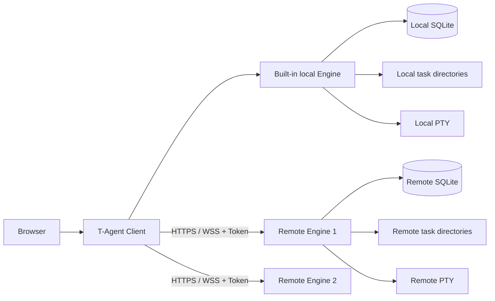

# T-Agent

Terminal copy: on a Mac, when an interactive program has enabled mouse mode, hold Option while selecting, then press Cmd+C or use the toolbar's "Copy selection"; on other platforms use Shift-select and Ctrl+Shift+C. Ctrl+C still interrupts. An OSC 52 request from a program is never written to the clipboard directly: click "Review program copy request", look at the content and confirm. A request is at most 64 KiB and kept for 60 seconds, the system clipboard is never read, and requests in a history replay are not processed again.

When a Git update meets local uncommitted changes, tick "Force update" in the update confirmation. The program first backs up the database, then saves the code changes (including untracked, non-ignored files) into a Git stash and fast-forwards; it never restores the changes automatically. Use `git stash list` and `git stash show -p <backup ref>` to inspect the backup. Configuration, tasks and databases ignored by Git are kept; committed divergence is never overwritten by force. When configuration or data is tracked by Git, a forced update is refused.

T-Agent is a componentized workbench for development tasks. One Client can manage the Engine on this machine and the Engines on other Clients; each Engine stores its own tasks, Markdown documents, to-dos and terminal sessions.

Every Client includes an Engine, so a personal computer only needs one install; a Linux server without a desktop UI also installs the Client (it can be bound from the command line only), and then uses a one-time pairing code or an access Token to let other Clients connect. A standalone Engine service is no longer provided.

## Project architecture



| Component | Responsibility |
| --- | --- |
| Client | Single-user UI, local Engine, switching between several Engine tabs, remote connection management, encrypted Token storage, update checks |
| Engine | Task and to-do data, Markdown files, working directories, terminal execution, Token authentication |

The browser only talks to the Client on this machine; it never gets a remote Token and never calls a remote Engine directly. Remote credentials are encrypted by the Client with `SESSION_SECRET` and stored in SQLite.

For implementation details see [Component architecture](docs/ARCHITECTURE.md), and for the interface definitions see [Engine API](docs/ENGINE_API.md).

## Current features

### Client

- The engine switch bar is at the top: switch between "Default" and several remote Engines, and right-click a remote tab to refresh, edit or remove the connection; the main navigation on the left (Tasks / Utilities) switches features inside the current engine.
- Create, edit and delete local tasks, with the groups Personal tasks, In progress, To do and Done, and drag-and-drop ordering.
- Manage `DESIGN.md`, `README.md` and `AGENTS.md` for a task, with Markdown, Mermaid, a table-of-contents outline and in-page editing.
- Local, remote and share pages use one Markdown reading style: a comfortable text width, a clear heading hierarchy, tables that scroll horizontally, and dark syntax-highlighted code blocks with a language label and a copy button. Code with no language or an unsupported one is shown as plain text. After changing the highlighting module run `npm run build:markdown` to generate the local script that ships with the app. The marked, mermaid and xterm versions used by the page are pinned and self-hosted in `public/vendor` (the manifest and SHA-256 values are in `scripts/vendor-libs.json`), so no CDN is used at run time and it works offline; mermaid is about 5 MB and is only loaded when the first diagram is rendered, `/vendor` is gzip-compressed and versioned files are cached for a long time. To upgrade a version, change the version and address in the manifest, run `node scripts/fetch-vendor.js --update` to download again and write the hashes back, then update the reference paths in the pages (`test/vendor-assets.test.js` checks that the two agree).
- Manage a task's to-dos, priority, due date and working directory.
- Every task supports several independent terminals: click "New terminal" to create a shell and switch with the terminal tabs; each terminal starts from the task's working directory and keeps its own output history.
- Chat-style agents: besides terminals, the "+" menu of a task (desktop and phone) offers **Claude agent** and **Codex agent**, a conversation view instead of a terminal. Start a new chat or resume an existing Claude / Codex session of the task directory; replies stream in, tool calls show as cards, Claude asks for permission in the page (Allow / Deny), and images and text files can be attached. Each chat has an access level (Claude: ask / accept edits / plan only / full access; Codex: read-only / workspace write / full access). Codex runs on `codex app-server`, so it asks for approval in the page too (Allow / Allow for this session / Deny), can ask you questions, and takes a message you send while it works (shown as "Add to what Codex is doing"); Stop interrupts the turn; Cmd/Ctrl+Enter queues a message to be sent when the turn ends. Under the composer the access level, the plan limits that are left with the time until they reset (for example `5h 62.5% · 4.2h`), the model and thinking effort (click it to change them for the next messages) and a ring for how full the context window is are shown when the agent reports them. Chats run on this machine only (remote Engines are not supported yet) and use the Claude Agent SDK and the installed `codex` CLI (it must be on PATH) with the logins of the installed CLIs.
- The terminal run state is shown directly on the task items on the left and on the terminal tabs: running is an outer-ring marquee, and when finished a green breathing light waits for you to open and acknowledge it; see "Terminal run state" below.
- Open a local task directory from Finder / a file manager or VS Code, and create read-only share links.
- The quick-links bar is hidden by default and existing link data is kept; PWA installation is supported; computers use the desktop page at `/web` (minimum width 1280px, stretched horizontally on large screens, maximum height 1200px in a normal browser, and an installed Chrome app or full-screen mode fills the actual window width and height, so a narrow window does not crop the terminal), which supports browser zoom; phones use the separate phone page at `/h5` (tasks, terminals, image upload and translate-and-send, with large terminal keys). Opening `/` picks the page by device; `/web` and `/h5` can always be opened directly.
- Automatically checks for updates, shows a hint in settings, and the user clicks to run the update.

### Tunnel (frp)

The "Page enhancement" page on the left uses this machine's `frpc` to map the Client port to your frps server (a TCP tunnel).

- Required: the frps server IP/domain and the frps server port (default 7000); fill in the Token as well when frps has one (stored encrypted and never echoed).
- The remote port is generated randomly by default (range 20000-60000) and then stays stable; click "Regenerate" to change it, which restarts a running tunnel. You can also enter a fixed port (it may be outside the random range and must be within frps `allowPorts`): a manual port that is taken is not changed automatically, and clearing it and saving returns to automatic random. In automatic mode, when the port is taken by frps it is changed automatically and retried up to 3 times.
- The domain is optional and only used to show the public address `domain:remote-port`; it is not written to the frpc configuration. Domain resolution and the reverse proxy (such as Nginx terminating HTTPS) are configured by you and forward to `server-IP:remote-port`; without a domain you can open `http://server-IP:remote-port` directly (the port must be allowed through).
- frpc must be available on this machine (0.52 or later, TOML configuration). When it is not detected, the page shows an "Install frpc" button and asks whether an Agent should install it: choose "Yes" to copy an install prompt (paste it to an Agent to run it), or "No" to let the Client download the official release package of a pinned version (0.61.1), verify its SHA-256 and put only frpc into `data/bin/`; when GitHub is unreachable, point `T_AGENT_FRP_DOWNLOAD_BASE` at a mirror (same layout as GitHub releases, including `v0.61.1/frp_sha256_checksums.txt`). You can also install it yourself (for example `brew install frpc` on a Mac) and then click "Re-detect frpc" on the page: it looks in `T_AGENT_FRPC_BIN`, `data/bin/`, PATH and common directories, Homebrew's `bin/`, `opt/frpc/bin` and `Cellar/frpc/<latest version>/bin` (including `/opt/homebrew` on Apple silicon, `/usr/local` on Intel and Linuxbrew), and shows the frpc path and version; a version below 0.52 (no TOML configuration support) is reported and refuses to start. Automatic install only supports macOS / Linux. You can tick "Start the tunnel automatically when the Client starts".
- The "Install frps" card at the bottom of the page copies an frps install prompt to paste to an Agent that can operate the public server: the prompt carries the server port, the Token (when empty the Agent is asked to generate one at random) and the `allowPorts` range from the page, and includes systemd auto-start and opening the firewall / security group. The prompt contains the Token, so only send it to an Agent you trust.
- It only manages the machine running the Client and does not go through an Engine proxy. Make sure an authenticator is bound before exposing the Client.

### SSH reverse tunnel

The top of the "Page enhancement" page can switch to the SSH method: `ssh -R` binds a port on a server that points to the Client port on this machine. Nothing has to be installed on the server; SSH login is enough.

- Required: the server IP/domain and the username; the SSH port defaults to 22. The remote port is random by default (20000-60000) and stays stable, or can be entered manually; when it is taken the automatic mode retries with another port and the manual mode does not.
- The private key path is optional: **leave empty to follow ssh's default lookup** (ssh-agent, `~/.ssh/id_*`, `~/.ssh/config`); **enter one to use the key at that path** (an absolute path or one starting with `~/`, with `IdentitiesOnly=yes` added). Passwordless login is required, `BatchMode` is used so no password prompt appears, the host key is trusted and recorded on first connect (`StrictHostKeyChecking=accept-new`), and the connection is refused when the host key changes.
- By default it only binds the server's `127.0.0.1`, so forward to that port with a reverse proxy on the server; ticking "bind all interfaces" also needs `GatewayPorts yes` (or `clientspecified`) enabled in the server's sshd and `AllowTcpForwarding` allowed.
- A tunnel that had connected and drops unexpectedly reconnects automatically after 5 seconds (at most 5 times in a row). You can tick "Start the tunnel automatically when the Client starts".
- The `ssh` command must be available on this machine; use `T_AGENT_SSH_BIN` when it is in an unusual place. It only manages the machine running the Client.

### Login entrance

When logged out, apart from the exceptions below, **every address returns 404** (exactly like a non-existent address, with no redirect and no login hint); only the hidden login entrance can be opened, which by default is:

```
http://127.0.0.1:3000/torin/hide/login
```

- Binding an authenticator for the first time, logging in and replacing the authenticator all start from this entrance; `/web` and the features are only accessible after a successful login. After a session expires the page jumps back to this entrance automatically.
- Change the entrance with `CLIENT_LOGIN_PATH` in `.env` (it starts with `/`, has at least 6 characters, contains only letters, digits and `-._~`, may have several levels, and must not use built-in paths such as `/api`, `/auth`, `/web` or `/v1`), and restart afterwards. An invalid value produces a notice and falls back to the default.
- Exceptions still reachable when logged out: the Bearer-token machine endpoints `/v1` and `/api/remote/v1` (used to connect several t-agent instances; without a token they still return their own errors), `/health`, public share pages `/share/*` and the scripts and styles they depend on.
- On a device where it is installed as an app (PWA): it works normally within the login validity; after a session expires a cold start of the app shows a 404, and you must open the login entrance in a browser and log in again first.
- The old page addresses `/auth/login` and `/auth/setup` and the multi-Client workspace `/clients` have been removed (always 404 when logged out). `CLIENT_FRAME_ORIGINS` can still be used to allow other sites to embed this Client's pages.

### Workspace tools: import and cleanup

Tasks are still only stored in the database. The two tools below are three icon buttons in one row at the top of the sidebar (+ new, 📁 import, 🧹 cleanup, with text shown on hover; local Client only, not available for remote Engines yet):

- **Import unmanaged directories**: when the page loads it automatically checks the first-level subdirectories of the current working directory (the working directory set in the account settings, or `TASKS_BASE_DIR`, default `~/tasks`), and if some are not managed by any task it shows "N directories in the workspace are unmanaged · Import". Opening it lets you tick, select all and import in bulk; only tasks are registered (the title is the directory name, status "To do") and no files are created in the directories. Directories starting with `.` and `node_modules` are not shown; neither are directories that are already a task directory (or contain one).
- **Clean up code directories**: a task directory is usually not a Git repository and contains several repositories. Click "Clean up code directories" to open a list that groups, by task, all repositories inside each task directory (up to 3 levels deep, not entering repositories, hidden directories or `node_modules`), showing disk usage and how many days they have been untouched; tasks and repositories are both ordered by usage, largest first, and can be ticked for bulk cleanup. Only the local repository directory is deleted; other files in the task directory, the task and its to-dos are kept. When the task directory itself is a repository only it counts. A repository can only be ticked when all of the following hold, otherwise the reason is shown: no uncommitted changes or untracked files; no stash; not a detached HEAD; it has a remote; every local branch has a remote branch and no unpushed commits; the repository directory is the repository root. The workspace itself, the home directory, a directory that contains other task directories and the directory of this program are always refused. The server re-checks before deleting and only accepts repositories that really lie inside that task directory, and the frontend asks for a second confirmation. Before cleaning, the repository address, branch and commit are recorded in the database table `repo_cleanups`, and "Restore from repo" in "Cleaned, restorable" at the bottom of the list clones it back to the original path.
- **Delete the directory together with a task**: right-click a task → Delete, and the dialog has an "Also delete the directory" checkbox which is **unticked by default** (only the task record and its to-dos are deleted). When ticked, the directory path that will be permanently deleted is shown. The workspace itself, the home directory, a directory containing other task directories or this program, and a directory shared by other tasks are always refused, and then the task is not deleted either. Local and remote Engines both support it; when the other side is older, only the task is deleted and a hint says the directory was not deleted. Directory deletion is irreversible and does not check Git state; when you want to keep a repository, use "Clean up code directories" first.
- Note: the checks rely on the remote branch state known locally and do not go online to verify it; files ignored by `.gitignore` (dependency directories, `.env` and so on) are deleted with the directory and must be generated again after a restore. `TASK_IDLE_DAYS` (default 30) is only used for the "suggested for cleanup first" hint in the list.

## Terminal user

If t-agent runs as root on a Linux server, Claude Code in the web terminal refuses the "skip permission prompts" mode. So **when the service is root, the terminal automatically drops to an ordinary user** (default `dev`):

- When `install.sh` installs as root it creates `dev` (home `/home/dev`, no password), writes `TERMINAL_USER=dev` into `.env`, and gives the task directory inside the install directory to it; the owner of a custom task directory is not changed on our own, so run `chown -R dev <directory>` yourself.
- Use `TERMINAL_USER=username` in `.env` to use another user; an empty `TERMINAL_USER=` means no drop (the terminal stays root). When it is not configured and `dev` does not exist, root is kept and a hint is written to the service log.
- After the drop the terminal does not carry `SESSION_SECRET`, and `HOME`/`USER` belong to the target user; a task directory that user cannot enter starts from its home directory and a hint is logged. For operations that need root, open a separate root session (such as SSH). That user installs Claude Code itself (`install-claude-code.sh`).
- When the service is already an ordinary user, or on macOS, this feature has no effect and the terminal is simply the service user.

### Multiple Engines

- One Client can save and switch between several remote Engines.
- Connect with a pairing code or an access Token; the online, offline and authentication-expired states are shown. When a connection fails (offline, authentication expired or loading tasks failed), that Engine shows no tasks, documents or terminals, only the "Check the service status" hint, the service address and the reason for the failure, with "Retry connection / Edit connection / Remove connection".
- Create tasks on a specific remote Engine. **A remote task uses the same UI and features as a local task**: editing the design doc / README / AGENTS.md in the page, adding / editing / deleting to-dos, the outline, relative-path images, automatic refresh on document changes, editing the task (title, paths, working directory, priority, group, due date), deleting, drag-and-drop ordering, the file browser and editing, several terminals, terminal history, image upload, and the terminal run state (marquee / breathing light, also summarized on the engine tab).
- Only features that depend on this machine's file system do not apply to remote tasks: "Reveal in Finder", "Open in VS Code" and "Create share link" are hidden.
- Every Engine connection has admin rights; view / operate / manage are no longer distinguished. Features are enabled by the capabilities the Engine declares: capabilities an old Engine lacks (ordering, automatic document refresh, relative-path images, path validation, run state and so on) are disabled automatically while the rest works as usual. The Engine must be upgraded to v2.29.0 or later for the full feature set.
- Tasks are shown by group, and local and remote both support creating, renaming and deleting custom groups (the "+" next to the sidebar title).
- "In progress / To do / Done" are system groups that cannot be modified; a custom group can only be deleted when it has no tasks.
- Remote interactive terminals are used through the Client proxy; the browser never stores an Engine Token.
- The name, HTTP/HTTPS address and port of a remote connection can be changed, and the old address is overwritten only after verification succeeds.
- The run state of a remote terminal comes from the PTY and hooks on that Engine: run `ta` once on the Engine's machine as well and trust it once with `/hooks` in Codex; see "Terminal run state".

### Security boundary

- The Client uses no username or password: browsers on computers and phones must first bind an authenticator and then log in with a 6-digit TOTP code; business pages and browser APIs cannot be used without binding.
- The first binding can be done by running `node scripts/client-auth-setup.js` in a terminal on the server (it can be run remotely over SSH), or by scanning the QR code at the web login entrance (see "Login entrance"), from this machine, a phone, the LAN or through a reverse proxy, with no initial password or setup code; until it is bound, anyone who can reach the address can bind first, so finish binding before opening it to a network. The binding secret is stored encrypted and recovery codes only as hashes; a session lasts 30 days and renews while in use, with logout, replay protection for codes and authentication rate limiting.
- The Client listens on `127.0.0.1` only by default; phone access needs LAN listening to be opened explicitly or an HTTPS reverse proxy.
- The `/v1` endpoints for other Clients do not use the web login and only accept Bearer Tokens.
- The Engine stores only the SHA-256 hash of a Token; the plaintext is shown once when it is created.
- A pairing code is valid for 10 minutes by default and can be used only once.
- A remote terminal uses a WebSocket ticket that is valid for 30 seconds and can be consumed only once.
- The Engine accepts any absolute working directory a task specifies; a Token with write permission can therefore create and modify task files within the permissions of the Engine's account.

## System requirements

- macOS, or Linux with a mainstream distribution.
- Node.js 20 or 22+; Node.js 22 LTS is recommended.
- The Client is installed with Git, so Git must be installed on the system.
- `better-sqlite3` and `node-pty` need Python 3, make and a C++20-capable compiler when prebuilt packages cannot be downloaded.

On macOS you can install the command line tools:

```bash
xcode-select --install
```

On Debian/Ubuntu you can install the build dependencies:

```bash
sudo apt update
sudo apt install -y git curl nodejs npm python3 build-essential clang
```

The default GCC 9 on Ubuntu 20.04 does not recognize the `-std=c++20` option the dependencies use; the install script installs Clang automatically and uses it instead.

## Quick install

The install script asks for the port and the task directory, installs the dependencies and then starts the service with **PM2** (process name `t-agent`). The default install directory is `t-agent` in the current directory.

### Install the Client

The Client is for a personal computer or a management node and includes a local Engine. The default port is `3000`.
The Client runs in single-user mode and needs no username or password; an authenticator must be bound the first time it is opened. By default it listens on the local address only.

```bash
curl -fsSL https://raw.githubusercontent.com/TorinMars/t-agent/main/bootstrap.sh | T_AGENT_MODE=client bash
```

After the install, open:

```text
http://127.0.0.1:3000
```

The Client is managed by **PM2** by default: when PM2 is missing the script installs it with `npm install -g pm2` (into `~/.local` when the global directory is not writable), then runs `pm2 start server.js --name t-agent --cwd <project directory>` and `pm2 save` (the working directory must be the project directory so that `.env` can be read). If the port is already in use it does not start and shows a hint. **Start on boot** needs you to run `pm2 startup` once (run the command it prints, with the sudo part executed by you) and then `pm2 save` again. After the in-app "Check for updates / Update" finishes, the process exits with exit code 75 and PM2 starts it again automatically; if the service has not restarted after an update, the update check says "restart the service" (`pm2 restart t-agent`). Once the service is running it shows up in the "App list" automatically.

Old installs that already registered a system service (the macOS `com.tagent.client` LaunchAgent or the Linux `t-agent.service`) **keep using the existing system service** when `install.sh` is run again, and are not silently switched, so two instances do not fight over the port. To switch to PM2, run again with `--pm2` (the old service is stopped and removed first, then PM2 starts it); to keep using the system service, add `--system-service`.

When the install finishes, the end of the terminal output shows "open this in a browser" and the access URL (by default `http://127.0.0.1:3000`, depending on the install configuration). With `--no-service`, or when the system cannot register a service automatically, it first prints the manual start command, and you open the address after starting.

### Access mode: authenticator + external access, or local only

**The first time you open the page in a browser on this machine** after the install, first choose the access mode (you can switch any time later under Settings → Access mode):

- **Authenticator + allow external access**: see the next section. Phones, other computers and remote clients can all connect.
- **Local access only · no verification**: only direct access from this machine (`127.0.0.1` / `localhost`) is accepted, with no code; other devices, requests forwarded by a reverse proxy or tunnel, and requests whose `Host` is not a loopback name (against DNS rebinding) always get 404, **including remote connections that use this machine as an engine (`/v1`) and share links**. Other users / processes on the same machine can also reach it, so use it only on a personal computer.

You can choose at install time: `./install.sh --access-mode local` (listens on `127.0.0.1`, no verification) or `--access-mode remote` (bind an authenticator after opening the page). When not given, a new install listens on `0.0.0.0` and the application lets requests through according to the access mode: **until an access mode is chosen only this machine can open the page** (on a remote server where a local browser cannot be opened, run `node scripts/client-auth-setup.js` in a terminal on the server to bind an authenticator, which enables external access).

Switching rules: "local only → external" needs an authenticator to be bound first (if already bound, one code is verified), and external access only opens once binding succeeds; "external → local only" needs you to be logged in, takes effect immediately and ends the sessions of other devices (if you switch from a browser that is not on this machine, the current device also loses access). An old install that already bound an authenticator counts as "external" mode and behaves as before after the upgrade; the listen address is still decided by `HOST` in `.env`, and in external mode with `HOST=127.0.0.1` the settings page suggests changing it to `0.0.0.0`.

### Authenticator and phone access

A new install and an upgrade from an old version both start with no authenticator bound. Opening the client page again shows "An authenticator is required"; tasks, settings and terminals cannot be reached without binding, and there is no login-free entry that skips binding.

1. In a terminal on the server running the Client, run `node scripts/client-auth-setup.js` (it can be run after an SSH login and does not have to be on the local machine; the port is read from `PORT`), scan the QR code in the terminal and enter the code; or open the login entrance directly (`http://127.0.0.1:3000/torin/hide/login` locally, or the phone, LAN or reverse-proxy address) and scan the code. No initial password or setup code is needed, and it is not limited to local or remote. Once bound, a restart does not cancel the binding.
2. Scan with Google Authenticator, Microsoft Authenticator or a compatible app; on the same phone you can tap "Open in authenticator", or add the key manually (time-based, 6 digits, 30 seconds). Enter the code the authenticator generates to finish binding.
3. Download and keep safe the 8 one-time recovery codes the page shows. Recovery codes are shown only once and each can be used once. If a code was already used, wait for the next one before logging in on another device.
4. When the phone and the Client are on the same LAN, change `HOST` in the Client's `.env` to `0.0.0.0` and restart the service. Open `http://<computer's LAN IP>:3000/` in the phone browser (the port depends on the actual configuration); a phone is sent to the phone page `/h5`. It offers tasks, terminals (the `+` Session menu opens a terminal or a new/resumed Claude or Codex session of the task directory), image upload and translate-and-send. Phone terminals are separate shells from the computer's terminals, so using a phone never changes the size of, or disconnects, a terminal open on the computer. Remote engines need this version or later for phone terminals. Open `/web` on the phone for the full desktop page.

Production deployments require HTTPS/WSS by default; a trusted intranet can enable `CLIENT_ALLOW_HTTP=true` explicitly. For the public network use an HTTPS/WSS reverse proxy and limit the sources with a firewall. An authenticator login session is valid for 30 days and renews while in use; it only expires after 30 days of no use, and a new device, an expired session or an explicit logout needs verification again. The authenticator can be replaced in the login settings; if you lose it, log in with a recovery code and bind again, and after the replacement the old authenticator, the old recovery codes and the sessions of other devices stop working immediately. Logging out only disconnects the web terminal connection and does not terminate the programs running on the server.

`SESSION_SECRET` must be a random key of at least 32 characters and must stay the same across restarts and upgrades. The install script generates it automatically; a weak key refuses binding. Back this key up safely together with the database, otherwise the existing binding and the remote connection Tokens cannot be decrypted.

### Specify the install directory or branch

```bash
curl -fsSL https://raw.githubusercontent.com/TorinMars/t-agent/main/bootstrap.sh \
  | T_AGENT_MODE=client T_AGENT_DIR=/opt/t-agent T_AGENT_REF=main bash
```

### Install from existing source

```bash
chmod +x install.sh
./install.sh --mode client
```

Non-interactive install example:

```bash
./install.sh --port 13500 \
  --tasks-dir /srv/t-agent-tasks
```

An existing `.env` is not overwritten; when `--port` or `--tasks-dir` is given explicitly, only the corresponding setting is changed. Run `./install.sh --help` to see all options.

## Getting started

### 1. Create a local task

After opening the Client click "New task":

1. For "Engine" choose "Local engine".
2. Enter a title; the MD file path and working path can be left empty.
3. Set the priority, group and due date, then create it.

When the paths are left empty, T-Agent creates the task directory under `TASKS_BASE_DIR` and generates:

```text
task-directory/
├── DESIGN.md
├── README.md
├── AGENTS.md
└── CLAUDE.md
```

The top of the task details switches between the design doc, README, AGENTS.md, to-dos and the terminal. The terminal uses the task's working path as its current directory. The terminal tabs switch between several independent shells of the same task; the page caches the screen, scroll position and connection per task and terminal, so an ordinary switch does not reconnect or replay history and never terminates background programs. After refreshing the page you can select the terminals you already created again. The bottom of the terminal has a compact function-key bar: Esc, Tab, Ctrl, Command, Option, Shift, the arrow keys, Enter and Backspace. Click a modifier key and then a function key or type a letter to form a combination; it is released automatically after being sent once; the "Option + ↑" button sends Alt+Up (`ESC [ 1 ; 3 A`) directly. Command uses the Super modifier of the extended keyboard protocol, needs support from the program in the terminal, and does not trigger operating-system shortcuts. The top of the terminal offers five actions:

- "+" opens a menu: "New Terminal" starts a separate shell in the task working directory and keeps the existing terminals; "Claude session" / "Codex session" start that agent in a new terminal, either a new session or one of the sessions already run in the working directory (resumed), as on the phone.

- "Reopen" only rebuilds the browser connection and keeps the current shell process, its directory and history.
- "Close current terminal" terminates the current shell and the programs running in it, and keeps the tab and the output history already recorded.
- The entry to delete a terminal is in the terminal tab: the tab of a newly created terminal has a × on its right (you can also press Delete on the tab); after you confirm, the shell of that terminal is terminated and the tab and history are permanently deleted; if the deleted one is the current tab the view then switches back to the default terminal, and deleting another tab does not switch. The default terminal has no × and cannot be deleted. For remote tasks the Engine must support this operation too. The old "Delete current terminal" button in the toolbar has been removed.
- "Reopen from working directory" terminates the current shell, clears the old terminal history and starts a brand-new shell in the working directory configured for the task.

### 2. Connect a remote Engine

At the bottom of the Engine navigation on the left click `+ Connect remote`:

1. Enter the URL, for example `http://192.168.1.20` or `https://engine.example.com`.
2. The port may be left empty when the default HTTP/HTTPS port is used; when connecting directly to a custom port enter it, such as `3100`.
3. Enter a one-time pairing code `TA-XXXX-XXXX-XXXX` or an access Token `tae_...`.
4. Click "Test connection", and after it succeeds click "Connect".

The URL may only contain the protocol and the host; do not include `/v1` or any other path. When using an HTTPS reverse proxy you usually enter the domain and leave the port empty.

After connecting, a new Engine tab appears on the left. Each tab shows that Engine's current version; the Client probes remote versions automatically at start-up and throttles repeated loads within one minute. Switch tabs to look at the tasks of the corresponding server.

### Let another Client connect to this Client

The Client already includes a standard Engine service on the same port, so no separate Engine install is needed:

1. In the Client to be connected, open "Settings → Remote service → Allow other clients to connect as an engine" and generate a pairing code.
2. In the other Client click "+ Connect remote" and enter a reachable IP/domain of the Client being connected, the actual port and the pairing code; the URL does not include `/v1` or a page path.
3. After connecting you can manage that Client's local tasks, files and terminals; the other remote Engines it has connected are not forwarded. A connection obtained by pairing has admin rights and can be revoked from the same settings entry of the connected Client.

The connected Client must allow remote access. Set `HOST=0.0.0.0` in `.env` to open listening, and for plain HTTP on a trusted intranet also set `CLIENT_ALLOW_HTTP=true`. A visitor exchanges the one-time pairing code for an independent Token, and no browser login session or authenticator needs to be shared.

### 3. Create a remote task

Click "New task", choose the target remote node under "Engine", and then enter an absolute path on the server under "Remote working directory". The task, documents and working directory are created directly on that Engine and are not copied to the Client's machine; when the specified directory does not exist the Engine creates it automatically.

Every task can have its own working directory, no longer limited by an allowlist of workspace roots. When only the working directory is entered, the design doc defaults to `DESIGN.md` in that directory; when the paths are left empty, the Engine creates the task directory under its own `TASKS_BASE_DIR`. A remote path must be absolute, and the account of the Engine process needs read and write permission on the directory.

Remote terminals likewise support starting several independent terminals, reopening, closing and reopening from the working directory. Closing and restarting only affect the current terminal tab. The multi-terminal feature needs the Engine to provide the `terminal:multiple` capability; an old Engine can still use the default terminal and asks you to upgrade when you start a new terminal. The terminal control endpoint is available from `2.5.0`; when controlling an old Engine the Client asks you to upgrade first and never writes the control content into the shell.

### 4. Manage remote connections and task groups

When the server IP, the port or the HTTPS domain changes:

1. Right-click the corresponding remote Engine tab on the left.
2. Choose "Edit connection".
3. Change the name, URL or port and test the connection.
4. Save.

The Client keeps using the saved Token. The new address is only saved when it can reach `/v1/info` with the Token, so a failed test never damages the original connection.

The same context menu can create a task group. Right-click a custom group to rename or delete it, and right-click a task to move it to another group. The server refuses to delete a group that still has tasks; the three system groups "In progress / To do / Done" offer no edit or delete.

### 5. Upgrade a remote Engine from the Client

The context menu of a remote Engine tab offers "Check for updates". The Client decrypts the saved Token on the server and proxies the following operations; the Token is never sent to the browser:

1. Ask the remote Engine to check for a new version on its configured branch.
2. Show the current version, the target version, the install type and any check error.
3. After a second confirmation by the user, trigger the update and wait for the Engine to restart and recover automatically.
4. After a successful update, refresh the Engine version and the task list recorded in the Client.

A remote upgrade is a host administration operation and every connection has that permission. An old Engine that has no update API yet must first be upgraded by hand to `2.4.0` or later once, after which the Client can complete later upgrades. The Engine must be hosted by systemd, launchd or another process manager that can restart it automatically.

## Tokens and pairing

### Permissions

Every pairing code and access Token has admin rights (`owner`): reading and writing tasks, documents, to-dos and files, using terminals, managing other Tokens, running remote upgrades and PM2 management. View / operate / manage are no longer distinguished, and the role parameter in requests is ignored. Read-only or operate Tokens issued earlier are also treated as admin (the records in the database are not changed); when you no longer want a connection to have admin rights, revoke it under Remote service in settings. Keep Tokens safe and avoid copying them between devices you do not trust.

### Create a one-time pairing code

In the Engine project directory run:

```bash
node scripts/create-engine-pairing-code.js
```

The generated pairing code is valid for 10 minutes and can be used only once. After the Client uses it to connect, it exchanges for the permanent access Token and stores it encrypted.

### Create an access Token directly

```bash
node scripts/create-engine-token.js "Mac Client"
```

### A forgotten or invalid Token

The plaintext of a Token cannot be recovered, because the Engine only stores hashes:

1. In the Engine directory generate a new pairing code or access Token.
2. If the old connection is still in the Client but authentication has expired, remove the old connection.
3. Reconnect with the original Engine address and the new credential.

When only the server address changes, no new Token is needed; just use "Edit connection".

The remote Tokens saved by the Client are decrypted with `SESSION_SECRET` from `.env`. When migrating or backing up the Client, keep both `.env` and `data/`.

## HTTPS and Nginx reverse proxy

In production Nginx is recommended to provide HTTPS/WSS for the Client being connected. The Client listens on `127.0.0.1:3000` by default and Nginx proxies back to that address; use the server firewall to stop direct public access to the original port.

The core Nginx proxy configuration is:

```nginx
location / {
    proxy_pass http://127.0.0.1:3000;
    proxy_http_version 1.1;

    proxy_set_header Host $host;
    proxy_set_header Authorization $http_authorization;
    proxy_set_header X-Real-IP $remote_addr;
    proxy_set_header X-Forwarded-For $proxy_add_x_forwarded_for;
    proxy_set_header X-Forwarded-Proto $scheme;

    proxy_set_header Upgrade $http_upgrade;
    proxy_set_header Connection "upgrade";

    proxy_buffering off;
    proxy_cache off;
    proxy_connect_timeout 60s;
    proxy_send_timeout 3600s;
    proxy_read_timeout 3600s;
}
```

BT Panel users can set the target URL to `http://127.0.0.1:3000` under the site's "Reverse proxy", enable WebSocket, and confirm that the generated site configuration contains the `Upgrade`, `Connection` and long-timeout settings above. It is also recommended to enable forced HTTPS and keep only TLS 1.2/1.3.

Check the configuration and connectivity:

```bash
/www/server/nginx/sbin/nginx -t
sudo systemctl restart t-agent
sudo /etc/init.d/nginx reload
curl -i https://engine.example.com/v1/health
```

The health check should return:

```json
{"ok":true}
```

Then enter `https://engine.example.com` in the Client and leave the port empty.

## Configuration

Copy the example configuration:

```bash
cp .env.example .env
```

Common settings:

```env
PORT=3000
T_AGENT_MODE=client
SESSION_SECRET=replace-with-a-long-random-string

# Internal data ownership ID of the Client, not used for login
SINGLE_USER_ID=local
# Listen address: 0.0.0.0 by default for a new install (whether external access is allowed is decided by the access mode); 127.0.0.1 with --access-mode local
HOST=0.0.0.0
# Initial access mode local / remote (leave empty to choose on first page load; a saved choice wins)
ACCESS_MODE=

# Root directory in which task files are created automatically
TASKS_BASE_DIR=/path/to/tasks

# Name and data ownership shown when this Client is connected to by other Clients as an Engine
ENGINE_NAME=my-engine
ENGINE_OWNER_ID=local
```

When upgrading from an old version there is no need to set `SINGLE_USER_ID` by hand. The program keeps using the first account in the original database as the only data owner, and `AUTH_USERS` in an old `.env` can stay for now but no longer takes part in authentication.

Update-related settings:


```env
GITHUB_VERSION_URL=https://api.github.com/repos/TorinMars/t-agent/contents/VERSION.json?ref=main
UPDATE_GITHUB_REPOSITORY=TorinMars/t-agent
UPDATE_GITHUB_REF=main
UPDATE_GIT_REMOTE=origin
UPDATE_GIT_BRANCH=main
UPDATE_CHECK_ENABLED=true
UPDATE_CHECK_INTERVAL_SECONDS=1800
UPDATE_CHECK_STARTUP_DELAY_SECONDS=30
```

For a private repository set `GITHUB_TOKEN` on the server. Never put a GitHub Token or an Engine Token into web code or Nginx configuration, or commit it to Git.

## Updates

After the Client service starts it checks for updates automatically, and then every 30 minutes by default. When a new version is found, the settings button shows a hint dot:

1. Open "Settings".
2. Click "Check now" to see the version.
3. When a new version exists, click the update button and confirm a second time.

The Client is a single-user instance, and the local user on the settings page can run updates.

- A Git Client checks the working tree, fetches the configured branch and only performs a fast-forward update.
- An old archive Client downloads the package of the matching GitHub branch; migrating it to a Git install first is recommended.
- The SQLite database is backed up before updating. For a Git install, updates that only touch the frontend, static assets and documents complete directly: no dependencies are installed, the service is not restarted and the page is not refreshed automatically, so existing shell connections are kept; the user can refresh later to load the new UI.
- When the server, engine, dependencies, build scripts or the API/database version change, dependencies are still installed, `node-pty` is verified, frontend assets are built and the service is restarted. The confirmation says whether a restart is needed. An archive install still uses the full update flow.
- The update scope is compared with the commit the current process started with, so server-side changes left over from a failed earlier update are not mistaken for "no restart needed".
- `.env`, the database, logs and task directories are never overwritten by an update.

**The update check distinguishes "a new version exists" from "the code was updated but the service has not restarted"**: it compares the remote version with the on-disk `VERSION.json`, so after a manual `git pull`, an update that failed halfway or a forced repository restore the code on disk is newer than the running process. The state is then `restart_pending` ("restart the service"), with the message "Code was updated to X, but the service is still running the Y code; restart the service for it to take effect" and a red dot, and it lists the restart commands for each install type (PM2 `pm2 restart t-agent`, macOS `launchctl kickstart -k gui/$(id -u)/com.tagent.client`, Linux `sudo systemctl restart t-agent`), instead of wrongly reporting "up to date". A Git install decides by whether there are changes needing a restart between "the commit at process start → the current HEAD" (changes only to hot-updatable files such as the frontend do not count), and a package install compares the version read at start-up; it recovers automatically after the service restarts.

When **tracked files** in the Git working tree have uncommitted changes, or the local branch has diverged, the web update stops to avoid overwriting local code; the error lists exactly which files (at most 8). Untracked stray files (such as `.DS_Store`, `nohup.out`, or `.claude/` created by an editor or Agent) do **not** block the update: during the fast-forward merge, if the new version happens to write a file of the same name, git refuses by itself and keeps your file without overwriting it.

The update UI (the same for this machine and remote Engines) shows the elapsed time of installing dependencies and building the frontend and the latest npm output line, and after 30 seconds without output it hints "the network may be down or it may be compiling"; the npm used for the update has short retries and timeouts (`fetch-retries=1`, `fetch-timeout=60s`, values already set in the environment are not overridden), so an unreachable download address fails within a minute or two instead of waiting the full 10 minutes. The update process writes the time, stage and command duration to the service log with an `[update]` prefix, along with the live output of the npm install and the frontend build; on failure the exit code and error details are recorded. For a PM2 deployment use `pm2 logs t-agent` (with the `PM2_HOME` used at deployment), and for a systemd deployment look at the journal of the corresponding service. The `esbuild` needed by the online update is installed as a regular dependency, so the build also works in production with dev dependencies omitted.

### Update a Git Client by hand

```bash
cd /path/to/t-agent
git pull --ff-only origin main
npm ci --ignore-scripts=false
npm run build:monaco
node scripts/verify-node-pty.js
```

Then restart the service for the current system, and force-refresh static assets in the browser with `Command/Ctrl + Shift + R`.

### Migrate a package install to a Git install

A newer install directory can use the general migration script directly. The script keeps `.env`, `data/`, `logs/` and `tasks/`, and makes a full backup of the original install in a sibling directory:

```bash
# Client
T_AGENT_REF=main ./scripts/migrate-to-git.sh
```

When an old package does not have the general script yet, first download the script from the target branch into the current project's `scripts/` directory. During migration a systemd or launchd service is stopped and registered again automatically; a Linux environment without systemd needs the current process stopped by hand first. After confirming that the configuration and tasks of the new install are fine, deal with the backup yourself.

## Service management

### PM2 (the Client default)

```bash
pm2 status t-agent          # status
pm2 logs t-agent            # logs
pm2 restart t-agent         # restart
pm2 stop t-agent            # stop
pm2 startup && pm2 save     # start on boot: run the command printed by pm2 startup, then save the process list
```

"Utilities → PM2 process management" and the "App list" in the web UI can both show status, restart, stop and show logs; note that stopping or restarting t-agent itself interrupts the current page (the UI asks for a second confirmation). To migrate from an old LaunchAgent/systemd: `./install.sh --pm2`. The macOS / Linux sections below apply to old installs that keep using a system service.

### macOS

macOS has no `systemctl`; use `launchctl`:

```bash
launchctl kickstart -k "gui/$UID/com.tagent.client"
```

View the logs:

```bash
tail -f logs/stdout.log logs/stderr.log
```

### Linux systemd

```bash
sudo systemctl status t-agent
sudo systemctl restart t-agent
```

View the logs:

```bash
sudo journalctl -u t-agent -f
```

### Linux containers or systems not running systemd

Some Ubuntu containers have `systemctl` installed although PID 1 is not systemd. The install script recognizes this environment automatically, skips service registration and shows the manual start command. The Client can run in the foreground:

```bash
cd /path/to/t-agent
npm start
```

In production you can hand the command above to an existing process manager. For a temporary background run you can use:

```bash
cd /path/to/t-agent
nohup npm start >> logs/stdout.log 2>> logs/stderr.log &
```

## Manual start and development

Install the dependencies:

```bash
npm install
```

Start the full Client:

```bash
npm start
# equivalent to npm run start:client
```

Run the tests:

```bash
npm ci --include=dev
npx playwright install chromium
npm test
```

Playwright is pinned to 1.58.2, which is compatible with macOS 13. The full test run includes real Chromium browser regressions, and the dev dependencies include Playwright, xterm and the Fit addon. Linux CI can install the system dependencies with `npx playwright install --with-deps chromium`; you can also point `CHROME_PATH` at an existing Chromium executable.


The default address is `http://127.0.0.1:3000`.

## FAQ

### A remote Engine was added but is not shown

First force-refresh the browser, then check whether the Client read the remote list successfully:

```text
GET /api/remote-servers
```

If the endpoint returns data but the tab still does not appear, check the browser console and the Client log.

### A remote service shows offline

On the Client server check:

```bash
curl -i https://engine.example.com/v1/health
```

Then check the Engine service and the reverse proxy logs:

```bash
sudo journalctl -u t-agent -n 100 --no-pager
tail -n 100 /www/wwwlogs/engine.example.com.error.log
```

When the HTTP health check is fine but the terminal fails, you should usually check Nginx's WebSocket request headers, the read timeout and the firewall.

### `node-pty is not installed` or `posix_spawnp failed`

```bash
npm ci --ignore-scripts=false
node scripts/verify-node-pty.js
```

If the verification still fails:

```bash
npm rebuild node-pty --ignore-scripts=false --foreground-scripts
node scripts/verify-node-pty.js
```

On macOS first make sure the Xcode Command Line Tools are installed, then run the install script again.

### `unrecognized command line option '-std=c++20'` during a Linux install

This means npm could not download the prebuilt package of the native module, fell back to building from source and found the system `g++` too old. The newer install script picks Clang automatically on Debian/Ubuntu and tries to install a GCC Toolset on CentOS/RHEL. An existing install directory can simply be run again. Even if `.env` was already created in the failed run, as long as the database has never produced a Token, the initial owner Token is still issued after a successful install:

```bash
cd /path/to/t-agent
./install.sh
```

On Ubuntu 20.04 you can also install Clang by hand and retry:

```bash
sudo apt update
sudo apt install -y clang python3 make

cd /path/to/t-agent
CC=clang CXX=clang++ ./install.sh
```

On CentOS/RHEL 8 you can also install GCC Toolset 12 by hand and retry:

```bash
sudo dnf install -y gcc-toolset-12-gcc gcc-toolset-12-gcc-c++
export CC=/opt/rh/gcc-toolset-12/root/usr/bin/gcc
export CXX=/opt/rh/gcc-toolset-12/root/usr/bin/g++

cd /path/to/t-agent
./install.sh
```

The `prebuild-install` deprecation warning and the notice about a new npm version are not the cause of this build failure.

### The log repeatedly shows `VERSION_URL_NOT_CONFIGURED`

Add `GITHUB_VERSION_URL` and the update repository settings to `.env`, or turn the check off for now:

```env
UPDATE_CHECK_ENABLED=false
```

Restart the service after changing `.env`.

## Data and backups

Back up:

```text
.env             # single-user ID, SESSION_SECRET, update source
data/            # SQLite, sessions, remote connections and update state
tasks/           # default task working directory; custom directories need a separate backup
logs/            # optional, run logs
```

Do not copy only `data/` and lose `.env`, otherwise the Client may be unable to decrypt the remote Tokens already saved.

## Uninstall

The following stops the service and permanently deletes the install directory, configuration, database, logs and the default task directory. The script first lists the targets and asks you to type `UNINSTALL` to confirm:

```bash
curl -fsSL https://raw.githubusercontent.com/TorinMars/t-agent/main/uninstall.sh | bash
```

Custom install directory:

```bash
curl -fsSL https://raw.githubusercontent.com/TorinMars/t-agent/main/uninstall.sh \
  | T_AGENT_DIR=/opt/t-agent bash
```

## Directory structure

```text
t-agent/
├── db/               # SQLite schema and session store
├── docs/             # Architecture and Engine API documents
├── lib/              # Base components such as tokens and terminal history
├── middleware/       # Session and Engine Token authentication
├── public/           # Static frontend assets of the Client
├── routes/           # HTTP/WebSocket routes of the Client and the Engine
├── scripts/          # Token, migration, build and diagnostic scripts
├── services/         # Engine, remote connection and update business components
├── data/             # Run-time data, not committed to Git
├── logs/             # Service logs, not committed to Git
└── tasks/            # Default task working directory, not committed to Git
```

## License

The repository has not declared an open-source license yet. Without authorization, do not assume the code may be copied, distributed or used for commercial release.

The "Update" button to the left of the settings button checks for a new client version immediately and, when one can be installed, runs it directly without a second confirmation; repeated clicks are disabled while updating. A frontend-only change keeps shell connections, and a change that needs the engine restarts according to the update flow. Blockers such as working-tree conflicts show the reason and are never overwritten by force automatically. The top of the update dialog shows the current stage and elapsed time, and below it the update log scrolls like a terminal (the output of git and npm, the latest 300 lines, with credentials hidden); after the update completes the page refreshes automatically (when the service must restart, it refreshes once the service is back). The update dialog of a remote Engine likewise shows the log and refreshes the page after completion; an Engine that is too old has no log and shows only the progress text.

Task documents default to `DESIGN.md`, `README.md` and `AGENTS.md` in the working directory; existing files are read directly and only created when missing, and existing content is never overwritten. The default `DESIGN.md` follows the working directory; the default `DESIGN.md` of an old task that pointed at another directory is also resolved against the current working directory, and the old file is kept. A design path that was set manually to another file name keeps using the custom file.

Task editing supports setting the absolute paths of the design doc, README and AGENT files separately; for a remote task they can be set from the context menu entry "Edit document paths". An explicit path wins over the working-directory default (including a DESIGN.md in another directory); clearing it restores the default. Changing a path never moves or overwrites the old file, and the target is created when it does not exist. A remote Engine must be upgraded to v2.10.12 or later.

### Agent rule file compatibility

New tasks create `AGENTS.md` and `CLAUDE.md` by default, and the latter references the main rules through `@AGENTS.md`. An existing `CLAUDE.md` keeps its content and gets the reference added. Existing tasks are migrated at start-up: when only `AGENT.md` exists it becomes `AGENTS.md`; when both exist `AGENTS.md` is kept and `AGENT.md` is deleted. An old explicit `AGENT.md` path is migrated as well, other custom rule paths are left as they are, and the working directory still gets the standard rule entry points. A working directory that cannot be accessed records an error and is retried at the next start-up, and an old directory that no longer exists is not recreated. Remote projects are migrated after the corresponding Engine is updated and started.

### Task file browser

After selecting a task, click "File browser" at the top to open the directory tree and the code editor. The page switches to the terminal automatically and the file panel unfolds from the top, taking 85% of the height below the toolbar by default, while the terminal at the bottom still accepts input; drag the bottom edge of the panel to adjust the ratio and drag the right edge of the tree to adjust its width. Click the button again or "Collapse" to restore the full terminal; this does not close the shell.

The panel supports several file tabs, creating files and folders, renaming, confirmed deletion, and showing hidden files. It is limited to the current task working directory; symbolic links are only displayed and are never expanded or operated on. Only UTF-8 text up to 5 MiB is edited, and the original BOM, line endings and permissions are kept. After modifying a file click Save or press Ctrl/Cmd+S; when leaving an unsaved file you can save, discard or cancel. When a file was modified by the terminal or an Agent, saving reports a conflict and you can reload or confirm the overwrite.

Local and remote tasks use the same panel. A remote Engine must support the `files:read` / `files:write` capabilities; an older version asks you to upgrade. File requests keep the task ownership check and the server proxy and never expose the remote Token to the browser. This version offers no upload / download, Git panel or whole-project search.

### Terminal Chinese-to-English input (DeepSeek / Zhipu GLM)

Below the terminal there is an input box: type Chinese, press Enter, and DeepSeek or Zhipu GLM translates it into English, types it into the current terminal and submits it with Enter (handy for giving instructions to Claude Code / Codex). On first use click the ⚙ on the right of the input, pick DeepSeek in the "Translation service" dropdown (the endpoint defaults to `https://api.deepseek.com` and the model to `deepseek-flash`) or Zhipu GLM (default `https://open.bigmodel.cn/api/paas/v4`, model `glm-5.3-flash`, with thinking pushed to the lowest level to avoid timeouts), and enter the matching API key; each provider's key is stored separately, switching providers never loses the key saved for the other one (leaving the key empty when saving keeps the stored key); keys are stored encrypted on the Client and are never sent to the browser or remote engines, and translation happens on the Client, so terminals of remote engines work too. Input without any Chinese (plain English) is sent as-is and no endpoint is called. Control characters in the translation are removed and the text is collapsed into one line; when the terminal is not connected nothing is sent and the input is kept.

### Terminal image upload (Alibaba Cloud OSS)

After configuring and enabling Alibaba Cloud OSS in the Client settings, you can paste images straight into local or remote task terminals, and on computers and phones alike you can use the "Upload image" button at the bottom of the terminal to choose an image (a phone can pick from the photo library). PNG, JPEG, GIF and WebP are supported, up to 10 MiB each. While uploading, the whole page shows a mask and a progress bar and terminal input, task switching and the like are disabled; when the upload completes the image URL is typed into the original terminal without pressing Enter. After a failure the mask is removed and the reason shown.

Enter the bucket, region (for example `oss-cn-hangzhou`), AccessKey ID, AccessKey Secret and the object prefix. Granting a dedicated RAM user the `oss:PutObject` and `oss:GetObject` permissions on that prefix is recommended. Images are uploaded **straight from the browser to OSS** and no longer pass through the Client server: for each image the Client only signs a form upload that allows exactly one object key, one content type and the announced size for 5 minutes, so the AccessKey Secret never reaches the browser or remote Engines. Because the browser talks to OSS itself, the bucket needs a CORS rule (OSS console → Bucket → Data Security → Cross-Origin Resource Sharing): allowed origin = the address you open the Client with (for example `https://client.example.com`; add one entry per address, and for the phone page too), allowed method `POST`, allowed headers `*`. Without it the upload fails with a message that names this rule. The key is stored encrypted in the Client database, and leaving the key empty when changing the configuration keeps the saved value; when backing up the database also keep `SESSION_SECRET`.

By default a private-object signed link valid for 24 hours is returned. When a long-lived link is needed, enter an HTTPS access address that is configured for public reads (such as your own CDN address); the program never changes the bucket's access permissions. A signed link can be read by anyone holding it during its validity and must be obtained again after it expires; image objects are not deleted automatically and a lifecycle rule can be configured in OSS. The server-side reverse proxy must allow a request body of at least 10 MiB (for Nginx set `client_max_body_size 12m;`).

The installed app and the web page share the same OSS settings. After saving the credentials you must tick "Enable image upload"; when it is not enabled the save page says so explicitly. The configuration is refreshed when the app regains focus or returns to the foreground, a first read failure can be retried at upload time, and the terminal upload button is not hidden because reading the configuration failed. The OSS configuration of different Clients is still independent.

### Direct access to the Client on a trusted intranet

Set `HOST=0.0.0.0` and `CLIENT_ALLOW_HTTP=true` in `.env` and restart, then log in via `http://intranet-IP:port/torin/hide/login`; HTTPS is required by default. HTTP does not encrypt codes and sessions, so restrict the access sources yourself.

### On-demand terminal history restore

When the page is refreshed or the terminal reconnects, the current screen and the latest 500 lines of scrollback are restored first, and the full log is no longer sent to the browser for replay in one go. The server keeps the terminal's cursor, colors and full-screen program state; live output keeps displaying normally. An ordinary switch between tasks or terminals inside the page still reuses the instances that are already open.

Click "History" in the terminal toolbar to view the retained log on demand and keep loading earlier content. The history window is a separate read-only text and never writes old output and its screen-clearing and cursor-control sequences back into the terminal in use. The first open starts at the end of the log at the time of this connection, so it contains the latest content; new output after connecting is still shown in the main terminal. Each page has at most 500 lines and the transfer size is limited, and the server keeps its existing log retention limit of about 5 MB.

Local and remote terminals use the same flow. A remote Engine must also be upgraded; an old Engine restores history in the original way, and the Client never sends a history request to an Engine that does not support paging.

### Terminal run state

The server decides one of three states, `idle` / `running` / `done`, for every terminal; the browser polls `GET /api/tasks/terminal-activity` every 1.5 seconds, and the state is not lost after a page refresh:

- **Running (running)**: an outer-ring marquee appears on the task item on the left and on the matching terminal tab. The task item on the left aggregates all terminals of that task, and it is shown when any terminal is running.
- **Finished, awaiting review (done)**: a green breathing light that stays until you open that terminal. Looking at the terminal, switching to the tab it lives in, or switching back to the browser window all count as acknowledging it (`POST /api/tasks/:id/terminal/ack`). A background terminal that finished is not swallowed by the acknowledgement of another terminal.
- When the system has "reduce motion" set, neither effect is animated any more.

The decision depends on the foreground process:

| Foreground program | How it is decided |
| --- | --- |
| Ordinary commands (`make`, `npm test` and so on) | Holding the PTY foreground means running, even when silent; returning to the shell prompt means finished. A command that ends within about 1 second is not shown |
| Agents such as Claude Code and Codex | Their hook reports are preferred: submitting a prompt is the start, the end of a turn is finished, and when a permission confirmation is needed it shows finished-awaiting-review; once you answer and it continues, it automatically returns to running |
| Agents without hooks, and interactive programs such as `ssh`, `tmux` and `vim` | Decided by output: several outputs within 1.5 seconds means running, and about 3 seconds of silence counts as waiting for you; the echo of your own keystrokes and the redraw after a window resize do not count |

When an Agent is interrupted midway with Esc or Ctrl+C, the end hook is not triggered, and in that case being "running" and silent for more than 20 seconds is automatically treated as finished.

**Hook reports**: the environment of the terminal PTY has `TA_HOOK_URL` and `TA_HOOK_TOKEN` (the token is computed per task and terminal with HMAC and only exists in that PTY), and the hook command only reports with `curl` to `POST /hooks/terminal-activity` when `TA_HOOK_URL` exists; running the same configuration in an ordinary terminal does nothing, and when the service is unreachable it never blocks the Agent. The hook configuration is in `rules/claude/settings.json` and `rules/codex/hooks.json`, and is merged into the machine by the "User-level rules and default configuration sync" below; hooks that already exist locally are kept.

- Run `ta` (or `claude` / `codex` with the sync function) once on the target machine, and only then is the configuration written to `~/.claude/settings.json` and `~/.codex/hooks.json`.
- Codex requires hooks to be reviewed and trusted: after first entering Codex type `/hooks` to approve; before approval Codex does not run them.
- When you ssh into a remote machine and then run an Agent, the environment variables are not carried over, and in that case the state is decided by output.
- Requires `curl`.

## Dev environment install script

The command copied by the "Utilities" tab at the top of the page runs `scripts/install-claude-code.sh`. It suits macOS and Linux, installs everything into the current user's directory, and uses neither Homebrew nor `sudo`:

1. Check the system, architecture, `curl`/`wget`, `tar`, `git`, and whether `claude.ai` and `github.com` are reachable.
2. Install Claude Code (the official native installer); skipped when already installed.
3. Install Codex: prefer downloading the prebuilt binary from the GitHub release page, and fall back to `npm install -g --prefix ~/.local @openai/codex` on failure.
4. When there is no SSH key, generate an `ed25519` key (no passphrase by default) and show only the public key; an existing key of any kind is never overwritten.
5. Install the sync program to `~/.local/share/t-agent/agent-sync.py`, sync once, and write `claude` / `codex` wrapper functions into the shell config (see "User-level rules and default configuration sync" below); `--skip sync` skips it, and with `--no-modify-path` it only syncs once and writes no wrapper functions.
6. Install the unified command `ta` to `~/.local/bin/ta` (see "Unified command ta" below); `--skip ta` skips it, and an existing program of the same name is never overwritten.
7. Install PM2 (see "PM2 process management" below); `--skip pm2` skips it.
8. With `--with-apps` (macOS local desktop session only), download and install Maccy, Snipaste and Clash Verge Rev: all are official Apple-notarized packages whose code signature and system version requirement are verified before installing, installed to `/Applications` by default (`~/Applications` when it is not writable, or choose with `--apps-dir`); installed ones are skipped, and over an SSH login they are skipped automatically. The "Accessibility" and "Screen Recording" permissions needed on first launch must be granted by hand.
9. Append `~/.local/bin` to the shell config file (only once) and finally summarize the result of each item; if any item fails the exit code is 1.

Options: `--check` (check only), `--upgrade`, `--no-modify-path`, `--passphrase`, `--skip claude|codex|ssh|sync|ta|pm2`, `--with-apps`, `--apps-dir DIR`, for example `curl -fsSL <script-url> | bash -s -- --check`.

## Proxy install and subscription setup

The "Configure proxy" command on the "Utilities" page runs `scripts/install-proxy.sh`, which only prompts for the subscription link and needs no `sudo`:

- **macOS (default)**: checks that Clash Verge is installed (install it first with `install-claude-code.sh --with-apps`) and imports the subscription into Clash Verge with a `clash://install-config` deep link; the "System Proxy" switch must be turned on by hand in the app.
- **Linux / macOS with `--core`**: downloads the latest mihomo core to `~/.local/bin`, fetches the subscription to `~/.config/mihomo/config.yaml`, forces it to listen on this machine only (mixed port 7890 by default and controller 127.0.0.1:9090 by default, changeable with `--port` and `--controller-port`), validates the configuration, and runs it as a `systemd --user` service; without a systemd user service it falls back to a background process. It also generates `~/.config/mihomo/proxy-env.sh`, and after `source` you switch the proxy environment variables of the current terminal with `proxy_on` / `proxy_off`.
- **Subscription link**: only read as hidden input from the terminal (or from `T_AGENT_PROXY_SUB_URL` when there is no terminal) and saved to a file with mode 600; it is never printed and never appears in process arguments or logs. The subscription content must be in Clash/mihomo format, otherwise a hint is shown.
- Other options: `--update` (fetch again with the saved subscription and restart), `--status`, `--reconfigure`, `--upgrade`, `--no-service`.

## Local install wizard

The "Copy wizard start command" on the "Utilities" page runs `scripts/setup-wizard.sh`: it downloads `setup-wizard.py`, `setup-wizard.html` and the two install scripts into a temporary directory (deleted on exit) and starts a web wizard where you can tick the dev environment and Mac apps, enter the subscription link and watch the output live. It needs Python 3.6+ (standard library only), with the options `--port N` (default 8765), `--no-browser` and `--idle-timeout seconds`.

Security constraints:
- It only listens on `127.0.0.1`. When running on a remote server, follow the terminal prompt and run `ssh -L 8765:127.0.0.1:8765 <username>@<server>` on your own computer, then open the printed address in a browser.
- A random token is generated at every start and wiped from the address bar after the page loads; every endpoint checks the token, `Host` and `Origin`, POST only accepts JSON, and no access log is written.
- Only the two install scripts can be run, the arguments are built from an allowlist, the page cannot submit arbitrary commands, and only one task runs at a time.
- The subscription link is only passed to child processes through an environment variable, is automatically replaced by `***` in the output and is not kept by the server; the input box is cleared right after the page submits it.
- It exits automatically after 30 minutes without activity (and with no task running), and "Quit wizard" can also be clicked on the page.

## User-level rules and default configuration sync

`scripts/agent-sync.py` (the install script puts it in `~/.local/share/t-agent/`) pulls the user-level rules and default configuration from this repository's `rules/` directory before every start of `claude` / `codex` and merges them into the machine; see `rules/README.md` for details. Current defaults:

- Claude Code: model `sonnet`, `permissions.defaultMode = auto` (permission requests are reviewed automatically), and the terminal state reporting hook.
- Codex: model `gpt-6-sol`, `approval_policy = on-request`, `approvals_reviewer = auto_review`, `sandbox_mode = workspace-write` (equivalent to `--approve-for-me`); plus the terminal state reporting hook in `~/.codex/hooks.json` (recursive JSON merge, which must be trusted once in Codex `/hooks`).

Key points:
- Rule files only replace the `<!-- t-agent:managed:begin/end -->` block and local rules outside the block are kept; the configuration only overwrites the keys listed remotely, and the other local keys, comments and `[tables]` are kept; a `.t-agent.bak` backup is made before the first modification.
- The trigger is a shell function: `claude() { …sync…; command claude "$@"; }`, and likewise for `codex`. The `codex` function also makes `codex -c` / `codex --continue [prompt]` resume the latest session in the current directory like `claude -c` (equivalent to `codex resume --last`); `codex -c key=value` is still the original config override, and the other arguments are passed through unchanged. The t-agent web terminal starts an interactive shell, so it takes effect there too; running the binary directly without going through the shell does not trigger it.
- Network access uses ETag conditional requests with a total limit of about 5 seconds; after a failure there is no network access for 10 minutes and the last cache is used, so it never blocks the tool from starting. When GitHub is unreachable there is at most one delay of about 3 seconds every 10 minutes.
- To pin some keys of one machine to different values: create `~/.config/t-agent/overrides/claude/settings.json` or `codex/config.toml` on that machine (same format as the remote file, writing only the keys to pin); the override wins over the remote, see `rules/README.md`.
- A corrupted local file (that cannot be parsed) is not overwritten, only reported. After a remote change is pushed to `main`, each machine picks it up the next time it starts the tool.
- To undo: delete the content between `# >>> t-agent agent-sync >>>` and `# <<< t-agent agent-sync <<<` in the shell config.

## Unified command ta

`ta` is a standalone script that does not depend on the shell config (`scripts/ta.sh`, installed to `~/.local/bin/ta`), so you only need to remember this one command:

| Command | What actually runs |
|---|---|
| `ta` | `claude` (the default tool) |
| `ta x` / `ta codex` | `codex` |
| `ta -c` | `claude -c` (resume the latest session in the current directory) |
| `ta x -c` | `codex resume --last` |
| `ta -p "prompt"` | `claude -p "prompt"` (non-interactive run) |
| `ta x -p "prompt"` | `codex exec "prompt"` |
| `ta x -c -p "prompt"` | `codex exec resume --last "prompt"` |
| `ta -m opus` / `ta x -m gpt-6-sol` | `claude --model opus` / `codex -m gpt-6-sol` |

- The tool name can be written as `claude` (`c`) or `codex` (`x`); when omitted the default tool is used, changed with `ta --set-default codex` (saved in `~/.config/t-agent/default-tool`, and the environment variable `TA_DEFAULT_TOOL` wins).
- Only `-c/--continue`, `-p/--prompt` and `-m/--model` are translated and the other arguments are passed through unchanged; for arguments with the same name but different meaning on the two sides (such as codex's `-p`, which is `--profile`), write them after `--`: `ta x -- -p NAME`.
- `ta --dry-run …` only prints the command that would run. The remote rules and configuration are synced before starting as well (a failure or a missing Python does not block starting).
- The original `claude` / `codex` commands keep working.

## Agent config (default settings for several servers)

The "Agent config" page (⚙️) in the main navigation maintains one **global default** for Claude Code and Codex and pushes it at once to this machine and all servers under "Connect remote"; each server can **override** it individually. The page itself does not belong to any engine, and the server list is "this machine + all remote engines".

| Setting | Claude Code (`~/.claude/settings.json`) | Codex (`~/.codex/config.toml`) |
|---|---|---|
| Default permissions | `permissions.defaultMode` | `approval_policy` (approval policy) + `sandbox_mode` (sandbox) |
| Default model | `model` | `model` |
| Default reasoning effort | `effortLevel` | `model_reasoning_effort` |
| Status line | `statusLine` (a command, with common presets to click) | `tui.status_line` (a list of items, with common presets to click) |
| More | reply language, thinking on by default, session retention days, add Co-Authored-By to commits | reasoning summary, web search |

- **Empty = leave alone**: items that are not filled in do not change the existing values on the target machine; a push writes only the items that were filled in, and everything else, including comments, is kept as it is. A value that was already written cannot currently be removed by emptying it.
- **Global default + per-server override**: items filled in the override win over the global default; choosing "Leave unmanaged on this server" means that item is not changed on that server when pushing. "View current" reads the actual configuration on the target machine for comparison.
- **Push**: "Save and push to all servers", or "Push" on a single server row. The result (time, success / failure reason) is shown in the server list. Remote servers are written through the existing Engine connection (`PUT /v1/agent-config`, capability `agent-config:manage`, which needs an owner token); an old Engine asks you to upgrade first.
- **Relation to rule sync**: every time `claude` / `codex` starts, `agent-sync.py` overwrites same-named keys with the values in the repository's `rules/`. To make the values set here last, a push writes, besides the tool config, the machine's local override file as well (`~/.config/t-agent/overrides/claude/settings.json`, `.../codex/config.toml`; see "User-level rules and default configuration sync").
- **Security**: high-privilege values such as "Skip all confirmations" and "Full access", and the status line command, take effect on the target machine, so only push to servers you trust. When a configuration file is not valid JSON, that tool is skipped this time without changes and the reason is shown. Global defaults and overrides are stored in the Client's `system_state` table (key `agent-config:<login name>`).
- Status line item names and effort levels depend on the installed Claude Code / Codex version, and values they do not recognize are ignored or flagged by the tool itself.

## App list

The "App list" page next to "Utilities" in the main navigation records which services exist on the machine of the current engine and how to reach them, and clicking an address opens it in a new tab:

- **There are three sources**: PM2 processes are **registered automatically** (synced every time the page is opened, after which the description, domain and so on can be edited); **added manually**; **self-registration by programs** (the service calls `POST /v1/apps/register` at startup, an idempotent update by name; an example command is at the bottom of the page and the token is generated with `node scripts/create-engine-token.js owner service-name`). A manual app and a PM2 process with the same name are merged into one row automatically.
- **Each row shows**: name / description, PM2 status (CPU, memory, uptime, restart count), port and access address. The port is detected automatically for the PM2 process and its children with `lsof` (or `ss` when it is missing), distinguishing "local-only listeners" (only a `127.0.0.1` link is given, never a LAN address that others cannot open); the IP defaults to this machine's LAN address and can be entered by hand; the domain must be entered by hand (a bare domain or a full `https://…` address), a custom full address wins over the domain, and the domain wins over the IP.
- **Apps linked to PM2** can be started, stopped, restarted, reloaded and have their logs viewed directly, through the current engine's `/pm2` endpoint; stop and restart ask for a second confirmation (restarting or stopping t-agent itself interrupts the current page).
- **The edit form only echoes saved values**: an auto-detected port/IP is only shown as a placeholder in the input and never becomes a fixed value just because you opened the editor and saved; leave it empty to keep detecting automatically.
- **Delete**: manual and program-registered apps are deleted outright; an auto-registered service that is still in PM2 is only **hidden from the list** (the PM2 process is unaffected, so the next sync does not register it again), and the page then shows "Restore N hidden".
- **Follows the engine**: like "Utilities" it belongs to the current engine, and a remote engine is proxied by the Client to its `/v1/apps` (capability `apps:manage`, which needs the engine upgraded to v2.31.0 or later; older ones show "not supported yet"). The data is stored in each engine's own database table `apps`. See `docs/ENGINE_API.md` for the endpoints.
- **Security**: `url` and `domain` only accept http(s) without credentials (they become clickable links), all text on the page is rendered with `textContent`, and the program registration endpoint needs a valid access token.

## File sync

The "File sync" page in the main navigation belongs to the current engine, and file sync uses a master / slave structure. "This node's role" at the top of the page switches between **Master** and **Slave** (the default is master with an empty file list; switching clears the sync list and keeps local files). Add the files to sync on the master, for example `~/.claude/settings.json`, `~/.codex/config.toml`, `home/.claude/CLAUDE.md`, and absolute paths are also accepted. The home-directory form resolves on each node to the home directory of the user running T-Agent there, which suits Macs and Linux machines whose home directories differ. When the master uses an absolute path, the slave can choose "Change local path" in the file table and set its own `~/.codex/config.toml` or an absolute path; clear the input to restore the default path. If an absolute path of the master does not exist on the slave, the first connection waits for a local path to be set and never creates the master's original path on the slave. Only the master can change the sync file list.

The connection is initiated by the slave: the master usually has a fixed public address and the slave can be on an internal network, so the master does not need to reach the slave. On the master's "File sync" page click **Generate connection string** to get a string starting with `TAFS1:` right away (the address defaults to the one the master is currently accessed with; if the slave needs another address, change it under "Advanced" and generate again), which contains the master's address and a one-time pairing code (valid for 10 minutes, single use, one generated per slave). Copy it to the slave's "File sync" page (first set "This node's role" to slave), paste it and click **Connect to master**; the slave then uses the pairing code in the string to exchange for a token from the master (`POST /v1/file-sync/pair`, authenticated by the pairing code, no Token required, rate limited), downloads the files immediately, and afterwards the slave polls the master. The string is equivalent to a one-time access credential: send it only to your own server, and use an HTTPS address across the public internet. "Unlink" on the slave notifies the master to revoke the token, after which a new string can be pasted to reconnect.

A file sync connection **does not borrow engine connections**: the master address and token (encrypted) are stored in file sync's own state, do not appear in the "Connect remote" list and do not use an engine token; the sync token (prefix `tfs_`) can only reach the file sync manifest, file and heartbeat endpoints, and cannot manage the list or roles or access other engine endpoints. Slaves built through an engine connection in 2.46.0 and earlier keep working (the master still accepts their engine token) and use a sync token after reconnecting. The old `/v1/file-sync/pairing`, `/connect` and `/servers` endpoints have been removed. Only the master adds and removes files in the list; after connecting, the slave downloads the list and the existing files. After the master or any slave modifies a file, the service checks about every 3 seconds; a slave submits its local change to the master and the other nodes then pull the new version. While a node is offline its local files are kept, and checking continues once the connection is back.

The master page lists the slaves' names, instance IDs, online state, last sync and contact times, and sync errors. A slave registers right after connecting successfully and sends a heartbeat in every sync round afterwards; about 15 seconds without a heartbeat shows it as offline. A normal unlink removes it from the master's list; when unlinking while offline the master cannot be notified, the old record stays in the list marked offline, and the token is not revoked until the master switches roles.

If the first download would overwrite different content already on the slave, it is backed up first to `~/.t-agent/file-sync-backups/` on that node, and the backup path is shown in the file table. When both sides modify on top of the same version at the same time, the slave's change is not overwritten automatically; the page shows a conflict and the user can merge by hand first, or choose "Back up the conflicting local file and use the master version". Removing a file from the list or restoring the master role never deletes local files. A file can be at most 1 MiB, and directories and symbolic links cannot be synced files. When a master file does not exist yet, a file of the same name on a slave is neither created nor deleted.

"Last check" updates with every poll, and the version number only increases when the file content hash changes. The old `agent-sync.py` startup script also merges the Claude/Codex configuration and may rewrite the same file back and forth with node file sync; the new script skips the configuration merge while node file sync manages that configuration, and rule files still sync as usual. Nodes that already installed the startup script need to run `install-claude-code.sh --upgrade` again to update their copy of the script. After node file sync has been stopped for more than about a minute, the startup script resumes its original configuration merge behavior.

File content is transferred between master and slaves and may contain Claude/Codex credentials; use an HTTPS address across untrusted networks. Old nodes do not have the `file-sync:manage` capability and must be upgraded before they can use it. State and versions are stored in each node's `system_state` table, and the file content stays at its original path.

## PM2 process management

**Install**: the PM2 step of `install-claude-code.sh` is skipped when `pm2` already exists. Without Node.js, it downloads the official Node 22 LTS prebuilt package (`https://nodejs.org/dist/latest-v22.x/`) to `~/.local/node`, verifies the SHA-256 against the official `SHASUMS256.txt` (installation is refused on a mismatch), and writes `~/.local/node/bin` into the shell config; on networks in China you can set `T_AGENT_NODE_MIRROR=https://npmmirror.com/mirrors/node`. It then runs `npm install -g pm2` (installing into `~/.local` when the global directory is not writable). No sudo is used; the official package does not apply to musl systems such as Alpine, which are told to use system packages instead. Start on boot needs you to run `pm2 startup` (the sudo command in it is printed by pm2) and `pm2 save` yourself.

**Web management**: the status, start, stop, restart, reload and logs of PM2 processes are all in the "App list" page (see the previous section) and belong to the current engine; the "PM2 process management" panel that used to be on the "Utilities" page was removed in v2.33.0. The endpoints `/api/pm2/*` (for a remote engine the Client proxies to that Engine's `/v1/pm2/*`, capability `pm2:manage`) are kept, and the PM2 actions of the app list use them; like the other `/api/*` endpoints they need login and an origin check. The install command, the proxy setup and the install wizard are generic commands run in a terminal on the target machine and do not change with the engine.

Security constraints:
- Only the four actions `start`, `stop`, `restart` and `reload` are allowed; processes cannot be deleted and no arbitrary command can be started; the process id must exist in `pm2 jlist`.
- The returned fields are an allowlist and **the environment variables and command-line arguments of a process are not returned**; the log path only comes from pm2's own records and a path from the request is never accepted, and at most the tail of 256 KiB / 1000 lines is read.
- Stopping any process, and restarting or stopping the t-agent that hosts the current page, ask for a second confirmation.
- When the PM2 daemon is not running only a hint is shown, and a query never starts it.
- The management scope is the machine of the currently selected engine; switching the engine clears the previous engine's process table and logs and discards old requests that have not returned yet.

## Interface language

The interface is in English by default. Click the 🌐 button in the header (or at the bottom of the login page) to switch to Chinese; the choice is remembered in the browser and the page reloads. Everything in the source code, the documentation and the server messages is English; the Chinese interface is a translation layer in `public/js/i18n-zh-*.js`. Content you create or enter yourself (task titles, Markdown documents, file names, terminal input, the Chinese-to-English input box) is never translated and works with Chinese and any other language. See "Interface language" in `DESIGN.md` for how to add or change translations.
