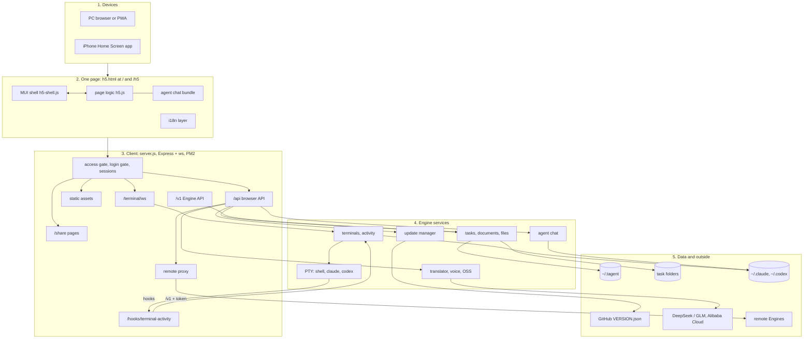
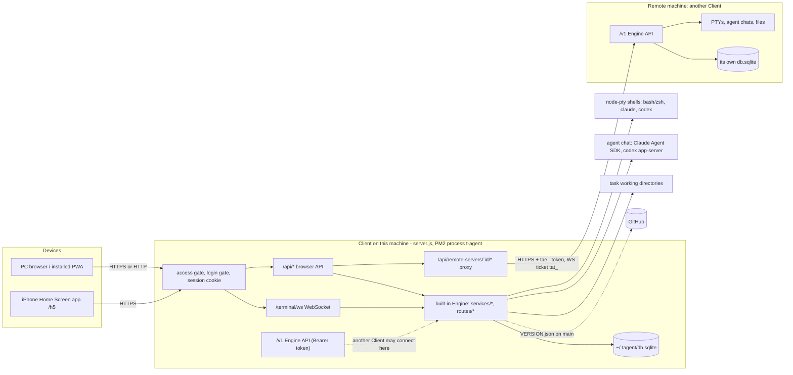

# System architecture and functionality

> Part of the T-Agent design document. The index of all parts is [DESIGN.md](../../DESIGN.md).

> The map of the whole system as it is now (2.88.x: one Material UI page at `/` and `/h5`, data in `~/.tagent`; the diagrams were checked against the code on 2026-11-07). The other files of `docs/design/` hold the details of each area.

Contents of this part:

- Overview diagram
- A. Purpose and users
- B. Deployment topology
- C. Server modules
- D. Data storage (and "Data directory"): in [architecture-data.md](architecture-data.md)
- E. Data model and core concepts (with "Terminal start directory" and "Task rename"): in [architecture-data.md](architecture-data.md)
- F. Client UI (after "T-Attention" and "Mind maps"): in [architecture-features-and-page.md](architecture-features-and-page.md)
- G. The page: routes, layout and input mode: in [architecture-features-and-page.md](architecture-features-and-page.md)
- H. Cross-cutting rules: in [DESIGN.md](../../DESIGN.md)

## Overview diagram

The whole project in five layers, from the device to the data. Part B shows how Clients connect to each other; the second diagram shows how a terminal and an agent chat move data.

- **Devices**: a PC browser (or the installed PWA) and the iPhone Home Screen app open the same page. There is no second page any more (the old PC page and Monaco were removed in 2.88.0).
- **Page** (`public/h5.html`): the React / MUI shell `scripts/h5-shell/*` (built to `public/js/h5-shell.js`, an ES module, and its chunks in `public/js/chunks/`: TaskDrawer, terminal bottom bar and on-screen keyboard, Update at start; Settings with Engines, the T-Attention panel, the Design sheet and file viewer, and the file tree as chunks loaded when first opened) draws the UI; `public/js/h5.js` does the work (xterm.js terminals, warm connections, translate-and-send, voice, image upload, activity stream). They talk through the `window.H5UI` store. The agent chat bundle is `public/js/agent-chat-ui.js`; the i18n layer is `i18n.js` plus the Chinese dictionaries.
- **Client** (`server.js`, Express + `ws`, PM2 process `t-agent`): every request passes the access gate, the login gate and the SQLite session. Static files get content-hash URLs and brotli copies (`lib/static-assets.js`). The page uses `/api` and `/terminal/ws`; `/share/:token` serves read-only Markdown.
- **Engine services** live in the same process (`routes/*`, `services/*`, `lib/*`): terminals in `node-pty` with activity tracking, live directory and agent session binding (`routes/terminal.js`); agent chat through the Claude Agent SDK and `codex app-server`; tasks, groups, documents and files; the translator, voice token and OSS upload policy; the update manager.
- **Hooks**: Claude / Codex in a terminal report start, stop and `SessionStart` to `POST /hooks/terminal-activity` with the per-terminal `TA_HOOK_TOKEN`.
- **Data**: `~/.tagent` holds `db.sqlite`, `session-secret` and `server.lock` (see "Data directory"); task folders hold the user's files; `~/.claude` and `~/.codex` session files are read for names, sub-agents and resume.
- **Outside services**: GitHub `VERSION.json` on `main` for updates; DeepSeek or Zhipu GLM for translation; Alibaba Cloud OSS (images) and Fun-ASR (voice), which the browser calls directly after the Client signs the request.
- **Remote Engines**: the remote proxy `/api/remote-servers/:id/*` calls another Client's `/v1` with a `tae_` token (terminals with a one-time `tat_` ticket). Other Clients call this Client's `/v1` the same way.

```mermaid
flowchart TB
    subgraph Browser["Browser page"]
      View["terminal view, xterm.js"]
      Drawer["TaskDrawer status dots"]
      ChatView["agent chat view"]
    end
    subgraph Server["Client server.js"]
      WS["/terminal/ws"]
      Hook["/hooks/terminal-activity"]
      Act["activity: idle, running, done"]
      Names["agent sessions: titles, sub-agents"]
      Stream["activity stream, SSE"]
      Ack["terminal ack"]
      ChatAPI["agent chat API and service"]
    end
    subgraph Machine["This machine"]
      PTY["node-pty shell"]
      CLI["claude or codex CLI"]
      SDK["Claude Agent SDK, codex app-server"]
      Jsonl[("~/.claude, ~/.codex sessions")]
      DB[("db.sqlite")]
    end
    View <-->|"1. keys, output"| WS
    WS <-->|"2. PTY data"| PTY
    PTY -->|"3. runs"| CLI
    CLI -->|"4. hook reports"| Hook
    Hook --> Act
    Hook -->|"SessionStart: rebind (not on /clear)"| DB
    CLI -->|"writes"| Jsonl
    Jsonl --> Names
    Act --> Stream
    Names --> Stream
    Stream -->|"5. states, counts"| Drawer
    Drawer -->|"6. opened"| Ack
    Ack --> Act
    ChatView <-->|"messages, events SSE"| ChatAPI
    ChatAPI --> SDK
    SDK --> Jsonl
    ChatAPI --> DB
```

- **1–2**: the terminal view sends keys over `/terminal/ws` (protocol v2, one owner per terminal); `handleWs` writes them to the PTY and sends output (and the in-memory history on reconnect) back.
- **3**: the shell runs `claude --session-id` / `--resume` or `codex` / `codex resume` for agent terminals.
- **4**: the CLI hooks post to `/hooks/terminal-activity`; activity events change the state (`idle`, `running`, `done`), and the Claude `SessionStart` hook rebinds the terminal to the session it runs after `/resume` (`task_terminals.agent_session_id`); after `/clear` the binding stays and only the live shell remembers the new id. Without hooks, the state comes from the foreground process and output bursts.
- **5**: `GET /api/tasks/terminal-activity/stream` (SSE) pushes the states and the running sub-agent counts, which `lib/agent-sessions.js` reads from the session log files; the TaskDrawer shows them as dots.
- **6**: opening a terminal that is `done` posts `POST /api/tasks/:id/terminal/ack`, which turns it back to `idle`.
- **Agent chat**: the chat view uses `/api/tasks/:id/agent/conversations` (REST plus an events SSE stream); `services/agent-chat.js` drives the Claude Agent SDK or `codex app-server` and stores the conversation in `agent_conversations`.
- For a remote Engine, the same calls go through `/api/remote-servers/:id/...` and the remote `/v1`.

## A. Purpose and users

T-Agent is a self-hosted, single-user web workbench for running and watching coding agents and terminals on one or more machines. One person installs a **Client** on each machine they work on. In a browser on a PC, or from the iPhone Home Screen app, they open tasks (a task is a working directory), start shells and Claude Code / Codex sessions in real PTYs, chat with Claude / Codex through the agent chat view, see which terminals are running or finished, and type into terminals with helpers (Chinese-to-English translate-and-send, voice input, image upload). Every Client also contains an **Engine**, so one Client can show and drive the tasks and terminals of other machines (see `README.md` "Project architecture", `docs/ARCHITECTURE.md`).

## B. Deployment topology

- **Client** (`server.js`): one Express + `ws` process. It serves the pages, the browser API under `/api`, the browser terminal WebSocket `/terminal/ws`, the hook endpoint `POST /hooks/terminal-activity`, the share pages `/share/:token`, and the Engine API `/v1`. The browser only ever talks to its own Client.
- **Engine**: the part that owns tasks, documents, terminals and chats. The local Engine is the same process (`routes/tasks.js`, `routes/terminal.js`, `services/*`). A remote Engine is another Client reached over `/v1` (`routes/engine-v1.js`; contract in `docs/ENGINE_API.md`). There is no standalone Engine service any more (removed in v2.28, see the v2.28.2 note).
- **Remote proxy**: `routes/remote-servers.js` mounts `/api/remote-servers/:id/...`. The Client decrypts the stored token (`lib/token-crypto.js`, key from `SESSION_SECRET`) and calls the Engine; the token never reaches the browser. JSON calls are forwarded, SSE streams are piped unbuffered (`services/remote-stream.js`), and terminals go through `services/remote-terminal-proxy.js`: the Client asks `POST /v1/terminal-sessions` for a one-time ticket (`tat_…`, 30 s) and opens `/v1/terminal-sessions/:id/stream?ticket=…`. The browser side of that is `/api/remote-servers/:id/terminal/ws`.
- **Pairing and tokens**: on the Engine, `POST /api/remote-tokens/pairing` makes a one-time pairing code `TA-XXXX-XXXX-XXXX` (10 minutes) or `POST /api/remote-tokens` an access token `tae_…` (stored as a SHA-256 hash in `engine_access_tokens`). On the Client, `POST /api/remote-servers` with the address and the code calls the Engine's rate-limited `POST /v1/pair`, gets a token, checks `GET /v1/info` and stores the token encrypted in `remote_servers.token_cipher`. Every token is admin (`services/engine-auth.js`).
- **Access mode** (`services/client-auth.js`, `lib/access-gate.js`, table `client_access_mode`): `local` = only direct loopback access, no login; `remote` = TOTP authenticator and external access; `unset` = choose on first local visit. Non-local requests in `local` / `unset` get 404.
- **Login gate** (`lib/login-gate.js`): when logged out, a GET of exactly `/`, `/web` or `/h5` redirects to the hidden login path (`CLIENT_LOGIN_PATH`, default `/torin/hide/login`) with `return_to`; everything else is a plain 404, except the login entrance, `/v1`, `/api/remote/v1`, `/health`, `/share/*` and the hook endpoint. Sessions are SQLite sessions (`db/session-store.js`) with a rolling 30-day life.
- **Process and listening**: `install.sh` starts the Client under PM2 with the name `t-agent` (launchd / systemd are still supported, `README.md` "Service management"). PM2 never trims its logs, so for a service it newly registers in PM2 `install.sh` also sets up PM2's `pm2-logrotate` module (`max_size 10M`, `retain 5`) when the module is not installed yet: after the service is started and saved, never fatal, and an existing module keeps its settings. An existing install is not changed by an update; the command is in `README.md` ("PM2 log rotation"). `config.js` defaults `HOST` to `127.0.0.1`; a fresh install writes `HOST=0.0.0.0` to `.env` unless `--access-mode local`.
- **Update flow** (`services/update-manager.js`, `lib/update-impact.js`, `routes/system.js`): the runtime version is `VERSION.json` in the install directory. `POST /api/system/check-update` reads `VERSION.json` of `main` on GitHub (`lib/version-utils.js` only allows `raw.githubusercontent.com` / `api.github.com`) and answers `available`, `current`, `local_newer` or `restart_pending` (the code on disk is newer than the running process). `POST /api/system/apply-update` does a Git fast-forward (optional force with a stash backup) or an archive update, installs and builds when needed, then exits with code 75 so PM2 (or launchd / systemd) restarts it; a frontend-only change skips the restart. `GET /api/system/update-status` gives the stage, log lines and `boot_id`, which the page uses to reload when the new process is up. `POST /api/system/restart` restarts the service with no update (see "Restart without an update" under "Update check and versions"). Remote Engines are updated through `/api/remote-servers/:id/check-update|apply-update|update-status` (`services/remote-engine-updates.js`).

## C. Server modules

One line each for the main modules, by area. Each route file is mounted in `server.js` (browser API) and, where the feature exists remotely, has a twin in `routes/engine-v1.js` and a proxy in `routes/remote-servers.js`.

**Entry and auth**

- `server.js` — Express app, gates, page routes (`sendClientPage` names `/js`, `/css` and `/vendor` scripts and styles `?v=<content hash>`, leaves the Chinese dictionaries out for English readers and adds the login-path meta tag), static files (see "Static asset caching"), share pages, WebSocket upgrade routing.
- `lib/static-assets.js` — content-hash asset URLs, the long cache for a matching hash (`no-cache` otherwise), the hashes of lazily loaded files for the page (`window.TAAsset`), one combined request for each run of small page scripts, brotli / gzip copies of scripts and styles made once in memory.
- `config.js` — `.env` settings (port, host, access mode, login path, cookie name, session secret).
- `routes/auth.js`, `services/client-auth.js` — TOTP binding and login, access mode, recovery codes, rate limits; `services/single-user.js` builds the single local user.
- `lib/access-gate.js`, `lib/login-gate.js`, `lib/client-embedding.js` — the gates above and the frame-ancestors / cookie SameSite rules.
- `middleware/auth.js`, `middleware/client-origin.js` (same-origin proof for browser mutations), `middleware/engine-auth.js` (Bearer token scopes for `/v1`), `middleware/remote-auth.js` (old `/api/remote/v1`).

**Tasks and groups**

- `routes/tasks.js` — task CRUD, reorder, validate-path, documents (`/document/:kind`, watch SSE), to-dos, share, reveal, vscode, workspace tools, terminals, activity, sub-agents, ack, agent sessions; mounts the files API.
- `routes/task-groups.js`, `services/task-groups.js` — groups (system groups `doing` / `todo` / `done` plus user groups).
- `services/task-documents.js`, `services/engine-tasks.js`, `services/task-assets.js` — document paths (`DESIGN.md`, `README.md`, `AGENTS.md` + `CLAUDE.md` with `@AGENTS.md`), creating missing documents, relative assets.
- `services/workspace-tools.js` — import unmanaged directories under `TASKS_BASE_DIR`, clean up and restore code directories (`repo_cleanups`).

**Terminals, PTY and activity**

- `routes/terminal.js` — PTY sessions keyed by task and terminal id (`node-pty`, `lib/node-pty-runtime.js`), WebSocket `handleWs` with protocol v2 (heartbeat, flow control; client side `public/js/terminal-protocol.js`), single owner per terminal (close codes 4009 / 4010, `takeover=1`), in-memory history replay, `cleanTitle`, agent terminals (`claude --session-id` / `--resume`, `codex resume`), `subagentSnapshot`, hook token per PTY, the per-process Claude `SessionStart` hook that rebinds a terminal after `/resume` and records the live session after `/clear` (`scripts/claude-session-hook.js`).
- `lib/terminal-activity.js` — state per terminal: `idle` → `running` → `done` (until acknowledged) → `idle`. Decided by the foreground process, by output bursts for agents and TUIs, and by Claude / Codex hooks when they report. `GET /api/tasks/terminal-activity` reads it, `GET /api/tasks/terminal-activity/stream` pushes it with the sub-agent counts (`lib/terminal-activity-stream.js`, server-sent events), `POST /api/tasks/:id/terminal/ack { terminal_id }` turns `done` into `idle`.
- `lib/terminal-snapshot.js` (headless xterm with the vendored Unicode 11 addon), `lib/terminal-history.js`, `lib/terminal-input-modes.js` (reset mouse modes on restore), `lib/terminal-locale.js`, `lib/terminal-user.js` (drop root), `lib/clipboard-shims.js` (shim folder first in PTY `PATH`, see "Clipboard (OSC 52)"), `lib/websocket-close.js`, `services/terminal-tickets.js`.

**Agent sessions and sub-agents**

- `lib/agent-sessions.js` — lists Claude (`~/.claude/projects/<dir>/*.jsonl`) and Codex (`~/.codex/sessions/**/rollout-*.jsonl`) sessions of a directory, session names, and `runningSubagents` (Claude sub-agent logs under `<session>/subagents/agent-*.jsonl`).
- `GET /api/tasks/terminal-subagents` (Engine `/v1/terminal-subagents`, proxy `/api/remote-servers/:id/terminal-subagents`) — read-only count of running sub-agents per Claude terminal; used by the phone "next running or pending session" button.

**Agent chat**

- `routes/agent-chat.js`, `services/agent-chat.js` — chat conversations of a task (`/api/tasks/:id/agent/conversations…`: create, events SSE, messages, interrupt, permissions, queue, fork, commands, models, limits) and `/api/agent-chat/summary` (top-bar counters).
- `lib/agent-chat/claude.js` (Claude Agent SDK adapter), `lib/agent-chat/codex.js` + `codex-app-server.js` (JSON-RPC to `codex app-server`), `lib/agent-chat/fork-point.js`.
- Browser bundle: `scripts/agent-chat/*` → `public/js/agent-chat-ui.js` (`npm run build:agent-chat`, the same build as the shell: `scripts/build-page-bundles.js`; React and highlight.js come from shared chunks), host glue `public/js/agent-chat.js`. Details: "Agent chat mode (v2.72.0)".

**T-Attention** (see "T-Attention" below)

- `services/attention.js` — items, events and tokens of the central attention list (validation, status rules, `onChange` bus); `routes/attention.js` — `/api/attention` for the browser session and for `Bearer tatt_…` tokens (the Bearer handler is mounted in `server.js` before the session and the gates).

**Mind maps** (see "Mind maps" below)

- `services/mindmap.js` — maps as JSON files in the data folder (one shared instance, `getMindmapService`); `routes/mindmap.js` — `/api/mindmaps` for the browser session and `/v1/mindmaps` for connected services (mounted in `routes/engine-v1.js`); the proxy `/api/remote-servers/:id/mindmaps` is in `routes/remote-servers.js`.

**Files API and safety**

- `routes/task-files.js`, `services/task-files.js` — `/api/tasks/:id/files` (list, create, rename, delete), `/files/content` (read, write), `/files/image` (an image, 20 MiB) and `/files/raw` (a PDF, audio or video file, streamed with Range support). Rules: paths are relative to the task root (`work_dir`, else the folder of `md_path`); absolute paths, `..`, backslashes and NUL are refused; symbolic links are never followed (`O_NOFOLLOW`, `lstat`, identity checks before and after); text at most 5 MiB of UTF-8; the root itself cannot be deleted. Engine scopes `files:read` / `files:write`.
- `services/file-content.js` — the content rules shared by the files API and the preview of any path: text is at most 5 MiB of UTF-8 without control characters (answer `{ path, content, revision, eol, bom }`), images are PNG, JPEG, GIF, WebP, SVG, BMP, ICO or AVIF by name and by content (at most 20 MiB; sniffing: PNG/JPEG/GIF/WebP signatures, `BM`, `00 00 01 00`, an `ftyp` box with the brand `avif` / `avis`, and for SVG text that starts, after an optional BOM, white space, an XML declaration, comments and a doctype, with `<svg`) with `Content-Security-Policy: sandbox`, `nosniff` and `private, no-cache` (an SVG is shown by the page only through ``, so its scripts never run); raw files (PDF, audio, video) by name and signature, see "Raw files" below.
- **Raw files** (capability `files:raw` in `/v1/info`, API version still 1): `GET <task>/files/raw?path=` (local `/api/tasks/:id/files/raw`, Engine `/v1/tasks/:id/files/raw` with scope `files:read`, proxy `/api/remote-servers/:id/tasks/:taskId/files/raw`; the task file path rules, `?terminal=` as for the other reads) and `GET /api/fs/raw?path=` / `/v1/fs/raw` / `/api/remote-servers/:id/fs/raw` (any path, as the terminal user, regular files only, as `/fs/content`). Only these names (case-insensitive): pdf `application/pdf`; mp3 `audio/mpeg`, m4a `audio/mp4`, aac `audio/aac`, wav `audio/wav`, ogg / oga / opus `audio/ogg`, flac `audio/flac`; mp4 / m4v `video/mp4`, mov `video/quicktime`, webm `video/webm`, ogv `video/ogg`. The first bytes must match: `%PDF-`; `ftyp` at offset 4 (mp4, m4v, m4a, mov); `1A 45 DF A3` (webm); `OggS`; `RIFF....WAVE`; `fLaC`; mp3 `ID3` or a frame sync `FF Ex/Fx`; aac `ID3` or ADTS `FFF1` / `FFF9`. Anything else (another name, wrong signature, an empty file) is 415 `FILE_UNSUPPORTED`; above 200 MiB 413 `FILE_TOO_LARGE`. One `Range: bytes=a-b` / `a-` / `-n` range answers 206 with `Content-Range`; a malformed or out-of-file range answers 416 `RANGE_NOT_SATISFIABLE` with `Content-Range: bytes */<size>`; another unit or several ranges are ignored (200, the whole file). `HEAD` sends the headers only. The file is streamed from an open descriptor (never buffered). Headers: the Content-Type above, `Content-Length`, `Accept-Ranges: bytes`, `X-Content-Type-Options: nosniff`, `Cache-Control: private, no-cache`, `Content-Disposition: inline`, and `Content-Security-Policy: sandbox` for audio and video. A PDF has no CSP sandbox, because Chrome does not show a sandboxed PDF in its viewer; the proxy (`streamRemote` with `raw: true` in `services/remote-stream.js`) keeps the sandbox on everything except an answer whose media type is exactly `application/pdf`, sends the `Range` header on, passes `Content-Range`, `Accept-Ranges`, `Content-Disposition` and `Cache-Control` back, and has no idle limit once the answer has started (a paused video is not cut). The proxy answers 501 `RAW_UNSUPPORTED` for an Engine whose `/v1/info` lacks `files:raw`; the local Client always has it. Tests: `test/task-files-api.test.js`, `test/fs-read.test.js`.
- `routes/fs-read.js`, `services/fs-read.js`, `scripts/fs-read-child.js` — read-only preview of a file at any path on the Engine machine; see "Preview of any path" below.

**Preview of any path** (read only; the user already has a shell on that machine)

- Endpoints: local `GET /api/fs/content?path=` and `/api/fs/image?path=` (browser session, the same gates as the other `/api` GETs); Engine `GET /v1/fs/content` and `/v1/fs/image` (scope `files:read`, capability `fs:read-any` in `/v1/info`); proxy `GET /api/remote-servers/:id/fs/content` and `/fs/image` (piped unbuffered with the Engine's status and error body; `Content-Security-Policy: sandbox` like every remote file answer; an Engine without `fs:read-any` gets 501 `FS_READ_UNSUPPORTED`). `GET /fs/raw` on the three mounts streams a PDF, audio or video file (capability `files:raw`, 501 `RAW_UNSUPPORTED` through the proxy without it; see "Raw files" above). The local Client always has it (the page treats local as supporting it). Writes, renames and deletes stay in the task files API, limited to the task root.
- Paths: an absolute path, or `~` / `~/...` (the terminal user's home on the Engine); anything else (relative, `~user`, empty, NUL, a repeated parameter) is 400 `BAD_PATH`. The path is normalized (`.`, `..`, trailing `/`); there is no root limit and symbolic links are followed. The answer names `path` (the normalized path asked for) and `realPath`.
- Files: regular files only, checked after following links: a folder is 400 `IS_DIRECTORY` with `{ path }`; FIFOs, sockets and devices (`/dev/zero`) are 400 `NOT_A_REGULAR_FILE`, and so are empty files under `/proc` and `/sys` (they are generated when read and may never end). The file is opened with `O_NONBLOCK` and checked again with `fstat` (still a regular file, same device and inode, else 409 `FILE_PATH_CHANGED`), so a read never waits for a writer. Text and image rules and answers are those of `GET <task>/files/content` and `/files/image` (413 `FILE_TOO_LARGE`, 415 `FILE_UNSUPPORTED` / `FILE_NOT_IMAGE`); 404 `NOT_FOUND`, 403 `PERMISSION_DENIED` (EACCES / EPERM); a read gives up after 10 s (504 `READ_TIMEOUT`). Errors are `{ error, message }` with an English message (Chinese in `public/js/i18n-zh-server.js`).
- Raw files at any path (`GET /fs/raw`, see "Raw files" above): the same file checks, then the signature; errors are `{ error, message }` with `This file type cannot be shown` (415) and `The file is larger than 200 MB` (413), an image above 20 MiB says `The image is larger than 20 MB`. The 10 s limit covers the checks up to the first byte; the stream itself has no time limit and is stopped when the answer closes. As a dropped terminal user the child runs `fs-read-child.js raw <path> <Range header or ''> <head|body>`: it writes one JSON line `{ realPath, size, range, head }` (`head` is the first 16 bytes in base64) or `{ error }`, then exactly the bytes of the range, streamed from its descriptor to its stdout. The parent (`spawnStreamRunner`) waits at most 10 s for that line, checks the size limit, the signature from `head` and that its own `parseRange` gives the same range, then pipes the rest through a counter that fails the stream when the child sends more or fewer bytes than the range (the answer is cut off instead of wrong); closing the answer kills the child.
- Identity: the read is done as the terminal user. When the service runs as root and drops terminals to `TERMINAL_USER` (`lib/terminal-user.js`), the Engine spawns `node scripts/fs-read-child.js <text|image> <path>` with that user's uid / gid, `HOME`, `USER` and a minimal environment (no service secrets), cwd `/`; the child does the same checks and writes one JSON line (`{ realPath, length }` or `{ error }`) and the bytes; the parent caps the output at the limit of the kind (5 MiB of text, 20 MiB of image) plus a little, kills it after 10 s, and applies the text / image rules itself. Otherwise (not root, no drop) the file is read in the service process, which is then also the terminal's user. Limits: node's spawn drops supplementary groups, so a file readable only through one of the terminal user's other groups is refused (403); the dropped user must be able to run the service's `node` and read the script (as for the Claude session hook). Regression: `test/fs-read.test.js` (the dropped path with an injected runner and with the real child under the test's own uid), `test/task-parity.test.js`.

**Input helpers**

- `routes/translate.js`, `services/translator.js` — `POST /api/translate` with DeepSeek or Zhipu GLM; up to 100,000 characters, split into pieces of at most 4,000 at line or sentence ends (`splitForTranslation`), pieces without Chinese kept as they are; each piece keeps its lines (`translatePiece`: the prompt asks for the same lines, and an answer with another line count or moved blank lines is translated again line by line, lines without Chinese kept exactly); `POST /api/translate/word`. Config is per user, encrypted in `system_state`.
- `routes/speech.js`, `services/speech.js` — voice input: the server only mints a 60-second Alibaba Cloud token (`POST /api/speech/token`); audio goes from the browser straight to Fun-ASR (`public/js/voice-input.js`).
- `routes/oss.js`, `services/oss-images.js` — image upload: `POST /api/oss/upload-policy` signs a POST policy and the browser uploads to Alibaba Cloud OSS itself (`public/js/oss-direct.js`).
- `services/attention-notify.js`, `plugins/notifiers/*` — T-Attention notifiers (Telegram message / call when an item needs the user), mounted at `/api/attention-notify`; see "T-Attention notifiers".

**Share pages**

- `GET /share/:token` and `/share/:token/file` in `server.js` — read-only Markdown of a task (`tasks.share_token`, created by `POST /api/tasks/:id/share`), only `.md` files under the folder of `md_path`.

**Machine tools** (local, and remote through `/v1` and the proxy where noted)

- PM2 and apps: `routes/pm2.js`, `services/pm2-manager.js` (status, logs, start / stop / restart / reload only), `routes/apps.js`, `services/apps-registry.js`, `services/apps-service.js`, `services/port-detector.js` (table `apps`; remote: `/v1/pm2`, `/v1/apps`).
- Tunnels: `routes/frp.js`, `services/frp.js`, `services/frp-install.js`; `routes/ssh-tunnel.js`, `services/ssh-tunnel.js` (local only).
- File sync: `routes/file-sync.js`, `services/file-sync.js`, `services/file-sync-instance.js` (master / slave, `/v1/file-sync/*`, state in `system_state.file_sync_v1`). A tick (every 3 s) with nothing new does no work:
  - A master with an empty list and a slave that is not paired return at once.
  - Master: each listed file is `lstat`-ed and read + hashed only when its stat (size, mtime, ctime, inode) changed since the last read, or when that read came less than 2.5 s after the file's last change (coarse timestamps could hide a second change).
  - State: `save()` writes only when the state differs from the stored row. The clocks (`lastSyncAt`, the children's `lastSeenAt` / `lastSyncAt`) are kept in memory, read from there by the API and the heartbeat, and stored alone at most once a minute.
  - Markers (`<file>.t-agent-file-sync-managed`): `scripts/agent-sync.py` trusts a marker changed less than 60 s ago, so the marker's time is part of the contract. It is written when missing or wrong; otherwise only its time is renewed (`utimes`) once it is 20 s old.
  - Slave: every manifest carries `etag` (generation + per file its revision and hash, or missing). While the stats of the local copies are the ones the last full round saw, the slave asks `GET /v1/file-sync/manifest?if_none_match=<etag>` and gets `{ unchanged: true }` without contents. Anything else is a full round as before. A master from before the parameter ignores it and sends the full manifest; once its answers stopped changing, the timer asks such a master every 15 s only (a local change is still sent at the next tick, `POST /run` always asks). The heartbeat stays in every round.
  - Errors: the error of a round stays in the state for the API; it is stored and logged (`[file-sync] error: …`) once per distinct error, and once more when it is over.
- Agent config: `routes/agent-config.js`, `services/agent-config.js` (default Claude / Codex settings pushed to this and remote machines, `/v1/agent-config`).
- Environment check: `routes/environment.js`, `services/environment-check.js`.
- Bookmarks (quick links): `routes/bookmarks.js`.
- Update: `routes/system.js`, `services/update-manager.js`, `services/archive-updater.js`, `lib/git-update-workspace.js`, `lib/update-command.js`, `lib/update-impact.js`, `lib/server-restart.js`, `services/remote-engine-updates.js`.
- Remote connections: `routes/remote-servers.js`, `services/remote-client.js`, `services/remote-server-settings.js`, `routes/remote-tokens.js`, `services/engine-identity.js` (stable `engine_id`), `routes/remote-api.js` (old read-only `/api/remote/v1`).
