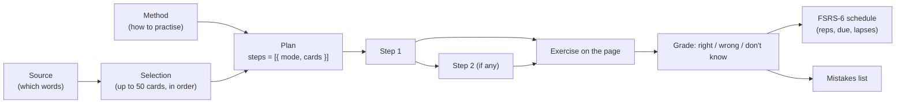
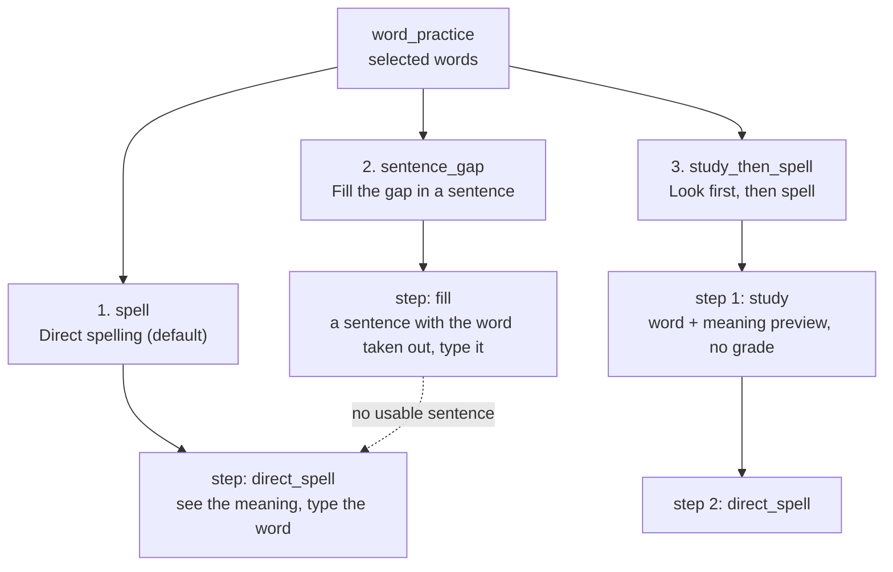
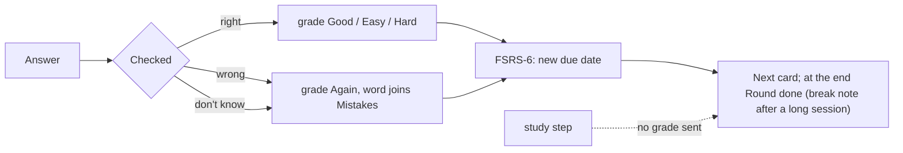

# Learn English: the practice approach

> Part of the T-Agent design document. The index of all parts is [DESIGN.md](../../DESIGN.md). This file is the one-page map of how a word is
> practised, drawn from the code (`services/learn-plan.js`, `services/learn-merge.js`, `scripts/h5-shell/learn-model.mjs`, `Learn.jsx`). The
> details are in [learn-english-coach.md](learn-english-coach.md) ("Practice plans"), [learn-spell-practice.md](learn-spell-practice.md),
> [learn-review-fsrs.md](learn-review-fsrs.md) and [learn-english-page.md](learn-english-page.md). Edit the diagrams and the tables here first, then the code.

## How a practice is made

Word practice is two independent choices: **which words** (a source) and **how to practise them** (a method). The coach (or a preset) picks both; the page runs the steps; every graded answer goes to the same FSRS schedule.

## Sources: which words

| Source | Words chosen |
|---|---|
| `today` | Due reviewed words first, then today's new words (capped by the daily new-word allowance) |
| `due` | Reviewed words that are due now |
| `reviewed` | Free practice from reviewed words, least recently seen first |
| `new` | New words (never answered), capped by the allowance left today |
| `highest_error_rate` | Words with the highest share of wrong answers (count and recency break ties) |
| `selected` | Exact words or card ids; a read-only query returning one `id` column |

## Methods: how to practise (the word practice list)

| # | Method | Steps (modes) | What the person does | Notes |
|---|---|---|---|---|
| 1 | `spell` Direct spelling (default) | `direct_spell` | Sees the meaning, spells the word in letter boxes grouped by syllable | |
| 2 | `sentence_gap` Fill the gap | `fill` | Sees a sentence with the word taken out, spells the word | Needs a sentence with exactly one occurrence of the word (its own example sentence, or one the coach supplies and the server checks). A word with none is spelled directly (shown in the proposal as "plain") |
| 3 | `study_then_spell` Look first, then spell | `study`, `direct_spell` | Looks at the word and meaning, then spells it | The study step sends no grades |

Adding a method: add its name to `WORD_METHODS` (`services/learn-merge.js`), map it to modes in `buildWordPlan` (`services/learn-plan.js`), give each new mode a time estimate in `SECONDS`, a title in `SERIES_TITLES` and an exercise in `Learn.jsx`, then describe it for the coach prompt.

## Preset plans (the older coach cards and the Learn buttons)

| Plan | Steps | Cards |
|---|---|---|
| `today_spelling` | `spell` | Due words, then today's new words; words now in Mistakes first |
| `review` | `spell` | Due word cards |
| `more_new_words` | `spell` | The next 5 new words; the allowance is raised once, at Start |
| `mistakes_series` | `spell`, `retest` | Mistake words, most often wrong first; then a retest of the ones missed in the series |
| `dictation` | `dictation` | Sentence cards from the dictation queue (needs speech output) |
| `fill_gap` | `fill` | Sentence cards from the fill queue |

## Exercises (what each mode shows)

| Mode | Exercise on the page | Used by |
|---|---|---|
| `spell` / `direct_spell` | Meaning shown; spell the word in letter boxes (syllable groups), page keyboard; after each answer "Type it yourself" practice row | Direct spelling, review, mistakes, new words |
| `fill` | Sentence with a gap; a word card without a usable sentence falls back to `spell` | Fill the gap |
| `study` | Word and meaning preview, no grade | Look first, then spell |
| `retest` | Short final spell of the series' missed words | Mistakes series |
| `dictation` | Hear the sentence, type it | Sentence cards (needs speech) |
| `say` | Say the sentence aloud (needs a microphone) | Sentence cards |
| `build` | Word tiles to build the sentence (hidden: `BUILD_HIDDEN`) | Not offered now |

A word whose spelling keeps failing (a leech) gets the same spelling in parts (`PartsExercise`) instead of the plain letter boxes.

## What every answer does

## Ideas to add (draft, not built)

Write new practice methods here, one row each: name, steps, what the person does, what it needs.

| Method | Steps | What the person does | Needs |
|---|---|---|---|
| | | | |
